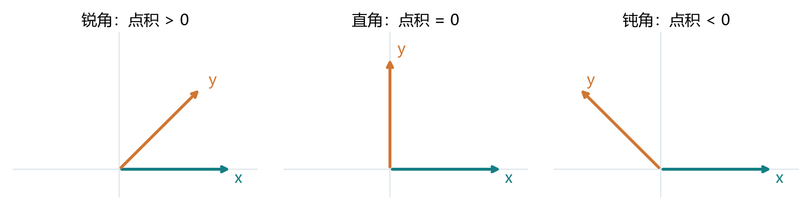
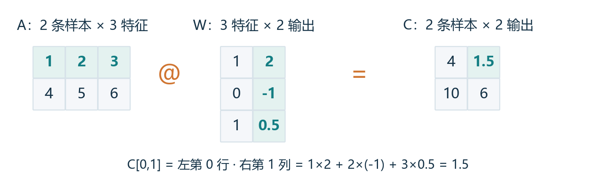
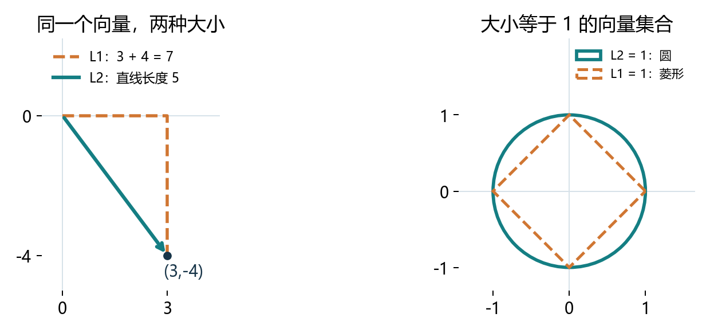

# 2.3 线性代数：从一条样本到一批预测

教材定位：用户提供的《动手学深度学习》Release 2.0.0，PDF 第 68-81 页，正文第 50-63 页，含节末练习。按完整一节学习，先贯通原理，再运行整节演示，最后集中完成综合实践。2.1、2.2 未提交的练习仍待验证，不影响继续。

## 这节到底解决什么问题

2.1 解决“数据怎样存和操作”，2.2 解决“原始表怎样变成数值”。2.3 接着回答：怎样把多个特征合成预测，怎样一次计算多条样本，怎样用一个数表示误差有多大？

本节主线是 **数据矩阵 X → 与权重相乘 → 预测 → 误差 → 大小度量**。这些计算是后面线性回归、神经网络层的基础。本节只计算，参数先人为给定；如何根据误差更新参数，要结合后面的微积分与自动微分。

已经会的创建与 reshape 快速通过，重点放在运算的含义与形状：

| 对象 | PyTorch 形状示例 | 现实含义 |
| --- | --- | --- |
| 标量 | `()`，0 个轴 | 一个温度、一个损失值 |
| 向量 | `(3,)`，1 个轴 | 一条样本的三个特征 |
| 矩阵 | `(4,3)`，2 个轴 | 四条样本，每条三个特征 |
| 高阶张量 | `(2,3,4)`，3 个轴 | 两组 3×4 数据 |

数学记号 `x ∈ R^d` 表示“x 是由 d 个实数组成的向量”；`A ∈ R^(m×n)` 表示“m 行 n 列实数矩阵”。R 在这里代表实数集合，∈ 读作“属于”。

<!-- pagebreak -->

## 1. 维度、轴、形状：同一个词的不同意思

“三维向量”指有三个分量；它在 PyTorch 中却是只有一个轴的张量。`ndim` 数轴，`shape` 列出各轴长度，`numel()` 数全部元素。张量的轴数也不要与后面可能学到的“矩阵的秩”混为一谈。

```python
import torch
x = torch.tensor([1., 2., 3.])
T = torch.arange(24).reshape(2, 3, 4)
print(x.ndim, x.shape, x.numel())  # 1, (3,), 3
print(T.ndim, T.shape, T.numel())  # 3, (2,3,4), 24
print(len(T))                     # 2：第 0 轴长度
```

标量 `torch.tensor(3.)` 没有第 0 轴，不能调用 `len()`。`torch.tensor([3.])` 有一个轴，形状是 `(1,)`，即使都只含一个数，形状也不同。

数学书常默认向量是列向量；PyTorch 的 `(d,)` 不自带行列方向。需要显式表示时用 `(1,d)` 行向量、`(d,1)` 列向量。不要用一维张量的 `.T` 来制造列向量，应使用 `reshape(-1,1)`。

## 2. 转置：交换行和列

若 B 是 A 的转置，则 `B[i,j] = A[j,i]`。因此 `(m,n)` 变为 `(n,m)`。这是对应位置关系的交换，和按原有顺序重新分组的 reshape 不同：

```python
A = torch.tensor([[1., 2., 3.], [4., 5., 6.]])
print(A.T)             # [[1,4], [2,5], [3,6]]
print(A.reshape(3, 2)) # [[1,2], [3,4], [5,6]]
```

**对称矩阵**是等于自己转置的方阵，例如 `[[1,2],[2,4]]`。主对角线两边像镜像。代码用 `torch.equal(S, S.T)` 检查整个条件；`S == S.T` 得到的是逐元素布尔矩阵。

本节 `.T` 只用于二维矩阵；高阶张量交换指定两个轴用 `T.transpose(1,2)`，形状 `(2,3,4)` 变为 `(2,4,3)`。

<!-- pagebreak -->

## 3. 按元素运算：各位置独立计算

形状相同的 A、B 相加或相乘，分别计算对应位置。`A * B` 叫 Hadamard 积，不会把一整行合成一个结果。乘标量则缩放每一个分量，形状仍相同。

```python
A = torch.tensor([[1., 2., 3.], [4., 5., 6.]])
B = A.clone()
print(A + B)  # 每个元素变成原来的 2 倍
print(A * B)  # 每个元素平方，形状仍是 (2,3)
print(2 * A)  # 缩放每个元素
```

## 4. 求和与均值：把指定轴汇总掉

Σ 表示把一组数加起来。`A.sum()` 汇总所有元素，输出标量；`A.mean()` 是所有元素和除以元素数。对下面这个 2×3 矩阵，总和 21，均值 3.5。

```text
A = [[1, 2, 3],
     [4, 5, 6]]

dim=0：改变行索引，跨行相加 -> [5, 7, 9]
dim=1：改变列索引，跨列相加 -> [6, 15]
```

不要只背“按行/按列”这类容易歧义的措辞。**dim 指被汇总的轴，默认从输出形状中删除它。** 对 `(2,3)`，删第 0 轴剩 `(3,)`；删第 1 轴剩 `(2,)`。

```python
print(A.sum(dim=0), A.sum(dim=1))
print(A.mean(dim=0))  # [2.5, 3.5, 4.5]，每个特征的均值
print(A.sum(dim=(0, 1)))  # 两个轴一起汇总，与 A.sum() 相同
```

教材写 `axis`，本项目统一使用 PyTorch 的 `dim`；教材的 `keepdims` 在这里写成 `keepdim`。本节张量用 float32，避免整数张量调用 mean 的类型问题。

对于 `(2,3,4)`，沿 dim=0、1、2 求和分别得到 `(3,4)`、`(2,4)`、`(2,3)`。多个轴求和，就是同时删去那些轴。

<!-- pagebreak -->

## 5. keepdim：让汇总结果能正确广播回来

想让 A 的每行除以自己的总和，应把两个行和保存成 `(2,1)`。广播时最后一轴的 1 扩展为 3，第一行始终除以 6，第二行始终除以 15：

```python
row_sums = A.sum(dim=1, keepdim=True)  # [[6.], [15.]]
ratios = A / row_sums                 # (2,3) / (2,1)
print(ratios)
print(ratios.sum(dim=1))              # [1., 1.]
```

`keepdim=True` 保留轴的“位置”，把被汇总轴的长度变成 1；它没有保留所有原始数值。这里得到每行和为 1，与后面“L2 长度为 1”的归一化不是一回事。

若写 `A / A.sum(dim=1)`，两者为 `(2,3)` 和 `(2,)`，末轴 3 与 2 不匹配，报错。更危险的是方阵：

```python
Q = torch.tensor([[1., 3.], [2., 6.]])
print(Q / Q.sum(dim=1))
# [[0.25, 0.375], [0.50, 0.75]]：逐列除以 [4,8]
print(Q / Q.sum(dim=1, keepdim=True))
# [[0.25, 0.75], [0.25, 0.75]]：每行除以自己的和
```

**不报错不等于含义正确。** 对归一化还要检查行和是否为 0；除以 0 没有定义。只有非负元素且和为正时，上面的结果才自然解释成每个分量的占比。

### 累积和保留所有前缀

`sum` 只留下最终汇总；`cumsum` 依次保存“到当前位置为止”的和，形状不变。例如 `[1,2,3]` 的累积和是 `[1,3,6]`。

```python
print(A.cumsum(dim=0))  # [[1,2,3], [5,7,9]]
print(A.cumsum(dim=1))  # [[1,3,6], [4,9,15]]
```

<!-- pagebreak -->

## 6. 点积：多个特征怎样变成一个分数

设一条样本 x 的每个特征配一个权重 w，先计算每个特征的贡献，再把它们相加。这就是点积，要求两个向量长度相同，结果是一个标量。

<div class="equation">x<sup>T</sup>w = Σ<sub>i=1…d</sub> x<sub>i</sub>w<sub>i</sub></div>

比如三个特征 `x=[1,2,3]`，权重 `w=[2,-1,0.5]`。它们的贡献为 `[2,-2,1.5]`，合起来是 1.5。负权重表示该特征增大时，分数沿负方向变化，其他特征不变。

```python
x = torch.tensor([1., 2., 3.])
w = torch.tensor([2., -1., 0.5])
print(x * w)             # [2., -2., 1.5]
print(torch.dot(x, w))   # 1.5
print((x * w).sum())     # 1.5，同一件事
```

**加权和**不要求权重和为 1；权重非负且和为 1 时才是通常的加权平均。例如权重 `[0.2,0.3,0.5]` 得到 2.3。模型的权重一般没有这些约束，不能总把输出解释成平均值。

### 几何含义：点积也反映方向关系

非零向量满足“点积 = 两个向量的 L2 长度之积 × 夹角余弦”。同向为正，正交为 0，反向为负。原始点积还受长度影响；把每个向量除以自己的 L2 长度后，点积才直接等于余弦相似度。零向量没有定义方向或余弦相似度。



<!-- pagebreak -->

## 7. 矩阵-向量积：对每一行重复同一个点积

把 m 条样本按行堆起来，每条有 n 个特征，得到 `(m,n)` 矩阵 A。用同一个长度 n 的 w 给每行打分，就会得到 m 个分数：

<div class="equation">(Aw)<sub>i</sub> = Σ<sub>j=1…n</sub> A<sub>ij</sub>w<sub>j</sub></div>

```text
[[1,2,3],    [ 2 ]     [1*2 + 2*(-1) + 3*0.5]     [1.5]
 [4,5,6]]  × [-1 ]  =  [4*2 + 5*(-1) + 6*0.5]  =  [6.0]
             [0.5]
```

```python
scores = A @ w           # shape (2,)
same = torch.mv(A, w)    # 对应教材的写法
column_scores = A @ w.reshape(-1, 1)  # shape (2,1)
```

**特征个数必须和权重个数相同**，所以 `(m,n) @ (n,) → (m,)`。使用显式列向量时，`(m,n) @ (n,1) → (m,1)`。一维向量参与 `@` 时库会按位置作约定，不代表 `(n,)` 本身有行列方向。

### 另一种理解：矩阵是一个线性变换

A 把 n 个输入数转换成 m 个输出数。纯粹的 `f(x)=Ax` 满足加法和缩放规律：`f(x+y)=f(x)+f(y)`，`f(a*x)=a*f(x)`。矩阵不仅能给样本打分，也能表示旋转、缩放等几何操作。

```python
R = torch.tensor([[0., -1.], [1., 0.]])
v = torch.tensor([1., 0.])
print(R @ v)  # [0.,1.]，逆时针旋转 90 度
```

加偏置 `Ax+b` 在严格数学意义上是仿射变换，b 非零时不满足上述线性规律。机器学习中仍习惯把“加权和加偏置”的模型叫线性模型，知道这个命名约定即可。

<!-- pagebreak -->

## 8. 矩阵乘法：一批样本同时计算多个输出

若右侧有 p 组权重，将每一组放成 W 的一列，W 的形状就是 `(n,p)`。A 的每一行与 W 的每一列点积，就填满输出 C 的一个元素：

<div class="equation">C = AW，C<sub>ij</sub> = Σ<sub>k=1…n</sub> A<sub>ik</sub>W<sub>kj</sub></div>



```python
W = torch.tensor([[1., 2.], [0., -1.], [1., 0.5]])
C = A @ W                  # (2,3) @ (3,2) -> (2,2)
print(C)                   # [[4.,1.5], [10.,6.]]
print(torch.mm(A, W))       # 教材写法，结果相同
print(torch.dot(A[0], W[:, 1]))  # C[0,1] = 1.5
```

**中间的长度相同，输出保留外侧两个长度。** 匹配的那一轴代表“特征”：每个特征都有一个权重，沿它相乘求和。外侧是“样本数”和“输出数”。

`A * W` 是按元素乘法，要满足相同形状或广播条件；`A @ W` 是乘后沿共有轴求和。本例中 `A * W` 会报形状错误，但如果两者都是方阵，`*` 和 `@` 都能运行，结果含义完全不同。

在二维情况下，把 W 每一列单独算 `A @ W[:,j]` 再并排拼起来，与一次 `A @ W` 相同。这正是“多个输出共享同一批输入”的意思。

<!-- pagebreak -->

## 9. 运算规律与教材的三个证明

按元素运算有普通数的对应规律；矩阵乘法则**通常不能交换次序**。例如 P、Q 都是 2×2，`P@Q` 与 `Q@P` 一般仍不相等；非方阵时反过来甚至可能无法相乘。

```python
P = torch.tensor([[1., 2.], [0., 1.]])
Q = torch.tensor([[2., 0.], [1., 3.]])
print(P @ Q)  # [[4,6], [1,3]]
print(Q @ P)  # [[2,4], [1,5]]
```

形状匹配时，矩阵乘法有结合律和分配律。连续变换的合并顺序可改变，应用次序不能随意颠倒；浮点运算下不同计算顺序可能有微小舍入差异。

<div class="equation">(AB)C = A(BC)；A(B+C) = AB+AC</div>

### 转置两次为什么恢复原矩阵

设 `B=A.T`，按定义 `B[i,j]=A[j,i]`。再转置一次，`B.T[i,j]=B[j,i]=A[i,j]`。每一个位置都恢复，所以整个矩阵恢复。这个“按元素比较”的思路，就是一种证明方法。

### 和的转置为什么等于转置的和

A、B 同形状时，`(A+B).T[i,j]=A[j,i]+B[j,i]`，也就是 `A.T[i,j]+B.T[i,j]`，所以 `(A+B).T=A.T+B.T`。

### 为什么方阵 A+A.T 一定对称

令 `S=A+A.T`。用上面两条规律，`S.T=A.T+A=S`，因此 S 对称。这里要求 A 是方阵，否则 A 与 A.T 形状不同，通常不能直接相加。

乘积的转置还需要反转次序：`(A@W).T=W.T@A.T`。可以按同一个元素展开求和理解，也可以用形状先检查：`(m,p)` 的转置是 `(p,m)`。运行示例可验证具体数值，但检查几个例子本身不是对任意矩阵的证明。

<!-- pagebreak -->

## 10. 范数：把整体大小压缩成一个数

“向量有几个分量”和“向量有多大”是两件事。`[3,-4]` 有两个分量，L2 长度是 5；`[300,-400]` 仍只有两个分量，L2 长度却是 500。

<div class="equation">L1：‖x‖<sub>1</sub> = Σ<sub>i</sub> abs(x<sub>i</sub>)</div>
<div class="equation">L2：‖x‖<sub>2</sub> = √(Σ<sub>i</sub> x<sub>i</sub><sup>2</sup>)</div>

```python
u = torch.tensor([3., -4.])
print(u.abs().sum())                 # L1 = 7
print(torch.linalg.vector_norm(u))   # L2 = 5
print(u.square().sum())              # L2 的平方 = 25
```

L1 像走横竖街道，L2 像走直线。负数先取绝对值或平方，不会因正负抵消而把一个很大的向量算成很小。二维的 L2 就是勾股定理，高维也按同样方式延伸。



范数要满足：非负；只有全零向量的范数是 0；缩放 a 倍后范数变为原来的 `abs(a)` 倍；两向量之和的范数不超过它们范数之和（三角不等式）。

**L2 的平方本身不是范数**：缩放 2 倍会让平方值变成 4 倍，不满足范数的缩放要求。深度学习常用平方误差，是选择了一个有用的目标函数，而非所有目标函数都必须是范数。

<!-- pagebreak -->

## 11. 从范数到距离、矩阵大小和误差

一般的 Lp 范数先对绝对值取 p 次幂，求和，再取 1/p 次幂；这里 p≥1。L1、L2 是 p=1、2 的特例。`0<p<1` 的同样表达式不满足一般的范数条件，本节不展开。

### 矩阵的 Frobenius 范数

把矩阵所有元素平方、求和、开方，相当于把它展开成一个长向量求 L2。一个 4×9 的全 1 矩阵有 36 个元素，Frobenius 范数是 √36=6，与行数或列数不同。

```python
F = torch.ones(4, 9)
print(torch.linalg.matrix_norm(F, ord="fro"))  # 6
T = torch.arange(24, dtype=torch.float32).reshape(2, 3, 4)
print(torch.linalg.norm(T))  # 未指定 ord/dim：展开后求 L2
print(torch.linalg.vector_norm(T, dim=2).shape)  # (2,3)
```

教材常用 `torch.norm`，本项目用已有 PyTorch 2.4.1 中语义更明确的接口。不要把矩阵 `torch.linalg.norm(F, ord=2)` 当作“所有元素平方和开方”：矩阵的 ord=2 是谱范数，本节暂不展开。高阶张量指定 ord 时还需考虑 dim；上面的结论只针对未指定 ord、dim 的情况。

### 距离与损失

两个向量的欧氏距离是“差向量的 L2 范数”，即 `vector_norm(x-y)`。大小相同不代表距离为零，例如 `[3,4]` 和 `[4,3]` 长度都为 5，却是不同向量。

若预测减标签得到误差 e，总共有 K 个误差元素，则：

<div class="equation">MAE = Σ<sub>i</sub> abs(e<sub>i</sub>)/K；MSE = Σ<sub>i</sub> e<sub>i</sub><sup>2</sup>/K</div>
<div class="equation">RMSE = √MSE = ‖e‖<sub>2</sub>/√K</div>

多输出误差是矩阵时，上式把全部误差展开求 L2，等价于 Frobenius 范数。平方误差会放大大误差的贡献，绝对误差线性增长；L1、L2 都不代表完全不受异常值影响。

<!-- pagebreak -->

## 12. 串起来：从三条样本计算一次预测

现在让每行是一条样本，每列是一个特征，权重保存成列，保证预测和标签都为 `(3,1)`。偏置 b 通过广播加到每个预测上。

```python
import torch

X = torch.tensor([[1., 2.], [3., 4.], [5., 6.]])
w = torch.tensor([[2.], [-1.]])
b = torch.tensor(0.5)
y = torch.tensor([[1.], [2.], [6.]])

pred = X @ w + b         # (3,2) @ (2,1) + () -> (3,1)
error = pred - y         # (3,1)，逐条样本对应相减
mse = error.square().mean()
print(pred)             # [[0.5], [2.5], [4.5]]
print(error)            # [[-0.5], [0.5], [-1.5]]
print(mse.item())       # 约 0.916667
print(mse.sqrt().item()) # RMSE 约 0.957427
```

第一条预测就是 `1*2 + 2*(-1) + 0.5 = 0.5`，其余行只是重复这件事。权重、偏置还没通过数据学习，损失只是用来衡量这组人为参数的表现。

### 再检查一次形状，避免把不同样本互相相减

若预测是 `(3,1)`，标签却是 `(3,)`，相减广播出 `(3,3)`：每条预测都与每条标签配对了。这不是三条样本各自的误差。本例这样计算的 MSE 约为 7.583333，而不是 0.916667。

### 只补充本节用到的 Python 写法

`@` 是矩阵乘法运算符；`*` 默认按元素乘。`A[0]` 取第 0 行；`W[:,1]` 取所有行的第 1 列。`dim=1` 是给参数指定数值，`keepdim=True` 是开启保留轴。`-1` 在 reshape 中表示让程序推算长度。`.item()` 将只有一个数的张量取为 Python 数值。这些写法都已在完整示例中出现，不必另开一套语法课。

<!-- pagebreak -->

## 综合实践：同一批输入，两个输出

运行 `lessons/ch02/03_linear_algebra.py` 看完整过程，再打开 `exercises/ch02/03_linear_algebra.py`。只填写那一个文件的十个 None，不用拆成十次反馈，不要硬编码结果。

```python
X = torch.tensor([[1., 2., 1.],
                  [2., 1., 3.],
                  [3., 2., 2.],
                  [4., 3., 1.]])
W = torch.tensor([[2., -1.], [0.5, 1.], [-1., 2.]])
b = torch.tensor([0.5, -0.5])
y = torch.tensor([[3., 2.], [1., 5.], [4., 4.], [8., 1.]])
```

X 有四条样本、每条三个特征；W 的两列对应两个输出；b 的两个元素给两个输出各加一个偏置。这里的数字只用于学习计算，没有现实单位。

| 要填写的结果 | 含义与期望形状 |
| --- | --- |
| feature_mean | 跨四条样本求每个特征均值，`(3,)` |
| row_sums / row_normalized | 每行求和保留轴 `(4,1)`；除回 X 得 `(4,3)` |
| first_score | 用点积算第 0 条的第 0 个输出，含偏置，标量 |
| pred / error | 批量预测、预测减标签，均为 `(4,2)` |
| mae / mse | 所有八个误差元素的绝对值平均、平方平均，标量 |
| weight_fro | 整个 W 的 Frobenius 范数，标量 |
| sample_distance | X 第 0、1 条之间的欧氏距离，标量 |

先用形状判断表达式是否合理，再看数字。最后一次发运行输出，并集中解释：A. `X*W` 与 `X@W` 的区别及输出形状；B. 逐行归一化为什么保留轴，方阵不保留轴为何可能算错；C. 权重范数为什么不是它的行数或列数。再概括哪些步骤在处理样本，哪些在度量误差。

<!-- pagebreak -->

## 教材练习的覆盖与复盘

教材本节的八道题不必再拆成八轮：转置两次、和的转置、方阵加转置的三个证明已在第 9 部分解释；len 与轴的关系在第 1 部分；不保留轴的相除在第 5 部分；三轴求和形状在第 4 部分；高阶张量的范数行为在第 11 部分并由程序实际验证。

若上述某处仍说不清，可以在综合反馈中标出对应部分。本轮先不拓展逆矩阵、行列式、特征值与分解，后续需要时再深入。下一整节是 2.4 微积分，用来解释“参数变一点，损失怎样变化”。

## 整节速查

| 想做的事 | 表达式与形状规律 |
| --- | --- |
| 交换矩阵行列 | `A.T`：`(m,n)` 变 `(n,m)` |
| 各位置独立相乘 | `A * B`：同形状时形状不变 |
| 跨样本求每个特征均值 | `X.mean(dim=0)` |
| 每条样本求和并保留轴 | `X.sum(dim=1, keepdim=True)` |
| 两个向量的点积 | `torch.dot(x,w)` 或 `(x*w).sum()` |
| 多样本、单输出 | `(N,d) @ (d,1)` 得 `(N,1)` |
| 多样本、多输出 | `(N,d) @ (d,p)` 得 `(N,p)` |
| 向量的 L2 大小 | `torch.linalg.vector_norm(x)` |
| 矩阵全部元素的大小 | `torch.linalg.matrix_norm(A, ord="fro")` |
| 两条样本的距离 | `torch.linalg.vector_norm(x-y)` |
| 预测误差平方平均 | `(pred-y).square().mean()`；先核对形状 |

## 运行与阅读

在 VS Code 打开项目，F5 选择“2.3 线性代数：完整演示”，随后运行综合练习。解释器沿用 `D:/Anaconda/envs/openmmlab/python.exe`，不安装任何新包。PDF 与本讲义覆盖相同内容，完整运行记录在 `reports/ch02/2_3_demo_output.txt`。

配图可用 `tools/build_linear_algebra_figures.py` 在已有学习环境重建；阅读 PDF 使用现成文件即可，不要求自己理解文档生成工具。生成 PDF 使用原有文档工具运行环境，运行 `tools/build_study_pdfs.py --section 2.3`，不改变学习环境。
