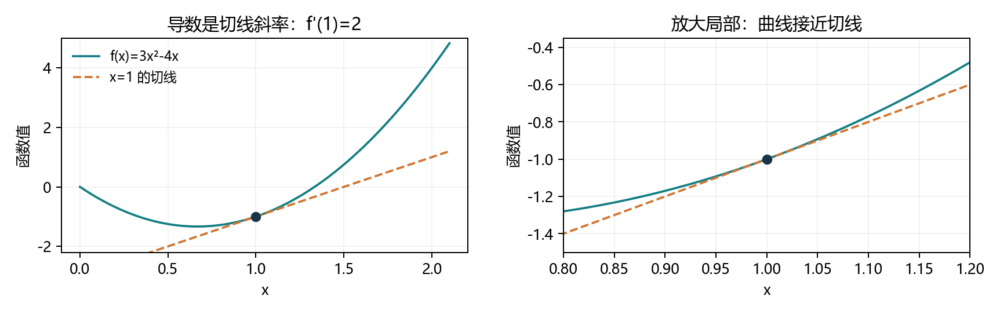
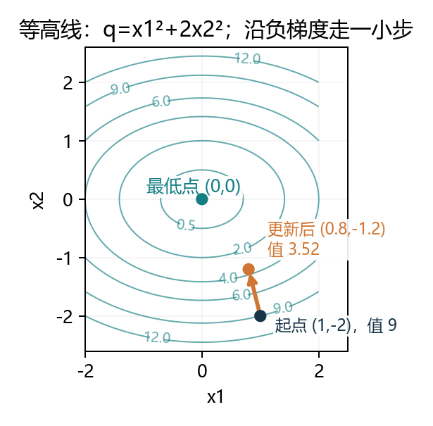
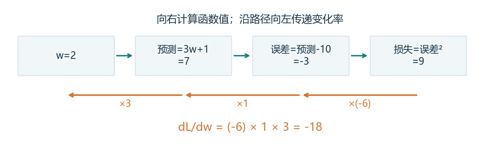

# 2.4 微积分：参数怎样影响损失

教材定位：《动手学深度学习》Release 2.0.0，用户提供的 PDF 第 81-87 页，正文第 63-69 页，含节末练习。按整节贯通讲解，配套完整演示、综合练习与阅读 PDF。本节手工求导，用数值差分核对，自动微分留到 2.5。

## 本节要回答的核心问题

2.3 已经能用 `pred = X @ w + b` 算预测，并用误差计算损失。现在想让模型变好，就要知道：**哪个参数应该增大或减小，改变多少，损失会怎样变化？** 微分提供局部变化率，是调整参数的依据。

你以前已经做过一次实验：学习率改成 0.2 后，w 变成约 5.6，预测约 17.8，损失约 60.84。本节会从导数定义推到梯度更新，完整解释这个结果，而不是只记“步长太大”。

微积分有两个主要分支：微分研究局部变化率；积分研究连续累积，例如用越来越细的小块面积逼近曲线下面积。本节按教材重点学习微分，不额外插入一套积分计算课程。

| 你面对的问题 | 对应工具 |
| --- | --- |
| 一个输入改变，输出怎样变 | 导数 |
| 多个输入中只改变一个 | 偏导数 |
| 同时考虑所有参数的局部影响 | 梯度 |
| 参数经过多层计算才影响损失 | 链式法则 |

训练损失下降属于优化；在没见过的数据上表现如何属于泛化。微积分帮助优化训练目标，不能凭损失下降就保证泛化。之前已理解的这点继续保留，不重复考算术。

<!-- pagebreak -->

## 1. 导数：从平均变化率到瞬时变化率

函数 `y=f(x)` 把输入 x 映射成输出 y。x 增加 h 后，平均变化率是“输出变化除以输入变化”，称为差商：

<div class="equation">差商 = [f(x+h)-f(x)]/h，h ≠ 0</div>

把 h 从正、负两边趋近于 0，如果差商趋向同一个有限值，这个极限就是导数。写作 `f'(x)` 或 `dy/dx`，表示在该点附近，x 每改变一个单位，y 大约改变多少。它不是把 h 直接设成 0；那会得到没有定义的除法。

沿用教材 `f(x)=3x²-4x`，在 x=1 处展开：

```text
f(1) = -1
f(1+h) = -1 + 2h + 3h²
[f(1+h)-f(1)]/h = 2 + 3h
h 趋近 0，结果趋近 2，因此 f'(1)=2。
```

```python
def f(x):
    return 3 * x ** 2 - 4 * x

for h in [0.1, 0.01, 0.001, 0.0001, 0.00001]:
    print(h, (f(1 + h) - f(1)) / h)
# 差商依次约为 2.3、2.03、2.003、2.0003、2.00003
```

数值实验支持这个结论，前面的代数展开才给出了这里的极限依据。变化率为 2，不代表函数值等于 2；本例函数值是 -1，导数是 2，两者回答不同问题。

### 不是所有位置都有导数

`abs(x)` 在 0 的左侧变化率为 -1，右侧为 +1，两侧不同，因此这里没有通常意义的导数。以后框架在这类位置选择约定的值，并不等于数学上出现了唯一导数。

<!-- pagebreak -->

## 2. 切线与微分：用直线近似局部变化

导数也是函数曲线在该点的切线斜率。切线经过 `(a,f(a))`，因此方程为：

<div class="equation">切线：y = f(a) + f'(a)(x-a)</div>
<div class="equation">局部近似：Δf ≈ f'(a)Δx；微分：df = f'(a)dx</div>

“微分”表示输入一个小变化对应的线性变化估计；实际函数增量还可能包含更高阶项。本例在 a=1，切线是 `y=-1+2(x-1)=2x-3`。



```python
delta = 0.1
tangent_estimate = f(1.0) + 2 * delta
print(tangent_estimate)  # -0.8
print(f(1.0 + delta))    # -0.77，误差为 0.03
```

导数描述的是局部。变化量变大时，高阶项可能明显，不能把切线当作整条曲线。这也是“沿下降方向走”仍可能因步长过大而升高的原因。

### 数值差分的 h 不是越小越好

前向差分使用 `[f(x+h)-f(x)]/h`；中心差分使用 `[f(x+h)-f(x-h)]/(2h)`，常可更准确地核对光滑函数的导数。但浮点数精度有限，h 极小时 `x+h` 甚至会舍入回 x，两次函数值相减也会丢失有效数字。

数学极限不受机器精度限制；电脑有限差分是近似。演示使用 float64 核对梯度，不把差分当作下一节的自动微分。

<!-- pagebreak -->

## 3. 求导法则：把复杂函数拆开计算

设 f、g 在讨论位置可微，C 为常数。先熟悉几条规则，不要求背一整本公式表：

| 原函数 | 导数 |
| --- | --- |
| 常数 C | 0 |
| x 的 n 次幂 | n 乘 x 的 n-1 次幂 |
| exp(x)，即 e 的 x 次幂 | exp(x) |
| ln(x)，自然对数 | 1/x，实数情形要求 x>0 |
| C f(x) | C f'(x) |
| f(x)+g(x) | f'(x)+g'(x) |
| f(x)g(x) | f'(x)g(x)+f(x)g'(x) |
| f(x)/g(x) | [f'(x)g(x)-f(x)g'(x)]/g(x)²，g(x)≠0 |

幂法则用于原函数与导数表达式有定义的位置；任意实数幂通常先在 x>0 上讨论。多项式的整数幂可在更广的实数范围使用。

由此，`3x²-4x` 的导数为 `6x-4`，在 x=1 时就是 2。乘积求导不能直接把两个导数相乘，例如：

<div class="equation">d[x²exp(x)]/dx = 2x exp(x) + x²exp(x)</div>

常数的导数为零，是因为它不会随当前求导的变量改变。一个量是不是“常数”，取决于这次对谁求导，而不是它的变量名。

Python 的 `**` 表示幂；`math.exp(x)` 是指数函数，`math.log(x)` 是自然对数。对张量可使用 `torch.exp`、`torch.log`。**`f(x)` 计算函数值，不会因为函数有公式就自动得到导数。** 本节把导数公式手写成表达式。

<!-- pagebreak -->

## 4. 偏导数：只改变一个参数，暂时固定其他参数

模型通常有多个参数。比如 `L(w,b)` 同时依赖权重和偏置。想知道只改变 w 的影响，就固定 b；反过来求 b 的影响时，固定 w。

`∂f/∂x1` 是对 x1 的偏导，符号 ∂ 提醒我们这里还有其他自变量，但本次保持它们不变。沿用教材练习形式：

<div class="equation">g(x<sub>1</sub>,x<sub>2</sub>) = 3x<sub>1</sub>² + 5exp(x<sub>2</sub>)</div>
<div class="equation">∂g/∂x<sub>1</sub> = 6x<sub>1</sub>；∂g/∂x<sub>2</sub> = 5exp(x<sub>2</sub>)</div>

求第一个偏导时，第二项随 x1 不变，所以导数为 0。求第二个偏导时，第一项随 x2 不变，所以导数为 0。

```python
import torch
point = torch.tensor([1., 0.], dtype=torch.float64)
gradient = torch.stack([6 * point[0], 5 * torch.exp(point[1])])
print(gradient)  # [6., 5.]
```

在 `(1,0)`，第一个参数增加很小的 h，函数约增加 `6h`；只让第二个增加 h，函数约增加 `5h`。这是两个分别控制变量的实验，不是让两个变量同时一起改变。

### 偏导与沿某条路径变化不同

如果 x1、x2 都依赖一个更早的参数 a，改变 a 会同时改变两者，这时不能只看某一个偏导。需要把两个路径的影响都计算进去，后面的多路径链式法则正是解决这件事。

<!-- pagebreak -->

## 5. 梯度：把所有偏导组织成一个向量

对输入为向量、输出为标量的可微函数，把各个分量的偏导按顺序排起来，就是梯度。符号 ∇ 读作 nabla；`∇f` 表示 f 的梯度。

<div class="equation">∇f = [∂f/∂x<sub>1</sub>, …, ∂f/∂x<sub>n</sub>]<sup>T</sup></div>
<div class="equation">局部变化：f(x+Δx)-f(x) ≈ (∇f)<sup>T</sup>Δx</div>

右边就是 2.3 学过的点积：每个参数的小变化乘以它的局部影响，再把贡献相加。上一页的 `[6,5]` 不是两个损失，而是同一个函数对两个坐标的敏感程度。

梯度非零时，在标准欧氏长度约束下，对于同样短的位移，梯度方向给出最大的一阶上升，负梯度方向给出最大的一阶下降。这是局部、一阶的结论，有限步长仍要重新计算真实损失。



对 `q=x1²+2x2²`，在 `[1,-2]` 处梯度是 `[2,-8]`。走 `-0.1*梯度` 后到 `[0.8,-1.2]`，函数从 9 降到 3.52；一阶近似给 2.2，与真实值不同，因为还有二阶项。

### 梯度为 0 不一定是最低点

`x²` 在 0 是最低点；`-x²` 在 0 是最高点；`x³` 在 0 既不是局部最低点也不是局部最高点，它们在 0 的导数却都为 0。零梯度只是某种局部信息，不能单独判断最优或泛化。

<!-- pagebreak -->

## 6. 把线性代数与求导接起来

下面公式针对标量输出，a、A 视为与 x 无关的固定量。先看含义与形状，不必一次背完。

| 标量函数 | 对 x 的梯度 |
| --- | --- |
| a 与 x 的点积 | a |
| x 的 L2 范数平方 | 2x |
| x 的 L2 范数，x 非零 | x / L2(x) |
| x.T @ A @ x，A 是方阵 | (A+A.T) @ x |
| 矩阵 X 的 Frobenius 范数平方 | 对 X 的梯度为 2X，与 X 同形状 |

L2 平方是各分量平方和，对第 i 个分量求导时，只有该分量的平方贡献 `2*x[i]`，合起来就是 2x。L2 本身还多一层平方根，因此梯度不同：

```python
u = torch.tensor([3., -4.], dtype=torch.float64)
print(2 * u)                              # L2 平方：[6,-8]
print(u / torch.linalg.vector_norm(u))     # L2：[0.6,-0.8]
```

L2 在零向量处没有通常意义的梯度；L2 平方在零向量处可微，梯度为零。教材练习里的范数与范数平方要看清上下标，不能混用。

对二次型 `x.T @ A @ x`，变量 x 出现两次，两部分贡献合为 `(A+A.T) @ x`。如果 A 对称，可简化为 `2*A@x`。

### 读教材时注意导数排列约定

若 `y=A@x` 输出是向量，完整导数是一张表，通常称雅可比矩阵。按 `J[i,j]=∂y[i]/∂x[j]` 的约定，J=A。教材使用的向量导数排列写成 A.T，是另一种排列约定；不能把向量输出的公式直接当成标量损失的梯度套用。当前先掌握“标量损失对各参数求偏导”，足够进入自动微分。

<!-- pagebreak -->

## 7. 链式法则：串联计算的变化率相乘

如果 `u=g(x)`，再算 `y=f(u)`，x 对 y 的影响要经过中间变量 u：

<div class="equation">dy/dx = (dy/du)(du/dx)</div>

例如 `y=(3x+1)²`，内层 `u=3x+1` 的导数为 3，外层 `y=u²` 对 u 的导数为 2u。所以最终导数是 `2(3x+1)*3`，不能漏掉内层的 3。

把它换成你之前实际用过的模型，输入为 3，标签为 10，偏置固定为 1：

```text
参数 w → 预测 pred=3w+1 → 误差 e=pred-10 → 损失 L=e²

在 w=2 时：pred=7，e=-3，L=9
dL/de=2e=-6
de/dpred=1
dpred/dw=3
dL/dw=(-6)*1*3=-18
```



这里梯度是负数，意味着小幅增加 w 会让损失下降；不是说损失本身为负。平方损失始终非负，导数却可以是负数。

反向传播的核心是按计算依赖复用链式法则计算梯度。**求出梯度和更新参数是两步**：求导回答“怎样影响”，更新规则回答“实际改多少”。本节先手工写公式，下一节再调用自动微分。

<!-- pagebreak -->

## 8. 多条路径：沿路径相乘，再把路径贡献相加

如果一个参数影响了多个中间量，必须把所有路径都算上。例如：

```text
a=x²，c=3x，z=a*c
经 a 的贡献：(∂z/∂a)*(da/dx) = c*2x
经 c 的贡献：(∂z/∂c)*(dc/dx) = a*3
两条相加：dz/dx = c*2x+a*3 = 9x²
```

把式子先合并为 `z=3x³` 求导，也得到 `9x²`。在 x=2 时导数是 36。乘法求导法则的两项，也可以从这两条依赖路径理解。

对于教材的通用形式：`u=f(x,y,z)`，而 x、y、z 都依赖 a、b，则：

<div class="equation">∂u/∂a = (∂u/∂x)(∂x/∂a) + (∂u/∂y)(∂y/∂a) + (∂u/∂z)(∂z/∂a)</div>
<div class="equation">∂u/∂b = (∂u/∂x)(∂x/∂b) + (∂u/∂y)(∂y/∂b) + (∂u/∂z)(∂z/∂b)</div>

不要只背一长串符号：对 a 求导，就寻找从 a 出发到 u 的每条路径，沿途变化率相乘，最后求和；对 b 同理。

### 对权重与偏置分别求导

单样本 `pred=w*x+b`，损失 `L=(pred-y)²`，训练时 x、y 视为固定数据。通过链式法则：

<div class="equation">∂L/∂w = 2(pred-y)x；∂L/∂b = 2(pred-y)</div>

两式差一个 x，因为预测对 w 的偏导是 x，对 b 的偏导是 1。虽然 L 是同一个标量，但 w 和 b 是两条独立的参数方向，所以需要两个偏导。

<!-- pagebreak -->

## 9. 为什么负梯度配上大步长仍会升高

最简单的梯度下降更新是 `新参数=旧参数-学习率*梯度`。学习率记作 η，是我们指定的步长系数，不是从导数定义中自动产生的量。

沿用 w=2、x=3、b=1、y=10；原损失 9，原梯度 -18，两次实验都从同一个旧参数出发：

| 学习率 | 新 w | 新预测 | 新损失 |
| --- | --- | --- | --- |
| 0.01 | 2.18 | 7.54 | 6.0516 |
| 0.20 | 5.60 | 17.80 | 60.8400 |

两次**初始梯度相同**。学习率增大，使更新幅度从 0.18 变成 3.6。梯度只描述出发点附近；大步可能越过低点，最后落到更高的位置。

本例可进一步精确解释：

<div class="equation">L(w) = (3w-9)² = 9(w-3)²，最低点 w=3</div>
<div class="equation">w<sub>new</sub>-3 = (1-18η)(w-3)</div>

本例只更新 w。若起点不是最低点，一步损失严格下降的条件是 `0<η<1/9`，而 0.2 超出范围。这个条件只适用于此函数，不能照搬到其他模型或同时更新偏置的实验。

### 小步下降为什么有依据

把参数变化写成 `Δθ=-η*梯度`，代入一阶近似，损失变化约为 `-η*梯度平方和`。梯度非零且 η>0 时，一阶项为负；真实变化还有高阶项，学习率过大仍可能升高损失。

<!-- pagebreak -->

## 10. 小批量：每条样本求导，再取平均

如果 N 条样本都用同一组 w、b，MSE 是它们误差平方的平均。求和、常数倍的求导法则告诉我们：**平均损失的梯度，就是各条损失梯度的平均。**

<div class="equation">e = Xw+b-y；L = Σ<sub>i=1…N</sub> e<sub>i</sub>²/N</div>
<div class="equation">∇<sub>w</sub>L = (2/N)X<sup>T</sup>e；∂L/∂b = 2 mean(e)</div>

X 是 `(N,d)`，e 是 `(N,1)`，所以 `X.T @ e` 得到 `(d,1)`，恰好与列形式的 w 同形状。每个权重累积它负责的特征与误差的贡献；偏置则累积误差本身。

```python
X = torch.tensor([[1., 2.], [3., 4.], [5., 6.]],
                 dtype=torch.float64)
w = torch.tensor([[0.5], [-1.]], dtype=torch.float64)
b = torch.tensor(0.5, dtype=torch.float64)
y = torch.tensor([[1.], [2.], [3.]], dtype=torch.float64)

error = X @ w + b - y
loss = error.square().mean()
dw = 2 / X.shape[0] * (X.T @ error)
db = 2 * error.mean()
new_w = w - 0.01 * dw
new_b = b - 0.01 * db
new_loss = (X @ new_w + new_b - y).square().mean()
print(loss.item(), new_loss.item())
```

这里 dw、db 都来自旧参数，然后一起更新；不要先更新 w，再用不同参数状态计算本轮 db。特征、标签和误差的形状仍要符合 2.3 的约定。

这只是把本节公式接到模型的一次更新上，不代表已完成第 3 章线性回归训练。下一节会用自动微分替代手写求导，之后再构建完整训练循环。

<!-- pagebreak -->

## 综合实践：一批数据、两个参数、两种学习率

先运行 `lessons/ch02/04_calculus.py` 看完整过程，再打开 `exercises/ch02/04_calculus.py`。在同一文件填写八个 None，不用 backward，不硬编码结果。练习的初始数据是：

```python
x = torch.tensor([1., 2., 3., 4.], dtype=torch.float64)
y = torch.tensor([3., 5., 7., 9.], dtype=torch.float64)
w = torch.tensor(0., dtype=torch.float64)
b = torch.tensor(0., dtype=torch.float64)
lr = 0.01
```

| 待填写项 | 目标 |
| --- | --- |
| pred / error | 四条样本的预测、预测减标签；均为 `(4,)` |
| loss | 平方误差平均，标量 |
| grad_w / grad_b | 按链式法则算两个偏导，均为标量 |
| new_w / new_b | 使用旧参数和本轮梯度，分别更新 |
| new_loss | 用两个新参数重新计算预测和 MSE |

完成后先用 lr=0.01 运行，再只改为 0.2 运行；每次运行都会从 w=0、b=0 出发。一次反馈两次结果和三个解释：A. 权重偏导为什么乘 x，偏置偏导为什么不乘；B. 相同起点改学习率，初始梯度是否改变，实际改变了什么；C. 一个标量损失为什么需要两个偏导，零梯度是否必然是最低点。

### 结合教材的选做复盘

教材第 1 题要求绘制 `x³-1/x` 及 x=1 的切线。你可仿照演示，自行求切线斜率，先在正数且远离 0 的范围画图；不要让横轴跨过未定义的 x=0。第 2 题的两分量梯度、第 3 题 L2 梯度、第 4 题多路径链式法则，分别在第 4、6、8 部分解释。无需把它们再拆成四轮练习。

<!-- pagebreak -->

## 整节速查与运行方式

| 名称 | 记住它回答的问题 |
| --- | --- |
| 函数值 | 当前输出是多少 |
| 导数 | 一个自变量的局部变化率 |
| 微分 | 输入小变化对应的线性输出变化 |
| 偏导 | 固定其他变量，只改变一个变量 |
| 梯度 | 标量函数对所有参数的偏导集合 |
| 链式法则 | 沿路径相乘，多条路径相加 |
| 梯度下降 | 旧参数减学习率乘梯度 |
| 中心差分 | 用有限扰动近似导数，核对公式 |
| 自动微分 | 2.5 正式学习，沿计算图应用求导规则 |

在 VS Code 按 F5，选择“2.4 微积分：完整演示”。解释器继续用 `D:/Anaconda/envs/openmmlab/python.exe`。演示会生成本节三张原理图与两种学习率的 CSV，不弹出阻塞式绘图窗口。

教材中的 `%matplotlib inline` 是 Notebook 魔法命令，不能原样放进普通 `.py` 文件。本项目直接用已有 Matplotlib 保存图像，不需要安装 d2l，也不要求重写教材的绘图辅助库。

`def` 定义一个可重复调用的函数，`return` 返回计算结果；`for h in [...]` 让同一个公式在多个 h 上重复。演示中绘图辅助代码可暂时略读，重点先对上公式、数值、更新前后结果。

PDF 是本讲义的阅读版，用现有文档环境运行 `tools/build_study_pdfs.py --section 2.4` 可重建。详细输出与核对记录在 `reports/ch02/`。用户完成并能解释实践后再确认掌握；继续学习不自动代表前面的练习已经完成。
