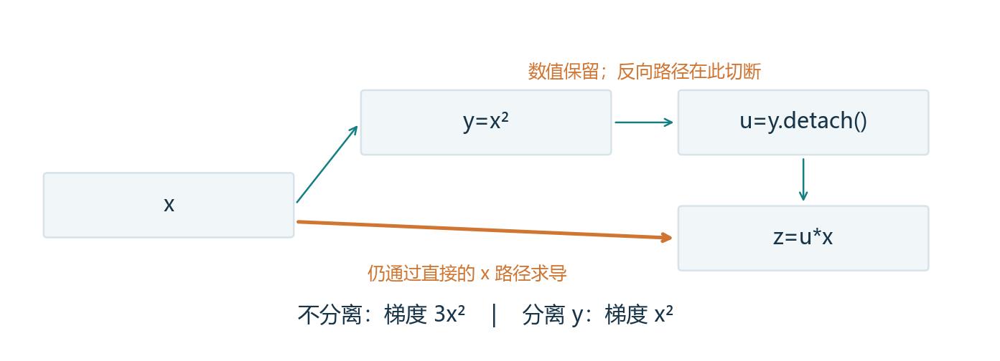
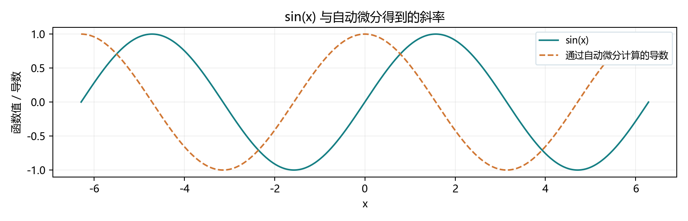
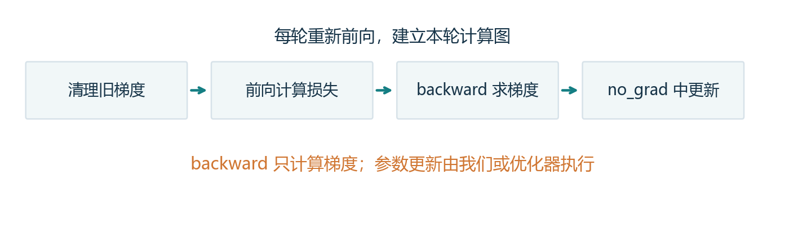

# 2.5 自动微分：把手写求导接到 PyTorch

教材定位：《动手学深度学习》Release 2.0.0，用户提供 PDF 第 87-91 页、正文第 69-73 页，含节末练习。继续整节讲解、整节演示与一次综合实践；本轮不因为旧练习未提交而阻挡，也不将教师运行记成用户掌握。

## 本节的主线：记录、求导、清理、更新

上一节已经手算了损失对权重和偏置的偏导。模型复杂后，手动展开所有路径容易漏项。自动微分把计算拆成已知操作，沿本次计算图应用链式法则，算出参数的梯度。

它使用数值运算中的求导规则，不需要像有限差分那样挑一个很小的 h，也不是把整个程序整理成符号公式。结果仍受浮点数精度影响；只能沿被跟踪、支持求导的计算路径传播。

| 环节 | 你需要写什么 |
| --- | --- |
| 指定需要求导的参数 | 创建带 `requires_grad=True` 的浮点张量 |
| 记录前向计算 | 用张量操作计算预测和损失 |
| 反向传播 | 对标量损失调用 `backward()` |
| 查看本轮梯度 | 读取参数的 `.grad` |
| 实际调整参数 | 在 `no_grad` 中更新，或后续使用优化器 |

梯度缓冲需要按训练意图清理。本节重点分清三个东西：**张量当前的数值、描述依赖关系的计算图、保存梯度的缓冲区**。它们相互关联，但不是同一个对象。

<!-- pagebreak -->

## 1. 最小完整例子：从 2x 点积 x 求导

教材例子是向量与自身点积的两倍，代码写作 `y=2*torch.dot(x,x)`。它等于每个分量平方后求和，再乘 2。用上一节的法则手算，梯度为 4x。

```python
import torch
x = torch.arange(4., dtype=torch.float64)
x.requires_grad_(True)
print(x.grad)  # None：还没有计算并保存梯度
y = 2 * torch.dot(x, x)
print(y.item())  # 28
y.backward()
print(x.grad)    # [0.,4.,8.,12.]
print(x.detach())  # 数值仍是 [0.,1.,2.,3.]
```

`requires_grad_(True)` 是开启跟踪的另一种写法。名字末尾的下划线表示原地修改这个属性。通常对模型参数跟踪梯度，输入数据、标签不必都打开。

`backward()` 从输出出发，沿计算依赖向前面的参数传播变化率，并累加到叶张量的 `.grad`。它没有学习率，也不会自动改变 x 的数值。

### 叶张量、grad_fn 与 None

这里直接创建的 x 是需要梯度的叶张量；由运算得到的 y 是中间结果，`y.grad_fn` 描述对应的反向操作。普通反向传播默认把梯度保存在需要梯度的叶张量上，中间结果的 `.grad` 默认不保留；确实需要观察中间梯度时可用 `retain_grad()`。

`.grad is None` 表示还没有保存这份梯度，不能等同于“已经计算，结果为零”。数学导数为零时，也可能得到一个确实存在的全零梯度张量。求导需要合适的浮点或复数类型；本节使用 float64，整数张量不能像这样开启梯度跟踪。

<!-- pagebreak -->

## 2. 梯度默认累加：新前向不会替你清空旧值

这里连续做两次新的前向计算，得到两张新图，但它们都把结果写进同一个 x.grad：

```python
x = torch.tensor([1., 2., 3.], requires_grad=True)
(x * x).sum().backward()
print(x.grad)  # [2,4,6]
(x * x).sum().backward()
print(x.grad)  # [4,8,12]，两次贡献相加
```

累加有实际用途，例如希望把多个批次的贡献合起来。普通逐轮更新时，如果本意是只使用本轮梯度，就需要清理旧值。

```python
x.grad = None
x.sum().backward()
print(x.grad)  # [1,1,1]
if x.grad is not None:
    x.grad.zero_()
print(x.grad)  # [0,0,0]
```

`None` 去掉现有梯度缓冲的引用；`zero_()` 把缓冲内容清零。还没有梯度时不能调用 zero_。本节用参数 `.grad=None` 准备下一轮，后续也可使用优化器提供的统一接口。

不要把它们完全等同：优化器可能跳过 None 梯度，而对零梯度仍按自己的状态和规则处理。现在先掌握“本轮开始前，旧梯度是否应该参与”，无需提前展开优化器细节。

<!-- pagebreak -->

## 3. 计算图的寿命：同一图重复反向是另一个问题

反向传播通常会释放求导时使用的中间缓存。含有保存中间值的操作时，对同一个结果立即再次 backward，通常会失败。以平方为例：

```python
a = torch.tensor(2., requires_grad=True)
square = a * a
square.backward()
try:
    square.backward()
except RuntimeError:
    print("本例中间缓存已释放，需要重新前向计算。")
a.grad = None
square = a * a
square.backward()
print(a.grad)  # 4
```

**清理 grad 不会重建旧图。** 重新前向也不会清理旧梯度。两者需要分别处理。

| 你需要解决的问题 | 对应方式 |
| --- | --- |
| 不要混入旧梯度 | 清理参数 `.grad` |
| 做下一轮计算 | 重新前向，建立本轮图 |
| 确实要对同一图反向多次 | 第一次反向时考虑 `retain_graph=True` |
| 后面还要对导数继续求导 | 按需要使用 `create_graph=True` |

`retain_graph` 保留缓存会占用更多内存，不必为了日常训练把它一直打开。也不是任何操作第二次反向都会报错：某些简单运算不需要保存中间量。应理解缓存依赖，而不是背“第二次一定报错”。

<!-- pagebreak -->

## 4. 多元素输出：先明确要对什么标量求导

`y=x*x` 输出多个元素。若不提供额外信息，单次 backward 不知道你想怎样组合这些输出。常见做法是先求和或均值，得到一个标量目标：

```python
x = torch.tensor([1., 2., 3.], requires_grad=True)
(x * x).sum().backward()
print(x.grad)  # [2,4,6]
x.grad = None
(x * x).mean().backward()
print(x.grad)  # [2/3,4/3,2]
x.grad = None
y = x * x
y.backward(torch.tensor([1., 2., 3.]))
print(x.grad)  # [2,8,18]
```

最后一次提供的向量是外部传入的权重，等价于对加权和 `y[0]+2*y[1]+3*y[2]` 求导。这里权重固定，不是模型参数。

更一般地，按 `J[i,j]=∂y[i]/∂x[j]` 约定，`y.backward(v)` 累加对应于 `J.T @ v` 的梯度；它不返回完整 J。种子 v 应与输出形状一致。隐式种子 1 适用于只含一个元素的输出，不要求形状必须严格为 `()`。

### 输出互相耦合时，也要沿所有路径相加

例如 `y=[x0+x1, x0*x1]`，在 x=[1,2] 时，若权重 v=[2,3]，实际标量目标是 `2(x0+x1)+3x0x1`，梯度是 `[8,5]`。演示也实际验证了这个结果。

MSE 使用 mean 时梯度取平均；改成 sum 时，在相同样本和参数下，梯度会放大为误差元素数倍。因此减少损失的汇总方式与学习率需要配合考虑。

<!-- pagebreak -->

## 5. detach：保持数值，改变求导依赖

教材构造 `y=x*x`，再构造 `z=y*x`。不分离时，目标是三次方的和，梯度是 3x²；如果把 y 当作已给定的常数，只沿后面的 x 求偏导，梯度则是 y，也就是当前数值 x²。

```python
x = torch.tensor([1., 2., 3.], requires_grad=True)
y = x * x
u = y.detach()
z = u * x
z.sum().backward()
print(x.grad)  # [1,4,9]
x.grad = None
y.sum().backward()
print(x.grad)  # [2,4,6]：原 y 的求导关系仍存在
```



两种算法的 z 数值可以相同，但指定的求导问题不同。detach 后是把 u 固定来求导，不能再把它当成完整三次方函数求导。y 本身没有被修改或“忘掉”，只是新变量 u 不再保留那条求导路径。

这也解释了上面为什么随后还能对原 y 求导：第一次 z 的反向没有沿 u 回到产生 y 的图。若本来使用的是 y 本身，相关缓存的寿命就不同。

<!-- pagebreak -->

## 6. no_grad、复制与安全更新

`detach()` 返回分离的张量，但通常与原张量共享存储。它不等于“复制一份独立数据”；如果要保存不会被后续修改影响的快照，用 `tensor.detach().clone()`。

| 写法 | 本节用途 |
| --- | --- |
| `tensor.detach()` | 对一个已有结果切断求导路径，保留数值 |
| `tensor.detach().clone()` | 分离并复制，保存独立快照 |
| `with torch.no_grad():` | 在一段代码中新做的运算通常不建立求导图 |
| `tensor.item()` | 单元素张量转成 Python 数值，适合打印日志 |

no_grad 适合参数更新或只观察预测结果。它不会把参数永久改成 requires_grad=False。离开这段上下文，后续前向仍可跟踪这些参数。

```python
w = torch.tensor(2., requires_grad=True)
loss = (3 * w + 1 - 10).square()
loss.backward()
with torch.no_grad():
    w -= 0.01 * w.grad
print(w.item(), w.is_leaf, w.requires_grad)  # 2.18, True, True
w.grad = None
```

本例特意在反向后更新：叶张量原地更新通常应放在 no_grad 中，避免把优化操作也记录成模型的计算依赖。直接写 `w=w-lr*w.grad` 还可能把名字绑定到非叶结果，后续读取 w.grad 不再符合预期。暂时不要通过 `.data` 绕过这些规则。

不要提前把损失变成 `.item()` 再求导，它已经是 Python 数值，没有 backward。用于训练的损失也不要在 no_grad 中计算；否则这段前向不建立需要的求导关系。

<!-- pagebreak -->

## 7. Python 控制流：记录这次实际走过的路径

计算图可以随着这次执行而建立。教材的倍增循环和条件分支，采用确定输入即可重复观察：

```python
def control_flow(a):
    if a.detach().norm().item() == 0:
        raise ValueError("全零输入无法结束倍增循环")
    b = a * 2
    while b.norm().item() < 1000:
        b = b * 2
    if b.sum().item() > 0:
        return b
    return 100 * b

a = torch.tensor(1.25, requires_grad=True)
d = control_flow(a)
d.backward()
print(d.item(), a.grad.item())  # 1280, 1024
```

在这个输入附近，循环次数与分支不变，所以实际执行的是 `d=1024*a`。改成 a=-1.25，则最终还乘了 100，该路径的导数为 102400。

自动微分沿已执行的张量运算求导，不是对布尔判断、循环次数或没走到的分支求导。跨越条件边界时，函数可能改变分支甚至不连续，不能把一个路径的导数推广到边界两侧。

原书随机标量通常能运行，但若输入恰好为 0，倍增永远还是 0，循环不会结束。本项目增加全零保护并使用固定输入，避免把时间花在随机结果或死循环上。

<!-- pagebreak -->

## 8. 二阶导数与自动绘制 sin 的导数

若还想对一阶导数求导，需要让求导过程本身可被跟踪。例子使用 `autograd.grad` 返回导数，不写入 q.grad：

```python
q = torch.tensor(2., dtype=torch.float64, requires_grad=True)
first = torch.autograd.grad(q ** 4, q, create_graph=True)[0]
second = torch.autograd.grad(first, q)[0]
print(first.item(), second.item())  # 32, 48
print(q.grad)  # None
```

`create_graph=True` 与只保留旧缓存的 `retain_graph=True` 用途不同。更高阶求导需要追踪并计算导数的变化，通常增加图、运算和内存开销，但不能简单说它固定贵几倍。

教材还要求不直接使用 cos 公式来画 sin 的导数：

```python
grid = torch.linspace(-6.28, 6.28, 400, requires_grad=True)
sine = torch.sin(grid)
slope = torch.autograd.grad(sine.sum(), grid)[0]
# 绘图使用 grid.detach()、sine.detach() 和 slope 的数值。
```



这里 sin 对各采样点独立计算，求和后的梯度恰好给出每个点的局部斜率。示例的导数曲线来自自动微分，解析 cos 只用于教师独立核对，不作为曲线数据的生成方法。

<!-- pagebreak -->

## 9. 用自动微分重现上一节的一次更新

数据和参数起点与 2.4 的小批量例子相同。本轮把手写 dw、db 替换为 backward，实际参数更新仍由代码执行：

```python
X = torch.tensor([[1., 2.], [3., 4.], [5., 6.]],
                 dtype=torch.float64)
w = torch.tensor([[0.5], [-1.]], dtype=torch.float64,
                 requires_grad=True)
b = torch.tensor(0.5, dtype=torch.float64, requires_grad=True)
y = torch.tensor([[1.], [2.], [3.]], dtype=torch.float64)

w.grad = None
b.grad = None
loss = (X @ w + b - y).square().mean()
loss.backward()
print(w.grad, b.grad)
with torch.no_grad():
    w -= 0.01 * w.grad
    b -= 0.01 * b.grad
    new_loss = (X @ w + b - y).square().mean()
print(loss.item(), new_loss.item())
w.grad = None
b.grad = None
```

梯度与上一节手算相同：w 的梯度约为 `[-29.333333,-37.333333]`（列形式），b 的梯度为 -8，损失从约 18.666667 降到 2.688474。



第二轮要重新计算预测和损失，不能直接拿上一轮 loss 再反向。后续章节会用优化器统一管理更新，并加入取批次、循环、评估等部分；本节先把一轮完整顺序弄清楚。

<!-- pagebreak -->

## 10. 控制流扩展与教材练习复盘

把控制流输入从标量改为向量或矩阵，norm 仍返回一个数，sum 也返回一个数，所以循环和分支依然能选择路径。但是输出 d 也变成了多元素张量，需要给反向目标指定汇总方式：

```python
a = torch.tensor([[1., 0.], [-2., 3.]], requires_grad=True)
d = control_flow(a)
d.sum().backward()
print(a.grad)  # 每个分量均为本次路径的系数 512
```

原教材使用 `d/a` 比较梯度。在非零且不跨路径边界的输入处，这有助于核对本例的系数；矩阵含 0 元素时会出现 0/0，不能普遍照用。演示改为与已记录的路径系数比较。

### 自己设计一个更短的分支函数

```python
for value in [2., -2.]:
    a = torch.tensor(value, requires_grad=True)
    d = a.square() if a.item() > 0 else 3 * a
    d.backward()
    print(a.grad)  # 分别为 4 和 3
```

两次前向走了不同分支，建立不同的计算依赖。a=0 的左右导数不一致，此处不把分支内部的规则当成全局可微的证明。

教材五道练习都已对应：二阶成本见第 8 部分；同图重复反向见第 3 部分；向量矩阵控制流和自定义分支在本页；sin 自动求导绘图见第 8 部分。综合实践继续围绕一个完整模型流程，不另拆五轮小练习。

<!-- pagebreak -->

## 综合实践：替换手写求导，完成同一轮更新

先运行 `lessons/ch02/05_autograd.py`，再打开 `exercises/ch02/05_autograd.py`。这里用四条样本，两个标量参数，初始值都是 0；x、y 是数据，不需要开启梯度。

```python
x = torch.tensor([1., 2., 3., 4.], dtype=torch.float64)
y = torch.tensor([3., 5., 7., 9.], dtype=torch.float64)
w = torch.tensor(0., dtype=torch.float64, requires_grad=True)
b = torch.tensor(0., dtype=torch.float64, requires_grad=True)
lr = 0.01
```

| TODO | 你要完成的环节 |
| --- | --- |
| 1、2 | 计算预测、平方误差平均，保留张量计算关系 |
| 3 | 在提供的位置调用反向传播 |
| 4、5 | 分别从 w.grad、b.grad 复制本次梯度 |
| 6、7 | 在已提供的 no_grad 区域中原地更新两个参数 |
| 8 | 用新参数重新计算 MSE |

八处标记包含 None 和 pass，集中填写即可。不要再用上一节的手写偏导公式代替自动求导，也不要硬编码数值。模板原样运行会显示待填写，已经提供显示与最后清理梯度的部分。

完成后一次反馈输出和三个解释：A. backward 后参数是否自动改变，为什么更新放在 no_grad；B. 新前向不清梯度会怎样，把本例的 mean 改成 sum，梯度变成几倍；C. `y=x*x` 时，`y.detach()*x` 与 `y*x` 的梯度为何不同。

<!-- pagebreak -->

## 整节速查与运行方式

| 操作 | 记住的含义 |
| --- | --- |
| `requires_grad=True` | 指定需要跟踪的浮点参数 |
| `loss.backward()` | 沿当前图求导，累加到需要的叶参数梯度 |
| `parameter.grad` | 梯度缓冲，开始或清理后可能为 None |
| `parameter.grad=None` | 去掉旧梯度，准备本轮重新累积 |
| `output.backward(v)` | 对固定权重 v 形成的输出加权和求导 |
| `detach()` | 切断求导依赖，通常仍共享存储 |
| `no_grad()` | 这一段新运算通常不建立求导图 |
| `autograd.grad(...)` | 返回所需导数，不直接累加到叶参数 .grad |
| `create_graph=True` | 按需要继续对导数求导 |

VS Code 按 F5，选择“2.5 自动微分：完整演示”。

解释器：`D:/Anaconda/envs/openmmlab/python.exe`。演示自动保存三张图，不弹出阻塞绘图窗口，不安装任何依赖。

有梯度的张量需要画图或转换 NumPy 时，本节先使用 detach 取数值；若以后在 GPU 上，通常先转到 CPU。打印单个数可用 item，但保持训练路径上的计算仍为张量。

完整输出、核对记录和正式 PDF 保存在项目内。阅读资料可用已有文档环境运行 `tools/build_study_pdfs.py --section 2.5` 重建。旧练习未作答的状态继续保留；下一完整节是 2.6 概率，不把教师运行结果当作用户掌握。
