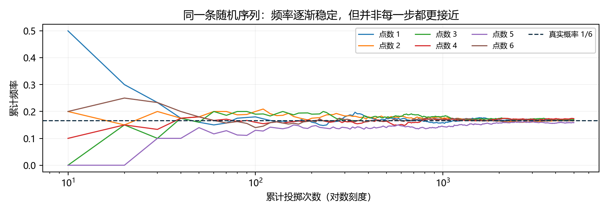
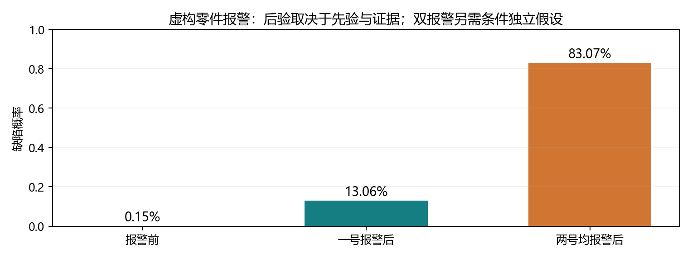
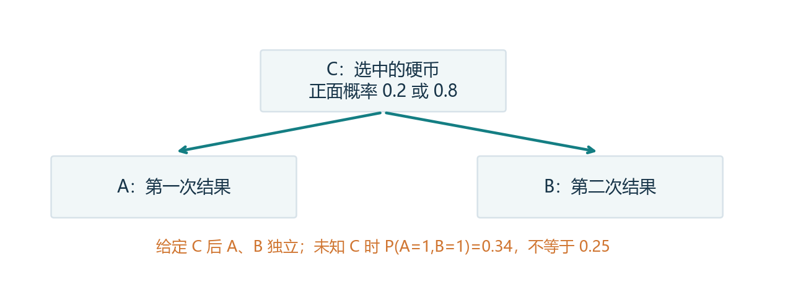
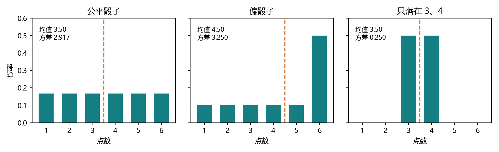

# 2.6 概率：从随机试验到带条件的预测

教材定位：《动手学深度学习》Release 2.0.0，用户提供 PDF 第 91-99 页、正文第 73-81 页，含节末练习。继续一次完整小节：系统解释、一个整节程序、一个综合练习，再集中反馈。本节全部使用虚构概率模型或模拟数据。

## 概率为什么出现在深度学习里

前面已经能整理数据、计算预测与损失、自动求导。但实际预测常有不确定性：一张模糊图片是什么类别，一个零件是否有缺陷，下一次试验会出现什么结果？概率让我们定量描述这些不确定性。

一种不确定性来自试验本身的随机性，另一种来自信息不足或模型不了解真实情况。概率可以用于两类情形；预测值为 0.9 也不自动保证模型校准良好或本次预测正确。

| 问题 | 本节工具 |
| --- | --- |
| 一次试验可能发生什么 | 样本空间、事件、随机变量 |
| 各种结果如何分配可能性 | 概率分布、抽样与经验频率 |
| 两件事一起发生的可能性 | 联合概率 |
| 已知一件事，再判断另一件 | 条件概率、贝叶斯公式 |
| 怎样概括分布的位置与波动 | 期望、方差、标准差 |

主线是“已知分布 → 模拟数据 → 估计频率 → 加入条件 → 更新判断”。计算会用到 2.1、2.3 的轴、广播、求和和点积，不再逐个函数拆成小课。

<!-- pagebreak -->

## 1. 样本空间、事件和概率的规则

掷一次骰子的样本空间是 `S={1,2,3,4,5,6}`。一个结果是某个点数；一个事件是一组结果，例如“奇数”是 `{1,3,5}`。若实际结果为 3，奇数事件就发生了。

概率满足三条基本规则：任何事件的概率非负；整个样本空间的概率为 1；互不重叠事件的概率可以相加（一般表述允许可数个事件）。因此空事件概率为 0，任何事件概率不超过 1。

公平骰子的六个结果等可能，所以奇数概率是 `3/6=1/2`。直接按“有利结果数/总结果数”计算，要求这些基本结果等可能；偏骰不能照搬。

<div class="equation">补事件：P(非 A)=1-P(A)</div>
<div class="equation">并集：P(A ∪ B)=P(A)+P(B)-P(A ∩ B)</div>

∩ 表示同时发生，∪ 表示至少发生一个。直接相加会把交集重复算两次，所以需要减掉一次。若互斥，交集为空，才可直接相加。

### 只知道两个边际概率，能确定交集吗

不能，但能限制范围。令 `a=P(A)`、`b=P(B)`：

```text
max(0,a+b-1) <= P(A且B) <= min(a,b)
max(a,b)    <= P(A或B) <= min(1,a+b)
```

例如 a=0.6、b=0.7，交集在 0.3 到 0.6 之间，并集在 0.7 到 1 之间。只有额外知道独立性等关系，才能进一步确定。注意：在连续模型里，“概率为 0”不等于事件在逻辑上不可能发生。

<!-- pagebreak -->

## 2. 随机变量与分布：把结果变成可计算的量

随机变量给试验结果对应一个数。令 X 表示骰子点数，则 `P(X=3)` 是事件 X 取 3 的概率。大写 X 表示随机变量，小写 x 常表示它的某个取值。

离散分布为各取值分配概率，例如公平骰子的概率向量为：

```python
import torch
from torch.distributions import Categorical, Multinomial
p = torch.ones(6, dtype=torch.float64) / 6
print(p, p.sum())
```

每个概率非负，所有可能值的概率和为 1。向量第 0 个位置对应点数 1，而不是点数 0。概率向量是模型的概率分配，不是一次实验已经得到的计数。

计算机不能精确保存所有分数，打印的总和可能是 0.9999999999999999。这是浮点舍入，检查时允许很小误差，概率总和为 1 的数学定义没有改变。

### 连续变量看区间，密度不等于单点概率

连续分布用密度描述；区间概率来自该区间内密度的累积面积。在有密度的模型里，精确落在某个点的概率为 0，并不要求该点密度也为 0。

例如在 `[0,0.5]` 均匀分布，密度为 2；区间 `[0.1,0.2]` 的长度是 0.1，概率为 `2*0.1=0.2`。密度可以大于 1，概率不能。

现实测量会舍入，记录为同一数值的概率与连续模型中的精确单点不同。本节后续主要使用离散分布，不展开连续积分计算。二分类也不意味着无信息时一定各为 0.5；还需说明对称假设或先验。

<!-- pagebreak -->

## 3. 分类抽样与多项计数：先弄清输出是什么

从分布中生成随机结果叫抽样。一次掷骰可用 Categorical 返回类别索引；Multinomial 则返回多次独立分类试验中，各类别出现的次数。总次数为 1 时，多项计数就是一个独热向量。

```python
torch.manual_seed(20261019)
label = Categorical(probs=p).sample()  # 一个 0-5 的索引
one = Multinomial(total_count=1, probs=p).sample()
ten = Multinomial(total_count=10, probs=p).sample()
print(label, one, ten)
```

不要把十次试验的六类计数理解成十个点数的列表。例如 `[2,1,0,3,2,2]` 的长度是 6，元素和才是 10。

教材模拟 m 组、每组 n 次：

```python
m, n = 500, 10
torch.manual_seed(20261019)
counts = Multinomial(total_count=n, probs=p).sample((m,))
cum_counts = counts.cumsum(dim=0)
estimates = cum_counts / cum_counts.sum(dim=1, keepdim=True)
print(counts.shape)  # (500,6)
print(cum_counts[-1].sum())  # 5000
print(estimates[-1])
```

每行是 n 次试验的六类计数；沿组轴累积后，第 i 行包含前 i+1 组的数据。分母保留 `(m,1)`，让这一行的六个计数除以同一个累计总数。这里直接复用上一节之前已学的广播规则。

固定随机种子有助于同一环境复现，既不改变真实概率，也不保证跨版本、设备得到逐位相同的样本。书里的 Notebook 命令和 d2l 绘图包不需要安装；本项目直接保存 Matplotlib 图。

<!-- pagebreak -->

## 4. 概率与频率：大数定律不承诺每一步更准

概率是分布中的设定；频率是样本里观察到的比例。公平骰子真实概率都是 1/6，但投十次通常不可能六个频率都等于 1/6。

在独立同分布的试验条件下，大数定律说明大量样本的频率会趋近对应概率。它不保证一条有限序列每加一个样本，误差都更小。



图中每条线对应一个点数；横轴是累计投掷次数，使用对数刻度显示早期波动。早期数据少，一次结果对比例影响大；数据多时，单个结果的影响变小。

### 改变 m 和 n，究竟改变什么

总试验次数是 m*n。同分布独立试验下，相同总次数的最终计数有相同的概率分布；分组方式主要改变观察中间结果的节奏，不凭空增加信息。

程序对比 `(500,10)`、`(50,100)` 和 `(1000,100)`。前两组总数都是 5000，第三组是 100000。某次模拟的误差不构成精度必然排序；不能挑一次恰好的结果证明某种分组更好。

连续掷出多次 6，也不意味着下一次必须少出 6 来补偿。若每次独立，下一次为 6 的概率仍是 1/6。频率趋近不是骰子具有“记账补偿”的机制。

<!-- pagebreak -->

## 5. 联合概率与边际化：先画一张表

多个随机变量一起建模时，联合概率回答“同时发生”的可能性。为避免引入真实检测知识，本讲义把教材参数改写为虚构零件报警：H=1 表示有缺陷，D=1 表示报警。

先设 `P(H=1)=0.0015`，给定缺陷一定报警，给定合格误报概率为 0.01。联合表如下，行对应 H，列对应 D：

| 联合概率 | D=0 不报警 | D=1 报警 |
| --- | --- | --- |
| H=0 合格 | 0.988515 | 0.009985 |
| H=1 缺陷 | 0 | 0.0015 |

四格总和是 1，每格都表示总体中的一部分。联合概率不超过其中任何单个事件的概率，因为同时满足的范围更小。

```python
joint = torch.tensor([[0.988515, 0.009985],
                      [0., 0.0015]], dtype=torch.float64)
p_h = joint.sum(dim=1)  # [0.9985,0.0015]
p_d = joint.sum(dim=0)  # [0.988515,0.011485]
print(p_h, p_d)
```

把不关心的变量所有可能值加起来，就叫边际化。例如不再区分 H，报警概率就是报警列之和：

<div class="equation">P(D=1)=Σ<sub>h</sub> P(H=h,D=1)=0.011485</div>

因此，行和是 H 的边际分布，列和是 D 的边际分布；这取决于表的轴约定。联合表不要求每行、每列都各为 1。

<!-- pagebreak -->

## 6. 条件概率与贝叶斯公式：分母决定参考范围

条件概率是在某个条件已经成立的范围内重新归一化。只要 `P(B)>0`：

<div class="equation">P(A|B)=P(A ∩ B)/P(B)</div>

竖线右边是已知条件。`P(D=1|H=1)` 把缺陷零件当参考范围；`P(H=1|D=1)` 把报警零件当参考范围。它们问的是两个不同的问题。

```python
d_given_h = joint / p_h.reshape(-1, 1)
print(d_given_h)  # [[0.99,0.01],[0.,1.]]
post = joint[1, 1] / p_d[1]
print(post.item())  # 约 0.130605
```

本表固定一行的 H 条件，所以条件表每行和为 1；教材转置摆放时表现为每列和为 1。先看哪个轴代表“固定条件”，不能死记一律按行或按列。

同一个交集可以从两个方向分解：

<div class="equation">P(A,B)=P(B|A)P(A)=P(A|B)P(B)</div>
<div class="equation">贝叶斯公式：P(A|B)=P(B|A)P(A)/P(B)</div>

P(A) 是看到 B 之前的先验；P(B|A) 描述在 A 成立时看到证据 B 的可能性；P(B) 是证据总概率；P(A|B) 是结合证据后的后验。分母通常需要用边际化算出，不能只把分子当答案。

<!-- pagebreak -->

## 7. 为什么报警后缺陷概率只有约 13.06%

这里“缺陷时一定报警”不等于“报警就一定缺陷”。大部分零件合格，即使合格品只有 1% 误报，也能贡献大量报警。

假想一百万件，按模型计算期望数量：缺陷 1500 件，全部报警；合格 998500 件，约 9985 件误报。报警总数约 11485，因此报警者中缺陷的比例是 `1500/11485≈13.06%`。

```python
prior = 0.0015
tp1, fp1 = 1.0, 0.01
evidence = tp1 * prior + fp1 * (1 - prior)
post_first = tp1 * prior / evidence
print(evidence, post_first)
```

若第二种检验给定缺陷时报警概率 0.98、给定合格时误报概率 0.03，并且**给定 H 后，两种结果条件独立**，可相乘得到双报警的条件概率：

```python
tp2, fp2 = 0.98, 0.03
both_defect = prior * tp1 * tp2
both_ok = (1 - prior) * fp1 * fp2
post_both = both_defect / (both_defect + both_ok)
print(post_both)  # 约 0.830720
```



约 83.07% 是在明确参数与条件独立假设下的计算，不是“两次报警必然具有这个概率”。模型参数和误差关系改变，后验也会改变。

<!-- pagebreak -->

## 8. 独立、互斥与条件独立不要混用

独立意味着知道 B 不改变对 A 的概率分配。在相应条件概率有定义时，`P(A|B)=P(A)`；等价地，所有联合取值满足概率乘积关系。

<div class="equation">独立时：P(A,B)=P(A)P(B)</div>

两次独立掷骰都为 6 的概率为 1/36。相反，同一次掷骰“为 1”和“为 2”互斥，交集为 0，概率乘积却为 1/36，因此不独立。互斥的两个正概率事件不会独立。

条件独立是“已经知道 C 后”，A、B 的联合条件概率才能拆开：

<div class="equation">P(A,B|C)=P(A|C)P(B|C)</div>

例如等概率选一枚正面概率为 0.2 或 0.8 的硬币，再连续抛两次。给定是哪一枚，两次按模型独立；不告诉你是哪一枚，第一次正面会让你更倾向于猜正面概率高的硬币，第二次判断也随之变化。



两次各自为正面的概率都是 0.5，但同时正面概率为 `0.5*0.2²+0.5*0.8²=0.34`，不等于 0.25。**条件独立不自动推出无条件独立。**

<!-- pagebreak -->

## 9. 重复检验与马尔可夫链：把假设写清楚

教材问“为什么不做两次第一种检验”。关键不只是单次检验的参数，而是两次误差是否在给定真实状态后独立。

若真的额外满足条件独立，两次第一种检验也可以按公式计算，后验约 93.76%。若只是对同一输入重复同一个确定性算法，结果完全重复，就没有新增证据，不能再乘一次独立似然；后验仍约 13.06%。两种不同检验也不天然独立，需要依据模型或误差来源说明。

### A → B → C 的联合概率怎样简化

一般链式分解是 `P(A,B,C)=P(A)P(B|A)P(C|A,B)`。若 C 在已知 B 后不再依赖 A，则最后一项可写成 P(C|B)：

<div class="equation">P(A,B,C)=P(A)P(B|A)P(C|B)</div>

```python
pa = torch.tensor([0.6, 0.4], dtype=torch.float64)
p_b_a = torch.tensor([[0.8, 0.2], [0.3, 0.7]],
                     dtype=torch.float64)
p_c_b = torch.tensor([[0.9, 0.1], [0.2, 0.8]],
                     dtype=torch.float64)
p_abc = pa[:, None, None] * p_b_a[:, :, None] * p_c_b[None]
print(p_abc.shape, p_abc.sum())  # (2,2,2)，总和 1
print(p_abc.sum(dim=(0, 1)))    # P(C)=[0.62,0.38]
```

每个条件表的行固定前一个变量，所以每行和为 1。这种依赖关系是简单马尔可夫链的形式，不表示 A、C 无条件独立。本例 `P(C=1|A=0)=0.24`，`P(C=1|A=1)=0.59`，可见 A 仍通过 B 影响 C。

<!-- pagebreak -->

## 10. 期望：按概率加权，而不只是把取值平均

离散随机变量的期望是每个取值乘以它的概率，再相加。它描述分布的平均位置，不是下一次必须出现的结果。

<div class="equation">E[X]=Σ<sub>x</sub> xP(X=x)</div>

公平骰子期望为 `(1+2+3+4+5+6)/6=3.5`。一次投掷不会出现 3.5，但大量独立投掷的样本均值会趋近它。

```python
faces = torch.arange(1., 7., dtype=torch.float64)
fair_mean = torch.dot(faces, p)
loaded_p = torch.tensor([0.1,0.1,0.1,0.1,0.1,0.5],
                        dtype=torch.float64)
loaded_mean = torch.dot(faces, loaded_p)
print(fair_mean.item(), loaded_mean.item())  # 3.5，4.5
```

这里点积再次出现：取值向量乘上概率向量，就是加权平均。偏骰的六种取值仍是 1 到 6，但分配给 6 的概率更高，所以期望变大。

### 函数的期望与期望的函数不同

<div class="equation">E[f(X)]=Σ<sub>x</sub> f(x)P(X=x)</div>

公平骰子 `E[X²]=91/6≈15.1667`，而 `E[X]²=3.5²=12.25`。平方是非线性操作，不能随便交换顺序。

样本平均是从实际数据计算的统计量，理论期望是从分布计算的量。数据多时可以接近，但有限样本一般不会完全相等。期望的线性性质不要求各变量独立；其他运算则需要分别分析。

<!-- pagebreak -->

## 11. 方差与标准差：量化围绕期望的波动

方差是偏离期望的平方再取期望；标准差是方差的平方根。平方使正负偏离不相互抵消。

<div class="equation">Var[X]=E[(X-E[X])²]=E[X²]-E[X]²</div>

```python
mu = torch.dot(faces, p)
variance = torch.dot((faces - mu).square(), p)
second_moment = torch.dot(faces.square(), p)
print(variance, second_moment - mu.square())
print(variance.sqrt())
```

公平骰子方差是 `35/12≈2.916667`，标准差约 1.707825；偏骰期望为 4.5，方差为 3.25。方差的单位是取值单位的平方，标准差回到原单位。



右侧分布只在 3、4 各放 0.5 概率，期望仍为 3.5，方差却只有 0.25。因此相同期望并不代表相同分布或相同波动。

### 不要把默认样本方差与分布方差混淆

本节从完整概率表计算理论方差。`torch.var` 默认通常使用 N-1 校正；`correction=0` 是对输入数据按元素数 N 计算。若取值并非等概率，直接对六个点数调用 var 也不能代表该分布方差，必须按概率加权。

<!-- pagebreak -->

## 12. 串起联合抽样、经验后验与模型目标

联合表有四格，可以把四种 `(H,D)` 组合视为四个离散类别。先抽样得到四类计数，除以总数恢复经验联合表，再计算报警范围中的缺陷比例：

```python
torch.manual_seed(20261020)
sample_counts = Multinomial(total_count=1000,
    probs=joint.reshape(-1)).sample((100,))
empirical_joint = (sample_counts.sum(dim=0)
                   / sample_counts.sum()).reshape(2, 2)
alarm_total = empirical_joint[:, 1].sum()
if alarm_total > 0:
    empirical_post = empirical_joint[1, 1] / alarm_total
    print(empirical_joint, empirical_post)
```

这里真实模型参数已知，因此能对照理论后验；实际任务中概率本身往往也需要从数据估计。如果样本里没有出现报警，就不能直接用这个比值估计条件概率。

对于只取 0/1 的报警变量 D，`E[D]=P(D=1)`，`E[D²]=E[D]`，所以方差为 `P(D=1)*(1-P(D=1))`。这个特例会在综合练习里使用。

### 概率怎样进入深度学习的损失

模型若给三个类别分配 `[0.1,0.7,0.2]`，真实标签是第 1 类索引，那么该标签概率是 0.7。一种常见目标是使真实标签的负对数概率变小：

```python
class_probs = torch.tensor([0.1, 0.7, 0.2])
loss = -torch.log(class_probs[1])
print(loss.item())  # 约 0.356675
```

这把“预测概率”接回“损失”，然后才能使用前面的梯度与自动微分。如何从模型输出得到概率、构建分类训练，会在后续章节正式学习；现在不额外跳入新模型。

<!-- pagebreak -->

## 综合实践：从联合计数估计报警后的缺陷比例

先运行 `lessons/ch02/06_probability.py`，再打开 `exercises/ch02/06_probability.py`，集中填写九个表达式。练习使用另一组虚构参数：

```python
prior = 0.02          # P(H=1)
sensitivity = 0.9    # P(D=1|H=1)
false_positive = 0.05  # P(D=1|H=0)
m, n = 200, 100
```

联合表固定行 H=0/1，列 D=0/1。展平后四个类别顺序为 `(0,0)、(0,1)、(1,0)、(1,1)`。每组独立抽 n 个零件，再对 m 组累计。

| TODO | 需要完成的结果 |
| --- | --- |
| 1 | 构造 float64 的 2×2 理论联合表，总和 1 |
| 2 | 生成 `(m,4)` 的分组四类计数 |
| 3、4 | 沿组轴累积，并按每行累计总数归一化 |
| 5 | 最后经验概率恢复成 2×2 表 |
| 6、7 | 分别用经验表和理论表求报警后缺陷概率 |
| 8、9 | 求二值报警变量 D 的理论期望和方差 |

不要硬编码后验或方差；根据前面的联合、条件概率、期望定义填写。模板已经提供显示区，九项答案保持空白。若估计条件概率的分母为 0，需先说明无法直接计算。

完成后一次反馈表与结果，并解释：A. `P(D=1|H=1)` 和 `P(H=1|D=1)` 的分母为何不同；B. m、n 与总样本量的关系，更多样本是否保证每一步误差更小；C. 期望、方差各描述什么，重复同一确定性结果是否算独立新证据。

<!-- pagebreak -->

## 教材练习覆盖与整节速查

教材第 1 题的 m、n 比较已经放在模拟程序与第 4 部分；第 2 题的交并概率上下界在第 1 部分；第 3 题的马尔可夫链在第 9 部分；第 4 题的重复检验与独立性假设也在第 9 部分。四题的知识点按整节串起来，不另拆成多轮小课。

| 名称 | 核心含义 |
| --- | --- |
| 分布 | 为可能取值分配概率 |
| 频率 | 样本里实际观察到的比例 |
| 联合概率 | 两个条件同时成立 |
| 边际化 | 把不关心变量的所有可能取值加起来 |
| 条件概率 | 在已知条件范围内重新归一化 |
| 贝叶斯公式 | 先验结合证据，反转条件方向 |
| 独立 | 联合概率等于边际概率乘积 |
| 条件独立 | 给定某变量后，联合条件概率才可拆开 |
| 期望 | 按概率加权的平均位置 |
| 方差 | 到期望的平方距离再取期望 |

在 VS Code 按 F5，选择“2.6 概率：完整演示”。解释器仍用 `D:/Anaconda/envs/openmmlab/python.exe`。演示会保存四张图、模拟频率与分组比较 CSV，已有环境即可运行。

PDF 阅读版由现有文档工具环境运行 `tools/build_study_pdfs.py --section 2.6` 生成。文件、结果与真实反馈随当前教学回合同步 GitHub，旧练习未提交的状态继续保留。下一节 2.7 查阅文档篇幅短，将按完整一节快速通过。
