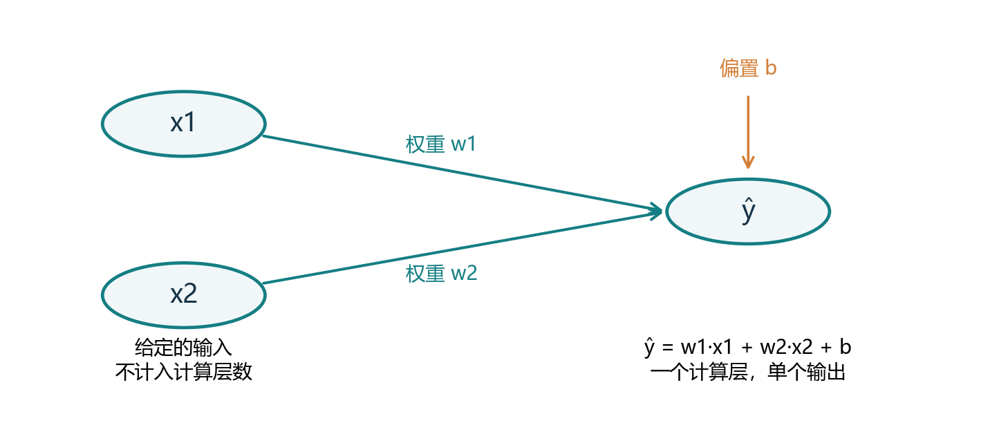
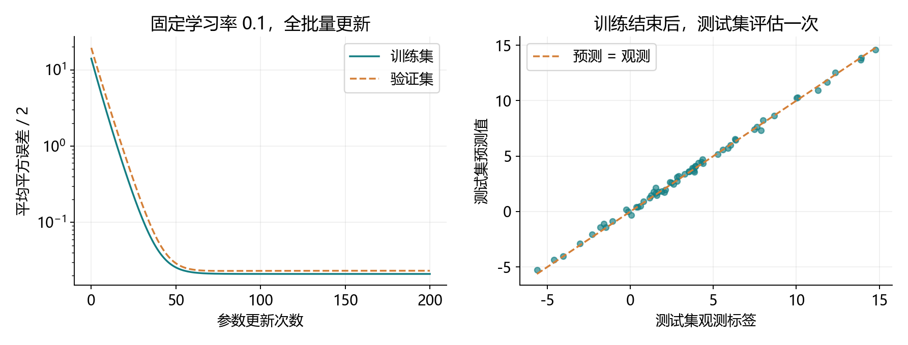
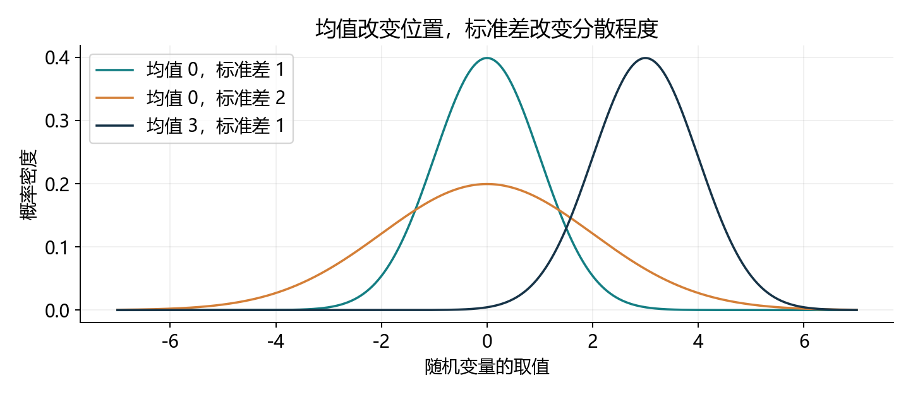
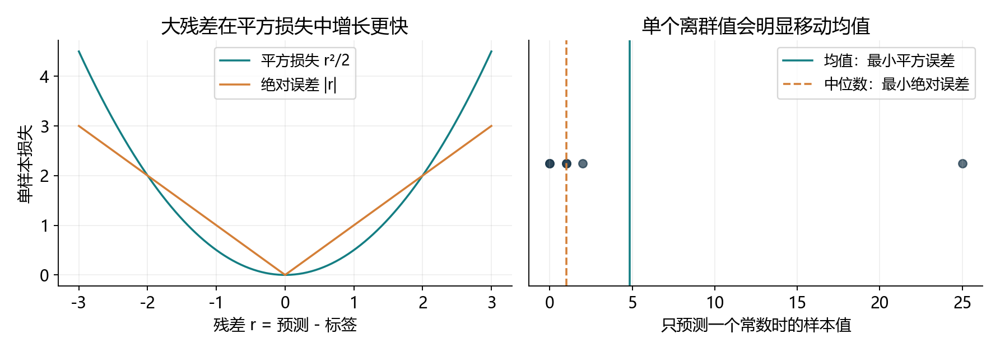

# 3.1 线性回归：把四个要素连成完整学习问题

对应教材 3.1.1–3.1.4 及节末练习，PDF 第 103-112 页、正文第 85-94 页。先完整理解一轮学习，3.2 再组织从零实现的小批量流水线。本轮教师运行和文件验证不代表用户已掌握。

## 先说清楚：我们要预测什么

回归任务预测数值，例如根据面积、房龄预测价格；分类任务预测所属类别。这里的“线性”描述模型的形式，“回归”描述预测数值这一类任务。它不是深度模型，但能把后续训练共同需要的要素全部展现出来。

| 要素 | 线性回归中的具体内容 |
| --- | --- |
| 数据 | 输入特征 X 与已知标签 y |
| 模型 | 用加权和加偏置计算预测 |
| 损失 | 衡量预测与标签的差距 |
| 优化 | 根据梯度反复调整参数 |

一行数据是一条样本，每列输入是一种特征，待预测的数值是标签。训练阶段用标签计算误差；对新样本预测时只需要特征与已经学好的模型。下面的人工数据用于观察原理，不代表真实房价规律。

<!-- pagebreak -->

## 线性模型：每个特征有一个权重

两个特征的预测形式是：

<div class="equation">ŷ = w<sub>1</sub>x<sub>1</sub> + w<sub>2</sub>x<sub>2</sub> + b</div>

x 是输入，w 是权重，b 是偏置，ŷ 是预测值。固定其他特征时，某个输入增加一单位，预测值改变对应的权重那么多。权重的数值依赖特征的单位和尺度；这种模型关系不自动等于因果关系。

偏置让整体预测上下平移。即使现实中所有输入都为零没有实际意义，允许偏置仍能扩大模型的表达范围。严格地说，带偏置的这一变换是仿射变换，教材沿用“线性模型”的常见称呼。



当有 d 个特征时，写成向量形式：

<div class="equation">ŷ = w<super>T</super>x + b</div>

同一个模型对全部样本使用同一组 w、b。训练并不是给每条样本各写一套参数，而是寻找能够解释数据关系的一套共同参数。

<!-- pagebreak -->

## 从一条预测到整批预测与损失

本项目统一采用列形式标签：X 为 (n,d)，w 为 (d,1)，b 为 (1,)，y 与 ŷ 均为 (n,1)。于是整批预测为 X@w+b。偏置通过广播加到每条样本上。

```python
import torch

X = torch.tensor([[1., 0.], [0., 1.],
                  [1., 1.], [2., -1.]], dtype=torch.float64)
y = torch.tensor([[3.], [0.], [2.], [6.]], dtype=torch.float64)
w = torch.zeros((2, 1), dtype=torch.float64, requires_grad=True)
b = torch.zeros(1, dtype=torch.float64, requires_grad=True)
prediction = X @ w + b
loss = ((prediction - y) ** 2).mean() / 2
print(prediction.shape, loss.item())
```

残差定义为 r=ŷ-y。平方让正负误差不会抵消，并对大残差施加更大的代价。教材使用的单样本损失与平均损失为：

<div class="equation">l<sub>i</sub> = (ŷ<sub>i</sub> - y<sub>i</sub>)<super>2</super>/2</div>

<div class="equation">L(w,b) = Σ<sub>i=1..n</sub>(ŷ<sub>i</sub> - y<sub>i</sub>)<super>2</super>/(2n)</div>

这段初始预测全为 0，损失为 6.125。ŷ 与 y 形状相同，计算的是逐样本误差；如果一个是 (n,1)、另一个是 (n,)，广播可能悄悄得到 (n,n)。

此前部分示例直接使用 MSE，本节统一使用 MSE/2。常数 1/2 不改变最优参数，但会把梯度缩小一半。固定数据量时，求和与平均也有相同最优点，却有不同梯度尺度；不能把它们当成每一步更新都相同。

<!-- pagebreak -->

## 最小二乘：为什么有时可以直接求解

先把偏置合并到矩阵中。在 X 最右侧加一列 1，得到 A；把 w 与 b 叠成列向量 θ。预测就变成 Aθ，目标是最小化 ||Aθ-y||²/(2n)。

<div class="equation">∇<sub>θ</sub>L = A<super>T</super>(Aθ-y)/n</div>

令梯度为零，得到正规方程：

<div class="equation">A<super>T</super>Aθ = A<super>T</super>y</div>

只有在 A 的列线性无关时，A 的转置乘自身才可逆，才可写出常见公式：

<div class="equation">θ* = (A<super>T</super>A)<super>-1</super>A<super>T</super>y</div>

样本数至少为参数个数是列满秩的必要条件，但不充分。比如把某个特征完整复制一遍，样本再多也不能让两列独立。此时最小二乘仍可有解，只是参数可能不唯一，不能直接套可逆公式。

程序使用最小二乘求解器，不显式形成逆矩阵：

```python
A = torch.cat((X, torch.ones((len(X), 1), dtype=X.dtype)), dim=1)
theta = torch.linalg.lstsq(
    A, y, rcond=1e-12, driver="gelsd"
).solution
print(theta.ravel())
```

这组小数据的解为 [2,-1,1]，依次对应两个权重和偏置。gelsd 是这里显式选择的 CPU 求解方法；当前阶段理解输入输出即可，不要求记住分解算法。

教材中“只有一个最小值”的描述需要加上列满秩等条件。平方损失是凸的，但秩不足时可以有多组参数达到同样小的损失。完整演示提供了不同参数、相同预测的对照。

<!-- pagebreak -->

## 梯度下降与小批量随机梯度下降

直接求解适合规模合适的最小二乘问题；更一般的模型需要迭代优化。对半均方误差，有：

<div class="equation">∂L/∂w = X<super>T</super>(Xw+b-y)/n</div>

<div class="equation">∂L/∂b = Σ<sub>i</sub>(ŷ<sub>i</sub>-y<sub>i</sub>)/n</div>

权重梯度带输入：同样的权重变化，在不同特征值下会造成不同的预测变化。

偏置直接加到预测中，所以预测对偏置的导数为 1。

```python
loss.backward()
print(w.grad.ravel(), b.grad)
# 初始权重梯度 [-4.25, 1.0]，偏置梯度 [-2.75]。
```

梯度指向局部上升方向，沿负梯度更新：w←w-η·grad_w，b←b-η·grad_b。η 是学习率。它控制更新幅度，不能把学习率变大说成“初始梯度本身变大”。

| 更新方式 | 每次用多少数据估计梯度 |
| --- | --- |
| 全批量梯度下降 | 当前全部训练样本 |
| 单样本随机梯度下降 | 一条随机样本 |
| 小批量随机梯度下降 | 一小组随机样本的平均损失 |

若有 128 条训练样本、批量大小为 32，一次遍历数据约有 4 次参数更新。一次遍历称为 epoch，一次参数更新称为 step；本节全批量演示中，一个 step 恰好使用完整训练集。

小批量更新有随机波动，不能要求每一步全训练集损失都下降。即使全批量，学习率过大也会越过低点。loss 已经用 mean 求平均时，更新阶段不要再次除以样本数。

<!-- pagebreak -->

## 参数、超参数与泛化

| 名称 | 在当前任务中怎样得到 |
| --- | --- |
| 权重 w、偏置 b | 根据训练数据及优化规则学习 |
| 学习率、批量大小、训练轮数 | 预先选择，或参考验证表现调整 |
| 输入 X、标签 y | 当前任务提供的数据 |

后一类训练设置称为超参数。它们会影响能否收敛和收敛速度，但本节不通过对它们执行梯度更新来学习。

训练集用于拟合参数，验证集用于比较训练设置，测试集留到方案确定之后评估。数据预处理若需要计算均值、标准差等，也应只在训练数据上拟合，再一致应用到其他数据。

训练损失低并不保证新数据误差低。模型需要从有限样本中学习能够推广的关系，这就是泛化。即使模型形式正确，有限数据中的噪声也会让学到的参数与生成参数有差别。

本次人工实验固定了以下设置，不根据测试结果挑选参数：

| 项目 | 本次设置 |
| --- | --- |
| 数据 | 训练 128、验证 64、测试 64，每条两个特征 |
| 生成关系 | y=2x1-3.4x2+4.2+ε |
| 噪声 | 独立的零均值正态噪声，标准差 0.2 |
| 优化 | 从零初始化，全批量，学习率 0.1，更新 200 次 |
| 复现 | CPU、float64、种子 3101，使用本机已有环境 |

噪声使同样的规律周围出现散点。我们希望恢复稳定关系，而不是要求每个带噪声的标签都被精确穿过。

<!-- pagebreak -->

## 一段完整训练：把已学知识连起来

下面就是教师实验的核心。先生成整份人工数据，只用前 128 条拟合；完整文件另有验证、测试、图示和最小二乘对照。

```python
import torch

g = torch.Generator().manual_seed(3101)
true_w = torch.tensor([[2.], [-3.4]], dtype=torch.float64)
x_all = torch.randn(256, 2, generator=g, dtype=torch.float64)
y_all = x_all @ true_w + 4.2
y_all += 0.2 * torch.randn(256, 1, generator=g,
                         dtype=torch.float64)
x_train, y_train = x_all[:128], y_all[:128]
w = torch.zeros((2, 1), dtype=torch.float64, requires_grad=True)
b = torch.zeros(1, dtype=torch.float64, requires_grad=True)

for step in range(200):
    prediction = x_train @ w + b
    loss = ((prediction - y_train) ** 2).mean() / 2
    loss.backward()
    assert w.grad is not None and b.grad is not None
    with torch.no_grad():
        w -= 0.1 * w.grad
        b -= 0.1 * b.grad
    w.grad = None
    b.grad = None

with torch.no_grad():
    final_loss = ((x_train @ w + b - y_train) ** 2).mean() / 2
print(w.detach().ravel(), b.item(), final_loss.item())
```

循环中的每次前向都会建立新的计算图；backward 计算当前梯度；no_grad 中执行更新；把 grad 设为 None 为下一次累积准备空缓冲。最后重新计算损失，避免把“更新前的 loss”误当成最终参数的损失。

固定数据中，w、b 从零开始可以训练线性回归；深层网络的初始化问题会在后续单独讨论。

<!-- pagebreak -->

## 实际结果：学到了什么，哪里还有误差



| 指标 | 本机实际结果（半均方误差） |
| --- | --- |
| 初始训练损失 | 14.028087 |
| 更新 200 次后训练损失 | 0.021086 |
| 最终验证损失 | 0.023230 |
| 最终测试损失 | 0.026617 |

学到 w≈[1.963403,-3.365796]、b≈4.227026；训练集最小二乘解约为 [1.963404,-3.365797,4.227026]。两种方法几乎一致，说明梯度下降已接近这个训练目标的最优解。

最小二乘解也没有恰好等于生成参数 [2,-3.4,4.2]。原因是我们观察的是有限的带噪声样本，不能把“训练集的最优估计”与“真实生成参数”当成同一个概念。

标准差 0.2 的噪声方差为 0.04；在已知真实均值模型下，期望的半平方误差为 0.02。这不是每份有限数据都必须满足的精确数值，也不能直接当作训练最小值。

对新输入 [1,-1]，学到的模型预测约为 9.556225。预测阶段不需要标签，不更新参数；即使知道生成关系给出的均值是 9.6，也不能提前知道下一条观测中的随机噪声。

<!-- pagebreak -->

## 矢量化：把一整块运算交给底层库

下面两种方式计算相同的逐元素加法：

```python
left, right = torch.ones(10000), torch.ones(10000)
out_loop = torch.empty_like(left)
for i in range(len(left)):
    out_loop[i] = left[i] + right[i]

out_vector = left + right
print(torch.equal(out_loop, out_vector))
```

矢量化减少 Python 逐元素调用和赋值的开销，让底层数值库组织计算。X@w 同时计算一批预测，同样把批量运算交给库执行。

本机测量 5 组。循环每次加 10000 个元素；矢量化重复 1000 次后折算为单次耗时。表中为单次耗时的中位数。

| 方法 | 这次运行的单次中位耗时 |
| --- | --- |
| Python 逐元素循环 | 约 0.056025 秒 |
| left+right | 约 0.000002320 秒 |

这是这个小实验的观测，不是其他模型都能获得的固定倍数。时间受设备、负载、数据量和计时方式影响。演示全部在 CPU 上计时，并先预热；GPU 异步执行需要额外的同步处理，当前不展开。

Python 的训练循环仍然有意义：它控制每一次参数更新。矢量化主要用于把每一步内部的批量数值计算放到张量运算中。

<!-- pagebreak -->

## 正态分布：用概率描述观测噪声

若 ε 服从均值 μ、标准差 σ 的正态分布，概率密度为：

<div class="equation">p(ε) = exp(-(ε-μ)<super>2</super>/(2σ<super>2</super>)) / (√(2π)σ)</div>

μ 决定中心位置；σ>0 决定分散程度，方差为 σ²。所有曲线下的总面积都是 1，曲线高度是密度，不是取某个精确数值的概率。



在线性回归中，常用观测模型为：

<div class="equation">y = w<super>T</super>x + b + ε</div>

其中 ε 是独立的零均值、同方差正态噪声。因此给定 x 后，y 的条件均值是模型预测，条件方差是 σ²。

正态噪声是赋予平方损失概率解释的一组假设。即使实际噪声不是正态分布，仍然可以定义和优化最小二乘目标；此时不要自动沿用正态似然结论。

<!-- pagebreak -->

## 为什么高斯噪声会得到平方损失

训练时已经观察到 X 和 y，似然把它们固定，比较不同参数让这份数据出现的密度大小。假设各条观测在给定输入、参数后独立，联合似然为各条条件密度的乘积。

<div class="equation">p(y|X,w,b) = Π<sub>i=1..n</sub> p(y<sub>i</sub>|x<sub>i</sub>,w,b)</div>

最大化这个乘积，可以改为最小化负对数。乘积变求和，指数里的平方误差被提取出来：

<div class="equation">NLL = (n/2)log(2πσ<super>2</super>) + Σ<sub>i</sub>(y<sub>i</sub>-ŷ<sub>i</sub>)<super>2</super>/(2σ<super>2</super>)</div>

当 σ 是固定正数时，第一项与 w、b 无关，第二项就是平方误差和乘一个正数。因此，在这些假设下，最小化平方误差与最大似然估计选择相同的参数。

```python
import math

sigma = 0.2
mean_prediction = x_train @ w + b
residual = mean_prediction - y_train
n = len(x_train)
nll_formula = n / 2 * math.log(2 * math.pi * sigma ** 2)
nll_formula += residual.square().sum() / (2 * sigma ** 2)
nll_api = -torch.distributions.Normal(
    mean_prediction, sigma
).log_prob(y_train).sum()
print(torch.allclose(nll_formula, nll_api))
```

公式与分布 API 的结果一致，本次总 NLL 约为 -20.907651。连续密度可以大于 1，其负对数就可以为负。

若模型只能预测一个常数 b，平方损失的导数为 Σ(b-y_i)，令它为零得 b=样本均值。这也解释了已知固定方差的正态分布中，均值的最大似然估计为何是样本均值。

<!-- pagebreak -->

## 换一种噪声假设，损失也会改变

教材末题给出 p(ε)=exp(-|ε|)/2。这个密度实际是尺度为 1 的拉普拉斯分布，也叫双边指数分布；它与只取非负值的普通指数分布不同。

其负对数似然为 n·log(2)+Σ|y_i-ŷ_i|，所以对应绝对误差目标。一般多特征绝对误差回归不能直接套平方损失的正规方程；只预测常数时，中位数是一个最优解。



例如 [0,0,1,1,2,25] 的均值是 4.833333，中位数是 1。选择不同损失是在表达不同的误差代价与建模假设，而非只换一个写法。

绝对值在零点不可导，可以使用次梯度；非零残差处的导数只有正负方向。固定学习率可能在最低点附近来回跨越。例如最小化 |b|，从 0.2 开始、步长为 0.3，会在 0.2 与 -0.1 之间往返。

逐渐缩小步长或使用适合非光滑目标的方法可以改善这种现象。这里理解噪声假设、损失形状和优化行为的联系即可，不把一般绝对误差回归当成已有同一条闭式公式。

<!-- pagebreak -->

## 从线性回归看神经网络

前面的连接图有 d 个输入和一个计算输出，输入层本身不执行可学习变换，因此按通常约定称为单层网络。每个输入都连接到输出，这就是一个全连接或稠密计算层。

若连续堆叠两个没有非线性激活的仿射层：h=XW1+b1，ŷ=hW2+b2，展开得：

<div class="equation">ŷ = X(W1W2) + (b1W2+b2)</div>

它仍然是输入的一个仿射变换。只增加这样的层数，并不会突破单个仿射模型能够表达的函数范围；后续引入非线性激活才会改变这一点。

```python
W1 = torch.tensor([[1., 2., 0.], [0., 1., 3.]], dtype=torch.float64)
b1 = torch.tensor([0.1, 0.2, 0.3], dtype=torch.float64)
W2 = torch.tensor([[1.], [-1.], [0.5]], dtype=torch.float64)
b2 = torch.tensor([0.4], dtype=torch.float64)
stacked = (x_train @ W1 + b1) @ W2 + b2
collapsed = x_train @ (W1 @ W2) + (b1 @ W2 + b2)
print(torch.allclose(stacked, collapsed))
```

教材中的生物学段落提供“接收输入、整合信息、产生输出”的启发性类比。人工加权求和、激活函数和反向传播是数学模型，不应把图中的计算节点逐字理解为真实生物细胞的内部结构。

本节打通的是后续共同骨架：给定数据，用模型产生预测，用损失评价，再用优化算法更新参数。模型可以逐渐复杂，这条骨架仍然保留。

<!-- pagebreak -->

## 一次完成综合练习

打开 exercises/ch03/01_linear_regression.py。给定六条、两个特征的人工样本，参数从零初始化。集中填六处 TODO，完成一次完整训练：

| TODO | 需要完成的计算 |
| --- | --- |
| 1 | 整批线性预测，保持 (6,1) |
| 2 | 平均平方误差除以 2，得到标量 |
| 3 | 自动微分计算当前梯度 |
| 4 | 在 no_grad 中用学习率更新两个参数 |
| 5 | 使用最终参数重新预测 |
| 6 | 重新计算最终损失 |

初始化、数据与梯度清理已经提供。答案保持空白，不硬编码权重或最终输出。默认 lr=0.05、更新 200 次；比较学习率时重新启动脚本，从相同起点开始。

集中反馈输出，并解释三个问题：

1. X、w、b 的角色分别是什么？参数与超参数怎样区分？
2. backward、参数更新和梯度清理分别做什么？mean 后为什么不再除样本数？
3. 若数据含噪声，是否必须训练到损失为零？如何检查新样本上的能力？

在 VS Code 按 F5 选择“3.1 线性回归：完整演示”。终端也可运行：

```powershell
& D:\Anaconda\envs\openmmlab\python.exe `
  .\lessons\ch03\01_linear_regression.py
```

数据位于 datasets/ch03，指标、训练曲线、计时和图示位于 reports/ch03。下一节 3.2 会把本节的原理组织为数据迭代器、模型、损失函数和小批量 SGD，不在本节引入新的安装。

扩展参考：PyTorch 最小二乘官方说明 https://docs.pytorch.org/docs/stable/generated/torch.linalg.lstsq.html 。网页 stable 会变化，本节在已有 PyTorch 2.4.1+cu121 中验证。
