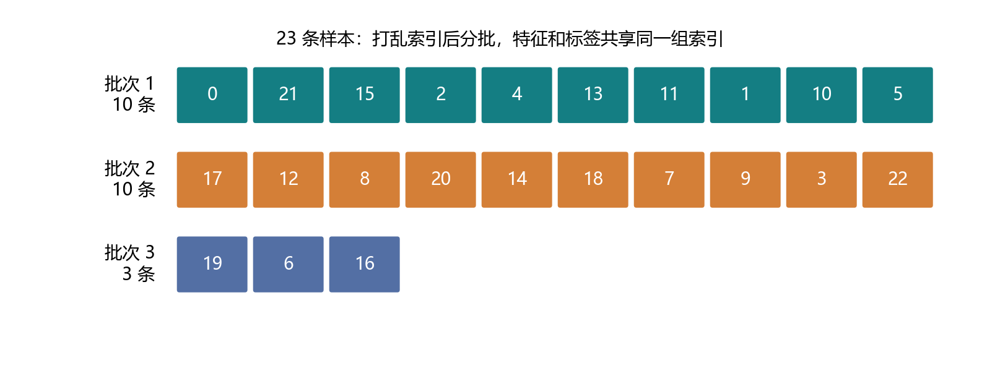
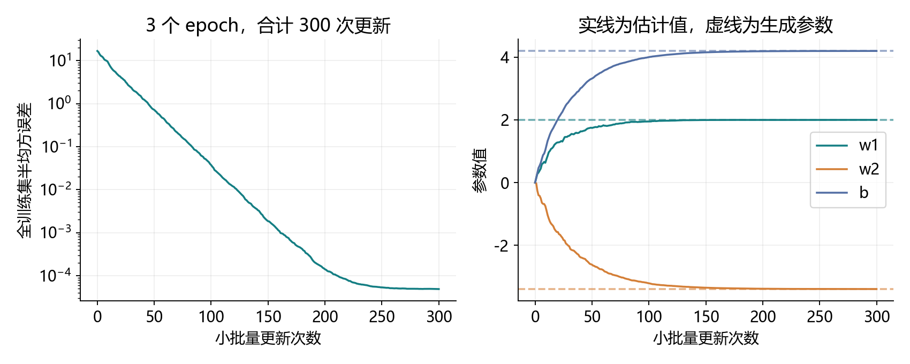
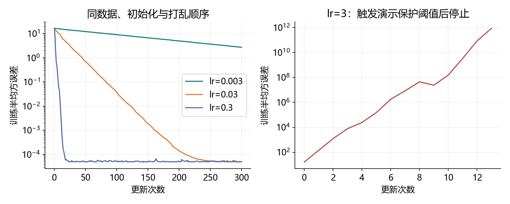

# 3.2 线性回归的从零开始实现

按完整小节学习，对应教材 3.2.1–3.2.7 及节末练习，PDF 第 113-118 页、正文第 95-100 页。统一演示与练习为 ch03/02_linear_regression_scratch.py。本轮材料和教师运行不代表用户已经掌握。

## 把一轮学习组织成可运行的程序

上一节用整批数据观察了线性回归。本节把程序组织成可以反复调用的部件，再用小批量数据训练。核心仍然是张量和自动求导；框架提供的层、数据加载器与优化器放到下一节使用。

| 部件 | 输入到输出的约定 |
| --- | --- |
| synthetic_data | 生成特征与标签，便于核对已知关系 |
| data_iter | 每次交出配对的一批特征与标签 |
| linreg | 根据 X、w、b 计算预测 |
| squared_loss | 返回每条样本的半平方误差 |
| sgd | 更新参数，并清理本轮梯度 |

先连续理解全部部件，再运行一个完整程序。学习目标是能够解释批次怎样进入模型、损失怎样得到梯度、参数怎样被更新，而非只记住输出数字。

<!-- pagebreak -->

## 生成数据：知道规律，才方便检查训练

沿用教材关系 y=2x1-3.4x2+4.2+ε，噪声标准差为 0.01。本项目额外保留验证和测试数据，训练仍使用教材规模的 1000 条样本。

```python
import random
import torch

def synthetic_data(w, b, count, generator):
    x = torch.randn(count, w.shape[0], generator=generator,
                    dtype=w.dtype)
    y = x @ w + b
    y += 0.01 * torch.randn(count, 1, generator=generator,
                           dtype=w.dtype)
    return x, y

true_w = torch.tensor([[2.], [-3.4]], dtype=torch.float64)
g = torch.Generator().manual_seed(3201)
all_x, all_y = synthetic_data(true_w, 4.2, 1400, g)
features, labels = all_x[:1000], all_y[:1000]
```

features.shape=(1000,2)，labels.shape=(1000,1)。中间 200 条用于验证，最后 200 条用于固定方案训练结束后的测试。生成参数仅用于造数据和核对；拟合过程从特征与标签计算梯度。

def 定义函数，return 把函数的结果交给调用处。return x,y 返回两个对象，调用处可以用两个变量接收。函数参数里的 w、b 是生成数据所用的系数，后面训练会另外初始化待学习的参数。

这里固定 Torch 的数据种子、初始化种子，以及 Python 的打乱种子。两个库各有随机数状态，不能以为只设置其中一个就固定了全部随机行为。

<!-- pagebreak -->

## 数据迭代器：同一组索引同时取 X 和 y

先创建全部样本编号，打乱编号，再按批量大小切片。这样保持原数组与标签配对，不需要把特征和标签分别打乱。

```python
def data_iter(batch_size, features, labels, rng):
    indices = list(range(len(features)))
    rng.shuffle(indices)
    for start in range(0, len(indices), batch_size):
        batch_indices = torch.tensor(
            indices[start:start + batch_size],
            dtype=torch.long,
        )
        yield features[batch_indices], labels[batch_indices]
```

| 语法 | 在这个程序中的意思 |
| --- | --- |
| list(range(n)) | 得到编号 0 到 n-1 |
| shuffle(indices) | 原地打乱编号顺序 |
| range(0,n,k) | 起点按 0、k、2k 等前进 |
| indices[start:start+k] | 当前批的编号；右端不包含 |
| yield X,y | 暂停函数，交出这一批并保留进度 |

含 yield 的函数会产生生成器。外层 for 请求下一批时，函数从上次暂停处继续。全部批次交付后，外层循环随之结束。若在第一批就用 return，函数会直接结束，后面的批次不会再提供。

每个 epoch 重新调用 data_iter，重新生成和打乱编号。训练使用同一个 rng 对象，让随机状态向前推进；不要在每次调用内部把种子重置成同一个值，否则每轮顺序会重复。

<!-- pagebreak -->

## 尾批也要训练：23 条样本怎样分成三批



23 条样本、batch_size=10 时，实际批量为 10、10、3。切片到达列表末尾会自然变短；本节生成器保留这个尾批，不需要样本数能够整除批量大小。

```python
rng_preview = random.Random(3203)
preview_x, preview_y = next(
    data_iter(10, features, labels, rng_preview)
)
print(preview_x.shape, preview_y.shape)
```

next 取生成器交出的下一项，两个变量分别接收特征和标签。预览使用单独的 rng，训练再建立自己的随机状态，避免预览改变训练的打乱过程。

23 条数据在一轮中应恰好各使用一次，三批都必须同时保留 X、y 的对应关系。演示用样本编号作为输入、编号加 100 作为标签，实际核对了覆盖完整且配对不变。

每轮更新次数为 ceil(n/batch_size)。因此教材默认 1000 条、批量 10，每轮更新 100 次，3 轮共 300 次。若是 23 条、批量 10，每轮则是 3 次更新。

这个教学迭代器要求数据已在内存中，还会进行随机索引访问。处理大型文件或复杂数据加载时，需要更完整的数据工具；下一节会使用框架提供的组件。

<!-- pagebreak -->

## 初始化、模型和逐样本损失

权重初始化为标准差 0.01 的小随机数，偏置为零。先生成不跟踪梯度的数值，再开启 requires_grad，可以得到待优化的叶张量。

```python
g_init = torch.Generator().manual_seed(3202)
w = (0.01 * torch.randn((2, 1), generator=g_init,
                        dtype=torch.float64)).requires_grad_()
b = torch.zeros(1, dtype=torch.float64, requires_grad=True)

def linreg(x, w, b):
    return x @ w + b

def squared_loss(y_hat, y):
    return (y_hat - y.reshape(y_hat.shape)) ** 2 / 2
```

模型输入一批 X，输出形状为 (实际批量,1)。损失函数也返回同样形状，每个位置是一条样本的损失；它在这里没有求和，也没有求平均。

reshape 的目的只是对齐标签结构。例如预测为 (10,1)、标签为 (10,) 时，直接相减会广播成 (10,10)，把不同样本互相组合。正确对齐后才是逐样本比较。

reshape 不会替我们修复错误的样本顺序，也不能让不同数量的元素成为正确配对。完整演示在损失函数里额外检查了预测与标签的元素数。

若先开启 requires_grad 再缩放，乘法结果通常是非叶张量。默认梯度保存在参与计算的叶参数上。当前先缩放再开启跟踪，便于直接读取参数的梯度。

<!-- pagebreak -->

## 手写 SGD：求和与平均，只归一化一次

这里沿用教材的配套约定：先把逐样本损失求和并反向传播，再在 SGD 中除以实际样本数 k。

<div class="equation">参数 ← 参数 - lr · ∂(Σ<sub>i∈B</sub>l<sub>i</sub>)/∂参数 / k</div>

```python
def sgd(params, lr, num_samples):
    with torch.no_grad():
        for param in params:
            assert param.grad is not None
            param -= lr * param.grad / num_samples
            param.grad.zero_()
```

params 是参数列表 [w,b]，for param 依次处理每个参数。no_grad 让更新操作不被加入求导图；zero_ 清空梯度数值，参数本身仍保留新值。

| 损失如何反向传播 | 更新时是否再除 k |
| --- | --- |
| per_sample.sum().backward() | 除以 k |
| per_sample.mean().backward() | 不再除 k |
| mean 后又除 k | 重复平均，更新额外缩小 k 倍 |

前两种方式在同一批数据、同一初始参数下等价，数值上允许浮点舍入差异。演示在 3 条尾批上实际核对，两组新参数最大差约 5.55e-17。

尾批 k=3，就传 len(X)=3。若错误地固定除以名义批量 10，这批的更新只有正确幅度的 3/10。这里是处理尾批必须检查的地方。

上一节把 grad 设为 None，本节把已有梯度缓冲清零；两者都可用于下一轮梯度准备。不要把清理梯度误解为把权重清零。

<!-- pagebreak -->

## 训练循环：每一批更新，每一轮评估

把前面的函数按顺序放在同一个文件中，再用下面的循环连接。for X,y 接收每次交出的两个张量。

```python
lr, num_epochs, batch_size = 0.03, 3, 10
rng_train = random.Random(3203)

for epoch in range(num_epochs):
    for X, y in data_iter(batch_size, features, labels, rng_train):
        per_sample = squared_loss(linreg(X, w, b), y)
        per_sample.sum().backward()
        sgd([w, b], lr, len(X))
    with torch.no_grad():
        train_loss = squared_loss(linreg(features, w, b), labels)
        print(epoch + 1, train_loss.mean().item())

print(w.detach().ravel(), b.item())
```

内层循环完成一次小批量的前向、损失、反向和更新。外层循环让我们完整遍历数据多轮；第二轮会基于第一轮学到的参数继续，而非每轮重新初始化。

逐样本损失不是标量，直接调用无额外参数的 backward 不符合这里的使用方式。sum 先把它变成一个标量；训练计算仍保留为张量，item 仅在最后记录数值时使用。

每一轮结束后，拿同一套最终参数重新计算整个训练集平均损失。不要把各批不同参数下的损失简单当成“本轮最终模型的损失”；尾批大小不等时，直接平均各批均值还会造成样本权重不等。

每次前向建立新的图，通常不需要 retain_graph=True 来循环训练。梯度缓冲在 sgd 中已经清理，下一批继续使用同一组叶参数。

<!-- pagebreak -->

## 本机实际结果与参数恢复



| 完整遍历次数 | 此时全训练集半均方误差 |
| --- | --- |
| 初始化 | 16.69903414 |
| epoch 1 | 0.03726169 |
| epoch 2 | 0.00014093 |
| epoch 3 | 0.00004899 |

学到 w≈[2.0004044,-3.3997312]，b≈4.2003513。真实减估计约为 [-0.0004044,-0.0002688] 和 -0.0003513，与教材生成参数很接近。

额外验证数据的半均方误差约为 0.00005028，固定训练结束后的测试值约为 0.00005503。对照实验只使用训练和验证数据，没有根据测试表现挑选设置。

噪声标准差 0.01 对应方差 0.0001，已知真实条件均值下期望半平方误差为 0.00005。有限数据和有限更新不会强制得到这个精确数值，也不能把恢复真实参数当成所有机器学习任务的最终目的。

教师程序成功运行只是工程验证。理解各部件后，还需要在综合练习中自己接好训练并解释输出。

<!-- pagebreak -->

## 对照实验：学习率与零初始化

每次比较都重新开始，保持同样的数据、打乱顺序与随机初始化；零初始化对照只改变初始化方式。



| 设置 | 这次实验结果 |
| --- | --- |
| lr=0.003，300 次更新 | 训练损失约 2.72108，仍在缓慢靠近 |
| lr=0.03，300 次更新 | 训练损失约 0.00004899 |
| lr=0.3，300 次更新 | 下降较快，低损失附近波动；最终约 0.00005003 |
| lr=3 | 第 13 次更新后，下一批触发演示停止保护 |
| 全零初始化，lr=0.03 | 最终约 0.00004899，同样能够学习 |

过大学习率对照在某批平均损失超过 1e12 或变成非有限值时停止，避免无意义地继续增长。这个阈值只是演示保护，不是通用的发散判据。

学习率较大并不保证最终更好；小批量梯度存在波动，参数接近最优区域后仍可能摆动。不要把单次批次损失下降当作所有数据上的单调改善。

这个单输出线性模型从零初始化仍有有效梯度。深层网络中的隐藏单元对称性属于另外的问题，不能把本例结论直接推广到所有神经网络。

<!-- pagebreak -->

## 教材拓展：自动微分也能估计物理参数

电压与电流若满足 V≈RI，可以把待估电阻 R 作为参数，构造预测与平方误差，再计算梯度。是否额外拟合截距，应根据模型和测量条件决定。

```python
current = torch.tensor([1., 2., 3.], dtype=torch.float64)
voltage = 2.5 * current
resistance = torch.tensor(1., dtype=torch.float64, requires_grad=True)
physical_loss = ((current * resistance - voltage) ** 2).mean() / 2
physical_loss.backward()
print(resistance.grad)
```

普朗克定律的温度估计也是同一思路：在确定光谱量定义、波长与单位后，把温度作为可微模型的参数，用预测与测量之间的差拟合它。这个关系可以是非线性的。需要处理温度为正、指数计算尺度与数值稳定性，当前作为选读问题，不要求现在完成物理建模。

二阶导数需要继续记录一阶导数的计算过程。例如：

```python
a = torch.tensor(2., requires_grad=True)
first = torch.autograd.grad(a ** 3, a, create_graph=True)[0]
second = torch.autograd.grad(first, a)[0]
print(first.item(), second.item())
```

输出均为 12。高阶计算可能增加内存开销，部分算子或非光滑点也有额外限制。本节手写 SGD 只需要一阶导数，不为普通训练保留高阶计算图。

至此教材七题涉及的零初始化、物理参数、二阶导、reshape、学习率和尾批均已对应到原理或实验。扩展依据：PyTorch 官方 autograd 说明与 NIST 的普朗克定律辐射温度资料；本机 API 行为仍以 PyTorch 2.4.1 实际执行核对。

物理拓展参考：https://tsapps.nist.gov/publication/get_pdf.cfm?pub_id=841231 。

<!-- pagebreak -->

## 一次完成综合实践

打开 exercises/ch03/02_linear_regression_scratch.py。给定 23 条人工样本，批量 10，默认训练 20 个 epoch。六处答案保持空白，集中完成后再运行。

| TODO | 本轮要自己接好的部分 |
| --- | --- |
| 1 | 把当前批索引切片变成 long 张量 |
| 2 | 对齐标签，返回逐样本半平方误差 |
| 3 | 在手写 SGD 中更新参数，除实际样本数 |
| 4 | 调用模型计算本批预测 |
| 5 | 对损失求和并反向传播 |
| 6 | 调用 SGD，传入本批实际大小 |

一次反馈运行结果，并解释：yield 如何接上外层循环、为什么 X/y 共用索引；sum/mean 两种约定怎样等价、尾批分母怎样选择；epoch 与 step 如何换算、零初始化在本例是否有效。

VS Code 按 F5 选择“3.2 从零实现线性回归：完整演示”，或在项目根目录运行：

```powershell
& D:\Anaconda\envs\openmmlab\python.exe `
  .\lessons\ch03\02_linear_regression_scratch.py
```

完整程序将训练数据、逐步指标、学习率对照和三张图保存到 datasets/ch03、reports/ch03。下一节 3.3 使用框架提供的组件简化同一套流程。

参考阅读：https://docs.pytorch.org/docs/stable/generated/torch.autograd.backward.html 。在线 stable 会更新，当前项目继续复用本机已有环境。
