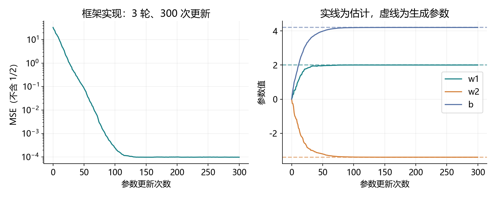
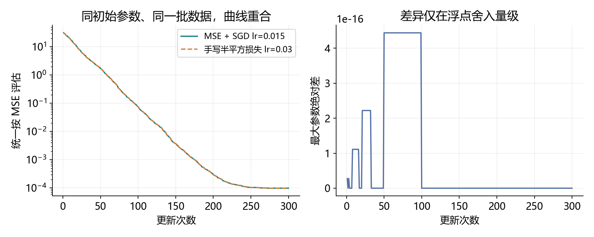
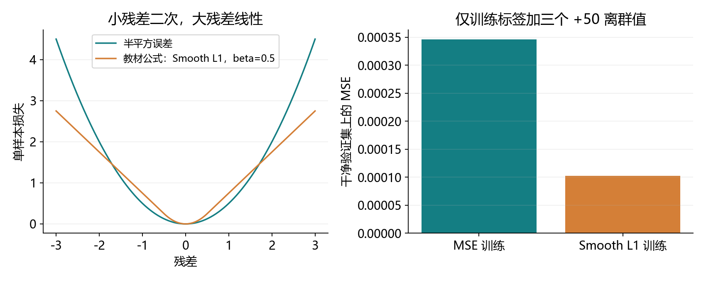

# 3.3 线性回归的简洁实现

完整对应教材 3.3.1–3.3.7 及三道节末练习，PDF 第 119–123 页、正文第 101–105 页。统一演示与综合练习为 ch03/03_linear_regression_concise.py。材料和教师运行不代表用户已经掌握。

## 从五个手写部件到框架组件

上一节已经写出线性回归训练。本节用 PyTorch 部件承担分批、模型计算、损失计算与参数更新。数学关系仍为 y=2x1−3.4x2+4.2+ε；训练顺序仍是计算预测和损失、求导，再更新参数。

| 上一节手写 | 本节使用 | 负责什么 |
| --- | --- | --- |
| data_iter | TensorDataset + DataLoader | 绑定样本，打乱、分批、迭代 |
| linreg 和 w、b | nn.Linear 放在 nn.Sequential 中 | 保存可训练参数并执行线性计算 |
| squared_loss | nn.MSELoss | 根据预测和标签计算损失 |
| sgd | torch.optim.SGD | 根据参数已有的梯度执行更新 |
| 完整训练循环 | 仍然自己组织 | 安排清梯度、求导、更新和评估 |

本节直接复用 3.2 已保存的人工 CSV。训练 1000 条，验证和测试各 200 条；不下载数据、不安装新环境。完整演示包含核对和绘图，综合练习独立留空。

<!-- pagebreak -->

## 复用数据与形状约定

以下 Python 代码可按顺序在项目根目录运行。先从已有 CSV 读取两列特征和一列标签，把它们转成相同数据类型的张量。

```python
import csv
from pathlib import Path
import torch
from torch import nn
from torch.utils.data import TensorDataset, DataLoader

path = Path("datasets/ch03/scratch_train.csv")
with path.open(encoding="utf-8") as f:
    rows = [[float(row[k]) for k in ("x1", "x2", "y")]
            for row in csv.DictReader(f)]
array = torch.tensor(rows, dtype=torch.float64)
features, labels = array[:, :2], array[:, 2:]
assert features.shape == (1000, 2)
assert labels.shape == (1000, 1)
```

每行两项输入、一项标签。标签保留列形状，避免损失计算发生广播。float64 沿用上一节，方便严密对照；实际项目也常用 float32，模型与输入必须匹配。

csv.DictReader 每次给出一行“列名到文字”的映射。row[k] 用列名取值，float 把文字转成数值；内部列表依次保存 x1、x2、y，外层列表收集全部样本。array[:, :2] 选所有行的前两列；array[:, 2:] 选最后一列，并保留二维结构。

训练集参与计算梯度和更新。验证集用于观察学习效果、比较方案；测试集留到默认方案结束后报告。完整程序的 load_splits 以同样方式读取三份 CSV；本页为了突出核心流程，只展示训练数据读取。

本节不重新生成数据，便于确认实现差异来自损失、批次或优化方式，而非换了一组样本。随机模型的起点与打乱方式仍需另外控制；仅仅复用数据不代表两段训练会走相同轨迹。

<!-- pagebreak -->

## 数据加载：绑定样本，再按批取出

TensorDataset 把 features[i] 和 labels[i] 绑定成同一条样本；DataLoader 决定每次取几条、是否打乱、是否丢弃尾批。打乱的是整对样本，特征与标签仍然一一对应。

```python
dataset = TensorDataset(features, labels)
loader = DataLoader(
    dataset, batch_size=10, shuffle=True,
    drop_last=False, num_workers=0,
    generator=torch.Generator().manual_seed(3303),
)
preview_loader = DataLoader(dataset, batch_size=10)
iterator = iter(preview_loader)
x_preview, y_preview = next(iterator)
print(x_preview.shape, y_preview.shape)
```

输出为 (10,2) 和 (10,1)。预览使用另一个加载器，避免提前消耗训练加载器的随机状态。generator 控制本加载器的随机行为；模型初始化另用种子。每轮重新进入 for 循环时创建新的迭代过程，shuffle=True 可产生新顺序。

| 写法 | 含义 |
| --- | --- |
| TensorDataset(features, labels) | 创建可以按索引读取的配对数据集 |
| iter(loader) | 得到一个记录当前读取位置的迭代器 |
| next(iterator) | 让这个迭代器交出下一批 |
| for x,y in loader | 持续取批次，直到本轮结束 |
| drop_last=False | 保留不足一个完整批量的最后一批 |
| num_workers=0 | 在当前进程加载，适合本节的小型数据 |

教材的 data.TensorDataset(*data_arrays) 用到了参数解包：当 data_arrays=(features,labels) 时，星号把两个元素分别传给函数，等价于 TensorDataset(features,labels)。它不是张量乘法。

23 条样本、batch_size=10：保留尾批时为 10、10、3；drop_last=True 时只保留 10、10。shuffle=True 时丢弃的是当前打乱顺序的尾部，不保证总是原数组最后三条。

反复写 next(iter(loader)) 会反复新建迭代器；要连续取第一、第二批，应保存 iterator 再连续 next。训练通常直接用 for，避免手动管理。

<!-- pagebreak -->

## 线性层：模型同时保存参数和计算规则

nn.Linear(2,1) 表示每条样本有两个输入、一个输出；批量大小不是这里的参数。nn.Sequential 是按顺序调用各层的容器，本节只有一层，net[0] 就是这层线性层。

```python
net = nn.Sequential(nn.Linear(2, 1, dtype=torch.float64))
nn.init.normal_(
    net[0].weight, mean=0., std=0.01,
    generator=torch.Generator().manual_seed(3302),
)
nn.init.zeros_(net[0].bias)
prediction = net(x_preview)
print(net[0].weight.shape, net[0].bias.shape)
print(prediction.shape)
assert net[0].weight.requires_grad
```

输出：权重 (1,2)，偏置 (1,)，预测 (10,1)。Linear 自动注册可训练 Parameter，net.parameters() 会提供这些参数给优化器，不必手动拼一个参数列表。

<div class="equation">ŷ = X W<super>T</super> + b</div>

| 对象 | 形状 | 如何配合 |
| --- | --- | --- |
| X | (批量大小,2) | 每行一条样本 |
| W | (输出数,输入数)=(1,2) | 转置后为 (2,1) |
| X @ W.T | (批量大小,1) | 一批预测 |
| b | (1,) | 广播到各样本的一个输出 |

上一节手写 w 为 (2,1)，这里 weight 为 (1,2)。两者计算关系相同，但保存方向不同；读取参数不能因为看到形状变化就认为模型改变了。

normal_ 将权重初始化为均值 0、标准差 0.01 的小随机数；zeros_ 把偏置设为 0。末尾下划线表示原地写入。nn.init 在适合初始化的无梯度上下文中工作；自定义修改则用 torch.no_grad()。

教材直接操作 .data；本项目优先用 nn.init 或 no_grad，避免绕过自动求导的正常检查。读取数值用 weight.detach()；若需要保存不会随训练改变的快照，再加 .clone()。Linear 默认通常为 float32，本例明确指定 float64，与数据保持一致。

<!-- pagebreak -->

## 均方误差：注意二分之一和标签形状

令 r=ŷ−y。nn.MSELoss 默认 reduction="mean"，计算所有元素平方误差的平均值。本节每条样本只有一个输出，因此分母是当前批量大小 k。

<div class="equation">L = (1/k) Σ r<sub>i</sub>²</div>

```python
loss_fn = nn.MSELoss(reduction="mean")
assert prediction.shape == y_preview.shape
batch_loss = loss_fn(prediction, y_preview)
print(batch_loss.item())
```

| reduction | 返回值 | 本节何时使用 |
| --- | --- | --- |
| "none" | 每个元素的平方误差 | 检查各样本，不直接对多元素结果无参 backward |
| "sum" | 全部平方误差之和 | 需要配合自己的归一化约定 |
| "mean" | 全部平方误差的平均值 | 本节默认，得到标量后反向传播 |

上一节的 squared_loss 返回 r²/2，然后 sum 反传、手写 SGD 除以实际批量 k，等效于优化半均方误差。MSELoss(mean) 没有 1/2，因此在同一参数、同一批次上，其梯度为上一节的两倍。相同学习率也就意味着两倍的更新幅度。

本节使用 mean 后，不要再手动除一次批量大小。torch.optim.SGD 根据现有梯度更新，不会替任意损失自动求平均。多输出模型的 mean 还会除输出元素数，不能总把分母理解为样本数。

形状正确同样重要：预测 (3,1)，标签 (3,) 相减可能广播成 (3,3)，把每个预测与所有标签交叉比较。即使两边数值都是 1、2、3，也会得到错误 MSE=1.333333；把标签改为 (3,1) 后，正确 MSE=0。MSELoss 不会自动替你改成列标签。

这也是前面学习 reshape、广播与按维度求平均的实际用途：张量能计算，不意味着正在计算我们想要的目标。正式训练前先确认预测和标签形状完全相同。

<!-- pagebreak -->

## 训练循环：清梯度、反向传播、更新

```python
trainer = torch.optim.SGD(net.parameters(), lr=0.03)
for epoch in range(3):
    for x, y in loader:
        trainer.zero_grad(set_to_none=True)
        loss = loss_fn(net(x), y)
        loss.backward()
        trainer.step()
    with torch.no_grad():
        train_mse = loss_fn(net(features), labels).item()
    print(epoch + 1, train_mse)
```

| 操作 | 做了什么 | 没有自动完成什么 |
| --- | --- | --- |
| zero_grad(set_to_none=True) | 将参数梯度重置为 None | 不计算新梯度 |
| net(x)、loss_fn(...) | 构建预测和标量目标 | 不更新参数 |
| loss.backward() | 沿计算图计算并累积梯度 | 不执行参数更新 |
| trainer.step() | 用已有梯度更新参数 | 不反向传播，也不清梯度 |

上一节手写 sgd 把更新和清梯度放在同一个函数里；框架优化器将二者分开。因此本节每批开始清理，再求导，再更新。优化器在循环外创建一次，并持续持有同一组模型参数。

梯度是损失对参数的变化率。单输出 MSE 的权重梯度用列向量写为 (2/k) × X.T @ r；Linear.weight 存成行，所以 .weight.grad 也是 (1,2)。偏置梯度为 (2/k)Σr。

```python
# 刚结束训练，最后一批的梯度仍然可以查看。
print(net[0].weight.grad)
print(net[0].bias.grad)
trainer.zero_grad(set_to_none=True)
assert net[0].weight.grad is None
```

要研究某一批的梯度，最佳位置是 backward 之后、清梯度之前；需要留存则 detach().clone()。一旦清成 None，就不能直接读取其数值。下一次 backward 会为参与计算的参数重新产生梯度。

每批 step 一次称为一次参数更新；完整遍历训练集为一个 epoch。1000 条、batch_size=10，每轮 100 次更新，3 轮共 300 次。每轮打印的训练 MSE 是用当前参数重算整个训练集，不是只打印最后一个小批的 loss。

<!-- pagebreak -->

## 实际结果：模型学到了哪些数



教师在已有 openmmlab、CPU/float64 下实际运行，学习率 0.03、批量 10、3 轮。初始化种子 3302，加载器种子 3303；后者固定本节批次顺序，并不声称与上一节 Python random 的顺序相同。

| 时刻 | 整个训练集 MSE | 验证集 MSE |
| --- | --- | --- |
| 初始化 | 33.36642650 | 33.96138694 |
| 第 1 轮 | 0.00024163 | 0.00022558 |
| 第 2 轮 | 0.00009979 | 0.00010264 |
| 第 3 轮 | 0.00009795 | 0.00010050 |

最终 weight≈[[2.00030352,−3.39970369]]，bias≈4.20037655，接近造数据的 [2,−3.4] 和 4.2。固定默认方案结束后，测试 MSE≈0.00011007。测试结果用于最终报告；本节损失对照使用验证集，不用测试集挑方案。

```python
with torch.no_grad():
    final_prediction = net(features)
    final_mse = loss_fn(final_prediction, labels).item()
print(net[0].weight.detach(), net[0].bias.detach())
print(final_mse)
```

标签中有标准差 0.01 的噪声，噪声方差为 0.0001，因此误差接近这个量级很自然。有限样本、随机小批更新和参数估计误差都会影响最后的小数；并非要求每次都精确等于噪声方差。

不能直接拿这里的 MSE 与上一节的半 MSE 比大小，判断哪种实现更好。只有数据划分和评估公式一致，数值比较才有意义。本项目的原始轮次、逐步参数和指标都保存在 reports/ch03/3_3_*，方便复盘。

<!-- pagebreak -->

## 对照实验：让两种实现走同一条路



演示将模型参数复制成手写 w、b，让两种实现接收完全相同的批次。手写半平方损失配学习率 0.03，MSELoss 配学习率 0.015。300 次更新中的最大参数差为 4.44e-16，属于浮点舍入量级。

也可以保持学习率 0.03，把框架损失乘以 0.5；两种方式只选一种，不要同时把学习率和损失都减半。

```python
half_mse = 0.5 * loss_fn(net(features), labels)
assert torch.allclose(
    half_mse, (net(features) - labels).square().mean() / 2
)
```

教材练习 1 要问的是 sum 与 mean 的尺度：使用内置 SGD、没有其他归一化时，sum 的梯度是 mean 的 k 倍。为了保持同样一次更新，从 sum 换成 mean，需要把学习率乘以当前元素数 k；从 mean 换成 sum 则除以 k。

| 目标与更新约定 | 一批中的有效梯度尺度 |
| --- | --- |
| 手写半平方损失 sum，手写 SGD 再除 k | (1/k)Σr_i∇r_i |
| MSELoss(mean)，内置 SGD | (2/k)Σr_i∇r_i |
| MSELoss(sum)，内置 SGD | 2Σr_i∇r_i |

这里的 k 是实际元素数。本节单输出时等于实际批量大小；尾批 3 条就用 3，不能仍按 10 计算。若批大小不一致，用一个固定学习率乘数不能让原始 sum 与 mean 在所有批次都严格对齐。

所以“换成 mean 后学习率该变大还是变小”必须连同原损失、优化器是否另除批量一起判断。默认演示保留教材学习率 0.03；严格等价实验另外使用 0.015，目的和结果已明确分开。

<!-- pagebreak -->

## 教材 Huber 公式：小残差二次，大残差线性

平方损失对大残差的梯度随残差增大，少数错误标签可能强烈拉动参数。教材练习 2 给出的分段函数在小残差时保留二次形式，大残差时改成线性，减小离群值在残差方向上的梯度影响。

<div class="equation">ℓ(r) = r²/(2σ)，当 |r| ≤ σ</div>
<div class="equation">ℓ(r) = |r| − σ/2，当 |r| &gt; σ</div>

当前 PyTorch 中，与教材这条公式准确对应的是 nn.SmoothL1Loss(beta=σ)。nn.HuberLoss(delta=σ) 的整体尺度是它的 σ 倍；只有 σ=1 时两者才完全相同。不能只看到教材叫 Huber 就忽略公式。

```python
r = torch.tensor([-2., -0.5, 0., 0.5, 2.],
                 dtype=torch.float64)
beta = 0.5
target = torch.zeros_like(r)
manual = torch.where(
    r.abs() <= beta,
    r.square() / (2 * beta), r.abs() - beta / 2,
)
smooth = nn.SmoothL1Loss(beta=beta, reduction="none")
huber = nn.HuberLoss(delta=beta, reduction="none")
assert torch.equal(manual, smooth(r, target))
assert torch.equal(huber(r, target), beta * manual)
```

torch.where 根据条件逐元素选择结果。阈值处两段数值和一阶导数一致，等号放在哪一段都不影响函数。本节 beta=0.5；小残差区梯度为 r/beta，大残差区为 ±1。若使用 mean，还会除总元素数。

这能缓和大残差的影响，但并不保证对所有数据更好；输入特征的大小仍会影响参数梯度。损失尺度变化也会改变相同学习率下的优化进度，比较时应使用共同的评估指标。

教材练习 3 的梯度查看已在训练页完成：loss.backward() 后读取 net[0].weight.grad 和 .bias.grad。更换损失后也可以采用同样方法，观察大残差对应的梯度变化。

<!-- pagebreak -->

## 离群值实验与常用工具



额外实验只复制训练标签，把编号 0、1、2 的标签各加 50。验证集保持原样；两种损失使用相同初始参数、批次顺序、学习率 0.03，训练 6 轮。统一在干净验证集上用 MSE 评估：

| 用于训练的损失 | 干净验证集 MSE | 最终偏置 |
| --- | --- | --- |
| MSELoss | 0.00034605 | 4.21455295 |
| SmoothL1Loss(beta=0.5) | 0.00010275 | 4.20024358 |

本次固定运行中 Smooth L1 更接近原关系。这是用来观察离群影响的有限实验，不能推广为普遍性能结论；两种训练目标的梯度尺度不同，相同轮数不代表优化程度完全一样。也不要直接比较两种训练损失的原始数值，右图使用相同验证 MSE 才可解释。

教材练习 2 还要求了解框架可选的损失和初始化方法。先认用途，后面遇到具体模型再展开：

| 工具 | 当前需要知道的用途 |
| --- | --- |
| nn.MSELoss | 平方误差；本节默认回归目标 |
| nn.L1Loss | 绝对误差，大残差区增长为线性 |
| nn.SmoothL1Loss、nn.HuberLoss | 二次和线性连接；注意尺度关系 |
| nn.CrossEntropyLoss | 后续分类任务会使用 |
| nn.init.normal_、uniform_ | 按正态或均匀分布写入参数 |
| nn.init.zeros_、constant_ | 写入零或指定常数 |
| nn.init.xavier_uniform_、kaiming_normal_ | 根据网络结构选择的初始化，后续再学 |

<!-- pagebreak -->

## 一次综合实践与集中反馈

打开 exercises/ch03/03_linear_regression_concise.py，一次填写八处 TODO：数据集、加载器、线性模型、损失、优化器、当前批损失、反向传播、参数更新。生成数据与初始化已提供，练习保持留空。

练习有 37 条样本、2 个输入、1 个输出；已知生成关系为 y=1.5x1−2x2+0.7+ε。默认每批 8 条，保留尾批，训练 20 轮。使用 MSELoss(mean) 后，不再手动除批量。

```powershell
& 'D:\Anaconda\envs\openmmlab\python.exe' `
  lessons/ch03/03_linear_regression_concise.py
& 'D:\Anaconda\envs\openmmlab\python.exe' `
  exercises/ch03/03_linear_regression_concise.py
```

也可以在 VS Code 按 F5，选择“3.3 线性回归简洁实现：完整演示”或“综合练习”。无需新建环境。演示文件后半部分负责核对、保存与绘图，先读 train 函数，就能抓住本节的训练主线。

完成后，把权重与偏置、最终 MSE、首轮各批量大小、更新总次数一起发来，再集中解释三组问题：

1. Linear 的权重为什么是 (1,2)？TensorDataset 与 DataLoader 各负责什么？
2. MSELoss 与上一节半平方损失的梯度差在哪里？zero_grad、backward、step 各做什么？
3. 37 条、每批 8 条、20 轮时，尾批和更新次数是多少？教材分段 Huber 公式准确对应哪个 API？

这一节完成的主线是：配对数据 → 批次 → 线性层 → 标量损失 → 梯度 → 优化器更新 → 独立评估。减少手写部件后，仍然要自己保证形状、损失尺度、更新顺序和评估方式正确。

下一节是 3.4 softmax 回归，从连续数值预测转向类别预测。旧综合练习未作答的状态保留；教师程序运行与资料准备不记作用户掌握。

参考范围：用户教材 3.3 及 PyTorch 官方 Linear、DataLoader、SGD、SmoothL1Loss 文档。官方页面入口如下，数学与本机实测记录见 reports/ch03/3_3_verification.md。

https://docs.pytorch.org/docs/stable/data.html

https://docs.pytorch.org/docs/stable/generated/torch.nn.Linear.html

https://docs.pytorch.org/docs/stable/generated/torch.nn.SmoothL1Loss.html
