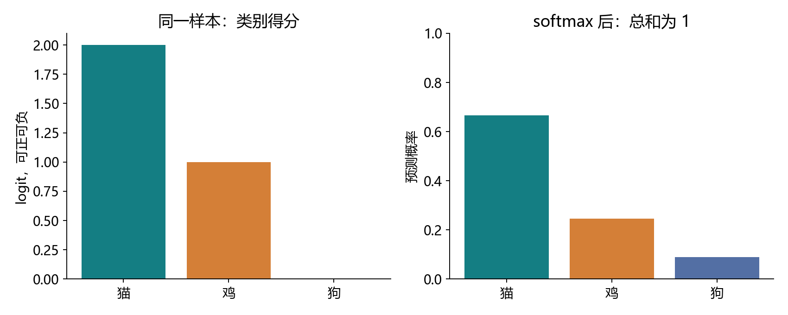
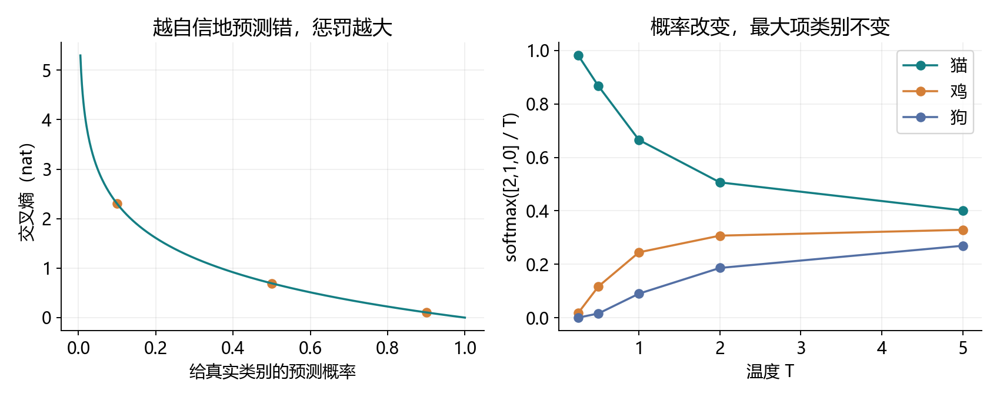
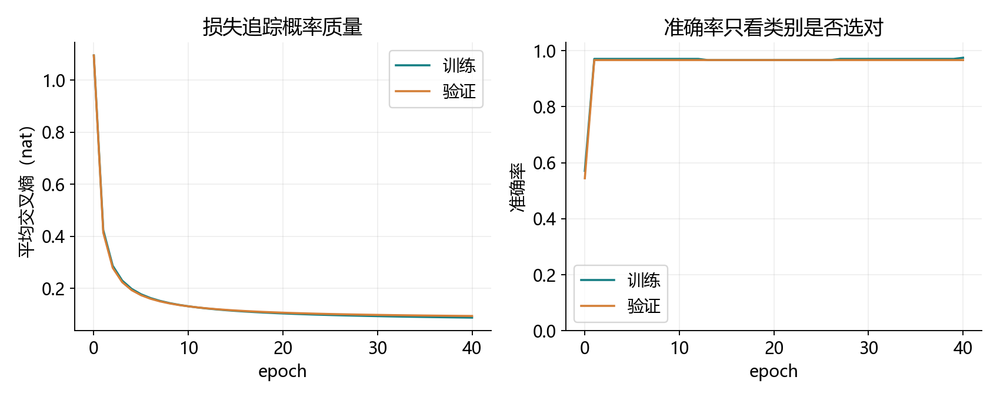
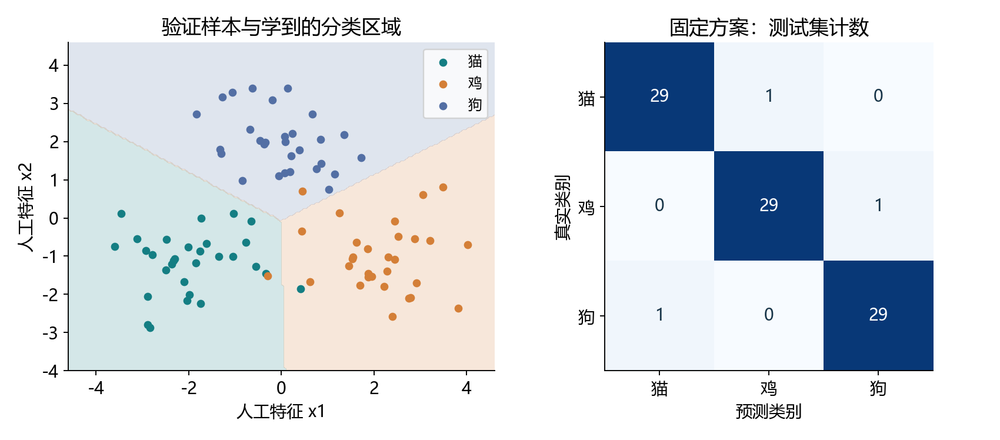

# 3.4 softmax 回归

完整对应教材 3.4.1–3.4.8 及三道节末练习，原 PDF 第 123–129 页、正文第 105–111 页。整节讲解、一个教师演示和一个留空综合实践配套使用。以下实测均属于材料验证，不代表用户已掌握。

## 从预测数值到选择类别

线性回归预测房价、时长等数值；分类预测某个样本属于哪一类。softmax 回归虽然名字里有“回归”，解决的是分类。它先为每个类别产生一个得分，再把得分转换成一个概率分布。

| 阶段 | 本节要回答的问题 |
| --- | --- |
| 标签 | 如何表示猫、鸡、狗，为什么不直接回归编号？ |
| 模型 | 每个类别的得分怎样从输入算出来？ |
| 概率 | 得分怎样转换成非负且总和为 1 的数？ |
| 损失与梯度 | 怎样鼓励真实类别获得较高概率？ |
| 评估 | 为什么同时看交叉熵和准确率？ |

本项目固定类别映射为 0=猫、1=鸡、2=狗。教师实践使用三组二维人工点，仅借用这三个类名帮助理解；它不是动物图像识别模型，不需要下载任何数据。

输入 → 各类别得分 → softmax 概率 → 交叉熵 → 梯度 → 参数更新，组成完整知识链。先理解这条主线，再阅读末尾关于二阶导数、编码与光滑最大值的教材拓展。

<!-- pagebreak -->

## 类别编号和独热标签：名称没有距离

猫=0、鸡=1、狗=2，只是查表用的编号。不能因此认为猫与鸡的距离是 1、猫与狗的距离是 2。对编号直接计算 MSE，会把任意命名强加成数值顺序；交换编号还会改变这个错误目标。

数学上常把标签写成独热向量：猫 [1,0,0]，鸡 [0,1,0]，狗 [0,0,1]。PyTorch 的常见分类接口可以直接使用整数标签，无需实际构造独热矩阵。

```python
import csv
from pathlib import Path
import torch
from torch import nn
from torch.nn import functional as F
from torch.utils.data import TensorDataset, DataLoader

path = Path("datasets/ch03/softmax_train.csv")
with path.open(encoding="utf-8") as f:
    rows = list(csv.DictReader(f))
features = torch.tensor(
    [[float(r["x1"]), float(r["x2"])] for r in rows],
    dtype=torch.float64,
)
labels = torch.tensor([int(r["class_id"]) for r in rows])
one_hot_labels = F.one_hot(labels, num_classes=3).double()
assert features.shape == (240, 2)
assert labels.shape == (240,) and labels.dtype == torch.long
assert one_hot_labels.shape == (240, 3)
```

本页及后续 Python 块可按顺序在项目根目录运行。先运行一次完整演示，便会在 datasets/ch03 生成这些可复现的人工 CSV。

注意与回归的区别：回归标签常保留 (批量,1) 的浮点张量；这里使用 (批量,) 的 long 类别索引。若传入软标签，则使用与得分同形状的浮点概率向量，并自己保证非负、每行总和为 1。

有自然次序的标签可以采用专门的有序建模方法，但“有次序”也不自动意味着相邻编号具有相同距离。本节讨论互斥、单标签的普通多类别分类；多标签任务以后再区分。

<!-- pagebreak -->

## 网络架构：一个类别对应一个仿射得分

教材用 2×2 灰度图像举例。把四个像素展开成四个输入，每个类别分别计算一套加权和，得到三个 logit。logit 在本节指尚未归一化的类别得分，可正可负，也不要求总和为 1。

<div class="equation">o<sub>j</sub> = Σ<sub>k</sub> w<sub>jk</sub>x<sub>k</sub> + b<sub>j</sub></div>

```python
tiny_image = torch.tensor([[0., 1.], [0.5, 0.2]],
                          dtype=torch.float64)
flat = tiny_image.reshape(1, 4)
shape_net = nn.Linear(4, 3, dtype=torch.float64)
scores = shape_net(flat)
assert scores.shape == (1, 3)
assert shape_net.weight.shape == (3, 4)
assert sum(p.numel() for p in shape_net.parameters()) == 15
```

4 个输入、3 个类别，需要 4×3=12 个权重，再加 3 个偏置，总计 15 个参数。它只有一层带可训练参数的仿射变换，所以仍称单层网络。

| 对象 | 手写批量约定 | nn.Linear 保存约定 |
| --- | --- | --- |
| 输入 X | (n,d) | (n,d) |
| 权重 W | (d,C) | weight 为 (C,d) |
| 得分 O | X @ W + b | X @ weight.T + bias |
| 输出形状 | (n,C) | (n,C) |

两种权重方向都能表达相同计算，不能把教材不同位置的向量约定与批量约定直接混用。偏置沿样本维广播，每个类别有自己的偏置。

普通稠密层参数数目是 dC+C，主要规模为 O(dC)。教材提到的节约方案需要额外结构约束，不能认为任选一个除数就能免费压缩任意稠密矩阵。例如低秩分解可用 r(d+C) 个权重，但 r 较小时也限制了可表达的矩阵。

<!-- pagebreak -->

## softmax：按每条样本归一化



<div class="equation">p<sub>j</sub> = exp(o<sub>j</sub>) / Σ<sub>k</sub> exp(o<sub>k</sub>)</div>

指数把各得分转成正数，再除总和，就得到总和为 1 的分布。有限精度计算可能把极小概率舍入为 0；数学上有限得分且类别多于一个时，各概率严格位于 0 和 1 之间。

```python
example_logits = torch.tensor([[2., 1., 0.]],
                              dtype=torch.float64)
example_probs = torch.softmax(example_logits, dim=1)
print(example_probs)
assert torch.allclose(example_probs.sum(dim=1),
                      torch.ones(1, dtype=torch.float64))
assert torch.equal(example_logits.argmax(dim=1),
                   example_probs.argmax(dim=1))
```

结果约为 [0.665241,0.244728,0.090031]。这不是说第一类一定正确，而是模型把最大的预测概率给了第一类。

对 (n,C) 的批量输出，dim=1 表示沿类别维操作，每一行分别归一化。若用 dim=0，就在不同样本之间做竞争，不能得到每条样本自己的类别分布。

softmax 保持得分次序，所以只需要类别编号时可以直接对 logits 取 argmax。softmax 只负责转换分布；它本身不保证预测正确，也不保证概率已经校准。

<!-- pagebreak -->

## 稳定计算：平移不变，温度会改变分布

对同一样本的全部得分加相同常数 c，指数中多出的 exp(c) 会在分子分母抵消，概率不变。因此计算时先减去该行最大得分，使最大的指数为 exp(0)=1，可防止大正数造成指数溢出。

```python
def stable_softmax(logits):
    shifted = logits - logits.max(dim=1, keepdim=True).values
    numerator = shifted.exp()
    return numerator / numerator.sum(dim=1, keepdim=True)

extreme = torch.tensor([[1000., 1001., 1002.]],
                       dtype=torch.float64)
assert torch.isfinite(stable_softmax(extreme)).all()
assert torch.allclose(stable_softmax(extreme),
                      torch.softmax(extreme, dim=1))
```

keepdim=True 保留每行最大值的 (n,1) 形状，使其正确广播回 (n,C)。直接计算 exp(1000) 会溢出；得分很小又可能整体下溢。内置 softmax 已处理常见稳定性问题，手写式用于理解。

平移与缩放不同。softmax(o/T) 中 T>0 称为温度：较小的 T 使分布更集中，较大的 T 使分布更平缓；最大得分类别保持不变。它改变概率，不凭空提高模型辨认类别的能力。

稳定 softmax 后再取 log 仍可能因真类概率下溢而出错。例如得分 [1000,0,-1000]、真类为 2 时，显式概率可能成为 0，但稳定交叉熵仍能算出有限损失 2000。

```python
hard_wrong = torch.tensor([[1000., 0., -1000.]],
                          dtype=torch.float64)
assert F.cross_entropy(hard_wrong, torch.tensor([2])) == 2000
```

因此训练时使用 log_softmax 或接收 logits 的 CrossEntropyLoss，不先算概率再手动取对数。更完整的数值实现会在后续实践中继续使用。

<!-- pagebreak -->

## 交叉熵：奖励真实类别的概率



假设给定特征后，各样本标签按模型条件独立，整个数据集的条件似然是各个真实类别概率的乘积。取负对数，把乘积变成求和；最大化似然就等价于最小化交叉熵。

<div class="equation">ℓ = −Σ<sub>j</sub> y<sub>j</sub> log p<sub>j</sub> = −log p<sub>真实类</sub></div>

独热标签只有真实类别的一项为 1，其他项为 0，所以只留下真实类别的负对数概率。给真类的概率为 0.9、0.5、0.1 时，损失约为 0.105、0.693、2.303。越自信地错，惩罚越大。

```python
sample_ce = -F.log_softmax(example_logits, dim=1)[0, 0]
builtin_ce = F.cross_entropy(example_logits, torch.tensor([0]))
assert torch.allclose(sample_ce, builtin_ce)
print(sample_ce.item())
```

示例得分 [2,1,0]、真类 0，交叉熵约 0.407606。PyTorch 默认对样本取平均；当前没有类别权重、忽略标签或标签平滑。使用自然对数时单位为 nat。

CrossEntropyLoss 输入原始 logits，内部等价于稳定的 LogSoftmax 加负对数似然。先把 softmax 概率传进去，会让它把这些概率再当作得分归一化，目标随之改变。查看概率用于展示；计算训练目标直接使用得分。

<!-- pagebreak -->

## 梯度：预测概率减去标签

将 softmax 代入交叉熵，单样本损失可以写成下面的式子，其中 y 的分量和为 1。

<div class="equation">ℓ = log Σ<sub>k</sub> exp(o<sub>k</sub>) − Σ<sub>j</sub> y<sub>j</sub>o<sub>j</sub></div>
<div class="equation">∂ℓ/∂o<sub>j</sub> = p<sub>j</sub> − y<sub>j</sub></div>

两项求导合起来得到 p−y。对独热真类，梯度 p−1≤0，负梯度方向会提高其得分；其他类别的梯度 p≥0，负梯度方向会降低其得分。再经链式法则，就能得到损失对权重和偏置的梯度。

```python
z = torch.tensor([[2., 1., 0.], [0., -1., 2.]],
                 dtype=torch.float64, requires_grad=True)
target_ids = torch.tensor([0, 2])
target_vectors = F.one_hot(target_ids, num_classes=3).double()
mean_ce = F.cross_entropy(z, target_ids)
mean_ce.backward()
expected = (torch.softmax(z.detach(), dim=1) - target_vectors) / 2
assert torch.allclose(z.grad, expected)
print(z.grad)
```

本例是两条样本损失的平均值，所以每行梯度还要除以 2。不能把单样本公式 p−y 直接当作平均批损失的梯度。

若手写 W 为 (d,C)，平均批损失的权重梯度为 X.T @ (P−Y)/n；偏置梯度为 (P−Y).sum(dim=0)/n。nn.Linear 的 weight 方向相反，梯度也要相应转置。

准确率依赖 argmax，通常在小范围参数变化时完全不变，不适合作为这里的求导目标。真实类别已经排第一时，还可以继续提高其概率、降低交叉熵；类别是否选对与概率分配质量是不同信息。

<!-- pagebreak -->

## 信息论：信息量、熵与交叉熵

一个模型认为概率很低的事件实际发生，会带来较大“惊异”。信息量用 −log P(j) 表示，熵是按真实分布 P 求得的信息量期望。

<div class="equation">I(j) = −log P(j)，H(P) = −Σ<sub>j</sub>P(j)log P(j)</div>

| 概念 | 观察者使用的分布 | 表达的量 |
| --- | --- | --- |
| 信息量 | 真实概率 P | 一次具体事件的惊异 |
| 熵 H(P) | 真实分布 P | 真实分布下的平均惊异 |
| 交叉熵 H(P,Q) | 用 Q 预测 P 生成的事件 | 使用预测分布后的平均惊异 |

<div class="equation">H(P,Q) = −Σ<sub>j</sub>P(j)log Q(j) = H(P) + KL(P‖Q)</div>

当 Q=P 时，交叉熵达到熵这个下界。这里固定真实分布，调整预测分布；并非说训练集中每条带噪声样本都可以获得概率 1。交叉熵本身不是对称距离，通常也不满足距离的其他公理。

```python
true_distribution = torch.tensor([.1, .2, .7], dtype=torch.float64)
pred_distribution = torch.tensor([.2, .2, .6], dtype=torch.float64)
entropy = -(true_distribution * true_distribution.log()).sum()
cross_entropy = -(true_distribution * pred_distribution.log()).sum()
kl = (true_distribution * (true_distribution / pred_distribution).log()).sum()
assert torch.allclose(cross_entropy, entropy + kl)
```

自然对数对应 nat，以 2 为底对应 bit：bit 数 = nat 数 / ln(2)，所以 1 nat≈1.4427 bit。三类等概率的熵为 ln(3)≈1.098612 nat，也就是 log2(3)≈1.584963 bit。

压缩中的熵描述平均码长的理论下界，不意味着单个符号能直接存进 1.585 个二进制位。若 P(j)=0，采用 0log0=0 的约定；若 P(j)>0 而 Q(j)=0，交叉熵为无穷大。有限精度训练因此尤其需要稳定的对数概率。

<!-- pagebreak -->

## 把分类接到已有训练循环

教师数据按三类中心 [-2,-1]、[2,-1]、[0,2] 生成，每个坐标加入标准差 0.85 的噪声。训练 240 条，验证和测试各 90 条，各划分内类别均衡。以下继续使用前面读取的 features、labels。

```python
net = nn.Linear(2, 3, dtype=torch.float64)
nn.init.normal_(net.weight, std=.01,
                generator=torch.Generator().manual_seed(3402))
nn.init.zeros_(net.bias)
loader = DataLoader(
    TensorDataset(features, labels), batch_size=24,
    shuffle=True, num_workers=0,
    generator=torch.Generator().manual_seed(3403),
)
criterion = nn.CrossEntropyLoss()
trainer = torch.optim.SGD(net.parameters(), lr=.1)
for epoch in range(40):
    for x_batch, y_batch in loader:
        trainer.zero_grad(set_to_none=True)
        batch_logits = net(x_batch)
        loss = criterion(batch_logits, y_batch)
        loss.backward()
        trainer.step()
```

与上一节相比，主要改动是 Linear 的输出数从 1 改为 3，标签改成长整数类别编号，MSE 换成交叉熵。清梯度、反向传播、优化器更新的顺序沿用已有知识。

240 条、每批 24 条，每轮 10 次更新；40 轮共 400 次。示例使用 CPU/float64，沿用已有环境。模型只产生 logits，未把 softmax 层放在 CrossEntropyLoss 前面。

本节训练是帮助理解理论的人工小实验；下一节 3.5 才正式介绍图像分类数据集，3.6 和 3.7 再在教材数据上分别组织从零与简洁实现。当前不提前下载 Fashion-MNIST。

<!-- pagebreak -->

## 实际结果：损失下降不要求准确率一直变化



| 时刻 | 训练交叉熵 | 训练准确率 | 验证准确率 |
| --- | --- | --- | --- |
| 初始化 | 1.09489275 | 57.08% | 54.44% |
| 第 1 轮 | 0.42367712 | 97.08% | 96.67% |
| 第 10 轮 | 0.13112612 | 97.08% | 96.67% |
| 第 40 轮 | 0.08761749 | 97.50% | 96.67% |

最终验证交叉熵 0.09385067，测试交叉熵 0.07350965；测试 90 条正确 87 条，准确率 96.67%。测试集只报告预先固定方案的结果，没有根据测试结果选择轮数或超参数。

初始化准确率高于 1/3 不矛盾：随机参数的某一次结果并不保证等于随机猜测期望，输入也有可分的结构。训练后仍有错误，说明噪声重叠下，简单线性边界未必能分开每个点。

准确率是离散计数。模型可以在相同准确率下显著降低交叉熵，甚至训练损失下降时有少数样本跨过边界导致准确率短暂下降。它们不是每一步都同涨同跌。

所有原始轮次、实际指标、教材公式核对与四张图保存在 reports/ch03/3_4_*。数据和训练种子均固定，方便复核；教师运行成功不记为用户完成练习。

<!-- pagebreak -->

## 分类决策、准确率与概率校准



```python
with torch.no_grad():
    all_logits = net(features)
    predicted_ids = all_logits.argmax(dim=1)
    accuracy = (predicted_ids == labels).double().mean()
    displayed_probs = torch.softmax(all_logits, dim=1)
print(accuracy.item())
```

accuracy=正确数/总数，本讲称为准确率。教材有时写“精度”，不要与以后分类指标中的 precision（查准率）混淆。本次测试矩阵三行均为 30 条，每行对角线为 29 条，所以正确总数为 87。

softmax 是非线性函数，但两个类别的得分相等仍满足仿射方程。类别区域由线性不等式决定，因此 softmax 回归仍是线性分类模型；图中像素化的边缘来自绘图网格。

最大概率为 0.9 不代表这一次必定正确。校准讨论的是大量可比预测的频率：对许多置信度约为 0.9 的预测，实际正确比例是否也约为 0.9。概率和为 1、交叉熵下降或准确率高，都不单独保证校准。

多类别单标签场景采用最大概率类别，是对称误分类代价下的常见决策。若错误代价不同，决策规则还可能改变。本节只学习普通 argmax，不把它推广成所有应用都最合适的规则。

<!-- pagebreak -->

## 教材练习一：二阶导数对应什么方差

主线先记住单样本一阶导数 p−y。继续对得分求导，得到 Hessian 矩阵，而不仅是一项标量二阶导数。

<div class="equation">∂²ℓ/∂o<sub>j</sub>∂o<sub>k</sub> = p<sub>j</sub>(δ<sub>jk</sub> − p<sub>k</sub>)</div>
<div class="equation">H = diag(p) − pp<super>T</super></div>

对角线上是 p_j(1−p_j)，非对角线上是 −p_jp_k。δ_jk 表示 j=k 时为 1，否则为 0。标签固定时，标签项是线性的，不影响这个二阶导数。

```python
point = torch.tensor([2., 1., 0.], dtype=torch.float64)
p = torch.softmax(point, dim=0)
hessian = torch.autograd.functional.hessian(
    lambda v: torch.logsumexp(v, dim=0) - v[0], point)
analytic_hessian = torch.diag(p) - torch.outer(p, p)
centered_states = torch.eye(3, dtype=torch.float64) - p
covariance = (centered_states.T * p) @ centered_states
assert torch.allclose(hessian, analytic_hessian)
assert torch.allclose(hessian, covariance)
```

这里考虑随机独热向量 U：以概率 p_j 取第 j 个单位向量。它的均值为 p，二阶矩为 diag(p)，所以协方差正是 diag(p)−pp.T。每个分量 U_j 是“是否属于第 j 类”的二值变量，方差为 p_j(1−p_j)。

不要把任意编号 0、1、2 当连续随机数，算出一个标量方差后与完整 Hessian 比较；两者对象不同。教材这里的匹配应理解为独热类别随机向量的协方差。

该矩阵半正定，说明单样本损失对 logits 是凸的；但有一个全 1 方向的零特征值，因为给所有得分加相同常数不改变分布。它也说明参数表达存在冗余，不能仅凭凸性就断言解唯一。

<!-- pagebreak -->

## 教材练习二：三个等概率符号怎样编码

三个符号都以 1/3 概率出现，熵为 log2(3)≈1.585 bit。单个符号的二进制码长必须是整数，不能直接给每个符号安排 1.585 位。

固定长度编码可取 00、01、10，每符号 2 bit，剩余 11 未使用。若允许前缀码，可取 0、10、11，平均长度为 (1+2+2)/3=1.667 bit，仍大于熵；没有一个码字是另一个的前缀，因此能够连续解码。

把 n 个独立观察联合编码，有 3 的 n 次方种等概率组合。用固定块长编码需要 ceil(n log2(3)) 位，所以平均每个符号的位数如下：

| 每块符号数 n | 每块固定码长 | 平均 bit/符号 |
| --- | --- | --- |
| 1 | 2 | 2.000000 |
| 2 | 4 | 2.000000 |
| 3 | 5 | 1.666667 |
| 5 | 8 | 1.600000 |
| 100 | 159 | 1.590000 |

联合两个观察有 9 种结果，固定长度仍需要 4 位，因此这一步还没有降低平均码长；不能把“联合编码有效”理解成每次增大块长都严格变好。继续增加块长，平均码长会趋近熵。

```python
import math
for n in (1, 2, 3, 5, 100):
    bits = math.ceil(n * math.log2(3))
    print(n, bits, bits / n)
```

ceil 是向上取整。每块取整带来的额外开销小于 1 bit，分到 n 个符号后小于 1/n，因此极限为 log2(3)。这个例子说明了熵与长期平均压缩率的关系，也解释了为什么交叉熵可以理解成使用预测分布时的平均编码代价。

<!-- pagebreak -->

## 教材练习三：光滑最大值与 soft-min

教材称为 RealSoftMax 的 log(exp(a)+exp(b)) 是一个标量光滑最大值；本节分类用的 softmax 则输出概率向量。两种运算有关，但返回的对象不同。

令 m=max(o)，C 为项数。提出 exp(m)，可得 log Σexp(o)=m+log Σexp(o−m)。后面的和至少有一项为 1，其余为正，所以有限得分且 C≥2 时严格大于 m，又不超过 m+log C。

<div class="equation">m &lt; (1/λ) log Σ<sub>j</sub>exp(λo<sub>j</sub>) ≤ m + (log C)/λ，λ &gt; 0</div>

右侧额外项随 λ 趋于无穷而趋于 0，由夹逼可知光滑最大值趋于最大值。这也推广了教材两项的证明。有限精度中极小差异可能舍入成相等，不否定数学上的严格不等式。

对应的标量光滑最小值是 −(1/λ)log Σexp(−λo)。若输出类别权重，则可以用 softmax(−o/T) 得到偏向小值的概率向量；标量近似与概率向量同样需要区分。

```python
values = torch.tensor([2., 1., 0.], dtype=torch.float64)
for scale in (1., 2., 5., 10., 100.):
    smooth_max = torch.logsumexp(scale * values, dim=0) / scale
    smooth_min = -torch.logsumexp(-scale * values, dim=0) / scale
    print(scale, smooth_max.item(), smooth_min.item())
```

这里 λ=1/T。logsumexp 的导数是 softmax；这正是交叉熵梯度能化简为 p−y 的原因。光滑最大值不等于把概率最大的一类编号取出来；argmax 返回位置，logsumexp 返回平滑聚合的数值。

这三道拓展题是对主线的深入解释。当前优先能解释得分、概率、交叉熵、梯度与准确率；二阶导数和编码证明可结合本页公式逐步复习，不拆成额外的小课。

<!-- pagebreak -->

## 一次综合实践与集中反馈

统一演示与练习为 ch03/04_softmax_regression.py。VS Code 按 F5，选择“3.4 softmax 回归：完整演示”。读完核心计算，再做一个六条人工样本的综合练习，八处 TODO 保持留空。

```powershell
& 'D:\Anaconda\envs\openmmlab\python.exe' `
  lessons/ch03/04_softmax_regression.py
& 'D:\Anaconda\envs\openmmlab\python.exe' `
  exercises/ch03/04_softmax_regression.py
```

八处分别是独热标签、批量得分、按类别归一化的概率、真实类负对数概率、平均损失、反向传播、最大得分类别和准确率。参数更新和梯度对照已提供，用一次更新串起整条链，不需要重复训练大型模型。

练习手写 W 采用 (2,3)，因此用 X @ W+b；不要照搬 nn.Linear 的存储方向。初始参数为零，所以类别得分相同，argmax 会采用实现的平局规则；这次准确率不能当作学习已发生的证据。

完成后把概率行和、逐样本交叉熵、更新前后损失与准确率、梯度一致性结果一起发来，集中解释三组问题：

1. 类别编号为什么不直接用 MSE 回归？softmax 的 dim=1 在归一化什么？
2. CrossEntropyLoss 应接收得分还是概率？最大项不变时交叉熵还能下降吗？
3. 单样本 p−y 与平均批损失梯度差在哪里？最大概率很高是否就保证正确和校准？

主线速查：标签是答案的表示，logits 是模型得分，softmax 产生概率，交叉熵比较真实标签与预测分布，backward 计算梯度，SGD 更新参数，accuracy 统计类别选择是否正确。

下一节为 3.5 图像分类数据集。未提交的旧练习状态保留，材料验证不记为用户掌握。参考为用户教材 3.4 及 PyTorch 官方 CrossEntropyLoss、log_softmax 文档；本机使用 PyTorch 2.4.1，所用接口均已实测。

https://docs.pytorch.org/docs/stable/generated/torch.nn.CrossEntropyLoss.html

https://docs.pytorch.org/docs/stable/generated/torch.nn.functional.log_softmax.html
