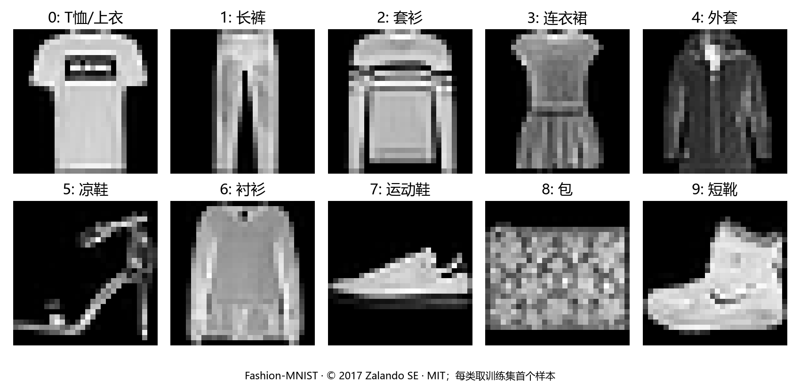
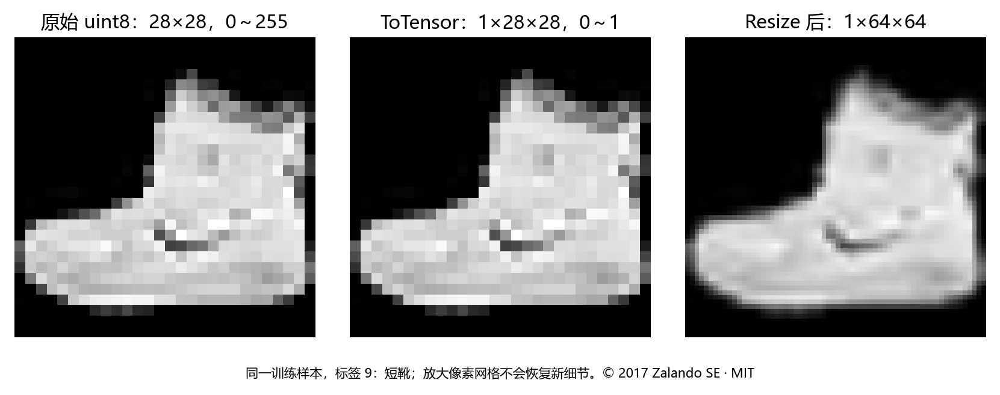
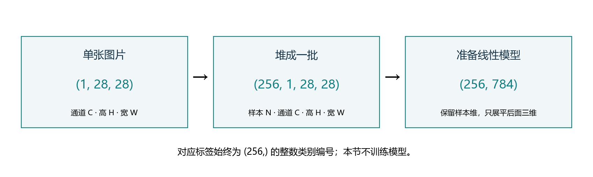
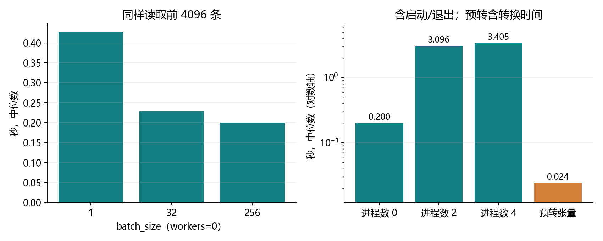

# 3.5 图像分类数据集

对应完整教材 3.5.1–3.5.3 与三道节末练习，原 PDF 第 129–133 页、正文第 111–115 页。统一代码入口为 ch03/05_image_classification_dataset.py。教师运行和资料准备不代表用户已经掌握。

## 这节把真实图像接入学习流程

上一节用二维人工点理解分类。本节换成 Fashion-MNIST 服装图片，完成从“文件中的图片”到“模型可以接收的一批张量”的整条流程。

| 环节 | 本节需要弄清什么 |
| --- | --- |
| 数据集 | 有多少张图，标签编号表示什么？ |
| 图像变换 | 像素、通道、浮点数和尺寸怎样对应？ |
| 数据加载器 | 一批图片怎样堆起来，尾批怎样处理？ |
| 检查与性能 | 怎样确认数据完整、读取方案是否合适？ |

本节读取数据、生成预览，暂不训练模型。下一节 3.6 再把这些批次送入手写 softmax 分类器。

本机已有完整数据，继续使用 openmmlab 和 torchvision。项目 data 中四个硬链接共享已有存储，无需下载或复制整套数据。原始文件只用于读取；GitHub 保存代码、报告、配图和学习 PDF。

<!-- pagebreak -->

## Fashion-MNIST：十类服装，固定标签含义



| 编号 | 类别 | 编号 | 类别 |
| --- | --- | --- | --- |
| 0 | T-shirt/top：T恤/上衣 | 5 | Sandal：凉鞋 |
| 1 | Trouser：长裤 | 6 | Shirt：衬衫 |
| 2 | Pullover：套衫 | 7 | Sneaker：运动鞋 |
| 3 | Dress：连衣裙 | 8 | Bag：包 |
| 4 | Coat：外套 | 9 | Ankle boot：短靴 |

官方训练集 60,000 张，每类 6,000 张；测试集 10,000 张，每类 1,000 张。每张图片为 28×28 的灰度图。标签编号是类别索引，没有大小或距离含义。

MNIST 主要是手写数字；Fashion-MNIST 保持相似的数据形状与划分，用服装类别提供另一种入门分类任务。套衫、衬衫、外套之间存在视觉相似性，不能把一张预览看起来容易区分，当成模型一定能全部预测正确。

图表只用于学习观察，不构成新的数据划分。数据出处、校验和及许可说明随项目报告保存；完整官方许可见 docs/references/fashion_mnist_LICENSE.txt。

<!-- pagebreak -->

## 读取数据：先分清样本与数据划分

以下 Python 块按顺序在项目根目录运行。root 指向项目自己的 data；download=False 使用已准备好的本地文件，避免重复下载。

```python
from pathlib import Path
import torch
from torchvision import datasets, transforms
from torch.utils.data import DataLoader

data_root = Path("data")
transform = transforms.ToTensor()
train_set = datasets.FashionMNIST(
    data_root, train=True, transform=transform, download=False,
)
test_set = datasets.FashionMNIST(
    data_root, train=False, transform=transform, download=False,
)
image, label = train_set[0]
names = ["T恤/上衣", "长裤", "套衫", "连衣裙", "外套",
         "凉鞋", "衬衫", "运动鞋", "包", "短靴"]
assert len(train_set) == 60000 and len(test_set) == 10000
print(image.shape, image.dtype, label, names[label])
```

train_set[0] 取第 0 条样本，返回“图片、标签”这一对对象；双变量接收后分别得到张量与整数。首条训练样本实际标签为 9，对应短靴。

train=True 只是选择官方训练划分，不会启动训练；train=False 选择官方测试划分，也不是把模型设为 eval。教材整合函数旁的文字称“验证集”，但其代码 train=False 实际返回官方测试集。本项目明确使用 test 命名。

需要比较超参数时，应从训练集再划出验证集，保留测试集用于最终报告。本节只检查官方两份数据，不使用测试样本更新参数，也没有创建训练效果指标。

<!-- pagebreak -->

## ToTensor：改数据类型，也改形状和值域



本节原始灰度像素是 0–255 的 uint8。ToTensor 将这种图像转成通道在前的浮点张量，并把像素除以 255，所以 0 变为 0，255 变为 1，128 约为 0.501961。

| 表示 | 形状 | 类型和值域 |
| --- | --- | --- |
| 原始单图 | (28,28) | uint8，0–255 |
| ToTensor 后单图 | (1,28,28) | 本机 float32，0–1 |
| 单个标签 | 一个类别编号 | 整数，不除以 255 |

```python
raw = train_set.data[0]
expected = raw.unsqueeze(0).float() / 255.
assert torch.equal(image, expected)
assert image.shape == (1, 28, 28)
assert image.dtype == torch.float32
print(image.min().item(), image.max().item())
```

本机默认浮点类型为 float32，首图实际值域是 0 到 1。ToTensor 已完成这次像素缩放，后面不要再除一次 255；也不要把标签当像素处理。

这个“除以 255”结论针对本节的 uint8/PIL 灰度输入，不适用于任意类型和任意变换。像素缩放也不是减均值、除标准差的标准化。上一节曾显式使用 float64；后续模型应与本节 float32 图像匹配。

<!-- pagebreak -->

## 批次形状：样本、通道、高、宽



```python
train_loader = DataLoader(
    train_set, batch_size=256, shuffle=True,
    num_workers=0, drop_last=False,
    generator=torch.Generator().manual_seed(3501),
)
test_loader = DataLoader(
    test_set, batch_size=256, shuffle=False,
    num_workers=0, drop_last=False,
)
images, labels = next(iter(train_loader))
assert images.shape == (256, 1, 28, 28)
assert labels.shape == (256,) and labels.dtype == torch.int64
flat_images = images.flatten(start_dim=1)
assert flat_images.shape == (256, 784)
```

NCHW 依次表示批量大小、通道数、高、宽。灰度图只有 1 个通道；RGB 彩色图通常有 3 个通道。256 是一次取出的图片数量，28×28 是每张图片的像素网格。

Dataset 负责按索引返回一对样本；DataLoader 负责抽样、打乱、批量堆叠。原始灰度图经 ToTensor 得到 CHW，加载器再在前面增加 N。图片和标签一起被选择，不能分别打乱。

flatten(start_dim=1) 把每张图的 C、H、W 展成 784 个输入，保留第一维样本数。本节先保留图像结构，展平是为下一节线性分类器做准备；它不会增加图像信息。

<!-- pagebreak -->

## 可视化：从一批张量恢复二维灰度图

Matplotlib 的 imshow 可以接收二维灰度数组。本节单张张量是 (1,28,28)，所以取出唯一通道 images[i,0]，得到 (28,28)。只改变展示表示，不改变对应标签。

```python
import matplotlib
matplotlib.use("Agg")
import matplotlib.pyplot as plt

preview_loader = DataLoader(train_set, batch_size=12)
preview_images, preview_labels = next(iter(preview_loader))
figure, axes = plt.subplots(2, 6, figsize=(10, 3.8))
for i, axis in enumerate(axes.ravel()):
    axis.imshow(preview_images[i, 0].numpy(), cmap="gray",
                vmin=0, vmax=1, interpolation="nearest")
    axis.set_title(str(int(preview_labels[i])))
    axis.axis("off")
output = Path("artifacts/ch03/3_5_docs_preview.png")
output.parent.mkdir(parents=True, exist_ok=True)
figure.tight_layout()
figure.savefig(output, dpi=130)
plt.close(figure)
```

enumerate 同时给出编号和对象；axes.ravel() 将二维子图数组展成一列，便于逐个填图。cmap="gray" 使用灰度显示；统一 vmin=0、vmax=1，避免每张图自动选择不同灰度范围。

图中的数字是真实标签，不是模型预测。本节没有训练模型。教师总览图选择每类的首个训练样本，方便一次对照全部类别；上面的代码则展示原顺序的前 12 条。

预览使用单独的加载器，避免提前消耗训练加载器的随机状态。next(iter(loader)) 创建新迭代器后取第一批；要连续取下一批，应保存迭代器或直接使用 for。

<!-- pagebreak -->

## 整合读取函数：Compose 与 Resize

Compose 按列表顺序应用变换。本节需要改尺寸时，先对 PIL 图像 Resize，再 ToTensor；标签不随图片尺寸改变。下面函数把本节的读取逻辑整合起来。

```python
def load_data_fashion_mnist(batch_size, resize=None):
    operations = []
    if resize is not None:
        operations.append(transforms.Resize(
            (resize, resize), antialias=True,
        ))
    operations.append(transforms.ToTensor())
    transform = transforms.Compose(operations)
    train = datasets.FashionMNIST(
        data_root, train=True, transform=transform, download=False,
    )
    test = datasets.FashionMNIST(
        data_root, train=False, transform=transform, download=False,
    )
    return (
        DataLoader(train, batch_size, shuffle=True, num_workers=0),
        DataLoader(test, batch_size, shuffle=False, num_workers=0),
    )

resized_train, resized_test = load_data_fashion_mnist(32, resize=64)
resized_images, resized_labels = next(iter(resized_train))
assert resized_images.shape == (32, 1, 64, 64)
assert resized_labels.shape == (32,)
```

resize=None 表示保留原始尺寸；若指定 64，本例通过二元组 (64,64) 明确目标高宽。Resize 对像素网格进行重采样，reshape 只重新组织现有元素，不能将 784 个像素直接变成 4096 个像素。

放大到 64×64 会产生更密的插值网格，不会恢复原图没有的细节，也不保证分类效果更好。单图浮点像素数从 784 增至 4096，约为原来的 5.22 倍，批量内存与后续计算也可能增加。

该函数返回的是训练和测试加载器。数据准备过程独立于模型，因此可以在后面的不同分类器之间复用。

<!-- pagebreak -->

## 完整遍历：确认没有漏掉尾批

drop_last=False 时，训练集 60,000 条分为 234 个完整批量和一个 96 条的尾批，共 235 批。测试集 10,000 条分为 39 个完整批量和一个 16 条的尾批，共 40 批。

```python
seen, batches, last_size = 0, 0, 0
counts = torch.zeros(10, dtype=torch.long)
for batch_images, batch_labels in train_loader:
    last_size = len(batch_labels)
    seen += last_size
    batches += 1
    counts += torch.bincount(batch_labels, minlength=10)
assert (seen, batches, last_size) == (60000, 235, 96)
assert torch.equal(counts, torch.full((10,), 6000))
```

| 检查项目 | 训练集 | 测试集 |
| --- | --- | --- |
| 样本数 | 60,000 | 10,000 |
| batch_size=256 时批数 | 235 | 40 |
| 最后一批 | 96 | 16 |
| 每类样本数 | 6,000 | 1,000 |

教师程序已完整读取两份数据并核对类型、配对数量和类别计数。包含这些检查的单次遍历用时约为训练 3.032 秒、测试 0.487 秒；它是本机这次数据读取的实测，不是模型训练耗时。

训练集通常打乱，减少固定顺序的影响；测试集通常保持固定顺序，方便复查。打乱不会改变类名映射，也不等于自动解决类别不均衡或保证每个小批量都含十种类别。

完整遍历代表读过全部样本，和更新参数是两回事。本节没有定义模型、损失或优化器，因此不能把这些输出当成已经完成一次训练。

<!-- pagebreak -->

## 教材性能练习：先测量，再判断



教师固定读取训练集前 4096 条，不打乱，每种方案运行两次并取中位数。常规方案都使用同一个 ToTensor；只改变批量大小或加载进程数。

| 方案 | batch_size | num_workers | 中位总时间/秒 |
| --- | --- | --- | --- |
| PIL → ToTensor | 1 | 0 | 0.427222 |
| PIL → ToTensor | 32 | 0 | 0.228328 |
| PIL → ToTensor | 256 | 0 | 0.199776 |
| PIL → ToTensor | 256 | 2 | 3.095523 |
| PIL → ToTensor | 256 | 4 | 3.404906 |
| 固定变换向量预转 | 256 | 0 | 0.024113 |

本次减少批量到 1 增加了 Python 迭代与批次处理开销。Windows 下多进程启动与通信成本较高，在这组小样本、轻量变换、包含启动的实验里，进程更多反而更慢。因此默认使用 num_workers=0。

预转方案一次把相同子集的 uint8 转成 NCHW 浮点张量，再按批读取；总时间已包含这次转换。它减少重复 PIL/逐样本变换的开销，但需要更多内存，只适用于本节这种固定像素变换。它不是任意数据增强的等价替代。

这些结果只说明本次短任务的读取表现。没有模型、GPU 传输或重型增强，也没有把多轮持久进程的启动成本摊薄；两次计时还会受到系统负载影响，不能推出所有任务都用 0 个进程最快。

<!-- pagebreak -->

## 改进方向与其他数据集

性能应按实际瓶颈改进。若重复 PIL 和固定变换占主要开销，可尝试向量化或缓存；若解码、增强很重，可测试更多加载进程。多进程时还可测试持久 worker 来减少跨轮启动开销，但会保留相关进程和内存。

pin_memory 可用于后续 CUDA 传输场景。本节只测 CPU 读取，没有进行设备传输，也不为缩短计时而安装新库。

Windows 使用多进程时，创建加载器并开始迭代的入口应放在 main 保护内，避免子进程导入脚本时再次启动工作。完整演示已采用这种结构：

```python
def main():
    pass  # 在这里组织读取、计时和保存。

if __name__ == "__main__":
    main()
```

本节固定子集预转需要约 12.25 MiB 的 float32 像素内存；若为 60,000 张全部预转，则约 179.44 MiB，不包括标签和额外对象。随机裁剪等变换若预先固定，会改变每轮重新随机增强的语义。

教材第三题要求查阅其他数据集。torchvision 的接口目录中还可以看到：

| 接口 | 适合认识的任务 |
| --- | --- |
| MNIST | 手写数字分类 |
| CIFAR10、CIFAR100 | 小型彩色自然图像分类 |
| ImageFolder | 按类别文件夹组织自己的图片 |
| VOCDetection、VOCSegmentation | 目标检测、像素分割，标签结构不同 |

并非所有接口都使用相同划分参数、标签格式或下载方式。先读对应说明，确认图像、标签和模型输入输出匹配；本节只查阅这些选项，没有额外下载。

<!-- pagebreak -->

## 一次综合实践与集中反馈

统一入口为 lessons/ch03/05_image_classification_dataset.py，练习为 exercises/ch03/05_image_classification_dataset.py。VS Code 按 F5，选择“3.5 图像分类数据集：完整演示”；重复查看时可加 --skip-worker-benchmark 略过多进程计时。

```powershell
& 'D:\Anaconda\envs\openmmlab\python.exe' `
  lessons/ch03/05_image_classification_dataset.py
& 'D:\Anaconda\envs\openmmlab\python.exe' `
  exercises/ch03/05_image_classification_dataset.py
```

练习用官方训练集前 37 条样本，缩放到 32×32，每批 8 条，保留尾批。八处 TODO 分别为变换、数据集、单图、标签、加载器、保留样本维展平、中文名称映射和二维显示数据。模板保持留空。

完成后，把首图形状/类型/标签、各批大小与覆盖数、尾批展平形状一起发来，并查看程序保存的单图预览。集中解释：

1. (N,C,H,W) 各代表什么？本节 ToTensor 后还要再除一次 255 吗？
2. Resize 与 reshape 有何区别？37 条样本每批 8 条的尾批有几条？
3. train=False 返回验证集还是官方测试集？num_workers 更大是否一定更快？

下一节 3.6 将保留默认 28×28 图像，展平成 784 个输入，从零实现十类 softmax 回归。未提交的旧练习继续保留未验证状态，读取程序成功不记为用户已经掌握。

参考：用户教材 3.5；本机 torchvision 0.19.1 / PyTorch 2.4.1 已实测。数据文件校验和与复用方式见 reports/ch03/3_5_data_integrity.json，性能原始计时见 3_5_benchmark.csv。

https://github.com/zalandoresearch/fashion-mnist

https://docs.pytorch.org/vision/0.19/generated/torchvision.transforms.ToTensor.html

https://docs.pytorch.org/vision/0.19/datasets.html
