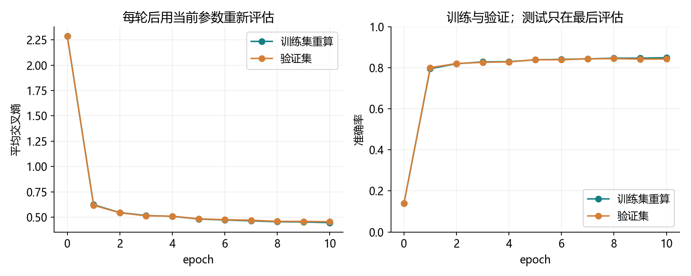
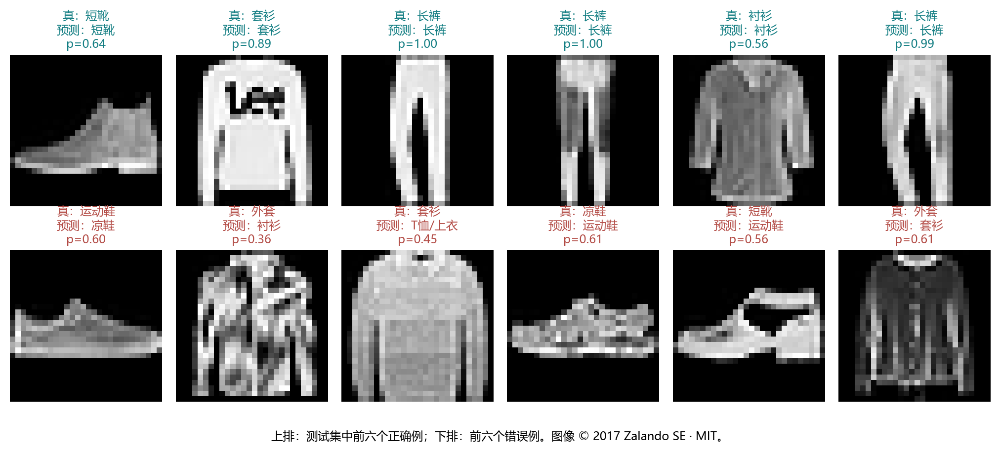
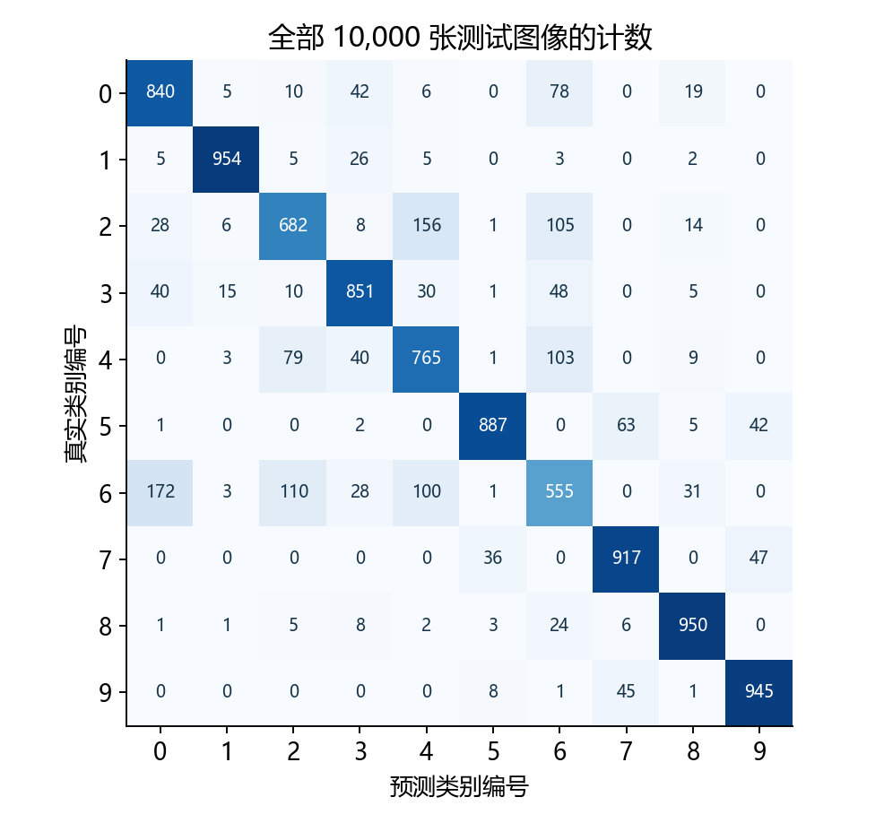
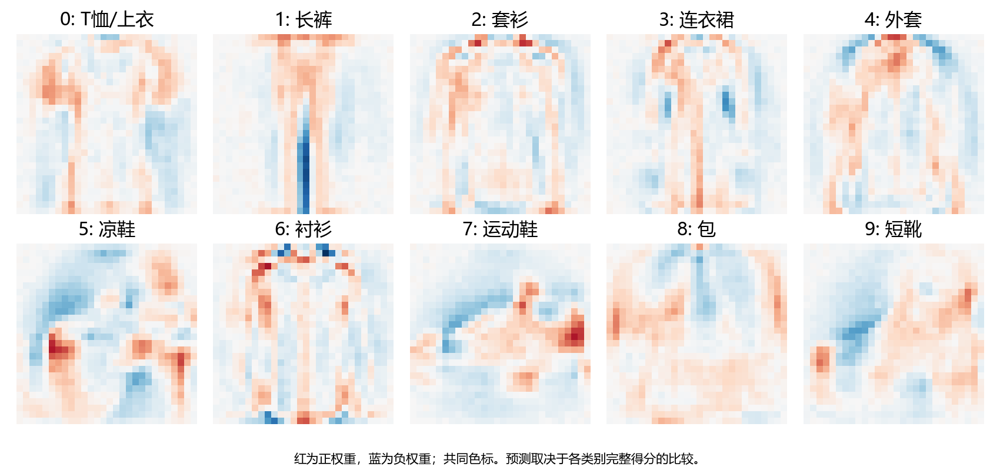

# 3.6 softmax 回归的从零开始实现

完整对应教材 3.6.1–3.6.7 及五道节末练习，原 PDF 第 133–141 页、正文第 115–123 页。整节代码入口为 ch03/06_softmax_scratch.py。教师实验和材料准备不代表用户已掌握。

## 把整条分类链亲手接起来

本节在真实 Fashion-MNIST 上完成训练。数据读取沿用上一节，模型、softmax、交叉熵、统计与 SGD 更新由张量表达式实现，自动求导仍交给 PyTorch。

| 环节 | 输入与输出 |
| --- | --- |
| 展平与得分 | 图片 (n,1,28,28) → 得分 (n,10) |
| softmax 与交叉熵 | 得分 → 概率；真实类别 → 每条样本的损失 |
| 统计与评估 | 累加损失、正确数量、样本数 |
| 反向传播与 SGD | 损失求和 → 梯度 → 除实际批量并更新 |
| 多轮与预测 | 记录训练/验证曲线，最后评估测试集 |

教材把全部官方训练集用于训练，并逐轮查看测试集。本项目另从官方训练集分出验证集：54,000 训练、6,000 验证，测试 10,000 张只在固定十轮方案结束后评估。结果不与教材示例数字直接作同条件比较。

继续使用已有数据和环境，无下载、无安装。核心训练不使用 nn.Linear、内置分类损失或现成优化器；内置损失只在核对环节作为参照。

<!-- pagebreak -->

## 数据划分：固定样本，再谈比较

每个类别从官方训练集取 600 张用于验证，剩余 5400 张用于训练。固定种子和索引生成规则，使后续不同实现可以复用相同划分。以下代码块按顺序读取数据、定义各个部件；完整十轮实验通过配套脚本运行。

```python
from pathlib import Path
import torch
from torch.utils.data import DataLoader, TensorDataset, Subset
from torchvision.datasets import FashionMNIST

raw = FashionMNIST(Path("data"), train=True, download=False)
images = raw.data.unsqueeze(1).float() / 255.
base = TensorDataset(images, raw.targets)
g = torch.Generator().manual_seed(3601)
train_parts, validation_parts = [], []
for class_id in range(10):
    ids = torch.where(raw.targets == class_id)[0]
    ids = ids[torch.randperm(len(ids), generator=g)]
    validation_parts.append(ids[:600])
    train_parts.append(ids[600:])
train_ids = torch.cat(train_parts)
validation_ids = torch.cat(validation_parts)
train_set = Subset(base, train_ids)
validation_set = Subset(base, validation_ids)
assert len(train_set) == 54000
assert len(validation_set) == 6000
```

固定的 uint8→float32/255 与上一节 ToTensor 的结果一致，先转换一次可减少每轮 PIL 处理开销；这是内存中的表示变化，不改写原始文件。图像仍为 (n,1,28,28)，标签为 int64 类别索引。

Subset 只保存索引并引用原数据，不创建新的图片文件。训练与验证索引互不重叠，合起来正好覆盖官方 60,000 张；索引哈希已保存，完整数据与参数文件不上传 GitHub。

<!-- pagebreak -->

## 初始化参数、展平图片与计算概率

```python
g_init = torch.Generator().manual_seed(3602)
W = (.01 * torch.randn(784, 10, generator=g_init)).requires_grad_()
b = torch.zeros(10, requires_grad=True)

def logits_fn(X, W, b):
    return X.reshape(len(X), -1) @ W + b

def softmax(logits):
    shifted = logits - logits.max(dim=1, keepdim=True).values
    numerator = shifted.exp()
    return numerator / numerator.sum(dim=1, keepdim=True)
```

手写 W 的形状为 (784,10)，每列负责一个类别；偏置 b 为 (10,)。总参数数目为 784×10+10=7850。注意与上一节见过的 nn.Linear.weight=(10,784) 存储方向不同。

| 对象 | 形状 | 含义 |
| --- | --- | --- |
| X | (n,1,28,28) | 一批原始形状的图像 |
| 展平后的 X | (n,784) | 每行一张图片 |
| X @ W+b | (n,10) | 每行十个类别得分 |
| softmax 结果 | (n,10) | 每行一个概率分布 |

requires_grad_ 让 W、b 成为需要求导的叶参数。初始化时的小随机数不是训练后的知识，真正学习发生在后面的参数更新。

dim=1 沿类别维归一化；keepdim=True 把每行最大值或总和保留为 (n,1)，方便广播回整行。先减行最大值不改变概率分布，可以防止直接计算很大正数的指数。

<!-- pagebreak -->

## 交叉熵：一组索引同时选出真实类别

教材先返回概率，再取真实类别概率的负对数。下面两条样本的真实类别分别为 0 和 2，因此选择第一行第 0 项、第二行第 2 项。

```python
example_p = torch.tensor([[.1, .3, .6], [.3, .2, .5]])
example_y = torch.tensor([0, 2])
selected = example_p[torch.arange(2), example_y]
print(selected)  # [0.1, 0.5]

def cross_entropy_probabilities(probabilities, labels):
    return -probabilities[torch.arange(len(labels)), labels].log()
```

得到逐样本损失约 [2.302585,0.693147]，形状为 (2,)，尚未求和或平均。这里两组索引是逐对取元素，不是行列交叉形成子矩阵。

正式训练采用数学等价的稳定对数概率，避免某个概率先下溢成 0 后再取 log。仍然使用张量表达式实现，而非调用内置分类损失。

```python
def losses_from_logits(logits, labels):
    shifted = logits - logits.max(dim=1, keepdim=True).values
    log_probs = shifted - shifted.exp().sum(dim=1, keepdim=True).log()
    return -log_probs[torch.arange(len(labels)), labels]
```

<div class="equation">ℓ<sub>i</sub> = log Σ<sub>j</sub>exp(o<sub>ij</sub>) − o<sub>i,真实类</sub></div>

第一种写法便于观察“真实类概率越小，损失越大”；第二种用于稳定训练。数学目标相同，有限精度实现的可靠性不同。不需要截断概率或任意添加一个小常数来改变本节目标。

<!-- pagebreak -->

## 正确数量、准确率与累加器

```python
def correct_count(scores, labels):
    return int((scores.argmax(dim=1) == labels).sum().item())

class Accumulator:
    def __init__(self, n):
        self.data = [0.] * n
    def add(self, *values):
        self.data = [a + float(v) for a, v in zip(self.data, values)]
    def reset(self):
        self.data = [0.] * len(self.data)
    def __getitem__(self, index):
        return self.data[index]
```

教材的 accuracy 函数实际上返回正确数量。本项目在主程序保留这个约定；讲义用 correct_count 命名，便于区分“数量”和“比例”。两条示例中一条正确，正确数量为 1，准确率才是 1/2=0.5。

class 定义一类对象；self 代表当前这个累加器。Accumulator(3) 调用初始化方法，建立三个从零开始的槽位。add 把新数加进去，reset 清零，metric[0] 通过 __getitem__ 读取第一个槽位。

| 槽位 | 累加内容 | 最后怎么使用 |
| --- | --- | --- |
| 0 | 各样本损失的总和 | 除总样本数，得到平均交叉熵 |
| 1 | 正确预测的数量 | 除总样本数，得到准确率 |
| 2 | 样本数量 | 统一作为分母 |

*values 接收多个参数，zip 把旧槽位和新数逐对配合。它只是统计工具，没有可训练参数。不要把 Accumulator 的清零与 W、b 的梯度清零混为一谈。

如果一批 3 条全部正确，另一批 1 条全部错误，总准确率是 3/4=0.75；直接平均两批的准确率会得到 (1+0)/2=0.5。尾批大小不同，必须先累计数量再相除。

<!-- pagebreak -->

## 评估：固定参数，遍历整个划分

```python
def evaluate(data_iter, W, b):
    metric = Accumulator(3)
    with torch.no_grad():
        for X, y in data_iter:
            scores = logits_fn(X, W, b)
            losses = losses_from_logits(scores, y)
            metric.add(losses.sum().item(), correct_count(scores, y),
                       len(y))
    return metric[0] / metric[2], metric[1] / metric[2]
```

评估不更新参数、不进行反向传播。用 no_grad 避免建立不需要的求导图，但依然会完成预测与损失计算。返回值依次为平均交叉熵与准确率。

本节模型是使用 W、b 的普通函数，没有 Dropout 或 BatchNorm 状态。教材也考虑了 nn.Module：这类模型评估时可能需要 net.eval()，训练时再 net.train()。eval 用来切换层的工作模式，no_grad 用来关闭梯度记录，二者职责不同。

每轮训练后，用当时固定的参数重新评估训练集与验证集，得到可比较的曲线。训练循环内部统计的在线指标则混合了该轮不断变化的参数，不一定等于轮末重算结果。

随机初始化的一次准确率不保证恰好为 10%。本次初始化训练准确率约 13.96%，验证约 13.88%；这只是单次随机参数在具有结构的数据上的结果。是否学到有用关系，应结合后面的损失、验证表现和完整流程判断。

完整实现用独立评估加载器读取训练集，避免评估提前消耗训练加载器的打乱状态。官方测试集不参与每轮评估，最后固定方案结束后才计算一次结果。

<!-- pagebreak -->

## 一轮训练：sum 反传，SGD 除实际批量

```python
def sgd(parameters, lr, batch_size):
    with torch.no_grad():
        for parameter in parameters:
            assert parameter.grad is not None
            parameter -= lr * parameter.grad / batch_size
            parameter.grad.zero_()

def train_epoch(train_iter, W, b, lr):
    metric = Accumulator(3)
    for X, y in train_iter:
        scores = logits_fn(X, W, b)
        losses = losses_from_logits(scores, y)
        losses.sum().backward()
        sgd((W, b), lr, len(y))
        metric.add(losses.detach().sum().item(),
                   correct_count(scores.detach(), y), len(y))
    return metric[0] / metric[2], metric[1] / metric[2]
```

losses 是一批逐样本损失，先 sum 得到标量供 backward 使用，再由手写 SGD 除实际 len(y)。梯度缩放后相当于优化当前批的平均损失；每次更新后清理梯度，避免下一批累积到旧梯度上。

<div class="equation">∇<sub>W</sub>L = X<super>T</super>(P−Y)/k，∇<sub>b</sub>L = Σ<sub>i</sub>(P<sub>i</sub>−Y<sub>i</sub>)/k</div>

k 是当前批真实样本数。默认训练 54,000 条、批量 256，最后一批是 240 条，不能固定除以 256。no_grad 包住参数原地更新，让优化步骤不成为新的求导图。

教材训练函数也支持框架优化器分支：用逐样本损失 mean 后 backward，再调用内置 step；这个分支不应再次除批量。不要把手写分支的除法原样叠加到框架分支，也不要 mean 后又让手写 SGD 再除一次。

<!-- pagebreak -->

## 多轮组织：记录历史，最后再测试

```python
train_iter = DataLoader(
    train_set, batch_size=256, shuffle=True, num_workers=0,
    generator=torch.Generator().manual_seed(3603),
)
train_eval_iter = DataLoader(train_set, batch_size=256)
validation_iter = DataLoader(validation_set, batch_size=256)

def fit(train_iter, train_eval_iter, validation_iter, W, b,
        epochs=10, lr=.1):
    history = []
    for epoch in range(epochs):
        online = train_epoch(train_iter, W, b, lr)
        train_metrics = evaluate(train_eval_iter, W, b)
        val_metrics = evaluate(validation_iter, W, b)
        history.append((epoch + 1, online, train_metrics, val_metrics))
    return history
```

上面定义整合训练函数；配套程序入口组织同样的循环并实际运行十轮。每轮 211 次参数更新，十轮共 2110 次。数据划分、参数初始化和加载器分别使用种子 3601、3602、3603，彼此职责不同。

教材的 Animator 负责把每轮指标追加到图里，不负责求导或更新。项目在普通 .py 文件中用 history 保存轮次，再生成静态曲线，不需要安装 d2l 或依赖 Notebook 动画接口。

学习率和轮数属于超参数。比较方案看验证集；不要根据测试集挑选学习率或提前停止。此次默认方案预先固定为 lr=0.1、10 轮，没有搜索或择优保存某个测试结果。

真实图像的张量在内存中复用，训练使用 CPU/float32。本次训练与逐轮评估约 78.68 秒，这个时间包含数据迭代和指标计算，不是仅矩阵乘法的耗时，也不包含所有前期读取与绘图。

<!-- pagebreak -->

## 实际结果：看清指标的计算时点



| 时刻 | 训练交叉熵 | 训练准确率 | 验证准确率 |
| --- | --- | --- | --- |
| 初始化 | 2.286611 | 13.96% | 13.88% |
| 第 1 轮 | 0.622904 | 79.59% | 80.08% |
| 第 5 轮 | 0.481891 | 83.88% | 83.95% |
| 第 10 轮 | 0.445873 | 84.95% | 84.28% |

最终验证交叉熵约 0.455106。固定方案完成后，测试交叉熵约 0.481161，10,000 张正确 8346 张，测试准确率 83.46%。这些结果来自本次实际运行，不是教材中的示意数值。

第十轮训练过程中累计的在线交叉熵约 0.450927、准确率约 84.71%，与表中轮末重算的 0.445873、84.95% 不完全相同。两个统计方式各有明确时点，不能混用后再猜测程序有错。

准确率不要求逐轮单调增加。损失下降也不代表每个样本都改善、概率已校准或模型已经适合所有图像。当前模型只有一个仿射层，尚未引入后面的多层网络或卷积结构。

报告保留原始轮次、验证指标、示例预测与检查结果；参数检查点保存在本地 artifacts/ch03/3_6_softmax_scratch.pt，不提交 GitHub。教师训练成功也不替代用户独立完成练习。

<!-- pagebreak -->

## 预测：类别编号、真实标签与置信度



```python
def predict(images, W, b):
    with torch.no_grad():
        scores = logits_fn(images, W, b)
        probabilities = softmax(scores)
        confidence, predicted = probabilities.max(dim=1)
    return predicted, confidence
```

只取类别时，对 logits 或概率取 argmax 都能得到相同编号。展示置信度时，再计算 softmax 并读取最大概率。真实类别来自数据集标签，预测类别来自模型，图中分成两行显示。

示例图为了看清错误，明确选择了正确与错误两组各六张；总体准确率使用全部 10,000 张计算，不从这十二张推断。完整示例索引保存在 3_6_predictions.csv，便于复查。

p 显示的是预测类别的概率，两位小数可能舍入为 1.00。它不等于事件必然发生；也有模型把错误类别排第一的例子。高准确率、单条高置信度和概率校准需要分别理解。

<!-- pagebreak -->

## 混淆矩阵：总体准确率之外还有什么



类别编号沿用上一节：0 T恤、1 长裤、2 套衫、3 连衣裙、4 外套、5 凉鞋、6 衬衫、7 运动鞋、8 包、9 短靴。

长裤正确 954/1000，衬衫正确 555/1000；衬衫有 172 张被判成 T恤。总体准确率把这些差异压缩成一个数字，矩阵则帮助定位哪些类容易相互混淆。

这里逐类“正确数/该真实类总数”属于按真实类观察的识别比例，不等于“所有预测为该类的样本中有多少正确”。先明确行列含义，再计算指标，避免把分母换错。

<!-- pagebreak -->

## 学到的参数：像素怎样影响类别得分



每个类别有 784 个权重。将一列排回像素网格，可以观察某些位置的像素变亮时，会提高还是降低该类别得分；偏置则整体平移该类别的得分。

这些图是训练后的系数，不是模型保存了十张原始图片。预测仍要把整张输入与每类权重做加权求和，再比较全部类别得分。

如果给所有类别权重都加同一列向量、所有偏置都加同一个数，每个样本的所有得分会增加同一项，softmax 分布仍不变。因此单张权重图不是唯一、绝对的语义模板，应结合类别间的差异理解。

本模型把图像展平成向量，没有显式利用局部平移和邻域结构。后面的多层感知机与卷积网络会逐步讨论怎样扩展表示能力；本节先把一个可解释、可运行的线性基线写清楚。

<!-- pagebreak -->

## 教材练习一至三：溢出、下溢与 log 的定义域

直接按 exp(o)/Σexp(o) 计算时，较大的数可能指数溢出，小概率又可能舍入成 0。对数只对正数有有限实数值，所以概率变成 0 后，−log(0) 将得到无穷大。

| 实测表达式 | 结果特点 |
| --- | --- |
| float32 的 exp(50) | 约 5.1847e21，仍有限 |
| float16 的 exp(50) | 已超出表示范围 |
| float32 的 exp(100) | 溢出 |
| 得分 [1000,0,-1000]，真类 2 | 显式真类概率可能为 0 |
| 同一例用稳定对数概率 | 交叉熵仍可得到 2000 |

不能仅因 exp(50) 很大，就断言它在所有类型里都溢出。可表示范围与数据类型有关；大指数还可能使累加与比例计算不可靠。

```python
large_scores = torch.tensor([[1000., 0., -1000.]])
large_y = torch.tensor([2])
stable_loss = losses_from_logits(large_scores, large_y)
assert stable_loss.item() == 2000.
print(torch.exp(torch.tensor(50.)).item())
```

解决方案分两步：softmax 前减去每行最大值，避免指数上溢；直接计算稳定的 log-softmax 或等价的 log-sum-exp 损失，避免先形成极小概率再取 log。本节正式训练采用手写稳定对数形式，并与内置交叉熵核对。

不能依赖事后把 inf、nan 替换掉来修复数学目标。下一节将使用框架提供的稳定损失封装，同一原理仍然适用。

<!-- pagebreak -->

## 教材练习四至五：决策代价与类别数量

最大概率分类对应对称的误分类代价。若不同错误的代价不同，应比较每个候选动作的期望代价，而不只看最大概率。

下面是抽象的两类例子，行是真实类、列是采取的动作。模型概率为 [0.6,0.4]，第二类被漏判的代价更高。

| 真实类 | 动作 A | 动作 B |
| --- | --- | --- |
| A | 0 | 1 |
| B | 10 | 0 |

动作 A 的期望代价为 0.6×0+0.4×10=4，动作 B 为 0.6×1+0.4×0=0.6。因此最大概率类别是 A，但该代价设定下最小风险动作是 B。类别概率、代价设定与最终决策是三个相关但不同的对象。

```python
posterior = torch.tensor([.6, .4])
costs = torch.tensor([[0., 1.], [10., 0.]])
risks = posterior @ costs
assert posterior.argmax().item() == 0
assert risks.argmin().item() == 1
```

若用于预测下一个词，类别数 C 可能很大。输出层参数主要为 d×C，每批得分有 n×C 项，计算、内存和梯度更新成本都增加，罕见类别的数据也可能不足。

例如 784 个输入、100,000 类，仅 float32 权重约 299.07 MiB，一批 256 条的 logits 还需约 97.66 MiB；这些不包含其他激活、梯度或优化器状态。这里只计算数量，没有实际申请大矩阵。

层次化输出、采样近似等方法可降低部分成本，但会引入结构或目标上的取舍，后面的语言模型再展开。大词表不能只把本节的 10 改成一个很大的数而忽略代价。

<!-- pagebreak -->

## 一次综合实践与集中反馈

VS Code 按 F5，选择“3.6 softmax 从零实现：完整演示”。先连续读 linear_logits、softmax、交叉熵、sgd、train_epoch 与 evaluate，绘图和保存部分可以后看。

```powershell
& 'D:\Anaconda\envs\openmmlab\python.exe' `
  lessons/ch03/06_softmax_scratch.py
& 'D:\Anaconda\envs\openmmlab\python.exe' `
  exercises/ch03/06_softmax_scratch.py
```

综合练习用前 37 张真实训练图片，每批 8 张、训练 10 轮。八处 TODO 是 softmax 分子、分母、逐样本交叉熵、模型得分、sum 反向传播、手写更新、预测与准确率。稳定对数公式和数据读取已提供，练习保持留空。

把首轮各批大小、总更新次数、最终交叉熵、训练准确率、概率行和及参数形状一起发来，集中解释：

1. 手写 W 为什么是 (784,10)？正确数量与准确率怎样区分？
2. sum 反传后为什么除实际批量？为什么不能直接平均各批准确率？
3. 概率取 log 会遇到什么问题？小训练集表现好能否说明新图片也分得好？

37 张的小实践用于确认完整链条，不能充当泛化实验。用户未作答的旧综合练习继续保留未验证状态，本次教师运行不记为用户掌握。

下一节为 3.7 softmax 回归的简洁实现，将把手写部件对应到框架层、损失与优化器。参考为用户教材 3.6；本机 PyTorch 2.4.1，已实际核对稳定损失和梯度。

https://docs.pytorch.org/docs/2.4/generated/torch.nn.CrossEntropyLoss.html

https://docs.pytorch.org/docs/2.4/generated/torch.Tensor.backward.html
