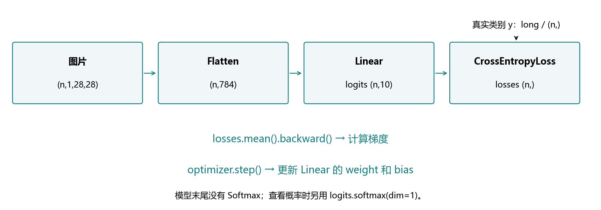
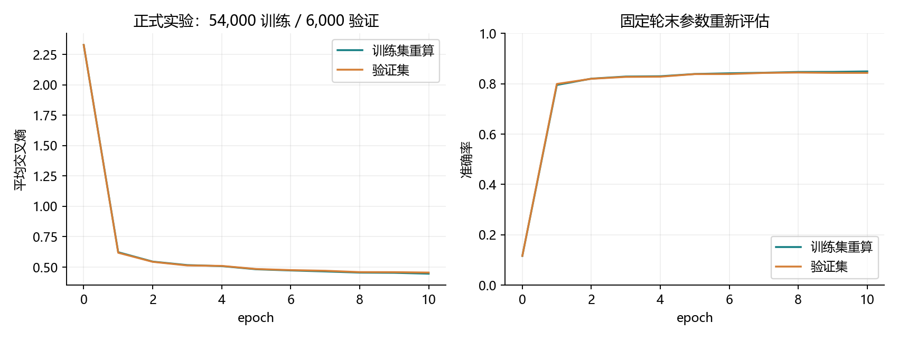
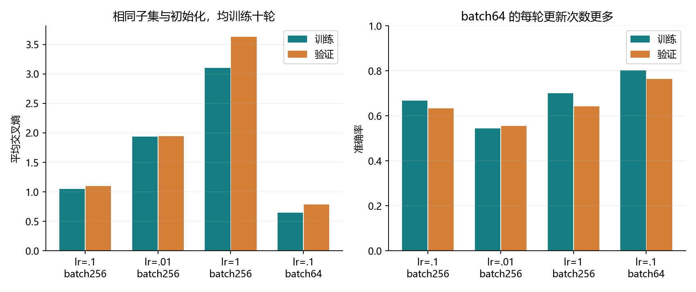
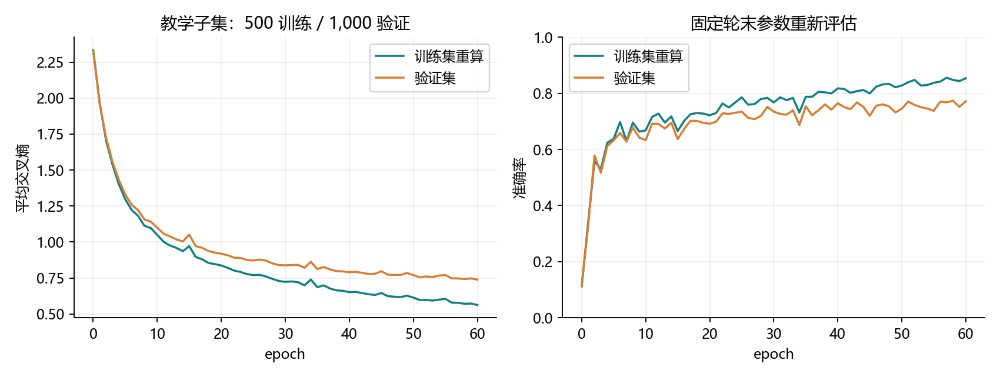

# 3.7 softmax 回归的简洁实现

完整对应用户教材 3.7.1–3.7.4 和两道节末练习，PDF 第141–144页、正文第123–126页。整节演示和综合练习入口均为 ch03/07_softmax_concise.py，分别位于 lessons 与 exercises。教师完成训练及材料验证，不等于用户完成作业。

## 一张图看清本节替换了什么

上一节亲手写出真实图像分类器，本节保留同一套学习目标，使用框架提供的层、损失与优化器。仍然是没有隐藏层的线性分类模型，代码变短不会自动增加模型表达能力。



| 3.6 手写部件 | 3.7 框架部件 | 实际作用 |
| --- | --- | --- |
| reshape 与 XW+b | Flatten、Linear | 展平后计算十个原始得分 |
| 稳定对数交叉熵 | CrossEntropyLoss | 用原始得分计算损失 |
| 叶张量 W、b | net.parameters() | 获取模型管理的参数 |
| no_grad 中减梯度 | SGD.step() | 按梯度更新参数 |
| 手动清理 grad | optimizer.zero_grad() | 清理已有梯度 |

完整链条为：图片 → 得分 → 交叉熵 → 反向传播 → SGD 更新。预测时取最大得分的类别，查看概率时才额外调用 softmax。标签为 long 类型、形状 (n,) 的类别索引。

依然使用本机已有环境和数据，无安装、无下载。教材依赖 d2l 的数据与训练辅助函数；本项目把相关循环写在脚本中，方便看懂每一步，不额外安装 d2l。

<!-- pagebreak -->

## 模型与初始化：框架替我们管理参数

```python
import torch
from torch import nn

torch.manual_seed(3700)
net = nn.Sequential(nn.Flatten(), nn.Linear(784, 10))

def init_weights(module):
    if isinstance(module, nn.Linear):
        nn.init.normal_(module.weight, mean=0., std=.01)
        nn.init.zeros_(module.bias)

net.apply(init_weights)
assert net[1].weight.shape == (10, 784)
assert net[1].bias.shape == (10,)
assert sum(p.numel() for p in net.parameters()) == 7850
```

Sequential 按顺序调用内部层：先展平，再进行线性变换。net[0] 是 Flatten，net[1] 是 Linear。Flatten 默认从第1维开始合并，保留第0维的样本数量，因此 (n,1,28,28) 变为 (n,784)。它没有可训练参数。

Linear(784,10) 计算 X A.T+b。框架的 weight 即 A，存为 (10,784)；上一节手写 W 是 (784,10)，两者通过转置对应。层内部的 weight、bias 已经需要梯度，不必再手动写 requires_grad。

apply 会递归访问子模块及当前模块。isinstance 筛出 Linear 后，normal_ 用均值0、标准差0.01的正态分布原地初始化权重；zeros_ 将偏置设为0。这些初始化工具会正确处理梯度记录。

教材只重设 weight，bias 保留 Linear 默认随机初值。本项目显式把 bias 清零，便于解释起点。正式实验的随机参数也与3.6不同；精确等价性另用同起点实验验证。

小随机数只是起点。训练中被更新的是同一组 Parameter；不要每个批次重新构造网络或重新初始化，否则刚学到的参数会被覆盖。

<!-- pagebreak -->

## 交叉熵：输入原始得分，内部稳定计算

```python
loss_fn = nn.CrossEntropyLoss(reduction="none")
example_logits = torch.tensor([[2., 1., 0.], [0., -1., 2.]])
example_labels = torch.tensor([0, 2], dtype=torch.long)
losses = loss_fn(example_logits, example_labels)
assert losses.shape == (2,)
assert torch.allclose(losses.mean(),
                     nn.CrossEntropyLoss()(example_logits, example_labels))
```

本节类别索引模式中，输入是 (n,10) 的浮点得分，标签是 (n,) 的 long 整数，数值范围0–9。标签没有额外的一列，也不需要先变成独热编码。API另支持概率目标，但不是本节使用方式。

CrossEntropyLoss 在内部完成稳定的对数概率与真实类损失，模型末尾不放 Softmax。把概率再交给它，程序通常仍能运行，却会把概率当成新的得分，改变损失与梯度。

设 m 是一行最大得分，稳定计算为：

<div class="equation">ℓ = −(o<sub>真实类</sub>−m) + log Σ<sub>j</sub>exp(o<sub>j</sub>−m)</div>

先减 m 防止大的正指数溢出；直接使用对数表达式避免先将真实类概率舍入为0后取 log。输入 [1000,0,-1000]、真实类2时，稳定损失仍是2000。

| reduction | 返回值 | 常用反向传播方式 |
| --- | --- | --- |
| none | 每条样本一项，形状(n,) | losses.mean().backward() |
| mean，默认 | 已经平均的标量 | loss.backward() |
| sum | 损失总和标量 | 需要考虑梯度尺度 |

本节无类别权重、无忽略标签，none 后 mean 与默认 mean 一致。每个 reduction 都是有效选择，但更新尺度必须与它配套。

<!-- pagebreak -->

## 优化器：清梯度、反传与更新各做一件事

```python
optimizer = torch.optim.SGD(net.parameters(), lr=0.1)
```

net.parameters() 提供模型中注册的参数。SGD 保存这些参数的引用和学习率，不会复制出另一套模型。这里不加动量和权重衰减，更新规则仍然是参数减去学习率乘梯度。

每个批次按如下顺序执行：

1. zero_grad：清理上一步遗留的梯度。
2. 计算得分和平均损失。
3. backward：计算本批梯度。
4. step：根据梯度更新参数。

set_to_none=True 让旧梯度变为 None；下一次 backward 再建立梯度。它不把模型参数清零。step 也不会自动替我们清理梯度。

| 写法 | 反向传播得到什么 | 参数更新 |
| --- | --- | --- |
| 3.6 手写 | 各样本梯度之和 | 手写除实际批量 k |
| 3.7 框架 | losses.mean() 的平均梯度 | step 不再除 k |

<div class="equation">θ ← θ − η × (1/k) Σ<sub>i</sub>∇ℓ<sub>i</sub></div>

两种写法目标相同。若 mean 后又除 k，更新会额外缩小 k 倍；若 sum 后直接 step，更新会比预期放大 k 倍。尾批 k 比常规批量小时，这种区别尤其容易被忽略。

默认54,000条训练数据、batch256，每轮211次更新，最后一批240条。losses.mean() 会自动使用本批真实条数；不需要手动判断尾批。

<!-- pagebreak -->

## 一轮训练：把框架部件接通

```python
def train_epoch(net, loader, loss_fn, optimizer):
    net.train()
    loss_total, correct, samples = 0., 0, 0
    for X, y in loader:
        optimizer.zero_grad(set_to_none=True)
        logits = net(X)
        losses = loss_fn(logits, y)
        losses.mean().backward()
        optimizer.step()
        loss_total += losses.detach().sum().item()
        correct += (logits.detach().argmax(dim=1) == y).sum().item()
        samples += len(y)
    return loss_total / samples, correct / samples
```

loader 每次交出一批图片与对应标签。net(X) 按 Sequential 的顺序完成展平与得分计算。训练损失的计算图连接到 Linear 的参数，所以 backward 可以自动找到 weight、bias 的梯度。

detach 取出不再追踪梯度的结果，item 将单元素张量转为 Python 数字。统计只保存普通数字，不把每一批求导图长期留在列表里。

平均交叉熵 = 所有样本损失之和 / 总样本数；准确率 = 总正确数 / 总样本数。不要直接平均不同大小批次的均值或准确率。

这里统计的 logits 与 losses 在更新前计算，所以这些数字是训练过程中各时刻的在线指标。轮末固定当前参数重新评估，会得到另一组指标；两者都可以记录，但不能混为同一时点。

net.train() 设置模型处于训练模式。本节的 Flatten 和 Linear 没有训练/评估行为差别，但提前保持标准结构，后面加入 Dropout 等层时就能自然延续。

<!-- pagebreak -->

## 评估与多轮：固定参数再比较

```python
def evaluate(net, loader, loss_fn):
    net.eval()
    loss_total, correct, samples = 0., 0, 0
    with torch.no_grad():
        for X, y in loader:
            logits = net(X)
            loss_total += loss_fn(logits, y).sum().item()
            correct += (logits.argmax(dim=1) == y).sum().item()
            samples += len(y)
    return loss_total / samples, correct / samples

def fit(net, train_loader, validation_loader, epochs=10):
    loss_fn = nn.CrossEntropyLoss(reduction="none")
    optimizer = torch.optim.SGD(net.parameters(), lr=.1)
    for epoch in range(epochs):
        online = train_epoch(net, train_loader, loss_fn, optimizer)
        validation = evaluate(net, validation_loader, loss_fn)
        print(epoch + 1, online, validation)
```

eval 切换层的工作模式，no_grad 关闭梯度记录；两者职责不同，不能互相替代。评估仍会执行前向计算与损失统计，只是不反传、不更新参数。

fit 在循环外建立优化器，循环内重复训练与评估。完整脚本还记录初始状态、逐轮重算训练指标、绘图及本地检查点；这些辅助工作不改变核心训练步骤。

与3.6复用相同分层划分及加载器种子：54,000训练、6,000验证。训练集用于更新，验证集用于观察和选择方案；官方10,000测试数据在预先固定的正式十轮配置结束后只评估一次。

教材训练辅助函数逐轮查看测试，本项目使用独立验证集。后续调参实验也不接触官方测试数据。不要根据一次测试成绩反复选学习率或训练轮数。

<!-- pagebreak -->

## 正式实验：代码简洁，模型能力保持同类

| 数据划分 | 轮末平均交叉熵 | 准确率 |
| --- | --- | --- |
| 训练54,000张 | 0.445904 | 84.94% |
| 验证6,000张 | 0.455055 | 84.35% |
| 测试10,000张 | 0.481048 | 83.43%，8343张正确 |



默认CPU/float32、学习率0.1、批量256、十轮，共2110次更新。训练交叉熵从2.327366降到0.445904。正式训练及初始/逐轮评估约90.23秒，不含额外小实验。图中使用轮末固定参数；测试没有逐轮曲线。

框架版仍然只有7850个参数。与3.6训练结果接近是合理现象，不能因为代码短就期待识别能力突然提高。两次正式实验初始化不同，不把最终小差异解释为实现优劣。

<!-- pagebreak -->

## 同起点对照：验证替换没有改变数学目标

```python
pair_W = torch.randn(784, 10, dtype=torch.float64) * .01
pair_b = torch.zeros(10, dtype=torch.float64)
pair_net = nn.Sequential(nn.Flatten(), nn.Linear(784, 10)).double()
with torch.no_grad():
    pair_net[1].weight.copy_(pair_W.T)
    pair_net[1].bias.copy_(pair_b)
pair_X = torch.randn(7, 1, 28, 28, dtype=torch.float64)
assert torch.allclose(pair_net(pair_X),
                      pair_X.flatten(start_dim=1) @ pair_W + pair_b)
```

公平核对需要相同图片、标签、参数起点、批次顺序、损失归一化及学习率。相同随机种子不必然生成逐元素转置对应的不同形状矩阵，因此直接复制 W.T 和 b。

配套演示额外使用23张真实图片，float64、批量8/8/7、三轮共9次更新，逐步比较得分、逐样本损失、平均梯度和更新后的参数。手写端 sum 反传再除 k，框架端 mean 反传直接 step。

最大绝对误差：得分3.55e-15、逐样本损失4.00e-15、平均梯度2.22e-16、更新后参数2.95e-17，均在浮点舍入尺度。尾批7也在核对范围内。

另一个实验说明重复 softmax 的问题：得分[8,0,-3]且真实类0，正确CE约0.000352；先做softmax后CE约0.551669。预测类别可能相同，但损失与梯度已经改变。

这类检查比只观察两次最终准确率是否接近更直接。float32、不同计算顺序也可能产生小数值差异，不要求逐位完全一致。

<!-- pagebreak -->

## 教材练习一：一次只改一个主要因素

为快速观察调参，另从训练集中固定抽500张、从验证集中抽1000张，类别平衡。两者来自互不重叠的正式划分，不使用测试数据。所有方案复用同一模型起点和子集。

| 学习率 / 批量 | 十轮更新数 | 训练CE | 验证CE | 验证准确率 |
| --- | --- | --- | --- | --- |
| 0.1 / 256 | 20 | 1.0494 | 1.0998 | 63.3% |
| 0.01 / 256 | 20 | 1.9393 | 1.9461 | 55.5% |
| 1.0 / 256 | 20 | 3.1033 | 3.6312 | 64.2% |
| 0.1 / 64 | 80 | 0.6512 | 0.7853 | 76.4% |



学习率控制单次更新幅度；批量大小控制每次用多少样本估计梯度。相同十轮下，batch256每轮2次更新，batch64每轮8次，因此该比较不是相同更新次数，也不是相同计算时间的性能排名。

本次lr=.01在十轮内学得较慢；lr=1的CE明显更差，但准确率略高于lr=.1，说明两种指标衡量的内容不同。batch64完成了更多更新。不能据此宣布某个超参数普遍最好。

<!-- pagebreak -->

## 教材练习二：训练更久为什么可能泛化变差



同一个500张训练子集、lr=.1、batch256，连续训练60轮。第10→60轮，训练CE从1.0494降到0.5629，验证CE从1.0998降到0.7392，验证准确率从63.3%升至77.2%。本次未出现整体越训越差。

验证准确率在第58轮为77.4%，第60轮为77.2%，有局部小幅下降；但验证CE在第60轮仍为本次最低。这不足以把局部变化归结为持续过拟合，也不能证明更多轮必然更好。

梯度下降直接优化训练损失，没有保证验证或测试指标逐轮改善。模型可能越来越适合有限训练样本，包括样本噪声和偶然特征；对新数据的表现可能停滞或变差，这就是过拟合风险。

训练集与验证集有差距本身不能单独证明“越训越坏”。应观察同一方案随轮数的变化，区分过拟合、学习率过大导致震荡、有限验证样本的统计波动。准确率与交叉熵也可能朝不同方向变化。

常见做法包括依据验证集早停、保存较好检查点、增加有效训练数据、使用正则化或合适的数据增强。这些会在第4章逐步实践；当前先学会观察并说明证据，不根据测试集选停止轮数。

本次60轮是固定的教学观察，曲线的极小值只作描述，没有据此重新评估官方测试。更多轮不必然降低准确率，也不必然改善它。

<!-- pagebreak -->

## 一次综合实践，统一反馈

VS Code 按 F5，选择“3.7 softmax 简洁实现：完整演示”。优先阅读 build_model、train_epoch、evaluate、fit；绘图与保存部分可后看。额外小型调参可通过 --skip-tuning 跳过。

```powershell
& 'D:\Anaconda\envs\openmmlab\python.exe' `
  lessons/ch03/07_softmax_concise.py
& 'D:\Anaconda\envs\openmmlab\python.exe' `
  exercises/ch03/07_softmax_concise.py
```

练习使用37张真实训练图，每批8张、十轮，集中填写八处：Flatten、Linear、CrossEntropyLoss、SGD、前向得分、平均损失反传、step、准确率。数据与初始化已给出，答案保持留空。

反馈首轮批量、更新次数、最终交叉熵与训练准确率、得分和标签形状、权重/偏置形状、概率行和，并集中解释：

1. 为什么模型末尾不放 Softmax？框架 weight 为什么是(10,784)？
2. none/mean/sum 有什么区别？mean 反传后是否再除批量，尾批如何处理？
3. zero_grad/backward/step 各做什么？eval 与 no_grad 的区别？小样本训练表现好说明什么？

旧练习尚未作答，继续保留未验证状态，不阻挡按整节前进。教师运行不新增用户掌握记录。下一节为4.1多层感知机，将加入隐藏层与非线性激活。

参考：用户教材3.7；以下为与现有环境对应的PyTorch 2.4官方文档。

https://docs.pytorch.org/docs/2.4/generated/torch.nn.Linear.html

https://docs.pytorch.org/docs/2.4/generated/torch.nn.CrossEntropyLoss.html

https://docs.pytorch.org/docs/2.4/generated/torch.optim.SGD.html
