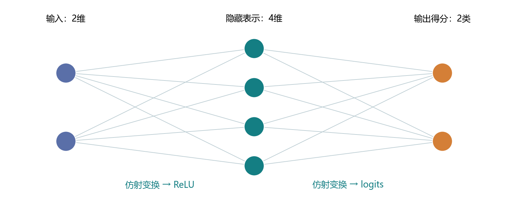
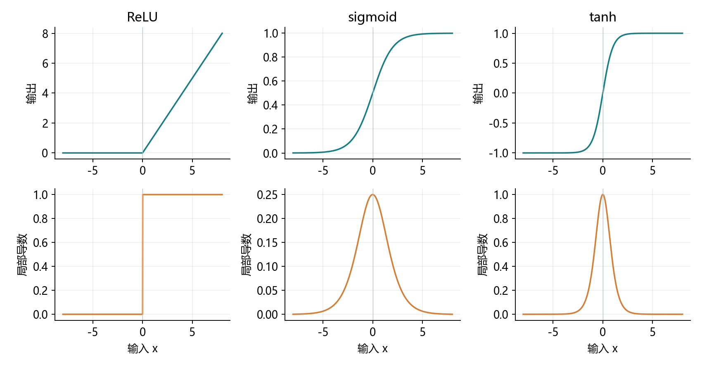
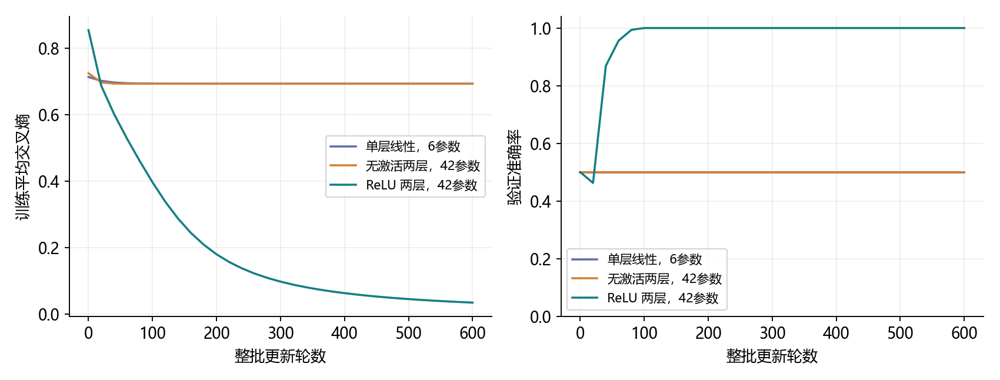
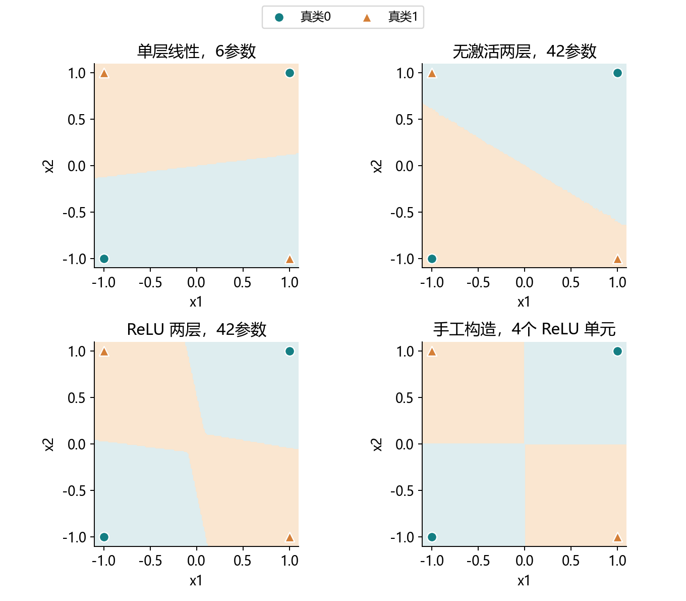
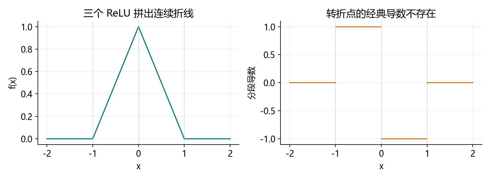

# 4.1 多层感知机

完整对应用户教材4.1.1–4.1.2及四道节末练习，原PDF145–152页、正文127–134页。一次讲清隐藏表示、仿射合并、非线性、常见激活及其导数，并用XOR进行综合实践。统一入口ch04/01_multilayer_perceptron.py，教师运行不代表用户掌握。

## 为什么这一章需要隐藏层

第3章模型直接从像素计算类别得分：O=XW+b。一个输入特征增加时，对某个得分的影响始终由同一权重决定。真实任务中，一个像素或特征的作用往往依赖其他特征；隐藏层让模型学习有用的中间表示。

先看二维XOR：两个输入符号相同记为0，不同记为1。这里是人工分类任务，不涉及真实图像，也没有下载数据。

| x1 | x2 | 类别 |
| --- | --- | --- |
| -1 | -1 | 0 |
| -1 | 1 | 1 |
| 1 | -1 | 1 |
| 1 | 1 | 0 |

一条直线无法把对角线上的两类全部分开。令两类得分之差为f(x)=a×x1+b×x2+c，类别1要求f>0，类别0要求f<0。将两个类别1角点相加得到2c>0，将两个类别0角点相加得到2c<0，产生矛盾。边界上的相同得分也无法靠固定的argmax同时赋予不同标签。

这说明问题来自模型能表示的关系，而不只是训练轮数不够。增加隐藏层并引入非线性后，模型可以先变换表示，再在新表示上分类。

本节先用可解释的小数据观察原理；4.2再从零实现并训练Fashion-MNIST上的MLP。前面尚未提交的作业仍保留未验证状态。

<!-- pagebreak -->

## 隐藏表示、网络层数与形状



隐藏层的每个单元都接收所有输入的加权和，再通过激活函数。隐藏表示H没有逐单元的标准答案，它和输出层一起通过最终任务损失学习；不要求每个隐藏单元都对应人能命名的概念。

<div class="equation">Z = XW<sub>1</sub>+b<sub>1</sub>，H = σ(Z)，O = HW<sub>2</sub>+b<sub>2</sub></div>

| 对象 | 一般形状 | Fashion-MNIST示例 |
| --- | --- | --- |
| X | (n,d) | (n,784) |
| W1、b1 | (d,h)、(h,) | (784,256)、(256,) |
| Z、H | (n,h) | (n,256) |
| W2、b2 | (h,q)、(q,) | (256,10)、(10,) |
| O | (n,q) | (n,10) |

输入层只是数据入口，不计为带参数的计算层。按教材约定，一个隐藏层加一个输出层，叫两层MLP。网络有几层、每层多少单元，是两个不同概念。

ReLU等激活通常逐元素处理H，不改变它的形状。分类输出仍是logits，交叉熵接原始得分；最后查看类别概率时再使用softmax。

<!-- pagebreak -->

## 为什么只堆叠线性层还不够

假如中间没有激活，H=XW1+b1、O=HW2+b2。展开后：

<div class="equation">O = X(W<sub>1</sub>W<sub>2</sub>) + b<sub>1</sub>W<sub>2</sub>+b<sub>2</sub> = XW+b</div>

合并后的W=W1W2，b=b1W2+b2。层数增加了，输出得分依然是输入的仿射函数。偏置使它严格说是仿射变换，教材常将这类模型统称为线性模型。

```python
import torch
from torch import nn

g = torch.Generator().manual_seed(4110)
X = torch.randn(7, 4, generator=g, dtype=torch.float64)
W1 = torch.randn(4, 5, generator=g, dtype=torch.float64)
W2 = torch.randn(5, 3, generator=g, dtype=torch.float64)
b1 = torch.randn(5, generator=g, dtype=torch.float64)
b2 = torch.randn(3, generator=g, dtype=torch.float64)

two_layers = (X @ W1 + b1) @ W2 + b2
one_layer = X @ (W1 @ W2) + b1 @ W2 + b2
assert torch.allclose(two_layers, one_layer)
```

本机最大差约1.78e-15，仅浮点计算顺序造成。加入ReLU后，H=max(Z,0)，哪些分量被保留取决于当前输入，通常不能用同一组W、b将整条网络合并。

无激活的多层参数化会影响优化，瓶颈也可能限制矩阵秩；但仍不能产生一般的非线性得分关系。更多参数不等于更强的表达能力。

<!-- pagebreak -->

## ReLU与PReLU：让梯度通过或被截断

ReLU(x)=max(x,0)：负数变为0，正数保留。它逐元素作用，保持张量形状；输出不需要按行求和为1。

| 位置 | ReLU局部导数 | 含义 |
| --- | --- | --- |
| x<0 | 0 | 该局部分支的梯度被截断 |
| x>0 | 1 | 梯度原样通过该激活 |
| x=0 | 经典导数不存在 | 本机torch.relu采用0 |

```python
x_relu = torch.tensor([-1., 0., 1.], requires_grad=True)
out_relu = torch.relu(x_relu)
grad_relu, = torch.autograd.grad(out_relu.sum(), x_relu)
assert grad_relu.tolist() == [0., 0., 1.]
```

原点并非永远遇不到：零偏置、零输入和中间计算都可能产生0。因此要区分数学不可导与框架选定的反向传播约定。梯度为0不等于程序把权重设置成0。

PReLU(x)=max(0,x)+αmin(0,x)，允许负半轴有斜率α。它对输入的导数在负半轴为α、正半轴为1；α≠1时原点不可导，α=1时整个函数就是恒等函数。

```python
x_prelu = torch.tensor([-1., 0., 1.], requires_grad=True)
alpha = torch.tensor([.1], requires_grad=True)
out_prelu = torch.prelu(x_prelu, alpha)
dx, da = torch.autograd.grad(out_prelu.sum(), (x_prelu, alpha))
```

本机dx=[0.1,0.1,1]，原点采用α；da=-1。α若作为参数训练，也会收到负输入贡献的梯度。这是教材第一题的输入导数和额外参数导数两种视角。

<!-- pagebreak -->

## sigmoid、tanh与饱和



| 激活 | 数学输出范围 | 导数 |
| --- | --- | --- |
| sigmoid(x)=1/(1+exp(-x)) | (0,1) | s×(1-s) |
| tanh(x) | (-1,1) | 1-t² |

sigmoid在0处导数最大，为0.25；tanh在0处导数为1，输出以0为中心。远离0时两者都逐渐饱和，局部导数趋近0。有限精度下输出甚至可能舍入到端点，实际实现使用torch提供的函数。

```python
samples = torch.tensor([-8., 0., 8.], dtype=torch.float64)
s = torch.sigmoid(samples)
t = torch.tanh(samples)
print(s, s * (1-s))
print(t, 1-t.square())
```

隐藏层sigmoid不要求每行总和为1。二类softmax中，类别1概率等于sigmoid(o1-o0)；对十个得分各自做sigmoid并不等于十分类softmax。

ReLU正半轴不饱和，但负半轴也会截断梯度。激活选择要结合结构和任务，不能从这张图推出ReLU总是最好。

<!-- pagebreak -->

## 反向传播如何穿过隐藏层

前向计算得到Z、H和O，交叉熵产生一个标量损失L。反向传播沿计算图，先求输出层梯度，再通过激活的局部导数传向第一层。

<div class="equation">G = (P−Y)/n，∇W<sub>2</sub> = H<sup>T</sup>G</div>
<div class="equation">D = (GW<sub>2</sub><sup>T</sup>) ⊙ σ′(Z)，∇W<sub>1</sub> = X<sup>T</sup>D</div>

这里P是逐行softmax概率，Y是独热标签，n是实际批量；符号⊙表示逐元素相乘。偏置梯度则沿样本维求和。代码仍用类别索引和内置交叉熵，无需实际生成独热标签。

```python
g_small = torch.Generator().manual_seed(4120)
features = torch.randn(5, 2, generator=g_small, dtype=torch.float64)
targets = torch.tensor([0, 1, 1, 0, 1])
A = torch.randn(2, 4, generator=g_small,
                dtype=torch.float64, requires_grad=True)
c = torch.ones(4, dtype=torch.float64, requires_grad=True)
B = torch.randn(4, 2, generator=g_small,
                dtype=torch.float64, requires_grad=True)
d = torch.zeros(2, dtype=torch.float64, requires_grad=True)
hidden = torch.relu(features @ A + c)
scores = hidden @ B + d
loss = nn.CrossEntropyLoss()(scores, targets)
loss.backward()
assert A.grad is not None and B.grad is not None
```

自动求导会完成上面的链式法则；backward只算梯度，优化器再更新四组参数。ReLU的局部导数像一个门，但并非把整个参数永久关闭。

多层sigmoid的局部导数连乘可能使梯度变小；完整梯度还与权重和路径有关，不能只凭0.25就断言每个网络都会梯度消失。更深网络的初始化与稳定性后面继续学习。

<!-- pagebreak -->

## 参数开销与通用近似定理的边界

单隐藏层参数数目为(d+1)h+(h+1)q。将Fashion-MNIST从784→10改成784→256→10，参数从7850增加到203530，计算、内存与过拟合风险也随之增加。

```python
shape_net = nn.Sequential(
    nn.Flatten(), nn.Linear(784, 256),
    nn.ReLU(), nn.Linear(256, 10)
)
with torch.no_grad():
    output = shape_net(torch.zeros(3, 1, 28, 28))
assert output.shape == (3, 10)
assert sum(p.numel() for p in shape_net.parameters()) == 203530
```

这里只检查形状，没有训练服装分类器。手写权重按输入×输出存放；nn.Linear.weight按输出×输入存放，使用时内部转置。

教材用“通用近似”说明MLP可以表示很丰富的函数。一个严谨的经典例子是：采用连续sigmoid类激活，在单位超立方体上，只要隐藏单元足够多，就存在参数，使单隐藏层网络以任意给定精度一致逼近连续目标函数。

这说的是在限定区域、限定函数类别和适当激活条件下的表达存在性，不是所有函数都能被有限网络精确表示，也不是训练一定找到这些参数。对不连续函数，不能随意套用相同的一致逼近结论。

还要区分表示、优化和泛化：能表示，不等于容易训练；训练拟合好，不等于新数据表现好。更深的网络对某些结构可更高效，但不是深度越大越好。

经典依据：Cybenko，1989，Approximation by superpositions of a sigmoidal function。

https://doi.org/10.1007/BF02551274

<!-- pagebreak -->

## 综合实验怎样控制比较条件

人工生成480条训练、160条验证、160条测试。每个幅值对都配置四种符号，两个类别等量，坐标绝对值在[0.2,1]内。三份数据用不同种子生成，避免坐标轴附近的模糊样本，只服务本节表达能力演示。

```python
xor_x = torch.tensor([[-1., -1.], [-1., 1.],
                      [1., -1.], [1., 1.]], dtype=torch.float64)
xor_y = torch.tensor([0, 1, 1, 0])
torch.manual_seed(4100)
xor_net = nn.Sequential(nn.Linear(2, 8), nn.ReLU(),
                        nn.Linear(8, 2)).double()
optimizer = torch.optim.SGD(xor_net.parameters(), lr=.1)
for epoch in range(300):
    optimizer.zero_grad(set_to_none=True)
    logits = xor_net(xor_x)
    loss = nn.CrossEntropyLoss()(logits, xor_y)
    loss.backward()
    optimizer.step()
```

这段四角点代码用来读通训练链；完整脚本使用上述480条训练样本、显式std=.4权重初始化、600次整批更新。两段代码设置不同，不直接比较最终数值。

完整实验比较单层线性、两层无激活、两层ReLU三种模型。后两者结构均为2→8→2、42个参数，复制相同初始权重和偏置，仅激活不同。每种模型都用SGD、lr=.1、600次整批更新。

验证集用于观察，预先固定方案结束后才对各模型测试一次。没有根据测试结果选隐藏宽度、种子或轮数。人工CSV保存在datasets/ch04，模型检查点只留本地artifacts。

<!-- pagebreak -->

## 实际训练结果与观察

| 模型 | 参数数 | 训练准确率 | 验证准确率 | 测试CE / 准确率 |
| --- | --- | --- | --- | --- |
| 单层线性 | 6 | 50.00% | 50.00% | 0.693147 / 50.00% |
| 两层无激活 | 42 | 49.58% | 50.00% | 0.693147 / 50.00% |
| 两层ReLU | 42 | 100.00% | 100.00% | 0.032455 / 100.00% |



加入ReLU的模型将训练CE降至0.034292，学会本人工分布中的非线性关系。无激活模型仍无法突破仿射表达的限制，参数更多也没有解决XOR。

无激活模型最终两类得分非常接近，argmax会受浮点末位影响，所以训练正确数有细小差异；CE约ln(2)和线性无法分开四角点，是更稳健的证据。

本次无噪声、离坐标轴有间隔的简单数据不代表真实图像任务。100%只说明这份受控数据上的表现，不能证明所有MLP都能训练成功或保证普遍泛化。

<!-- pagebreak -->

## 从分类区域看隐藏表示的作用



底色显示模型在二维平面上的预测类别，圆形和三角形表示四个固定角点的真实类别。完整测试指标使用全部160条测试样本，而不是只看图中的四个点。

可直接构造四个ReLU隐藏单元，分别计算x1-x2、x2-x1、x1+x2、-x1-x2的正部。组合后得到：

<div class="equation">f(x) = |x1−x2|−|x1+x2|</div>

异号时f>0，同号时f<0，坐标轴上f=0。将输出得分设为[-f,f]即可分类。这个构造对所有离开坐标轴的输入都成立，说明非线性表示可以做到什么；训练得到的8单元网络不必学成同一组参数。

<!-- pagebreak -->

## 教材练习二：连续的分段仿射函数



例如f(x)=ReLU(x+1)-2ReLU(x)+ReLU(x-1)，在[-1,0]上升、[0,1]下降，其他区域为0，拼成一个三角形。非线性并不要求每一小段都是弯曲的，整体不能用一条仿射函数表示就可以是非线性。

固定一组网络参数后，ReLU在正负两侧分别是仿射函数，且在0处连续；PReLU两侧斜率为1、α，也连续。

证明可逐层进行：假设前一层在有限个区域内是仿射函数，下一层仿射变换在每个区域仍是仿射函数。再按各个单元的正负号切分这些区域，ReLU/PReLU在每个新区域只选择固定斜率，输出仍为仿射函数。有限单元产生有限分区；连续函数的复合和加权求和保持连续。

因此，有限层、有限宽、仅含仿射变换和ReLU/PReLU的MLP，其得分是连续分段仿射函数。教材常称“分段线性”；带偏置时“分段仿射”更精确。固定参数讨论输入函数，PReLU的α可以在训练过程中再更新。

这个结论针对softmax之前的得分。加上softmax后的概率通常不再是分段仿射函数；分段交界处可能不可导，连续也不等于处处可导。

<!-- pagebreak -->

## 教材练习三至四：恒等式与批次维度

将sigmoid定义代入：

<div class="equation">2 sigmoid(2x)−1 = (1−exp(−2x))/(1+exp(−2x)) = tanh(x)</div>

因此tanh(x)+1=2sigmoid(2x)。数值实现不要为这个恒等式手动计算极端指数，使用内置函数更可靠。

```python
probe = torch.linspace(-8, 8, 101, dtype=torch.float64)
assert torch.allclose(torch.tanh(probe) + 1,
                      2 * torch.sigmoid(2 * probe), atol=1e-14)
```

第四题的“对整个小批量应用一个非线性单元”需要区分两种含义：逐元素向量化是正确做法；如果把批次当一个样本，错误地跨样本归一化或压缩样本维，就会让一条样本的结果依赖其他样本。

```python
batch = torch.tensor([[1., 2.], [3., 4.]], dtype=torch.float64)
changed = batch.clone()
changed[1] = torch.tensor([30., 40.], dtype=torch.float64)
assert torch.equal(batch.relu()[0], changed.relu()[0])
assert torch.equal(batch.softmax(dim=1)[0], changed.softmax(dim=1)[0])
assert not torch.allclose(batch.softmax(dim=0)[0],
                          changed.softmax(dim=0)[0])
```

dim=1是在每条样本内部沿类别归一化；dim=0混合了不同样本。后一种错误会导致批量大小、排序或伴随样本变化时，同一输入的输出也变化。检查形状、轴含义和单样本/分批一致性，不能只看代码是否运行。

后面有些层会刻意利用批次统计，例如BatchNorm，其设计有明确的训练/评估语义；这不能成为在本节激活或分类概率中随意混合样本的理由。

<!-- pagebreak -->

## 一次综合实践与集中反馈

VS Code按F5，选择“4.1 多层感知机：完整演示”。

重点阅读build_models、fit和theory_audit，观察五张图。本机PyTorch2.4.1的原点梯度已核对；代码使用autograd.grad，不沿用教材的.grad.data写法，避免绕过自动求导保护。

```powershell
& 'D:\Anaconda\envs\openmmlab\python.exe' `
  lessons/ch04/01_multilayer_perceptron.py
& 'D:\Anaconda\envs\openmmlab\python.exe' `
  exercises/ch04/01_multilayer_perceptron.py
```

综合练习使用前24条XOR训练数据，2→8→2、300次整批更新。八处TODO分别是第一层仿射、ReLU、第二层仿射、平均交叉熵、反向传播、优化器更新、预测与准确率。初始化和数据读取已提供，作业答案保留空白。

发来X/H/logits形状、参数数目、更新次数、最终CE与训练准确率，并集中解释：

1. 去掉ReLU后两层为什么能合并？输入层是否计入带参数层数？
2. ReLU负半轴梯度是什么，原点可导吗？sigmoid饱和怎样影响梯度？
3. 24条样本全对能说明什么？通用近似为何不保证训练和泛化？错误跨batch归一化会怎样？

教师的材料与数值检查不作为用户掌握记录。下一节4.2多层感知机的从零开始实现，将在已有Fashion-MNIST上接通隐藏层和完整训练。

参考：用户教材4.1；激活公式查阅PyTorch官方文档，框架在原点的行为以本机2.4.1实际运行为准；通用近似的限定参考Cybenko原论文。

https://docs.pytorch.org/docs/2.4/generated/torch.nn.Sigmoid.html

https://docs.pytorch.org/docs/stable/generated/torch.nn.PReLU.html

https://doi.org/10.1007/BF02551274
