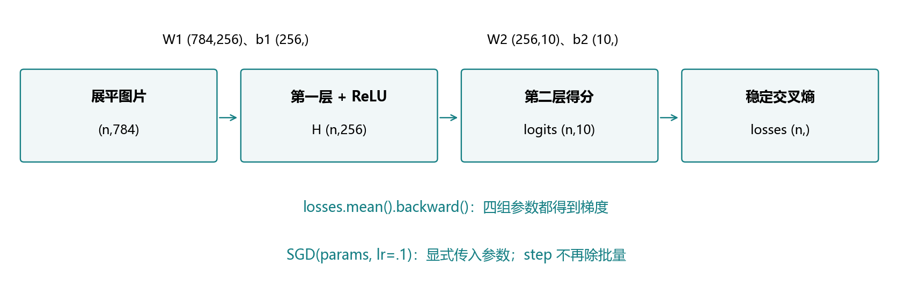
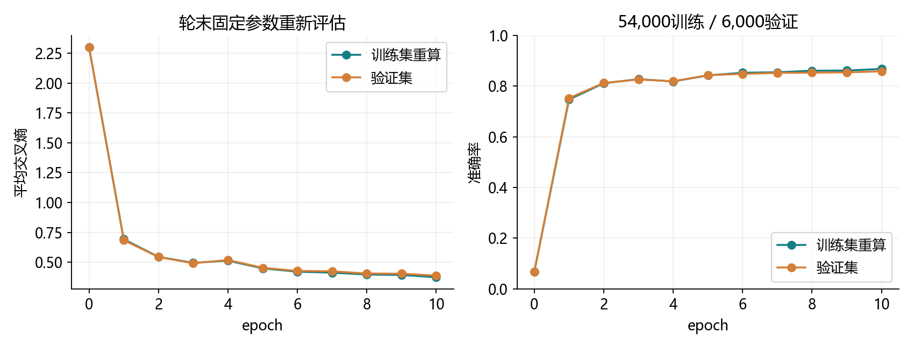
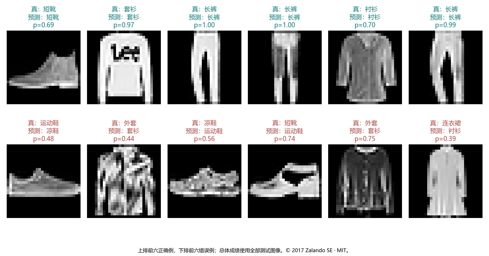
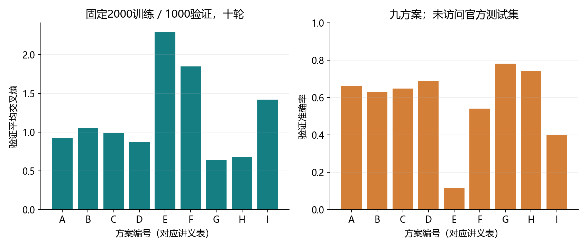

# 4.2 多层感知机的从零开始实现

完整对应教材4.2.1–4.2.5和六道节末练习，PDF153–156页、正文135–138页；156页顶部仅接续4.2讨论链接，随后进入4.3。统一入口ch04/02_mlp_scratch.py，分别位于lessons和exercises。教师程序与资料验证不代表用户掌握。

## 从隐藏层公式到真实图像训练

上一节用XOR理解非线性，本节回到已有Fashion-MNIST。用参数张量实现784→256→10的模型，手写ReLU与前向计算，再接入已熟悉的数据、交叉熵、自动求导和SGD。



| 环节 | 本节实现 |
| --- | --- |
| 数据 | 已有图像，54,000训练/6,000验证/10,000测试 |
| 模型 | 显式W1、b1、W2、b2，矩阵乘法和手写ReLU |
| 损失 | CrossEntropyLoss(none)，接原始logits |
| 梯度 | losses.mean().backward() |
| 更新 | SGD(params,lr=.1)，不重复除批量 |

“从零”主要指模型部件可见，不要求手写整个框架。图像与环境继续复用，无安装、无下载。模型本体不用Linear或Sequential；内置层只在独立核对中作为参照。

<!-- pagebreak -->

## 数据与参数：先确定每个对象的形状

沿用3.6/3.7的固定分层划分：官方训练数据每类600张用于验证、5400张训练。划分种子3601，加载器种子3603；图像在内存转换为float32/255，不改写原始文件。

```python
import torch
from torch import nn

g = torch.Generator().manual_seed(4200)
W1 = nn.Parameter(.01 * torch.randn(784, 256, generator=g))
b1 = nn.Parameter(torch.zeros(256))
W2 = nn.Parameter(.01 * torch.randn(256, 10, generator=g))
b2 = nn.Parameter(torch.zeros(10))
params = [W1, b1, W2, b2]
```

| 对象 | 默认形状 | 元素数量 |
| --- | --- | --- |
| W1 | (784,256) | 200704 |
| b1 | (256,) | 256 |
| W2 | (256,10) | 2560 |
| b2 | (10,) | 10 |

共203530个参数。第一层占绝大部分，隐藏层变宽主要增加这部分开销。偏置的(n,h)+(h,)广播与前面相同。

图像展平后(n,784)，H为(n,256)，最终logits为(n,10)。标签仍为long/(n,)的0–9类别索引。隐藏宽度不要求是2的幂；硬件性能取决于具体实现，不能只凭宽度数字判断速度。

<!-- pagebreak -->

## Parameter、叶张量与优化器参数表

Parameter是一种标记“模型参数”的Tensor子类，默认requires_grad=True。将它作为Module属性时，框架会自动登记；本节模型是普通函数，因此显式维护params并交给优化器。

```python
assert all(p.requires_grad and p.is_leaf for p in params)
assert all(p.grad_fn is None for p in params)
optimizer = torch.optim.SGD(params, lr=.1)
```

叶参数是优化器持续更新的对象。先生成小随机数，再用Parameter包装，能得到需要梯度的叶参数。不要每个批次都重新构造这些参数或重建优化器。

普通的、需要梯度的叶张量也可以被优化器更新；并不是只有Parameter才能训练。Parameter额外表达参数身份，并在Module中参与参数登记。只有一个名为W1的Python变量，并不会自动加入任何Module。

例如先创建requires_grad=True的张量，再写W=原张量*.01，W通常是带grad_fn的非叶结果。若要直接优化W，可以在构造随机值后再包装Parameter，或在缩放完成后设置requires_grad_。

params必须包含全部四组参数。遗漏某一组时，backward仍可能算出它的梯度，但该优化器不会更新它；梯度存在与参数被更新是两个条件。

书中使用Parameter(torch.randn(...,requires_grad=True)*.01)，外层包装已经给出参数身份。本项目省去内层重复的requires_grad=True，结果仍是可求导的叶参数。

<!-- pagebreak -->

## 手写ReLU及原点的反向传播约定

```python
def relu(X):
    zeros = torch.zeros_like(X)
    return torch.max(X, zeros)

probe = torch.tensor([-1., 0., 1.], requires_grad=True)
book_gradient, = torch.autograd.grad(relu(probe).sum(), probe)
print(book_gradient)  # 本机：[0.0, 0.5, 1.0]
```

zeros_like创建与X同形状、同类型、同设备的零张量。这里torch.max接收两个张量，表示逐元素最大值，不是沿某个维度求最大值；输出形状不变。

数学ReLU在x<0导数为0、x>0为1，x=0经典导数不存在。两种等价前向写法的自动求导约定可以不同：

| 实现 | 输入[-1,0,1]的反向传播结果 |
| --- | --- |
| 教材torch.max(X,zeros_like(X)) | [0,0.5,1] |
| torch.relu(X) | [0,0,1] |

在相等的两个输入之间，逐元素max会平分梯度；常数零张量不记录梯度，不会改变X得到0.5的事实。这与4.1的torch.relu原点采用0并不矛盾，两者在非零输入处一致。

本节按教材使用max，梯度检查避开转折点；与内置ReLU对照时确认预激活非零。两种实现的梯度并非在任意输入下都相同。

<!-- pagebreak -->

## 两层前向：输出层保留原始得分

```python
def forward(images, params):
    W1, b1, W2, b2 = params
    X = images.reshape(len(images), -1)
    H = relu(X @ W1 + b1)
    return H @ W2 + b2

demo_images = torch.zeros(3, 1, 28, 28)
assert forward(demo_images, params).shape == (3, 10)
```

len(images)保留样本数量；-1让框架推断每张图展平后的长度。第一层计算256个预激活，再经过ReLU。第二层输出十个可以为正或负的类别得分。

输出层不再加ReLU，否则会改变目标并限制得分；也不先加softmax再送入交叉熵。预测类别取logits.argmax(dim=1)，展示概率时才用logits.softmax(dim=1)。

完整演示用一个小循环支持调参时增加隐藏层。params依次存W1,b1,W2,b2等，range(0,len(params),2)按0、2、4访问每对权重与偏置；最后一层之前都加ReLU。

默认四组参数时，该循环与上面的显式两层写法相同。增加一个64单元隐藏层，就要再维护一对权重与偏置；这也说明层数多时手工管理会变得繁琐，4.3再交给模块化网络管理。

<!-- pagebreak -->

## 损失、训练与评估接成一条链

```python
loss_fn = nn.CrossEntropyLoss(reduction="none")

def train_epoch(loader, params, optimizer):
    loss_sum, correct, samples = 0., 0, 0
    for images, labels in loader:
        optimizer.zero_grad(set_to_none=True)
        logits = forward(images, params)
        losses = loss_fn(logits, labels)
        losses.mean().backward()
        optimizer.step()
        loss_sum += losses.detach().sum().item()
        correct += (logits.detach().argmax(1) == labels).sum().item()
        samples += len(labels)
    return loss_sum/samples, correct/samples
```

none保留逐样本损失，mean让本批平均损失产生梯度。SGD.step不再除批量；最后一批240张时，mean按实际条数计算。统计则累计损失总和、正确数量和样本数，再统一相除。

模型是使用params的普通函数，没有Module的train/eval方法，也没有Dropout或BatchNorm状态。评估用no_grad遍历数据，不反传、不更新参数；普通函数不需要伪造train/eval调用。

每轮结束后固定当前参数，重新评估训练和验证数据，得到曲线。循环内部记录的在线指标来自该轮不断变化的参数，不一定等于轮末重算结果。

正式默认十轮、每轮211批，共2110次更新。最初参数只建立一次，四组梯度通过同一个交叉熵损失联合计算。测试只在预先固定的完整训练结束后评估一次。

<!-- pagebreak -->

## 真实训练结果：回到服装图像

| 数据划分 | 轮末平均交叉熵 | 准确率 |
| --- | --- | --- |
| 训练54,000张 | 0.374240 | 86.82% |
| 验证6,000张 | 0.388366 | 85.87% |
| 测试10,000张 | 0.416226 | 85.30%，8530张正确 |



CPU/float32、种子4200、batch256、lr=.1、十轮，训练CE从2.301744降至0.374240。本机正式训练及初始/逐轮评估约18.82秒，不含额外子集搜索，不能与历史运行时间直接做性能排名。

3.7的softmax模型在相同划分、批量、学习率和轮数下测试83.43%，本次MLP为85.30%。结构、参数数目和随机初始化都不同，这是一次运行的观察，不能据此保证任意隐藏层都能提升成绩。

曲线也不是每轮都下降：第4轮训练和验证损失有回升，后续继续改善。一次回升不自动等于过拟合；要看持续趋势、学习率、随机批次与两组指标。

<!-- pagebreak -->

## 正确与错误预测：分数和信心不是保证



这些示例按正确/错误筛选，不能用图中的一半错误推算模型总准确率。总体85.30%来自完整10,000张测试图像。

每张图先展平，经两层变换得到十个得分。argmax选最大得分对应类别，softmax再显示该类别概率。概率很高也可能分错；图中p保留两位小数，显示1.00不表示数学上的绝对确定。

错误可以帮助识别外观接近的类别及模型局限，但不要根据这批测试错误反复调整当前超参数再报告同一个测试集的“最终成绩”。调参使用独立验证集。

图像来自本机已有Fashion-MNIST，©2017 Zalando SE，MIT许可见docs/references/fashion_mnist_LICENSE.txt。原始图片与参数检查点留本地，少量学习配图及指标同步GitHub。

<!-- pagebreak -->

## 教材练习一至三：宽度、层数和学习率

另从训练/验证划分中固定抽取类别平衡的2000/1000张，子集种子4201/4202；九个方案都训练十轮、batch256、80次更新。权重均为std=.01、偏置0、模型种子4200、加载种子3603。

| 方案 | 隐藏层 | 学习率 | 参数数 | 验证CE | 验证准确率 |
| --- | --- | --- | --- | --- | --- |
| A | 256 | .1 | 203530 | .9212 | 66.2% |
| B | 64 | .1 | 50890 | 1.0528 | 63.1% |
| C | 128 | .1 | 101770 | .9864 | 64.8% |
| D | 512 | .1 | 407050 | .8686 | 68.6% |
| E | 256→64 | .1 | 218058 | 2.2965 | 11.4% |
| F | 256 | .03 | 203530 | 1.8508 | 54.1% |
| G | 256 | .3 | 203530 | .6419 | 78.1% |
| H | 128 | .3 | 101770 | .6803 | 74.0% |
| I | 128→64 | .3 | 109386 | 1.4205 | 39.9% |



只比较A/B/C/D，可观察固定其余设置时的宽度变化，本次512的验证CE最低。A/E比较层数增加，当前小初始化和短训练预算下，深网络学得很慢，不说明深网络普遍无用。

A/F/G比较学习率，本次.3更好。不同宽度的矩阵形状改变，初始参数并非逐元素相同；同种子只固定可复现流程。相同更新次数也不等于相同计算量，不能仅凭此表给宽度或速度作普遍推荐。

<!-- pagebreak -->

## 教材练习四至六：联合选择与搜索策略

每个方案额外保留第5和第10轮的检查点指标，共18个候选；无需重新训练5轮模型。预先用最低验证交叉熵选择，若相同再比较准确率和参数数。

本次有限候选中的最好配置是G：单隐藏层256、lr=.3、第10轮。其子集训练CE=.638977、验证CE=.641855，验证准确率78.1%，80次更新。它没有接受官方测试评估，也没有替代前面预先固定的正式训练。

这里的“最好”只针对这18个检查点、当前子集和预算。不能宣称找到了全局最优，也不能把78.1%与完整训练的85.30%直接比较。

多个超参数更难搜索，因为它们会相互影响：增加深度可能需要改变初始化、学习率或训练轮数；更宽模型每轮成本更高；短预算下的排名不一定能代表充分训练后的排名。

例如每层共用一种宽度，4种宽度×3种层数×4种学习率×3种轮数，就有144种组合。若允许每层宽度独立选择，组合会更多；重复查看验证结果也可能逐渐适应验证集。

一个有预算意识的策略：先固定数据划分、指标、种子和基线；在对数尺度粗选学习率，少量尝试宽度/层数；用较小预算淘汰明显无效方案，给较有希望的方案更多数据和轮数，最后复核少数候选。也可以随机采样组合，避免完整网格的组合爆炸。

早期淘汰可能误伤学习较慢的模型，不能只凭第一轮判断。保存完整配置、运行成本和中间指标；最终方案确定后再使用保留测试集。这里提供策略与有限搜索示例，不安装额外调参框架。

<!-- pagebreak -->

## 四组参数是否都在学习：独立核对

完整演示保存首批W1/b1/W2/b2的梯度范数，确认梯度确实通过隐藏层传回第一层。这只核对计算链条，不保证已经学到充分泛化的表示。

对于平均交叉熵，输出得分梯度G=(P−Y)/n。第二层梯度为H.T@G，先乘W2.T再经过ReLU局部导数，可继续得到第一层梯度X.T@D。偏置梯度沿样本维求和。

手写max-ReLU在0的约定是.5，所以解析核对要么纳入这个约定，要么确保预激活远离0；中心差分在不可导点不用于验证唯一的经典导数。

实际核对中，NumPy独立重算得到相同的8530个正确预测，平均CE差约2.01e-8。23张真实图像、7个隐藏单元的同起点对照，8/8/7尾批、三轮9次更新后，手写与内置模型参数最大差1.04e-17；过程中预激活均非零。

四组参数的解析梯度与自动求导最大差2.78e-17，中心差分最大差2.34e-11。首批W1/b1/W2/b2梯度范数约为.18923/.01123/.18590/.07569。这些检查验证公式与实现，不代表用户已经掌握。

Parameter是叶参数、优化器确实引用四组对象、输入与标签配对、尾批使用实际大小、损失与准确率按样本统计，也都属于可检查的工程条件。

<!-- pagebreak -->

## 一次综合实践与集中反馈

VS Code按F5，选择“4.2 MLP从零实现：完整演示”。优先阅读initialize_parameters、relu、net、train_epoch、evaluate；search_experiments是教材调参拓展，绘图与保存部分可后看。

```powershell
& 'D:\Anaconda\envs\openmmlab\python.exe' `
  lessons/ch04/02_mlp_scratch.py
& 'D:\Anaconda\envs\openmmlab\python.exe' `
  exercises/ch04/02_mlp_scratch.py
```

再次运行可加--skip-search，只跳过额外子集搜索，正式训练仍运行。默认练习取37张真实训练图片，784→32→10，batch8、30轮，共150次更新；答案保持留空。

八处TODO为手写ReLU、W1/W2、隐藏层、输出得分、平均损失反传、step和准确率。数据、偏置、优化器与损失已提供，把首轮批量、更新数、参数形状/总数、X/H/logits形状、最终训练CE与准确率一起发来。

集中解释三组问题：

1. Parameter与普通requires_grad叶张量的关系，为什么普通函数要显式维护params？
2. mean反传后为什么不再除批量？手写max-ReLU与torch.relu在原点的梯度是否一样？
3. 怎样公平比较宽度/层数/学习率，为什么不能用测试集选最佳方案？小训练集表现好说明什么？

下一节4.3多层感知机的简洁实现，将用模块替代手工参数表。用户未作答的旧练习继续保留未验证状态；不据教师运行新增掌握记录。

参考为用户教材4.2及与现有环境对应的PyTorch2.4官方文档。

https://docs.pytorch.org/docs/2.4/generated/torch.nn.parameter.Parameter.html

https://docs.pytorch.org/docs/2.4/generated/torch.nn.CrossEntropyLoss.html

https://docs.pytorch.org/docs/2.4/generated/torch.max.html
