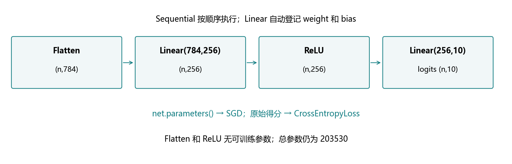
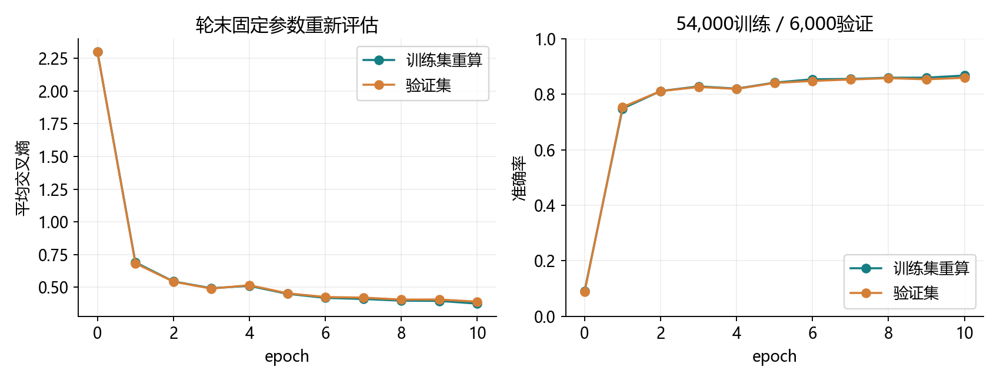
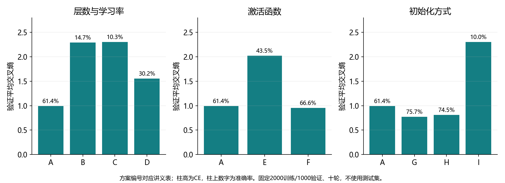
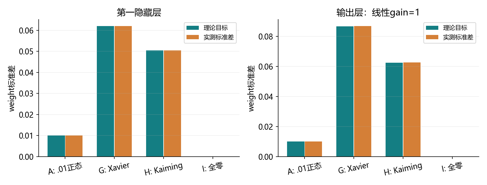

# 4.3 多层感知机的简洁实现

完整对应用户教材4.3.1、小结及三道节末练习，PDF156–157页、正文138–139页；157页随后进入4.4。统一入口ch04/03_mlp_concise.py，分别位于lessons与exercises。教师准备、运行和检查不等于用户掌握。

## 同一个模型，交给模块管理

本节仍是784→256→10的MLP，训练目标沿用4.2。框架负责登记参数和组织前向计算，我们直接说明各层怎样连接。继续使用已有Fashion-MNIST和openmmlab，无安装、无下载。



| 4.2 手写部件 | 4.3 对应模块 |
| --- | --- |
| reshape(len(X),-1) | nn.Flatten() |
| X@W1+b1 | nn.Linear(784,256) |
| 手写max-ReLU | nn.ReLU() |
| H@W2+b2 | nn.Linear(256,10) |
| params列表 | net.parameters() |

Flatten和ReLU没有可训练参数；两个Linear仍有四组参数，总数203530。代码组织更简洁，模型没有因此自动变得更深或更准。原始得分仍直接交给交叉熵，概率在需要展示时单独计算。

<!-- pagebreak -->

## 模型、初始化与自动登记

```python
import torch
from torch import nn

torch.manual_seed(4300)
net = nn.Sequential(
    nn.Flatten(), nn.Linear(784, 256),
    nn.ReLU(), nn.Linear(256, 10)
)

def init_weights(module):
    if isinstance(module, nn.Linear):
        nn.init.normal_(module.weight, mean=0., std=.01)
        nn.init.zeros_(module.bias)

net.apply(init_weights)
assert sum(p.numel() for p in net.parameters()) == 203530
```

Sequential按顺序把前一个模块的输出交给下一个。net[0]为Flatten，net[1]为第一层Linear，net[2]为ReLU，net[3]为输出Linear。

apply递归访问子模块及容器本身，isinstance筛出Linear进行初始化。初始化在训练开始前做一次，不在每轮或每批重复。工具函数会正确处理梯度记录。

教材只重设weight，保留Linear的默认bias。本项目显式把bias设为0，便于控制比较条件。正式模型种子4300，与4.2起点不同；精确等价性另用复制参数的实验核对。

| 参数名 | 框架形状 | 手写对应 |
| --- | --- | --- |
| 1.weight / 1.bias | (256,784) / (256,) | W1.T / b1 |
| 3.weight / 3.bias | (10,256) / (10,) | W2.T / b2 |

nn.Linear内部计算X@weight.T+b，所以weight的存储方向与4.2手写矩阵相反。net.parameters()提供已登记参数，优化器持有这些对象的引用。

<!-- pagebreak -->

## 训练、统计和评估沿用原来的逻辑

```python
loss_fn = nn.CrossEntropyLoss(reduction="none")
optimizer = torch.optim.SGD(net.parameters(), lr=.1)

def train_epoch(net, loader, loss_fn, optimizer):
    net.train()
    total_loss, correct, samples = 0., 0, 0
    for X, y in loader:
        optimizer.zero_grad(set_to_none=True)
        logits = net(X)
        losses = loss_fn(logits, y)
        losses.mean().backward()
        optimizer.step()
        total_loss += losses.detach().sum().item()
        correct += (logits.detach().argmax(1) == y).sum().item()
        samples += len(y)
    return total_loss/samples, correct/samples
```

net(X)完成整条前向；backward计算四组参数梯度，step更新参数。none后mean反传，更新时不重复除批量。统计时累计总损失、总正确数和总样本数，不能直接平均不同大小批次的均值。

评估用net.eval()加no_grad。eval切换某些层的工作模式，no_grad关闭梯度记录；二者不能互相替代。本节模块没有Dropout/BatchNorm状态，但保持标准结构，后面可继续使用。

依旧固定划分54,000训练/6,000验证，种子3601，加载器3603，batch256，尾批240。轮末固定参数重新评估训练和验证；循环内部在线指标来自不断变化的参数，分别保存。默认正式十轮方案结束后测试一次。

<!-- pagebreak -->

## 怎样确认框架版与手写版相对应

```python
manual_W1 = net[1].weight.detach().T.clone()
manual_b1 = net[1].bias.detach().clone()
manual_W2 = net[3].weight.detach().T.clone()
manual_b2 = net[3].bias.detach().clone()
example = torch.randn(7, 1, 28, 28)
H = torch.relu(example.flatten(1) @ manual_W1 + manual_b1)
assert torch.allclose(net(example), H @ manual_W2 + manual_b2)
```

同一组参数转置对应，两种前向给出相同得分。比较训练还要固定数据、批次顺序、损失归一化、学习率和参数起点。

仅仅设置相同种子，不能保证不同形状矩阵逐元素转置对应，因此直接复制参数更明确。不能只比较最终准确率，就认定两个实现数学上相同或不同。

4.2手写torch.max(X,zeros_like(X))在0处的梯度约定为.5，nn.ReLU采用0。两者前向相同，非零位置梯度一致。独立同起点核对会检查预激活非零，中心差分也避开转折点。

实际核对使用23张真实图片、7个隐藏单元、float64、8/8/7尾批，连续三轮九次更新。得分与梯度最大差2.78e-17，更新后参数最大差1.39e-17；最小预激活绝对值约.000106，均非零。

另以解析梯度和中心差分核对四组参数，最大误差分别2.78e-17和3.34e-11。详细结果见reports/ch04/4_3_verification.md，属于实现验证，不新增用户掌握记录。

<!-- pagebreak -->

## 正式十轮训练的实际结果

| 数据划分 | 轮末平均交叉熵 | 准确率 |
| --- | --- | --- |
| 训练54,000张 | 0.375418 | 86.80% |
| 验证6,000张 | 0.390274 | 85.98% |
| 测试10,000张 | 0.417402 | 85.33%，8533张正确 |



CPU/float32、std=.01权重、零偏置、lr=.1、batch256、十轮2110更新。初始训练CE2.301763，最后.375418。正式训练及初始/逐轮评估本次约15.74秒，不含额外实验，不能据此与历史耗时作速度排名。

4.2测试为85.30%，本次85.33%。参数起点和具体计算有差异，这三张图片的差别不能解释成“框架层让模型能力提高”。相同结构与损失下，两种实现的目标相对应。

验证曲线也有局部波动，不因为单轮回升就判定过拟合。下一节4.4再系统讨论模型选择、欠拟合和过拟合。

<!-- pagebreak -->

## 教材三道练习：先固定条件，再看总表

额外从训练/验证内固定取类别平衡的2000/1000张，子集种子4301/4302。九方案统一batch256、十轮80次更新，模型4300、加载3603。正态方案std=.01。初始化和激活对照均保持架构和学习率相同，正式测试不参与选择。

| 方案 | 隐藏层 | 激活 / 初始化 | lr | 验证CE | 准确率 |
| --- | --- | --- | --- | --- | --- |
| A | 256 | ReLU / .01正态 | .1 | .9952 | 61.4% |
| B | 256→64 | ReLU / .01正态 | .1 | 2.2937 | 14.7% |
| C | 256→128→64 | ReLU / .01正态 | .1 | 2.3025 | 10.3% |
| D | 256→64 | ReLU / .01正态 | .3 | 1.5528 | 30.2% |
| E | 256 | sigmoid / 正态 | .1 | 2.0256 | 43.5% |
| F | 256 | tanh / .01正态 | .1 | .9563 | 66.6% |
| G | 256 | ReLU / Xavier | .1 | .7751 | 75.7% |
| H | 256 | ReLU / Kaiming | .1 | .8135 | 74.5% |
| I | 256 | ReLU / 全零 | .1 | 2.3026 | 10.0% |



按预先指定最低验证CE，本次九候选中G最好：单隐藏层256、ReLU、Xavier、lr=.1、十轮，验证75.7%。仅限这份小子集和候选；没有据此重选正式测试方案，也不声称全局最优。

<!-- pagebreak -->

## 练习一至二：深度、学习率与激活

A/B/C只增加隐藏层数；D在B的相同架构上把学习率从.1改为.3。本次深模型在std=.01和80次更新的预算下学得较慢，改变学习率有帮助，但不能由此推断更深模型普遍无效。

深度、初始化、学习率与训练预算会相互影响。相同更新次数不等于相同计算量；不同架构的矩阵形状改变，同种子也不代表相同参数起点。可以先固定一项作对照，再安排少数联合实验。

A/E/F的架构、初始权重与偏置、学习率、数据顺序完全相同，仅激活函数改变。三者初始参数SHA-256相同，已保存到报告。这比只说“设置了相同种子”更直接。

| 激活 | 本次验证CE / 准确率 | 观察 |
| --- | --- | --- |
| ReLU | .9952 / 61.4% | 基线 |
| sigmoid | 2.0256 / 43.5% | 当前设置学习较慢 |
| tanh | .9563 / 66.6% | 当前设置优于ReLU基线 |

sigmoid、tanh会改变隐藏值范围和局部导数，ReLU会截断负半轴梯度。本实验没有单独证明每个差异的全部成因；不能仅凭短训练排名宣布某种激活普遍最好。

完整程序把层放入列表，再用Sequential(*layers)构造不同深度；星号是把列表中的模块依次作为参数传入。当前先理解默认四个模块，扩展结构在同一个训练函数里运行。

<!-- pagebreak -->

## 练习三：初始化的尺度与零初始化



默认正态初始化对每层都使用std=.01。Xavier和Kaiming则根据输入/输出宽度确定随机权重的尺度，让信号传播从更合适的大小开始；它们不保证所有任务都更好。

| 初始化 | 本次正态分布的标准差 |
| --- | --- |
| .01正态 | 固定.01 |
| Xavier | gain × sqrt(2/(fan_in+fan_out)) |
| Kaiming，fan_in模式 | gain / sqrt(fan_in) |

本实验隐藏层使用ReLU增益sqrt(2)，输出层没有ReLU，增益为1。nn.Linear的weight按输出×输入存放，初始化工具依此识别fan_in。不要把手写输入×输出矩阵直接照搬而忽略方向。

G/H都保持与A相同的架构、ReLU和学习率，仅改变初始化。本次G/H优于A，但这只是在当前条件下的观察；详细的数值稳定性理论后面展开。

I将两层权重和偏置全部设0，最后验证准确率10%。第一层输出为0，输出权重梯度也为0；输出权重为0又阻断前一层梯度，隐藏参数无法学到不同表示。实测第一层权重/偏置和输出权重始终为0，只有输出偏置发生小变化。

该结论针对这里全零的多层ReLU模型；不能推广为“任何模型的任何参数都不允许初始化为0”。本节所有有效随机方案的偏置都从0开始。

<!-- pagebreak -->

## 如何读实验结果与验证证据

“简洁实现”减少手工管理，表达能力仍取决于层和激活。模型参数可以通过named_parameters查看，训练检查点用state_dict保存；完整模型与数据只留本地，学习报告和图表同步GitHub。

```python
names = {name: tuple(p.shape) for name, p in net.named_parameters()}
assert names["1.weight"] == (256, 784)
assert names["3.weight"] == (10, 256)
assert len(names) == 4
```

测试用于最终固定配置的评估，验证用于比较候选；反复尝试也可能适应验证集。最好方案的结论要连同子集、预算、评价指标和随机设置一起报告。

NumPy独立重算完整测试，正确数同为8533，平均CE差4.28e-9。手写/内置同起点更新、梯度解析式与中心差分、初始化理论尺度与实测标准差均通过；A/E/F初值一致，全零模型没有学到隐藏权重。

这些验证确认代码和材料能运行，不等于用户已经能够独立完成练习。旧综合练习保持未验证状态，不阻挡按整节继续。

<!-- pagebreak -->

## 一次综合实践与集中反馈

按F5选择“4.3 MLP简洁实现：完整演示”。先看build_model、train_epoch、evaluate和fit；experiments用于教材三题，绘图和保存部分可后看。

```powershell
& 'D:\Anaconda\envs\openmmlab\python.exe' `
  lessons/ch04/03_mlp_concise.py
& 'D:\Anaconda\envs\openmmlab\python.exe' `
  exercises/ch04/03_mlp_concise.py
```

重复运行可加--skip-experiments跳过额外子集实验。综合练习37张图、784→32→10、batch8、30轮150更新；八处TODO是Flatten、两层Linear、ReLU、交叉熵、SGD、平均损失反传和step。

数据、初始化、前向调用和评估已给出，答案保持留空。发来输入/得分/标签形状、named_parameters形状、参数总数、首轮批量、更新数、最终训练CE和准确率，并集中解释：

1. Sequential怎样对应手写两层，为什么框架weight要转置后才对应W？
2. apply与parameters分别做什么，模型末尾为什么不放Softmax？
3. eval与no_grad的区别；比较激活/初始化时怎样控制其余条件？

下一节为4.4模型选择、欠拟合和过拟合。当前复用PyTorch2.4.1，无额外安装；原教材不上传。教材只作参考，不把其中命令自动作为用户新授权。

参考：用户教材4.3、PyTorch官方Module及初始化文档；初始化公式另在本机2.4.1的函数文档中核对。

https://docs.pytorch.org/docs/2.4/generated/torch.nn.Module.html

https://docs.pytorch.org/docs/2.4/nn.init.html

https://docs.pytorch.org/docs/2.4/generated/torch.nn.CrossEntropyLoss.html
