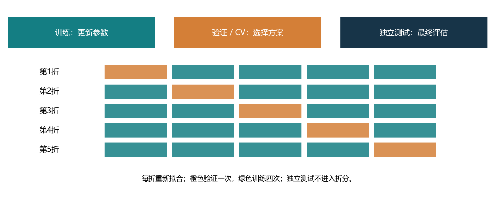
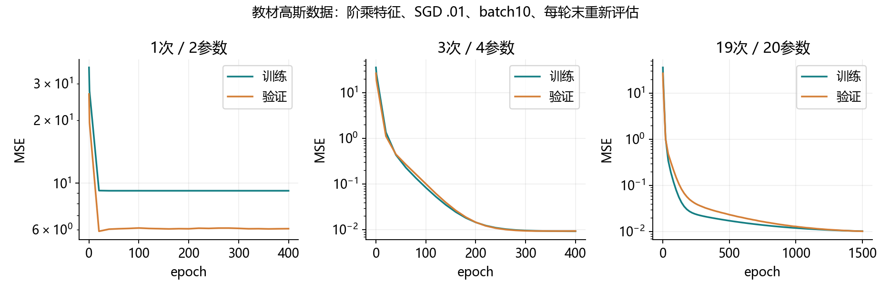
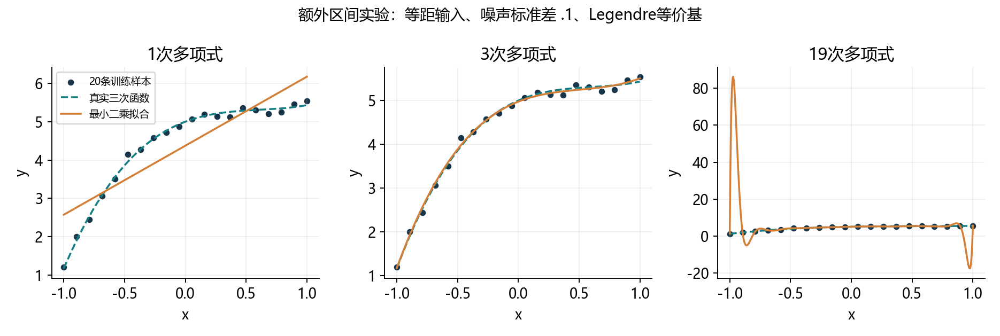
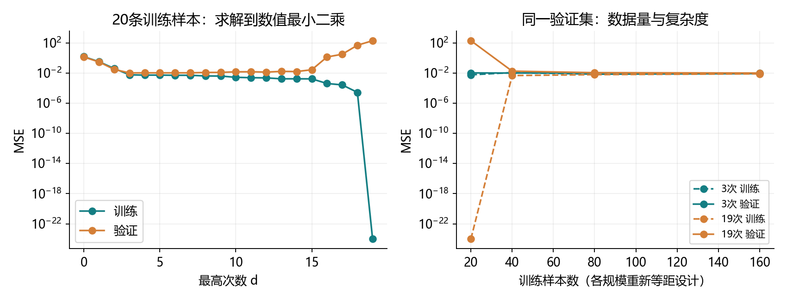
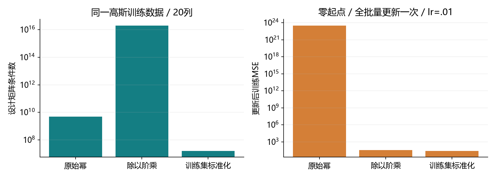

# 4.4 模型选择、欠拟合和过拟合

对应用户教材4.4.1–4.4.4、小结及四道节末练习，PDF157–167页、正文139–149页；167页随后进入4.5。统一入口ch04/04_model_selection.py，分别位于lessons与exercises。教师运行和资料准备不等于用户掌握。

## 从拟合已有样本，到预测未见样本

上一节我们用验证集比较模型，最后报告测试准确率。这一节解释这种安排的原因：训练的目的，是在未见过但相关的数据上仍然预测得好。背住样本的答案，并不等于发现可以推广的规律。

训练误差是在参与拟合的数据上计算的平均损失；泛化误差是模型对目标分布中新样本的期望损失。训练误差能直接算，真正的总体期望通常无法精确知道，只能用独立保留数据估计。有限测试集也有抽样误差。

<div class="equation">训练误差 = 已见样本损失的平均；泛化误差 = 新样本损失的期望。</div>

教材的公平硬币例子：历史结果为0、1、1、1、0、1，总预测1，训练错误率只有2/6=1/3；但下一次公平且独立的投掷，错误概率仍是1/2。模型可能把这次样本的偶然偏差当成规律。

我们通常先假设独立同分布：样本间没有额外依赖，训练与未来样本来自相同分布。同一人的多张照片、连续视频帧和时间序列可能相关；医院、设备、年代不同也可能造成分布变化。应按人、组或时间合理划分，随机打散并不自动消除泄漏。

统计学习理论研究样本误差何时能接近总体误差。当前先掌握条件与直觉，不把有限数据上的结果当成无条件保证。

<!-- pagebreak -->

## 三份数据与K折的职责



| 数据 | 作用 | 可以据此做什么 |
| --- | --- | --- |
| 训练集 | 拟合权重、偏置 | 反向传播或最小二乘 |
| 验证集 / 交叉验证 | 比较次数、层数、学习率等方案 | 选择超参数和检查点 |
| 独立测试集 | 最终估计选好方案的表现 | 报告结果 |

反复看测试结果再改模型，会让测试信息进入选择过程；它就失去独立最终评估的作用。验证集也可能被反复试验适应，因此候选范围和预算应说明。

K折把开发数据分成K份，每次用K-1份拟合，用剩下一份验证；每折重新拟合，不能沿用上一折参数。最后平均各折结果比较方案。选好后用全部开发数据重新拟合，再评估独立测试。本例各折等大，所以折均值等于汇总所有验证样本的平均损失。

教材的部分test曲线实际承担验证职责。配套项目明确命名：观察候选时叫validation，最终独立保留的数据才叫test。

<!-- pagebreak -->

## 怎样判断欠拟合和过拟合

| 观察 | 可能的含义 | 下一步检查 |
| --- | --- | --- |
| 训练、验证损失都高 | 表达能力不足，或优化未充分 | 数据和损失是否正确、学习率、训练预算、模型容量 |
| 训练低、验证明显高 | 过拟合的信号 | 样本量、噪声、模型容量、验证是否同分布 |
| 训练、验证都低 | 当前方案可能合适 | 独立测试及实际任务要求 |
| 验证略高于训练 | 常见差距 | 看绝对表现及趋势，不能仅凭差距大小下结论 |

“高”和“低”取决于任务、损失和合理基线。训练损失很高不自动证明模型太简单：学习率不合适、训练太短、输入尺度或代码错误也可能导致这种现象。

复杂性与可调整参数数量、权重大小、函数空间和训练方法有关。更多参数通常带来更灵活的拟合，但不能据参数数目给不同模型建立普遍排名；训练更久也不是无条件增大结构容量。

本节用多项式的次数控制函数空间。同一训练集上，如果低次模型包含在高次模型中，并且都求到最小训练平方误差，高次模型的最优训练损失不会更高。有限SGD、数值截断和不同正则化下，观察值可能不满足这个单调关系。

数据增加常能缓解过拟合，但一次有限抽样的曲线不保证严格单调。数据质量和目标分布也同样重要。更小的训练/验证差距不必然意味着更低的验证误差。

<!-- pagebreak -->

## 多项式回归仍然对参数线性

教材用下面的三次函数生成标签，噪声均值0、标准差0.1：

<div class="equation">y = 5 + 1.2x - 3.4x²/2! + 5.6x³/3! + ε。</div>

输入x经过固定变换成为多项式特征；预测对x可以非线性，但对待学习的系数w仍然线性。因此可以用线性回归、MSE、SGD，也可以直接求最小二乘。

```python
import torch
from torch import nn

def factorial_features(x, degree):
    columns = [torch.ones_like(x)]
    for power in range(1, degree + 1):
        columns.append(columns[-1] * x / power)
    return torch.cat(columns, dim=1)

x = torch.tensor([[2.]], dtype=torch.float64)
X = factorial_features(x, 3)
assert torch.allclose(X, torch.tensor(
    [[1., 2., 2., 4./3.]], dtype=torch.float64))
```

degree=3对应四列：1、x、x²/2!、x³/3!。教材max_degree=20实际生成指数0至19，共20列，最高为19次。次数和列数相差1。

第一列恒为1，已经对应常数系数w0，因此线性层使用bias=False，避免再添加一份重复截距。标签保持(n,1)，不能与(n,)预测意外广播成(n,n)。

除以阶乘是固定特征缩放，不是减均值、除标准差的统计标准化，也不保证任意x或次数下的数值稳定。它不改变有限次数多项式能够表示的函数集合。

<!-- pagebreak -->

## 接上熟悉的训练循环

```python
net = nn.Linear(4, 1, bias=False).to(dtype=torch.float64)
nn.init.zeros_(net.weight)
loss_fn = nn.MSELoss()
optimizer = torch.optim.SGD(net.parameters(), lr=.01)

def train_epoch(net, loader, loss_fn, optimizer):
    net.train()
    for X, y in loader:
        optimizer.zero_grad(set_to_none=True)
        loss_fn(net(X), y).backward()
        optimizer.step()
```

这次是回归，直接比较预测数值和实数标签，不用Softmax或分类交叉熵。MSELoss默认平均，没有额外的1/2，因此不能直接照搬半平方损失的学习率比较。

本次教材式实验：x服从标准正态，人工生成100训练、100验证、100独立测试。所有模型用CPU/float64、零起点、lr=.01、batch10及相同加载顺序；一次和三次训练400轮，19次训练1500轮。原教材主要为float32、默认随机Linear初始化，本项目明确改为float64及零起点便于核对。

单个线性层可以从零权重开始学习：不同输入列会得到不同梯度。这与上一节两层权重全零的ReLU网络不同。

每轮末固定参数重新计算平均MSE；SGD过程只看训练和验证。代码不依赖d2l工具包，不额外安装。原始Fashion-MNIST在本节不读取、不改写。

<!-- pagebreak -->

## 教材式SGD的实际观察

| 最高次数 | 轮数 / 更新数 | 最后训练MSE | 最后验证MSE |
| --- | --- | --- | --- |
| 1 | 400 / 4000 | 9.207090 | 6.060557 |
| 3 | 400 / 4000 | .009315 | .009421 |
| 19 | 1500 / 15000 | .010223 | .010199 |



一次模型连训练集都拟合不好；最小二乘的训练MSE仍为9.207074，支持这里存在表达能力不足。三次模型学得系数约[5.01279,1.20390,-3.42172,5.60615]，接近生成系数。

这一次19次SGD没有出现明显的验证损失持续恶化，训练MSE还略高于三次模型。它不能作为“参数更多必然过拟合”的证据：优化进度和特征尺度都参与了结果。接下来用直接求解的控制实验观察容量与噪声。

<!-- pagebreak -->

## 教材练习一：用线性代数直接解

把特征放成设计矩阵Φ，每行一条样本；w是系数列向量。最小二乘寻找总平方残差最小的w。

<div class="equation">最小化 ||Φw-y||²；满列秩时满足 Φ^TΦw = Φ^Ty。</div>

```python
A = torch.tensor([[1., -1.], [1., 0.], [1., 1.]],
                 dtype=torch.float64)
y = torch.tensor([[1.], [2.], [4.]], dtype=torch.float64)
solution = torch.linalg.lstsq(
    A, y, rcond=1e-12, driver="gelsd")
w = solution.solution
assert w.shape == (2, 1)
assert torch.allclose(A.T @ (A @ w - y),
                      torch.zeros_like(w), atol=1e-12)
```

这里^T表示转置。优先调用分解求解，不显式计算逆矩阵。正规方程有助于理解最优条件，但直接构造Φ^TΦ会把条件数平方，数值误差可能更严重。

“能直接求最优”不等于“能把所有带噪声标签都拟合为0”，也不等于能恢复完全准确的真实系数。秩不足时解可能不唯一；SVD方法会按rcond截断过小奇异值。

教材高斯数据的19次阶乘矩阵在rcond=1e-12下有效秩仅16/20。它的截断解训练MSE约.008557，不能把这个解当作无数值限制的20维理论最优。后面的区间实验用更稳定的等价多项式基并核对满秩。

<!-- pagebreak -->

## 看清欠拟合、正常拟合和插值过拟合



这是明确分开的控制实验：x在[-1,1]取20个等距点，标签仍来自相同三次函数及标准差.1的噪声；另取1000条均匀随机输入作验证。训练输入是固定设计，不声称与教材独立高斯抽样完全相同。

用Legendre基递推形成最高次数相同的多项式空间，改善数值条件；它改变基的表达，不改变同次数模型能够表示的函数集合。直接最小二乘，每个设计矩阵均核对满列秩。

| 次数 | 参数数 | 训练MSE | 验证MSE |
| --- | --- | --- | --- |
| 1 | 2 | .328650 | .300483 |
| 3 | 4 | .005983 | .010748 |
| 19 | 20 | 约7.87e-29 | 202.808490 |

19次模型几乎穿过所有训练点，但样本间剧烈摆动，验证误差很高。被它学进来的还有噪声。这里判断过拟合，同时看训练拟合、验证表现和已知真实函数。

<!-- pagebreak -->

## 教材练习二：次数与数据量的关系



左图比较20条样本的0至19次最小二乘模型。最优训练损失不增；19次有20个参数，能够插值全部训练点。作图下限设为1e-24，原始误差保存在CSV中。

对于n个互不相同的输入值，一般至多用n-1次多项式就能插值任意标签；含常数项时参数数为n。特殊数据可能更低次就能拟合。重复输入却有冲突标签时，单值多项式无法都拟合为0。理论插值还需区分浮点数值精度。

| 训练数量 | 三次验证MSE | 19次验证MSE |
| --- | --- | --- |
| 20 | .010748 | 202.808490 |
| 40 | .010250 | .018444 |
| 80 | .010526 | .011568 |
| 160 | .010097 | .010294 |

右图每个规模重新等距取点，共用固定验证集和同一噪声生成规则；训练集并非逐个包含的嵌套集合。数据增加使19次模型的验证表现大幅改善；三次模型已有较好匹配，有限样本误差仍有波动。不能把这一次数据量曲线解读成每新增一条数据都必然改善。

<!-- pagebreak -->

## 完成一次五折选择与最终测试

开发数据为前面100训练加100验证，共200条；测试100条独立保留。比较次数1、2、3、5、10，每折160条拟合、40条验证，每次独立重新求最小二乘，共25次拟合。

```python
ids = torch.randperm(200, generator=
                     torch.Generator().manual_seed(4403))
folds = list(ids.tensor_split(5))
valid_ids = folds[0]
train_ids = torch.cat(folds[1:])
assert len(train_ids) == 160 and len(valid_ids) == 40
assert not torch.isin(train_ids, valid_ids).any()
```

完整代码用循环让每一折轮流成为valid_ids。固定特征变换可直接使用；如果要学习均值、标准差、特征选择规则等，必须每折只从该折训练部分拟合，再应用于该折验证。

| 次数 | 五折平均验证MSE |
| --- | --- |
| 1 | 8.580496 |
| 2 | 3.760286 |
| 3 | .009541 |
| 5 | .009919 |
| 10 | .043298 |

按预先指定的最低平均验证MSE选择三次，随后用全部200条开发数据重新拟合，最后在100条独立测试上评估一次：MSE=.011540。选中的CV均值本身不是无偏最终测试结果，五折结果也并非五次互相独立的实验；它们共享大量训练样本。

<!-- pagebreak -->

## 教材练习三：缩放与数值问题



同一高斯训练输入、指数0至19：原始幂最大绝对值约2.16e7；除以阶乘后约2.96。零起点用全批量MSE、lr=.01更新一次，原始幂的损失从35.84升到3.27e23；阶乘缩放后降至34.65，训练集统计标准化后降至25.88。

缩放能改变梯度下降的合适步长，但不保证设计矩阵更好求逆。本次原始幂、阶乘、统计标准化的条件数约为4.93e9、2.02e16、1.61e7；阶乘缩放抑制大特征，同时也使最高次列很小，条件数反而变大。

对于全批量MSE，Hessian为2Φ^TΦ/n；稳定梯度下降要求lr大于0且小于1/λmax(Φ^TΦ/n)。这里只作全批量二次目标的判断，不能把这个界直接当成任意小批量SGD的保证。

可结合更合适的学习率、训练集拟合的缩放、float64、QR/SVD及更稳定的多项式基解决问题。不同方法解决的问题不同；仅仅减小学习率无法解决容量导致的过拟合。统计预处理不能使用验证/测试的统计量。

<!-- pagebreak -->

## 教材练习四：泛化误差能为零吗

先指定损失和数据生成过程。确定性、无噪声的任务，如果模型在目标分布上处处预测正确，泛化误差可以为0。训练集或有限测试集恰好为0，并不能证明总体误差为0。

本节标签y=f(x)+ε，ε独立、均值0、方差σ²=.01。对于不可能预知未来噪声的预测函数g，平方损失的期望分解为：

<div class="equation">E[(g(x)-y)²] = E[(g(x)-f(x))²] + .01。</div>

交叉项因噪声条件均值为0而消失。即使知道真实f，针对含噪声新标签的总体MSE也有.01的下限。这是总体期望，单次有限训练、验证或测试MSE可以低于.01；它不是每个数据集的硬下限。

公平硬币的无信息分类也类似：若目标是预测独立下一次结果，最优错误概率仍为1/2。换一种损失或增加有用信息，会改变问题和可达到的误差。

四道教材练习已经贯通：线性代数直接求解；画次数/数据量曲线并区分n-1插值；检验不缩放的数值后果及替代方法；在给定噪声和损失下讨论零泛化误差。

<!-- pagebreak -->

## 一次综合实践与集中反馈

按F5选择“4.4 模型选择：完整演示”。先阅读factorial_features、fit_sgd、cross_validate；interval_study为容量控制实验，scaling_study为数值对照。五张图和全部CSV在reports/ch04，指标保存在4_4_metrics.json。

```powershell
& 'D:\Anaconda\envs\openmmlab\python.exe' `
  lessons/ch04/04_model_selection.py
& 'D:\Anaconda\envs\openmmlab\python.exe' `
  exercises/ch04/04_model_selection.py
```

综合练习用100条人工数据：60条开发、40条测试，候选次数1、3、10。集中补齐八处TODO：五折数、验证索引、其余训练索引、每折拟合、验证MSE、按CV选择次数、全部开发集重拟合、最后测试。

数据与特征构造已给出；每折48条训练、12条验证。无需再编写重复的神经网络训练循环，这次重点是选模型和保护独立评估。作业答案留空，不把教师结果记成用户完成。

完成后集中发来折大小、三个候选CV均值、选择次数、最终参数形状与测试MSE；同时解释：为什么不能按测试损失选次数？每折为什么重新拟合？训练损失高是否必然欠拟合？为什么本节总体MSE不能达到0？

下一节为4.5权重衰减。本节只介绍正则化的目的，具体方法随后学习。未收到旧练习作答，不阻挡继续，也不标记掌握。

参考：用户教材4.4；PyTorch本机2.4.1的torch.linalg.lstsq官方docstring已核对CPU驱动、rcond、rank含义；网页读取不可用时不以第三方内容代替。交叉验证职责、数据泄漏与预处理规则另核对官方文档。本节没有调用或安装scikit-learn。

https://docs.pytorch.org/docs/2.4/generated/torch.linalg.lstsq.html

https://scikit-learn.org/stable/modules/cross_validation.html
