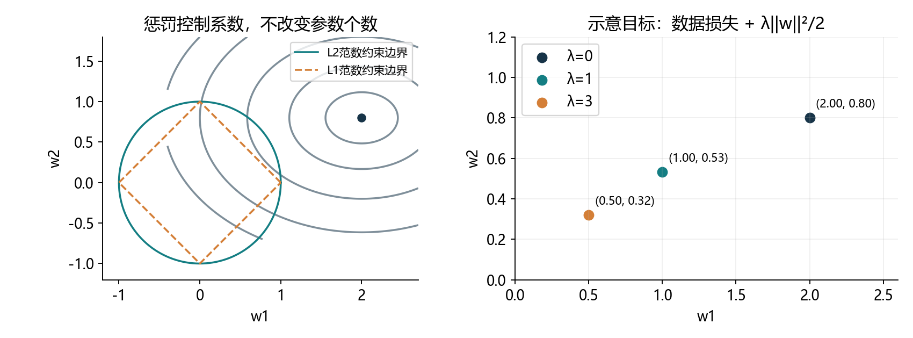
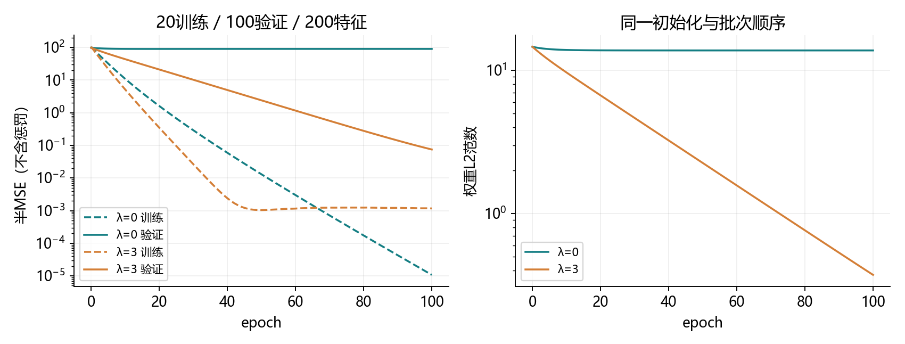
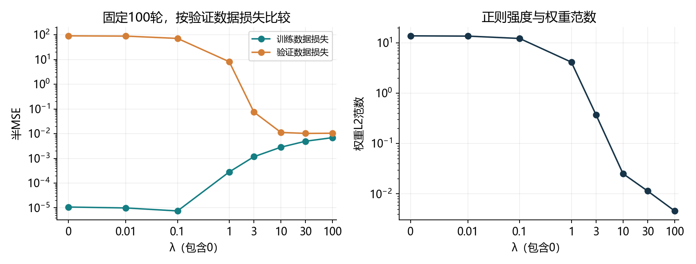
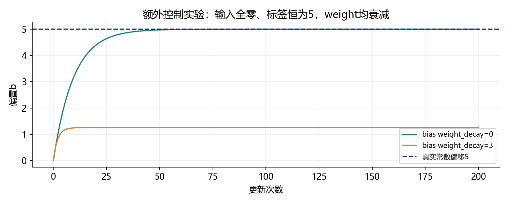

# 4.5 权重衰减

完整对应用户教材4.5.1–4.5.3、前置原理、小结与六道节末练习，PDF167–174页、正文149–156页；174页随后进入4.6暂退法。统一入口ch04/05_weight_decay.py，分别位于lessons和exercises。教师准备不等于用户掌握。

## 用惩罚限制权重的大小

上一节通过改变多项式次数控制容量。这一节保持特征和参数数量，把权重过大的代价加入训练目标，在拟合数据和限制系数之间作权衡。这类方法属于正则化。



对于固定线性模型和固定特征尺度，较小的权重通常意味着输入变化对输出影响较小。参数数量没有减少，模型也没有自动删除某几层。它限制的是系数取值，而不是重新选择特征个数。

L2对大的系数施加更大代价，连续压小权重；L1还可能产生稀疏解。图为二维示意。特征尺度和网络参数化会影响范数的含义，小范数本身不保证泛化。

多变量多项式的项数会迅速增长：k个变量、总次数恰为d的单项式数量为C(k+d-1,d)。权重惩罚提供了比直接删掉一批特征更连续的调节方式。

<!-- pagebreak -->

## 从训练目标推导衰减更新

本节统一使用平均半平方误差，偏置不加惩罚：

<div class="equation">J(w,b) = 平均[(预测-y)²]/2 + λΣw_i²/2。</div>

λ为非负超参数，用验证集比较。λ=0恢复普通训练；λ越大，目标对大权重的惩罚越强。L2范数是平方和的平方根，这里使用的是平方范数，不能把sum(w²)写成sum(w)²。

<div class="equation">惩罚对w的梯度 = λw；对b的梯度 = 0。</div>

普通无动量SGD把数据梯度g与惩罚梯度相加：

<div class="equation">w ← w - η(g + λw) = (1-ηλ)w - ηg。</div>

只看衰减部分，合适的ηλ会让权重靠近零；完整更新还包括数据梯度，因此权重范数不保证每步下降。例如w=1、η=.1、λ=1、g=-5，更新后为1.4。

纯衰减时，ηλ在0到1之间才是同号收缩；步长过大还可能翻号甚至放大。实际稳定性也取决于数据目标的曲率，不能用“衰减”一词代替学习率检查。

线性回归加入这种L2平方惩罚，得到岭回归。偏置是否正则化依任务而定，本节跟随教材的主要设置只惩罚weight。

<!-- pagebreak -->

## 从零实现：在平均数据损失上加一次惩罚

```python
import torch
from torch import nn

def half_mse(prediction, target):
    assert prediction.shape == target.shape
    return ((prediction-target)**2).mean()/2

def l2_penalty(w):
    return w.square().sum()/2
```

下面使用200个特征，权重标准正态初始化、偏置为0。权重是需要梯度的叶张量；每批反传前清空旧梯度。

```python
w = torch.randn(200, 1, dtype=torch.float64,
                generator=torch.Generator().manual_seed(4502))
w.requires_grad_()
b = torch.zeros(1, dtype=torch.float64, requires_grad=True)

def train_scratch_epoch(w, b, loader, lambd, lr=.003):
    for X, y in loader:
        w.grad = None
        b.grad = None
        objective = half_mse(X@w+b, y) + lambd*l2_penalty(w)
        objective.backward()
        with torch.no_grad():
            w -= lr*w.grad
            b -= lr*b.grad
```

mean已经完成批量平均，更新时不再除以批量。教材把标量惩罚广播给每条样本，sum反传后再除批量，同样得到λw；若sum数据损失却只加一次惩罚，再一起除批量，惩罚会错误地变成原来的1/批量。

<!-- pagebreak -->

## 简洁实现：让优化器负责惩罚梯度

```python
net = nn.Linear(200, 1).to(dtype=torch.float64)
with torch.no_grad():
    net.weight.copy_(w.detach().T)
    net.bias.copy_(b.detach())

optimizer = torch.optim.SGD([
    {"params": [net.weight], "weight_decay": 3.},
    {"params": [net.bias], "weight_decay": 0.}
], lr=.003, momentum=0, foreach=False)

def train_concise_epoch(net, loader, optimizer):
    net.train()
    for X, y in loader:
        optimizer.zero_grad(set_to_none=True)
        half_mse(net(X), y).backward()
        optimizer.step()
```

weight为(1,200)，对应手写w的转置。参数分组允许weight和bias有不同更新规则。简洁版反传只用数据损失，优化器已经加入惩罚梯度；同时再手动加相同L2，会重复惩罚。

本节无动量SGD下，这种写法与手动L2目标对应。参数必须有梯度张量才参与PyTorch该步更新；grad为全零张量仍会衰减，grad=None的参数会跳过。

这种等价关系不能直接推广到所有优化器。AdamW把衰减从自适应梯度处理里分离，与把L2项加入Adam的梯度通常不同。当前先掌握SGD，后续优化章节再展开。

<!-- pagebreak -->

## 教材两种损失尺度怎样对齐

教材手写版用半平方损失，简洁版的MSELoss没有1/2，而且初始偏置也不同。它们的趋势可以比较，不能据此要求参数逐步完全相同。

| 写法 | 数据项 | weight_decay / 惩罚系数 | 学习率 |
| --- | --- | --- | --- |
| 本节手写 | 半MSE | 手动λ | η |
| 本节框架 | 半MSE | λ | η |
| 保留完整MSE且要求同路径 | MSE | 2λ | η/2 |

完整MSE的数据梯度是半MSE的两倍。要保持同一次更新，衰减系数也乘2、学习率除2；不能只修改其中一项。这里η=.003、λ=3时，第三行用lr=.0015、weight_decay=6。

实际核对23条样本、7个特征、批量5，三轮15次更新，每轮尾批3。手动平均目标、框架半MSE、教材广播sum/按真实批量归一化、框架完整MSE/尺度修正四种写法同起点，最大参数差约2.17e-19。

解析梯度与自动微分最大差4.44e-16，中心差分约2.83e-11。正式训练也用NumPy独立重放全部八候选各400次更新。验证结果确认实现对应，不代表用户已经独立完成。

<!-- pagebreak -->

## 高维少样本的实际对照

教材生成规律为y=.05+Σ(.01x_i)+ε，200个输入特征，噪声标准差.01。本项目生成20训练、100验证、100独立测试，种子4501；对比共用标准正态w/零b起点4502和批次4503。

| λ | 最后训练半MSE | 最后验证半MSE | 权重L2范数 |
| --- | --- | --- | --- |
| 0 | .000010737 | 90.346375 | 13.756341 |
| 3 | .001165278 | .074745899 | .373624 |



CPU/float64，100轮、batch5、lr=.003，共400更新。λ=3使训练数据拟合变差，却显著改善验证表现，展示正则化的取舍。这里报告的都是不含惩罚的数据半MSE，不能拿J与普通预测损失直接混比。

本节是回归，教材练习中的“精度”用回归损失曲线回答，不凭空定义分类准确率。MSE等于此表数值的两倍。

<!-- pagebreak -->

## 为什么随机大权重会留下巨大验证误差

20条训练数据不足以唯一确定200个权重。存在一些权重方向，对这20条样本的预测没有影响；普通数据梯度无法修正这些方向上的初始分量。

无衰减时，对训练矩阵不可见的权重分量范数一直约13.755933。λ=3时，这部分随每次更新乘以1-.003×3，400次后约.369787。完整权重还包含能由数据约束的部分，二者不要混同。

因此本例的巨大过拟合，与标准差1的随机起点、欠定问题及有限训练共同有关。不能把“200个参数”单独当成全部原因。

| 同一训练数据的方案 | 训练半MSE | 验证半MSE | 权重范数 |
| --- | --- | --- | --- |
| λ=0，随机起点SGD | .000010737 | 90.346375 | 13.756341 |
| λ=0，最小权重范数直接解 | 约3.02e-32 | .010941491 | .041226 |
| λ=3，岭回归直接解 | .000469924 | .010814952 | .031025 |

即使λ=0，不同解的选择方式也可能带来很不同的泛化。直接解只是诊断参考，没有替换前面规定的SGD候选，也没有据它重新选择测试方案。

<!-- pagebreak -->

## 教材练习一至二：用验证集选λ

固定相同起点、批次、学习率和100轮预算，比较下面八个λ。按最后验证数据半MSE最低选择，平局取较小λ。测试集不参与筛选。

| λ | 训练半MSE | 验证半MSE | 权重范数 |
| --- | --- | --- | --- |
| 0 | .00001074 | 90.346375 | 13.75634 |
| .01 | .00000987 | 88.200272 | 13.59226 |
| .1 | .00000747 | 71.036364 | 12.20063 |
| 1 | .00028221 | 8.115163 | 4.13653 |
| 3 | .00116528 | .07474590 | .37362 |
| 10 | .00283535 | .01121579 | .02522 |
| 30 | .00493719 | .01021206 | .01140 |
| 100 | .00689690 | .01038632 | .00459 |



本次候选中选λ=30，最后在100条独立测试上评估一次，半MSE=.007844471。λ=100的范数更小，验证却略差。有限SGD的训练误差不必对λ严格单调。

“最好”限定在这些候选、数据、初始化和预算内，既不保证连续λ范围内最优，也不保证真实泛化误差最低。换初值、训练更久或直接解，结果可能改变；关心的是可复现的选择过程和实际预测表现。

<!-- pagebreak -->

## 参数分组：为什么单独处理偏置



额外控制实验把输入全设为0，标签恒为5。预测完全由偏置决定；权重都从0开始并衰减，区别只有偏置的weight_decay。

| 偏置衰减 | 200次更新后的b | 数据半MSE |
| --- | --- | --- |
| 0 | 约5 | 约6.22e-18 |
| 3 | 1.25 | 7.03125 |

此时目标为(b-5)²/2+λb²/2，最优b=5/(1+λ)。惩罚偏置会把任务所需的常数偏移也压向0。

这说明参数分组的实际含义，而不是规定任何任务都禁止惩罚bias。当前项目显式设置bias的weight_decay=0，避免不小心继承优化器默认衰减。

线性层仍有201个参数。衰减没有改变形状，也不会自动把权重精确设成0。若特征单位差别很大，相同L2惩罚对不同系数的作用含义也不同，应结合训练集特征尺度理解。

<!-- pagebreak -->

## 岭回归直接解与评估口径

把X和y分别减去训练均值，得到Xc、yc，截距可以从均值恢复。本节目标的正规方程为：

<div class="equation">(Xc^T Xc + nλI)w = Xc^T yc。</div>

^T表示转置。n来自平均损失，不能漏掉。高维小样本时可以改为只解n×n的系统，再乘Xc的转置。

```python
def ridge_fit(X, y, lambd):
    Xc, yc = X-X.mean(0), y-y.mean(0)
    if lambd == 0:
        w = torch.linalg.lstsq(
            Xc, yc, rcond=1e-12, driver="gelsd").solution
    else:
        gram = Xc@Xc.T + len(X)*lambd*torch.eye(
            len(X), dtype=X.dtype, device=X.device)
        w = Xc.T@torch.linalg.solve(gram, yc)
    b = y.mean(0)-X.mean(0)@w
    return w, b
```

λ>0时目标严格凸，直接解给出该正则目标的唯一最优值；λ=0时这里选中心化问题的最小w范数解。优先分解/solve，不显式求逆。

训练时优化J，比较预测表现时报告数据损失。不同λ的惩罚系数不同，不能简单比较J大小来选λ。正则项属于训练目标，通常不加进验证/测试预测误差。

<!-- pagebreak -->

## 教材练习三至四：L1与矩阵范数

如果惩罚改成λΣ|w_i|，非零位置的惩罚梯度为λsign(w_i)，子梯度更新为w←w-η(g+λsign(w))。0处绝对值不可导，子梯度范围为[-1,1]，自动微分常采用0。

普通sign更新可能在0附近来回越过，并不保证产生精确零。近端梯度方法先令v=w-ηg，再做软阈值：

<div class="equation">w ← sign(v) × max(|v|-ηλ, 0)。</div>

```python
def soft_threshold(v, threshold):
    return v.sign()*(v.abs()-threshold).clamp_min(0)

v = torch.tensor([.03, -.02, 1.], dtype=torch.float64)
assert torch.allclose(soft_threshold(v, .05),
                      torch.tensor([0., 0., .95], dtype=v.dtype))

W = torch.tensor([[1., -2.], [3., 4.]], dtype=torch.float64)
assert torch.allclose(torch.trace(W.T@W), W.square().sum())
assert W.square().sum().item() == 30.
```

矩阵Frobenius范数的平方等于所有元素平方和，也等于tr(W^T W)或tr(W W^T)。惩罚λ||W||F²/2的梯度为λW，可以对神经网络权重矩阵逐个应用。

L2通常连续压小系数，L1最优解可能稀疏；具体优化算法决定怎样接近这些解，不要把子梯度更新和软阈值更新混为一谈。

<!-- pagebreak -->

## 教材练习六：从先验得到正则项

贝叶斯观点把观测数据的似然与参数先验相乘，得到后验。最大后验估计MAP等价于最小化负对数似然加负对数先验；这里只估计参数点，不计算完整后验预测。

设标签噪声为独立高斯，方差σ²；每个权重独立服从均值0、方差τ²的高斯先验。忽略不依赖参数的常数，负对数后验为：

<div class="equation">Σ(预测-y)²/(2σ²) + Σw_i²/(2τ²)。</div>

给整个表达式乘以σ²/n，转成本节平均半平方损失的口径：

<div class="equation">平均半平方误差 + λΣw_i²/2，其中 λ=σ²/(nτ²)。</div>

先验方差越小，越偏向权重靠近0，对应更强的惩罚。λ与噪声方差、样本数及损失采用求和还是平均有关，不能脱离目标尺度直接写λ=1/τ²。λ=0可理解为先验约束消失的极限，不是有限方差高斯先验。

本节不惩罚b，对应不对截距加入这种高斯收缩。若改用独立拉普拉斯先验，负对数密度含绝对值，得到L1型惩罚；其尺度也需要按似然和平均方式换算。

<!-- pagebreak -->

## 教材练习五：还有哪些办法缓解过拟合

除了收集更多合适数据、调整容量和权重衰减，还可以考虑：

- 早停：用验证结果选择训练检查点，避免把训练轮数只看作越多越好。
- 合理数据增强：只使用保持任务标签含义的变换，增加训练变化。
- 暂退法Dropout：训练时随机屏蔽部分隐藏激活，下一节系统学习。
- 借用已有表示、共享参数或集成：在适用任务与预算下减少估计不稳，具体方法以后展开。

先排查划分泄漏、标签问题和分布变化；这些问题不能都靠加大λ修复。以上是备选思路，不意味着全部叠加一定更好，仍需受控验证。

本节六题已贯通：λ曲线、验证选择与最优性的范围、L1更新、Frobenius矩阵式、其他过拟合方法、高斯先验与L2惩罚的关系。深层网络也常应用平方权重惩罚，但函数复杂度还受结构、激活与参数化影响，不能由线性例子得到无条件结论。

本次八候选NumPy重放最大参数差2.22e-15，数据损失差4.26e-14；独立测试半MSE重算相同。中心化岭回归与独立增广矩阵最小二乘解一致；所有验证属于教师工程核对，未据此记用户掌握。

<!-- pagebreak -->

## 一次综合实践与集中反馈

按F5选择“4.5 权重衰减：完整演示”。先读half_mse、l2_penalty和fit的两种分支；随后看λ扫描、ridge_solution和bias_study。四图与CSV在reports/ch04，指标在4_5_metrics.json。

```powershell
& 'D:\Anaconda\envs\openmmlab\python.exe' `
  lessons/ch04/05_weight_decay.py
& 'D:\Anaconda\envs\openmmlab\python.exe' `
  exercises/ch04/05_weight_decay.py
```

综合练习为40特征、17训练/60验证/60测试，候选λ=0/3/30，同起点、batch5、80轮。八处TODO集中完成惩罚函数、Linear、参数分组、SGD、平均半平方损失、反传、step和按验证选择。

惩罚函数用于报告，训练反传只用数据损失，衰减交给优化器；避免重复加惩罚。每个候选首轮批量5/5/5/2，共320次更新，参数41个。最终只评估选中方案的测试表现。

集中发来三个候选的数据损失/范数、选择λ、最终测试半MSE和批量/更新数，并解释：为什么训练变差验证可能改善？bias为何分组？mean后是否再除批量？手动惩罚和weight_decay同时用会怎样？

下一节4.6暂退法（Dropout）。本节无安装、无下载，旧作业未验证状态保留。原教材只作参考，其中命令不自动变成用户操作授权。

参考：用户教材4.5；PyTorch2.4官方SGD文档与本机2.4.1的SGD/AdamW docstring。AdamW网页读取不可用，已核对本机官方公式并用单步实验确认与Adam中的L2不同，未新增优化器训练课程。

https://docs.pytorch.org/docs/2.4/generated/torch.optim.SGD.html

https://docs.pytorch.org/docs/2.4/generated/torch.optim.AdamW.html
