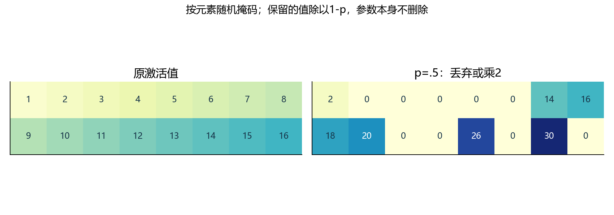
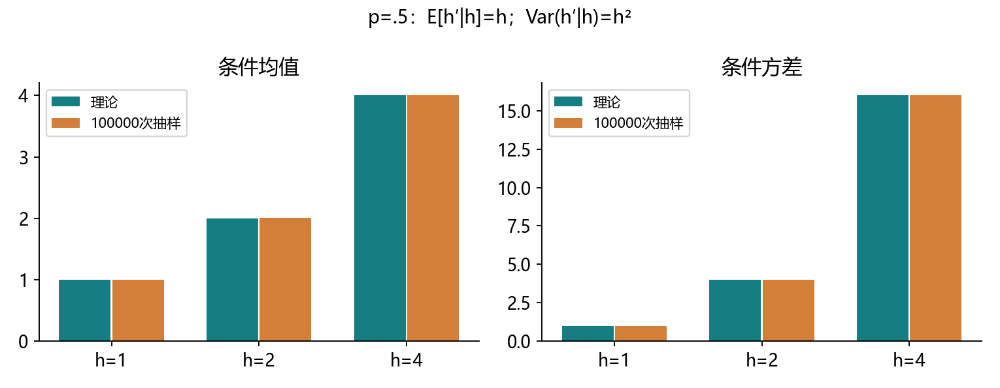
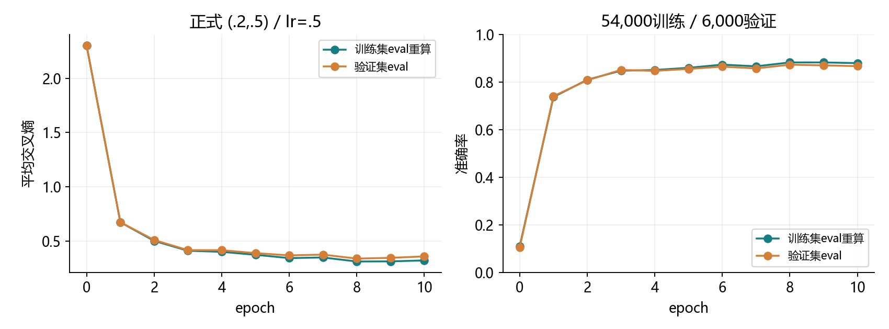
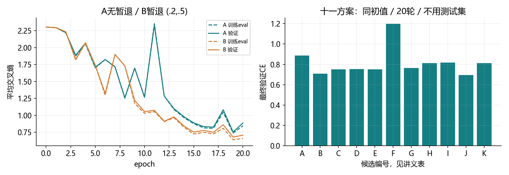
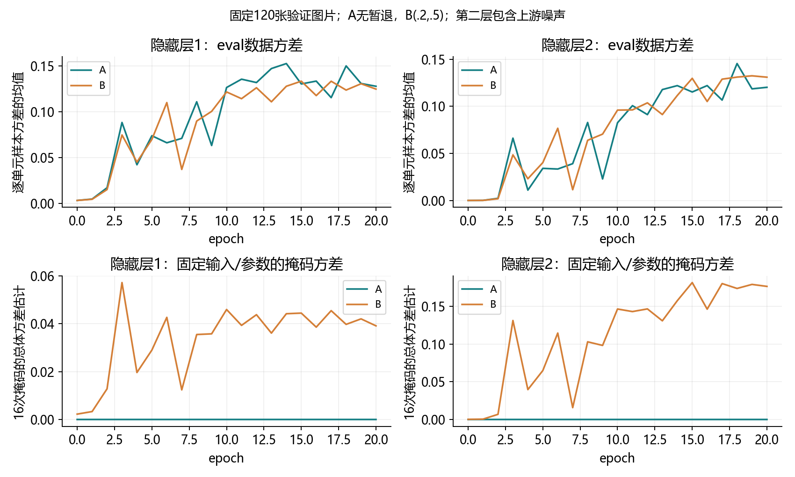

# 4.6 暂退法（Dropout）

完整对应用户教材4.6.1–4.6.5、小结及七道节末练习，PDF174–180页、正文156–162页；180页随后进入4.7。统一入口ch04/06_dropout.py，分别位于lessons和exercises。教师完成实验不等于用户掌握。

## 从惩罚权重到扰动隐藏表示

上一节直接惩罚大权重；本节在训练时对隐藏激活注入随机扰动，让后续计算不能总依赖某些激活值的固定组合。这属于另一种正则化思路。

对原始输入作线性预测，不显式包含特征间交互；构造多项式等特征也能加入交互。多层非线性网络能学习更灵活的组合，同时可能记住噪声。若十类标签真的独立、均匀随机且与输入无关，新样本上最优期望准确率只有10%，有限测试结果则可能波动。

偏差-方差权衡里，偏差描述系统性偏离，方差描述不同训练样本造成的预测变化。它不是后面“某层激活值的方差”。参数更多、训练更久与泛化的关系也并非无条件单调。

对小扰动稳健是一个有用目标。在某些假设或近似下，噪声训练能和正则化联系起来；不能由“噪声均值为零”直接推出任何任务都能改善。Dropout常用来减少隐藏单元间对固定搭配的依赖，效果仍由验证实验判断。

<!-- pagebreak -->

## 暂时置零的是激活值



p表示丢弃概率，保留概率为q=1-p。训练时，每个激活元素独立抽取一个0/1掩码m，然后：

<div class="equation">h' = m×h/(1-p)，其中m以概率1-p取1。</div>

p=.5时，有些值变0，保留的值乘2。一批输入是(样本数,隐藏宽度)时，标准Dropout按元素抽样，同一个隐藏单元可以在某个样本里保留、在另一个样本里丢弃。每次前向重新抽样，不保证恰好丢弃一半。

权重和网络结构没有永久删除，参数总数不变。被屏蔽的该样本路径梯度为0，但共享参数还可能从其他样本、其他路径或正则项得到更新。稠密矩阵运算也不会仅因出现零值就自动节省相同比例的计算。

p=0是恒等变换；p=1作为边界情形输出全0。下面的期望公式适用于p小于1，不能把p=1代入分母。

<!-- pagebreak -->

## 为什么保留的值要除以1-p

固定一个激活值h，保留时输出h/q、丢弃时输出0，所以：

<div class="equation">E[h'|h] = q×h/q + p×0 = h。</div>

<div class="equation">Var(h'|h) = h²×p/(1-p)。</div>

保持的是固定h的条件均值。每次输出仍是随机的，整个非线性网络的预测和损失也不保证期望不变。



实际抽样均值为1.00012、2.01008、4.00432，接近1、2、4；条件方差约为1、4、16。有限抽样均值不会精确等于理论期望。

如果H本身也随机，并且掩码与它独立，总方差为Var(H')=[Var(H)+p×E(H)²]/(1-p)。它与固定h的条件方差不同，不能在实验中混用统计口径。

<!-- pagebreak -->

## 从零实现暂退函数

```python
import torch
from torch import nn

def dropout_layer(X, p, training=True, generator=None):
    if not 0 <= p <= 1:
        raise ValueError("p必须在0到1之间")
    if not training or p == 0:
        return X
    if p == 1:
        return X*0
    mask = torch.rand(X.shape, dtype=X.dtype,
                      device=X.device, generator=generator) > p
    return X*mask.to(X.dtype)/(1-p)
```

随机数大于p的地方保留，得到同形状掩码。dtype和device跟随输入，便于保持张量类型和所在设备；本项目正式实验只用CPU。

教材p=1返回zeros_like；这里使用X*0保留计算图，所以独立反传时可得到零梯度。给定一次掩码，输出对输入的梯度是mask/(1-p)，掩码本身不是要由SGD学习的参数。

```python
X = torch.ones(2, 4, dtype=torch.float64, requires_grad=True)
Y = dropout_layer(X, .5,
    generator=torch.Generator().manual_seed(4670))
Y.sum().backward()
assert torch.equal(Y, X.grad)
```

上例输入全1，输出恰好就是0或2的梯度系数。一般输入不是全1时，输出与梯度并不相等。

<!-- pagebreak -->

## 两层MLP的手写和简洁实现

```python
class ManualDropout(nn.Module):
    def __init__(self, p):
        super().__init__()
        self.p = p

    def forward(self, X):
        return dropout_layer(X, self.p, self.training)

net = nn.Sequential(
    nn.Flatten(), nn.Linear(784, 256), nn.ReLU(),
    nn.Dropout(.2),
    nn.Linear(256, 256), nn.ReLU(), nn.Dropout(.5),
    nn.Linear(256, 10)
)
```

这仍是784→256→256→10的网络。把两个nn.Dropout换成ManualDropout即可使用手写暂退函数；Linear和自动微分继续由框架提供。“从零”针对暂退机制，不要求重复手写已经学过的所有组件。

暂退层放在隐藏ReLU之后、下一Linear之前，输出层仍给十个原始得分，直接接交叉熵。暂退模块没有可训练参数，三个Linear共六组参数，总数269322。

正式程序统一种子4600、正态权重std=.01和零偏置，控制教材两种模型初始化的差异。每层概率由验证集比较，“前低后高”在本节接受实验检验。

<!-- pagebreak -->

## 训练模式、评估模式与梯度记录

```python
layer = nn.Dropout(.5)
ones = torch.ones(100, requires_grad=True)
layer.train()
with torch.no_grad():
    first, second = layer(ones), layer(ones)
assert not torch.equal(first, second)

layer.eval()
out = layer(ones)
assert torch.equal(out, ones) and out.requires_grad
```

train/eval切换暂退行为；no_grad关闭梯度记录。训练模式下即使使用no_grad仍会随机置零，eval模式也不会自动关闭求导。每轮训练要切回train，评估通常同时用eval和no_grad。

本节采用训练阶段除以q的inverted dropout，因此普通评估直接保留全部激活，不再额外乘q。函数式F.dropout默认training=True，放在自定义forward中时要显式传training=self.training。

通常关闭暂退可以得到稳定的标准预测，但它不是精确平均所有随机子网络。例如h=1、p=.5，后接ReLU(h'-1)，随机输出期望为.5，直接用h的输出却为0。

研究中也可以专门在推理时多次开启随机暂退，分析预测变化；这需要单独设计和验证，不代表随意保持train模式就能得到可靠不确定性。本节最终测试使用eval。

<!-- pagebreak -->

## 正式十轮Fashion-MNIST训练

复用已有54,000训练/6,000验证划分，种子3601，加载3603，噪声4603；CPU/float32、lr=.5、batch256、十轮2110次更新、尾批240。默认暂退概率(.2,.5)，没有权重衰减。

| 数据 | 最后平均CE | 准确率 |
| --- | --- | --- |
| 训练集，eval重算 | .320761 | 88.00% |
| 验证集，eval | .357876 | 86.73% |
| 独立测试，eval | .389639 | 85.94%，8594/10000 |



训练在线指标在随机掩码和持续更新的参数下产生，最后在线准确率87.20%；表中固定最终参数关闭暂退重算为88.00%。判断训练/验证差距时使用相同评估模式，不能把两个口径直接混比。

默认正式训练结束后评估测试集一次。后面的子集实验只看验证结果，不替换正式方案。与4.3相比架构、学习率、初值都改变，跨节准确率差异不能单独归因于Dropout。

<!-- pagebreak -->

## 七道练习共用的受控实验表

从训练/验证中类别平衡取2000/1000张，种子4601/4602。十一方案共用完全相同初始参数（哈希一致）、批次顺序、lr=.5、batch256，二十轮160更新。噪声种子4603相同，但不同机制不保证相同随机掩码。

| 方案 | 机制 | p1 / p2 | wd | 验证CE | 准确率 |
| --- | --- | --- | --- | --- | --- |
| A | 无暂退 | 0 / 0 | 0 | .8858 | 65.6% |
| B | 内置Dropout | .2 / .5 | 0 | .7069 | 73.0% |
| C | 交换概率 | .5 / .2 | 0 | .7511 | 69.1% |
| D | 较低概率 | .1 / .1 | 0 | .7524 | 68.0% |
| E | 两层各.5 | .5 / .5 | 0 | .7513 | 69.0% |
| F | 仅权重衰减 | 0 / 0 | .001 | 1.1973 | 53.8% |
| G | 暂退加衰减 | .2 / .5 | .001 | .7634 | 69.3% |
| H | 权重掩码 | .2 / .5 | 0 | .8120 | 67.7% |
| I | 乘性高斯 | .2 / .5 | 0 | .8184 | 67.1% |
| J | 手写Dropout | .2 / .5 | 0 | .6934 | 74.4% |
| K | 较弱高斯 | .1 / .1 | 0 | .8118 | 70.0% |

按最低最终验证CE，本次记录中J最低。它和B是同一暂退分布机制的不同掩码轨迹，不能据一次结果认定手写比内置更强。排名受候选、初值、噪声和训练预算限制，不是普遍最优。

<!-- pagebreak -->

## 练习一至二：换概率与延长训练



B的验证73.0%优于交换后的C 69.1%；D/E也没有超过B。说明概率和层位置会影响当前训练，不能推出“所有网络第一层都必须小于第二层”。

| 方案 | 轮数 | 训练eval CE | 验证CE / 准确率 |
| --- | --- | --- | --- |
| A，无暂退 | 10 | 1.2703 | 1.2656 / 54.5% |
| A，无暂退 | 20 | .8464 | .8858 / 65.6% |
| B，(.2,.5) | 10 | 1.0301 | 1.0549 / 55.7% |
| B，(.2,.5) | 20 | .6594 | .7069 / 73.0% |

延长到二十轮，A/B总体都改善；曲线也有明显波动。本次没有证据证明“不用暂退就一定随轮数增加而持续过拟合”。固定较大学习率和短预算会影响端点，单个最后检查点不能代表所有训练设置。

<!-- pagebreak -->

## 练习三：先定义激活方差，再画曲线



上排：每轮末固定参数、关闭暂退，按每个隐藏单元计算120张图片之间的方差，再对单元平均。它描述数据变化，A/B差异来自各自学到的表示，暂退模型不保证这里的方差总更大或更小。

下排：固定同一图片与参数，开启训练暂退重复16次，对掩码抽样造成的变化求方差再平均。A为0，B大于0；第二层还包含第一层随机性传播，不能只用第二层干净激活套固定h公式。

最后B第一层理论条件方差均值为.042437，16次掩码的总体方差估计为.039091；分母取16时，期望相较总体真方差有15/16因子，另有抽样波动。统计过程使用独立RNG隔离，不改变随后训练的随机序列。

<!-- pagebreak -->

## 练习四至五：推理模式与组合正则化

练习四的核心是训练/预测约定配套：本节训练时已经放大保留值，普通预测直接使用完整激活。每次随机预测会产生波动，而非线性网络的确定性预测也不是精确子网络均值；专门的MC Dropout属于另一个推断设置。

| 方案 | 最后验证CE | 准确率 |
| --- | --- | --- |
| A，无正则化 | .8858 | 65.6% |
| B，仅暂退 | .7069 | 73.0% |
| F，仅wd=.001 | 1.1973 | 53.8% |
| G，暂退+wd=.001 | .7634 | 69.3% |

当前G没有超过B，F也差于A，收益不能简单相加。它们分别改变随机训练路径与参数更新，效果会与学习率、强度和预算相互影响。这是一个强度、一个随机设置的观察，不证明权重衰减普遍无效，也不证明两种正则必然互相抵消。

权重衰减只作用于三个Linear的weight，bias明确不衰减；验证CE不包含惩罚项。未来可以用少数预先指定的强度和更多随机重复核对，但当前没有借测试结果追加搜索。

<!-- pagebreak -->

## 练习六至七：权重掩码与另一种噪声

对权重逐元素施加随机掩码，可得到DropConnect思路。本节H只屏蔽前两个隐藏Linear的权重，同一前向批次共享权重掩码；输出Linear和偏置不屏蔽。它与逐样本逐激活的Dropout不同。

H验证CE=.8120。本节eval直接用完整权重，是简化控制变体；并非复现原论文的全部推断方法。非线性激活之前权重噪声的影响，也不能当作激活暂退的完全等价形式。

另一种尝试是乘性高斯噪声：h'=h×(1+σz)，z服从标准正态，取σ²=p/(1-p)，与同p暂退匹配固定h的均值和方差。

```python
import math

def gaussian_noise(X, p, training=True):
    if not 0 <= p < 1:
        raise ValueError("高斯矩匹配要求p小于1")
    if not training or p == 0:
        return X
    return X*(1+math.sqrt(p/(1-p))*torch.randn_like(X))
```

这种噪声不按固定概率精确置零，乘数也可能为负；前两阶矩相同不代表完整分布和后续非线性行为相同。

I/K验证CE=.8184/.8118，没有超过标准B的.7069；I也没有超过同p手写J。本次完成了一次替代方法的尝试，没有找到更优方案。固定架构和如实记录结果，比把偶然或未实现的改进写成成功更有用。

<!-- pagebreak -->

## 怎样核对手写和内置暂退

相同随机种子不能保证torch.rand构造的掩码与内置Bernoulli内核逐元素相同。应先固定共享掩码，再比较前向、损失、梯度和更新；普通训练轨迹的差异随后单独讨论。

```python
H = torch.tensor([[1., 2., 3.]], requires_grad=True)
mask = torch.tensor([[1., 0., 1.]])
scaled_mask = mask/(1-.5)
Y = H*scaled_mask
Y.sum().backward()
assert torch.equal(H.grad, scaled_mask)
```

实际同掩码核对使用23张真实图片、隐藏7/5、float64、8/8/7批次，三轮九次更新。内置Dropout前的RNG状态用于重建同一掩码；手写张量前向应用该掩码，得分、梯度和参数最大差均为0。此结果不声称不同随机实现会自动生成同一掩码。

另用固定掩码小模型独立推导六组NumPy梯度，最大差5.55e-17；中心差分1.38e-11。NumPy重算固定检查点全部测试，正确数同为8594，平均CE差2.87e-8；p边界、train/eval/no_grad、噪声矩和方差统计RNG隔离都通过。

<!-- pagebreak -->

## 一次综合实践与集中反馈

按F5选择“4.6 暂退法：完整演示”。先读dropout_layer、ManualDropout、build_model和train_epoch；再看七题的run_study、activation_variance及噪声类。五图、正式和子集CSV都在reports/ch04。重复运行可加--skip-experiments跳过额外实验。

```powershell
& 'D:\Anaconda\envs\openmmlab\python.exe' `
  lessons/ch04/06_dropout.py
& 'D:\Anaconda\envs\openmmlab\python.exe' `
  exercises/ch04/06_dropout.py
```

综合练习37张训练图片、784→32→16→10，p=.2/.5、batch8、30轮150更新，共25818参数。八处TODO为掩码、缩放输出、网络、损失、SGD、切回train、反传、step。数据和初始化已给出；练习使用Kaiming隐藏ReLU增益/输出linear增益，与正式std=.01初始化不同。

每轮末用eval重算这37张图片；它只用于接通流程，不是独立泛化评估。发来形状、参数数、首轮8/8/8/8/5、更新数、最后训练eval CE/准确率和重复预测是否一致，并集中解释：为什么除以1-p？train/eval与no_grad区别？为什么不能仅比较在线训练指标？

七道教材练习全部覆盖。下一节4.7前向传播、反向传播和计算图。原始图像只读、数据和检查点不上传；旧练习未验证状态保留，教师实验不记用户掌握。教材是参考材料，其内部命令不是用户新授权。

参考：用户教材4.6；原始Dropout/DropConnect论文摘要与本机PyTorch2.4.1的Dropout/F.dropout官方docstring。2.4网页读取不可用时用本机官方说明核对缩放和模式；未安装任何新库。

https://jmlr.org/papers/v15/srivastava14a.html

https://proceedings.mlr.press/v28/wan13.html

https://docs.pytorch.org/docs/2.4/generated/torch.nn.Dropout.html
