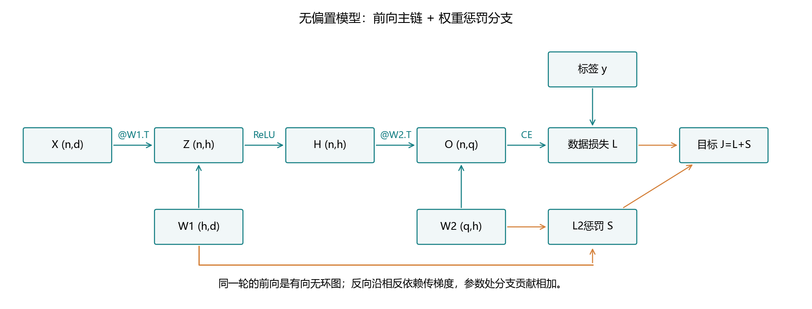
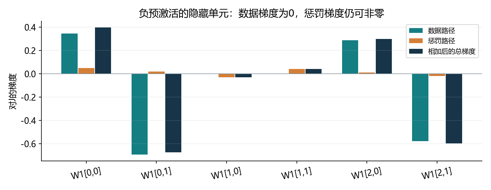
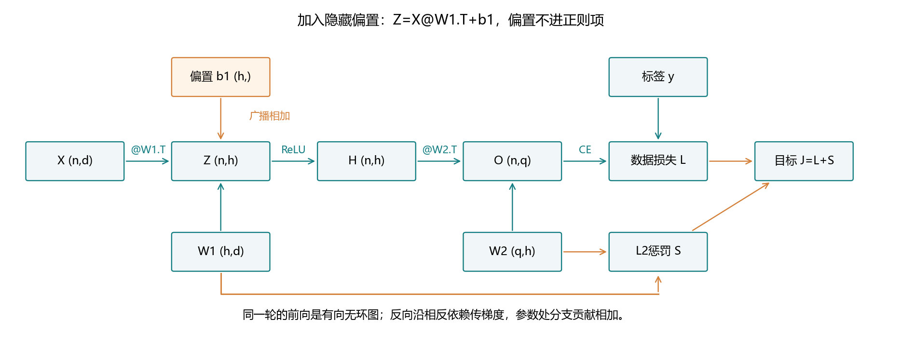
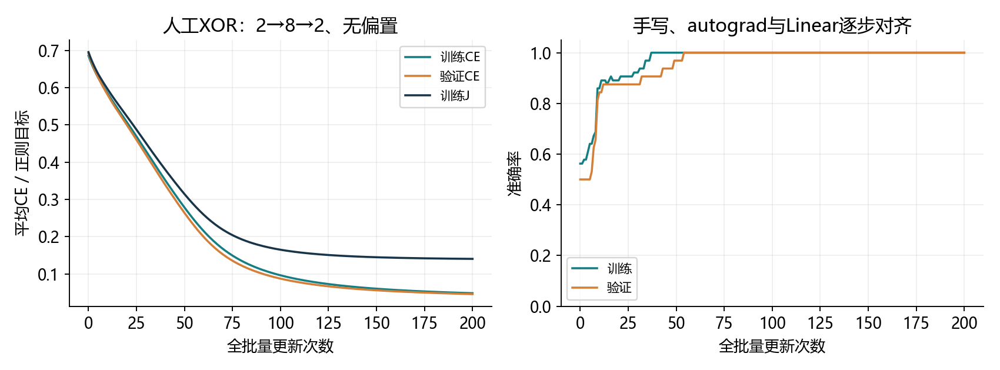
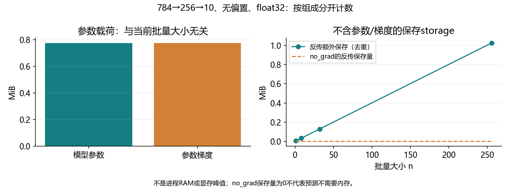
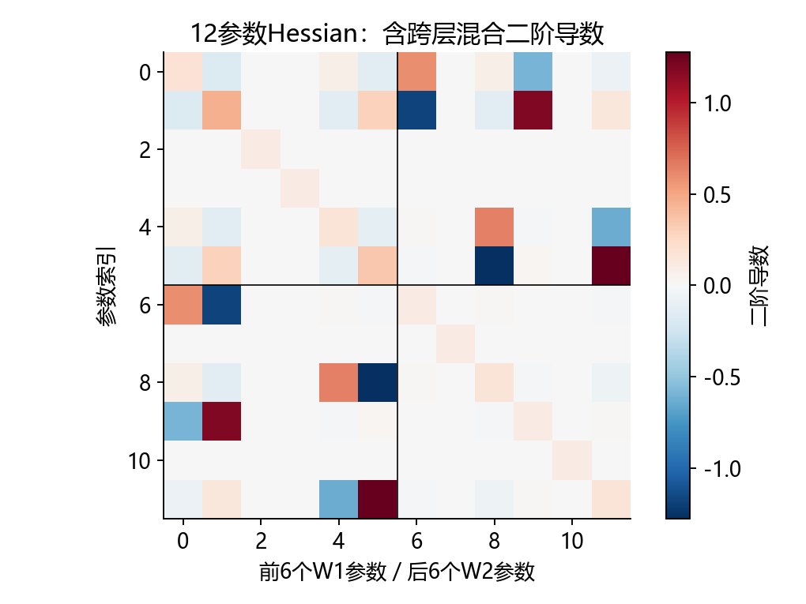

# 4.7 前向传播、反向传播和计算图

完整对应用户教材4.7.1–4.7.4、小结及五道节末练习，PDF180–183页、正文162–165页；下一节4.8从PDF184页/正文166页开始。统一入口ch04/07_backpropagation.py，分别位于lessons和exercises。教师演示不等于用户掌握。

## 把一次训练分成三件事

前向传播根据输入和当前参数，计算隐藏表示、预测得分和目标值。反向传播根据链式法则，计算这个目标对各个变量的梯度。优化器使用梯度更新参数，然后下一次前向使用新参数。



同一轮的依赖构成有向无环图。数据沿依赖关系向前算，梯度沿相反关系传回来；参数更新发生在两次前向之间，不把一轮的计算图画成循环。

backward计算梯度，step才改变参数。本节用小模型把中间数值和导数全部展示出来，暂时不进行大型图像训练。所有数据人工生成，复用已有环境，无安装、无下载。

<!-- pagebreak -->

## 单样本公式与批量代码的方向

教材先用列向量，且两层都不含偏置：

<div class="equation">z=W1x；h=ReLU(z)；o=W2h；J=L(o,y)+s。</div>

<div class="equation">s=λ(||W1||F²+||W2||F²)/2。</div>

为了给出具体梯度，本项目选择分类交叉熵。批量代码把样本放在行上，参数矩阵方向保持和nn.Linear相同：

| 变量 | 形状 | 计算 |
| --- | --- | --- |
| X | (n,d) | 每行一条输入 |
| W1 / Z / H | (h,d) / (n,h) / (n,h) | Z=X@W1.T，H=ReLU(Z) |
| W2 / O | (q,h) / (n,q) | O=H@W2.T |
| y | (n,) | long类型类别索引 |
| L / s / J | 标量 | 平均交叉熵、权重惩罚、二者相加 |

代码中.T表示转置，@表示矩阵乘法。教材的列向量式和这里的行批量式表达同一模型，不能在两种约定之间随意交换矩阵顺序。

Frobenius范数平方就是矩阵所有元素平方和。梯度既来自预测损失路径，也来自参数到正则项的直接路径。

<!-- pagebreak -->

## 跟着一组数字完成前向

```python
import torch
from torch.nn import functional as F

X = torch.tensor([[1., -2.]], dtype=torch.float64,
                 requires_grad=True)
y = torch.tensor([1], dtype=torch.long)
W1 = torch.tensor([[.5, .2], [-.3, .4], [.1, -.2]],
                  dtype=torch.float64, requires_grad=True)
W2 = torch.tensor([[.2, -.1, .3], [-.4, .2, -.2]],
                  dtype=torch.float64, requires_grad=True)
Z = X@W1.T
H = torch.relu(Z)
O = H@W2.T
L = F.cross_entropy(O, y)
s = .1*(W1.square().sum()+W2.square().sum())/2
J = L+s
```

| 中间量 | 实际结果 |
| --- | --- |
| Z | [.1, -1.1, .5] |
| H | [.1, 0, .5] |
| O，原始得分 | [.17, -.14] |
| Softmax概率 | [.576885, .423115] |
| L / s / J | .860111886 / .0485 / .908611886 |

y=1表示第二类。原始得分直接交给交叉熵，不先对O调用Softmax再喂给交叉熵。这里展示概率只是为了理解损失与输出梯度。

<!-- pagebreak -->

## 从目标出发逐步反传

把“J对某变量的梯度”记为g_变量。标量根节点的起始梯度为1；J=L+s，所以两条分支的上游系数也都是1。

单样本列向量约定下，按顺序得到：

<div class="equation">g_o=预测概率-one_hot(y)。</div>

<div class="equation">g_W2=g_o h^T+λW2；g_h=W2^T g_o。</div>

<div class="equation">g_z=g_h * 1[z大于0]。</div>

<div class="equation">g_W1=g_z x^T+λW1；g_x=W1^T g_z。</div>

^T表示转置，*在这里表示按元素乘。外积给出权重矩阵同形状的梯度，不能用两个向量的点积替代。ReLU在正位置局部导数为1、负位置为0；0处数学不可导，PyTorch采用0约定，本节数值差分避开转折点。

g_h没有额外的λh，因为正则项只依赖权重，没有直接依赖h。到达同一个参数的不同路径贡献要相加。

我们计算g_x是为了展示链式法则；普通监督训练通常只更新模型参数，不把输入图片或标签当成优化器参数。

<!-- pagebreak -->

## 一整段批量手写反向传播

```python
def manual_backward(X, y, W1, W2, lambd=.1):
    Z = X@W1.T
    H = torch.relu(Z)
    O = H@W2.T
    GO = O.softmax(1)
    GO[torch.arange(len(y)), y] -= 1
    GO /= len(y)
    GW2 = GO.T@H + lambd*W2
    GH = GO@W2
    GZ = GH*(Z > 0)
    GW1 = GZ.T@X + lambd*W1
    GX = GZ@W1
    return GW1, GW2, GX
```

这里GO对应平均交叉熵，所以除以批量大小。随后的矩阵乘法已经把各样本贡献汇总，不要再重复除以n；正则项的梯度直接是λW，也不额外除以n。

函数只计算梯度数值，不调用backward。完整教师程序在no_grad环境下执行这条手写路径，另建autograd路径和nn.Linear路径比较。

先计算全部梯度，再一起更新参数。不能先修改W2，再用新W2计算本轮g_h；反传要使用生成本轮前向值的那一套参数。

<!-- pagebreak -->

## 分支汇合后，实际梯度是什么



本例的输出梯度为[.576885,-.576885]。传回隐藏层，再经过ReLU，得到g_z约[.346131,0,.288443]。

| 对W1的总梯度 | 第0列 | 第1列 |
| --- | --- | --- |
| 第0个隐藏单元 | .396131 | -.672262 |
| 第1个隐藏单元 | -.030000 | .040000 |
| 第2个隐藏单元 | .298443 | -.596885 |

第1个隐藏单元的预激活为-1.1，数据路径梯度为0，但λW1这一直接分支仍给出[-.03,.04]。因此“某个激活路径关闭”不等于“相关权重总梯度一定为0”。

选择lr=.1做一次完整更新，本例J从.908611886降到.817373471。这是当前参数与步长下的实际结果；梯度提供局部变化信息，有限步是否降低目标仍取决于学习率。

<!-- pagebreak -->

## 用autograd观察中间梯度

```python
for tensor in (Z, H, O):
    tensor.retain_grad()
J.backward()
GW1, GW2, GX = manual_backward(
    X.detach(), y, W1.detach(), W2.detach())
assert torch.allclose(W1.grad, GW1)
assert torch.allclose(W2.grad, GW2)
assert torch.allclose(X.grad, GX)

with torch.no_grad():
    W1 -= .1*W1.grad
    W2 -= .1*W2.grad
```

W1/W2是需要梯度的叶张量；Z/H/O是中间量。PyTorch默认不会把非叶节点的梯度长期写入.grad，观察它们时使用retain_grad。它们的.grad为None，不代表反传内部没有经过这些节点。

backward默认把梯度累加到叶张量.grad。重复训练时要清空旧梯度；每次前向会建立当前计算的新图。普通第一次反传后，图中保存的反传数据通常被释放，再次使用同一图需要专门处理。

retain_grad用于保留某张量的.grad；retain_graph用于保留反传所需的图数据；create_graph用于把求导过程也记录成图。三者用途不同。平常训练不应为了避免报错就一直保留所有图。

<!-- pagebreak -->

## 练习二：加隐藏偏置，重新推导



批量前向改为Z=X@W1.T+b1，随后H/O/L按原来方式计算。偏置沿样本维广播，但不放进s。反向中权重公式形式不变，新增：

<div class="equation">g_b1 = 对GZ沿样本维求和。</div>

GO已经按平均损失除以n，因此这里求和，不再取一次平均。单样本时偏置梯度就是g_z。若存在输出偏置，它的梯度同样由GO沿样本维求和，本节扩展只添加隐藏偏置。

取b1=[.05,-.1,.1]，新Z=[.15,-1.2,.6]、O=[.21,-.18]，s仍为.0485、J约.955540397。实际g_b1约[.357770,0,.298141]，没有额外λb1。

原模型有12个权重参数，新增3个隐藏偏置后共15个。虽然正则项数值不变，数据路径已经改变，不能沿用原来的数据梯度。

<!-- pagebreak -->

## 把完整反传用于一次真实训练

人工生成二维XOR数据，64训练/32验证/32测试，每类平衡；网络2→8→2、无偏置、32参数，float64、lr=.2、λ=.01，全批量200次更新。

三条路径用完全相同的初始参数：手写矩阵反传、叶张量autograd、nn.Linear加SGD weight_decay。比较期间，前两条显式优化J，第三条只对交叉熵反传，由优化器加入相同λW。



最终训练CE=.048551993、正则项=.092085540、J=.140637532；验证CE=.046034459。固定方案训练结束后测试32条，CE=.046997638、32条正确。

三条实现200更新期间最大参数差3.33e-16，NumPy独立重放最大参数差2.22e-16。这是小型人工任务，用来验证计算链与更新，不代表图像任务的泛化水平，也不记为用户已经掌握。

<!-- pagebreak -->

## 练习一：梯度形状与完整Jacobian

如果f是标量函数，输入X为n×m矩阵，那么f对X的梯度也是n×m：每个元素对应f对该输入元素的偏导数。

```python
A = torch.arange(1., 7., dtype=torch.float64).reshape(2, 3)
A.requires_grad_()
gradient = torch.autograd.grad(A.square().sum(), A)[0]
assert gradient.shape == A.shape
assert torch.equal(gradient, 2*A.detach())

jacobian = torch.autograd.functional.jacobian(
    lambda value: value.square(), A.detach())
assert jacobian.shape == (2, 3, 2, 3)
```

如果输出也是张量，完整Jacobian要同时表示输出和输入的各个索引；这里有6×6个导数，而不是只剩一个2×3梯度矩阵。

autograd.grad中传入grad_outputs，计算的是输出向量与Jacobian的乘积，即按指定上游权重汇总输入梯度，不会自动返回完整Jacobian。它返回梯度张量，默认不写入输入的.grad。

教材prod代表根据张量形状匹配的链式组合。代码中要分清@、转置和按元素乘，不能把所有高维求导都写成同一种乘法。

<!-- pagebreak -->

## 练习三：训练内存怎样计算

反传要使用前向保存的输入、激活及其他算子数据，还需要参数梯度；这通常使训练比单纯推理需要更多内存。保存并不等于把所有值重新复制：视图、别名和重复保存可能共享storage。



计数场景为784→256→10、两层无偏置、float32。参数总数784×256+256×10=203264，参数和参数梯度各813056字节，约.7754 MiB。

| 批量n | 额外保存storage字节 | 参数+梯度+保存量字节 |
| --- | --- | --- |
| 1 | 4212 | 1630324 |
| 8 | 33668 | 1659780 |
| 32 | 134660 | 1760772 |
| 256 | 1077252 | 2703364 |

右列是去重保存载荷和参数/梯度的计数下界，不是进程RAM或显存峰值；不含图节点、临时工作区、分配器缓存、其他活跃张量和可选优化器状态。此处SGD没有动量。no_grad没有反传保存量，不表示推理不需要参数和中间计算空间。

若简化地保留X/Z/H/O所有命名量，推理预算可写为4×[203264+n(784+256+256+10)]字节；n=256时为2150400字节。这是另一种明确的保留假设，不能与右列当作同口径实测峰值比值。真实内存还受算子、复用与重计算方式影响。

<!-- pagebreak -->

## 练习四：对导数再求导

```python
u = torch.tensor(2., dtype=torch.float64, requires_grad=True)
first = torch.autograd.grad(u**3, u, create_graph=True)[0]
second = torch.autograd.grad(first, u)[0]
assert first.item() == 12. and second.item() == 12.
```

create_graph=True把一阶求导过程也记录下来，才可以继续对它求导。仅保留原前向图的retain_graph=True，不等价于记录梯度计算图。



若参数数为K，完整Hessian含K²个元素；本例12×12、float64需1152字节。只求Hessian向量积H·v，无需显式保存完整矩阵，其输出只有12个数（96字节），但仍需要梯度图与工作内存。

实际HVP与稠密H@v差5.55e-17，方向差分差6.93e-12；正则项对Hessian的贡献为λI。两层联合参数的目标不必凸，本例最小特征值约-1.72427。ReLU转折处应另外讨论，本例远离0。

一次HVP通常只需少数求导过程；形成完整Hessian通常需要更多方向计算及K²存储，不能给所有网络承诺固定时间倍数。

<!-- pagebreak -->

## 练习五：把图分阶段执行

把第一层和第二层放在不同设备，边界处传输激活，反传时梯度也需要经过该边界。基本结构为：

```python
def split_forward(X, W1, W2):
    H = torch.relu(X.to(W1.device)@W1.T)
    O = H.to(W2.device)@W2.T
    return O
```

中间H.to(...)保留求导连接；这里detach会切断前层的数据梯度。正则项两层产生的标量也必须移到同一设备才能相加，再对总目标反传。

本机检测到1张可用GPU，因此实际演示为第一阶段CPU、第二阶段cuda:0。目标值和参数梯度与全CPU参考差均为0。这验证了跨设备复制中的求导连接，不是两张GPU的实测。脚本在有两张GPU时可选择cuda:0/cuda:1；重复运行可用--skip-device-demo跳过。

| 方法 | 主要帮助 | 代价或限制 |
| --- | --- | --- |
| 减小微批量 | 降低激活相关内存 | 不减少模型参数本身的存储 |
| 模型分阶段 | 分担参数及部分中间量 | 传输激活/梯度，负载不均和阶段空闲 |
| 数据并行 | 不同设备处理不同样本 | 通常复制完整模型，不能单独解决参数本体放不下 |

单批顺序分阶段不保证更快；还需要考虑通信和调度。参数占主导时只减批量可能不够，激活占主导时较小微批量或重计算可能更合适。本节是计算依赖演示，不部署多机训练框架。

<!-- pagebreak -->

## 小批量不足时，怎样累积梯度

为了保留相同有效批量，可以分多次前向/反传，最后只更新一次。平均损失要按每个微批量的实际样本数加权，尤其注意尾批。

```python
def micro_step(X, y, W1, W2, lambd=.1):
    optimizer = torch.optim.SGD([W1, W2], lr=.1)
    optimizer.zero_grad(set_to_none=True)
    for start in range(0, len(y), 5):
        xb, yb = X[start:start+5], y[start:start+5]
        logits = torch.relu(xb@W1.T)@W2.T
        loss = F.cross_entropy(logits, yb)
        (loss*len(yb)/len(y)).backward()
    penalty = lambd*(W1.square().sum()+W2.square().sum())/2
    penalty.backward()
    optimizer.step()
```

这里正则项只加一次，优化器没有再设置weight_decay。17条样本分5/5/5/2，与一次完整批量的梯度最大差6.94e-18，执行一次SGD后参数完全相同。

等价条件包括期间参数保持不变、样本损失可以这样加权求和。本例没有Dropout或BatchNorm；不能把完全相同轨迹的结论自动推广到任意随机层或批量相关层。

累积梯度不会把模型参数分到别的卡，也不要求保留所有微批量图。每个微批量反传后可以释放其保存数据，.grad继续累计，直到最后一次更新。

<!-- pagebreak -->

## 一次综合实践与集中反馈

按F5选择“4.7 计算图与反向传播：完整演示”。先阅读forward_values、manual_gradients和single_example，再看三路径训练；内存、二阶和设备演示对应教材练习，所有结果保存在reports/ch04。

```powershell
& 'D:\Anaconda\envs\openmmlab\python.exe' `
  lessons/ch04/07_backpropagation.py
& 'D:\Anaconda\envs\openmmlab\python.exe' `
  exercises/ch04/07_backpropagation.py
```

综合练习为5条人工样本、2→3→2网络、隐藏偏置、不惩罚偏置，共15参数。八处TODO集中接通Z、H、O、GO、GW2、GZ、GW1、Gb1。参考自动求导核对与一步更新框架已给出，答案保持留空。

发来前向量与梯度形状、L/s/J、最大梯度误差和一步后的J；集中解释：权重为什么有两条梯度路径？隐藏激活关闭时总梯度是否必为0？backward与step分别做什么？训练为什么通常需要更多内存？

五道教材练习已覆盖：标量矩阵梯度形状、隐藏偏置图与方程、内存计数、二阶计算图与代价、模型分阶段和小批量比较。下一节4.8数值稳定性和模型初始化。教师验证不记作用户掌握，旧作业未验证状态保留。

资料基于用户教材与本机PyTorch2.4.1；官方autograd教程和分布式概览用于核对概念，版本API以本机官方docstring及实际运行核对。原教材仅为参考，内部命令不自动成为用户操作授权，无安装、无下载。

https://docs.pytorch.org/tutorials/beginner/basics/autogradqs_tutorial.html

https://docs.pytorch.org/tutorials/beginner/dist_overview.html

https://docs.pytorch.org/docs/2.4/autograd.html
