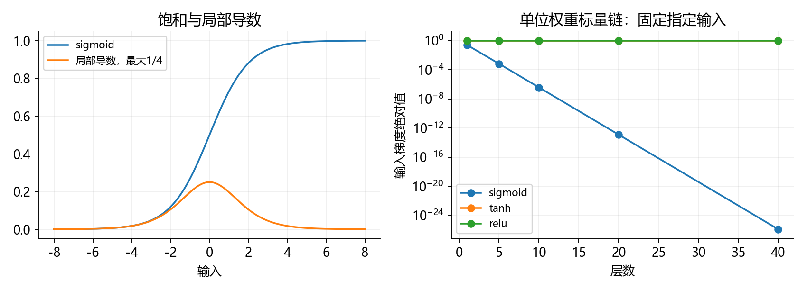
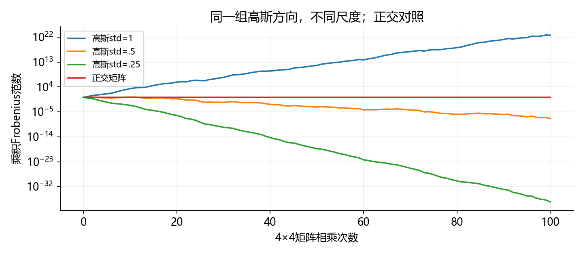
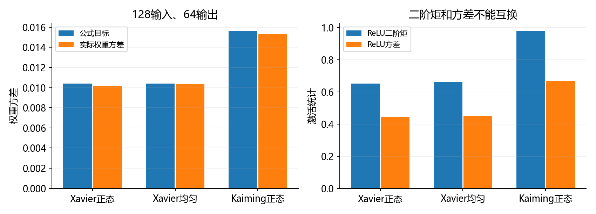
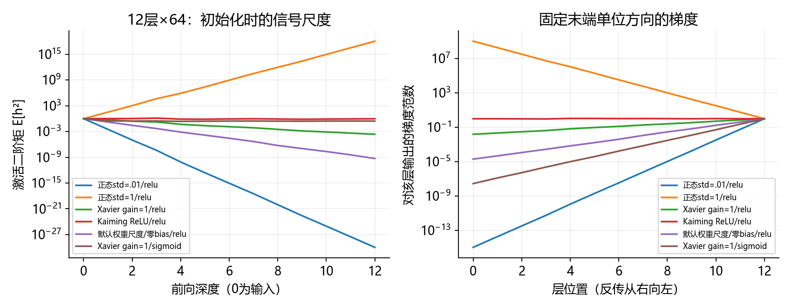
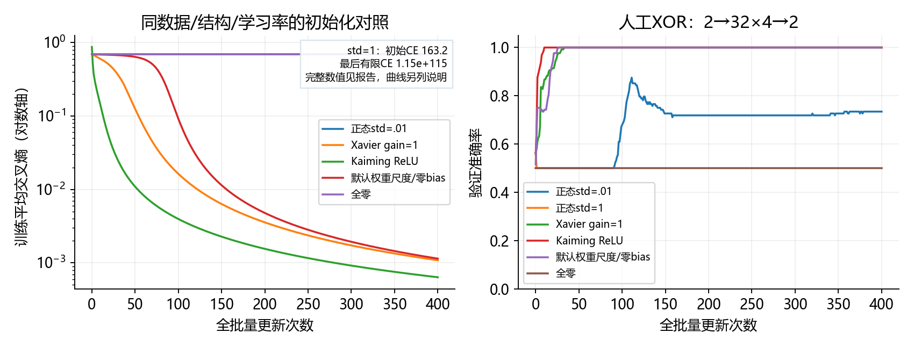
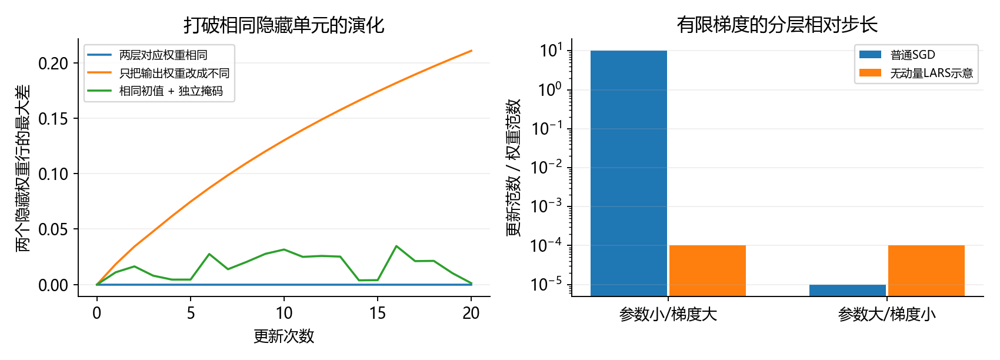

# 4.8 数值稳定性和模型初始化

完整对应用户教材4.8.1–4.8.2、小结与四道节末练习，PDF184–188/正文166–170；4.9在PDF188/正文170同页开始。统一演示与综合练习为ch04/08_numerical_stability.py，分别位于lessons和exercises。教师运行不等于用户掌握。

## 从上一节的链式法则继续

4.7说明怎样沿计算图求梯度。4.8要问：即使每一步公式都对，多层连乘以后，梯度大小还合适吗？

设每层的输入到输出Jacobian为M_l，输入梯度包含多层矩阵的连乘。标量情形更直观：

<div class="equation">dy/dx = f_L'(h_(L-1)) × … × f_1'(x)。</div>

梯度消失意味着传到某些层的梯度非常小，常规更新几乎不动；梯度爆炸意味着梯度很大，同一学习率可能造成过大的参数变化。二者都可能在仍为有限数时影响优化，不必等到0、inf或NaN才算问题。

浮点数有有限的范围和精度。下溢到0、上溢到inf是进一步的表示问题；提高到float64能扩大范围，却不能把本来不合适的梯度尺度变合适。

本节顺序为：标量链与矩阵连乘、对称性、方差推导、初始化API、逐层诊断和真实训练，最后回答矩阵界与LARS拓展。全部是小型人工实验，CPU/float64为主，不安装、不下载。

<!-- pagebreak -->

## Sigmoid为什么容易让梯度变小

<div class="equation">s(x)=1/(1+exp(-x))；s'(x)=s(x)(1-s(x))≤1/4。</div>

输入很大或很小时，sigmoid趋近1或0，导数接近0；输入为0时导数也只有1/4。对权重全为1的标量sigmoid链，即使没有饱和到极端值，多层导数相乘仍会迅速缩小。



```python
import math
import torch
from torch import nn
from torch.nn import functional as F

x = torch.tensor(0., dtype=torch.float64, requires_grad=True)
h = x
for _ in range(10):
    h = torch.sigmoid(h)
h.backward()
print(x.grad.item())  # 约3.87522e-7
```

40层实际梯度约1.37e-26，仍是非零有限数，但已经很小。这个1/4上界是对本例单位权重链的说明；一般网络还包含权重矩阵，不能断言所有sigmoid网络的总梯度都严格小于(1/4)^层数。

图中tanh只在输入0、单位权重时沿0传递而导数为1；ReLU只在指定正输入下为1。它们不是对所有输入和参数都不会消失或爆炸的保证，ReLU在负输入处仍会关闭梯度。

<!-- pagebreak -->

## 矩阵连乘与表示范围



从4×4单位矩阵开始，相乘100个高斯矩阵。三个方案共用标准正态基底（种子4801），只改变尺度；正交对照由各基底QR分解得到。

| 每个矩阵的构造 | 100次后乘积Frobenius范数 |
| --- | --- |
| 高斯std=1 | 4.98267e22 |
| 同一基底×.5 | 3.93064e-8 |
| 同一基底×.25 | 3.10073e-38 |
| 每次取正交Q | 约2 |

4维线性层用std=1/√4=.5能保持某些二阶矩的期望，并不保证每条有限随机连乘轨迹都稳定。本次轨迹仍缩小；正交矩阵的奇异值均为1，纯线性乘积保持长度，但加上ReLU门控后就不再有同样保证。

单独的80次标量相乘实验中，float32的.25连乘变为0，4连乘变为inf；float64分别约6.84e-49和1.46e48。这说明增加精度只能推迟表示范围问题，梯度尺度仍可能不适合优化。

把标量概率乘积改写成对数和可以减轻一些表示问题，但普通深层矩阵连乘还包含正负项和求和，不能简单逐元素取log来替代整个反向传播。

<!-- pagebreak -->

## 打破对称性：相同隐藏单元为什么会一直相同

一个隐藏单元计算tanh(w·x+b)。若两个单元的输入权重行、偏置、对应输出权重列都相同，前向激活相同，收到的反向信号也相同。对同一批数据做确定性的SGD，两者继续同步，难以学出不同特征。

```python
X = torch.tensor([[1., -2.], [-1., 2.]], dtype=torch.float64)
W1 = torch.tensor([[.3, -.2], [.3, -.2]],
                  dtype=torch.float64, requires_grad=True)
W2 = torch.tensor([[.4, .4]], dtype=torch.float64,
                  requires_grad=True)
prediction = torch.tanh(X@W1.T)@W2.T
prediction.square().mean().backward()
assert torch.allclose(W1.grad[0], W1.grad[1])
```

这里的关键是完整连接关系保持对称。只把W1设为相同，而输出对应权重不同，并不保证两个隐藏单元梯度仍相同。

本节tanh对照用相同隐藏初值，20次更新后：两层对应权重都相同的方案，隐藏行差为0；只改成不同输出权重，行差约.210700；独立Dropout掩码的方案，行差约.001239。它们说明对称性可被打破，不用于比较最终泛化能力。Dropout最后一次记录关闭掩码，损失不与前面随机值直接比较。

全零深层ReLU网络还会遇到零激活、零权重和框架原点导数的阻断。bias设0通常可以，但不能由此推断这个深层网络所有权重也可设0。

<!-- pagebreak -->

## Xavier推导：先看一个线性层

先忽略非线性和偏置，对一个输出分量：

<div class="equation">o_i = Σ_j w_ij x_j。</div>

教材假设权重独立抽样、均值0、方差σ²；输入均值0、方差γ²，输入之间及输入与权重适当独立。这是对随机输入和随机初始化的理想化分析。

<div class="equation">E[o_i]=0；Var[o_i]=n_in σ² γ²。</div>

直觉是：输出加了n_in项，若每项尺度不随输入数减小，总输出会越来越大。为了让前向方差不变，希望n_in σ²=1；反向使用类似独立性近似，希望n_out σ²=1。

| 方向 | 理想化的方差倍率 | 对权重方差的要求 |
| --- | --- | --- |
| 前向 | n_in σ² | σ²=1/n_in |
| 反向 | n_out σ² | σ²=1/n_out |

宽度不同时，这两个条件一般无法同时满足。Xavier把两个倍率的平均设为1，是折中，不是承诺前向和反向各自都精确保持。

若输入128、输出64，Xavier gain=1时，前向倍率4/3、反向倍率2/3。教材小结中的“方差不受数量影响”要结合这些假设和折中理解。

<!-- pagebreak -->

## Xavier正态和均匀分布

<div class="equation">Var[w]=2/(n_in+n_out)；std=√(2/(n_in+n_out))。</div>

正态分布传给normal的是标准差，不能把方差2/(n_in+n_out)直接当标准差。若用U(-a,a)，它的方差为a²/3，因此：

<div class="equation">a=√(6/(n_in+n_out))。</div>

```python
fan_in, fan_out = 128, 64
sigma = math.sqrt(2/(fan_in+fan_out))
bound = math.sqrt(6/(fan_in+fan_out))
assert math.isclose(bound**2/3, sigma**2)
w = torch.empty(fan_out, fan_in, dtype=torch.float64)
nn.init.xavier_uniform_(w, gain=1.)
assert w.abs().max().item() <= bound
```

| 初始化 | 本例目标 |
| --- | --- |
| Xavier正态 | 标准差约.102062，方差.0104167 |
| Xavier均匀 | 区间约[-.176777,.176777]，相同方差 |
| 实际正态样本方差 | .0101914 |
| 实际均匀样本方差 | .0103436 |

两种分布的前两矩相同，但分布和具体权重不同；有限样本方差不必正好等于理论值。PyTorch还提供gain参数，gain=g会把标准差或区间界乘g，方差乘g²。本节“Xavier”均指gain=1，和4.3中按ReLU增益设置的对照要区分。

<!-- pagebreak -->

## ReLU与Kaiming：二阶矩不等于方差

对零点对称的预激活z，ReLU保留正半边，因此E[ReLU(z)²]=E[z²]/2。希望激活二阶矩跨层保持时，得到ReLU常用的fan_in初始化：

<div class="equation">Var[w]=2/n_in；std=√(2/n_in)。</div>

ReLU输出通常有正均值，所以Var[h]=E[h²]−E[h]²，不能把它和二阶矩互换。若z为零均值高斯、方差v，则ReLU方差为v(1/2−1/(2π))，二阶矩为v/2。



4096条独立标准正态输入，128→64，Kaiming正态的预激活二阶矩约1.95670，ReLU二阶矩约.979721，方差约.669448。二阶矩接近输入的.999395，但激活方差没有变成1。

这是初始化时、基于独立性和分布假设的尺度分析。训练后参数与激活会相关；有限宽度、深度、输入分布和具体任务都影响结果，初始化不是全程稳定或收敛的保证。[He等人的原始论文](https://arxiv.org/abs/1502.01852)从整流激活出发研究这种初始化。

<!-- pagebreak -->

## 在PyTorch中正确初始化

```python
net = nn.Sequential(nn.Linear(2, 32), nn.ReLU(),
                    nn.Linear(32, 2)).double()
with torch.no_grad():
    nn.init.kaiming_normal_(net[0].weight, mode='fan_in',
                            nonlinearity='relu')
    nn.init.normal_(net[2].weight, mean=0., std=1/math.sqrt(32))
    nn.init.zeros_(net[0].bias)
    nn.init.zeros_(net[2].bias)
```

隐藏层后接ReLU，输出层直接产生logits，不能把输出层也误当后接ReLU。本节给Kaiming方案的线性输出层用方差1/fan_in；分类交叉熵直接接原始得分。

nn.Linear权重形状为(fan_out,fan_in)，计算X@weight.T，初始化函数也按这个约定解释fan。若自己保存W为(fan_in,fan_out)并计算X@W，应相应对W.T使用初始化函数，不能机械照搬方向。[官方初始化文档](https://docs.pytorch.org/docs/stable/nn.init.html)明确说明这一点。

本机2.4.1的Linear.reset_parameters源码使用kaiming_uniform_(a=√5)，等价于权重U(-1/√fan_in,1/√fan_in)，并非上面的ReLU Kaiming方差2/fan_in。默认bias也从相同界的均匀分布抽样，不是自动为0。

训练中的“默认权重尺度/零bias”是控制方案：采用默认权重分布，但显式把所有bias归零，使偏置设置一致；它不是完整保留框架默认初值。

<!-- pagebreak -->

## 先诊断逐层的激活和梯度



512条标准正态输入、12层宽64、零偏置，固定种子4802/4803。各正态方案共用同一基底，只改尺度。末端使用相同的单位范数方向r，对标量Σh*r求导，以隔离Jacobian传播，不混入不同任务损失的尺度。

| 方案 | 最后一层激活二阶矩 | 输入梯度范数 |
| --- | --- | --- |
| std=.01 / ReLU | 1.08902e-30 | 1.06523e-15 |
| std=1 / ReLU | 1.08902e18 | 1.06523e9 |
| Xavier / ReLU | .000230608 | .0155011 |
| Kaiming / ReLU | .944572 | .992069 |
| 默认权重尺度 / ReLU | 5.23568e-10 | 1.98900e-5 |
| Xavier / sigmoid | .273966 | 2.78570e-8 |

看右图时，反向传播从右向左。最右端梯度都是1，是实验设定；要比较的是传回输入时的大小。sigmoid的激活二阶矩没有趋于0，梯度却仍很小，不能只看前向激活是否非零。

<!-- pagebreak -->

## 把初始化放进同一个真实训练任务

统一用人工XOR分类，输入两个坐标，异号为1、同号为0；绝对值在[.4,1.6]，数据种子4805。256训练、128验证、128测试，各集类别平衡。

结构2→32→32→32→32→2，四层ReLU隐藏层，共3330参数；CPU/float64，所有bias显式0，学习率.1，400次全批量SGD，没有Dropout、动量或权重衰减。

六方案为std=.01、std=1、Xavier gain1、Kaiming ReLU、默认权重尺度、全零。各正态方案使用同一标准正态基底4806；均匀方案用单独固定流4807。Kaiming线性输出层用1/√fan_in，其余方案按各自定义初始化输出层。

下面两条样本只演示训练循环，沿用前面初始化API示例的浅层net；正式六方案采用上述数据与四层隐藏结构。

```python
batch_X = torch.tensor([[1., -1.], [1., 1.]], dtype=torch.float64)
batch_y = torch.tensor([1, 0])
optimizer = torch.optim.SGD(net.parameters(), lr=.1)
optimizer.zero_grad(set_to_none=True)
loss = F.cross_entropy(net(batch_X), batch_y)
loss.backward()
optimizer.step()
```

训练核心与上一节相同。实际整节程序在loss或梯度出现非有限值时停止该方案并记录；不会静默把NaN替换为0后继续。

400更新是固定预算，没有为了让某方案胜出而调参。测试方案在产生结果前固定为Kaiming，最后评估一次；比较验证结果不再改变测试方案。

<!-- pagebreak -->

## 本次训练结果怎么读



| 初始化 | 首次第一层梯度范数 | 最后有限验证CE | 验证准确率 |
| --- | --- | --- | --- |
| std=.01 | 8.58367e-7 | .693147147 | 73.4375% |
| std=1 | 84.5897 | 1.14597e115 | 50%，已停止 |
| Xavier gain1 | .113524 | .000979745 | 100% |
| Kaiming ReLU | .218903 | .000559850 | 100% |
| 默认权重尺度/零bias | .00843765 | .000993596 | 100% |
| 全零 | 0 | .693147181 | 50% |

std=1方案初始训练CE约163.17，执行7次更新后检测到非有限loss；表格保留的是第6次更新后的最后有限记录。没有成功完成400轮，也不是所有大初始化都必然在第7次失败。

std=.01的准确率不低，但交叉熵几乎没有降低：概率非常接近.5，微小的得分排序也可能产生较高准确率。它的首次第一层梯度很小；不能只看准确率说“已经充分学好”，也不能说完全没有形成分类信息。

预先固定的Kaiming最后测试CE=.000758678、128/128正确。这是简单人工任务和本次种子的结果，不是图像分类成绩，也不证明Kaiming在任何任务上都胜过Xavier。

<!-- pagebreak -->

## 教材练习一和二：哪些对称性需要区分

隐藏单元可以交换顺序，同时交换下一层对应的输入连接，整体函数不变。这是参数表示的排列对称性，不是某次初始化才能产生的现象。

另一个例子是ReLU正比例缩放：将一个隐藏单元的输入权重与偏置乘c>0，再把其输出连接除以c，整体函数不变。tanh则有同时翻转输入权重、偏置及输出连接符号的对称性。本节数值误差分别约2.78e-17与0。

这些函数等价并不都必须消除。初始化时要避免的是多个隐藏单元在训练中一直同步、无法形成不同表示的退化状态。

线性回归只有一个仿射映射，不存在重复隐藏特征的这个问题；softmax回归也可从全零权重开始，因为标签和输入通常会让不同类别收到不同梯度。本节零初始线性回归梯度[-1.15,1.70]，softmax两行梯度[-.375,.25]、[.375,-.25]。

```python
A = torch.tensor([[1., -2.], [-1., 2.]], dtype=torch.float64)
target = torch.tensor([0, 1])
W = torch.zeros(2, 2, dtype=torch.float64, requires_grad=True)
F.cross_entropy(A@W.T, target).backward()
assert not torch.allclose(W.grad[0], W.grad[1])
```

softmax还具有给所有类别得分加同一个值而概率不变的平移不变性；有参数非唯一性，并不等于不能从全零开始训练。标签、数据和模型结构决定具体梯度，不能泛化成“所有模型必须所有参数随机”。

<!-- pagebreak -->

## 教材练习三：矩阵乘积的界

一般矩阵中，只知道各矩阵特征值很难保证乘积稳定。[Higham关于谱半径的说明](https://nhigham.com/2024/01/12/what-is-the-spectral-radius-of-a-matrix/)给出反例与范数上界。本节独立构造：

<div class="equation">A=[[1,10],[0,1]]；B=A.T；ρ(A)=ρ(B)=1。</div>

然而ρ(AB)约101.9902。两个因子的特征值都为1，并不代表乘积的特征值也在1附近。

对方阵乘积，有可靠但可能很松的界：

<div class="equation">ρ(AB) ≤ ||AB||_2 ≤ ||A||_2 ||B||_2。</div>

谱范数||A||_2等于最大奇异值，描述输入方向可能被放大的最大倍数。对可逆同阶方阵，还可用最小奇异值控制最小缩放：

<div class="equation">σ_min(AB) ≥ σ_min(A) σ_min(B)。</div>

上界很大不证明一定爆炸，实际还取决于方向；只控制最大奇异值也不防止某些方向被压到0。要同时关心最大和最小缩放，以及多层乘积的方向对齐。ReLU门控可能有零奇异值，不能只看权重矩阵。

程序用SVD/eigvals核对本例；无需在这一节深入矩阵分析证明。相关有限维线性代数背景可参看[Cornell数值线性代数讲义](https://www.cs.cornell.edu/courses/cs6210/2025fa/lec/2025-08-25.html)。

<!-- pagebreak -->

## 教材练习四：能否事后修正尺度

[LARS论文](https://arxiv.org/abs/1708.03888)按层用权重和梯度范数调节相对步长。下面只写无动量、有限非零范数时的核心；g为数据梯度，β为权重衰减：

<div class="equation">r=η||w||/(||g||+β||w||)；Δw=-αr(g+βw)。</div>

β=0时，相对更新范数||Δw||/||w||=αη。一般β≥0时，由三角不等式得到不超过αη的界。实现还需要处理零范数、eps和参数分组；这不是原论文完整优化器复现。



示意设α=.1、η=.001，两层的SGD相对步长分别为10和1e-5，LARS均为1e-4。它控制有限梯度的更新尺度，不能把已变成inf/NaN的计算恢复成正确数，也不能恢复已经下溢为0而丢失的方向。

梯度裁剪限制更新前的梯度范数；调整初始化/学习率、规范输入等作用于不同环节。先定位哪一层开始异常，再选择处理方法。训练已非有限时，应停止并从有效状态重来，而不是期待缩放万能修复。

<!-- pagebreak -->

## 一次综合实践与集中反馈

按F5选择“4.8 数值稳定性与初始化：完整演示”。先看scalar_chains与matrix_products，再看make_model、propagation_probe、train_comparison。六张图、真实CSV和指标放reports/ch04；检查点只在被忽略的artifacts，已有图像数据不读取。

```powershell
& 'D:\Anaconda\envs\openmmlab\python.exe' `
  lessons/ch04/08_numerical_stability.py
& 'D:\Anaconda\envs\openmmlab\python.exe' `
  exercises/ch04/08_numerical_stability.py
```

综合练习使用96训练/48验证人工XOR，2→16→16→16→2、626参数、lr=.1、200次整批更新。比较小正态、Xavier、Kaiming隐藏层；三组输出层统一用1/√fan_in，bias均0，共用标准正态基底4809，数据4808。八处TODO保留：两种隐藏层标准差、输出层标准差、缩放权重、清零bias、平均交叉熵、反传与step。

发来三组首次第一层梯度范数、最终训练/验证CE和验证正确数，集中解释：为什么准确率和CE可能给出不同信息？ReLU为什么仍需控制权重尺度？标准差与方差有何区别？为什么bias可为0，却不把深层所有权重都设为0？

四道教材练习已在正文覆盖。下一节4.9环境和分布偏移，讨论训练环境变化后模型为什么可能失效。旧作业未验证状态保留，材料准备不写成掌握。

理论参考还包括[Xavier原始论文](https://proceedings.mlr.press/v9/glorot10a.html)。API以本机PyTorch2.4.1官方docstring、Linear源码及运行核对；官网当前版本仅用于概念交叉检查，不升级环境。原教材是参考材料，其命令不自动成为操作指令。
