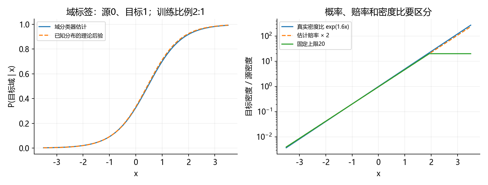
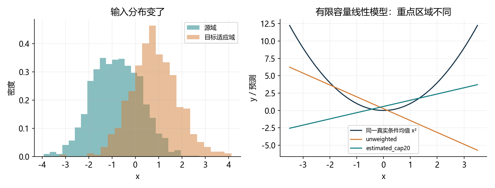
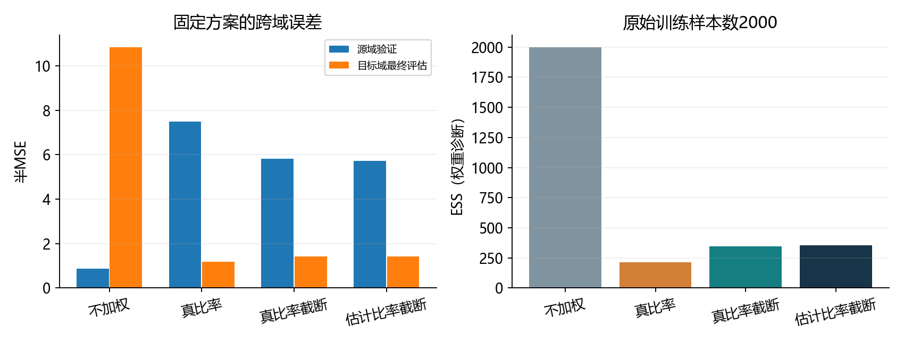
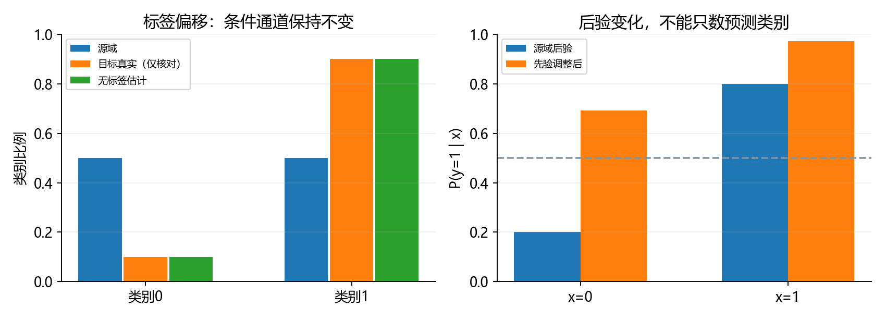
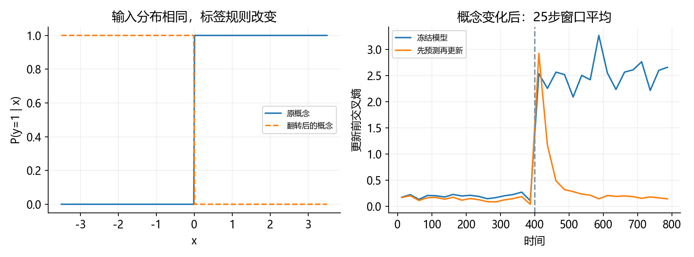
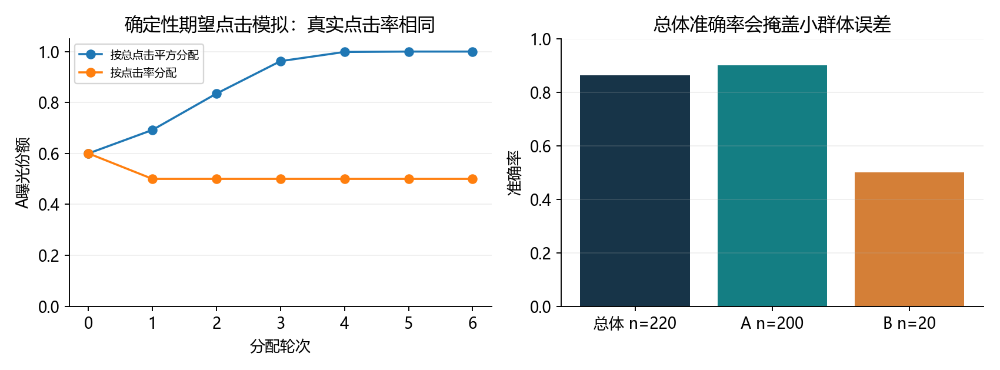

# 4.9 环境和分布偏移

完整对应用户教材4.9.1–4.9.5、小结和四道节末练习，PDF188–198/正文170–180；4.10在PDF198/正文180同页开始。演示与综合练习统一为ch04/09_distribution_shift.py，分别位于lessons和exercises。教师实验不等于用户掌握。

## 从模型是否学好，到环境是否改变

4.4讨论同一目标分布下的训练误差与泛化；4.8讨论梯度和初始化。4.9进一步问：模型训练完成，未来遇到的数据还和当初一样吗？

源域S是训练数据的来源，目标域T是准备应用的环境。x表示输入，y表示任务标签。联合分布P(x,y)同时描述哪些输入常见、不同输入对应什么标签。

<div class="equation">P_S(x,y) ≠ P_T(x,y)：分布偏移。</div>

同源随机测试集上的高分，只说明相应分布和采样条件下的表现，不自动保证新相机、新时间、新人群或新决策策略下仍有效。分布偏移也不等于一定失败；不影响决策的变化可能几乎无害。

本节用人工数据贯通三类偏移、重要性加权、域分类检测、标签比例估计、先预测后更新，以及反馈和分组指标。复用已有环境，CPU/float64，无安装、无下载。

目标适应特征与最后评估集分开。算法不接触目标适应标签；最后目标标签只用于固定方案的诊断比较，不用它选截断值、训练轮数或模型。

<!-- pagebreak -->

## 三类偏移：明确什么变、什么保持

联合分布有两种分解：P(x,y)=P(y|x)P(x)=P(x|y)P(y)。竖线表示“在已知某个条件时”。

| 类型 | 变化的部分 | 保持的假设 | 直觉 |
| --- | --- | --- | --- |
| 协变量偏移 | P(x) | P(y给定x) | 输入频率变，条件标签规律保持 |
| 标签偏移 | P(y) | P(x给定y) | 类别比例变，每类特征规律保持 |
| 概念偏移 | P(y给定x) | 不要求P(x)保持 | 同一输入的标签规律改变 |

标签偏移指类别的边缘比例改变。若把0和1的含义交换、修改标签定义或判定规则，则属于概念变化。

纯标签偏移通常也会改变P(x)和P(y|x)，所以它与纯协变量偏移是不同假设，不是看到哪个直方图变了就能唯一分类。现实中可能混合变化，也有某些特殊情况同时满足多个条件。

后续纠正方法都有适用假设。能检测到输入差异，不代表已经证明P(y|x)相同；看不到输入差异，也不能证明标签规律没变。

<!-- pagebreak -->

## 把例子与采样方式放在一起看

模型可能学到采样过程留下的捷径，而不是我们希望的规律。例如，某类零件始终在亮背景拍摄，另一类始终在暗背景拍摄；同源随机划分时很好，换背景就可能失败。

视觉SLAM相关的例子是白天换夜晚、室内换室外、相机曝光或模糊程度变化。它们提示需要检查输入和误差，但不能仅凭外观改变就断言是纯协变量偏移；可见信息、噪声或标签关系也可能变化。

教材还讨论年龄与采样来源混杂、合成纹理捷径、时间变化和地区差异。它们的共同点是要先调查数据怎么收集、标签怎么定义、准备在哪里使用。教材中的轶事是说明机制，不作为本项目独立验证的历史事实。

随机按行划分不一定防止泄漏：同一对象、相邻视频帧、同一用户或同一批次可能进入不同集合。应根据应用按对象、时间或来源划分，并用独立目标环境样本检查。

本节所有模型都很小，目的不是训练更强的网络，而是控制数据生成机制，让“哪个分布因子改变了”可以被准确检查。

<!-- pagebreak -->

## 经验风险和真正想优化的风险

经验风险是有限训练集的平均损失；目标真实风险是未来目标分布上的损失期望。

<div class="equation">R_hat_S(f)=Σ_i loss(f(x_i),y_i)/n。</div>

<div class="equation">R_T(f)=E_(x,y来自T)[loss(f(x),y)]。</div>

即使没有分布偏移，有限样本、抽样相关性、测量/标注噪声、数据泄漏、模型复杂度，以及反复使用验证集选方案，都会影响经验风险接近真实风险的程度。这对应教材练习四。

对固定模型、独立同分布且损失方差有限时，样本均值的方差为Var(loss)/n；样本更多通常更稳定。模型由同一数据选择后，训练误差可能偏乐观，不能直接套固定模型的结论。

```python
import math
import torch
from torch.nn import functional as F

q = torch.tensor([.8, .2], dtype=torch.float64)
p = torch.tensor([.2, .8], dtype=torch.float64)
loss_by_region = torch.tensor([1., 9.], dtype=torch.float64)
beta = p/q
assert torch.allclose((q*beta*loss_by_region).sum(),
                      (p*loss_by_region).sum())
```

例中源域风险2.6、目标域风险7.4。每个区域的损失不变，只是区域出现概率变了，平均误差就会变化。

<!-- pagebreak -->

## 协变量偏移纠正：让源样本代表目标频率

若P_T(y|x)=P_S(y|x)，并且目标域有概率出现的区域在源域也有支持，可以换写目标期望：

<div class="equation">β(x)=P_T(x)/P_S(x)。</div>

<div class="equation">R_T(f)=E_S[β(x) loss(f(x),y)]。</div>

源域少见而目标域常见的样本，权重较大；源域常见而目标域少见的样本，权重较小。纠正的是哪些区域更影响平均目标，并没有发明新标签。

训练目标变成Σβ_i loss_i/n。这里权重乘逐样本损失后再平均；不能先把loss汇总成标量再乘一个样本向量。

上述恒等式是总体期望关系，不表示某一份有限样本的加权损失就一定等于目标评估误差。模型、权重还可能从数据估计，产生额外误差。

如果目标域某区域P_T(x)>0而源域P_S(x)=0，就没有带标签源样本可以重新加权；权重无法补出缺失知识。即使理论上有支持，有限数据中有效覆盖也可能不足。

重要性加权与模型选择的背景见[Sugiyama等人的原始论文](https://www.jmlr.org/papers/v8/sugiyama07a.html)。本节固定方案做演示，不声称消除所有域差异。

<!-- pagebreak -->

## 用域分类器估计密度比

构造一个新的二分类任务：源域的域标签z=0，目标域z=1。这里的z只表示数据来自哪里，不是原任务的y。

令域分类器g(x)=P(z=1|x)，域训练混合比例为π_T、π_S。根据Bayes公式：

<div class="equation">g(x)/(1-g(x)) = [π_T P_T(x)]/[π_S P_S(x)]。</div>

<div class="equation">β(x) = [g(x)/(1-g(x))] × π_S/π_T。</div>

若g(x)=sigmoid(h(x))，则β(x)=exp(h(x))×π_S/π_T。教材先用两域等量样本，此时比例因子为1；不等量混合时不能照抄。

```python
x = torch.tensor([-1., 0., 1.], dtype=torch.float64)
n_source, n_target = 1200, 600
h = 1.6*x + math.log(n_target/n_source)
ratio = (h + math.log(n_source/n_target)).exp()
assert torch.allclose(ratio, (1.6*x).exp())
```

本节源域1200、目标域600，所以赔率还要乘2。若重采样成等量或改变域损失的类别权重，有效域先验也随之改变，应使用实际训练分布，而不是机械套原始数据数量。

<!-- pagebreak -->

## 域检测器的真实实验与数据角色

源域x来自N(-.8,1)，目标域来自N(.8,1)；两域任务关系均为y=x²+噪声，噪声标准差.1。因而理论密度比为exp(1.6x)，线性域logit可以正确表示其形式。



| 数据角色 | 数量 | 用途 |
| --- | --- | --- |
| 源域/目标域的域训练特征 | 1200 / 600 | 训练域分类器，不用任务标签 |
| 两域独立的域留出特征 | 300 / 300 | 检查域可分性 |
| 源任务训练/源验证 | 2000 / 600 | 加权回归与同源评估 |
| 目标最终评估 | 2000 | 固定方案完成后比较，不参与适应 |

域分类用BCEWithLogits，零初值、lr=.1、800整批更新。估计h(x)=1.570294x−.724079，理论为1.6x−.693147。域留出集按等先验评价，准确469/600=78.17%。

这个分数说明当前检测器发现了输入来源差异，不是正式显著性检验，也不能证明差异就是纯协变量偏移。弱分类器、样本不足或未观察到的特征，都可能漏检。

<!-- pagebreak -->

## 将权重接到已有训练循环

为突出有限容量影响，任务模型故意采用直线w*x+b，去近似同一个二次条件均值。最适合源域和目标域频率的直线不同。

固定比较不加权、真实比率、真实比率截断20、估计比率截断20。截断值20、lr=.03和400次整批更新在结果产生前固定，所有回归模型从同一零参数开始。

```python
# 三点示例只展示更新核心，正式训练使用2000条源样本。
train_x = torch.tensor([-1., 0., 1.], dtype=torch.float64)
train_y = train_x.square()
design = torch.stack((train_x, torch.ones_like(train_x)), dim=1)
theta = torch.zeros(2, dtype=torch.float64, requires_grad=True)
weights = ratio.detach().clamp(max=20)
per_sample = (design@theta-train_y).square()/2
objective = (weights*per_sample).mean()
objective.backward()
with torch.no_grad():
    theta -= .03*theta.grad
```

detach表示第二阶段把已估计权重当作固定数，不让回归损失反过来修改域检测器。直接对域logit加先验修正，再在log空间截断后exp，可以避免先exp出巨大值再处理。

Σβ_i loss_i/Σβ_i是自归一化形式，与本节除n的目标不同。固定权重、无正则的最优点可相同，但梯度尺度、固定学习率的轨迹和正则相对强度会改变。

<!-- pagebreak -->

## 为什么源域误差升高，目标域反而改善



不加权模型学到斜率约-1.709665、截距.256295；估计加权截断模型学到斜率.897361、截距.578212。二者都只能画直线，前者更贴近源域常见的左侧，后者更重视目标域常见的右侧。

| 固定方案 | 源域验证半MSE | 目标域最终半MSE |
| --- | --- | --- |
| 不加权 | .864012 | 10.844112 |
| 真实比率 | 7.501275 | 1.172886 |
| 真实比率截断20 | 5.829989 | 1.419644 |
| 估计比率截断20 | 5.730252 | 1.428331 |

加权后源域平均误差升高，不代表程序必然写错；优化目标转向了目标分布。真实比率是人工生成器已知时的参照，实际部署通常无法直接获得。

本任务目标总体最佳直线是1.6x+.36，最小总体半MSE为1.005；有限样本模型与评估误差不必正好达到它。本节没有用目标标签拟合这条参照线，也没有按最终评估结果重新选择方案。

<!-- pagebreak -->

## 权重截断、有效样本量与覆盖



常用的权重诊断是有效样本量：

<div class="equation">ESS=(Σβ_i)²/Σβ_i²。</div>

2000条训练样本中，真实未截断权重最大约70.66、ESS约211.49；估计截断20后ESS约356.84。大量权重集中在少数点时，估计会不稳定；ESS是权重集中度的诊断，不等于实际拥有这么多独立新标签。

截断减轻少数极大权重的影响，同时改变目标，带来偏差。本次真实比率不截断的目标误差1.172886，优于截断的1.419644；不能把“更稳健”直接当成每次都更准确。

真实权重均值本次约.892223，而不是精确1，体现有限样本波动。估计权重又增加模型误差。不能因为权重来自概率公式，就忽略样本覆盖、检测器拟合或适用假设。

<!-- pagebreak -->

## 标签偏移：先估计目标类别比例

假设P_T(x|y)=P_S(x|y)，但类别比例改变。重要性权重变为β(y)=P_T(y)/P_S(y)，不再是输入密度比。

用源域独立校准集构造条件混淆矩阵C，行是预测类别，列是真实类别：C_ij=P_S(预测=i|真实=j)。每列和为1。用无标签目标适应特征得到预测比例μ。

<div class="equation">C p_T = μ。</div>

```python
C = torch.tensor([[.8, .2], [.2, .8]], dtype=torch.float64)
mu = torch.tensor([.26, .74], dtype=torch.float64)
prior_target = torch.linalg.solve(C, mu)
prior_source = torch.tensor([.5, .5], dtype=torch.float64)
class_weights = prior_target/prior_source
assert torch.allclose(prior_target, torch.tensor([.1, .9], dtype=torch.float64))
```

这里的C必须明确归一化方式。若存的是联合比例C_joint=P(预测=i,真实=j)，正确方程是C_joint*β=μ，解的是类别权重β，而不是目标先验。本例误把联合矩阵当条件矩阵，会把[.2,1.8]误认成先验，其和为2。

矩阵可逆与数值条件很关键；“分类准确”不是唯一条件。始终预测一个类别的矩阵秩为1，无法分离类别比例。有限样本可能解出负比例，需要检查假设和估计误差，不能无说明地截掉负数就宣称问题解决。[BBSE原始论文](https://proceedings.mlr.press/v80/lipton18a.html)研究这种估计。

<!-- pagebreak -->

## 标签纠正的结果与代价

受控实验中，源域两类各50%；目标域类别1为90%。条件通道保持P(x=1|y=0)=.2、P(x=1|y=1)=.8，源后验已知；用1000条源校准样本和1000条无标签目标适应样本估计，另有1000条目标最终评估。



本例估计先验[.1,.9]、权重[.2,1.8]。若源后验可靠，可由Bayes关系调整：

<div class="equation">P_T(y|x) ∝ P_S(y|x) × P_T(y)/P_S(y)。</div>

```python
prob_source = torch.tensor([[.8, .2], [.2, .8]], dtype=torch.float64)
prob_target = prob_source*class_weights
prob_target /= prob_target.sum(dim=1, keepdim=True)
assert torch.allclose(prob_target.sum(dim=1), torch.ones(2, dtype=torch.float64))
```

行对应x=0/1，列对应y=0/1。调整后P(y=1|x=0)约.692308，x=1时约.972973。总体准确率80%→90%、交叉熵.500402→.252428，但类别0召回率80%→0。

这不是估计器偷看标签，而是目标先验变化后的决策取舍。本例采用已知源后验，真实模型若概率失准，不能照搬其精确收益。加权重训也是一种纠正方式，实际应按应用评价目标验证。

<!-- pagebreak -->

## 概念偏移与在线适应

如果输入数组完全相同，原标签为x>0，新标签变成x<0，只看x无法区分“规则不变”和“规则翻转”。实际域分类器在成对相同特征上准确率50%，原任务分类器从100%变成0%。



在线学习按顺序做：观察x→给出预测→得到y→计入损失→更新模型。不能用当前标签先更新，再拿更新后结果冒充刚才的预测成绩。

```python
w = torch.tensor(3., dtype=torch.float64, requires_grad=True)
xi = torch.tensor(1., dtype=torch.float64)
prediction_before = torch.sigmoid(w*xi).detach()
yi = torch.tensor(0., dtype=torch.float64)  # 预测后才揭示标签
loss_before_update = F.binary_cross_entropy_with_logits(w*xi, yi)
loss_before_update.backward()
with torch.no_grad():
    w -= .2*w.grad
```

800条流数据在第400条开始翻转规则，初值w=3/b=0、lr=.2。600–799段，冻结模型平均CE2.523886/准确率0%，在线模型CE.177842/97%。它依赖持续获得新标签；发现输入差异不等于有标签可更新，且在线适应也可能遗忘旧环境。

<!-- pagebreak -->

## 批量、在线、Bandit、控制与强化学习

| 学习情景 | 数据与反馈特点 | 需要关注什么 |
| --- | --- | --- |
| 批量/离线学习 | 先获得一批训练数据，再训练或更新 | 数据来源与未来应用是否相符 |
| 在线学习 | 按时间先预测，再获得反馈并更新 | 当前预测必须在看到当前答案前作出 |
| Bandit | 选择动作，只看到所选动作的回报 | 探索与利用，未选动作的结果通常未知 |
| 控制 | 动作改变之后的系统状态 | 动态、稳定性、长期影响；不一定学习 |
| 强化学习 | 智能体与环境交互，优化累计回报 | 状态、动作、奖励、延迟影响和策略 |

这里的“批量学习”不是要求一次把全部训练样本送进网络。小批量SGD也可以用于离线学习；“在线”也不是“连着互联网”。这些分类不是完全互斥的轴。

教材用有限手臂介绍Bandit，但关键是动作选择和部分反馈；监督学习中的类别有限，并不会自动变成Bandit。推荐两条内容后只看到被展示项的点击，与给每条内容都标注喜欢/不喜欢不同。

控制器可以按已知物理规律设计，不一定需要强化学习。强化学习通常要考虑动作对未来状态与回报的影响；无状态的Bandit可看成更简单的情形。本节不训练大型强化学习模型。

<!-- pagebreak -->

## 决策会反过来改变数据

教材练习一问：搜索引擎改变行为后，用户和广告商会怎么做？用户可能改变查询或点击习惯；内容发布者优化排名信号；广告商调整素材、关键词和出价。新的行为又成为后续训练数据。

不能把相关性自动当成干预后的稳定因果关系。模型依赖的信号一旦成了行动目标，人们可能专门改变它；只记录被展示、被检查或被批准的对象，还会形成选择性反馈。



本节明示一个简化分配规则：两组真实点击率都为.1，初始曝光600/400；下一轮按期望总点击数的平方分配曝光。较大组获得更多曝光、更多总点击，进一步放大。按点击率分配的对照则变成相等份额。

这些点击是计算出的期望值，属于确定性模拟，不是采集的真实点击，也不是对任何搜索平台行为的实证结论。它只展示“记录数据取决于此前决策”的机制；实际还要考虑反馈噪声、未曝光项和评估设计。

<!-- pagebreak -->

## 公平、责任与透明度：从预测到决策

教材4.9.5强调模型会参与决策，需要说明在哪些条件、哪些人群上有效，如何处理不同错误，以及谁负责复核和更新。这属于本节内容，不由一个总分替代。

本节虚构两组二分类计数，不对应真实人群：

| 分组 | 样本数 | TP / TN / FP / FN | 准确率 | 真正例率 |
| --- | --- | --- | --- | --- |
| A | 200 | 90 / 90 / 10 / 10 | 90% | 90% |
| B | 20 | 0 / 10 / 0 / 10 | 50% | 0% |
| 总体 | 220 | 90 / 100 / 10 / 20 | 86.36% | 81.82% |

总体86.36%掩盖了B组的差表现。报告还要给出样本量；小群体统计不确定性较大，不能只比较百分数后就认定原因或确定唯一公平标准。

如果一次假阴性的代价设为5、假阳性为1，总代价=(5×20+10)/220=.5单位/样本。这个人为成本示例说明准确率默认等价对待错误，而决策目标可能不同；它不是现实应用的通用成本设定。

标签纠正实验中总体准确率上升、类别0召回率归零，也说明优化某一总体目标可能牺牲其他指标。透明度包括记录数据来源、适用假设、评估分组、阈值、变化和限制；解释某个模型分数不等于已经识别因果或解决公平问题。

<!-- pagebreak -->

## 四道教材练习与一次综合实践

练习一的搜索行为/反馈已在正文讨论；练习二由独立留出集检验域分类器；练习三完成先验修正、密度比、截断、加权训练和覆盖诊断；练习四区分样本量、相关性、噪声、泄漏和模型选择。四题均有对应材料。

F5选择“4.9 环境和分布偏移：完整演示”。按make_covariate_data→fit_domain→density_weights→fit_regression阅读，再看标签纠正和先预测后更新。结果统一存reports/ch04，不复制或下载图像数据。

```powershell
& 'D:\Anaconda\envs\openmmlab\python.exe' `
  lessons/ch04/09_distribution_shift.py
& 'D:\Anaconda\envs\openmmlab\python.exe' `
  exercises/ch04/09_distribution_shift.py
```

综合练习用N(-.6,1)/N(.6,1)，域源400/目标200，源回归600/目标最终评估600，数据4910；任务仍是x²+噪声。域训练400步、lr=.1；两个回归方案各300步、lr=.03、同零初值，截断10。

八处TODO留空：域特征、域标签、域BCE、域反传、log密度比、截断权重、逐样本损失和加权目标。发来域参数、2倍修正、权重均值/最大值/ESS、两方案参数与源/目标半MSE。

集中解释：域标签与任务标签有何区别？为何要修正域先验？加权适用什么假设？只有标签规则翻转时域检测器能否发现？下一节4.10实战Kaggle比赛：预测房价，届时先检查本机数据，不把教材下载命令当作自动操作指令。旧练习未验证状态保留。

资料基于用户教材与本机PyTorch2.4.1；理论交叉核对使用Sugiyama等人2007和Lipton等人2018论文。所有实验为人工受控情景，不把模拟改进写成现实部署保证，材料准备不记为用户掌握。
