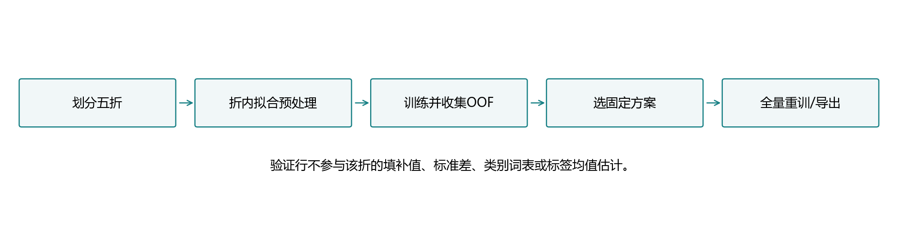
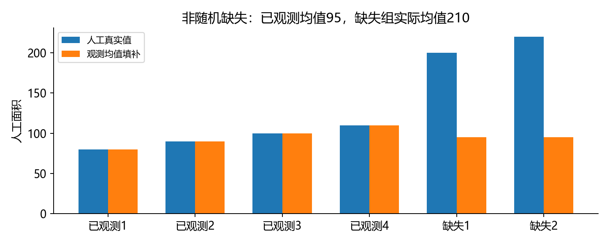
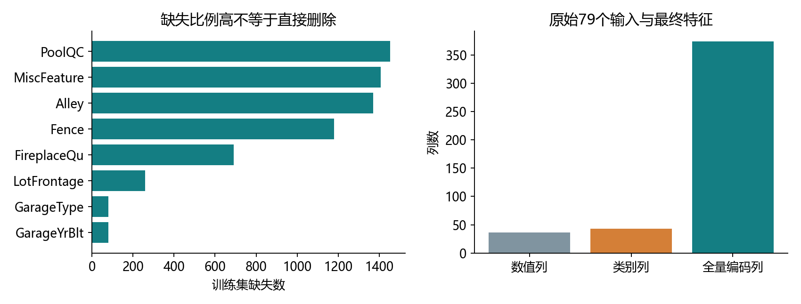
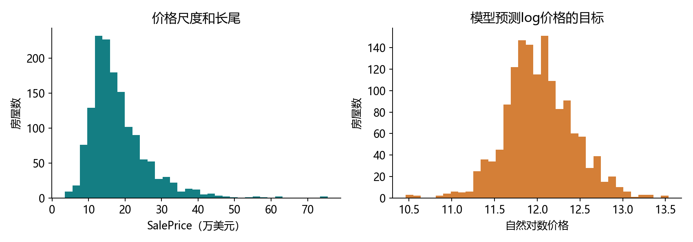
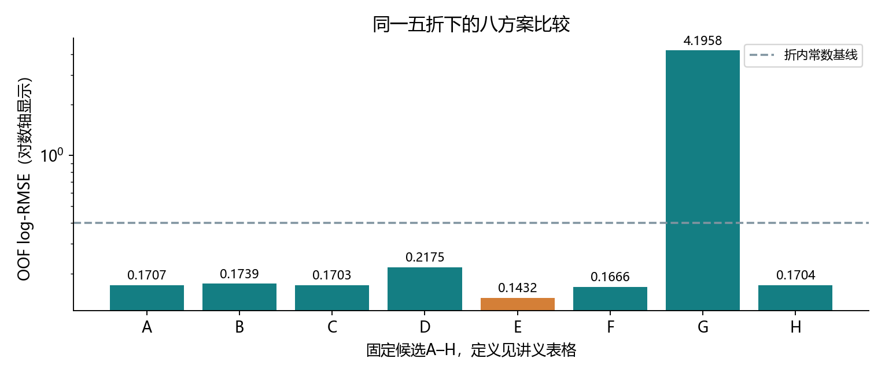
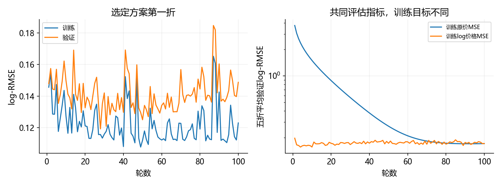
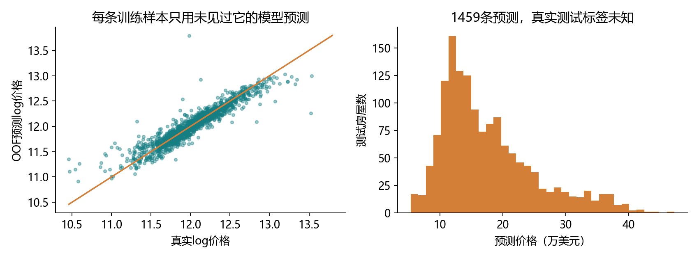

# 4.10 实战Kaggle比赛：预测房价

完整对应用户教材4.10.1–4.10.8、小结及六道节末练习，PDF198–208/正文180–190；下一章5.1从PDF209/正文191开始。演示和综合练习统一为ch04/10_kaggle_house_prices.py，分别位于lessons和exercises。教师工程完成不等于用户掌握。

## 用一个真实项目串起第4章

输入是一套房屋的属性，输出是成交价格，属于有监督回归。本节贯通读取、预处理、训练、交叉验证、模型选择和预测导出，形成可复现的完整流程。



训练集有真实房价，比赛测试集没有标签。要从训练集内部划分验证集；不能拿没有标签的测试集计算本地误差。预测文件正确，也不等于已经取得线上成绩。

本项目用真实比赛CSV和现有openmmlab环境，CPU/float64。按固定五折比较八个方案，选定后全量重训并生成1459行预测。本次没有登录或上传Kaggle，所以线上分数未知。

原始房屋数据来自2006–2010年的Ames, Iowa；教材中的“亚利桑那州”地名不准确，原论文署名Dean De Cock。这里只做历史数据建模，不把它解释成当前房价。[原始数据论文](https://jse.amstat.org/v19n3/decock.pdf)说明了数据来源。

<!-- pagebreak -->

## 数据缓存：路径、校验与环境是三件事

本机常用目录未找到比赛CSV。本轮为完成明确请求的真实实战，仅获取教材镜像的训练/测试两个文件，合计912081字节，约0.87 MiB；不安装依赖，不执行download_all，也不解压任何归档。

| 文件 | 字节数 | 教材SHA-1 |
| --- | --- | --- |
| kaggle_house_pred_train.csv | 460676 | 585e9cc93e70b39160e7921475f9bcd7d31219ce |
| kaggle_house_pred_test.csv | 451405 | fa19780a7b011d9b009e8bff8e99922a8ee2eb90 |

文件放在data/house_prices，受Git忽略。prepare_house_prices工具默认只检查缓存；显式--download才获取这两份CSV。下载有超时和大小限制，写临时文件，校验后才成为正式缓存；已有哈希不符的缓存会保留并报错。

教材将这类值称为“sha-1密钥”，这里更准确地理解为数据指纹：用于核对文件字节版本，不是登录密码，也不是来源身份的数字签名。

训练程序默认只读取缓存，反复运行不会重复下载。实验指标记录SHA-256与来源URL。原教材、原始数据和模型检查点留在本地。

<!-- pagebreak -->

## 读懂训练表和测试表

```python
import math
import numpy as np
import pandas as pd
import torch
from torch import nn

raw = pd.read_csv('data/house_prices/kaggle_house_pred_train.csv',
                  keep_default_na=False, na_values=['NA', ''])
features = raw.drop(columns=['Id', 'SalePrice'])
assert raw.shape == (1460, 81) and features.shape[1] == 79
```

训练表1460×81，包括Id、79个解释变量、SalePrice。测试表1459×80，没有SalePrice。79个输入中，本节按教材的基础类型处理：36个数值列、43个类别列。

Id用于把预测与比赛样本对齐，不作为本节模型的房屋输入。导出时需要保留测试Id及顺序。MSSubClass虽然保存为数字，也有类别编码含义；本节保持教材基础处理，后续特征工程可以重新考虑。

| 列 | 角色或含义 |
| --- | --- |
| SalePrice | 训练标签，必须从输入中移除 |
| GrLivArea | 地上居住面积 |
| OverallQual | 整体质量评分 |
| Neighborhood | 地区类别 |
| Id | 导出对齐键 |

不能把SalePrice混入输入，也不要把测试表的“没有标签”当作标签缺失后用均值填上。

<!-- pagebreak -->

## 真实类别None与缺失NA不能混成一类

pandas2.0.3默认的缺失值列表包含字符串“None”。本数据中MasVnrType的字面None是一个类别，与真正NA不同；默认读取会把它们合并。[pandas2.0.3官方文档](https://pandas.pydata.org/pandas-docs/version/2.0/reference/api/pandas.read_csv.html)列出了这些默认规则。

本项目使用keep_default_na=False、na_values=['NA','']，保留字面None。MasVnrType中有864个字面None、8个真正缺失；默认读取会显示872个缺失。原始数据字典明确列出了None类别。

类别含义比“是不是空值”更重要。有些字段缺失可能意味着设施不存在，也可能是未知，需要结合数据字典判断。本节保留类别缺失标志，既不无条件删除缺失多的列，也不把所有NA解释成同一种现实原因。

为说明均值填补的局限，人工构造面积[80,90,100,110,200,220]，后两条因为数值较大而更容易缺失。观测均值95，缺失组真实均值210，直接填95会系统性偏小。



这对应教材练习三。缺失指示列可以提供“这一项缺失”的信息，但是否改善误差仍应通过验证比较。

<!-- pagebreak -->

## 预处理必须先fit，再transform

fit从训练行学习规则：数值均值、标准差、类别词表。transform把已有规则应用到任意新行，不重新估计。

代码用Preprocessor对象保存这些规则。self.means可先理解为这个对象保存的均值；不要求先另学完整的类课程。每折创建新对象，避免把上一折或验证集的规则带进来。

```python
import importlib
lesson = importlib.import_module('lessons.ch04.10_kaggle_house_prices')
prep = lesson.Preprocessor().fit(features.iloc[:100])
small_train = prep.transform(features.iloc[:100])
small_valid = prep.transform(features.iloc[100:105])
assert small_train.shape[1] == small_valid.shape[1]
```

这里100/5行只是接口示例，正式实验另用完整五折。预处理时完全不接触SalePrice；预测log价格时使用的标签均值也只来自该折训练行。

教材先合并训练与测试特征做预处理，有助于演示列对齐，但会利用目标批次的特征分布。严格本地交叉验证中，提前合并全部训练行会让验证行参与均值、标准差和词表估计。因此本节采用折内fit，再独立transform验证/测试。

最终方案选好后，允许在全部1460条带标签训练数据上重新fit预处理和模型，再处理1459条测试行。

<!-- pagebreak -->

## 数值列：填补与标准化

<div class="equation">x_std=(x-μ_train)/s_train。</div>

本节按pandas标准差ddof=1，与教材x.std一致。μ和s来自该折非缺失训练值；先以μ填补，再标准化，因此缺失数值最终为0。

```python
sample = pd.Series([1., 3., np.nan])
mean = sample.mean()
scale = sample.std(ddof=1)
standardized = (sample.fillna(mean)-mean)/scale
assert standardized.iloc[2] == 0 and np.isfinite(standardized).all()
```

常量列标准差为0，全缺失列均值可能为空，本程序分别用安全尺度1和填补值0保证有限结果。不是给这些列创造预测信息，而是避免除0或NaN传播。

标准化方便优化，也改变L2惩罚所对应的特征尺度；它不表示每个特征服从正态分布。填补后的整列方差还可能受缺失比例影响，验证集也不必均值0、方差1，因为它使用的是训练规则。

相同学习率不能随意从标准化输入搬到未经缩放的面积、年份等输入。本节G方案专门观察不缩放的影响，不把某次失败泛化成所有模型都必须采用同一种缩放。

<!-- pagebreak -->

## 类别列：缺失、未知与编码维度

每个类别转换为0/1指示列。类别的数字编号通常没有线性距离含义，独热编码避免模型把“类别编号大”直接理解为数值大。

每个类别字段保留__MISSING__和__UNKNOWN__。前者表示缺失，后者表示验证或测试出现训练词表以外的类别。所有transform都按训练时固定的列顺序输出，不能单独get_dummies后就假设列天然对齐。



仅作教材维度核对时，合并两表并dummy_na可得到331列；这个全量合并矩阵没有用于严格CV。本节最终模型还有43个未知类别保留列，共374列；每折训练词表略有不同，所以维度可以不同，不能硬编码331。

get_dummies在当前pandas可能产生bool列；与数值列混合后要显式转换为数值NumPy数组，再转float64张量，避免object数组。每个模型只使用本折的编码器，不把不同折的参数直接拼在一起。

<!-- pagebreak -->

## 为什么评价价格的对数误差

同样错10万元，对12万元的房子与400万元的房子，相对影响不同。对数差直接对应乘法比例：

<div class="equation">log(y_hat)-log(y)=log(y_hat/y)。</div>

<div class="equation">log-RMSE=√mean[(log(y_hat)-log(y))²]。</div>

```python
y = torch.tensor([100000., 200000.], dtype=torch.float64)
pred = 1.1*y
score = ((pred.log()-y.log()).square().mean()).sqrt()
assert math.isclose(score.item(), math.log(1.1), abs_tol=1e-12)
```

这里使用自然对数log(y)，不把它悄悄改成log(1+y)。单个样本对数差绝对值≤δ时，价格比在exp(-δ)与exp(δ)之间。总体RMSE为.1432并不表示每套房子都恰好错14.32%。



本地验证遵循教材给出的对数误差定义；比赛入口见[Kaggle评估页面](https://www.kaggle.com/competitions/house-prices-advanced-regression-techniques/overview/evaluation)。当前页面依赖网页渲染，线上实际分数须提交后才能得到。

<!-- pagebreak -->

## 训练原价，还是训练log价格

教材基线对原价使用MSE训练，但用log-RMSE评价。为避免评价时对非正预测取log，它将小于1的预测截为1。这只是评价保护，不是把训练原价MSE变成对数损失。

如果直接对clamp后的价格log反传，低于下界的区间梯度会被截断，也不能把它与预测log价格混为一谈。

本节B–H让网络输出中心化的log价格z：

<div class="equation">训练目标t=log(y)-mean_train(log(y))。</div>

<div class="equation">预测log价格=z+mean_train(log(y))；预测价格=exp(预测log价格)。</div>

减去均值让初始零输出就对应一个合理价格中心，均值必须只来自本折训练标签。对t训练MSE，与对log价格训练MSE等价。

平方对数损失与原价平方损失优化的统计目标不同。exp(E[log y|x])通常不等于E[y|x]；在对数正态假设下前者对应条件中位数。为了对数指标，不应无依据地再做“均值修正”。

训练目标更贴近评价指标是合理尝试，但学习率、正则和有限训练也会影响结果。本次单纯改成log线性B，没有超过原价线性A，结果如实保留。

<!-- pagebreak -->

## 训练循环和Adam

本节按教材使用Adam。它维护梯度及梯度平方的移动统计，调节参数更新尺度；详细推导留到第11章。它仍有学习率、状态和正则约定，不保证对学习率任意不敏感。

```python
X = prep.transform(features.iloc[:8])
log_y = torch.tensor(np.log(raw.SalePrice.iloc[:8].to_numpy()),
                     dtype=torch.float64)
offset = log_y.mean()
net = nn.Linear(X.shape[1], 1).double()
optimizer = torch.optim.Adam(net.parameters(), lr=.01)
optimizer.zero_grad(set_to_none=True)
loss = (net(X).reshape(-1)-(log_y-offset)).square().mean()
loss.backward()
optimizer.step()
```

这个8行小批量仅展示接口，正式实验使用下页的参数。预测和标签都展平为(n,)，避免(n,1)与(n,)广播成(n,n)。

正式Adam使用耦合L2，只惩罚weight矩阵，bias不惩罚；不是AdamW。线性模型全部零初始化合法；MLP隐藏层Kaiming、输出层小正态、bias为0。Dropout训练时开启、评估时关闭，每轮验证都用eval和no_grad。

<!-- pagebreak -->

## K折：每条样本都必须得到一次验证预测

固定种子41001打乱1460条带标签训练行，分成五折，每折292条。一次训练1168条，其余292条验证；训练batch64，一轮19次更新，尾批16。

```python
parts = lesson.fold_indices(23, 5, seed=41001)
assert [len(p) for p in parts] == [5, 5, 5, 4, 4]
assert len(np.unique(np.concatenate(parts))) == 23
```

教材的floor(n/k)切片在一般不能整除的情形会漏掉余数；本程序用array_split。137条练习也会完整覆盖，不能因为正式1460恰好可被5整除就忽略这个问题。

每折重新创建预处理器、网络和优化器。所有候选共用同一折划分；每折数据打乱流固定，Dropout的随机流另外隔离。线性各方案从零起点，MLP E/F在同一折初始参数相同。

OOF指out-of-fold：对每条训练样本保存一个“没用该行拟合的模型”所给出的验证预测。先凑齐1460条OOF预测，再统一计算log-RMSE，作为本节选择标准。

五折RMSE的算术平均不等于合并OOF后的RMSE。折大小相同时，合并值为各折RMSE的平方平均再开方。报告同时保存两种数，不能把它们当同一个结果。

<!-- pagebreak -->

## 八个事先固定的候选

所有候选100轮、batch64、五折、相同数据划分。线性与MLP都使用相同训练/评估角色；除G外均标准化。衰减值是Adam中weight矩阵的weight_decay。

| 候选 | 目标与模型 | lr | 衰减 | 额外设置 |
| --- | --- | --- | --- | --- |
| A | 原价MSE、线性 | 5 | 0 | 教材基线思路 |
| B | log价格MSE、线性 | .01 | 0 | 中心化log标签 |
| C | log价格MSE、线性 | .01 | .01 | 权重L2 |
| D | log价格MSE、线性 | .03 | .01 | 较大学习率 |
| E | log价格MSE、隐藏64的MLP | .01 | .01 | ReLU，无Dropout |
| F | log价格MSE、隐藏64的MLP | .01 | .01 | Dropout=.2 |
| G | log价格MSE、线性 | .01 | .01 | 不标准化数值列 |
| H | log价格MSE、线性 | .01 | .01 | 增加数值缺失指示 |

每候选五次训练、每折1900次更新，共76000次CV更新。候选和预算在比较前固定；没有看测试标签或线上排行榜调参，也没有宣称这八个方案覆盖全局最优。

教材原始实现与本实验在折划分、折内预处理、初始化、dtype、偏置正则和log标签中心化等方面有明确差异，不要求逐位复现书里的示例分数。

<!-- pagebreak -->

## 实际交叉验证结果



| 候选 | 合并OOF log-RMSE |
| --- | --- |
| 常数基线：折内平均log价格 | .399521 |
| A 原价线性 | .170732 |
| B log线性 | .173930 |
| C log线性+L2 | .170297 |
| D 较大学习率 | .217513 |
| E log MLP64 | .143214 |
| F MLP64+Dropout | .166557 |
| G 不标准化 | 4.195830 |
| H 缺失指示列 | .170373 |

E在这八候选和本次种子下最好；B并未自动胜过A，F未超过E，H也未超过C。G在固定优化设置下很差，不能据此说任何不缩放的模型都不能工作。

常数基线同样按折内训练标签计算，没有使用验证标签的平均值。它用于判断整个流水线是否学到有意义的信息。

<!-- pagebreak -->

## 训练曲线、选择误差与排行榜



E的五折分别约.148738/.131906/.154300/.138046/.141999；折均值.142998、样本标准差.008793，合并OOF为.143214。

每轮记录训练与验证log-RMSE，观察过拟合和优化。选择使用固定第100轮，没有事后把各折的最好轮数混合成另一个结果。训练与验证曲线也不是保证同方向变化的理论定律。

用OOF选择候选后，这个分数本身已经参与模型选择，不能再把它当作完全独立、无选择偏差的最终测试成绩。后续若反复扩展候选，也需要更谨慎的评估设计。

Kaggle测试标签不可见，线上分数未知。不同评测样本和训练随机性会造成差异，不能把本地OOF数字改名为线上成绩，更不能凭本次OOF虚构排名。

<!-- pagebreak -->

## 全量重训与价格还原

选定E后，用全部1460条训练行重新fit预处理器与标签均值，再训练374→64→1的MLP，24065参数。100轮共2300次更新，尾批52；全量训练log-RMSE=.117859。

低于OOF的全量训练分数反映模型见过这些训练行，不是新的泛化估计。测试时复用这个最终编码器、eval关闭Dropout，对log预测取exp得到美元价格。



本次测试预测范围约53612.88–472813.75美元。分布看起来合理只能作为检查，不能替代未知真实标签的评价。

所有fold模型和最终模型的参数、预处理规则保存在被Git忽略的artifacts/ch04/4_10_states.pt；原始数据仍在data。GitHub同步分数、折分配、曲线、OOF预测和提交文件，OOF CSV不复制真实训练标签。

<!-- pagebreak -->

## 提交文件检查和Kaggle操作边界

本地文件为reports/ch04/4_10_submission.csv，两列Id、SalePrice；1459行、Id唯一，与测试表顺序一致，价格为有限正数，不多写DataFrame索引。

```python
submission = pd.read_csv('reports/ch04/4_10_submission.csv')
assert submission.shape == (1459, 2)
assert submission.columns.tolist() == ['Id', 'SalePrice']
assert submission.Id.is_unique
assert np.isfinite(submission.SalePrice).all()
assert submission.SalePrice.gt(0).all()
```

本节已经生成可检查的正式预测文件；没有登录、接受规则、上传或获得线上分数。教材练习一中的“成绩如何”仍需实际提交后才能回答，材料中不写一个猜测分数。

用户决定提交时，在Kaggle比赛页面确认当前规则与账户要求，选择提交预测并上传这份1459行文件，再保存返回的分数用于复盘。网页按钮名称可能改变，不沿用教材截图的位置作为事实。

137条训练/23条测试的综合练习会另外生成artifacts中的小文件，用于检查流程；它不是正式1459行比赛文件。

<!-- pagebreak -->

## 六道教材练习如何落实

| 教材练习 | 本节对应工作与实际限制 |
| --- | --- |
| 提交并查看成绩 | 已生成/校验正式CSV；尚未提交，线上分数未知 |
| 直接训练对数 | A/B对照及中心化log目标；本次B未胜出 |
| 均值填补是否总合理 | 非随机缺失反例、None/NA区别、H指示列对照 |
| K折调参 | 固定五折比较A–H，按合并OOF选E |
| 层、衰减、Dropout | 线性/MLP、B/C、E/F等限定比较，不虚构必然收益 |
| 不标准化会怎样 | G和C的同设置比较，联系优化与L2尺度 |

本节主线是建立可靠的完整流水线。先把数据与评价做好，再尝试更复杂模型或特征；不因为模型更深、方法更多，就假设成绩一定提升。

下载和数据字典检查属于项目准备；教师训练和独立核对也不等于用户已经能独立完成这六题。已讲解、程序验证、用户完成要分开记录。

<!-- pagebreak -->

## 一次综合实践与集中反馈

F5选择“4.10 Kaggle房价：完整演示”。阅读顺序read_data→Preprocessor的fit/transform→fit_model→run_experiment。全量重复运行会覆盖本节教师报告；单看结果可先阅读已有CSV和图。

```powershell
& 'D:\Anaconda\envs\openmmlab\python.exe' `
  lessons/ch04/10_kaggle_house_prices.py
& 'D:\Anaconda\envs\openmmlab\python.exe' `
  exercises/ch04/10_kaggle_house_prices.py
```

综合练习用真实训练集前137条、测试前23条，五折验证大小28/28/27/27/27；每折使用训练行拟合编码器。线性log目标、lr=.01、50轮、batch32，每折训练109或110条，200次更新，尾批13或14；最终137条训练则250更新、尾批9。

八处TODO留空：移除Id/标签、构造log标签、折内预处理、线性模型、中心化MSE、反传、step、加回log均值的预测。开头importlib只负责载入已给出的预处理工具，不要求这次重新实现整个编码器。

集中发回五折样本数/编码维度/验证分数、137条OOF总分及23行文件检查。解释：为什么每折重新fit？Id为何不入模型却要导出？log输出为何需要exp？OOF与线上分数有什么区别？

下一节进入第5章5.1层和块，系统学习自定义模型类。旧练习未验证状态保留，教师运行不记作用户掌握。

参考以用户教材、本机PyTorch2.4.1/pandas2.0.3、Kaggle评估页面和De Cock原论文为准。原数据字典：https://jse.amstat.org/v19n3/decock/DataDocumentation.txt 。没有安装或升级环境。
