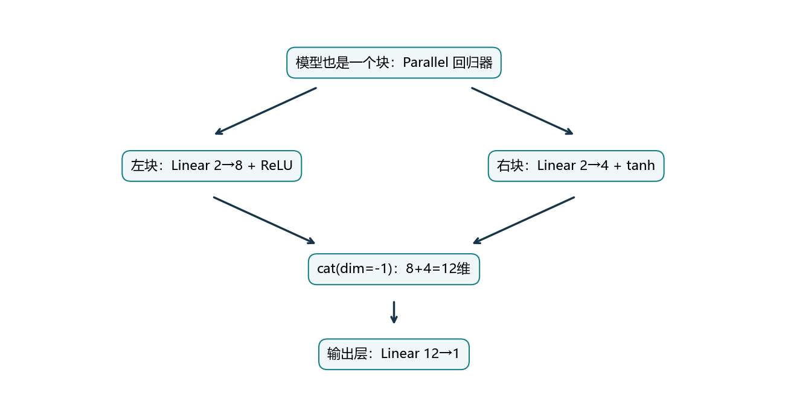
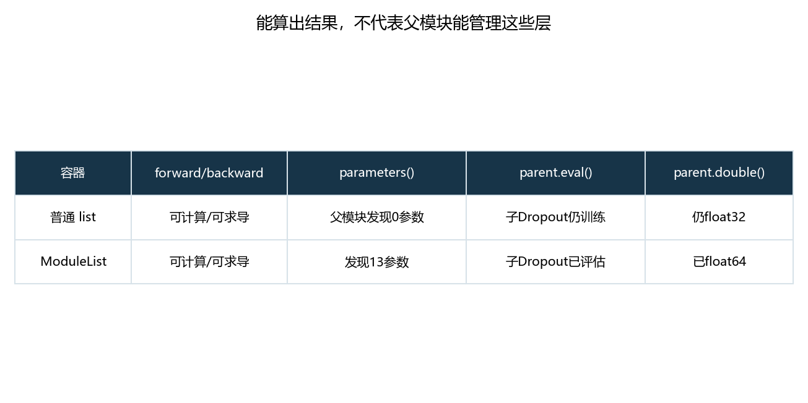
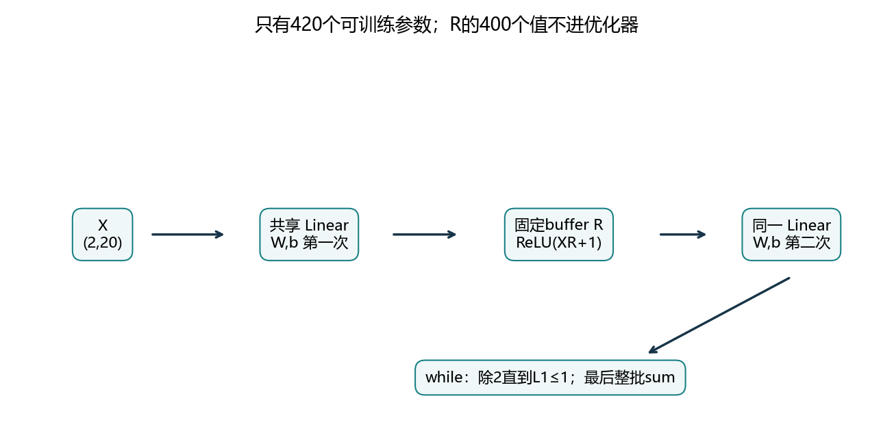
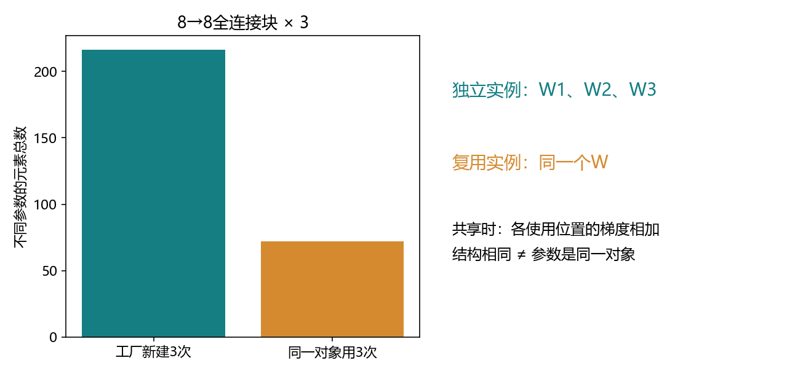
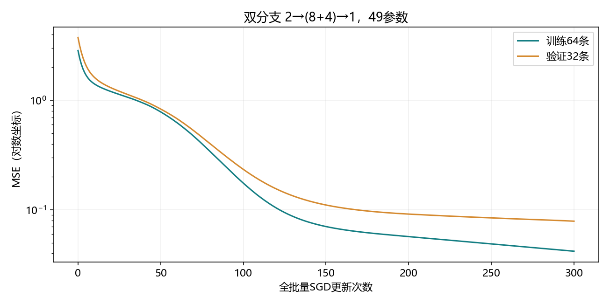

# 5.1 层和块

完整对应用户教材5.1.1–5.1.4及三道节末练习，PDF209–215/正文191–197；5.2参数管理也从PDF215开始。代码与综合练习统一名为ch05/01_layers_and_blocks.py，分别位于lessons与exercises。沿用openmmlab，不安装、不下载。教师运行不等于用户掌握。

## 从会调用模型，到会组织模型

第4章解决模型怎么拟合、如何验证、怎样控制过拟合。第5章开始理解框架如何组织计算：先搭块，再管理参数、保存模型、使用GPU。本节不增加大数据训练任务，重点是让你能自己构建和检查网络。

一个块接收输入、执行计算并返回输出。它可以是一个Linear、一组层或整个模型。ReLU没有可训练参数，也仍然是一个块；块不要求必须有参数。



这里的“并行”描述计算结构：两个分支都读取同一个X，再拼接结果。它不保证两个分支在CPU/GPU上同时运行，也不是分布式训练。

想象你已经会使用积木，现在要学的是：定义一组积木的接口，把它整体复用，并确保其中的可训练权重能够被框架发现。层、块、模型之间没有固定的尺寸界限。

<!-- pagebreak -->

## 自定义块：构造时准备，调用时计算

```python
import copy
import torch
from torch import nn
from torch.nn import functional as F

class MLP(nn.Module):
    def __init__(self):
        super().__init__()
        self.hidden = nn.Linear(20, 256)
        self.out = nn.Linear(256, 10)

    def forward(self, X):
        return self.out(F.relu(self.hidden(X)))

net = MLP().double()
X = torch.ones(2, 20, dtype=torch.float64)
assert net(X).shape == (2, 10)
```

class定义一种对象的结构；MLP()创建一个具体网络。self指当前这个网络，self.hidden把隐藏层保存在这个网络上。两个单独创建的MLP实例，默认拥有各自的参数。

__init__在创建对象时执行，负责创建和保存层；forward在调用net(X)时执行，负责规定计算顺序。不能在每次forward里重新创建Linear，否则会反复换一套权重，优化器也无法按原计划管理它们。

super().__init__()先准备父类Module的管理结构，随后赋值的self.hidden和self.out才会被注册。注册就是把子模块加入父模块可递归查找的结构。

本例形状是(2,20)→(2,256)→(2,10)，参数数为20×256+256+256×10+10=7946。ReLU不增加参数，最终10维输出没有自动变成概率。

<!-- pagebreak -->

## forward、backward与step各做什么

一个前向调用建立当前这次计算的依赖关系。自动微分沿支持求导的张量运算计算梯度；通常不必为整个自定义Module另写backward，但自定义底层算子可能需要专门处理。

```python
net = MLP().double()
optimizer = torch.optim.SGD(net.parameters(), lr=.03)
target = torch.zeros(2, 10, dtype=torch.float64)
optimizer.zero_grad(set_to_none=True)
prediction = net(X)
loss = F.mse_loss(prediction, target)
loss.backward()
optimizer.step()
assert net.hidden.weight.grad is not None
```

net(X)进入Module的调用入口，再执行forward。直接net.forward(X)往往仍能求导，却会绕过这个模块本身的前向钩子等调用管理；平时统一用net(X)。这个区别由[PyTorch2.4的Module文档](https://docs.pytorch.org/docs/2.4/generated/torch.nn.Module.html)明确说明。

本节实测：对同一模块依次调用net(X)、net.forward(X)，注册在父模块上的forward hook只触发1次。内部子模块如果仍用child(X)调用，其自身钩子依然可以执行。

为比较写法，教师程序给Sequential、自定义MLP、MySequential复制相同起点。三者都做3轮、每轮5/5/3条的3批更新，共9次SGD更新，学习率.03、float64。

| 检查项 | 本机最大绝对差 |
| --- | --- |
| 9次更新前的输出 | 0 |
| 各参数梯度 | 0 |
| 各次更新后的参数 | 0 |
| 初始完整批量的输入梯度 | 0 |

这说明这些组织方式能够表示并训练同一个函数；仅有相同结构但随机起点不同，输出本来就可能不同。

<!-- pagebreak -->

## 顺序块：登记层，再按顺序调用

```python
class MySequential(nn.Module):
    def __init__(self, *blocks):
        super().__init__()
        self.block_count = len(blocks)
        for index, block in enumerate(blocks):
            self.add_module(str(index), block)

    def forward(self, X):
        for index in range(self.block_count):
            X = self.get_submodule(str(index))(X)
        return X

chain = MySequential(nn.Linear(20, 256), nn.ReLU(),
                     nn.Linear(256, 10)).double()
assert chain(X).shape == (2, 10)
```

*blocks把传入的多个模块收成一组；enumerate同时提供位置和模块。add_module用“0”“1”“2”等名字登记子模块；get_submodule按名字取回并调用。

教材直接操作内部_modules字典，本项目用公开接口完成同一件事。这里按位置执行，没有用children()代替执行序列，因为children()会去除重复的模块对象；同一层放在两个位置时仍需要执行两次。

本实现只支持单输入单输出顺序链，不复制内置Sequential的索引、切片等完整接口。在实际项目中，普通顺序模型直接使用nn.Sequential即可。

上一块的输出就是下一块的输入，所以特征维度必须匹配。例如Linear(20,256)之后应接收256维，而不是继续接收20维。ReLU只改变数值，不改变此处形状。

<!-- pagebreak -->

## 为什么普通Python列表会埋下问题

把层装进self.blocks=[...]，再逐层调用，前向能运行，张量自动微分也能计算其中权重的梯度。但父Module不会因为一个普通列表里装着模块，就自动递归发现它们。



教师对Linear(2,3)→ReLU→Dropout→Linear(3,1)做了同条件对照。普通list中权重有梯度，但父模型parameters()发现0个参数，SGD报empty parameter list；state_dict为空。父模块eval()后，子Dropout仍是训练模式；父模块double()也没转换其中权重。

修复使用nn.ModuleList。它负责注册与存储；具体怎么执行仍需自己写forward。相同网络此时发现13个参数，eval和dtype转换能传到子模块，state_dict也能看到权重。

```python
class Chain(nn.Module):
    def __init__(self):
        super().__init__()
        self.blocks = nn.ModuleList([
            nn.Linear(2, 3), nn.ReLU(), nn.Linear(3, 1)])

    def forward(self, X):
        for block in self.blocks:
            X = block(X)
        return X

assert sum(p.numel() for p in Chain().parameters()) == 13
```

如果你手动把普通列表内部的参数交给优化器，当然也能更新它们；但这没有解决父模块的模式、迁移和保存管理。应修复注册结构。

<!-- pagebreak -->

## 平行块：同一份输入，提取两种表示

```python
class Parallel(nn.Module):
    def __init__(self, left, right):
        super().__init__()
        self.left = left
        self.right = right

    def forward(self, X):
        return torch.cat((self.left(X), self.right(X)),
                         dim=-1)

branches = Parallel(
    nn.Sequential(nn.Linear(2, 8), nn.ReLU()),
    nn.Sequential(nn.Linear(2, 4), nn.Tanh())).double()
small_X = torch.ones(5, 2, dtype=torch.float64)
assert branches(small_X).shape == (5, 12)
```

左分支得到(5,8)，右分支得到(5,4)。沿最后一维拼接得到(5,12)，仍然是5条样本，每条有12个新特征。沿dim=0是把样本堆叠，不是本节要做的特征组合，且此处8维和4维无法按该方向直接拼接。

拼接不等于逐元素相加：相加要求相应维度可匹配，通常不增加特征宽度；拼接保留两边的全部特征。梯度会从拼接后的对应片段回到各自分支。

两个分支都赋值到self的模块属性，所以优化器可递归找到两边参数；把Parallel再放进Sequential，后接Linear(12,1)，就组成一个更大的回归模型。

这个类对应教材第二道练习。这里提供教师示例供阅读，用户综合练习改成4维和3维分支，仍留空让你亲自接通。

<!-- pagebreak -->

## 固定张量、共享层与普通数学运算

块的forward可以包含矩阵乘法、常量和控制流，不必每一步都包装成现成神经网络层。教材FixedHiddenMLP先调用Linear，再乘固定矩阵并ReLU，之后再次调用同一个Linear。



本节固定矩阵R是20×20，Linear也是20→20，参数420个。R的400个值参与前向计算但不作为可训练参数；它通过register_buffer登记，可以随模型迁移并进入state_dict。

| 保存方式 | parameters() | 随模型to迁移 | 默认进入state_dict |
| --- | --- | --- | --- |
| nn.Parameter | 是 | 是 | 是 |
| register_buffer的张量 | 否 | 是 | 是 |
| 普通Tensor属性 | 否 | 否 | 否 |

上表针对本节这些常规写法；buffer可设置persistent=False不保存。本项目buffer保持默认设置且不要求梯度，优化器不会更新它；程序也没有手动改变它。

教材将固定矩阵直接赋给普通Tensor属性，CPU演示可以工作。本项目用buffer保留同一数学运算，同时避免以后迁移设备或保存状态时漏掉它。

第二次self.linear不是新建一个层，而是再次使用相同的W、b，因此仍只有一组420个参数。自动微分会把W、b在两个使用位置的梯度贡献相加；不能仅算第二次调用的贡献。

<!-- pagebreak -->

## 动态控制流能求导到哪里

最后的控制流是：整批张量的L1和大于1时除以2，直到不超过1，再把所有元素相加。示意代码如下。

```python
def shrink_and_sum(Z):
    if not bool(torch.isfinite(Z).all()):
        raise ValueError('只接受有限值')
    while bool(Z.detach().abs().sum() > 1):
        Z = Z / 2
    return Z.sum()

z = torch.tensor([2., 1.], requires_grad=True)
shrink_and_sum(z).backward()
assert torch.equal(z.grad, torch.full_like(z, .25))
```

这个例子执行两次除2，最终sum=.75，对已执行路径有梯度1/4。detach只用于判断条件，没有切断Z/2和Z.sum的求导链。项目避免原地Z/=2，以免覆盖反向计算需要的旧值。

自动微分对本次实际执行的张量运算求导，不对“循环应该执行多少次”这个离散选择求导。输入跨过阈值时，执行路径可能改变，函数甚至可能跳变；不能把某一路径的梯度当作阈值处的全局导数。

本机FixedHiddenMLP对(2,20)输入执行5次除2，返回标量.0180556328。其标量形状为()，不再保留2条样本维度，所以这是组织代码的演示，不是实际逐样本预测头。

这里条件依赖整批L1和，结果也会受批量组成影响。反向后优化器更新了Linear，固定buffer字节不变且没有梯度。独立NumPy解析梯度和中心差分进一步核对共享层的两条贡献。

<!-- pagebreak -->

## 嵌套：把一个网络当成另一个网络的组件

NestMLP内部是20→64→32→16，它本身可作为另一个Sequential的第一块；后接Linear(16,20)，再接FixedHiddenMLP，就得到教材中的chimera组合。

```text
输入 (2,20)
  NestMLP
    Sequential: Linear 20→64, ReLU, Linear 64→32, ReLU
    Linear 32→16
  Linear 16→20
  FixedHiddenMLP: 共享Linear、固定R、ReLU、while、sum
输出 ()
```

输入输出兼容即可组合，框架会递归收集已注册子模块的参数。这个嵌套例子共有4712个可训练参数，固定矩阵另有400个buffer元素；不能把buffer算入可训练参数。

本机对它完成了一次前向和反向，所有参数均获得有限梯度。这里验证的是组合可运行与求导链完整，并没有把这个特别的标量组合训练成实际应用模型。

前向执行图与模块组织树是两种视角。模块树便于组织组件和状态；一次前向计算图还体现分支、循环、同一模块多次使用，以及具体输入触发的路径。

后续残差网络会在更有实际意义的结构里复用这种组合能力。先把“输入在哪里分叉、输出如何汇合、参数属于谁”看清楚，再考虑增加深度。

<!-- pagebreak -->

## 相同结构的实例，与同一实例复用



教材第三题的工厂函数，每次调用都创建一个新块。为了能直接顺序连接，示例每块输入和输出都用8维。不能把20→10的块直接重复相接而不调整维度。

```python
def repeat_blocks(factory, count):
    return MySequential(*(factory() for _ in range(count)))

factory = lambda: nn.Sequential(nn.Linear(8, 8), nn.ReLU())
independent = repeat_blocks(factory, 3)
block = factory()
shared = nn.Sequential(block, block, block)
assert sum(p.numel() for p in independent.parameters()) == 216
assert sum(p.numel() for p in shared.parameters()) == 72
assert shared[0] is shared[1] is shared[2]
```

factory可理解为“按要求生产一个新模块”的函数。这里lambda是简短函数的写法；factory()调用一次创建一个新Linear。每个8→8的层有8×8+8=72个参数。

相同结构的三个实例拥有三套权重，共216个参数。同一个block放三个位置，则只有72个不同参数；parameters()默认不会重复交出同一参数对象，但前向仍执行三个位置，反向累加各位置贡献。

不要用[block]*3来创建独立网络，这只是复制三个引用。如果需要相同初始数值但独立更新，可以分别创建后复制状态，或使用deepcopy；它和共享同一个参数对象不同。

<!-- pagebreak -->

## 效率：Python负责组织，张量算子承担主要计算

教材5.1.4提出担忧：层级、字典查找、循环会不会拖慢GPU？需要区分“大张量计算”和“很多小操作”。单个大矩阵乘法往往由底层数值库或设备执行，不能看到Python就认定它一定是瓶颈。

如果每次运算很小，解释器和算子调度的开销就更明显。若Python while每次都读取GPU张量的真假或标量，CPU可能需要等待GPU给出结果，频繁同步会影响性能。

所以本节控制流放在CPU上，用很小数据解释机制；没有声称这种while是高效训练方案。先保留正确清晰的程序，再对实际瓶颈测量。批量张量运算通常比逐元素Python循环更合适。

| 场景 | 本节应做的判断 |
| --- | --- |
| Sequential还是自定义Module | 先看是否需要分支、循环或特殊数学运算 |
| Python层数多 | 不能仅凭层数推断实际耗时 |
| GPU上读取张量真假 | 考虑设备同步与控制流开销 |
| 打算做性能比较 | 固定输入、预热、考虑异步，重复测量 |

当前已有torch2.4.1，无需为学习本节安装编译工具或升级框架。更系统的计算性能和设备测量留到相关章节；本节没有制造未经测量的加速倍数。

**本节选型规律：**单条链先用Sequential；复杂forward自定义Module；需要动态管理模块列表用ModuleList，再明确写出如何执行。

<!-- pagebreak -->

## 一次完整实践：双分支回归块真正训练

人工目标为y=x1²+.5x2+.1sin(2x2)，输入在[-2,2]²。固定生成64训练、32验证、32测试样本，float64，无额外数据文件。两分支分别为Linear(2,8)+ReLU、Linear(2,4)+tanh，拼接12维，最后Linear(12,1)。

| 部件 | 参数数 |
| --- | --- |
| 左分支 | 2×8+8=24 |
| 右分支 | 2×4+4=12 |
| 输出层 | 12×1+1=13 |
| 合计 | 49 |



数据种子5106、模型种子5107，SGD学习率.03、平均MSE、300次全批量更新。初始训练MSE2.851863，结束训练.041824、验证.078693；方案与预算预先固定，最后评估32条测试，MSE.041204。

这里只说明自定义分支、自动求导和优化器成功接通；有限人工数据上的结果不代表真实房价或图像效果。测试MSE略小于验证MSE可能来自有限样本差异，不能按这种大小关系判断是否存在数据泄漏。

<!-- pagebreak -->

## 综合练习与集中反馈

先在VS Code运行lessons/ch05/01_layers_and_blocks.py看整节结果，再打开exercises/ch05/01_layers_and_blocks.py集中补齐八处TODO。使用已有openmmlab环境，F5可选择完整演示或综合练习。

练习模型改为：左分支2→4→ReLU，右分支2→3→tanh，拼接7维后输出1维。使用32条训练、16条验证，目标y=x1²+.5x2，250次全批量SGD，学习率.03，float64。

| TODO | 要接通的环节 |
| --- | --- |
| 1–3 | 创建并注册两个分支及输出层 |
| 4 | 沿特征维拼接分支 |
| 5 | 将所有注册参数交给SGD |
| 6 | 平均MSE |
| 7–8 | 反向传播与参数更新 |

练习应打印分支形状(32,4)/(32,3)、拼接(32,7)、输出(32,1)，参数总数29，以及初始/最终训练MSE和验证MSE。用实际结果判断更新是否生效，不要求损失等于0。

请一次反馈运行结果，并解释：普通list里的权重为什么可能有梯度却未被优化器找到？为什么cat沿最后一维？共享同一块与新建三个块有何差别？先不替你填写答案。

本节覆盖教材三题：普通list的管理缺失；两个分支输出拼接的Parallel；工厂创建多个同结构独立实例。进一步练习可将第三题的实例数改成2或4，先手算参数量再运行核对。

## 文件与查阅来源

详细指标、9步等价表、301行训练曲线和验证记录均在reports/ch05，以5_1开头；图在其figures目录。仅本地artifacts/ch05保存本次状态供独立核对，不上传模型。

教材依据为用户本地PDF209–215。本节接口核对版本与本机一致：[PyTorch2.4 Module](https://docs.pytorch.org/docs/2.4/generated/torch.nn.Module.html)。ModuleList的注册与迭代、Sequential重复对象的执行，还通过本机torch2.4.1源码与实际运行核对。

下一节5.2参数管理，再系统学习读取参数、初始化与参数共享。此前练习尚未收到作答，保持未验证；本节工程完成也不等于已经掌握。
