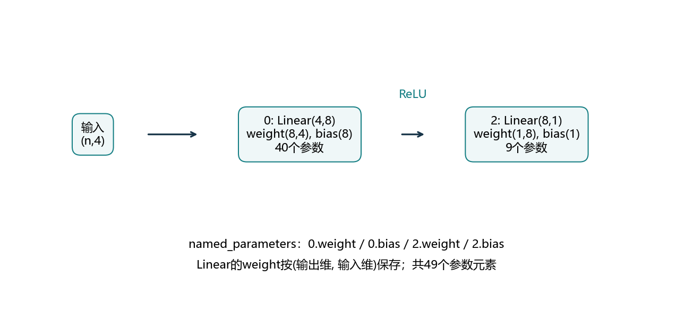
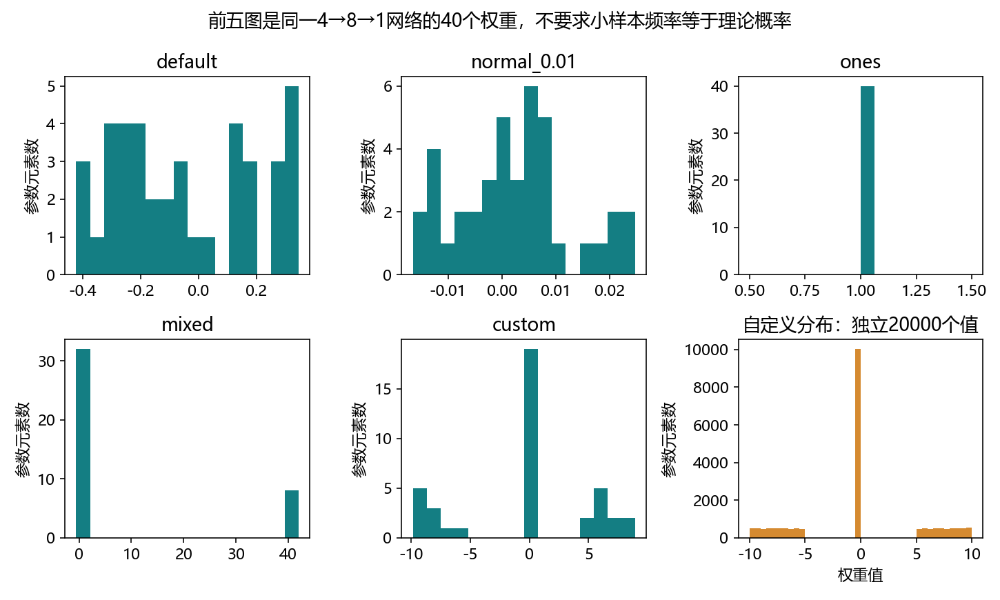
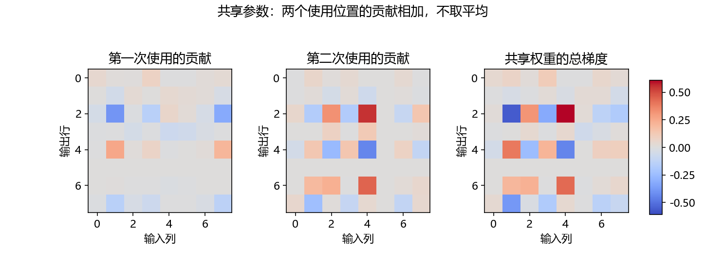
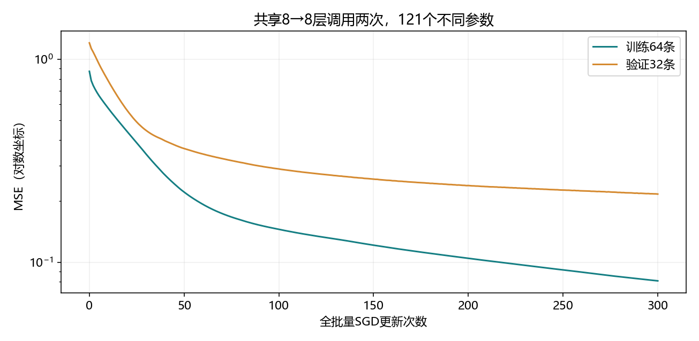
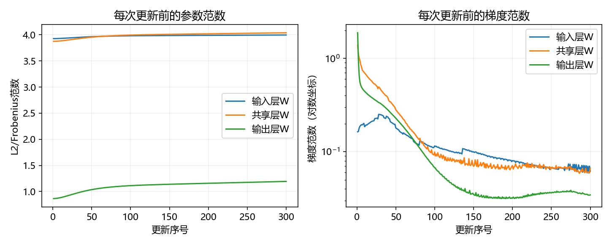

# 5.2 参数管理

对应用户教材5.2.1–5.2.3及四道节末练习，PDF215–222/正文197–204；下一节5.3延后初始化从PDF222/正文204开始。本节统一入口ch05/02_parameter_management.py，演示和练习分放lessons与exercises。复用openmmlab，CPU/float64、无安装下载。教师运行不等于用户掌握。

## 从搭建网络，到管理其中的参数

上一节用Module组织计算，这一节打开模块，确认里面有哪些参数、它们是否获得梯度、怎样设置初值，以及两个位置是否真正共用参数。

本节主要使用教材的4→8→1网络：输入4个特征，隐藏8个单元，ReLU，最后回归输出1个值。它有两个Linear、四个Parameter对象，共49个参数元素。



对Linear而言，公式按行批量写成Y=XW转置+b；weight保存为(输出维,输入维)。第一层weight为(8,4)，bias为(8,)；输出层weight为(1,8)，bias为(1,)。ReLU没有可训练参数。

“四个参数张量”和“49个参数元素”是两个计数单位。看模型大小时通常统计元素数，检查优化器管理时还要看它拿到了哪些Parameter对象。

<!-- pagebreak -->

## 按层访问，再按名称遍历

```python
import copy
import torch
from torch import nn
from torch.nn import functional as F

net = nn.Sequential(nn.Linear(4, 8), nn.ReLU(),
                    nn.Linear(8, 1)).double()
X = torch.ones(2, 4, dtype=torch.float64)
assert net(X).shape == (2, 1)
assert net[2].weight.shape == (1, 8)
assert isinstance(net[2].bias, nn.Parameter)

for name, parameter in net.named_parameters():
    print(name, tuple(parameter.shape), parameter.numel())

assert sum(p.numel() for p in net.parameters()) == 49
```

net[2]取第三个组件，也就是第二个Linear；net[2].weight进一步取它的权重。named_parameters提供“名称、Parameter”配对；parameters只提供对象，不带名称。

| 参数名称 | 形状 | 元素数 |
| --- | --- | --- |
| 0.weight | (8,4) | 32 |
| 0.bias | (8,) | 8 |
| 2.weight | (1,8) | 8 |
| 2.bias | (1,) | 1 |

Parameter是一种特殊Tensor，赋给Module属性时会登记为模型参数。普通Tensor属性不会因此进入parameters。requires_grad表示是否记录求导，grad保存累积到这个叶参数上的梯度。

全模型net.named_parameters()递归进入已注册子模块。net[0].named_parameters()只从第一个Linear开始，所以名称变成weight和bias。名称前缀反映你从哪里开始查找。

<!-- pagebreak -->

## 参数值、梯度和更新分开观察

```python
target = torch.zeros(2, 1, dtype=torch.float64)
optimizer = torch.optim.SGD(net.parameters(), lr=.02)
assert net[2].weight.grad is None

loss = F.mse_loss(net(X), target)
loss.backward()
first_gradient = net[2].weight.grad.detach().clone()
F.mse_loss(net(X), target).backward()
assert torch.allclose(net[2].weight.grad, 2 * first_gradient)

optimizer.zero_grad(set_to_none=True)
assert net[2].weight.grad is None
```

创建参数、进行前向，都不会自动填好grad。调用backward后才累积梯度；第二次对新建的前向图反传，梯度会叠加到同一参数。教师实测第二次结果与两倍第一次梯度差0。

这里每次都重新计算前向，没有复用已释放的旧计算图。zero_grad(set_to_none=True)清除累积结果，让下一次更新只使用计划中的梯度。

None表示当前没有保存梯度张量，数值0表示有梯度张量但其分量为零。这两者不能混同。若训练中某参数一直grad为None，应检查它是否参与本次计算、是否被detach或是否关闭了求导。

backward计算梯度，step更新参数。打印loss、调用eval或保存state_dict，均不能替代训练更新。eval也不会自动关闭自动求导。

<!-- pagebreak -->

## 查看值与保存独立快照

```python
parameter = net[0].weight
view = parameter.detach()
snapshot = parameter.detach().clone()
live_state = net.state_dict()
independent_state = copy.deepcopy(net.state_dict())
old = snapshot.clone()
identity = id(parameter)

with torch.no_grad():
    parameter.add_(1)
    parameter[0, 0] = 42

assert torch.equal(view, parameter)
assert torch.equal(live_state['0.weight'], parameter)
assert torch.equal(snapshot, old)
assert torch.equal(independent_state['0.weight'], old)
assert id(net[0].weight) == identity
```

detach让结果脱离求导图，但仍与原参数共享存储。随后修改原参数，detach得到的视图也会看到新值。detach().clone()再复制一份数据，适合保存训练前快照，之后计算变化量。

state_dict返回名称到状态张量的映射，包含参数及持久buffer。默认张量脱离求导，但映射中的值仍引用模型存储；把字典存进变量，并不等于得到独立的“最佳模型快照”。

需要独立状态时使用deepcopy，或逐个detach().clone()。这一点已由[PyTorch2.4 Module文档](https://docs.pytorch.org/docs/2.4/generated/torch.nn.Module.html)与本机实验核对。

教材大量使用.data访问和改写值。本项目查看用detach，设置用no_grad中的copy_、fill_或索引赋值，保留自动求导对修改的检查。即使使用no_grad，也应在初始化或训练步骤之间修改，避免覆盖待反传的中间状态。

<!-- pagebreak -->

## 嵌套网络的名称是一条查找路径

教材先生成4→8→4/ReLU块，再把四个块相接，最后接4→1。每块40+36=76参数，四块304，输出5，总计309。

```python
def block1():
    return nn.Sequential(nn.Linear(4, 8), nn.ReLU(),
                         nn.Linear(8, 4), nn.ReLU())

blocks = nn.Sequential()
for i in range(4):
    blocks.add_module('block' + str(i), block1())
nested = nn.Sequential(blocks, nn.Linear(4, 1)).double()

assert nested[0][1][0].bias is nested.get_parameter(
    '0.block1.0.bias')
assert sum(p.numel() for p in nested.parameters()) == 309
```

0.block1.0.bias可逐段读成：整个网络的第0块，其中名为block1的第二个子块，其中第0层的bias。数字索引方便临时访问，有意义的名字有助于复杂模型调试。

为对应教材练习一，演示还读取上一节FixedHiddenMLP：named_parameters只有linear.weight与linear.bias，named_buffers有rand_weight，state_dict包含三者。

教材练习称FancyMLP，而该PDF的5.1 PyTorch示例实际命名为FixedHiddenMLP。本项目按已有实际类名访问，不凭空新建另一套网络。固定矩阵参与计算，但不算可训练参数。

<!-- pagebreak -->

## 初始化：先了解默认规则，再主动设置

本机torch2.4.1的Linear默认权重与偏置取自区间[-1/√fan_in,1/√fan_in]内的均匀分布。它的reset_parameters内部使用特定参数的Kaiming接口，但效果不等于4.8讨论的ReLU增益初始化。

4→8层默认界为±.5；8→1层默认界为±.353553。这里范围取决于输入宽度，不能笼统认为默认Linear同时按输入和输出宽度决定范围。已检查本机源码及对应版本官方源码。

```python
def init_normal(module):
    if isinstance(module, nn.Linear):
        nn.init.normal_(module.weight, mean=0, std=.01)
        if module.bias is not None:
            nn.init.zeros_(module.bias)

net.apply(init_normal)
assert torch.count_nonzero(net[0].bias) == 0
```

apply会递归把每个子模块交给初始化函数。函数中的isinstance确保只处理Linear，跳过ReLU和容器本身；bias=None的层需要先判断。nn.init函数末尾的下划线表示原地填充已有张量。

normal的std=.01是采样分布的标准差，小网络里32个权重的实际样本标准差不必恰好等于.01。偏置设零与隐藏权重全设零有不同后果，衔接4.8的对称性结论。

初始化一般在正式训练和创建优化器之前完成。中途重新初始化会改掉已学习参数，已有动量等优化器状态也未必适配新权重。

<!-- pagebreak -->

## 整体、局部与不同层分别初始化

```python
def init_ones(module):
    if isinstance(module, nn.Linear):
        nn.init.ones_(module.weight)
        if module.bias is not None:
            nn.init.zeros_(module.bias)

net.apply(init_ones)
nn.init.xavier_uniform_(net[0].weight, gain=1)
nn.init.constant_(net[2].weight, 42)
assert torch.all(net[2].weight == 42)
```

整体apply适合统一规则；访问具体层后调用初始化器，可以给不同层不同规则。教材的常量1和42用来演示“能控制哪个参数”，不把它们当作推荐训练配置。

本节教师程序并列保存默认、正态.01、全1、局部Xavier/42、自定义五种状态，避免把后一次改写误当作前一种分布。每一种都报告实际均值、总体标准差、最小/最大值与零值数量。



回忆4.8：Xavier增益1用于平衡线性传播尺度；ReLU隐藏层常用Kaiming。选择哪种初始化要结合激活、宽度与实际训练，并不因为某方法“更随机”就一定更好。

<!-- pagebreak -->

## 自定义初始化：采样后按规则变换

教材希望一半概率精确为0，另外各四分之一落在[-10,-5]和[5,10]。实现方法是先从[-10,10]均匀采样，再把绝对值小于5的值变成0。

```python
@torch.no_grad()
def custom_init(module):
    if isinstance(module, nn.Linear):
        nn.init.uniform_(module.weight, -10, 10)
        module.weight.mul_(module.weight.abs() >= 5)
        if module.bias is not None:
            nn.init.zeros_(module.bias)

net.apply(custom_init)
W = net[0].weight.detach()
assert torch.all((W == 0) | (W.abs() >= 5))
```

三个区间长度分别5、10、5，总长20，所以负值、零、正值的概率为.25、.5、.25。这里是带零点质量的混合分布，不能把保留下来的值重新缩放来维持原方差。

理论均值0，二阶矩和方差均为175/6≈29.1667。这个尺度相当大，目的在于演示自定义采样，不直接作为本节共享网络的训练初始化。

教师用固定种子5208生成20000个独立权重，得到负值.2481、零.5012、正值.2507，实际总体方差29.3105。有限样本频率靠近理论值，并不要求精确相等。

这里显式把偏置设零；教材my_init只修改weight，偏置沿用此前状态。本项目把这个选择写清楚，避免代码顺序暗中决定偏置初值。

<!-- pagebreak -->

## 参数绑定：同一个对象，多个使用位置

```python
shared = nn.Linear(8, 8)
tied = nn.Sequential(
    nn.Linear(4, 8), nn.ReLU(),
    shared, nn.ReLU(),
    shared, nn.ReLU(),
    nn.Linear(8, 1)).double()

assert tied[2].weight is tied[4].weight
assert sum(p.numel() for p in tied.parameters()) == 121
assert len(list(tied.parameters())) == 6
assert len(tied.state_dict()) == 8
```

两个位置引用同一个shared层，weight和bias都共享。模型参数为输入层40+共享层72+输出层9=121。若两个8→8层分别创建，则40+72+72+9=193。

比较数值相等只能说明当前值一样；is检查是否为同一个Python对象。把一层权重copy_给另一层，或deepcopy一个层，得到的参数可以初值相同、后续独立更新。

named_parameters默认对重复Parameter去重，本例6个张量；remove_duplicate=False能看到8条访问路径。state_dict也保留8个路径键，2.weight与4.weight底层存储相同；8条路径不等于8个独立参数张量。

优化器直接使用net.parameters()，共享参数只交给它一次。不要按重复路径手工构造含重复Parameter的列表，以免重复更新。同一参数共享还要求两个使用位置的维度兼容。

<!-- pagebreak -->

## 共享参数的梯度来自两次使用

令两个独立位置暂时使用W_a与W_b，并设它们数值相同。将它们绑定为W后，链式法则给出：

<div class="equation">∇<sub>W</sub>L = ∇<sub>W_a</sub>L + ∇<sub>W_b</sub>L</div>

这两个贡献是在完整计算图上分别对两个位置求偏导，所以较早位置的贡献已经包含后续计算的影响；不是只看两个局部输入就随意相加。



教师创建共享模型，以及同起点但两层独立的副本，仅在初始状态比较梯度。两者输出最大差0；共享weight梯度减去两独立层梯度之和，最大差0；bias最大差1.39e-17。

梯度在这里相加，不因使用两次就额外除2。平均MSE已经按样本/元素定义好损失尺度；要改变这个尺度，需要明确改变目标或学习率。

一次普通SGD更新为W_new=W−η(g_a+g_b)。之后独立模型的两层会分别移动，通常不再具有相同数值，因此不能拿后续不同状态的梯度继续做同点等式比较。

<!-- pagebreak -->

## 真实训练：持续观察共享关系、参数与梯度

人工输入4维标准正态，目标y=.8x1−.5x2+.4x3x4。固定数据种子5210，64训练/32验证/32测试；模型种子5211，隐藏层Kaiming正态、输出层Xavier正态增益1，偏置全零。

共享结构4→8→8→8→1，中间8→8的同一层调用两次，共121参数。SGD .02、float64、MSE、300次全批量更新。方案与预算预先固定，最后才评估测试。



| 指标 | 本机实际值 |
| --- | --- |
| 初始训练MSE | .8729869602 |
| 最终训练MSE | .0809231649 |
| 最终验证MSE | .2167245668 |
| 最终测试MSE | .1843285241 |

共享权重相对初始快照的变化范数.690183944，训练前后两个位置仍是同一Parameter。它确实参与了学习；损失下降与共享约束是否适合真实任务，仍是不同的问题。

<!-- pagebreak -->

## 怎样解释参数与梯度曲线



5_2_parameter_traces.csv对每次更新的6个不同Parameter分别记录参数范数与梯度范数，共1800行。曲线按更新前的状态绘制，避免把旧梯度与新权重误配。

范数是检查尺度的摘要，不能代替全部元素，也不能仅凭梯度范数大小断言模型学得好坏。共享参数接收多处信号，仍可能有相互抵消的分量。

共享能减少独立参数及相应优化器状态，表达重复使用相同变换的假设，例如循环网络反复使用相同状态变换、不同位置使用同一特征提取器。它限制模型自由度，有时有助于利用数据中的重复规律。

如果两个位置需要不同变换，强行绑定可能降低表达能力。参数减少不等于计算次数减少，也不保证训练更快或泛化更好。本节没有把共享与不共享训练成排名实验，只验证同点梯度等式与共享模型的完整训练。

已有对象的参数修改采用no_grad内的copy_或填充，尽量保留对象身份。若在创建优化器后用全新Parameter替换属性，优化器可能仍持有旧对象，必须重新核对它管理的参数。

<!-- pagebreak -->

## 综合练习与集中反馈

先运行lessons/ch05/02_parameter_management.py，再完成exercises/ch05/02_parameter_management.py的八处TODO。VS Code的F5已设置整节演示与综合练习入口。

练习为2→4→4→4→1，中间Linear(4,4)在两个位置共享，ReLU隐藏层。输入层12+共享层20+输出层5=37个参数，去重后6个Parameter张量。

| TODO | 要接通的部分 |
| --- | --- |
| 1 | 创建供两个位置共用的4→4层 |
| 2 | Xavier均匀初始化，gain1 |
| 3–4 | 读取参数名称，保存独立权重快照 |
| 5–6 | SGD .03与平均MSE |
| 7–8 | 反向传播和更新 |

使用32训练/16验证、250次全批量更新、float64；目标y=x1²+.5x2。输出参数名称、37参数、共享对象检查、权重变化范数，以及训练前后和验证MSE。八处留空，不替你填写。

一次反馈完整输出，并解释：Parameter、detach和detach().clone()的差别；为什么状态有重复路径但参数只计一次；共享梯度为何相加，共享对容量有什么影响。

教材四题已覆盖：读取上一节固定/嵌套模型参数；查阅初始化方法；训练共享MLP并记录参数/梯度；讨论共享的适用条件。初始化文档还列有orthogonal_与sparse_等方法，本节只查阅接口，不把它们擅自加入训练方案。

## 来源、文件和下一节

以用户本地PDF为教学顺序。接口核对：[PyTorch2.4 Module](https://docs.pytorch.org/docs/2.4/generated/torch.nn.Module.html)、[Parameter](https://docs.pytorch.org/docs/2.4/generated/torch.nn.parameter.Parameter.html)、[2.4.1初始化源码](https://github.com/pytorch/pytorch/blob/v2.4.1/torch/nn/init.py)、[Linear默认初始化源码](https://github.com/pytorch/pytorch/blob/v2.4.1/torch/nn/modules/linear.py)。对应版本初始化网页版读取失败时，使用本机函数文档和源码核对，未安装或升级。

reports/ch05保留5_2开头的真实指标、参数表、初始化统计、训练曲线及验证记录；图在figures。核对状态只放本地artifacts，不上传模型。旧文件保留，未提交作答不标记掌握。

下一节5.3延后初始化会讨论形状推断。本节已显式指定输入维度，Linear创建时就完成参数初始化。
