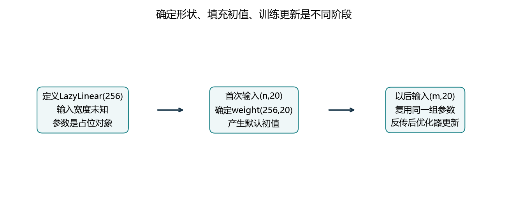
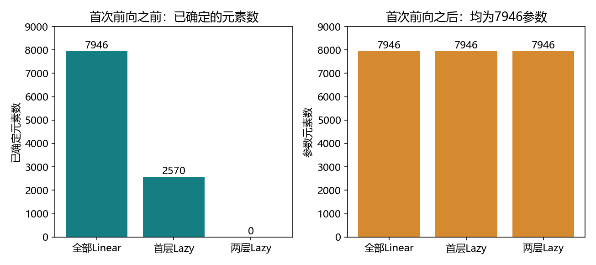
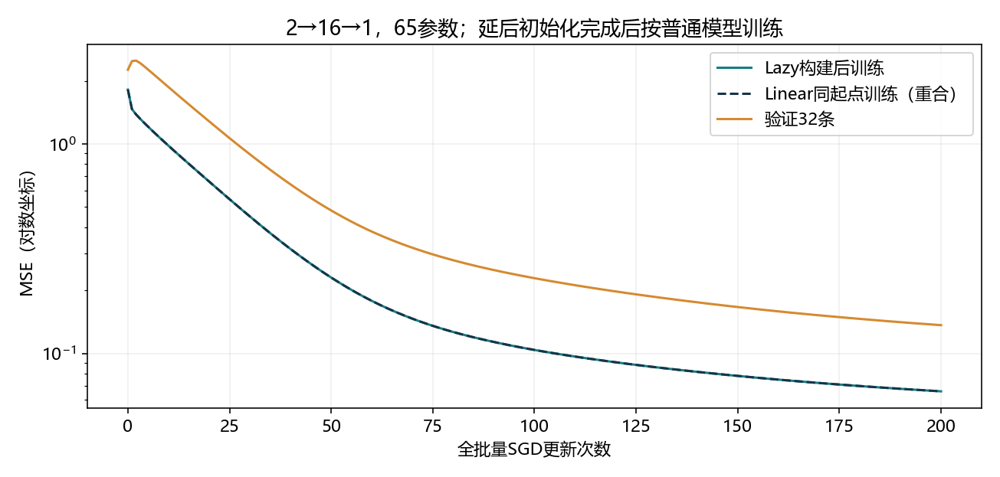

# 5.3 延后初始化

完整对应用户教材5.3.1、小结与三道练习，PDF222–223/正文204–205；下一节5.4自定义层从PDF223/正文205开始。演示和练习统一名ch05/03_deferred_initialization.py，分别位于lessons与exercises。复用openmmlab，CPU/float64，无下载安装。教师验证不等于用户掌握。

## 为什么还需要等到第一次输入

Linear权重的形状为(输出宽度,输入宽度)。如果只说“这一层输出256维”，尚不知道它接收20维还是100维，就不能确定整张权重矩阵。

延后初始化先保存结构要求和参数占位对象，等真实形状的输入到达，再确定权重形状并填入初值。此后按普通模型反复使用和训练。



先澄清教材的框架语境：前几节PyTorch的nn.Linear(输入宽度,输出宽度)已经指定了两维，创建时就完成默认初始化。本节在本机torch2.4.1中用nn.LazyLinear(输出宽度)实现延后推断输入维度。

Lazy只减少手写部分尺寸的工作，不会自动选择隐藏单元数、激活、层数或任务输出维度。通常这些仍由我们决定。

<!-- pagebreak -->

## 实例化网络，再观察首次前向

```python
import copy
import torch
from torch import nn
from torch.nn import functional as F
from torch.nn.parameter import UninitializedParameter

net = nn.Sequential(nn.LazyLinear(256), nn.ReLU(),
                    nn.LazyLinear(10)).double()
assert isinstance(net[0].weight, UninitializedParameter)
assert isinstance(net[2].weight, UninitializedParameter)

with torch.no_grad():
    output = net(torch.zeros(2, 20, dtype=torch.float64))

assert net[0].weight.shape == (256, 20)
assert net[2].weight.shape == (10, 256)
assert output.shape == (2, 10)
assert sum(p.numel() for p in net.parameters()) == 7946
```

第一层从输入最后一维推断in_features=20，建立(256,20)权重与(256,)偏置，产生(2,256)输出。ReLU保留形状，第二层接收到256维输入，建立(10,256)权重与(10,)偏置。

本机首次前向后，LazyLinear模块转成Linear，占位对象转成普通Parameter。实验还确认参数对象身份在物化过程中保留，前向完成后即可正常访问shape和numel。

首次前向之前，占位参数已登记在模块中，但没有可用的完整数据形状。直接读取其shape、numel或调用normal_填充会报错；不能把“参数占位”理解成所有参数数值为0。

本节参数表使用isinstance判断占位类型，再决定是否读取形状，完整记录了第一层和第二层依次确定的过程。

<!-- pagebreak -->

## 哪些参数延后，取决于具体层

```python
eager = nn.Sequential(nn.Linear(20, 256), nn.ReLU(),
                      nn.Linear(256, 10))
mixed = nn.Sequential(nn.LazyLinear(256), nn.ReLU(),
                      nn.Linear(256, 10))
all_lazy = nn.Sequential(nn.LazyLinear(256), nn.ReLU(),
                         nn.LazyLinear(10))

assert sum(p.numel() for p in mixed[2].parameters()) == 2570
```

混合模型第二层的输入256已由代码写明，所以即使第一层尚未收到输入，第二层也能立即完成初始化。不能把“模型含Lazy层”说成“整个模型全都还没初始化”。

| 构造方式 | 首次前向前已确定元素 | 未确定参数张量数 | 前向后总元素 |
| --- | --- | --- | --- |
| 两个Linear | 7946 | 0 | 7946 |
| 首层Lazy、末层Linear | 2570 | 2 | 7946 |
| 两层Lazy | 0 | 4 | 7946 |



PyTorch在本例中把Lazy层的weight和bias都延后处理。bias虽然输出宽度已知，也采用该层的延后初始化流程；表中的2和4统计的是张量对象数，而非未知元素数。

这回答教材练习一：输入宽度已明确的Linear立即初始化；后续若写成LazyLinear，则仍等它自己的输入到达。具体行为应按使用的框架和层类型判断。

<!-- pagebreak -->

## 正确流程：先试运行，再定制初值和优化器

```python
small = nn.Sequential(nn.LazyLinear(16), nn.ReLU(),
                      nn.LazyLinear(1)).double()
small.eval()
with torch.no_grad():
    small(torch.zeros(2, 2, dtype=torch.float64))

nn.init.kaiming_normal_(small[0].weight, nonlinearity='relu')
nn.init.zeros_(small[0].bias)
nn.init.xavier_normal_(small[2].weight, gain=1)
nn.init.zeros_(small[2].bias)
optimizer = torch.optim.SGD(small.parameters(), lr=.03)
small.train()
assert sum(p.numel() for p in small.parameters()) == 65
```

先选择dtype和设备，再用正确形状、dtype和设备的输入试运行；尺寸确定后设置自己的初值，最后构造优化器并开始训练。本节用CPU/float64和零张量完成形状试运行，无需消耗训练标签。

首次前向可能已经填入默认随机权重，随后初始化器将其换成我们选择的规则。Lazy模块没有把输入自动转换成模型的dtype，也没有自动移动设备；两边需要匹配。

no_grad禁止这次前向记录梯度，并不阻止它确定形状、填入参数。eval负责模块模式，也不会自动关闭自动求导。当前模型只有Linear/ReLU；显式试运行流程方便以后加入其他模块时继续检查。

试运行没有loss、backward和step，所以不算一次训练更新。Lazy初始化也不会在每个新批次重新采样权重。本节实测重复前向后参数值保持不变。

这里统一采用“物化后创建优化器”的清晰流程；不把本版本可能支持的提前构造优化器说成所有框架都必然支持或必然失败。

<!-- pagebreak -->

## 批量大小可变，输入特征宽度不能随意改变

```python
layer = nn.LazyLinear(8).double()
with torch.no_grad():
    assert layer(torch.zeros(2, 20, dtype=torch.float64)).shape == (2, 8)
    assert layer(torch.zeros(7, 20, dtype=torch.float64)).shape == (7, 8)
    assert layer(torch.zeros(2, 3, 20, dtype=torch.float64)).shape == (2, 3, 8)
assert layer.in_features == 20
```

层按输入最后一维确定特征宽度。2条换7条是批量大小变化，仍使用同一张(8,20)权重。增加前导维度也可以，最后20维仍表示每个位置的特征。

但首次确定20维后，再输入(2,21)，矩阵乘法就不匹配。Lazy不会因为新输入有21维，就自动替换已经学习的权重。教材练习二中的显式层接错宽度，同样会报错。

| 情况 | 本节实际结果 |
| --- | --- |
| 未物化时查shape | RuntimeError |
| 未物化时查numel或normal_ | ValueError |
| 20维模型输入21维 | RuntimeError，矩阵维度不匹配 |
| Linear(20,8)后接Linear(7,1) | RuntimeError，8维不能直接交给7维层 |

五种预期错误由演示程序捕获并保存，不会中断整节执行。异常文字可能随版本变化，应先看错误发生在哪个阶段，以及预期和实际的形状。

<!-- pagebreak -->

## 随机种子相同，也要核对初始化顺序

混合网络先创建后面的普通Linear，再在首次前向中初始化前面的Lazy层；完全显式的网络则通常按构造顺序初始化。这会改变随机数被哪一层使用的顺序。

本机固定种子5302、float64，比较20→8→1的显式与混合网络，参数最大差.6431994113。因此不能仅凭“种子相同”认定两个模型拥有相同起点。

为了比较实现，演示在Lazy完成物化后，把显式模型状态复制给它；此时输出最大差0。正式训练的Lazy与Linear对照也采用相同状态，而非只设置相同种子。

```python
reference = nn.Sequential(nn.Linear(2, 16), nn.ReLU(),
                          nn.Linear(16, 1)).double()
reference.load_state_dict(small.state_dict())
probe = torch.ones(3, 2, dtype=torch.float64)
assert torch.equal(reference(probe), small(probe))
```

这段复制让数值相同，但两模型拥有各自参数，之后各自更新。它不把两个模型绑定为同一参数对象，衔接5.2的“复制”和“共享”区别。

随机顺序问题由本机LazyModuleMixin文档和官方实现说明核对。延后初始化解决参数形状确定的时机，不承诺不同构造流程的默认随机数恰好一致。

<!-- pagebreak -->

## 输入宽度不同，怎样保留可复用部分

教材练习三提示考虑参数绑定。一个20维Linear不能直接接21维输入，但可以分别构建适合输入的投影层，再在形状一致的隐藏空间复用后续层。

```text
2维输入 → Linear(2,8) → ReLU ─┐
                             ├→ 同一个Linear(8,1)
3维输入 → Linear(3,8) → ReLU ─┘
```

演示中的TwoWidthModel根据最后一维选择投影；两个分支都有各自参数，输出层只有一份。参数数为24+32+9=65，两个分支各输入4条样本，输出都为(4,1)。

这只展示如何组织兼容的计算。隐藏宽度相同还不足以保证两个真实任务语义相同，是否应该共享，需要结合输入含义和训练目标判断。

分别计算两分支损失，再合起来反传，共享输出层的总梯度等于两部分贡献之和；本机最大差8.33e-17。该例只做前向与求导演示，不声称已训练多任务模型。

如果新特征改变了问题定义，也可以新建相应输入层或重新构建模型。保留旧后续权重要求接口兼容，且应验证迁移效果；不能对任意新特征盲目截断或补零。

<!-- pagebreak -->

## 一次完整训练：形状确定后按普通模型学习

教师实验用2→16→1回归，65个参数。人工输入在[-2,2]²，目标y=x1²+.5x2；固定数据种子5310，64训练/32验证/32测试。

Lazy模型先试运行，再设隐藏层Kaiming正态、输出层Xavier正态增益1、偏置零；模型种子5311。将这个状态复制给显式Linear模型，两者分别用SGD .03、平均MSE、200次整批更新。



| 指标 | 本机实际值 |
| --- | --- |
| 初始训练MSE | 1.8151930085 |
| 最终训练MSE | .0659483891 |
| 最终验证MSE | .1364611028 |
| 最终测试MSE | .0909903099 |
| 两实现各步梯度/参数/训练损失最大差 | 0 / 0 / 0 |

固定方案后才最后评估测试。结果表明物化后的网络可以按普通模型训练，不能据此声称Lazy提高预测精度或计算速度。

<!-- pagebreak -->

## 综合练习：从未知宽度到可训练模型

在VS Code用F5选择“5.3 延后初始化：完整演示”运行整节，然后完成exercises/ch05/03_deferred_initialization.py八处TODO。练习使用3维输入、隐藏8、输出1，即3→8→1，共41参数。

| TODO | 要接通的环节 |
| --- | --- |
| 1 | 两层LazyLinear与ReLU，float64 |
| 2 | (2,3)零张量试运行，确定参数形状 |
| 3–4 | 隐藏Kaiming、输出Xavier，偏置由模板设零 |
| 5–6 | SGD .03、训练平均MSE |
| 7–8 | 反向传播和更新 |

固定32训练/16验证，目标y=x1²+.5x2−.3x3，200次整批更新。程序应打印weight形状(8,3)/(1,8)、41参数、7条样本输出(7,1)，以及初始/最终训练MSE和验证MSE。作业仍留空。

集中反馈完整输出，并解释：为什么首次前向前不能直接统计全部参数元素？为什么no_grad试运行不等于训练？如果输入改成4维，应怎样处理输入层并保留可复用部分？

本节已对应教材三题：部分显式/部分Lazy的初始化时机、形状不匹配、不同输入宽度与兼容部分复用。旧练习未收到作答，继续保持未验证，不将教师运行当作用户掌握。

## 文件与来源

reports/ch05保留5_3参数阶段表、五种预期错误、201行训练记录、指标与验证；三图位于figures。本地artifacts保存核对状态，不上传模型；所有新文件和缓存在项目内。

教材范围以本地PDF为准。本机torch2.4.1文档与源码核对LazyLinear、UninitializedParameter和LazyModuleMixin；[官方对应版本Linear/LazyLinear源码](https://github.com/pytorch/pytorch/blob/v2.4.1/torch/nn/modules/linear.py)支持其形状推断行为。在线API页面抓取失败时使用已有本机文档，不安装升级。

下一节5.4自定义层，进一步编写带参数或不带参数的计算组件。
