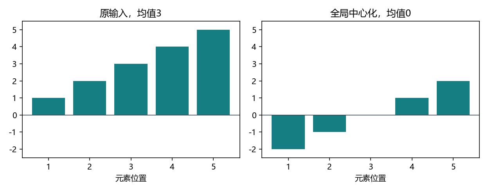
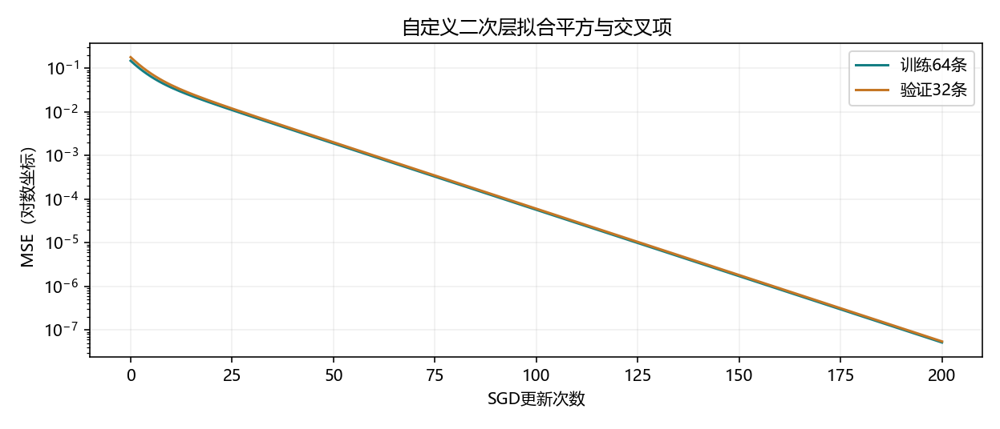
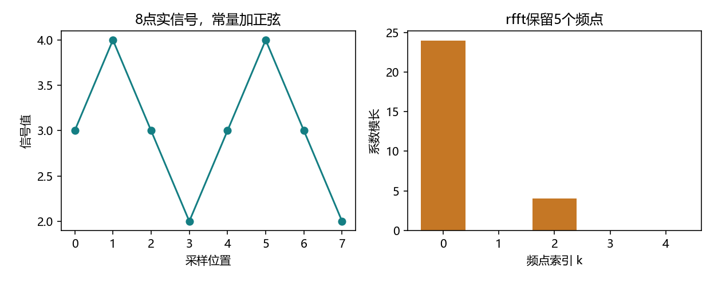

# 5.4 自定义层

本节对应教材 5.4.1、5.4.2、小结和两道练习，PDF 第 223–226 页，正文第 205–208 页。演示和练习均为 ch05/04_custom_layers.py，分别位于 lessons 与 exercises。本节使用现有 openmmlab 环境和人工数据。

## 用 forward 表达一个没有参数的变换

5.1 的块组合了现成层。这里把自己写的运算封装成层，同样可以插入 Sequential。先定义一个把输入均值移到 0 的层。

```python
import torch
from torch import nn

class CenteredLayer(nn.Module):
    def forward(self, X):
        return X - X.mean()

layer = CenteredLayer()
X = torch.tensor([1., 2., 3., 4., 5.])
Y = layer(X)
assert torch.equal(Y, torch.tensor([-2., -1., 0., 1., 2.]))
assert list(layer.parameters()) == []
```

均值是 3，每个元素都减去 3，输出形状保持 (5,)。此层只有计算规则，没有需要优化器更新的参数。这里无需额外编写构造函数，直接继承 Module 的初始化即可。



将它接在 Linear(8,128) 后，输入 (4,8) 得到 (4,128)。整个输出的均值约为 1.21e-17，属于本次 float64 运算的舍入误差。

<!-- pagebreak -->

## 均值的轴决定哪些元素一起变化

教材的 X.mean() 对所有元素求一个平均值。以两条样本、每条两个特征为例。

```python
X = torch.tensor([[1., 2.], [9., 10.]])
global_centered = CenteredLayer()(X)
row_centered = X - X.mean(dim=-1, keepdim=True)
column_centered = X - X.mean(dim=0, keepdim=True)
assert torch.allclose(global_centered.mean(), torch.tensor(0.))
assert torch.allclose(row_centered.mean(dim=-1), torch.zeros(2))
assert torch.allclose(column_centered.mean(dim=0), torch.zeros(2))
```

| 求均值范围 | 结果 | 保证的零均值 |
| --- | --- | --- |
| 整个张量 | [-4.5,-3.5] / [3.5,4.5] | 全部元素 |
| 每条样本 | [-0.5,0.5] / [-0.5,0.5] | 每一行 |
| 每个特征 | [-4,-4] / [4,4] | 每一列 |

keepdim=True 使均值保留被压缩的那一维，便于沿正确的轴广播。全局中心化中，第一条样本保持原样而更换第二条，也会改变第一条的输出。这个依赖在评估模式下仍存在，因为 forward 每次都计算当前输入的均值。

没有可训练参数的层仍然能把梯度传给输入。把输出梯度记为 g，每个输入既直接影响自身输出，也通过均值影响所有输出。

```text
输入梯度 = g - mean(g)
```

演示用非均匀的上游梯度核对了这个式子，最大差为 0。如果用中心化结果的总和当损失，所有上游梯度都为 1，输入梯度也恰好为 0。

<!-- pagebreak -->

## 让层拥有可训练的权重与偏置

自定义全连接层先完成 XW+b，再做 ReLU。下面的权重按教材方向存放。

```python
class MyLinear(nn.Module):
    def __init__(self, in_features, out_features):
        super().__init__()
        self.weight = nn.Parameter(
            torch.empty(in_features, out_features))
        self.bias = nn.Parameter(torch.zeros(out_features))
        nn.init.kaiming_uniform_(self.weight.T, nonlinearity="relu")

    def forward(self, X):
        return torch.relu(X @ self.weight + self.bias)

layer = MyLinear(5, 3)
assert layer(torch.ones(2, 5)).shape == (2, 3)
assert sum(p.numel() for p in layer.parameters()) == 18
assert list(layer.state_dict()) == ["weight", "bias"]
```

| 对象 | 形状 | 作用 |
| --- | --- | --- |
| X | (2,5) | 2 条样本，每条 5 个特征 |
| W | (5,3) | 把 5 个输入特征组合成 3 个输出 |
| b | (3,) | 对每行加上相同的偏置 |
| Y | (2,3) | ReLU 后的输出 |

nn.Parameter 赋给模块属性后，parameters() 能找到它，state_dict() 也会记录它的数值。初始化器按内置 Linear 的 (输出,输入) 约定估计 fan_in，因此演示用 weight.T 初始化，再按教材存储方向做前向。

把 MyLinear(64,8) 与 MyLinear(8,1) 放进 Sequential，输入 (2,64) 就得到 (2,1)。这个版本的每一层都包含 ReLU，末层输出范围为非负数。若回归目标允许负值，可以在末尾接一个纯仿射的 Linear。

<!-- pagebreak -->

## 参数注册后还要参与可微的前向

本地教材的 MyLinear 在矩阵乘法里读取 self.weight.data 和 self.bias.data。这两个读取绕开参数的自动求导路径。演示将它们放进局部对照，观察同一层的参数梯度。

| 使用方式 | 输入求梯度 | 参数梯度结果 |
| --- | --- | --- |
| 直接使用 weight 和 bias | 可以 | 反传后 weight.grad、bias.grad 有值 |
| 读取两个参数的 .data | 输入要求求导时仍可得到 | 反传到两个参数的路径已切断 |

当输入也无需梯度时，教材写法的输出 requires_grad 为 False。即使显式让输入求梯度，两个参数的 grad 仍为 None。参数已经注册在模块里，注册本身无法替代从损失到参数的求导路径。

本项目的可训练版本写作 X @ self.weight + self.bias。在训练之外查看数值，可以用 detach()。保存独立快照时再加 clone()，沿用 5.2 的做法。

```python
reference = nn.Sequential(nn.Linear(5, 3), nn.ReLU())
with torch.no_grad():
    reference[0].weight.copy_(layer.weight.T)
    reference[0].bias.copy_(layer.bias)

X = torch.ones(2, 5)
assert torch.allclose(layer(X), reference(X))
```

两种存储方向通过转置对齐。演示在 float64 下用相同起点及输入，核对了输出、权重梯度、偏置梯度和输入梯度，四项最大差均为 0。实际执行一次 SGD 后，权重变化范数约为 .0246044。

<!-- pagebreak -->

## 二次层把平方项与交叉项变成可训练特征

教材第一题让每个输出 y[k] 对所有输入位置 i、j 的乘积加权求和。

```text
y[k] = sum over i,j of W[i,j,k] * x[i] * x[j]
```

先把每条输入与自身做外积。若 x=[2,3]，外积是 [[4,6],[6,9]]。每个输出 k 都有一张与外积同形状的权重表，把对应元素相乘并求和。

```python
class QuadraticLayer(nn.Module):
    def __init__(self, in_features, out_features):
        super().__init__()
        self.weight = nn.Parameter(
            torch.zeros(in_features, in_features, out_features))

    def forward(self, X):
        return torch.einsum("...i,ijk,...j->...k",
                            X, self.weight, X)

quadratic = QuadraticLayer(3, 2)
assert quadratic(torch.ones(4, 3)).shape == (4, 2)
assert quadratic.weight.numel() == 18
```

einsum 中 i、j 都没有出现在箭头右侧，因此沿这两轴求和。k 保留为输出特征轴，省略号保留输入前导维度。输入 (4,3) 与参数 (3,3,2) 对应输出 (4,2)。

对于两个输入和一个输出，展开式是 W00*x0² + (W01+W10)*x0*x1 + W11*x1²。两条交叉路径对应同一个乘积，因此函数由 W01 与 W10 的和决定。单独比较这两个数，无法判断两个模型是否计算相同函数。

<!-- pagebreak -->

## 二次层直接拟合带交叉项的回归目标

正式演示取 64 条训练、32 条验证、32 条测试样本。输入两个特征均来自 [-1,1]，人工标签为 0.8*x0² + 0.6*x0*x1 - 0.4*x1²。输出只有一维，所以参数张量为 (2,2,1)，共 4 个元素。

从全零权重出发，用平均 MSE 和学习率 .2 的 SGD 做 200 次整批更新。这里输出对 W 是线性的，即使初值为零，输入乘积特征仍能把误差信号传给权重。



| 指标 | 运行结果 |
| --- | --- |
| 初始训练 MSE | .14750103 |
| 最终训练 MSE | 5.15e-8 |
| 最终验证 MSE | 5.44e-8 |
| 最终测试 MSE | 6.72e-8 |
| 拟合交叉项 W01+W10 | .59991528 |

两个非对角权重同从零出发，接收到相同梯度，更新后都约为 .299958。二者的和接近目标交叉项系数 .6。验证与测试使用独立样本，测试在固定更新次数后进行一次。

<!-- pagebreak -->

## 傅里叶层沿最后一维提取频率成分

教材第二题的“前半部分”在本节采用实信号的完整单边谱。实数输入的完整频谱存在共轭对称，torch.fft.rfft 保留非负频率的独立系数。

```python
class FourierLayer(nn.Module):
    def forward(self, X):
        return torch.fft.rfft(X, dim=-1)

t = torch.arange(8, dtype=torch.float64)
signal = 3 + torch.sin(2 * torch.pi * 2 * t / 8)
spectrum = FourierLayer()(signal)
assert spectrum.shape == (5,)
restored = torch.fft.irfft(spectrum, n=8)
assert torch.allclose(restored, signal)
```



长度 N 的实信号得到 floor(N/2)+1 个复数系数。8 点得到 5 个，包含直流 k=0 与偶数长度的奈奎斯特频点 k=4。7 点得到 4 个，逆变换显式传 n=7，保留原长度。

8 点示例中，常量 3 对应直流系数 24。正弦在 8 点内完成两周期，对应 k=2，系数为 -4j，图中画的是模长 4。复数系数还包含相位信息，取模后便无法据此完整重建原信号。

本机 8 点和 7 点重建最大误差均小于 5e-16。接口按本机 torch2.4.1 实测，单边谱含义可参见 [PyTorch rfft 文档](https://docs.pytorch.org/docs/2.15/generated/torch.fft.rfft.html)。

<!-- pagebreak -->

## 把四种层串进一次练习

VS Code 中按 F5 选择“5.4 自定义层：完整演示”。演示包括中心化及其梯度、自定义 Linear 对照、二次层回归和频谱重建。综合练习入口是 exercises/ch05/04_custom_layers.py。

| TODO | 要完成的环节 |
| --- | --- |
| 1 | 全局中心化 |
| 2–3 | 注册权重并实现可微的仿射与 ReLU |
| 4 | 二次层按 i、j 求和 |
| 5 | 沿最后一维计算实信号单边频谱 |
| 6–8 | 平均 MSE、反传和 SGD 更新 |

练习使用 3 维输入、2 维二次输出，权重形状 (3,3,2)，共 18 个元素。固定 48 条训练和 24 条验证，做 200 次整批更新。7 点信号应返回 4 个频点，逆变换时显式给出原长度。

完成后一次贴出输出，并解释三个问题。整批中心化为何会让一条样本受其他样本影响？直接使用 Parameter 与读取 .data 时，参数梯度有什么差别？二次层与频谱层各自保留了哪些维度？

实验指标、201 行训练记录和三图位于 reports/ch05。六段代码示例与练习的运行核对记录见 5_4_verification.md。本节覆盖教材 5.4.1、5.4.2 及两道练习。下一节 5.5「读写文件」从 PDF 第 226 页开始。
