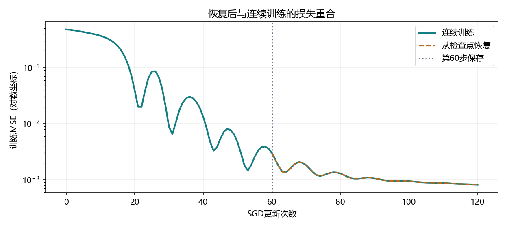

# 5.5 读写文件

本节覆盖教材 5.5.1、5.5.2 和三道练习，PDF 第 226–229 页，正文第 208–211 页。演示与练习分别位于 lessons/ch05/05_file_io.py 和 exercises/ch05/05_file_io.py。使用现有 openmmlab 环境，实验文件写入项目 artifacts 目录。

## 张量、列表与字典可以一起保存

训练时的张量在内存里。torch.save 把对象写到文件，torch.load 把文件里的对象重新读回内存。字典可以给多个张量起名字，加载时按键访问。

```python
from pathlib import Path
import torch
from torch import nn

sample_dir = Path("artifacts/ch05/5_5_notes")
sample_dir.mkdir(parents=True, exist_ok=True)
x = torch.arange(4)
y = torch.zeros(4, dtype=torch.float64)
torch.save(x, sample_dir / "tensor.pt")
torch.save([x, y], sample_dir / "list.pt")
torch.save({"x": x, "y": y}, sample_dir / "dictionary.pt")

loaded = torch.load(sample_dir / "dictionary.pt",
                    map_location="cpu", weights_only=True)
assert list(loaded) == ["x", "y"]
assert torch.equal(loaded["x"], x)
assert torch.equal(loaded["y"], y)
```

三类对象在演示中均完成往返核对，x 的 dtype 仍为 int64，y 仍为 float64。map_location="cpu" 指定将文件中的张量读到 CPU。weights_only=True 使用受限加载方式，可以读取本节的张量和普通容器。

本节示例读取自己生成的文件。接口参数按本机 PyTorch 2.4.1 使用。 [PyTorch 2.4 torch.load 文档](https://docs.pytorch.org/docs/2.4/generated/torch.load.html)

<!-- pagebreak -->

## state_dict 把每层状态按名称整理起来

5.2 用 named_parameters() 查看参数。现在用 state_dict() 把网络中的参数与持久 buffer 一起取出。后续如果使用 BatchNorm，移动平均等持久 buffer 也属于恢复预测所需的状态。

```python
class Regressor(nn.Module):
    def __init__(self, in_features, hidden_features, out_features):
        super().__init__()
        first, second = hidden_features
        self.features = nn.Sequential(
            nn.Linear(in_features, first), nn.ReLU(),
            nn.Linear(first, second), nn.ReLU(),
        )
        self.head = nn.Linear(second, out_features)

    def forward(self, X):
        return self.head(self.features(X))

net = Regressor(2, [8, 8], 1).double()
state = net.state_dict()
assert state["features.0.weight"].shape == (8, 2)
assert state["head.weight"].shape == (1, 8)
assert sum(p.numel() for p in net.parameters()) == 105
```

| 键名前缀 | 参数形状 | 作用 |
| --- | --- | --- |
| features.0 | (8,2) 与 (8,) | 第一层特征变换 |
| features.2 | (8,8) 与 (8,) | 第二层特征变换 |
| head | (1,8) 与 (1,) | 一维输出 |

ReLU 的行为由 forward 和模块结构决定。两个 ReLU 都没有权重键。为了复现计算，需要保留结构代码，并把加载的状态交给相应的层。

state_dict() 在内存中引用当前参数与 buffer。要留住某一步的状态，可以当时调用 torch.save，或对状态字典做独立复制后再继续训练。

<!-- pagebreak -->

## 重新建模并加载参数，恢复预测

演示训练 2→8→8→1 的回归网络，最后把 state_dict() 写到 artifacts/ch05/5_5/weights.pt。先运行完整演示，即可读取该文件。

```python
lesson_dir = Path("artifacts/ch05/5_5")
weights = torch.load(lesson_dir / "weights.pt",
                     map_location="cpu", weights_only=True)
restored = Regressor(2, [8, 8], 1).double()
restored.load_state_dict(weights)
restored.eval()

X = torch.ones(2, 2, dtype=torch.float64)
with torch.no_grad():
    prediction = restored(X)
assert prediction.shape == (2, 1)
```

load_state_dict 按键把文件里的数值装进新模型。新模型初始化时生成的参数值会被加载值覆盖，因此恢复预测时可以用不同的初始化种子。

调用 eval() 会设置 Dropout、BatchNorm 等层的预测行为。no_grad() 管理求导记录。演示中，新模型加载参数后的 training 仍为 True，所以预测前显式切换模式。

在 CPU/float64、相同模型结构和相同验证输入下，文件往返后的参数最大差为 0，32 条验证样本的预测最大差也为 0。

| 文件 | 本次大小 | 主要用途 |
| --- | --- | --- |
| weights.pt | 3208 字节 | 给兼容模型加载参数，恢复预测 |
| checkpoint_step60.pt | 5874 字节 | 重建第 60 步并继续训练 |

<!-- pagebreak -->

## 恢复训练还需要优化器的历史状态

SGD 带动量时，下一次更新依赖当前梯度与之前累积的动量。检查点同时保存模型状态、优化器状态、结构配置、训练步数和格式版本。

```python
checkpoint = torch.load(lesson_dir / "checkpoint_step60.pt",
                        map_location="cpu", weights_only=True)
config = checkpoint["architecture"]
resumed = Regressor(config["in_features"], config["hidden_features"],
                    config["out_features"]).double()
resumed.load_state_dict(checkpoint["model_state"])
optimizer = torch.optim.SGD(resumed.parameters(), lr=.05, momentum=.9)
optimizer.load_state_dict(checkpoint["optimizer_state"])
start_step = checkpoint["step"]
assert start_step == 60
```



64 条人工训练样本，平均 MSE，SGD .05、动量 .9，连续做 120 次整批更新。第 60 步写入检查点，另建模型恢复后完成剩余 60 步。恢复与连续训练的逐步损失、最终参数、动量和验证预测最大差均为 0。

只恢复权重并重新建立空动量优化器时，下一步参数最大差约为 .003948。做多个对照时分别读取检查点或复制优化器状态，以便每个对照从同一份历史动量出发。

<!-- pagebreak -->

## 只复用前两层时，给特征块加载状态

教材第二题希望把已有网络的一部分装进新网络。演示把两个仿射层及其 ReLU 组成 features。新模型沿用相同的输入宽度和特征块，输出头由 8→1 改为 8→2。

```python
wider = Regressor(2, [8, 8], 2).double()
wider.features.load_state_dict(restored.features.state_dict())
with torch.no_grad():
    assert torch.equal(wider.features(X), restored.features(X))
    assert wider(X).shape == (2, 2)
```

加载整个特征块会把两个全连接层的参数复制过去。ReLU 已经在新结构中定义。新输出头保留自己初始化的数值，可以针对新的任务训练。

演示向 32 条验证数据运行两套特征块，特征最大差为 0。新模型的输出形状为 (32,2)。直接将旧模型的整个状态加载给新模型时，head.weight 分别为 (1,8) 与 (2,8)，形状冲突会报错。strict=False 可以允许缺少键或多余键，同名参数仍需形状兼容。

需要复用哪一块，就为那一块核对键名、输入输出维度和 forward 计算。模块拆分清楚时，直接加载子模块通常最容易核对。

<!-- pagebreak -->

## 同时记录架构、参数与训练位置

教材第一题可以从两个使用场景回答。保存最终参数便于以后重复评估、比较模型或初始化新任务。保存中途检查点让长训练可以接着做。

教材第三题可以把已定义的架构转成可读配置，再与参数放在同一个文件中。本节检查点中的配置如下。

```text
format_version = 1
architecture = {
    "kind": "two_hidden_mlp",
    "in_features": 2,
    "hidden_features": [8, 8],
    "out_features": 1
}
```

程序由 kind 找到已知的构造代码，再用尺寸重建各层。two_hidden_mlp 在本项目中约定两个 Linear+ReLU 特征层与一个线性输出头。配置能描述的架构范围由项目代码决定。若添加新的层、激活或连接方式，需要扩展配置和构造逻辑，并保存对应代码版本。

实际项目还可以记录预处理、标签映射等预测约定。想精确续跑含随机打乱或 Dropout 的训练，要按训练流程记录随机状态、数据进度和学习率调度器状态。本次整批确定性实验在固定数据上运行，检查点中的模型、优化器与步数足以复现所需结果。

本节训练 MSE 从 .48002886 降到 .00081718，第 60 步为 .00299948。最终验证 MSE 为 .00113663。恢复实验核对的是相同训练流程和状态的重现。

<!-- pagebreak -->

## 综合练习从保存数据走到恢复训练

在 VS Code 按 F5 选择“5.5 读写文件：完整演示”，再打开 exercises/ch05/05_file_io.py。练习使用 24 条人工样本与 2→4→1 的小模型。先训练 30 步并写检查点，再比较第 50 步的两条路径。

| TODO | 要完成的环节 |
| --- | --- |
| 1–2 | 保存和读取训练张量字典 |
| 3–4 | 写入第 30 步检查点，再读取到 CPU |
| 5–6 | 分别恢复模型与优化器 |
| 7 | 计算两条训练路径的最大预测绝对差 |
| 8 | 只把第一层加载给输出宽度为 2 的新模型 |

完成后集中观察张量往返是否相同、恢复后预测是否一致，以及新模型的输出是否为 (24,2)。再解释三个问题。为什么恢复预测只需结构和状态？为什么带动量续训需要优化器状态？为什么改变输出宽度后仍可复用第一层？

本节运行记录位于 reports/ch05，包含 121 行损失记录、恢复曲线和实际核对报告。下一节 5.6「GPU」从 PDF 第 229 页、正文第 211 页开始。
