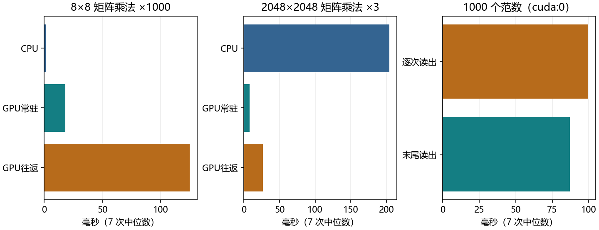

# 5.6 GPU

教材 5.6.1–5.6.3 和四道节末练习，PDF 第 229–234 页，正文第 211–216 页。接着 5.5 的状态字典练习，把同一个训练流程从 CPU 搬到 GPU，再测量计算和数据搬运的代价。

## 设备决定张量放在哪里

一个张量除了形状和数据类型，还有 `device`。CPU 张量在主内存，由 CPU 算子处理。CUDA 张量通常在对应 GPU 的显存，由该卡执行 CUDA 算子。CPU 擅长低延迟和复杂控制，GPU 能同时处理许多类似运算。矩阵乘法里有大量可以并行计算的乘加操作，矩阵足够大时更容易摊薄派发与调度的固定成本。

在现有 openmmlab 环境里，`torch.cuda.is_available()` 检查 CUDA 是否可用，`device_count()` 返回可见卡数。设备编号从 0 开始。本机可见 1 张 RTX 4060 Laptop GPU，`try_gpu(0)` 选到 `cuda:0`，`try_gpu(1)` 按教材约定回退到 `cpu`。只列可用设备时，有卡就列 CUDA 设备，无卡时返回一个 CPU 设备。

```python
import torch

if torch.cuda.is_available():
    device = torch.device("cuda:0")
else:
    device = torch.device("cpu")
print(torch.cuda.device_count(), device)
```

`torch.device("cuda:0")` 描述目标位置。张量可以直接在目标设备创建，也可以稍后迁移。

`cuda:0` 固定指向第 0 张可见 GPU。只写 `cuda` 时，PyTorch 使用当前 CUDA 设备。每张卡都有自己的显存预算。训练时参数、梯度和前向保留的中间结果也占显存，输入大小只是其中一项。

系统终端的 `nvidia-smi` 可查看驱动和显存，Python 里的 `torch.version.cuda` 是当前 PyTorch 构建对应的 CUDA 版本。本机实测驱动 566.24，PyTorch 2.4.1+cu121，CUDA 构建版本 12.1。

<!-- pagebreak -->

## 张量在哪儿，运算就在哪儿

两个矩阵张量要放在同一个设备上才能相加。在本机 GPU 路径里，`x + y` 会报设备不匹配。先选执行位置，再用 `to` 的返回值。两张卡时也一样，例如先用 `z = x.to("cuda:1")`，再在第二张卡算 `z + y`。只指定设备时，形状与 dtype 保持一致。

```python
x = torch.arange(6, dtype=torch.float32).reshape(2, 3)
y = torch.ones((2, 3), device=device)
x_on_device = x.to(device)
z = x_on_device + y
print(x.device, z.device, z.cpu().tolist())
print(x_on_device.to(device) is x_on_device)
```

只写 `x.to(device)` 然后继续使用原来的 `x`，在 CUDA 路径上 `x.device` 仍为 CPU。同设备、同 dtype 且没有要求强制复制时，`to` 返回原张量。教材里的 `x.cuda(1)` 指定 CUDA 卡号，`to(device)` 同时支持回退到 CPU。上例的结果为 `[[1, 2, 3], [4, 5, 6]]`，结果位置等于选定设备。[PyTorch 2.4 Tensor.to](https://docs.pytorch.org/docs/2.4/generated/torch.Tensor.to.html)

诊断时先看 `X.device`、`y.device`、`model.weight.device` 和报错涉及的临时张量。若前向临时创建了 CPU 张量，可用 `torch.zeros_like(X)` 或指定 `device=X.device`。只想查看设备和形状时，打印 `x.device` 和 `x.shape` 就够了。把 CUDA 张量的数值交给 NumPy 时，使用 `x.detach().cpu().numpy()`，依次断开梯度追踪、搬到 CPU、转换接口。

<!-- pagebreak -->

## 把模型、输入和标签放到一起

对于这一节的小回归模型，前向用输入和模型参数，损失再用预测和标签。可以沿这条链查设备。先移动模块，再创建优化器。对模块执行 `model.to(device)` 会就地迁移注册的参数和缓冲区。模型的普通张量属性如需跟着迁移，可以用 5.1 学过的 `register_buffer` 注册。梯度由反向传播生成，本例线性层权重的梯度与权重同在 `cuda:0`。[PyTorch 2.4 Module](https://docs.pytorch.org/docs/2.4/generated/torch.nn.Module.html)

```python
from torch import nn

model = nn.Linear(2, 1).to(device)
X = torch.tensor([[1., 2.], [3., 4.]]).to(device)
y = torch.tensor([[1.], [2.]]).to(device)
optimizer = torch.optim.SGD(model.parameters(), lr=.01)
optimizer.zero_grad(set_to_none=True)
loss = (model(X) - y).square().mean()
loss.backward()
optimizer.step()
print(model.weight.device, model.weight.grad.device, loss.device)
```

统一演示以同一份 CPU 初始参数和 64 条人工数据，分别训练 CPU 模型与选定设备的模型。结构为 2→8→1，参数 33 个，另有一个保存固定偏移的缓冲区。SGD 学习率为 0.08，整批更新 80 次。CUDA 上训练 MSE 从 0.855740 降到 0.00506127，和 CPU 独立训练的最大预测绝对差为 2.38e-7。CPU 和 GPU 的 float32 运算顺序可以不同，核对时使用容差。

保存时可直接写 `model.state_dict()`。下面用已知结构新建 CPU 模型，再用 `map_location="cpu"` 把文件里的张量读到 CPU，最后按需迁移模块。演示在 CPU 上恢复的预测与 GPU 训练结束时相差最多 1.19e-7，恢复后再搬回同一 GPU 时差为 0。[PyTorch 2.4 torch.load](https://docs.pytorch.org/docs/2.4/generated/torch.load.html)

```python
# 路径指向演示自己生成的 CUDA 权重文件。
path = "artifacts/ch05/5_6/regressor_cuda.pt"
state = torch.load(path, map_location="cpu", weights_only=True)
# 演示中已定义 Regressor，它与文件里的结构相同。
restored = Regressor()
restored.load_state_dict(state)
restored.to(device)
```

<!-- pagebreak -->

## 为什么小任务可能在 CPU 上更快

CUDA 运算通常由 Python 发出后排队，CPU 可以先继续执行。用普通秒表包住运算时，先等待前面的 GPU 工作结束，再计时，最后再等本轮 GPU 工作结束。这样测的是这段操作的完成时间，其中也包含主机发出调用的开销。使用多个 GPU 时要等齐本轮涉及的设备。[PyTorch CUDA 异步执行](https://docs.pytorch.org/docs/2.15/notes/cuda.html#asynchronous-execution) · [PyTorch 2.4 同步接口](https://docs.pytorch.org/docs/2.4/generated/torch.cuda.synchronize.html)

演示用相同 float32 输入，CPU 固定 4 个 PyTorch 计算线程，矩阵乘法精度选 `highest`。每种方式预热，取七次完成时间的中位数。常驻方式在计时前就准备好输入和输出空间，往返方式每次把两个输入从 CPU 搬到 GPU，再把结果搬回 CPU。两种 GPU 方式都用预分配的 GPU 输出空间。每行比较的是同样次数、同样大小的乘法。

| 每轮任务 | CPU | GPU 常驻 | GPU 往返 |
| --- | --- | --- | --- |
| 8×8 乘法，1000 次 | 1.39 ms | 18.00 ms | 124.93 ms |
| 2048×2048 乘法，3 次 | 204.37 ms | 7.68 ms | 26.35 ms |

小矩阵计算本身短，反复派发和往返的成本突出。大矩阵给 GPU 的并行单元提供更多工作，实测常驻耗时明显缩短。第二行里，加入搬运后耗时也明显上升。两行的重复次数不同，只在每一行内比较设备。同一台电脑重跑也会因功耗状态和系统负载得到不同数字。



<!-- pagebreak -->

## 把每批的日志留在设备上

Frobenius 范数是矩阵中所有元素平方和的平方根。第三道教材练习为 1000 次 100×100 矩阵乘法，每次算输出矩阵的这个范数。两种写法的乘法、范数及读取顺序相同，区别在于何时让 CPU 取得数值。

```python
# norms 的元素仍是设备上的标量张量。
norms = [torch.linalg.matrix_norm(x_on_device)]
values = torch.stack(norms).cpu().tolist()
print(values)
```

逐次 `.item()` 时，CPU 需要立即拿到标量，必须等对应的 GPU 运算完成。逐次等待的关键来自 CPU 读取设备数值。程序用预分配的 GPU 向量保存 1000 个范数，循环结束才搬回 CPU。两法的范数最大差为 0，逐次读出 99.68 ms，最后一次读出 87.19 ms。本次还包含设备端写入日志的开销。

在训练循环里可以收集 `loss.detach()`，在阶段末用 `torch.stack(history).cpu()` 集中处理。这里的 `detach()` 让日志与计算图分离，日志仍在原设备。只需平均值时也可以在设备上累计和与样本数，只读最终的平均值。打印 CUDA 张量的数值、转 NumPy 及训练中逐批 `.item()` 都会让主机等待数值可用。

<!-- pagebreak -->

## 走完教材四道练习

| 教材题目 | 在本项目里如何观察 |
| --- | --- |
| 1. 比较大、小矩阵 | 运行完整演示，逐行对比 CPU、GPU 常驻和 GPU 往返的完成时间。 |
| 2. 读写 GPU 参数 | 保存设备上的 state_dict，用 map_location 读到 CPU，再加载同结构模型并核对预测。 |
| 3. 测量 1000 个范数 | 对比每次 item 与末尾批量复制，核对两组日志逐项一致。 |
| 4. 比较单卡串行和双卡并行 | 先准备同样的两个独立乘法，再比较只在卡 0 上提交两次、向卡 0 和卡 1 各提交一次。 |

第 4 题的双卡计时先把相同输入放到两张卡，各卡的算子与输出驻留在各自卡上。并行路径要先把任务都提交，再分别同步两张卡。如果每提交一个任务就立刻等待完成，后一个任务只能等前一个结束。两张性能接近的卡在计算充足、任务独立且开销较小时，理论耗时可接近单卡顺序执行的一半。实际还受卡速、调度、传输和通信影响。本机只有一张可见 GPU，因此第 4 题保留实验分支，当前记录为跳过。多卡一起训练同一模型还需要合并各卡的梯度，多机器则要经网络通信。

在 VS Code 按 F5 选择「5.6 GPU：完整演示」。也可以用现有解释器运行下方命令。想观察回退路径时，在第一条命令末尾加 `--device cpu`。默认运行保留讲义使用的基准记录，新生成的权重写到本地 artifacts。

```powershell
& 'D:\Anaconda\envs\openmmlab\python.exe' lessons/ch05/06_gpu.py
& 'D:\Anaconda\envs\openmmlab\python.exe' exercises/ch05/06_gpu.py
```

综合练习有八处 TODO。先选设备并迁移模型、特征、标签，再把 40 次更新的损失整批取回，最后用 CPU 恢复 GPU 权重。完成后集中发三项结果。训练时的模型、输入和标签设备是什么？日志有几条，最终在哪个设备？恢复后最大预测差是多少？再用一句话说明为什么只写 `X.to(device)` 容易导致原变量的设备仍为 CPU。
