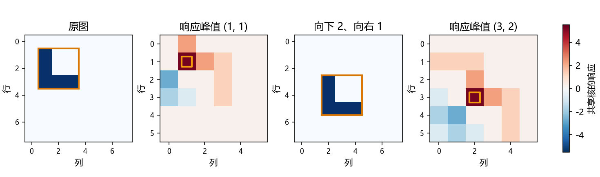
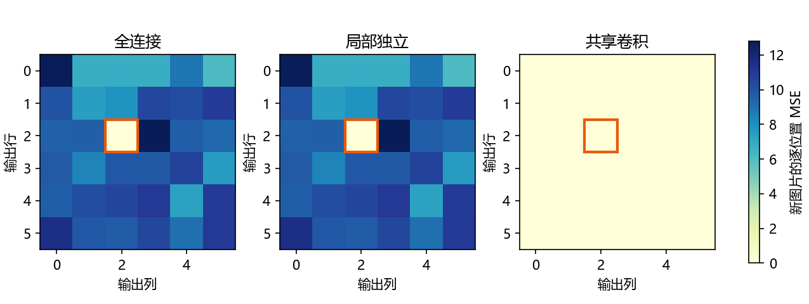

# 6.1 从全连接层到卷积

对应第 6 章导读、6.1.1–6.1.4 与六道节末练习，教材 PDF 第 235–240 页，正文第 217–222 页。

## 第 6 章从像素网格出发

前面的图像分类把一张图展平成一个向量，再交给全连接层。展平之后，像素值和固定索引仍然可追溯，但全连接层给每一对输入、输出位置独立权重。模型要从样本里学到哪些像素应当一起看，以及一个形状移到其他位置后该怎样识别。

图像有两个适合写进模型的规律。局部性让前几层先看相邻像素，提取边缘、纹理等局部模式。权重共享让同一个识别规则扫过不同位置，好比课本里用同一组特征去找「沃尔多」。模型先产生一张保留位置的响应图，分类时可以再汇总响应，定位时则用响应图保留坐标。这样的结构假设称为归纳偏置。[教材 6.1](https://zh.d2l.ai/chapter_convolutional-neural-networks/why-conv.html)

卷积神经网络（CNN）把这些局部计算叠起来，让后层看到更大范围。本章路线是图像卷积、填充与步幅、多输入多输出通道、汇聚，最后搭建 LeNet。本节先弄清结构为什么这样设计。

本节用人工数据、CPU 和 float64。8×8 灰度图保留行和列。所有坐标从 0 开始，书写顺序为（行，列）。

<!-- pagebreak -->

## 把全连接层的权重限制成卷积核

把输入写成二维的 X，把输出写成二维的 H。全连接层的第 (i,j) 个输出可以使用任意输入位置 (k,l)。因此每个权重有四个下标，另加每个输出位置的偏置。

```text
全连接：H[i,j] = U[i,j] + sum_{k,l} W[i,j,k,l] X[k,l]
改记号：H[i,j] = U[i,j] + sum_{a,b} V[i,j,a,b] X[i+a,j+b]
共享核：H[i,j] = u + sum_{a,b} K[a,b] X[i+a,j+b]
```

从第一行到第二行只是把绝对坐标改写为相对偏移，k = i + a、l = j + b。偏移会覆盖整张图，所以还没减少参数。第三行移除了权重与偏置对输出位置 (i,j) 的依赖。再应用局部性，只保留窗口内的偏移。以窗口中心为原点时，3×3 的偏移在每个方向都为 −1、0、1；演示用窗口左上角标记响应图的位置，索引等价。

对 8×8 输入、6×6 输出和 3×3 窗口，三种结构如下。每个输出位置都对应一个计算结果，差别在于它能读哪些像素、用哪组权重。

| 结构 | 每个输出位置读取 | 参数量（含偏置） |
| --- | --- | --- |
| 全连接 | 64 个输入像素，位置各用一套权重 | 36 × (64 + 1) = 2340 |
| 局部独立 | 9 个窗口像素，位置各用一套权重 | 36 × (9 + 1) = 360 |
| 共享卷积 | 9 个窗口像素，所有位置共用一个核 | 9 + 1 = 10 |

局部性主要限制每次计算的输入范围，共享主要限制可独立学习的权重组数。即使只有 10 个参数，卷积仍需在 36 个位置计算响应。像 1000×1000 灰度图接 1000 个全连接单元，仅权重就有 10 亿个，所以空间结构会影响模型的参数量。

<!-- pagebreak -->

## 图案移动，响应也跟着移动

L 形有五个值为 1 的亮点，其他像素为 0。构造一个 3×3 核，亮点对应的权重为 +1，其余为 −1。把窗口对准 L 形，五个亮点各贡献 1，再加偏置 0.25，得分 5.25。把窗口挪到别处，就用同一组权重重新算分。

图案从 (1,1) 挪到 (3,2)，响应最高点也跟着挪了两行一列，峰值仍为 5.25。在两个扫描图可对齐的重叠区域，逐项最大差为 0。**平移等变**指响应图跟着移动。**平移不变**指最终输出保持同一个值，例如这个例子的最大分数，或者只问图里有没有目标。题目若问目标在哪儿，就需要保留位置。



边缘要另外考虑。窗口越界时，可以只算完整窗口，也可以选择零、反射或环绕填充。有限图像移动时，内容可能移出画布，边缘又会补入新像素。演示用全 1 图、3×3 求和核和零填充做反例。向右移动一列，先移输入再算与先算再移输出，在左边缘的对应读数为 3 和 0。比较等变性时要说清楚比较区域和边界规则。

<!-- pagebreak -->

## PyTorch 的 Conv2d 默认怎样算

二维互相关把核按原顺序放在窗口上，逐元素相乘后求和。数学卷积的偏移符号相反。固定窗口内，先把核上下、左右各翻一次，再用互相关计算数学卷积的局部值。PyTorch 把互相关算子封装在 Conv2d 层中。[PyTorch 2.4.1 Conv2d 源码](https://github.com/pytorch/pytorch/blob/v2.4.1/torch/nn/modules/conv.py#L2688-L2707)

```python
import torch
from torch.nn import functional as F

X = torch.arange(1., 10.).reshape(3, 3)
K = torch.tensor([[1., 2.], [3., 4.]])
corr = F.conv2d(X[None, None], K[None, None])[0, 0]
conv = F.conv2d(X[None, None], K.flip((0, 1))[None, None])[0, 0]
print(corr.tolist(), conv.tolist())
```

左上角的窗口是 [[1,2],[4,5]]。互相关得 1×1 + 2×2 + 4×3 + 5×4 = 37；翻核后得 1×4 + 2×3 + 4×2 + 5×1 = 23。固定核时分数可能改变。核可学习时，两种写法通过参数翻转可以表示同一族局部线性映射。

连续卷积把 f(z) 与 g(x−z) 的乘积对 z 积分。离散时把积分换成求和。二维离散卷积可写为下面第一行。在全平面零延拓的有限数组，或者能合法重排的绝对收敛情形，令 p = i − a、q = j − b，就得到第二行，证明 f * g = g * f。比较时应使用同一个完整输出域。

```text
(f * g)[i,j] = sum_{a,b} f[a,b] g[i-a,j-b]
             = sum_{p,q} g[p,q] f[i-p,j-q]
             = (g * f)[i,j]
```

<!-- pagebreak -->

## 通道让每个位置输出多种特征

灰度图每个位置有一个数，RGB 图每个位置有三个数。PyTorch 的输入常按 N、C、H、W 排列，分别表示批量大小、通道数、高度、宽度。普通卷积的一个输出通道，在同一窗口对所有输入通道分别乘加，最后把结果相加、加一次偏置。多个输出通道用不同的核，得到多张特征图。

```python
from torch import nn

X_rgb = torch.randn(2, 3, 8, 8)
layer = nn.Conv2d(in_channels=3, out_channels=2, kernel_size=3)
H = layer(X_rgb)
print(layer.weight.shape, H.shape)
```

这个例子的核形状为 (2,3,3,3)，输出形状为 (2,2,6,6)，参数量为 2 × (3 × 3 × 3 + 1) = 56。每个 8×8 方向上能放 6 个完整的 3×3 窗口。核的前两轴分别表示输出通道和输入通道，后两轴表示窗口高和宽。

当教材的窗口半径 Δ = 0 时，空间窗口为 1×1。此时对每个位置单独做 `y = W @ x + b`，其中 x 是该像素的全部通道，W 的形状为 (输出通道, 输入通道)。所有空间位置共用这组 W 和 b。普通 1×1 卷积因此等价于对每个像素的通道向量应用同一个全连接层。演示用 `F.linear` 和 `F.conv2d` 核对，最大差为 0。

<!-- pagebreak -->

## 只教一个位置，去其余位置检验

为了单独观察共享的作用，实验用一个固定的 L 形检测核为人工图像生成目标响应。训练有 160 张随机 8×8 图，损失只使用输出位置 (2,2)。三个模型各自从零权重开始，以同样的 MSE、学习率 0.08 和 200 次整批 SGD 更新训练。最后拿 64 张独立生成的图，分别测见过的位置和其余 35 个位置。

| 模型 | 训练位置上的 MSE | 新图见过位置的 MSE | 新图其余位置的 MSE |
| --- | --- | --- | --- |
| 全连接 | 2.01e-7 | 1.42e-6 | 9.497873 |
| 局部独立 | 1.95e-17 | 3.10e-17 | 9.497873 |
| 共享卷积 | 1.95e-17 | 3.10e-17 | 3.35e-17 |

全连接和局部独立的其余输出没有参与损失，对应参数保持在零初始化，预测都为 0。共享卷积在 (2,2) 学到核以后，其余位置使用的就是这组权重。共享核与真实生成核的最大绝对差为 3.63e-9。目标本来就由共享卷积生成，所以此结果说明归纳偏置和任务匹配时发生了什么，适用范围是这组受控实验。



<!-- pagebreak -->

## 教材六题与综合练习

1. **半径 Δ = 0。** 将 3×3 改成 1×1，空间偏移只剩 0。每个像素的 RGB 等输入通道组成一个向量，输出通道是共享仿射变换的结果。可用讲义里的 1×1 核对实验验证。
2. **何时位置有意义。** 若任务要求判断物体在画面左边还是右边，最后输出必须保留位置。若场景中天空和道路的位置有规律，整个分类器一律忽略绝对坐标也可能损失有用信息。
3. **边界怎么处理。** 要决定图像外的像素从哪里来、是否保留边缘输出，以及怎样对齐移动前后的结果。只算完整窗口会缩小输出，零填充会给边界引入人为的零。
4. **音频卷积。** 一维卷积沿时间轴滑动，在短时间窗内检测局部波形。输入可用 (批量, 声道, 时间)，输出通道可表示不同响应。用在实时预测时，窗口要只读当前及过去样本。
5. **文本卷积。** 可把词或子词的嵌入各维当成输入通道，沿词序列扫描，检测局部短语。短窗口本身只覆盖邻近词，长距离依赖需要更大的有效覆盖范围或其他结构。
6. **卷积交换律。** 对二维完整卷积做索引替换 (p,q) = (i−a,j−b)，交换两项的乘积顺序即可。上文的推导与演示分别给出了符号证明和数值核对。

在 VS Code 按 F5 选择「6.1 从全连接层到卷积：完整演示」，或在项目终端运行：

```powershell
& 'D:\Anaconda\envs\openmmlab\python.exe' lessons/ch06/01_from_dense_to_conv.py
& 'D:\Anaconda\envs\openmmlab\python.exe' exercises/ch06/01_from_dense_to_conv.py
```

练习把 L 形换成十字形。补完八处 TODO，从切片和手算得分开始，再用同一个核扫描两张图，比较平移前后的对应区域。发回响应图形状、两个峰值坐标和重叠区域的最大差。最后解释「看局部」和「共用权重」分别限制了什么。
