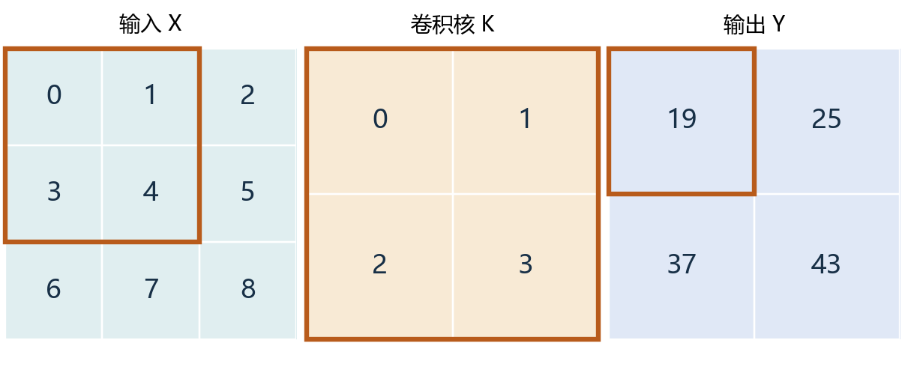
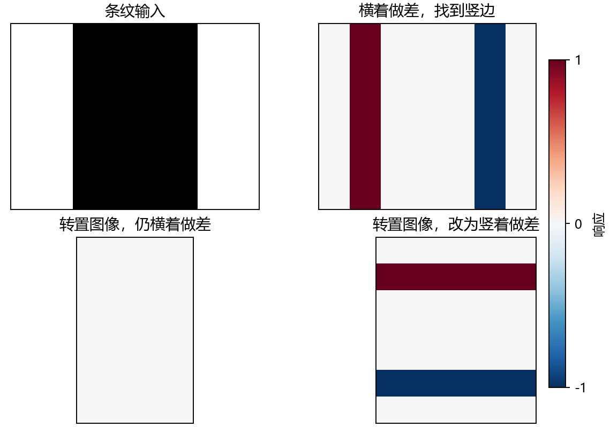
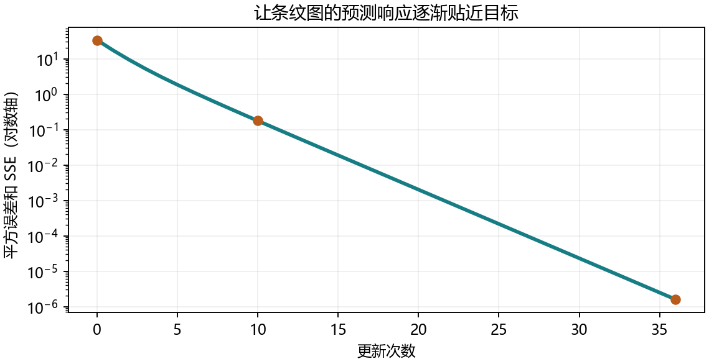
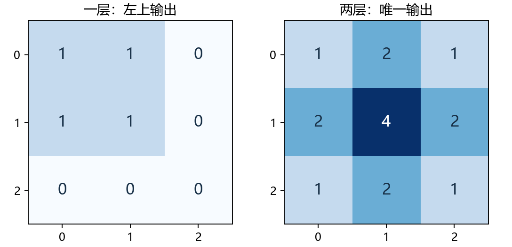

# 6.2 图像卷积 · 实验手册

教材 6.2.1–6.2.6 及四道节末练习，PDF 第 240–246 页、正文第 222–228 页。本节用现有 openmmlab 环境的 PyTorch 2.4.1，在 CPU 上运行人工数据。

## 01 先算一格，再看整张图

上一节讲同一组权重怎样扫描不同位置。本节把这条规则落实成一次可以手算、编程和训练的操作。



把 2×2 核放在 3×3 输入的左上角。相同位置的数相乘，再加起来。窗口右移一格，就用同一个核继续算。整个输入只有四个位置可以放下完整的核。

<!-- side -->

### 手算台

```text
Y[0, 0] = 0*0 + 1*1 + 3*2 + 4*3
        = 19

Y = [[19, 25],
     [37, 43]]
```

先自己用右上角窗口复核 25。这里的 `*` 是逐元素相乘，最后还要把窗口内所有乘积求和。

### 形状怎么数

高度方向的最后一个窗口起点是 H − h，起点从 0 数起，总共有 H − h + 1 个位置。宽度同理。步幅为 1、只算完整窗口时，输出是 **(H − h + 1) × (W − w + 1)**。 [教材 6.2](https://zh.d2l.ai/chapter_convolutional-neural-networks/conv-layer.html)

<!-- pagebreak -->

## 02 把手算写成可训练层

```python
import torch

def corr2d(X, K):
    h, w = K.shape
    rows = X.shape[0] - h + 1
    cols = X.shape[1] - w + 1
    return torch.stack([
        torch.stack([
            (X[i:i+h, j:j+w] * K).sum()
            for j in range(cols)
        ])
        for i in range(rows)
    ])
```

内层 `stack` 拼成一行，外层再把行叠成二维输出。演示的 `Conv2D` 把核和标量偏置登记为 `nn.Parameter`，前向计算 `corr2d(X, weight) + bias`。偏置由所有输出位置共享。统一例子中，手写与内置层的输出、输入梯度、核梯度和偏置梯度最大差都是 0。

<!-- side -->

### 把窗口摊成矩阵

每个窗口摊成一列，第一列为 `[0, 1, 3, 4]`。核摊成一行 `[0, 1, 2, 3]`。做 **(1,4) @ (4,4)** 得到四个分数，排回 2×2。演示用 `F.unfold` 提取窗口，核对全部四格。

### 自动求导实测

课本问逐格写入输出会出现什么报错。以现有 PyTorch 2.4.1 验证，给初始的零张量逐格写入由核算出的值，会产生 `CopySlices`，对核反传成功。反过来，把结果变成 Python 数值后再用 `torch.tensor` 新建张量，才会在这里断开梯度。手写例子用 `stack` 直接拼接有梯度的结果。

<!-- pagebreak -->

## 03 用差分找边缘



横着拿相邻像素相减。像素相同得 0，从白到黑得 +1，从黑到白得 −1。这里检测到的是**沿竖直方向延伸的边界**，因为亮度在水平方向上变化。

<!-- side -->

### 先说方向，再看正负

原条纹图大小 6×8，横向差分核为 `[[1, -1]]`，输出大小 6×7。任取一行，读到 `[0, 1, 0, 0, 0, -1, 0]`。

转置图像以后，亮度改为上下变化。继续左右相减会得到全零。把核也转成 2×1，上减下，就重新找到了边界。

### 教材题 1 · 对角线

构造 6×6 图，列号大于等于行号时为 1。横向核给出 5 个 −1；转置输入再用横向核，得到 5 个 +1；保留原输入并转置核，也得到 5 个 +1。后两张响应图互为转置。斜边同时有水平和垂直亮度变化。

<!-- pagebreak -->

## 04 让模型从目标响应学出核



输入是一张黑白条纹，目标是已知差分核产生的响应。训练时把二维图加上批量、通道两个长度为 1 的轴，变成 `(1, 1, 6, 8)`；内置层输出 `(1, 1, 6, 7)`。每步算误差平方和、清梯度、反传，再用 SGD 更新。

<!-- side -->

### 训练读数

```text
更新次数      平方误差和
 0           33.503179
10            0.176467
36            0.00000159
```

没有偏置，只学习两个权重。学习率 0.03，最终核约为 **[1.00016, −0.99984]**。手写层和内置层共享同一初始值，各自训练，最终参数差在 5e-16 以内。另一条灰度序列的最大响应误差约为 2.77e-4。

这里的误差用 `sum()`。同一张图有 42 个输出，改成 `mean()` 会把梯度除以 42；若想在本实验中得到同样的一步更新，学习率要乘以 42。两种损失的数值也要按各自定义比较。

<!-- pagebreak -->

## 05 从翻核到感受野



第一层的左上输出只看原图的 2×2 窗口。第二层唯一输出会看第一层全部四格，它们各自对应的输入窗口合起来覆盖原图 3×3。这就是该输出相对于原图的感受野。**特征图**是所有位置的响应，**感受野**是某一个响应可能依赖的输入范围。

<!-- side -->

### 为什么有两个术语

把固定的核上下、左右各翻一次，再用互相关计算，对应数学卷积的局部值。第 1 页例子中，第一个输出从 19 变成 5。若分别学习核，两种算子可用互相翻转的参数表示同一组函数。PyTorch 的 `Conv2d` 采用互相关。 [PyTorch 2.4.1 源码](https://github.com/pytorch/pytorch/blob/v2.4.1/torch/nn/modules/conv.py#L2688-L2707)

### 图里的数字怎么读

在这组全 1 权重中，像素每经过一条路径，就给最终输出贡献一次。结构上的感受野由窗口覆盖决定；换成一般权重时，有些路径的贡献可能相互抵消。

<!-- pagebreak -->

## 06 自己写一个水平边缘检测器

练习把输入换成 8×6 图像，中间四行设成黑色。先填 4 处 TODO 做滑窗，接着构造一个 2×1 核来做上减下。然后用你的函数生成目标，用 `nn.Conv2d` 和 MSE 学这个核，填写损失、反传、更新三个步骤。练习设置 24 次更新。

在 VS Code 按 F5，选择「6.2 图像卷积：完整演示」或「6.2 图像卷积：综合练习」。也可以在项目终端运行：

```powershell
& 'D:\Anaconda\envs\openmmlab\python.exe' lessons/ch06/02_image_convolution.py
& 'D:\Anaconda\envs\openmmlab\python.exe' exercises/ch06/02_image_convolution.py
```

先预测输出的形状和第一列。做完后，把你的输出形状、第一列和学到的核发回来。再解释为什么沿竖直方向做差会找出水平边缘。

### 我的实验记录

| 要检查的项目 | 运行前的预测或实测值 |
| --- | --- |
| 输出形状 | ________________________ |
| 第一列响应 | ________________________ |
| 最终核权重 | ________________________ |

<!-- side -->

### 教材题 4 · 设计三个核

- 二阶差分可用 `[1, -2, 1]`，均匀采样间隔为 h 时，除以 h² 得到二阶导数近似。
- 固定区间的离散积分可用全 1 核求和，再乘采样间隔 h 作为矩形求积。全局前缀积分对应累积和。
- 在一维等间距的普通有限差分下，d 阶差分至少用 d+1 个点。例如 `[−1, 3, −3, 1]` 计算三阶前向差分。更高精度通常需要更多点。

### 教材题查找

第 1 题对角线在第 3 页。第 2 题求导和第 3 题矩阵乘法都在第 2 页。下节 6.3 会把填充与步幅纳入输出尺寸计算。
