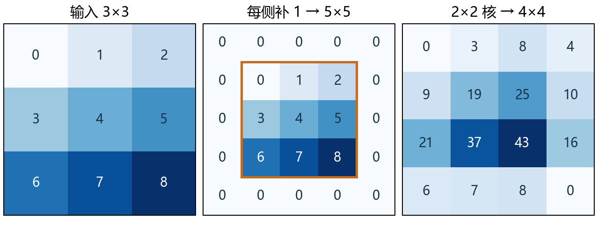
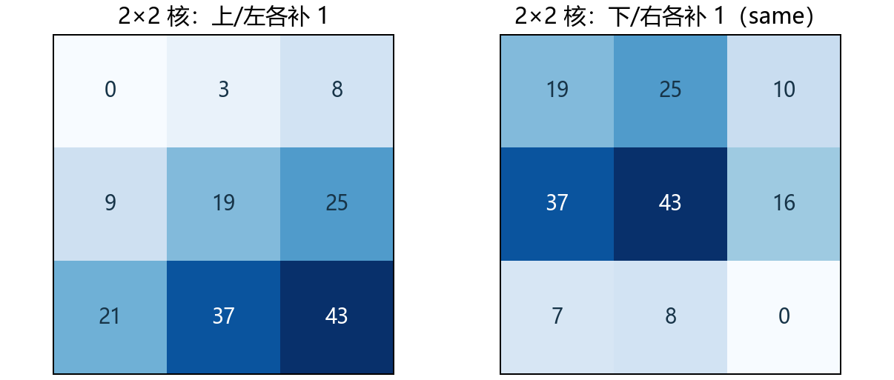
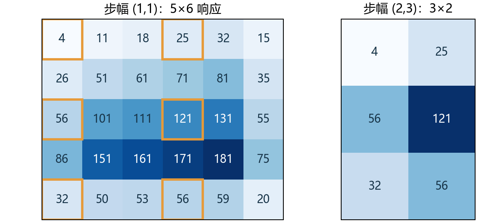
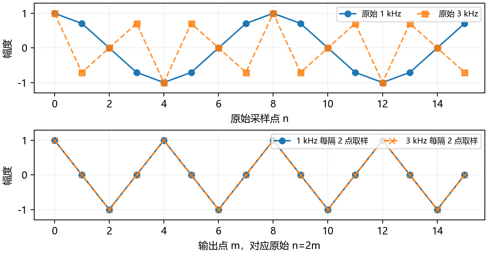

# 6.3 填充和步幅 · 实验手册

覆盖教材 6.3.1、6.3.2 和四道节末练习，PDF 第 246-249 页、正文第 228-231 页。复用 openmmlab 的 PyTorch 2.4.1，在 CPU 上使用 float64 人工张量。沿用 6.2 的横向双栏版式，先看窗口，再推尺寸、写程序，最后集中实践。

## 01 给边界留出窗口



6.2 的窗口只在原图内移动。3×3 输入配 2×2 核只能产生 2×2 输出。现在给上下左右各补一圈 0，输入变成 5×5，同一个核产生 4×4 输出。

填充使窗口可以跨过原图边界。图中的第一个窗口全部是 0，因此第一个响应为 0。填入的值会参与乘加，边界采用什么假设会影响输出。

<!-- side -->

### 两种填充记法

教材公式中的 p_h 是**上下合计**增加的行数，p_w 是左右合计增加的列数。

PyTorch 的 `padding=(p_h, p_w)` 则表示上下**各**补 p_h 行，左右**各**补 p_w 列。比如 `padding=1`，高度和宽度各增加 2。

### 边界有没有参与

每侧补 1、2×2 核、步幅 1 时，本图每个原始像素都进入四个窗口。只计算原图内完整窗口时，角落像素只进入一个窗口。零填充带来更多边界响应，新增响应包含对图外为零的假设。

连续十层 5×5 卷积，步幅 1、无填充，会让高和宽各减少 40。每层各侧补 2，可持续保持原尺寸。

<!-- pagebreak -->

## 02 从最后一个窗口推出尺寸

设原图为 H×W，核为 k_h×k_w。上下总填充 P_h，左右总填充 P_w，步幅为 s_h、s_w。高度上第 i 个窗口起点是 i·s_h，完整窗口必须满足下式。

```text
i * s_h + k_h <= H + P_h

H_out = (H + P_h - k_h) // s_h + 1
W_out = (W + P_w - k_w) // s_w + 1
```

`//` 对这里的非负整数做向下整除。起点从 0 开始，因此可用位置数量还要加 1。窗口超出填充后输入的部分不会生成输出。本节默认膨胀率为 1。

若 P_h=k_h−1，则输出高为 ceil(H/s_h)。例如 H=7、s_h=2，输出高为 4。只有能够整除时，才恰好等于 H/s_h。

<!-- side -->

### 教材题 1 · 最后一例

输入 8×8，核 3×5，PyTorch 单侧填充 (0,1)，步幅 (3,4)。总填充是 (0,2)。

```text
H_out = (8 + 0 - 3) // 3 + 1 = 2
W_out = (8 + 2 - 5) // 4 + 1 = 2
```

高度起点为 0、3，宽度起点为 0、4，均按填充后的网格计数。第三个宽度起点 8 会让 5 列窗口越过总宽 10。

### 为什么要向下取整

8×8 输入、3×3 核、无填充、步幅 2，起点是 0、2、4，输出 3×3。起点 6 的窗口需要索引 8，已经超界。可自己在纸上画最后一个窗口。

<!-- pagebreak -->

## 03 尺寸相同，对齐方式也要看



步幅 1 时，要保持尺寸，某一方向总填充量应为核大小减 1。3×3 核需要每方向总共补 2，可在两侧各补 1。5×3 核则是上下各 2、左右各 1。

2×2 核每方向只需总共补 1，只能分成一侧 1、另一侧 0。教材给出上、左多补一格的可选方案。现有 PyTorch 的 `padding="same"` 将多出来的一格补在下、右，得到图中右侧结果。

<!-- side -->

### 显式填充的顺序

`F.pad` 的四个数字按**左、右、上、下**排列。`Conv2d` 的二元 `padding` 按高、宽排列，并在每个方向的两侧对称补齐。

```python
import torch
from torch.nn import functional as F

X = torch.arange(9.).reshape(1, 1, 3, 3)
K = torch.arange(4.).reshape(1, 1, 2, 2)
before = F.conv2d(F.pad(X, (1, 0, 1, 0)), K)
after = F.conv2d(F.pad(X, (0, 1, 0, 1)), K)
assert before.shape == after.shape == X.shape
```

PyTorch 2.4.1 的 `padding="same"` 只支持步幅 1。演示实际捕获了步幅 2 的构造错误。需要降采样时，用显式填充和尺寸公式安排窗口。

<!-- pagebreak -->

## 04 步幅决定下一次从哪算



输入为 4×5、数值 1 到 20，核为 `[[1,2],[3,4]]`，每侧补 1。步幅 (1,1) 得到 5×6 响应。改成 (2,3)，窗口每次向下走 2、向右走 3，输出变成 3×2。

固定输入、核和填充时，步幅 (2,3) 的结果恰好等于密集响应的 `dense[::2, ::3]`。实际步幅卷积可以直接计算所需窗口。

<!-- side -->

### 把两套坐标分开

输出第 (i,j) 格，在填充后网格中的窗口起点是 `(i*s_h, j*s_w)`。换成原始输入坐标，还需减去上、左填充量。

本例输出第 (1,1) 格起点为填充网格 (2,3)，对应原图 (1,2)。窗口为 `[[8,9],[13,14]]`，加权和为 **121**。

### 教材题 2 · 改组合

程序逐一核对 8×8 输入的六种组合。三个教材保尺寸或降采样例子得到 8×8、8×8、4×4，最后一个非对称参数例得到 2×2。

把输入改成 7×7，3×3 核、每侧补 1、步幅 2，仍得到 4×4。比较两种输入各自最后一个窗口，解释补零参与的位置。

<!-- pagebreak -->

## 05 将窗口规则写进程序

```python
def corr2d(X, K, padding, stride):
    left, right, top, bottom = padding
    sh, sw = stride
    kh, kw = K.shape
    padded = F.pad(X, padding)
    rows = (X.shape[0] + top + bottom - kh) // sh + 1
    cols = (X.shape[1] + left + right - kw) // sw + 1
    return torch.stack([
        torch.stack([
            (padded[i*sh:i*sh+kh, j*sw:j*sw+kw] * K).sum()
            for j in range(cols)
        ])
        for i in range(rows)
    ])
```

沿用第 3 页导入的 torch 和 F。先补零，算输出行列，再把输出索引乘以步幅，得到输入窗口起点。`stack` 将有梯度的标量组织成矩阵。完整脚本还会检查核能否放入填充后的输入。

<!-- side -->

### 内置层怎样对应

```python
X = torch.arange(20.).reshape(4, 5)
K = torch.arange(6.).reshape(2, 3)
padding, stride = (1, 2, 2, 0), (2, 3)
hand = corr2d(X, K, padding, stride)
builtin = F.conv2d(
    F.pad(X[None, None], padding),
    K[None, None], stride=stride,
)[0, 0]
torch.testing.assert_close(hand, builtin)
```

`X[None,None]` 加上长度为 1 的批量轴和通道轴。内置结果用 `[0,0]` 取回二维图。

CPU/float64 随机小例中，比较均方输出损失的输入梯度和核梯度，最大误差为 `2.22e-16`。填充与跨步索引仍保留对原始像素及核的梯度路径。

<!-- pagebreak -->

## 06 音频抽样与计算量



音频以 8 kHz 采样时，相邻点间隔 0.125 ms。步幅 2 令相邻输出中心相隔两个原始采样点，即 0.25 ms，输出网格对应 4 kHz。滤波、边界填充和起点决定具体保留哪些值。

例子中的 1 kHz 和 3 kHz 余弦，在原始网格上不同，直接隔点取样后最大差约 `2.18e-14`。这是混叠的具体例子。

<!-- side -->

### 教材题 3 · 怎样听懂步幅 2

在同一时间范围内，输出采样点数约减半。若要按原有时长播放，需要使用相应输出采样率。降采样前通常需要限制高频内容。

三点平滑核 `[.25,.5,.25]` 在本例将高频与低频的输出 RMS 比降到约 0.1716。它对高频的抑制仍有限。可学习卷积核是否形成合适低通，需根据实际权重判断。

### 教材题 4 · 计算优势

单输入、单输出通道，8×8 输入、3×3 核、每侧补 1。步幅 1 有 64 个输出，约需 576 次乘加；步幅 2 有 16 个输出，约需 144 次乘加。权重始终是 9 个。

输出存储和后续层的空间计算量也会下降。此处统计理论乘加次数，实际运行时间还取决于实现、设备和输入规模。

<!-- pagebreak -->

## 07 综合实践与集中反馈

输入为 5×6，按行放置数值 1 到 30。核为 `[[1,0,-1],[1,0,-1]]`。显式补零 `(1,2,0,1)`，步幅 `(2,3)`。先在纸上预测，再填写练习的八处 TODO。

1. 按左、右、上、下补零，计算输出行列。
2. 将输出索引乘以步幅，切出完整窗口并乘核求和。
3. 用 `F.conv2d` 复算，比较形状、第一行和最大误差。
4. 说明最后一行窗口用了哪些原始像素及补零。

在 VS Code 按 F5，选择本节完整演示或综合练习。终端入口如下。

```powershell
& 'D:\Anaconda\envs\openmmlab\python.exe' lessons/ch06/03_padding_and_stride.py
& 'D:\Anaconda\envs\openmmlab\python.exe' exercises/ch06/03_padding_and_stride.py
```

<!-- side -->

### 我的实验记录

| 核对项目 | 预测或实测 |
| --- | --- |
| 输出形状 | __________________ |
| 第一行响应 | __________________ |
| 最大核对误差 | __________________ |
| 最后一行的补零 | __________________ |

做完后集中反馈上表。再解释窗口位置怎样计数、偶数核怎样保尺寸，以及音频跨步抽样为何会混叠。

### 教材与后续

本节题 1、2 在第 2、4 页，题 3、4 在第 6 页。下一节 6.4「多输入多输出通道」从教材 PDF 第 250 页、正文第 232 页开始。

教材作者为 Aston Zhang、Zachary C. Lipton、Mu Li、Alexander J. Smola。页码依据用户提供的 Release 2.0.0 中文 PDF。线上可对照教材与当前实验使用的框架源码。[教材 6.3](https://zh.d2l.ai/chapter_convolutional-neural-networks/padding-and-strides.html) [PyTorch 2.4.1 Conv2d](https://github.com/pytorch/pytorch/blob/v2.4.1/torch/nn/modules/conv.py)
