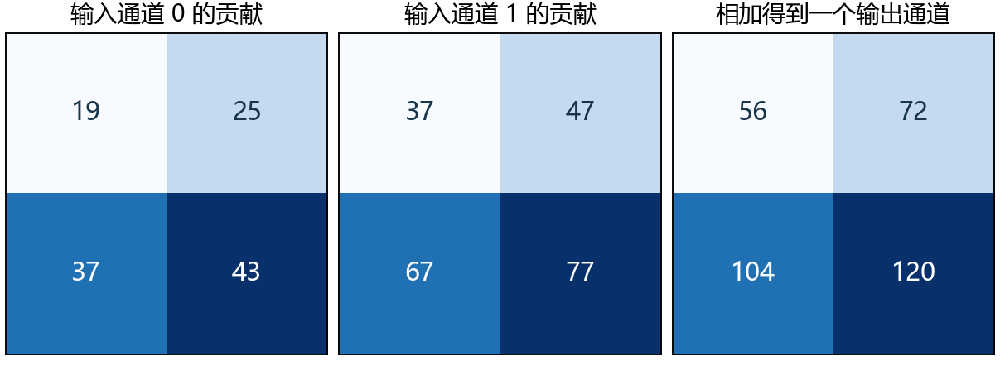
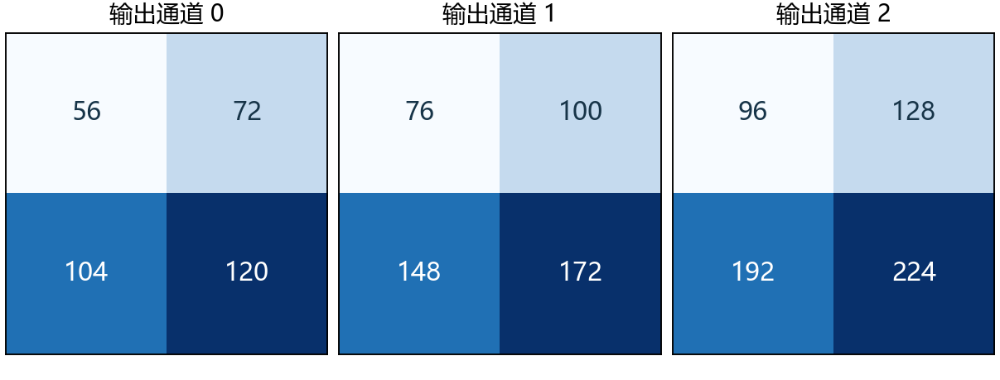
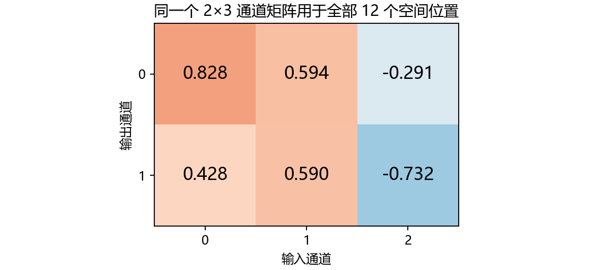
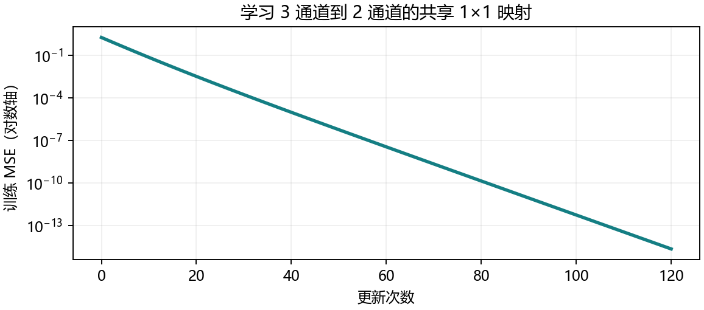

# 6.4 多输入多输出通道 · 原理与复现实验

覆盖教材 6.4.1-6.4.3 和六道节末练习，PDF 第 250-254 页、正文第 232-236 页。承接 6.3 的窗口、填充和步幅，本讲先连续说明通道求和、多组输出、1×1 映射及矩阵实现，再指导手算、代码复现和一个小型训练。采用已有 openmmlab，CPU、float64，全部数据在项目内生成。

## 01 一个窗口为什么要读取多个通道

6.3 已经能确定一个输出对应原图中的哪个窗口。如果输入是 RGB 图，这个窗口在红、绿、蓝三个通道上各有一组像素。一个输出特征通常需要综合这些值，所以给每个输入通道配一个二维核，分别乘加，再把通道贡献相加。



教材例子有两个 3×3 输入通道，分别为 0 到 8、1 到 9。两个 2×2 核分别为 0 到 3、1 到 4。左上窗口的贡献是 19 和 37，相加得到 56。其他位置也按同一规则计算，输出为 [[56,72],[104,120]]。

<!-- side -->

### 从二维变成 CHW

单张灰度图原先写成 HW，现在把输入通道轴加到前面，成为 (C_in,H,W)。一个输出通道的核形状相应为 (C_in,k_h,k_w)。

每个输入通道保留自己的空间像素和核权重。逐个通道计算二维响应，再在对应位置相加，得到保留行列位置的输出。

### 偏置加在哪里

先汇总全部输入通道贡献，再为这个输出通道加一个偏置。这个标量在所有空间位置共享。若有三个输入通道，一个输出仍只需要一个偏置。

这一步把 6.1 的局部性和共享推广到通道。窗口范围继续由 6.3 的几何规则决定，通道决定窗口内要汇总哪些数。

<!-- pagebreak -->

## 02 多组核怎样产生多张特征图

每组核读取全部输入通道并产生一张响应图。准备三组核，就可以得到三张响应图，再沿输出轴叠放，供后续层共同使用。



本例核形状为 (3,2,2,2)，输出形状为 (3,2,2)。四个核轴依次是输出通道、输入通道、核高、核宽。若输入有批量，再在最前面增加 N 轴，内置卷积输出为 NCHW。

<!-- side -->

### 写出完整计算规则

```text
Y[n,o,i,j] = bias[o]
  + sum over c,a,b of
    K[o,c,a,b] * X[n,c,i+a,j+b]
```

此式暂设步幅 1、无填充。加入步幅与显式填充后，窗口起点按上一节替换，通道汇总的方式继续沿用。

### 参数数怎样计算

每个输出通道有 C_in*k_h*k_w 个权重，以及一个共享偏置。

```text
参数数 = C_out*(C_in*k_h*k_w + 1)
```

本例包含 24 个权重、3 个偏置，共 27 个参数。空间上有多少输出位置，不会增加独立参数的数量。各通道在后续任务中共同优化，特征含义应根据实际响应分析。

<!-- pagebreak -->

## 03 把通道求和与输出叠放写成代码

```python
def multi_in(X, K):
    parts = []
    for channel in range(X.shape[0]):
        part = corr2d(X[channel], K[channel])
        parts.append(part)
    return torch.stack(parts).sum(dim=0)

def multi_out(X, K, bias):
    outputs = []
    for channel in range(K.shape[0]):
        response = multi_in(X, K[channel])
        outputs.append(response)
    Y = torch.stack(outputs)
    return Y + bias[:, None, None]
```

corr2d 是 6.3 已实现的二维窗口函数。第一层循环遍历输入通道，sum(dim=0) 汇总贡献。第二层循环遍历输出通道，stack 保留每一张响应图。操作部分会把已有二维函数接进完整跟做文件。

<!-- side -->

### 轴的变化怎样追踪

X[channel] 从 CHW 取出一个 HW。parts 叠放后是 (C_in,H_out,W_out)，求和得到 HW。

多组输出叠放为 (C_out,H_out,W_out)。bias[:,None,None] 变成 (C_out,1,1)，在高宽两个轴广播。

### 内置层怎样对应

nn.Conv2d(C_in,C_out,kernel_size) 保存同样的 OIHW 权重，每个输出通道一个偏置。F.conv2d 可直接接收给定张量，便于与手写实现核对。

教师程序先检查输入和核的通道数相同。否则遍历错误的通道组合，会让计算失去原来的含义。

在随机小例中，手写与内置前向最大差约为 3.55e-15，输入、权重和偏置梯度差均在 2.23e-16 以内。

<!-- pagebreak -->

## 04 1×1 卷积如何混合通道

当核高宽都是 1，窗口只覆盖一个空间位置。这个位置的所有输入通道组成向量 x，同一组矩阵 W 和偏置 b 在各位置计算 y=W@x+b。空间坐标保持，通道向量被重新组合。



把输入 (C_in,H,W) 重排为 (C_in,H*W)，每列就是一个位置的通道向量。核重排为 (C_out,C_in)，相乘后得到 (C_out,H*W)，再恢复空间形状。这个计算也等价于逐像素应用同一个 F.linear。

<!-- side -->

### 通道变化与空间变化

3 输入、2 输出的 1×1 层有 6 个权重、2 个偏置。它能压缩或扩展通道数量。本页讨论步幅 1 的情况，若同时设置更大步幅，仍会改变空间采样网格。

### 教材题 4、5

主乘法次数为 N*H_out*W_out*C_out*C_in。1×1 将每个输出窗口的空间权重项减少到一个位置。

数学等价的表达式在浮点运算中可能出现很小差异，因为乘加的组织顺序会影响舍入。教师矩阵与窗口路径误差为 0，逐像素 linear 路径约有 5.55e-17 差异。

核对时先检查形状和计算约定，再按 dtype 选择合理容差。torch.testing.assert_close 可以同时检查数值是否接近。

<!-- pagebreak -->

## 05 从窗口矩阵推到计算量和内存

对于一般 k_h×k_w 核，也可以把每个通道窗口摊成一列。令 Q=C_in*k_h*k_w，L=H_out*W_out，unfold 得到 (N,Q,L)。权重摊成 (C_out,Q)，矩阵乘法得到 (N,C_out,L)，加偏置后恢复 NCHW。

一次输出需要 Q 次乘法和 Q-1 次加法，再加一次偏置。整个前向输出数量为 N*C_out*L。主乘加量为 N*C_out*L*Q。反传时，对输入和对权重的两项梯度通常各需要与前向同阶的乘加，偏置还要跨样本和位置归约。

教师例子为输入 (2,3,5,6)、核 (4,3,2,3)，无填充、步幅 1。unfold 是 (2,18,16)，输出是 (2,4,4,4)。前向有 2304 次乘法、2176 次窗口内加法和 128 次偏置加法。

<!-- side -->

### 教材题 2 的存储核对

输入、权重、偏置和输出共 384 个数。float64 每个数 8 字节，共 3072 字节。显式 unfold 额外生成 576 个数，占 4608 字节。

本例 dX、dK、db、dY 分别含 180、72、4、128 个数，合计也为 3072 字节。反传还要保留所需前向值，优化器可能保存额外状态。实际峰值取决于实现与复用，这里给出主要张量项。

### 教材题 3 的两个变化

固定空间尺寸、核大小和 groups=1，同时将输入与输出通道翻倍，权重和主乘加项变为四倍，偏置数变为两倍。

填充翻倍要重新算输出面积。例如 8×8 输入、3×3 核、步幅 1，单侧填充从 1 变 2，输出从 8×8 变成 10×10，主计算量为原来的 100/64。

<!-- pagebreak -->

## 06 两个卷积层什么时候能合成一个

两个没有激活函数的线性卷积连续应用，可以沿中间通道和空间偏移展开求和。第一层某个像素的贡献再被第二层加权，两次空间偏移相加，得到一个更大的等效核。

```text
K_eff[o,i,a+c,b+d]
  += sum_m K2[o,m,c,d] * K1[m,i,a,b]
```

步幅 1、膨胀率 1、两层都只计算完整窗口时，等效核高宽分别为 k1_h+k2_h-1、k1_w+k2_w-1。教师用两层 2×2、多通道、无偏置卷积，构造 3×3 等效核并核对全部输出。

若包含偏置，在此 valid 条件下可将第一层偏置经第二层加权后合并到最终偏置。若中间加入 ReLU，或者有限画布上的填充和裁剪改变了边界路径，就需要重新分析对应关系。

<!-- side -->

### 教材题 1 的反方向

任意大核能否拆成指定的两个小层，还受中间通道数与因式结构限制。

以 1×1 为例，2 通道经过 1 个中间通道再回到 2 通道，等效矩阵是 (2,1)@(1,2)，秩最多为 1。2×2 单位矩阵的秩为 2，所以这一瓶颈结构无法表示该恒等映射。

### 与前面知识怎样连接

两层连续线性变换可以合并，是 4.1 讨论过的仿射合并在卷积结构中的对应。激活函数为层叠引入非线性，中间通道数量则影响可表达的线性组合。

这里的核仍保留跨空间位置共享的约束，因此能够用一个核表达合并后的局部计算。

<!-- pagebreak -->

## 07 用训练学习一组共享通道映射

教师生成 24 张训练图和 8 张验证图，每张是 (3,3,4)。目标由固定的 3 输入、2 输出的 1×1 映射产生。模型有 8 个参数，从零初始化开始，用平均平方误差、SGD 0.15 做 120 次整批更新。



初始训练 MSE 约为 1.87454，最终为 2.23e-15，验证 MSE 约为 2.85e-15。学到的两行权重接近 [1,-0.5,0.25]、[-0.75,0.5,1.25]，偏置接近 [0.1,-0.2]。

<!-- side -->

### 更新怎样同时使用各位置

每个像素的通道向量都经过同一组 W、b。损失汇总训练样本全部输出，因此不同样本、不同位置的梯度共同更新这 8 个参数。

这个人工目标明确由共享线性通道映射生成。核对真实参数和新图误差，可以检查模型是否学回这个规则。

### 接下来亲自复现

先运行整个教师程序，核对教材与训练读数。再在跟做文件中逐步加入多通道、1×1、unfold 和训练代码。最后更换输入与核，完成综合练习。

所有输入由代码生成，跟做时每次从同一初始值重新运行，便于判断参数改变造成的影响。

<!-- pagebreak -->

## 08 操作一 · 运行导读并手算通道贡献

在 VS Code 打开本项目，选择已有 openmmlab 解释器。在项目根目录的 PowerShell 终端运行下面命令。

```powershell
$pythonPath = 'D:\Anaconda\envs\openmmlab\python.exe'
& $pythonPath lessons/ch06/04_channels.py --guided
```

程序依次打印通道贡献、多输出、矩阵/梯度核对和训练结果。命令末尾加 --record 可重建 reports/ch06/6_4_metrics.json 及四张图。先读 corr2d_multi_in 和 corr2d_multi_in_out，再沿后面的 demo 函数核对每组结果。

| 核对项目 | 教师基准结果 |
| --- | --- |
| 两个首格贡献 | 19、37 |
| 单输出首格 | 56 |
| 核形状、含偏置参数量 | (3,2,2,2)、27 |
| 1×1 最终训练 MSE | 约 2.23e-15 |

先在纸上分别计算两个窗口贡献，再把它们相加。随后在右栏建立跟做文件，保持每段代码按阅读顺序运行。

<!-- side -->

### 准备输入与二维窗口函数

在 .cache 新建 6_4_follow_along.py，放入下面完整代码并运行当前文件。

```python
import torch
from torch import nn
from torch.nn import functional as F
from runpy import run_path

helpers = run_path("lessons/ch06/04_channels.py")
corr2d = helpers["corr2d"]
A = torch.arange(9., dtype=torch.float64)
A = A.reshape(3, 3)
X = torch.stack((A, A + 1))
B = torch.arange(4., dtype=X.dtype).reshape(2, 2)
K = torch.stack((B, B + 1))
first = corr2d(X[0], K[0])[0, 0]
second = corr2d(X[1], K[1])[0, 0]
print("首格贡献", first.item(), second.item())
```

run_path 读取已有教师函数，本次只取出二维 corr2d。main 入口在教师文件被直接运行时才启动。应复现首格贡献 19 和 37。

<!-- pagebreak -->

## 09 操作二 · 核对多输出和 1×1 映射

把第 3 页的 multi_in、multi_out 函数复制到跟做文件，再在末尾加入下面调用，先复现三个输出通道。

```python
K_all = torch.stack((K, K + 1, K + 2))
bias = torch.tensor([.5, -1., 2.], dtype=X.dtype)
Y = multi_out(X, K_all, bias)
reference = F.conv2d(X[None], K_all, bias)[0]
torch.testing.assert_close(Y, reference)
print(tuple(Y.shape), Y[:, 0, 0].tolist())
```

应得到 (3,2,2)，三个通道左上值为 56.5、75、98。这里已加偏置，与无偏置教材数值按各自定义核对。

接着保留两通道 X，用右栏的三行矩阵将它映射成三个输出通道。这个例子的通道规模与教师三输入、两输出示意相反，但矩阵作用方式相同。

<!-- side -->

### 将空间位置排成矩阵列

```python
W = torch.tensor(
    [[1., 0.], [0., 1.], [1., -1.]],
    dtype=X.dtype,
)
b = torch.tensor([0., .25, -.5], dtype=X.dtype)
columns = X.reshape(2, -1)
point = W @ columns + b[:, None]
point = point.reshape(3, 3, 3)
point_kernel = W[:, :, None, None]
ref_point = F.conv2d(X[None], point_kernel, b)[0]
torch.testing.assert_close(point, ref_point)
print("矩阵列形状", tuple(columns.shape))
print("左上向量", point[:, 0, 0].tolist())
```

应得到 (2,9)、左上向量 [0,1.25,-1.5]。前两行选择原通道，第三行计算差值。

只将第三行改为 [1,1]，预测第三个左上值变成 0.5。运行整个文件，核对全部位置也按同一规则改变。恢复原行后，继续一般窗口矩阵实现。

<!-- pagebreak -->

## 10 操作三 · 用 unfold 复现一般卷积

沿用前两页的 X、K_all、bias 和 Y，继续追加以下代码。

```python
windows = F.unfold(X[None], kernel_size=(2, 2))
weights = K_all.reshape(3, -1)
scores = weights @ windows + bias[None, :, None]
reconstructed = scores.reshape_as(Y)
print("窗口矩阵", tuple(windows.shape))
print("权重矩阵", tuple(weights.shape))
print("第一列窗口", windows[0, :, 0].tolist())
print("最大差", (reconstructed - Y).abs().max().item())
torch.testing.assert_close(reconstructed, Y)
```

应看到窗口矩阵 (1,8,4)，权重矩阵 (3,8)，最大差为 0。第一列先放第一个输入通道的四个窗口像素，再放第二个通道的四个像素。核摊平时采用相同顺序，因此内积汇总的正是一次多通道窗口计算。

<!-- side -->

### 教材题 6 与维度关系

每列含 C_in*k_h*k_w 个值，每个空间位置一列。权重矩阵每一行对应一个输出通道，矩阵乘法同时计算全部位置。

对于步幅和对称填充，F.unfold 接受同名参数。窗口提取与内置卷积必须采用相同的核、填充和步幅。

### 一个可复现的几何变更

将 unfold 与 F.conv2d 参考都设置 stride=2，当前 3×3 输入配 2×2 核只剩一个完整窗口。先预测响应为 (3,1,1)，再将矩阵结果按这个新形状恢复并核对。

每次修改都一起核对起点网格、矩阵列数和输出高宽。这样就把上一节的空间规则接到了本节的通道矩阵。

<!-- pagebreak -->

## 11 操作四 · 从零复现 1×1 训练

继续在同一跟做文件中追加数据和模型设置。生成顺序与教师基准相同，验证图在训练图之后生成。

```python
gen = torch.Generator().manual_seed(6404)
train_X = torch.randn(24, 3, 3, 4, generator=gen, dtype=torch.float64)
valid_X = torch.randn(8, 3, 3, 4, generator=gen, dtype=torch.float64)
true_W = torch.tensor([[1., -.5, .25], [-.75, .5, 1.25]],
                      dtype=train_X.dtype)[:, :, None, None]
true_b = torch.tensor([.1, -.2], dtype=train_X.dtype)
target = F.conv2d(train_X, true_W, true_b)
valid_target = F.conv2d(valid_X, true_W, true_b)
model = nn.Conv2d(3, 2, 1, dtype=train_X.dtype)
with torch.no_grad():
    model.weight.zero_()
    model.bias.zero_()
optimizer = torch.optim.SGD(model.parameters(), lr=.15)
```

这些图中的每个位置都遵循同一条已知通道映射。模型从零开始，训练时让共享的 8 个参数逐渐接近真实规则。

<!-- side -->

### 接通损失、反传与更新

```python
print("初始 MSE",
      (model(train_X)-target).square().mean().item())
for step in range(120):
    loss = (model(train_X)-target).square().mean()
    optimizer.zero_grad(set_to_none=True)
    loss.backward()
    optimizer.step()
with torch.no_grad():
    final = (model(train_X)-target).square().mean()
    valid = (model(valid_X)-valid_target).square().mean()
print("最终训练/验证 MSE", final.item(), valid.item())
print("最终权重", model.weight.detach()[:, :, 0, 0])
```

应复现约 1.87454 到 2.23e-15 的训练 MSE，以及约 2.85e-15 的验证 MSE。核对数据生成顺序、零初值、学习率和更新次数。随后解释六个权重如何混合三个通道。

<!-- pagebreak -->

## 12 综合练习与集中反馈

打开 exercises/ch06/04_channels.py。题目使用两个 4×4 输入通道、两个 2×2 多通道核和两个偏置。先预测输出的通道数和空间尺寸，再分三个阶段填写八处 TODO。

第一阶段逐个取输入通道及其对应核，并汇总响应。第二阶段分别计算输出通道、加入共享偏置，再用内置卷积核对。第三阶段把同一输入改排为矩阵列，完成给定的 1×1 映射。

```powershell
$pythonPath = 'D:\Anaconda\envs\openmmlab\python.exe'
& $pythonPath exercises/ch06/04_channels.py
```

每阶段完成后重新运行，核对形状和指定位置的数值。维数错误时，先写清 CHW、OIHW、NCHW 各个轴的含义。数值错误时，先分别计算输入通道贡献，再检查偏置广播。

<!-- side -->

### 需要反馈的结果与解释

| 核对项目 | 你的预测与实测 |
| --- | --- |
| 输出形状、各通道首格 | ________________ |
| 含偏置参数量 | ________________ |
| 1×1 左上通道向量 | ________________ |
| 手写与内置最大差 | ________________ |

再解释为何输入通道相加、输出通道叠放，以及 1×1 怎样改变通道数。教材题 1 在第 6 页，题 2、3 在第 5 页，题 4、5 在第 4 页，题 6 在第 10 页。

下一节沿用多通道特征图，学习怎样用汇聚层降低空间分辨率。教材作者为 Aston Zhang、Zachary C. Lipton、Mu Li、Alexander J. Smola，页码依据用户提供的 Release 2.0.0 中文 PDF。实测记录位于 reports/ch06/6_4_metrics.json。[教材 6.4](https://zh.d2l.ai/chapter_convolutional-neural-networks/channels.html)
