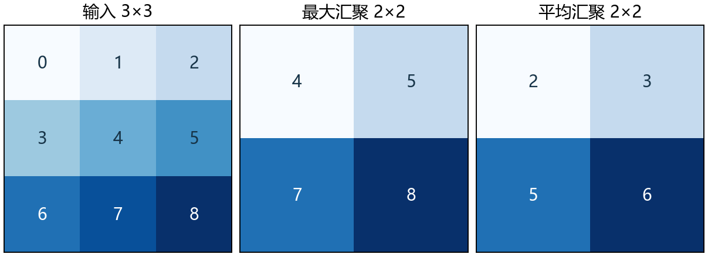
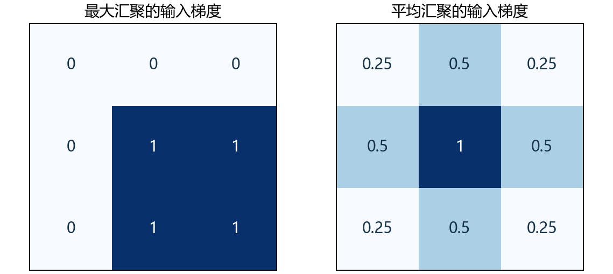
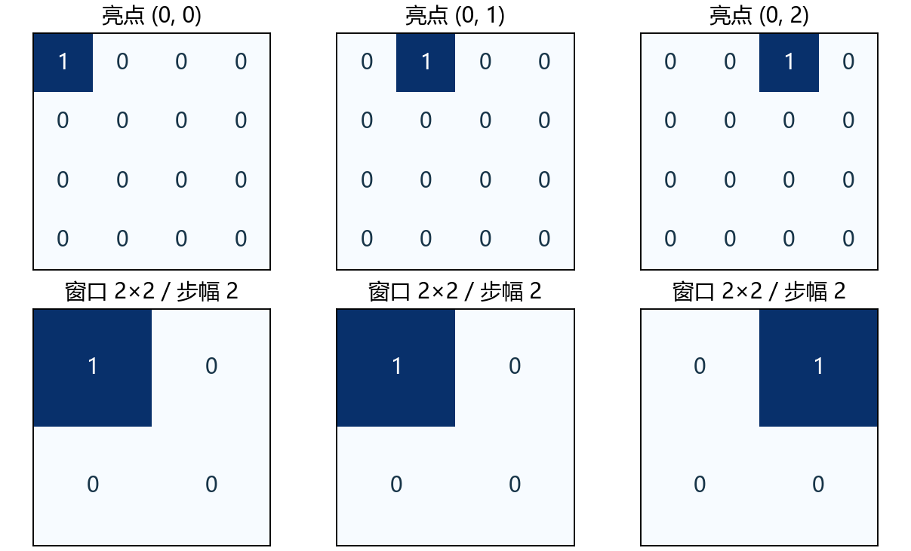
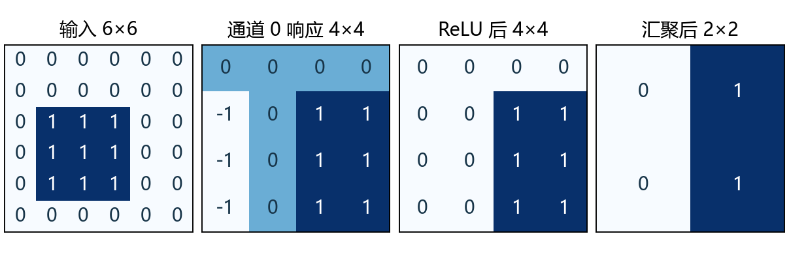

# 6.5 汇聚层 · 原理与复现实验

覆盖教材 6.5.1-6.5.3 和六道节末练习，PDF 第 254-258 页、正文第 236-240 页。从 6.4 的多通道特征图出发，先连续解释窗口统计、空间降采样、边界、梯度和位置敏感性，再指导复现。采用已有 openmmlab，CPU、float64，全部输入在内存中生成。

## 01 从检测局部特征走向区域汇总

前面用卷积核在每个位置提取局部特征，6.4 又让一个位置拥有多个特征通道。后层常需要知道较大区域内是否出现某种特征，或者该特征的平均强度。汇聚层在一个窗口内计算最大值或平均值，将细密响应汇总成更粗的空间表示。



第一个窗口是 [[0,1],[3,4]]。最大值为 4，平均值为 2。逐个扫描四个完整窗口，最大汇聚得到 [[4,5],[7,8]]，平均汇聚得到 [[2,3],[5,6]]。

<!-- side -->

### 窗口内的规则怎样变化

卷积为各像素乘以权重再求和。这里的标准汇聚用固定统计量汇总，窗口中没有需要学习的核权重。给定输入、窗口、边界和步幅，输出即可确定。

最大值强调区域内最强响应，平均值综合区域内所有响应。它们保留的信息不同，后续会用输入与梯度对照解释。

### 与前面三节怎样连接

窗口覆盖和起点计数继续使用 6.3 的规则。输入与输出保持批量和通道轴，每个通道各自汇总。

配合更大步幅，汇聚可降低特征图高宽。层叠以后，较少的输出位置可以覆盖原图较大的范围，为后续全局判断提供输入。

<!-- pagebreak -->

## 02 用熟悉的窗口循环实现汇聚

```python
import torch
from torch import nn
from torch.nn import functional as F

def pool2d(X, size, stride, mode):
    kh, kw = size
    sh, sw = stride
    rows = (X.shape[0] - kh) // sh + 1
    cols = (X.shape[1] - kw) // sw + 1
    outputs = []
    for i in range(rows):
        line = []
        for j in range(cols):
            patch = X[i*sh:i*sh+kh, j*sw:j*sw+kw]
            if mode == "max":
                flat = patch.reshape(-1)
                value = flat[flat.argmax()]
            else:
                value = patch.mean()
            line.append(value)
        outputs.append(torch.stack(line))
    return torch.stack(outputs)
```

<!-- side -->

### 从像素到一格输出

size 给定窗口高宽，stride 给定起点移动距离。切片取出完整窗口后，max 分支选择一个最大值，avg 分支把全部像素取均值。

argmax 返回第一个最大值的位置，再用索引取出对应张量。stack 把这些有梯度的值排成响应图。教师完整函数还会检查模式与输入范围，并实现边界填充。

### 参数与梯度分别指什么

nn.MaxPool2d 和 nn.AvgPool2d 都没有可训练参数。但输出仍依赖输入，所以损失能够通过汇聚层传回前面的卷积层。

本页跟做函数处理无填充二维浮点输入，明确传入步幅。操作部分会按相同顺序调用它，并与内置层核对。

<!-- pagebreak -->

## 03 步幅默认值与边界统计要一起核对

输出尺寸继续由完整窗口约束决定。本讲采用 dilation=1、ceil_mode=False，每方向为 (输入+总填充-窗口)//步幅+1。汇聚层在 PyTorch 中未指定 stride 时，默认步幅等于窗口大小。

因此 4×4 输入、3×3 窗口的 nn.MaxPool2d(3) 只产生一个输出 10。指定 padding=1、stride=2 后，产生 [[5,7],[13,15]]。矩形窗口 (2,3)、填充 (0,1)、步幅 (2,3)，在本例也得到同一组输出。

最大汇聚的隐式填充按负无穷处理，使边界外的值不会胜过有限的负数输入。若先人为补零再求最大值，零可能压过原图的负响应，这会改变边界结果。

<!-- side -->

### 平均值的分母包含什么

AvgPool2d 默认 count_include_pad=True，零填充计入窗口元素数。设一个 2×2 输入的和为 10，用 3×3 窗口、每侧补 1。

计入填充时，每个窗口除以 9，结果为 10/9。设置 False 时，只除以 4 个实际输入像素，结果为 2.5。

### 同一形状还需同一约定

比较手写与内置运算时，要同时核对窗口、步幅、填充、分母和是否使用 ceil_mode。教师手写函数显式选择这些约定，并在负数边界与平均值分母例子中分别核对。

6.3 的起点公式因此继续适用，但窗口中如何处理边界值，还取决于所做的统计操作。

<!-- pagebreak -->

## 04 最大值与平均值怎样向输入传梯度

令损失是所有汇聚输出之和。平均汇聚的每个输出把梯度均分到窗口内像素，像素若进入多个窗口，就把多条梯度相加。最大汇聚在最大值唯一时，把该输出的梯度传给取到最大值的位置。



平均汇聚的中心像素进入四个窗口，每条路径贡献 1/4，合计为 1。最大汇聚的四个窗口在本例选中了四个不同位置，所以对应梯度各为 1。

<!-- side -->

### 最大值并列时发生什么

多个位置取得同一最大值时，数学上的 max 在该点通常不可导。框架选择一种梯度分配约定。本机 MaxPool2d 在并列窗口中选择第一个最大值。

2×2 全 1 输入只输出一个数，输入梯度为 [[1,0],[0,0]]。本页手写函数通过 argmax 索引采用相同约定。

直接对整个窗口调用无维度的 patch.max()，在并列时会把梯度平均分配。本机得到每格 1/4。前向值相同，也要核对实际使用的梯度约定。

### 接回训练流程

前面的卷积权重决定输入特征，汇聚输出再影响损失。反传经过这些选择或均分规则，就能继续计算卷积权重梯度。

<!-- pagebreak -->

## 05 局部位置变化会怎样影响输出

用 4×4 零图中的一个亮点观察位置敏感性，窗口为 2×2、步幅为 2。亮点从 (0,0) 移到 (0,1)，仍落在同一个汇聚窗口，输出相同。移到 (0,2) 后进入另一个窗口，输出位置也随之变化。



这个例子展示局部汇总可以减轻某些位置变化的影响。是否保留输出，还与窗口、步幅、边界和实际特征分布有关。降采样同样会减少位置细节，也需要结合 6.3 的采样知识分析。

<!-- side -->

### 教材题 4 怎样从输入解释

比较下面两个窗口，它们的平均值都为 1，最大值分别为 4 和 1。

```text
A = [4,0,0,0]
B = [1,1,1,1]
```

最大汇聚更关注局部最强的响应，平均汇聚更能保留区域整体水平。两种算子对稀疏强响应、分散响应和噪声会有不同表现，具体选型要联系任务。

### 位置与通道分别怎样变化

标准二维汇聚在每个通道上单独应用同一空间规则。一个通道里的最大值，不会与另一个通道相互比较。

所以 NCHW 输入会输出相同的 N 和 C，变化发生在 H、W。这个约定与上一节卷积沿输入通道求和的规则形成清楚的接口衔接。

<!-- pagebreak -->

## 06 平均汇聚与固定卷积的联系

无填充的平均汇聚，可用窗口内全部权重为 1/Q 的固定卷积实现，Q 是窗口元素数。多通道时，让每个通道各自使用这组权重，groups=C 即可保持通道独立。

```text
平均值 = (x1+x2+...+xQ)/Q
固定核 = 每个元素都取 1/Q
```

教师将输入 (2,3,6,8) 做 2×2、步幅 2 的平均汇聚，核对固定 depthwise 卷积，全部输出一致。固定核没有参与训练。若平均汇聚排除边界补零，其分母会随边界改变，需要再用有效像素计数修正。

### 教材题 3 的计算成本

设输出高宽为 H_out、W_out，窗口面积为 Q。共有 N*C*H_out*W_out 个输出。直接计算最大值每个窗口通常需要 Q-1 次比较，平均值需要 Q-1 次加法和一次除法。主要复杂度均随输出位置数和 Q 增长。

<!-- side -->

### 一个具体数量核对

输入 (2,3,6,8)，窗口 2×2、步幅 2，输出 (2,3,3,4)，共有 72 个数。

直接最大汇聚需要 216 次比较。直接平均汇聚需要 216 次加法和 72 次除法。专门实现可能利用重叠窗口、向量化等方法改变实际执行方式。

### 存储与训练的联系

汇聚参数量为 0，输出在本例只有原输入四分之一的元素。最大汇聚反传还可能保存所选位置的索引，平均汇聚则需要知道窗口和边界分母。

这些是主要张量和计算项，实际峰值内存与运行速度还依赖具体实现。

本页覆盖教材题 1、3。下一页从非线性解释最大汇聚，再扩展其他统计方式。

<!-- pagebreak -->

## 07 最大值、最小值和光滑汇总

固定权重的单层卷积是仿射映射。全零输入的最大值为 0，所以若用这个映射表示 max，偏置必须为 0，随后应满足线性加法性质。

取 u=[1,0]、v=[0,1]，计算下面两条路径。

```text
max(u)+max(v) = 2
max(u+v) = 1
```

加法关系不成立，所以单个固定卷积核不能对全部输入实现 max。

加入非线性后，可以用 ReLU 构造两个数的最大值。

```text
max(a,b) = ReLU(a-b) + b
```

先合并两对数，再合并两次结果，就得到四个数的最大值。这个过程依赖选择型非线性，对应教材题 2。

最小值可用 min(X)=-max(-X) 实现。将输入取负、做最大汇聚、再取负，就得到相同窗口与步幅下的最小汇聚，对应教材题 5。

<!-- side -->

### 教材题 6 的光滑例子

设窗口有 Q 个数，可以定义带温度 T 的归一化 log-sum-exp。

```text
T * log(mean(exp(x/T)))
```

T 很小时接近最大值，T 很大时趋向平均值。计算时用 logsumexp 保持数值稳定。

窗口 [0,1,3,4] 的最大值为 4、平均值为 2。T=0.01 时本例约为 3.9861，T=100 时约为 2.0125。

softmax 权重加权平均也是可选的光滑汇总。它们增加温度选择和指数、归一化计算，具体收益依赖任务。常用最大或平均汇聚拥有更简单的规则与实现，其他方式也可在有需要时进行对照实验。

<!-- pagebreak -->

## 08 把卷积、激活和汇聚接成数据流

现在把两节组件放在一起。输入是 (1,1,6,6)，用两个 3×3 边缘核得到 (1,2,4,4)。ReLU 保留正响应，再用 2×2、步幅 2 的最大汇聚得到 (1,2,2,2)。空间尺寸降低，两个特征通道各自保留。



卷积有 18 个权重，本例关闭偏置。ReLU 与标准汇聚均为 0 个可训练参数。对最终输出之和反传，卷积权重仍得到非零梯度，绝对值之和为 18。

<!-- side -->

### 一格输出依赖什么

第一层每个响应读取原图 3×3。汇聚再汇总相邻 2×2 响应，其结构覆盖的原图范围扩大为 4×4。最大值的实际梯度只沿选中的响应和 ReLU 门继续传回。

### 怎样衔接到 6.6

6.4 解释多个核怎样产生多个特征通道。

6.5 用固定窗口汇总这些通道。

下一节 LeNet 会把卷积、激活、汇聚层反复组合，再接分类头训练真实图像任务。

这里先核对形状和梯度路径。完整程序 pipeline_demo 中每个中间张量都单独命名，方便用断点观察数值与依赖关系。

<!-- pagebreak -->

## 09 操作一 · 跑通导读并复现基本窗口

在 VS Code 打开项目根目录，选择已有 openmmlab。通过 PowerShell 运行中文导读。先核对最大/平均响应、默认步幅、通道与梯度，再看流水线形状。

```powershell
$pythonPath = 'D:\Anaconda\envs\openmmlab\python.exe'
& $pythonPath lessons/ch06/05_pooling.py --guided
```

加 --record 可重建 reports/ch06/6_5_metrics.json 和四图。源码按 pool2d、textbook_demo、padding_demo、gradient_demo、shift_demo、alternatives_demo、pipeline_demo 顺序阅读。

| 核对项目 | 应看到的结果 |
| --- | --- |
| 最大与平均首格 | 4、2 |
| 默认 3×3 汇聚 | 只输出 10 |
| 同窗与跨窗移动差 | 0、1 |
| 卷积后、汇聚后通道数 | 都为 2 |

<!-- side -->

### 建立一个跟做文件

在 .cache 新建 6_5_follow_along.py，复制第 2 页的导入和完整 pool2d 函数，再接上下面代码。每次保存后运行当前文件。

```python
X = torch.arange(9., dtype=torch.float64).reshape(3, 3)
maximum = pool2d(X, (2, 2), (1, 1), "max")
average = pool2d(X, (2, 2), (1, 1), "avg")
print("最大", maximum.tolist())
print("平均", average.tolist())
ref = F.max_pool2d(X[None, None], 2, stride=1)[0, 0]
torch.testing.assert_close(maximum, ref)
```

应得到下面两张响应图。

```text
max = [[4,5],[7,8]]
avg = [[2,3],[5,6]]
```

先在纸上用首格四个数求最大值与平均值，再与程序核对。

改变内置层的 stride 时，手写函数也要传入同样的步幅，才能比较相同位置的结果。

<!-- pagebreak -->

## 10 操作二 · 复现边界约定与反传

把下面代码接到跟做文件后面。先使用全负输入观察最大汇聚边界。

```python
negative = -torch.tensor([[4., 3.], [2., 1.]], dtype=X.dtype)
n4 = negative[None, None]
proper = F.max_pool2d(n4, 3, stride=1, padding=1)
zero = F.max_pool2d(F.pad(n4, (1, 1, 1, 1)), 3, stride=1)
print("隐式边界", proper[0, 0].tolist())
print("显式零边界", zero[0, 0].tolist())
positive = -n4
include = F.avg_pool2d(positive, 3, stride=1, padding=1)
exclude = F.avg_pool2d(positive, 3, stride=1, padding=1,
                       count_include_pad=False)
print("平均分母 9/4", include[0, 0].tolist(), exclude[0, 0].tolist())
```

最大结果分别全为 -1、0，平均结果分别为 10/9、2.5。核对首格包含哪些实际像素、补了哪些值，以及平均值除以多少。

<!-- side -->

### 沿原窗口求输入梯度

```python
grad_X = X.clone().requires_grad_()
Y = pool2d(grad_X, (2, 2), (1, 1), "max")
Y.sum().backward()
print("最大梯度", grad_X.grad.tolist())
grad_A = X.clone().requires_grad_()
A = pool2d(grad_A, (2, 2), (1, 1), "avg")
A.sum().backward()
print("平均梯度", grad_A.grad.tolist())
```

最大梯度为 [[0,0,0],[0,1,1],[0,1,1]]。平均梯度为 [[.25,.5,.25],[.5,1,.5],[.25,.5,.25]]。

clone 为两次反传准备各自的输入，requires_grad_ 开启输入求导。把 X 改成全 1，最大值发生并列，可以再核对 argmax 选择的位置。完成后恢复 0 到 8 的基准输入。

<!-- pagebreak -->

## 11 操作三 · 观察亮点移动与通道独立

继续追加下面代码，构造同窗内移动和跨窗移动。

```python
images = torch.zeros(3, 1, 4, 4, dtype=X.dtype)
for index, col in enumerate((0, 1, 2)):
    images[index, 0, 0, col] = 1
Y = F.max_pool2d(images, 2, stride=2)
print("三个亮点对应输出", Y[:, 0].tolist())
print("同窗差", (Y[0]-Y[1]).abs().max().item())
print("跨窗差", (Y[1]-Y[2]).abs().max().item())
```

前两张图的输出相同，第三张输出中的 1 移到右侧。先画出步幅 2 的四个窗口，再解释为什么同样移动一个像素，两次结果会不同。

<!-- side -->

### 再加入第二个特征通道

```python
source = torch.arange(16., dtype=X.dtype)
source = source.reshape(1, 1, 4, 4)
channels = torch.cat((source, source + 1), dim=1)
pooled = F.max_pool2d(channels, 3, stride=2, padding=1)
print("双通道结果", pooled.tolist())
print("输出形状", tuple(pooled.shape))
```

输出形状为 (1,2,2,2)，两通道分别是 [[5,7],[13,15]] 与 [[6,8],[14,16]]。第二个输入通道全部值增加 1，输出通道也逐项增加 1。

通道间没有求和或取最大值。回看 6.4 的 OIHW 卷积核，再说明两种层怎样改变通道轴与空间轴。

完整导读还会显示固定平均核、最小汇聚与光滑汇总的核对，便于把教材练习放回这一条计算链。

<!-- pagebreak -->

## 12 综合练习与集中反馈

打开 exercises/ch06/05_pooling.py，输入是 4×5、按行排列 1 到 20，窗口 2×2、步幅 (1,2)。先列出窗口起点，预测最大/平均响应的形状与第一行。

TODO 1-4 完成行列数、切片和最大值选择。TODO 5-6 与内置最大汇聚、固定平均卷积核核对。TODO 7 对最大输出之和反传，TODO 8 利用已知最大汇聚实现最小汇聚。

```powershell
$pythonPath = 'D:\Anaconda\envs\openmmlab\python.exe'
& $pythonPath exercises/ch06/05_pooling.py
```

形状不同时，先检查内置层是否传入了明确步幅。边缘值不同时，核对填充和分母。梯度不同时，先判断最大值是否并列，以及所用函数怎样处理这些位置。

<!-- side -->

### 集中反馈

| 核对项目 | 你的预测与实测 |
| --- | --- |
| 输出形状与最大首行 | ________________ |
| 平均与最小首行 | ________________ |
| 输入梯度非零位置 | ________________ |
| 卷积与汇聚的参数作用 | ________________ |

再解释同窗移动怎样保留强响应、跨窗移动为何改变输出，以及没有汇聚参数时前面的卷积怎样学习。

教材题 1、3 在第 6 页，题 2、5、6 在第 7 页，题 4 在第 5 页。下一节 6.6 LeNet 从教材 PDF 第 258 页、正文第 240 页开始。

教材作者为 Aston Zhang、Zachary C. Lipton、Mu Li、Alexander J. Smola，页码依据用户提供的 Release 2.0.0 中文 PDF。完整实测位于 reports/ch06/6_5_metrics.json。[教材 6.5](https://zh.d2l.ai/chapter_convolutional-neural-networks/pooling.html)
