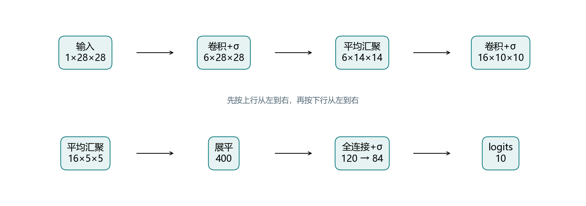
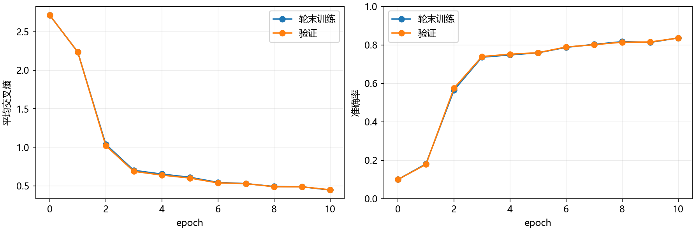
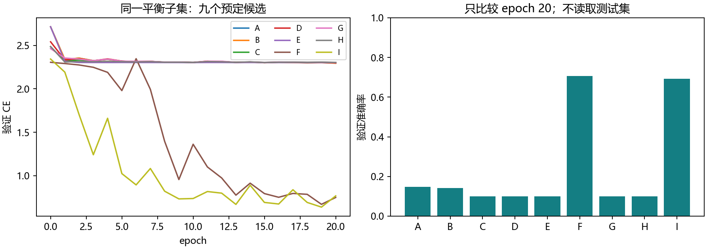
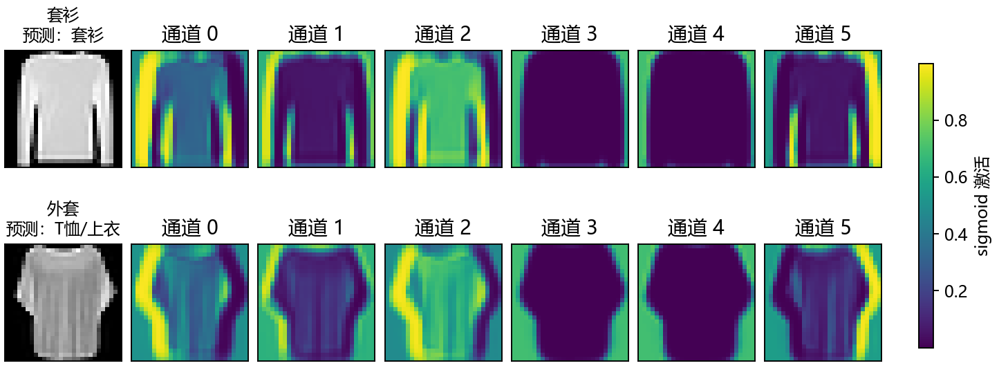
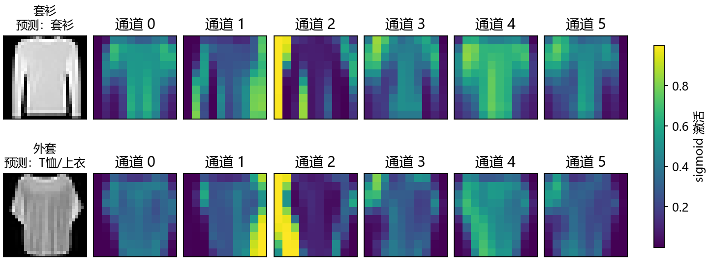

# 6.6 卷积神经网络（LeNet）· 原理与复现实验

覆盖教材 6.6.1、6.6.2 和四道节末练习，教材 PDF 第 258-264 页、正文第 240-246 页。先把 6.1-6.5 接成完整图像分类系统，再逐步构造、训练、评估和观察。已有 openmmlab、PyTorch 2.4.1+cu121、RTX 4060 Laptop GPU，无安装或升级。教师实测与学习者掌握分开记录。

## 01 把局部特征连接成整张图的判断

3 章的 softmax 回归把图像展平成 784 个像素，4 章 MLP 再加入隐藏层和非线性。6.1-6.5 保留像素的二维邻接关系，用共享的局部卷积检测图案，用多个通道表达不同响应，再用汇聚缩小空间。现在需要把这些响应变成十个类别的得分。



前半段逐层提取表示，后半段展平并分类。所有含权重的层共同接受最终交叉熵的梯度，卷积核由类别监督学出来，无须手工指定为“边缘核”。

<!-- side -->

### 本节知识链

先追踪 NCHW 形状，理解高宽、通道和参数为何变化；再说明非线性、logits、损失和反传。数据划分与评估方法确定后，才能解释训练结果。

第 13 页开始指导操作。先做形状检查，再写核心流水线，随后复现正式训练、受控对照和激活可视化，最后填写八处练习。

### 教材实现与历史模型

本节复现教材的 LeNet 风格 PyTorch 网络。1998 年 LeNet-5 的 C3 部分连接、可训练下采样和 RBF/Gaussian 输出头，与这里的全连接通道 Conv2d、标准平均汇聚和 logits 头存在差别。

来源：[教材 LeNet 小节](https://zh.d2l.ai/chapter_convolutional-neural-networks/lenet.html)、[LeCun 等 1998 年论文](http://yann.lecun.com/exdb/publis/pdf/lecun-98.pdf)。

<!-- pagebreak -->

## 02 先算清每一层的形状

输入为 (N,1,28,28)，N 是本批图像数，1 是灰度通道。卷积沿空间滑动，同时混合输入通道。汇聚则逐通道汇总，保留 N 和通道数。

| 操作 | 每张图的输出 | 尺寸与含义 |
| --- | --- | --- |
| Conv2d(1,6,5,padding=2) + sigmoid | 6×28×28 | (28+4−5)//1+1=28 |
| AvgPool2d(2,2) | 6×14×14 | (28−2)//2+1=14 |
| Conv2d(6,16,5) + sigmoid | 16×10×10 | (14−5)//1+1=10 |
| AvgPool2d(2,2) | 16×5×5 | (10−2)//2+1=5 |
| Flatten | 400 | 16×5×5=400 |
| Linear(400,120) + sigmoid | 120 | 混合所有空间位置和通道 |
| Linear(120,84) + sigmoid | 84 | 再组合隐藏特征 |
| Linear(84,10) | 10 | 十类原始得分 |

<!-- side -->

### Flatten 不改变图像数量

nn.Flatten() 默认从第 1 维展平，把 (N,16,5,5) 变为 (N,400)。它不引入参数，也没有平均操作。若把批量轴一起展平，后面将无法逐张计算损失。

第二个卷积的每个输出通道有六片 5×5 核，先对六个输入通道的响应求和，再加一个偏置。16 个输出通道叠放起来，正好接上 6.4。

### 为什么改核后要重算 Linear

若两个核都改为 3×3，首层 padding=1 保持 28，第二个卷积输出 12×12，汇聚后是 16×6×6。分类头输入必须改为 576。卷积支持可变高宽，不代表固定宽度的 Linear 也支持任意图像尺寸。

<!-- pagebreak -->

## 03 参数共享、运算量和感受野

含偏置卷积的参数量为 Cout×(Cin×kh×kw+1)，与输出高宽无关。Linear 的参数量为 输出宽度×(输入宽度+1)。

| 层 | 参数量 | 单图权重乘法次数 |
| --- | --- | --- |
| 卷积 1 | 6×(1×25+1)=156 | 6×28×28×25=117600 |
| 卷积 2 | 16×(6×25+1)=2416 | 16×10×10×150=240000 |
| 全连接 1 | 120×401=48120 | 48000 |
| 全连接 2 | 84×121=10164 | 10080 |
| 输出层 | 10×85=850 | 840 |
| 合计 | 61706 | 416520 |

汇聚、sigmoid 和 Flatten 没有可训练参数。MLP 784→256→10 有 203530 个参数、203264 次权重乘法；本网络参数更少，乘法更多，因为共享卷积核会在许多位置重复使用。

<!-- side -->

### 这些计数不能当速度测试

表中只计权重乘法，另有 6518 次偏置加法，还未计卷积累加、sigmoid、汇聚、反传及传输。不同算子可并行程度和硬件实现不同，不能直接用参数量预测运行时间。

### 一格深层响应看到多大范围

令 r 为理论感受野边长，j 为相邻输出在原图中的间距。起点取 r=1 和 j=1。每层先更新 r←r+(k−1)j，再更新 j←js。

两次卷积与两次汇聚依次得到：

```text
(r,j): (5,1) → (6,2)
       → (14,2) → (16,4)
```

第二次汇聚的一格理论覆盖原图 16×16 区域，边界部分可能落在填充上。全连接头又联合利用所有格子，模型整体并不保证严格平移不变。

<!-- pagebreak -->

## 04 从特征到 logits，再到交叉熵

卷积和全连接都对输入做仿射变换，sigmoid 将每个数映射到 (0,1)。若连续仿射层之间没有非线性，可以合并为一次仿射；这里的 sigmoid 使分层表示具有更丰富的表达能力。平均汇聚本身是线性的，最大汇聚则是非线性的。

输出层只做 Linear(84,10)，得到 z=(z0,…,z9)。logits 是原始得分，可以为负，也无须加起来为 1。softmax 通过 exp(zj)/Σexp(zk) 得到类别概率，预测类别直接取 logits 的 argmax 即可。

真实标签为类别索引 y 时，一张图的交叉熵为 L=logΣexp(zk)−zy。框架使用稳定的计算方式，直接调用 F.cross_entropy(logits,y)。默认返回本批样本的平均损失。

对于一张样本，有 ∂L/∂zj=pj−1[j=y]；批量平均再除以本批样本数。这把类别预测误差传给输出层，再沿分类头、汇聚和卷积逐层传回。

<!-- side -->

### 最后一层为何没有 sigmoid

十类互斥分类使用十个 logits 和一个 long 类型标签。若先 sigmoid 或 softmax，再送入 CrossEntropyLoss，框架会把这些数再次当作 logits，优化的目标随之改变。

显示概率时才需要额外计算 softmax。准确率直接用 argmax 取得预测类别即可。

### 激活值不等于类别概率

中间某通道的 sigmoid 数值表示该单元的响应。它不是“属于某类的概率”，也不能仅凭亮区就断言通道检测了领口或袖子。

ReLU=max(0,x) 在正区间导数为 1，减少正区间的饱和问题；负区间梯度为 0，仍可能出现无响应单元。换激活后需一起检查初值与步长是否合适。

<!-- pagebreak -->

## 05 反传、初始化和更新组成同一个循环

反向传播计算当前参数下的梯度，SGD 再执行 θ←θ−η∇θL。每批先清除旧梯度，然后前向计算 logits 和平均 CE。接着调用 backward，最后调用 step。这里已经在损失中平均，更新时不再除批量大小。

卷积核在多个位置使用，反传时同一权重收到的贡献需要相加。平均汇聚无须学习参数。它将梯度传给窗口内各格，使前面的卷积核能够学习。Flatten 则将梯度按原形状排回。

本节 Xavier uniform 使用 gain=1：权重在 ±√(6/(fan_in+fan_out)) 内均匀采样。Conv2d 的 fan 包含核面积。显式将偏置设为零；教材示例只重设权重、保留默认偏置，这是本项目为便于比较作的控制差异。

Sigmoid 导数 σ(x)(1−σ(x)) 最大为 1/4，深层连乘时可能出现很小的梯度。初值、学习率和训练步数共同影响能否进入有效学习阶段，不能只凭训练准确率低就判断表达能力不足。

<!-- side -->

### epochs 和更新次数有何关系

一轮是把训练集遍历一次。54000 张图、batch256 每轮有 211 批，最后一批 240 张；十轮共 2110 次更新。

2000 张子集每轮只有 8 批，二十轮仅 160 次更新。两者不能只按“十轮、二十轮”比较优化预算。

### ReLU 初始化对照

候选 I 的隐藏 Conv2d/Linear 使用 Kaiming uniform、ReLU 增益，最后 logits 层仍使用 Xavier gain1，所有偏置为零。

这套初值与候选 F 的 Xavier 初值不同。初始化是控制信号与梯度尺度的办法，并不能保证每次运行、每个检查点的验证指标都更优。

<!-- pagebreak -->

## 06 数据、设备与指标决定怎样解释结果

沿用第 3 章划分：用种子 3601 在每类内部打乱，从官方训练集每类取 600 张做验证，共 6000；余下 54000 张训练。官方测试集 10000 张留到预定方案结束后评估。输入 uint8 转为新的 float32 NCHW 张量再除以 255，原始文件不改写。

训练加载器种子 3603，每轮继续打乱，保留尾批，num_workers=0。模型在 CPU 内用种子 6600 初始化，再整体迁移设备，然后创建优化器。图像和 long 标签逐批放到相同设备。

在线训练 CE 来自一轮中不断变化的模型；轮末训练 CE 则用该轮结束后的同一个模型重新评估整个训练集。二者不能混为一条统计量。验证 CE 和准确率都按实际样本数加权，不把尾批当作完整批平均。

评估先 net.eval()，再 no_grad()。前者切换模块行为，后者关闭梯度记录。本网络没有 Dropout 或 BatchNorm，模式切换仍应按规范保留，便于后续扩展。

<!-- side -->

### 本机复现条件

Python 3.8.20、torch 2.4.1+cu121，RTX 4060 Laptop GPU，float32。开启确定性算法，关闭 TF32 和 cuDNN benchmark，CUBLAS_WORKSPACE_CONFIG=:4096:8。

同一软件与硬件配置用于固定实验；换设备或版本可能有浮点差异。报告保留划分和初值哈希，便于判断数据、结构与起点是否对齐。

### 数据职责

训练集更新参数；验证集比较配置；测试集只评价预先确定的完整方案。九候选小实验不读取测试集。完整基线和预定 MNIST 双方案各在结束时评估测试集，不根据测试结果重新挑配置。

数据和权重留在本地，GitHub 同步代码、配置、统计和图。教师运行成功只说明工程复现完成。

<!-- pagebreak -->

## 07 完整基线的十轮实测



基线使用平均汇聚、sigmoid、Xavier/零偏置、SGD lr=.9、batch256，十轮 2110 次更新。初始验证 CE=2.715297，最终训练 CE=.444909、验证 CE=.448216，验证正确 5013/6000=83.55%。

固定十轮结束后，官方测试 CE=.473045、正确 8255/10000=82.55%。最终在线训练 CE=.468627，与轮末训练 CE 不相同，原因是统计时使用的参数不同。

<!-- side -->

### 怎样读这条曲线

前两轮进展较慢，随后明显下降。训练与验证 CE 大体接近；本次曲线没有给出强烈的持续过拟合证据，但不能据十个点保证未来训练不会过拟合。

测试准确率描述这一次固定方案的结果。不能拿它与第 4 章某次不同起点、不同结构的单次结果直接比较，就断定 CNN 或 MLP 普遍更好。

### 可以直接检查的报告

reports/ch06/6_6_metrics.json 保存配置、划分、每轮指标、最终测试和恢复误差；6_6_epochs.csv 便于逐轮查看。

本地检查点在 artifacts/ch06/6_6_lenet.pt。CPU 恢复后的 32 张验证图 logits 与 CUDA 最大差 4.77e-6，低于本节设定的 1e-4 容差。

<!-- pagebreak -->

## 08 先规定对照，再看结果

固定训练子集每类 200 张、验证子集每类 100 张，分别用种子 6601、6602 从原划分抽取。所有候选 batch256、二十轮、160 次更新，用 epoch20 验证 CE 比较。

| 候选 | 相对基线的改动 | 参数量 |
| --- | --- | --- |
| A | 平均汇聚、sigmoid、lr=.9 | 61706 |
| B | 仅改最大汇聚 | 61706 |
| C | 两个核改 3×3，首层 pad1 | 81194 |
| D | 通道改 8、24 | 88166 |
| E | 仅将 lr 改为 .1 | 61706 |
| F | 在 E 基础上将激活改 ReLU | 61706 |
| G | 第二次汇聚前加 16→16 的 3×3 卷积 | 64026 |
| H | 分类头隐藏宽度改 120、84、32 | 63906 |
| I | F 的隐藏层改 Kaiming 初始化 | 61706 |

<!-- side -->

### 什么才是单因素比较

A/B 只改变汇聚，A/E 只改变学习率，E/F 只改变激活，F/I 只改变初始化。A/B/E/F 的参数初始哈希相同，但相同参数不表示激活输出或训练轨迹相同。

改核、通道或深度时参数形状改变，无法声称全部权重完全一致。统一种子、划分与批次顺序仍能减少额外差异。

### 小核不必然减少总参数

C 的卷积核更小，第二次汇聚后却为 16×6×6，第一层全连接输入由 400 增为 576，总参数随之增加。这是先推导形状再谈模型复杂度的原因。

本页各配置在教师代码 candidates() 中明确列出，包含所有教材第 2 题要求修改的类别。

<!-- pagebreak -->

## 09 有限预算下的真实比较



| epoch20 | A | B | C | D | E |
| --- | --- | --- | --- | --- | --- |
| 验证 CE | 2.29653 | 2.29548 | 2.30357 | 2.29927 | 2.30288 |
| 准确率 | 14.7% | 14.1% | 10.0% | 10.0% | 10.0% |

| epoch20 | F | G | H | I |
| --- | --- | --- | --- | --- |
| 验证 CE | .74912 | 2.30396 | 2.30449 | .76725 |
| 准确率 | 70.7% | 10.0% | 10.0% | 69.2% |

<!-- side -->

### 用结果检验解释

按预定规则选择 F。只表示这九个候选、当前子集、起点和预算中的比较，不称全局最优。E/F 显示当前条件下 ReLU 配置更快进入有效学习；不能外推为所有任务的必然规律。

A/B 的 CE 从第 10 轮 2.30362/2.30350 到第 20 轮 2.29653/2.29548，改善很小。B 的 CE 略低，准确率也略低。两项指标不一定同方向变化。

### 为什么不临时改成最好的一轮

F 在第 19 轮验证 CE=.67000，第 20 轮反而升到 .74912；I 的第 19 轮 .63794 也低于第 20 轮 .76725。说明训练有波动，Kaiming 也不保证每点更优。

本次坚持预定 epoch20 规则。若采用早停，应在训练前写清验证选择规则，并为多次选择留下独立评估边界。

<!-- pagebreak -->

## 10 第一层激活怎样随输入改变



这里显示的是激活图：每个数都由输入窗口、学习到的核与偏置共同决定，再经过 sigmoid。卷积核是模型参数，激活图是特定图像经过模型时产生的中间结果，二者形状与含义不同。

按预定规则，选择验证划分中类别 2 和 4 的第一张图，原官方训练索引为 47684、39525。模型分别预测为套衫和 T恤/上衣，第二张是一次实际误判，没有按预测正确与否筛选图像。

<!-- side -->

### 怎样比较亮暗

本层完整张量为 (2,6,28,28)，展示全部六个通道。两张图所有通道共用 vmin≈3.37e-7、vmax≈.998945，颜色可在本层内比较。

若每张小图都自动缩放，微弱响应也可能变成最亮颜色。这样便容易误认为不同通道的响应强度相同。

### 能观察什么，不能直接推出什么

可以比较同一通道对两张输入的空间响应，留意轮廓附近与背景中的差异。sigmoid 可能将较大的正/负卷积值压向 1/0。

这两张图无法证明一个通道专门识别某类，也无法解释整套分类决策的全部原因。需要更多样本或有控制的输入干预才能检验具体假设。

<!-- pagebreak -->

## 11 第二层把哪些信息组合起来



第二层的输入已经经过第一次卷积、非线性和汇聚，每个输出位置又对六个通道的 5×5 邻域加权求和。因此它不再只是读取原始像素，而是在较粗网格上组合前层响应。

本层完整张量为 (2,16,10,10)，图中固定展示前六个通道。当前理论感受野为 14×14。第二次汇聚将它扩大为 16×16。深层空间格子减少，但一格对应的原图范围更大。

<!-- side -->

### 色标与分辨率

本层两张图的全部 16 个通道共同确定色标，vmin≈2.18e-5、vmax≈.999786。色标与前页分别计算，跨层比较时必须同时看数值，不能仅按颜色判断幅度。

通道 6-15 没有画出，不能把图中六个通道称作第二层全部特征。

### 怎样接上最终误判

观察到两张输入的响应不同，只说明网络表示依赖输入。后面的平均汇聚和全连接会联合读取 16 个通道的全部位置，单独一幅亮图不能充分解释外套为何误判为上衣。

复现时先核对层切片：net[:2] 到第一 sigmoid，net[:5] 到第二 sigmoid。不要把汇聚后输出误标为汇聚前激活。

<!-- pagebreak -->

## 12 把预定方案迁移到 MNIST

教材第 3 题要求在 MNIST 上尝试改变。数字与服饰都是 1×28×28、十类输入，结构接口可复用，但语义、样本分布和任务难度不同。本次使用同样划分规则，每类 600 张验证，其余共 54000 张训练，官方测试 10000 张。

提前固定 A、F 两配置，各训练五轮、1055 次更新。A 为 sigmoid/lr=.9；F 为 ReLU/lr=.1，两者都是平均汇聚、Xavier/零偏置。两者改变了激活和学习率，应作为组合方案比较。

| MNIST 五轮 | A | F |
| --- | --- | --- |
| 轮末训练 CE | .298946 | .096659 |
| 验证 CE / 准确率 | .293954 / 91.08% | .107286 / 96.63% |
| 最终测试 CE | .286667 | .100847 |
| 测试正确数 / 10000 | 9099 | 9684 |

<!-- side -->

### 本次迁移说明什么

F 在这次五轮预算中结果更好；由于同时改变两个因素，不能把差异全部归因于 ReLU。若要单独研究激活，应增加同学习率、同初值的配对。

A 的前两轮验证仍为 10%，第三轮到 72.15%，第五轮到 91.08%。短时间接近随机水平不证明网络永远学不会。

### 数据与测试边界

本机此前没有 MNIST，本轮从 torchvision 标准 OSSCI 镜像准备至 data/MNIST/raw，并核对官方归档 MD5。代码默认 download=False，不自动获取数据。

两配置各在最终固定模型上测试一次，结果单独记录在 6_6_mnist_metrics.json。不要将 MNIST 与 Fashion-MNIST 的准确率差直接当成某种结构的因果收益。

<!-- pagebreak -->

## 13 操作一：定位文件，先检查形状

用 VS Code 打开本项目工作区，在项目根目录终端运行。教师文件为 lessons/ch06/06_lenet.py，练习为 exercises/ch06/06_lenet.py。解释器复用已有 openmmlab。

```powershell
$pythonPath = 'D:\Anaconda\envs\openmmlab\python.exe'
$env:PYTHONUTF8 = '1'
& $pythonPath lessons/ch06/06_lenet.py --inspect --guided
```

这条命令不读取数据，也不训练。应显示 (2,6,28,28)、(2,6,14,14)、(2,16,10,10)、(2,16,5,5)、(2,400)，最后 (2,10)。总参数为 61706，单图权重乘法为 416520。

在项目 .cache 文件夹新建 6_6_follow.py。第 14-16 页代码按顺序写入同一个文件，下面是开头：

```python
import runpy
from pathlib import Path
import torch
from torch import nn
from torch.nn import functional as F
ROOT = Path.cwd()
helper = runpy.run_path(str(
    ROOT / "lessons/ch06/06_lenet.py"))
device = helper["configure"]("auto")
```

<!-- side -->

### 先预测，再运行

先口头推导两次汇聚后的形状和 Flatten 的 400，从公式核对代码。只看输出行并不能说明已经理解为什么是这个尺寸。

runpy.run_path 读取教师文件中定义的函数，返回按名称查找的字典，不会执行 main 训练。这里只借用数据读取与设备配置，核心模型和训练循环由你在跟做文件中写出来。

### 路径必须从项目根目录出发

示例通过 Path.cwd() 获取当前目录。请在项目根目录打开终端。若找不到 lessons 或 data，先检查终端位置，再检查文件名。

原始 Fashion-MNIST 在 data/FashionMNIST/raw，只读使用。若另一台电脑已有数据，可用项目 tools/prepare_fashion_mnist.py 按 README 的来源参数准备；不要改写本机共享的原始文件。

<!-- pagebreak -->

## 14 操作二：亲手组装并初始化

把下面代码接在同一个跟做文件末尾。Sequential 按顺序传递上层输出；同一个类构造出的不同实例拥有各自参数，sigmoid 和汇聚没有参数。

```python
torch.manual_seed(6600)
net = nn.Sequential(
    nn.Conv2d(1, 6, 5, padding=2), nn.Sigmoid(),
    nn.AvgPool2d(2, 2),
    nn.Conv2d(6, 16, 5), nn.Sigmoid(),
    nn.AvgPool2d(2, 2), nn.Flatten(),
    nn.Linear(400, 120), nn.Sigmoid(),
    nn.Linear(120, 84), nn.Sigmoid(),
    nn.Linear(84, 10))
for layer in net:
    if isinstance(layer, (nn.Conv2d, nn.Linear)):
        nn.init.xavier_uniform_(layer.weight, gain=1.)
        nn.init.zeros_(layer.bias)
X = torch.zeros(2, 1, 28, 28)
with torch.no_grad():
    for layer in net:
        X = layer(X)
        print(type(layer).__name__, tuple(X.shape))
print("参数", sum(p.numel() for p in net.parameters()))
```

<!-- side -->

### 必要语法逐项理解

for layer in net 按顺序取出每一层；isinstance 的第二个参数是类型元组，表示只初始化卷积或全连接。其他层没有权重，不需要同样处理。

sum 中的生成表达式逐个取得参数张量的元素数，再相加。它统计可训练参数，不统计每一批激活张量。

### 改一个参数核对

先只把两次平均汇聚都改为 MaxPool2d，形状和参数数应不变，数值规则改变。然后撤销改动，继续后面的基线跟做。

若把第二个卷积核改为 3，预测汇聚后是 16×6×6；把 Linear 输入改为 576 才能接上。教师工厂会按公式计算这个宽度，手写时需要你自己负责。

<!-- pagebreak -->

## 15 操作三：读取小批量并真正更新

继续接在跟做文件末尾。先用 37 张训练图走三轮，流程确认后再跑完整实验。图像标签均来自训练/验证划分，不读取官方测试集。

```python
splits, _ = helper["load_data"](include_test=False)
train = helper["balanced_subset"](
    splits["train"], 37, 6601)
validation = helper["balanced_subset"](
    splits["validation"], 20, 6602)
loader = helper["make_loader"](
    train, shuffle=True, batch_size=8)
net = net.to(device)
optimizer = torch.optim.SGD(net.parameters(), lr=.9)
for epoch in range(3):
    net.train()
    total, updates = 0., 0
    for X, y in loader:
        X, y = X.to(device), y.to(device)
        optimizer.zero_grad(set_to_none=True)
        logits = net(X)
        loss = F.cross_entropy(logits, y)
        loss.backward()
        optimizer.step()
        total += loss.item() * len(y)
        updates += 1
    print(epoch + 1, total / len(train), updates)
```

<!-- side -->

### 把循环与公式对应

net(X) 是前向，loss 是批平均 CE；backward 计算梯度，step 执行一次 SGD。zero_grad 每批调用，避免上批梯度继续累加。

loss.item() 取出用于日志的 Python 数，乘 len(y) 恢复该批样本损失总和，最后除 37。不能将各批平均损失直接相加后除以 5，因为最后一批只有 5 张。

### 应得到什么

每轮五次更新，批量为 8/8/8/8/5，三轮共 15 次。最后 logits 的形状为 (5,10)，标签为 long/(5,)。每轮打印一个有限 CE 和 updates=5。

这里只验证程序流程，不要求三轮的小样本 Sigmoid 网络有高准确率。先检查形状、损失是否有限和更新是否发生，再考虑延长训练或调整配置。

<!-- pagebreak -->

## 16 操作四：评估与恢复模型

继续接到跟做文件末尾。验证的 20 张图在这里放入一个批量；完整教师评估函数会分批求总损失与总正确数，再除以实际样本数。

```python
val_loader = helper["make_loader"](
    validation, batch_size=20)
net.eval()
with torch.no_grad():
    X, y = next(iter(val_loader))
    logits = net(X.to(device)).cpu()
    ce = F.cross_entropy(logits, y).item()
    correct = (logits.argmax(1) == y).sum().item()
print("验证 CE/正确数", ce, correct, "/20")
path = ROOT / ".cache/6_6_follow.pt"
torch.save(net.state_dict(), path)
restored = helper["build_net"]()
state = torch.load(path, map_location="cpu",
                   weights_only=True)
restored.load_state_dict(state)
restored.eval()
with torch.no_grad():
    error = (restored(X) - logits).abs().max().item()
print("CPU 恢复 logits 最大差", error)
assert error < 1e-4
```

<!-- side -->

### 运行自己的完整跟做文件

```powershell
& $pythonPath .cache/6_6_follow.py
```

应依次看到逐层形状、参数61706、三轮有限损失和验证指标。恢复误差应低于 1e-4；CPU 对 CPU 一般可完全一致，CUDA 与 CPU 的浮点累加可能有微小差异。

### 权重文件没有保存什么

state_dict 保存参数值，不自动保存模型结构或本页局部变量。恢复前必须构建相同结构。这里用教师 build_net 重建基线，再载入当前值；重建时的新初值会被状态覆盖。

教师正式检查点另外记录配置、优化器与划分信息。本节只验证恢复预测，不宣称已经精确恢复加载器的随机状态来无缝续训。

<!-- pagebreak -->

## 17 操作五：复现正式实验和预定对照

```powershell
# 先在 CPU 用极小子集确认完整入口
& $pythonPath lessons/ch06/06_lenet.py --device cpu `
  --epochs 1 --train-size 37 --validation-size 20 `
  --guided --record
# 正式 Fashion-MNIST：十轮并生成图与报告
& $pythonPath lessons/ch06/06_lenet.py --guided --record
# 九候选：2000/1000 子集，不评估测试集
& $pythonPath lessons/ch06/06_lenet.py `
  --experiments --guided --record
# MNIST：预定 A/F 各五轮
& $pythonPath lessons/ch06/06_lenet.py --mnist `
  --guided --record
```

短运行的报告为 reports/ch06/6_6_custom_metrics.json、6_6_custom_epochs.csv，本地模型带 custom 前缀，不覆盖正式 6_6_metrics.json 和配图。正式结果与本手册第 7 页核对，变体与 MNIST 分别核对第 9、12 页。

<!-- side -->

### 参数的含义与运行顺序

--device auto 默认有 GPU 时使用 CUDA，否则 CPU。--record 才写报告和模型；不加此项只运行并打印。--guided 输出中文导读，省略时在进度行后打印完整 JSON。

--inspect、--experiments、--mnist 三种模式互斥。预定对照不接受 --epochs 或子集参数，避免误把自定义结果覆盖到固定协议报告。

### 另一台电脑准备 MNIST

如已有四个原始 IDX 文件，放在项目 data/MNIST/raw。若尚无数据，在项目根目录用现有 torchvision 显式准备一次：

```powershell
@'
from torchvision.datasets import MNIST
for training in (True, False):
    MNIST("data", train=training,
          download=True)
'@ | & $pythonPath -
```

整体复制此代码块到终端。MNIST 使用 torchvision 已知镜像与官方 MD5；教师主程序始终离线读取。数据不提交 Git。

<!-- pagebreak -->

## 18 综合练习：自己接通八个位置

打开 exercises/ch06/06_lenet.py，按三个阶段填写。练习使用 CPU、37 张训练图、20 张验证图；模型改为 ReLU、单隐藏层 32，学习率 .1，三轮训练。与正式基线不同，不能照搬十轮准确率作为练习目标。

| 阶段 | 待填写 | 核对目标 |
| --- | --- | --- |
| 模型 | 1-2 卷积、3 展平 | 两次汇聚为 6×14×14 和 16×5×5，输出 (8,10) |
| 训练 | 4 优化器、5 平均 CE、6 反传、7 更新 | 三轮 15 更新，尾批 5，损失有限 |
| 评估 | TODO 8 每行 argmax | 20 个类别索引，打印验证正确数 |

```powershell
& $pythonPath exercises/ch06/06_lenet.py
```

未填写时脚本只提示当前阶段，不代填作业。模型阶段完成后应统计 15734 个参数。每次只补一个阶段，解释该阶段输出，再继续后面的空位。

<!-- side -->

### 交回什么信息

集中反馈两次汇聚后的形状、总参数、三轮损失、更新次数和验证正确数，并说明它们分别检验什么。参数与形状应精确一致，损失和准确率允许随环境有差异。

解释为什么输出不加 softmax、平均 CE 后不能再除以批量，以及评估为何同时写 eval 与 no_grad。

### 需要提示时从哪里看

模型尺寸回看第 2、14 页；训练顺序看第 5、15 页；标签和预测看第 4、16 页。先用提示定位问题，不直接把完整教师程序替换进练习。

原文件八处 TODO 保持留空。尚未收到你的作答，所以当前只记录“材料与教师验证完成”，不记录已经独立掌握。

<!-- pagebreak -->

## 19 教材练习一、二：带着假设改网络

第 1 题平均改最大汇聚：运行预定 A/B 对照，先预测形状和参数量是否改变，再查看验证 CE 与准确率。本次两者差距很小，不能把 0.00105 的 CE 差说成可靠普遍优势。若继续研究，可预先增加多个模型种子，报告均值和离散程度。

第 2 题的修改均有可运行配置：C 改核，D 改通道，E 改学习率，F 改激活，G 增卷积，H 增全连接，I 改初始化；A/B 的第十与二十轮用于比较训练时长。

如需自行扩展，在 .cache 新建 6_6_variant.py，沿用第 13 页的导入和 helper 字典，然后写：

```python
cfg = dict(helper["BASE"], pool="max")
print(helper["inspect_net"](cfg))
# 确认形状后，在与基线相同的 splits 上训练
small = dict(train=train, validation=validation)
result, candidate, _ = helper["fit"](
    cfg, small, 3, device, "my-max", use_test=False)
print(result["history"][-1])
```

<!-- side -->

### 怎样让这个扩展独立运行

先复制第 13 页导入，以及第 15 页定义 splits、train、validation 的五行准备代码，再加本页片段。不要复制已经更新过的 net，fit 会重新初始化候选并创建自己的优化器和加载器。

small 此处只有 37/20，三轮 3 次更新，作为接口检查。正式九候选使用 2000/1000 和二十轮；两种预算需要区分。

### 每次实验写清五件事

先说明假设和只改的因素，再记录结构、数据划分、初始化、学习率与更新次数；最后用验证指标检验假设，并写下局限。

增加卷积层会延长梯度链，增加通道会改变容量和计算量；缩小核可能扩大展平宽度。把这些连到实际形状、梯度和训练预算上解释，而不是笼统说“更复杂就更好”。

<!-- pagebreak -->

## 20 教材练习三、四与排错顺序

第 3 题在 MNIST 上试修改：先按第 17 页准备并离线运行 --mnist，对照第 12 页。若继续研究单个因素，在 .cache 的扩展文件将 load_data 改为 dataset="mnist"，保持其他配置、划分、步长和轮数一致，先只比较验证集。

第 4 题观察套衫和外套的第一、第二层激活：正式 --record 已生成两图。也可在自建文件选择固定样本，eval 和 no_grad 下用 net[:2]、net[:5] 取响应；用 detach().cpu() 交给绘图工具。先说明截取层、张量形状、通道范围和色标，再描述观察。

| 现象 | 优先检查 |
| --- | --- |
| mat1 与 mat2 形状不匹配 | 卷积/汇聚后高宽、Flatten 宽度、Linear 输入 |
| CPU/CUDA 设备不一致 | 模型、X、y 的 device；先迁移再建优化器 |
| 标签类型或维度报错 | y 为 long/(N,)，logits 为 (N,10) |
| loss 非有限或长期不降 | 像素范围、logits、清梯度、实际更新、初值/步长 |
| 找不到数据或文件 | 根目录、data 下四个 IDX 文件、所选解释器 |

<!-- side -->

### 完整知识链集中回顾

为什么一张灰度图可以变成六个通道？为什么汇聚不引入参数却允许卷积学习？400 从哪里来？为什么 61706 个参数仍可能比 MLP 做更多乘法？

用一句连贯的话解释：输入网格经过共享局部映射、非线性和降采样形成特征，再经分类头输出 logits，交叉熵把类别误差沿整条链传回，SGD 更新所有权重。

### 下一步

完成练习后集中反馈运行结果和无法解释的地方；旧题未作答的状态保留。下一块是第 7 章导读，教材 PDF265/正文247，再进入 7.1 AlexNet，PDF266/正文248。

本节配套代码、报告和本手册同步 GitHub；原教材、图像数据、缓存及模型权重均留在本地。
