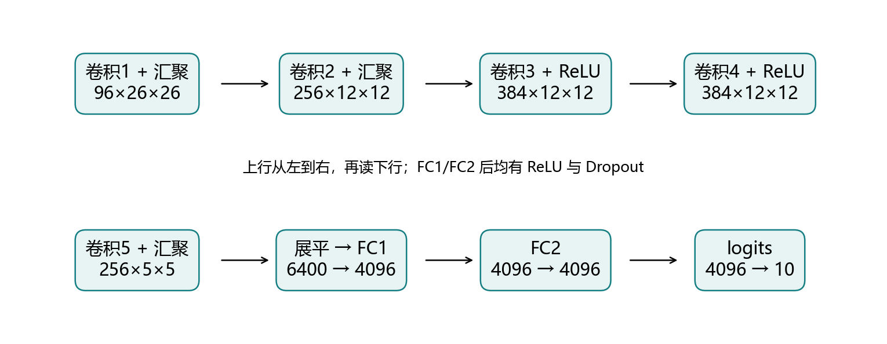
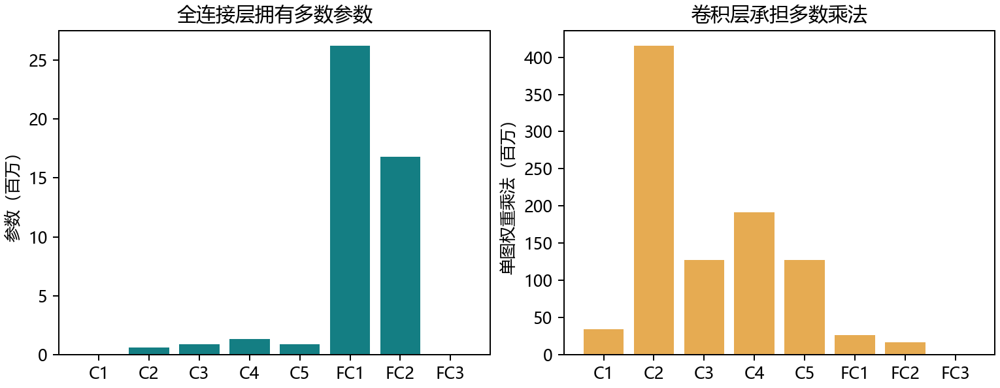
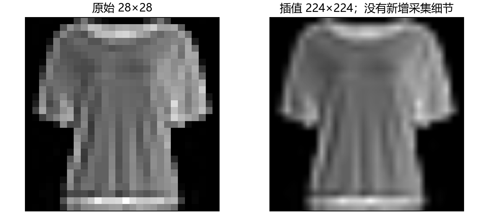
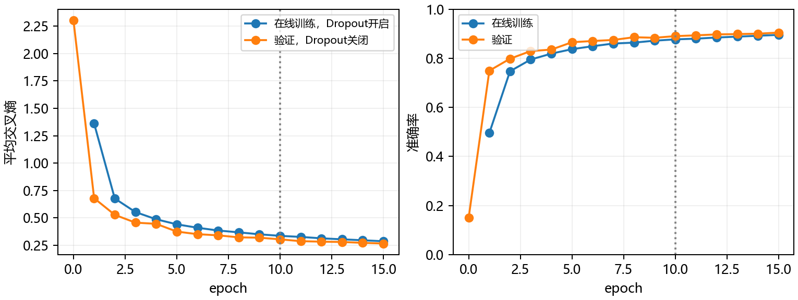
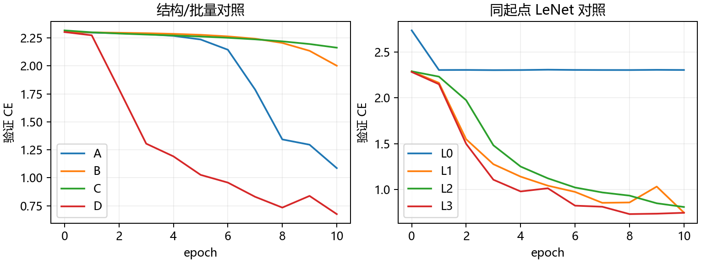
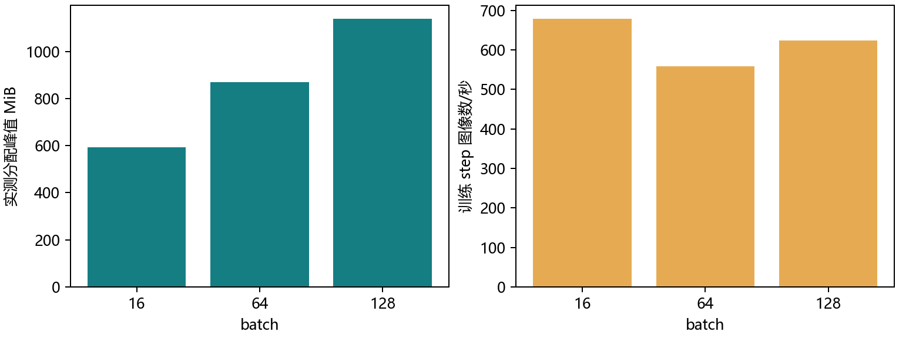

# 7.1 深度卷积神经网络（AlexNet）· 原理与复现实验

包含第7章导读和7.1.1-7.1.4，以及五道教材练习及子题。教材PDF265-273/正文247-255，273页只取7.1题目，后面7.2另学。沿用已有openmmlab与Fashion-MNIST，不安装、不升级、不下载ImageNet。先连续讲清知识链，再指导操作和复现。

## 01 从会训练 LeNet 到学习现代架构

6.6 已把卷积、激活、汇聚和分类头连成完整分类系统。第7章研究如何组织更多层：AlexNet扩展深度与宽度，VGG重复同类块，NiN用1×1卷积混合通道，GoogLeNet并行提取不同尺度，ResNet加入跨层相加，DenseNet连接多层特征。

这些结构各自回答计算、表示或优化中的问题，并不意味着把网络堆得更大就一定更好。后面还会学习批量规范化，帮助理解深层网络的训练条件。本节先用AlexNet观察深度、数据和计算资源怎样相互制约。

传统视觉流水线常由人设计描述子，再训练分类器，例如SIFT、HOG与核方法。端到端神经网络将特征提取器也设为可训练映射，分类损失的梯度同时调整低层卷积与高层分类头。人仍需选择结构、数据、目标和评估方法。

<!-- side -->

### 历史突破包含哪些条件

AlexNet赢得2012年ImageNet竞赛，推动了大规模视觉识别中的分层表示学习。数据规模、GPU计算与训练方法共同促成这一结果；激活、初始化和正则化都是其中的条件。

不要把“底层边缘、高层物体”当成每个通道的固定标签。网络学到的是有助于训练目标的表示；具体通道的作用需要用数据和干预检验。

### 本节复现的边界

本节是教材的单通道、十类AlexNet风格模型。原论文使用RGB/ImageNet，并有双GPU分组连接、局部响应归一化和更丰富的数据增强等设计。本项目没有复现原论文竞赛成绩。

来源：[教材7.1](https://zh.d2l.ai/chapter_convolutional-modern/alexnet.html)、[2012年论文](https://papers.nips.cc/paper/4824-imagenet-classification-with-deep-convolutional-neural-networks)。

<!-- pagebreak -->

## 02 八层指哪些层，信息怎样向前流动



“八层”按含权重的层计数：五个卷积层，两个全连接隐藏层，一个全连接输出层。ReLU、三次最大汇聚、Flatten和两次Dropout也参与计算，但不计入这个层数，更不能说成八个卷积层。

第一层用11×11核、步幅4，快速降低高宽；第二层用5×5核；后面连续三个3×3卷积，逐步组合已有响应。通道依次为96、256、384、384、256，每个输出通道都混合前层全部输入通道。

<!-- side -->

### 与 LeNet 的连续关系

两者都遵循“局部特征提取→空间汇总→全局分类”。AlexNet扩大通道与隐藏宽度，增加卷积层，把sigmoid改为ReLU，把平均汇聚改为最大汇聚，并在全连接隐藏层后使用Dropout。

前两个卷积块后各汇聚一次，中间三个3×3卷积之间不汇聚。这样可以在同一网格上继续提取特征，最后再降采样。

### 训练目标仍然熟悉

最后Linear输出十个logits，直接送入交叉熵。输出头不加ReLU、sigmoid或softmax。每张图的类别预测用argmax，long标签形状为(N,)。整条网络由同一个分类损失反传训练。

<!-- pagebreak -->

## 03 从 224 逐层推导到 6400

本节使用dilation=1、ceil_mode=False。每方向输出为(输入+两侧总填充−核尺寸)//步幅+1，向下取整的规则继续沿用6.3。

| 含权重层或汇聚 | 单图输出 | 高宽推导 |
| --- | --- | --- |
| Conv1：11×11、stride4、pad1 | 96×54×54 | (224+2−11)//4+1=54 |
| MaxPool：3×3、stride2 | 96×26×26 | (54−3)//2+1=26 |
| Conv2：5×5、pad2 | 256×26×26 | 高宽保持26 |
| MaxPool：3×3、stride2 | 256×12×12 | (26−3)//2+1=12 |
| Conv3/4/5：3×3、pad1 | 384/384/256×12×12 | 高宽保持12 |
| MaxPool：3×3、stride2 | 256×5×5 | (12−3)//2+1=5 |
| Flatten | 6400 | 256×5×5 |
| 三个Linear | 4096→4096→10 | 批量轴始终保留 |

<!-- side -->

### 留意教材的具体填充

本教材第一层padding=1，所以224得到54，再到26、12、5。不要混用其他实现的填充、输入尺寸或6×6分类头，否则Linear的输入宽度会不匹配。

若直接送入28×28，第一卷积只剩5×5，第一次汇聚后为2×2，第二次3×3汇聚已经放不下完整窗口。因此直接取消Resize需要同时重新设计结构。

### 感受野怎样扩大

沿空间层依次得到理论感受野边长11、19、51、67、99、131、163、195，对应最终网格间距32。边界部分含填充；全连接头再汇总全部5×5位置。

后层的一个响应覆盖更大原图范围，不等于它自动识别了某个有明确语义的物体部件，也不保证模型整体严格平移不变。

<!-- pagebreak -->

## 04 参数量与显存先分开计算

卷积参数数为Cout×(Cin×kh×kw+1)，Linear为输出宽度×(输入宽度+1)。偏置每个输出通道或输出单元只有一个，不按空间位置复制。

| 含权重层 | 参数量 |
| --- | --- |
| Conv1 | 11712 |
| Conv2 | 614656 |
| Conv3 | 885120 |
| Conv4 | 1327488 |
| Conv5 | 884992 |
| FC1：6400→4096 | 26218496 |
| FC2：4096→4096 | 16781312 |
| FC3：4096→10 | 40970 |
| 总计 | 46764746 |

<!-- side -->

### 权重实际占多少

float32每个值4字节。全部参数占187058984字节，约178.39 MiB。全连接层合计43040778个参数，比例约92.04%。本节根据当前结构逐层计数，不能用笼统的“大约1GB”代替实际权重字节数。

### 训练还需要哪些存储

反传需要同量级参数梯度，以及部分中间激活、输入、临时工作区等。这里的SGD不使用动量，未引入Adam那样的两组状态。仅参数加梯度就约356.79 MiB，完整训练峰值还会更高。

激活存储随batch增加；参数量不随batch变化。框架已分配显存与预留缓存也不同，后面会用本机实测分别记录，不能把所有显存开销都归给最大的全连接层。

<!-- pagebreak -->

## 05 多数乘法为什么发生在卷积中



单图前向权重乘法共938146176次。其中第二卷积层为256×26×26×96×25=415334400次；FC1为6400×4096=26214400次。卷积核参数在许多位置重复使用，因此参数较少的层也可能承担更多算术。

所有卷积共895113600次乘法，约占95.41%。缩小全连接头能明显减少参数，但未必同幅度降低卷积计算。缩减通道、分辨率或卷积层数会同时改变计算量与表示能力。

<!-- side -->

### 此处的运算计数包含什么

只计前向权重乘法，不含累加、偏置、ReLU、汇聚、Dropout、反传、更新和传输。若把一次乘加算两次浮点操作，应清楚说明约定；不能把这些理论次数直接当成训练耗时。

### 带宽与计算怎样一起看

算子既要执行乘加，也要搬运输入、权重与输出。batch较小时，全连接层读取大量权重却只处理少量图像，可能难以充分复用权重。卷积则在空间位置重复使用同一组核。

真正瓶颈取决于硬件、数据类型、算子实现、缓存和工作区。后面的逐层CUDA事件计时与逻辑字节估计提供观察线索，不将代理数值宣称为实测DRAM带宽。

<!-- pagebreak -->

## 06 ReLU 与 Dropout 改变什么

ReLU(x)=max(0,x)，正区间导数为1，负区间为0，框架在原点取0。它的正区间没有sigmoid那样的饱和压缩，通常更利于优化深层网络；负区间仍可能无梯度，矩阵连乘也可能放大或缩小梯度，所以初始化与学习率仍需检查。

本节所有Conv2d/Linear使用Xavier uniform gain1，显式零偏置。这样贴近教材权重初始化并方便配对；教材辅助函数只重设权重，默认偏置的处理与本项目有差异。没有把更换激活等同于自动采用Kaiming初始化。

两个全连接隐藏层后使用p=.5的inverted Dropout。训练时独立保留概率为.5，保留值除以.5，使给定输入的输出期望保持原值。评估时直接使用完整激活，不再额外乘.5。Dropout作用于激活，没有增加可训练参数。

<!-- side -->

### 两种模式控制不能混用

net.train()开启Dropout随机性；net.eval()关闭。no_grad()只关闭梯度记录，不自动切换训练模式。评估必须写eval和no_grad，才能获得固定模型下可比较的指标。

### 与正则化的关系

Dropout给训练过程加入随机扰动，可能减轻过拟合，也可能在小样本、短预算下妨碍拟合。实际效果应在相同数据、起点和步长下比较。

历史AlexNet还有随机裁切、翻转与颜色扰动。本节正式服饰实验只做固定缩放和归一到[0,1]，额外的训练像素标准化放在受控LeNet实验中，不把它称为完整论文增强流程。

<!-- pagebreak -->

## 07 放大图像是接口适配，数据职责不变



Fashion-MNIST原始图为1×28×28，教材为沿用AlexNet结构将其放大到224。本项目先把uint8转成新的float32张量并除以255，再在每个批量上用双线性插值、align_corners=False、antialias=True放大。原始硬链接只读，不改写。

教材常用PIL先Resize再ToTensor，两条路径有量化与插值实现差异，本节明确使用张量路径。只在当前批量放大，避免在内存中保存全部224图；完整训练集若都存float32，图像本身就需约10.09 GiB。

<!-- side -->

### 划分继续沿用第3章

种子3601在每类打乱，600张验证，形成54000/6000；官方测试10000保留到预定终点。加载器种子3603，num_workers=0，保留尾批。

正式模型种子7100，Dropout种子7103。float32、关闭TF32与cuDNN benchmark、开启确定性算法。换硬件或版本可能出现浮点差异。

### 标准化只能从训练数据拟合

LeNet候选L3先在本次2000张训练子集计算像素均值与总体标准差，再把相同变换用于训练和验证。验证标签与像素分布都不参与这些统计量的拟合。

本项目没有下载ImageNet。服饰分类实测不能代表百万图像、千类别任务的性能。

<!-- pagebreak -->

## 08 优化预算、评估口径和预定终点

默认SGD lr=.01、batch128，先运行教材十轮，再延长五轮。54000张图每轮422次更新，尾批112张；十轮4220次，十五轮6330次。两个固定终点分别评估官方测试一次，结果都报告，不用测试选择轮数或配置。

每批执行清梯度→前向logits→平均CE→反传→SGD。损失已按实际批量平均，step不再除batch。统计在线CE时将每批均值乘实际len(y)，累加后除总样本数。

在线训练使用不断变化、开启Dropout的模型；验证使用轮末固定模型并关闭Dropout。因此验证CE低于在线训练CE并不自动说明异常。第10与15轮另用eval模式重评整个训练集，提供相同模式下的训练/验证对照。

<!-- side -->

### 先固定比较规则

正式10/15轮回答延长训练的问题。八方案子集实验固定每类200训练、100验证，种子7101/7102，全部只训练十轮，用最终验证指标解释结果。

批量改32后，每轮63次更新，十轮630次；batch128每轮16次，十轮160次。相同轮数的更新次数不同。批量变化还会改变Dropout掩码分组，因此这些结果不能解释为只改变单一条件的因果效应。

### 不复用教材成绩作本机成绩

教材示例的准确率和吞吐量取决于其机器、数据路径与计时方法。本项目报告真实运行值，并区分端到端实验时间、CUDA step时间和理论计算量。

教师程序成功只说明工程验证。练习由你自己填写并解释。掌握状态根据你的实际反馈记录。

<!-- pagebreak -->

## 09 完整训练：十轮到十五轮发生什么



| 固定终点 | 轮末训练CE | 验证CE | 测试CE | 测试正确数 |
| --- | --- | --- | --- | --- |
| 第10轮 | .295793 | .305110 | .334695 | 8783 |
| 第15轮 | .244297 | .266929 | .294347 | 8948 |

测试集共10000张，准确率从87.83%到89.48%；验证准确率从89.00%到90.43%。本次延长五轮改善了这两个预定终点的指标，不把它推断为无限延长必然有益。

<!-- side -->

### 在线与轮末对照

第15轮在线训练CE=.287655，开启Dropout；轮末eval训练CE=.244297，关闭Dropout。将后者与验证CE=.266929比较，才是在相同模式下观察训练/验证差距。

### 与上一节怎样比较

6.6的LeNet十轮测试82.55%，本节AlexNet十轮87.83%。两者划分相同，但初值、步长、batch、分辨率、Dropout和更新次数不同，这属于方案结果对照，不足以隔离“深度”一个因素。

### 真实时间与资源

十五轮连同评估和检查点写入约1289.91秒，折合21.50分钟。训练分配峰值约1138.65 MiB。时间包含验证等开销，不能当作纯卷积吞吐量；GPU step另做短测。

<!-- pagebreak -->

## 10 八方案怎样覆盖教材问题

固定平衡2000张训练、1000张验证，各方案十轮。A-D使用lr=.01；L0-L3使用lr=.1。结构简化、batch及LeNet组件分别对照，不用官方测试挑选模型。

| 方案 | 结构与主要改动 | 参数 |
| --- | --- | --- |
| A | 完整224 AlexNet，batch128 | 46764746 |
| B | 224，通道24/64/96/96/64，隐藏256/128 | 679226 |
| C | 直接28，通道16/32/64，隐藏64 | 60874 |
| D | 完整224，batch32 | 46764746 |
| L0 | LeNet，sigmoid，无Dropout | 61706 |
| L1 | L0改ReLU | 61706 |
| L2 | L1增加p=.5的Dropout | 61706 |
| L3 | L2增加训练像素标准化 | 61706 |

<!-- side -->

### 相同起点意味着什么

A/D的初始参数哈希一致，L0-L3也一致。它们仍可能因激活、Dropout或输入尺度而产生不同的前向与梯度。

改通道与分类头时，参数形状改变，无法声称全部参数值相同。统一划分和种子只能控制一部分额外变化。

### 资源下降与效果需要分别验证

B的参数约为原来的1.45%，C约为.13%。准确率是否保持需要实验。优化预算与有效容量都在变化，因此要同时报告效果与资源。

C三次2×2汇聚将28变为14、7、3，最后一次向下取整。后接576→64→10，不需要将灰度图先插值到224。

<!-- pagebreak -->

## 11 子集结果：资源下降并未自动保住准确率



| 十轮方案 | 验证CE | 准确率 | 更新 |
| --- | --- | --- | --- |
| A / B | 1.08677 / 2.00190 | 61.2% / 39.1% | 160 / 160 |
| C / D | 2.16308 / .67572 | 41.3% / 76.7% | 160 / 630 |
| L0 / L1 | 2.30528 / .74558 | 10.0% / 71.4% | 160 / 160 |
| L2 / L3 | .80702 / .74343 | 72.9% / 72.4% | 160 / 160 |

B/C耗时约10.66/5.00秒，A约38.42秒，包含各自验证等开销。它们更快，但当前步长与预算下准确率明显下降；不能把这个结果写成“简化已保证精度”。

<!-- side -->

### 原始28模型的追加检验

看到C在lr=.01、160更新中学习不足后，追加固定lr=.1、完整54000张训练十五轮，使用同一60874参数结构。此方案依赖验证反馈，不冒称原来的预定八候选；10/15轮两个测试时点在追加运行前确定。

追加模型第10轮测试89.43%，第15轮90.08%。第15轮验证91.02%。这次完整数据实验中，小模型保住了相近的准确率。两者步长和结构不同，不作单因素归因或统计显著性结论。

追加十五轮约158.12秒，分配峰值85.53 MiB，单图权重乘法1956736次。两套完整训练的计时口径相同，实际耗时比却不等于理论乘法比。

### 批量对照怎样解释

D最终验证更好，但batch32产生630次更新，A只有160次；D总实验约45.56秒，也没有比A更快。相同epoch下统计预算与计算开销都需保留，不能只报告准确率差。

<!-- pagebreak -->

## 12 GPU短测：batch、峰值与吞吐量



| batch | step毫秒 | 图像/秒 | 分配峰值MiB |
| --- | --- | --- | --- |
| 16 | 23.58 | 678.65 | 592.55 |
| 64 | 114.79 | 557.53 | 868.77 |
| 128 | 205.15 | 623.94 | 1139.02 |

本次batch增大时显存峰值增加，吞吐量却没有单调增加。短测只给本机当前算子、float32/确定性配置下的观察，不支持“batch越大一定越快”的结论。

<!-- side -->

### 测量条件

RTX4060 Laptop GPU，关闭TF32；每组预热2步，再用CUDA事件计5步并同步。包含前向、平均CE、反传、SGD，独立于正式训练运行。

预留峰值分别为640、1188、1472 MiB，与分配峰值不同。缓存可能保留已释放内存，分配统计也不包含驱动上下文等全部进程开销。

### 短测的局限

只有5次计时，没有做多次独立重复，温度、频率和算法选择都会影响结果。它不构成长时间吞吐量保证，也不直接测分类准确率。

精度变化看前页A/D，显存与step看本页。两种实验的数据及统计口径不同，不能拼成一个未经实际测量的指标。

<!-- pagebreak -->

## 13 从计时推理资源，也检验组件效果

另用batch8、eval模式逐层预热并计时，按“输入+输出+参数各一次”估算逻辑字节数。该估计忽略实际缓存、重复读取、工作区与算子融合。

| 层 | 逻辑流量MiB | 前向毫秒 | 逻辑GB/秒 |
| --- | --- | --- | --- |
| Conv2 | 9.61 | .77558 | 12.99 |
| FC1 | 100.34 | .86344 | 121.85 |

按一次乘加约两FLOP计，当前理想流量下Conv2约659.71 FLOP/字节，FC1约3.99。Conv2重复利用核做大量空间计算，FC1则需要读取庞大权重。这帮助提出计算与搬运的假设，但没有硬件计数器，不能据此证明哪个层受DRAM带宽限制。

全连接占多数参数，卷积占多数理论乘法；训练峰值还随batch增长。应分别回答“保存多少”“做多少算术”“实际耗时多少”，再说明它们怎样相互影响。

<!-- side -->

### LeNet的三次组件检验

L0→L1在当前lr=.1/160更新下改善很大，说明激活与优化条件有关系，不能外推成所有配置的结论。

L1→L2加入Dropout后准确率71.4%→72.9%，CE却从.74558升到.80702。改善哪项指标必须说明，不能笼统写“全面提升”。

L2→L3标准化后CE降到.74343，准确率略降到72.4%。这些单种子、1000张验证的差异不支持普遍优劣或统计显著性结论。

### 标准化的实际统计

只用2000张训练图的1568000个像素：均值.28952675，总体标准差.35476714。两者固定用于验证，未用验证数据拟合。改变像素尺度也改变了固定步长下的优化轨迹。

<!-- pagebreak -->

## 14 操作一：找到入口，先核对大模型

在项目根目录打开VS Code终端。教师文件lessons/ch07/01_alexnet.py，练习文件exercises/ch07/01_alexnet.py。使用已有解释器：

```powershell
$pythonPath = 'D:\Anaconda\envs\openmmlab\python.exe'
$env:PYTHONUTF8 = '1'
& $pythonPath lessons/ch07/01_alexnet.py --inspect --guided
```

该命令不读数据、不训练，应依次显示54、26、26、12、12、12、12、5，展平6400，最终(1,10)。参数46764746，单图权重乘法938146176。

在项目.cache中新建7_1_follow.py。以下导入写在文件开头，第15-17页的代码继续接在同一文件后。

```python
import runpy
from pathlib import Path
import torch
from torch import nn
from torch.nn import functional as F
ROOT = Path.cwd()
helper = runpy.run_path(str(
    ROOT / "lessons/ch07/01_alexnet.py"))
device = helper["COMMON"]["configure"]("cpu")
```

<!-- side -->

### 先读输出，再修改

逐个解释高宽从哪里来，分清卷积前后通道与汇聚前后空间。nn.Sequential按顺序将输出传到下一层；nn.Flatten默认保留第0维批量轴。

这里固定CPU做小型跟做，便于随时调试。完整正式入口默认auto，有CUDA时使用GPU。runpy只取教师文件内函数定义，不自动启动其main。

### 目录检查

Path.cwd()读取终端当前位置，应为本项目根目录。若找不到lessons或data，先检查位置。已有原始数据位于data/FashionMNIST/raw，禁止改写共享原始文件。

完整模型较大。接下来的跟做使用同样五卷积流水线的精简通道与小分类头；大模型的真实训练由完整入口单独执行，不将小模型成绩冒充大模型成绩。

<!-- pagebreak -->

## 15 操作二：写出同一结构的精简版本

本页保留卷积核、填充、步幅、五层拓扑和两次Dropout；通道改24/64/96/96/64，隐藏层改256/128。它就是候选B，按同一公式得到1600维展平。

```python
torch.manual_seed(7100)
net = nn.Sequential(
    nn.Conv2d(1, 24, 11, 4, 1), nn.ReLU(),
    nn.MaxPool2d(3, 2),
    nn.Conv2d(24, 64, 5, padding=2), nn.ReLU(),
    nn.MaxPool2d(3, 2),
    nn.Conv2d(64, 96, 3, padding=1), nn.ReLU(),
    nn.Conv2d(96, 96, 3, padding=1), nn.ReLU(),
    nn.Conv2d(96, 64, 3, padding=1), nn.ReLU(),
    nn.MaxPool2d(3, 2), nn.Flatten(),
    nn.Linear(1600, 256), nn.ReLU(), nn.Dropout(.5),
    nn.Linear(256, 128), nn.ReLU(), nn.Dropout(.5),
    nn.Linear(128, 10))
for layer in net:
    if isinstance(layer, (nn.Conv2d, nn.Linear)):
        nn.init.xavier_uniform_(layer.weight)
        nn.init.zeros_(layer.bias)
net = net.to(device)
print("精简参数", sum(p.numel() for p in net.parameters()))
```

<!-- side -->

### 完整模型怎样对应

完整教师工厂将五个通道换回96/256/384/384/256，展平变为6400，两个隐藏宽度换回4096，最后仍为十类。核、步幅、填充的规则相同。

精简模型参数应为679226。缩小通道也同时改变下一卷积的输入通道，不能只修改当前层的输出数而忘记下层。

### 看懂必要语法

isinstance检查当前层是否卷积或Linear；这两种层才有weight与bias。for循环遍历所有层，sum对各参数张量的numel相加。

同一个类构造出的不同实例各有参数。重复写nn.ReLU()没有共享权重问题，因为ReLU本身没有可训练参数。

<!-- pagebreak -->

## 16 操作三：按批放大，执行真实更新

继续写入同一文件。小练习37张训练/20张验证，三轮、batch8，均从官方训练集划分中抽取；不读取测试集。cfg采用B的尺寸与学习率。

```python
common = helper["COMMON"]
splits, _ = common["load_data"](include_test=False)
train = common["balanced_subset"](
    splits["train"], 37, 7101)
validation = common["balanced_subset"](
    splits["validation"], 20, 7102)
loader = common["make_loader"](
    train, shuffle=True, batch_size=8)
cfg = helper["candidates"]()["B"]
stats = dict(mean=0., std=1.)
optimizer = torch.optim.SGD(net.parameters(), lr=.01)
torch.manual_seed(7103)
for epoch in range(3):
    row = helper["train_epoch"](
        net, loader, optimizer, cfg, device, stats)
    print(epoch + 1, row)
```

每轮应为5次更新，尾批5张，三个样本轴依次为(8,1,28,28)→(8,1,224,224)→(8,10)，最后一批的N为5。损失应有限，不要求小样本三轮有高准确率。

<!-- side -->

### 在教师函数里读核心步骤

打开train_epoch，找到下面主干。prepare负责迁移、插值及可选标准化，y迁移为同一设备：

```python
optimizer.zero_grad(set_to_none=True)
logits = net(X)
loss = F.cross_entropy(logits, y)
loss.backward()
optimizer.step()
```

mean只在交叉熵中做一次。每批损失转为Python日志值前，梯度已用原张量反传。不要对loss.item()结果调用backward。

### 单项核对

临时打印prepare前后的shape和像素范围。N和通道轴应保持不变，高宽变为224。放大没有增加独立样本，训练集长度仍为37。

<!-- pagebreak -->

## 17 操作四：模式切换、评估与保存

继续接在同一文件后。先在固定小验证集上评估，随后在CPU保存并恢复同样的精简结构。

```python
metric = helper["evaluate"](
    net, validation, cfg, device, stats)
print("验证", metric)
X, _ = next(iter(common["make_loader"](
    validation, batch_size=20)))
X = helper["prepare"](X, cfg, device, stats)
net.eval()
with torch.no_grad():
    logits = net(X).cpu()
path = ROOT / ".cache/7_1_follow.pt"
torch.save(net.state_dict(), path)
restored = helper["build_net"](cfg).eval()
restored.load_state_dict(torch.load(
    path, map_location="cpu", weights_only=True))
with torch.no_grad():
    difference = (restored(X.cpu()) - logits).abs().max()
print("恢复误差", difference.item())
assert difference.item() < 1e-4
```

<!-- side -->

### 运行跟做文件

```powershell
& $pythonPath .cache/7_1_follow.py
```

预期参数679226、三轮各5次更新、验证samples=20、恢复误差低于1e-4。CPU同结构恢复通常可完全一致。

### 检验 Dropout 的模式

在自建跟做文件用同一X连续两次前向，先train再eval。训练输出一般不同，eval输出应一致。no_grad包住train模式时，随机性仍保留。

载入参数前须构建相同结构。精简B的状态不能直接载入完整A。state_dict不保存Python结构，也不会自动恢复加载器随机状态。本节验证恢复预测，不宣称精确断点续训。

<!-- pagebreak -->

## 18 操作五：复现完整训练与本机测量

```powershell
# 小型CPU入口检查，custom报告不覆盖正式结果
& $pythonPath lessons/ch07/01_alexnet.py --device cpu `
  --epochs 1 --batch-size 2 --train-size 11 `
  --validation-size 10 --guided --record
# 完整模型十五轮，含第10/15轮预定测试
& $pythonPath lessons/ch07/01_alexnet.py --guided --record
# 八个方案，2000/1000子集验证，不读测试集
& $pythonPath lessons/ch07/01_alexnet.py `
  --experiments --guided --record
# 看到C的优化不足后追加：28小网络全量十五轮
& $pythonPath lessons/ch07/01_alexnet.py --native --guided --record
# GPU显存与计时，需单独运行
& $pythonPath lessons/ch07/01_alexnet.py `
  --benchmark --guided --record
```

--guided提供中文导读，省略时在进度行后显示完整JSON；--record才保存报告、图与本地模型。四种检查或固定实验模式互斥，不接受自定义训练参数。默认auto有CUDA时用GPU，CPU可做结构和小型流程检查。

<!-- side -->

### 输出到哪里

公开报告位于reports/ch07。正式结果为7_1_metrics.json和7_1_epochs.csv。对照、追加与计时分别带experiments、native和benchmark名称，小训练另用custom前缀。

本地权重在artifacts/ch07，正式第10/15轮各保存一次。数据、模型、缓存不提交Git，文档、代码与统计同步。

### 测量要避免相互干扰

完整训练、八方案和GPU benchmark应顺序执行。后台另一个大模型会占显存与算力，测得的耗时不能当独占运行结果。

如果显存不足，先停止重复运行的进程，再用小batch自定义实验确认流程。改变batch后更新次数与随机轨迹也改变，必须记录配置，不能把custom结果写成默认协议成绩。

<!-- pagebreak -->

## 19 操作六：有控制地改一个因素

新建.cache/7_1_variant.py，复制第14页导入，再用第16页的common、splits、train和validation准备代码。先不触碰官方测试集，例子从LeNet同起点比较激活开始：

```python
small = dict(train=train, validation=validation)
for name in ("L0", "L1"):
    config = helper["candidates"]()[name]
    result, candidate = helper["fit"](
        config, small, 3, device, name)
    print(name, result["history"][-1])
```

这里每轮仅一批、三轮3次更新，只验证接口；正式八方案采用2000张和十轮。先检查两个初始参数哈希相同，再比较CE与准确率，不把小数据上的波动说成稳定优势。

对原始28图的候选C先算28→14→7→3，展平64×3×3=576；后接64→10。减少放大开销与参数的同时也改了结构，不能仅凭成绩归因某一个因素。

<!-- side -->

### 用哪些配对回答什么

A/B比较完整与精简224模型。

A/C比较完整224与原始28小网络。A/D改变batch，并同时记录更新次数。

L0/L1只改sigmoid→ReLU；L1/L2加入p=.5的Dropout；L2/L3加入训练像素标准化。四个LeNet方案lr=.1、batch128、相同参数初值与数据顺序，便于解释各项操作。

### 扩展前先写协议

记录要改的因素、数据划分、初始化、更新预算、选择指标和测试时机。想研究轮数可固定终点，想早停则提前定义验证规则，保留独立评估边界。

不要在看完官方测试后不断改网络，再把最高测试成绩当作未参与选择的泛化估计。

<!-- pagebreak -->

## 20 综合练习：直接处理 28×28

打开exercises/ch07/01_alexnet.py。构建三个3×3卷积，通道16/32/64，每层ReLU后2×2最大汇聚。展平后576→64→10，隐藏层带p=.5的Dropout。CPU、37/20样本、SGD .05、三轮、batch8。

| 阶段 | 八处待填写 | 核对目标 |
| --- | --- | --- |
| 模型 | 1-3三个卷积，4展平 | 14→7→3，展平576，参数60874 |
| 训练 | 5平均CE，6反传，7更新 | 三轮15更新，尾批5，损失有限 |
| 评估 | 8逐行argmax | 20个预测，关闭Dropout后计算正确数 |

```powershell
& $pythonPath exercises/ch07/01_alexnet.py
```

初始文件只提示当前阶段，不代填答案。完成模型后先检查尺寸和参数，随后接通训练，最后解释评估。小样本三轮的目标是独立接通流程，无须达到完整数据模型的准确率。

<!-- side -->

### 集中交回哪些结果

给出三个汇聚后的形状、参数60874、每轮损失、更新15次、验证正确数；再解释576怎样算出、为何尾批只含5张，以及为何无需先将图像放大。

解释train/eval对Dropout的影响、no_grad的职责，和批平均CE后不能再除batch的原因。

### 从哪里获得最小提示

形状看第3页，批内插值和梯度看第16页，模式与恢复看第17页。不能解释的输出先定位到某层或某个统计口径，再反馈。

源文件八处TODO保留。教师参考只在内存验证，既不替你填写作业，也不因此记为独立掌握。

<!-- pagebreak -->

## 21 教材练习一至三：轮数、简化和批量

第1题延长轮数：比较正式第10/15轮的轮末训练、验证和固定测试，观察改善或退化。对照6.6的LeNet记录时，两者学习率、batch、初值、Dropout、分辨率都不同，只能描述配置结果，不能据单次差异断言某类结构普遍更强。

第2题简化模型：A/B展示如何缩通道和分类头；C则重新设计为原始28网络。先比较参数、乘法、实测时间与验证指标。若本次精简方案准确率下降，应该如实报告；“确保不明显下降”是待检验目标，不是事先保证。

第3题改变batch：A/D提供训练结果，benchmark另测16/64/128的分配峰值与吞吐量。相同epoch并未控制更新次数，若要进一步研究，可预先固定更新预算或样本预算，清楚说明控制了哪个量。

<!-- side -->

### 对照表需要保留条件

实验至少记录结构、分辨率、batch、学习率、轮数、更新次数、数据划分与随机种子。单独列一个准确率无法判断改动的影响。

### 复杂度和速度并非同一张表

小模型参数少、理论乘法少，实际速度还受GPU利用率、加载与启动开销影响。不同模型的完整训练时间可以描述这次协议，但不能与CUDA事件只计step的时间直接相除当加速比。

### 不为进度编造学习记录

教材题的教师实测为你提供参照。用户尚未交回答案时，进度只标材料准备完成；不把运行脚本与理解原理视作同一件事。

<!-- pagebreak -->

## 22 教材练习四、五与下一步

第4题分析计算：先用参数表回答持久权重主要在哪里，再用逐层乘法表看算术集中在哪里。训练显存还含梯度、激活和工作区，结合batch峰值核对，不能只看权重。带宽题用输入/输出/权重逻辑字节与CUDA事件时间讨论复用和搬运，明确它不是硬件DRAM读写计数。

第5题把ReLU、Dropout、预处理加到LeNet：比较L0/L1、L1/L2、L2/L3，使用相同末轮验证口径。标准化的均值/标准差只从训练子集估计，改变像素尺度也会改变同一个学习率下的有效优化轨迹。提升与否由真实结果决定。

排错顺序为：先看NCHW和Linear宽度，再看模型/X/y的设备，随后核对logits、标签long/(N,)、清梯度与实际更新，最后检查模式、像素范围、初值和步长。显存问题还要检查重复进程与batch。

<!-- side -->

### 用一段话串起全节

大规模数据为学习复杂表示提供监督，GPU让大量卷积与矩阵计算可行；更深更宽的局部特征提取器配合ReLU与合适初值进行优化，Dropout等手段控制训练行为，最终仍靠验证与独立测试检验方案。

### 下一节怎样衔接

7.2 VGG从教材PDF273/正文255开始。AlexNet逐层手工排列，VGG接着将相似的卷积模式组织成可以重复的块，沿第5章模块化知识继续推进。

先集中反馈本节八处练习与无法解释的实验现象。原教材、原始数据、权重和缓存留在本地；代码、讲义、PDF及实验记录同步GitHub。
