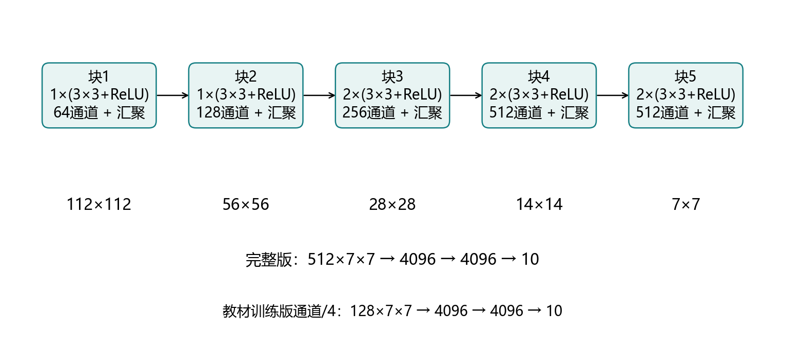
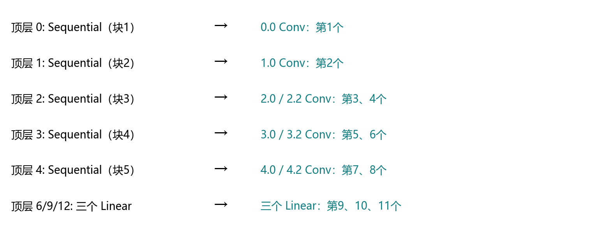
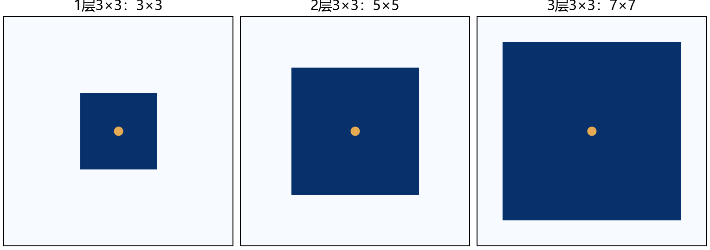
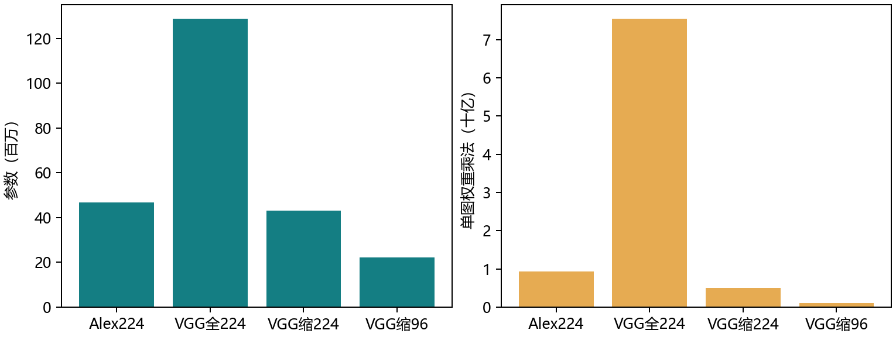
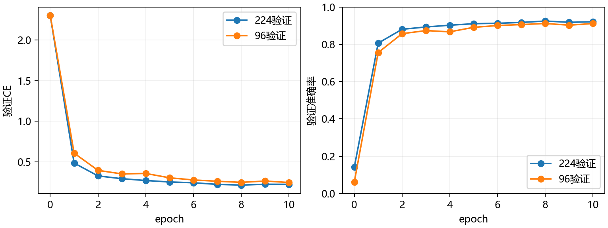
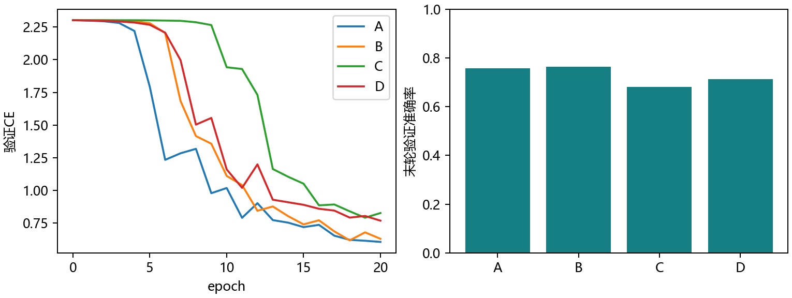
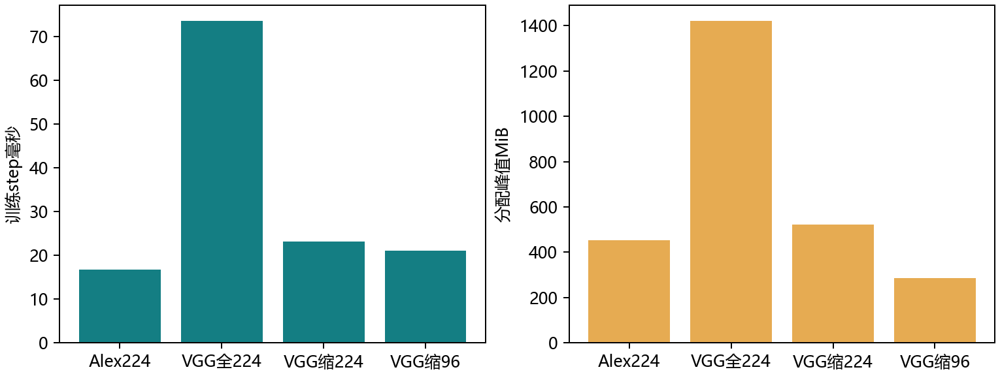

# 7.2 使用块的网络（VGG）· 原理与复现实验

覆盖教材7.2.1-7.2.3及四道练习，PDF273-277/正文255-259；277页仅取7.2练习，随后7.3另学。先从AlexNet接到块、形状、参数、感受野和训练，再指导操作复现。已有openmmlab与Fashion-MNIST，只读数据，无安装升级。真实实验与用户掌握分开记录。

## 01 从逐层排列到可重复的块

AlexNet把五个卷积层逐一排列，核、步幅与汇聚位置各不相同。VGG改用更统一的局部规则：若干次3×3卷积与ReLU后，接一次2×2最大汇聚。把这个重复单元写成块，再按配置表搭成完整网络。



这是第5章Module与Sequential知识在卷积网络上的应用。块接收并返回张量，父模型递归管理内部参数。一个优化器和最终损失仍能作用于全部层，监督学习的基本流程继续沿用。

<!-- side -->

### 本节要贯通什么

先理解块中通道怎样衔接、对象怎样注册，再推导五次汇聚与分类头。随后解释层数、小核堆叠、参数与计算资源，最后读实际训练和尺寸对照。

第13页开始操作，从形状检查到亲手写块、训练小网络，再复现完整实验，最后集中完成八处练习。

### 复现的是哪个版本

本节沿教材使用单通道、十类、无BatchNorm的VGG风格模型。原论文研究RGB/ImageNet，并有不同训练与评估方案；本机服饰实验不冒充论文成绩。

VGG-16与19的配置已核对，分别采用[原论文表1](https://arxiv.org/pdf/1409.1556)的D、E列。教学主线依据用户提供的教材独立整理。

<!-- pagebreak -->

## 02 一个块内，通道与注册怎样连接

vgg_block(num_convs,in_channels,out_channels)有三个输入：卷积层数、第一层输入通道和目标输出通道。每个卷积都用3×3核、stride1、padding1，随后接ReLU，块末统一加MaxPool2d(2,2)。

第一卷积从in_channels映射到out_channels。它完成以后，下一卷积的输入通道必须更新为out_channels。若仍使用最初的输入通道，第二层就会收到与自身权重不匹配的张量。

例如两卷积块3→8→8，输入(2,3,16,16)；两次卷积后仍为16×16，汇聚后输出(2,8,8,8)。含偏置参数为8×(3×9+1)+8×(8×9+1)=808。

构造时先把新层追加到Python列表，再用nn.Sequential(*layers)注册。星号把列表中的各层作为位置参数传入。最终注册发生在Sequential中，参数才能被父模型、优化器、state_dict和设备迁移找到。

<!-- side -->

### 复用代码不等于绑定权重

多次调用vgg_block会创建不同的Conv2d实例。不同块的权重是不同Parameter，不因来自同一段函数而共享。空间位置之间的卷积核共享则发生在同一个Conv2d内部。

若将同一个块对象重复放入模型，才会重复调用同一组参数；这与本节每次新建块的做法不同。

### 哪些部件没有参数

ReLU与MaxPool没有可训练参数，但梯度仍能通过它们传回前面的卷积。Python列表暂存层也没有数值计算；真正的前向由Sequential按顺序执行。

本节构造了两个独立两卷积块，检查权重对象不同，并实测808参数与输出形状。完整函数会在操作部分亲手写出。

<!-- pagebreak -->

## 03 五次汇聚怎样到达 7×7

3×3、stride1、padding1的卷积保持高宽：(H+2−3)//1+1=H。2×2、stride2、无填充的最大汇聚输出为(H−2)//2+1，等于向下取整的H/2。

| VGG-11块 | 卷积数 | 完整通道 | 224后高宽 | 96后高宽 |
| --- | --- | --- | --- | --- |
| 1 | 1 | 64 | 112 | 48 |
| 2 | 1 | 128 | 56 | 24 |
| 3 | 2 | 256 | 28 | 12 |
| 4 | 2 | 512 | 14 | 6 |
| 5 | 2 | 512 | 7 | 3 |

完整224模型展平为512×7×7=25088。教材缩通道版最后128通道，展平为6272。输入改96时，最后空间为3×3，缩通道版应改成128×3×3=1152，才能接上Linear。

<!-- side -->

### 批量轴始终保留

输入(N,1,H,W)经过块后仍是NCHW。nn.Flatten默认从第1维开始展平，每张图各自得到一个特征向量，再由分类头输出(N,10)。

### 为什么不能只改Resize

若把224改96，却保留Linear(6272,4096)，会在矩阵乘法处报宽度不匹配。教师工厂按size//32计算五次汇聚后的边长，再构造分类头。

直接把原始28图送入五块结构，第五次汇聚前已经只剩1×1，放不下2×2窗口。综合练习会明确改成三块，不把它称为完整VGG-11。

<!-- pagebreak -->

## 04 顶层打印与含权重层计数



“VGG-11”按含权重的层计：卷积1+1+2+2+2=8，再加三个Linear，共11。ReLU、汇聚、Flatten和Dropout不按这个规则计入。

教材代码逐个执行顶层模块时，实际打印13行：五个Sequential块、一个Flatten、三个Linear、两个ReLU和两个Dropout。若只挑顶层中含权重的条目，会看到五块加三个Linear共八项；其余三个卷积藏在块内部，参数并没有丢失。

<!-- side -->

### 怎样亲自核对

--inspect同时给出顶层outer和递归weighted_layers。full11的顶层13行，叶子权重层11行。名字如2.0与2.2表示顶层第3块中两个卷积的位置。

named_modules递归找到嵌套模块。教师用forward hook观察它们的真实前向，而不是将所有注册模块再次顺序调用；重复执行会改变计算。

### 参数管理也递归进行

net.parameters包含块内部参数，state_dict中的路径也会带嵌套名字。无需为每个块单独建优化器。一个最终CE的backward会沿分类头、五个块逐层传播。

教材题面关于“八个结果”的描述需要结合统计口径理解，不能把它误读成实际脚本总共只输出八行。

<!-- pagebreak -->

## 05 小核堆叠改变了表示与参数约束



忽略偏置，令输入、中间和输出通道都为C。两层3×3有18C²个权重，一个5×5为25C²。三层3×3为27C²，一个7×7为49C²。比较依赖通道条件，不能推广到任意宽度组合。

中间加入ReLU增加非线性，通常不能合并为一个线性大核。即使去掉ReLU，多个小核的分解也约束了可表达的大核形式，不等于任意大核都能这样分解。

<!-- side -->

### 合并还需要边界条件

教师在无中间激活、两次valid卷积时合成5×5核，前向数值核对通过。若两层各自padding1，中间图的边界会被截断，不能直接当作一次padding2的大核。

3×3全1输入、两次3×3全1核各补1，左上输出25；用合成5×5核一次补2，左上为36。内部路径不同，解释了边界反例。

### 不把感受野当语义标签

更大的理论覆盖范围只说明存在计算路径。真实梯度与响应取决于权重、ReLU门控和输入，不能仅凭深度断言某通道识别了某个物体。

VGG-11最后一次汇聚的理论感受野为150、网格间距32，分类头还会联合读取全部空间位置。

<!-- pagebreak -->

## 06 缩通道不等于所有参数都除以十六



| 结构 | 参数 | 单图权重乘法 |
| --- | --- | --- |
| AlexNet224 | 46764746 | 938146176 |
| 完整VGG-11/224 | 128806154 | 7547232256 |
| 通道/4，224 | 43093322 | 512155648 |
| 通道/4，96 | 22121802 | 107798528 |

原始完整VGG在高分辨率上反复卷积，首层输出64×224×224，比AlexNet首层96×54×54大得多。大激活与更多卷积计算共同解释资源需求，不能仅看核从11缩为3。

<!-- side -->

### 通道缩放怎样影响各部分

输入与输出通道都除4的卷积，权重主项约除16；第一层输入仍为灰度1，只缩输出。第一个Linear随末层通道减少，但第二个4096→4096保持不变。

教材只缩卷积通道，两个隐藏层仍为4096。于是总参数从约1.288亿降到4309万，不能简单说全部参数缩到十六分之一。

### 理论与实际分开报告

float32完整VGG权重约491.36 MiB，教材224版约164.39 MiB。训练还要梯度、激活和工作区，峰值随batch与算法变化。meta形状推导不会实际分配这些存储，也不能替代GPU测量。

<!-- pagebreak -->

## 07 用配置表构造 VGG-16 与 VGG-19

原论文表1的A、D、E列分别对应这里的11、16、19权重层。五块的输出通道依然为64/128/256/512/512，改变每块内部卷积次数即可构造更深网络。

| 版本 | 五块卷积次数 | 卷积+Linear | 本节完整参数 |
| --- | --- | --- | --- |
| VGG-11 | 1,1,2,2,2 | 8+3=11 | 128806154 |
| VGG-16 | 2,2,3,3,3 | 13+3=16 | 134300362 |
| VGG-19 | 2,2,4,4,4 | 16+3=19 | 139610058 |

增加卷积时仍用stride1/padding1，五次汇聚的位置不变，所以三个版本的块末高宽相同。更多层会增加变换、参数与计算，也会延长梯度链。表示能力、优化是否充分和验证表现需要分别判断。

<!-- side -->

### 参数数为何不同于论文表2

本节固定灰度输入和十类输出；论文是RGB与1000类。第一层和最后一层的大小不同，不能把论文的百万级舍入计数直接当成本机参数数。

### 结构检查与真实运行

--inspect使用meta张量构造完整11/16/19，核对递归层数、形状与参数。它不读数据，也不宣称完成了真实训练。

额外四方案实验实际训练缩通道11/16/19及96版，分类头改小至256/128，作为有界预算下的结构对照。其成绩不能替代完整论文模型成绩。

来源：[原论文表1、表2](https://arxiv.org/pdf/1409.1556)。

<!-- pagebreak -->

## 08 数据、初始化与训练协议先固定

沿用54000训练/6000验证/10000官方测试。种子3601按类划分，加载器3603打乱训练顺序，num_workers=0、保留尾批。输入uint8转为新的float32除255，按批双线性插值，align_corners=False、antialias=True，不改写原始文件。

正式两方案预先确定为通道/4的VGG-11，224与96各十轮，SGD .05、batch128、隐藏4096/4096、p=.5的Dropout。每轮422次更新、尾批112，十轮4220次；各方案只在最终固定模型上评估测试一次，不用测试选择尺寸。

每个含权重层用Xavier uniform gain1、零偏置，独立种子7200+j。这样两尺寸的卷积和相同形状分类层初值一致，但不同宽度的FC1无法相同。训练Dropout另用7203。教材默认偏置的处理与本项目显式零偏置有差异，已单独说明。

<!-- side -->

### 指标与模式要对应

训练开启Dropout，清梯度→前向logits→平均CE→反传→SGD。平均只做一次，尾批按实际样本数统计，不再次除batch。

每轮验证使用eval和no_grad；末轮也用eval重评训练集。在线训练来自不断变化且开启Dropout的模型，不能直接将它与验证CE的高低当成过拟合证据。

### 其他实验的职责

四个小头候选固定2000/1000、二十轮320更新，只比较验证；GPU短测顺序单独执行。关闭TF32与cuDNN benchmark，开启确定性算法，使用现有RTX4060 Laptop GPU。

教师运行成功不等于学习者掌握。所有练习答案继续留空，后面按实际反馈检查理解。

<!-- pagebreak -->

## 09 十轮实测：训练、验证和测试各看什么



| 输入 | 轮末训练CE | 验证CE | 测试CE | 测试准确率 |
| --- | --- | --- | --- | --- |
| 224 | .140746 | .223178 | .243842 | 91.65% |
| 96 | .191257 | .245697 | .269522 | 90.45% |

两方案各十轮4220次更新，测试均为10000张。末轮验证准确率为92.03%与91.12%。224方案在第8轮验证92.43%，第10轮回到92.03%；本次坚持预定终点，没有临时用最好验证点替换它。

<!-- side -->

### 在线与轮末为什么不同

224末轮在线训练CE=.180004，eval重评训练CE=.140746；96分别为.227191与.191257。在线模型持续更新并开启Dropout，轮末重评则固定参数且关闭Dropout。

224的eval训练准确率94.73%，验证92.03%；96为92.91%和91.12%。两者都有训练/验证差距，但十轮曲线不足以保证继续延长一定更好或一定过拟合。

### 怎样定位实际报告

224见7_2_metrics.json，96见7_2_96_metrics.json，均在reports/ch07。配置、种子、逐轮统计、尾批、测试和分配峰值一并保留，CSV可逐轮核对。

<!-- pagebreak -->

## 10 改成96，减少了什么又改变了什么

| 同一通道/4的VGG-11 | 224输入 | 96输入 |
| --- | --- | --- |
| 五块末端 | 128×7×7 | 128×3×3 |
| FC1输入宽度 | 6272 | 1152 |
| 全部参数 | 43093322 | 22121802 |
| 单图权重乘法 | 512155648 | 107798528 |
| 本次整段时间/秒 | 683.08 | 197.66 |
| 训练分配峰值/MiB | 2297.79 | 706.71 |

同一空间层的网格更小，后续卷积位置减少；末端变为3×3也使FC1参数减少。两方案使用相同卷积初值和数据划分，但FC1形状与初值尺度不同，不能将差异全部归因于图像插值。

本次96版本测试低1.20个百分点，整体更省时、显存更低。这体现了效果与资源的取舍。其他任务和硬件上的加速幅度需要另行实测。

<!-- side -->

### 为什么小图并不增加信息

两方案都来自28×28原图。224与96只是对已有像素做插值，不会新增采集细节；不同网格仍可能改变卷积看到的尺度、采样与优化轨迹。

### 时间和显存的口径

本表时间包含训练、验证、最终训练重评、测试、哈希及模型保存。它不是只计GPU kernel的时间。显存为PyTorch分配峰值，不包含驱动等全部进程开销，也不同于预留缓存。

### 可复现的控制条件

两方案卷积初始哈希完全一致；两个隐藏层都为4096，lr=.05、batch128、十轮不变。尺寸导致FC1无法相同，报告保留这一限制。

<!-- pagebreak -->

## 11 深度对照：构造更深与训练更好是两件事



| 方案 | 结构/尺寸 | 验证CE | 准确率 |
| --- | --- | --- | --- |
| A | 11 / 224 | .60728 | 75.8% |
| B | 16 / 224 | .63087 | 76.4% |
| C | 19 / 224 | .82811 | 68.1% |
| D | 11 / 96 | .76956 | 71.3% |

每方案2000训练/1000验证、二十轮320更新。A/D卷积初值一致；不同深度的形状与层序改变，不能声称全部权重初值相同。所有比较只用验证集，没有读取测试。

<!-- side -->

### 怎样解释这些差异

B比A验证多对6张，CE却更高。没有多种子重复，不能把它说成可靠的普遍提升。C在当前初值、步长与预算下学习较慢，不证明更深模型的表达能力更差。

C的eval训练CE=.81224，验证=.82811，二者都高于A。这个结果更需要检查拟合与优化是否充分，不能只因网络更深就认定严重过拟合。

### 资源与预算

A/B/C/D参数为2216906、2560570、2892666、906186。本次整段耗时约54.23/98.92/111.00/18.02秒，包含各自验证与末轮训练重评。

这些是缩通道、小头实验，不是完整ImageNet模型的排名。固定二十轮也不意味着各结构花费相同算力。

<!-- pagebreak -->

## 12 独立GPU短测：完整版与缩通道版分开看



| 结构 | step毫秒 | 分配峰值MiB |
| --- | --- | --- |
| AlexNet224 | 16.72 | 453.95 |
| 完整VGG-11/224 | 73.57 | 1420.90 |
| 通道/4，224 | 23.14 | 521.81 |
| 通道/4，96 | 21.10 | 285.71 |

完整VGG在本次短测中更慢、峰值更高，与高分辨率激活、更多卷积及大分类头相符。缩通道以后资源明显下降，但乘法数的减少并未等比例变成step加速。

<!-- side -->

### 测量条件与范围

使用float32并关闭TF32。每组先预热2步，再用CUDA事件计5步并同步。包含前向、平均CE、反传和SGD。完整VGG这里只做结构检查及少量随机输入训练步，未进行其全量服饰训练。

预留峰值为490/1526/540/294 MiB，与分配峰值不同。分配统计也不是全部驱动上下文与进程显存开销。

### 为什么不能只用理论次数推时间

不同图形有不同的激活读写、算子数和硬件利用率。缩224版乘法少于当前AlexNet，短测却更慢；具体瓶颈还需更细的性能剖析，不能仅凭参数数定论。

只有5步短测、没有多次独立重复，温度与频率等会影响结果。本表不构成长时间吞吐量或固定加速比例保证。

<!-- pagebreak -->

## 13 操作一：核对完整结构和两个尺寸

在项目根目录打开VS Code终端。教师入口lessons/ch07/02_vgg.py，练习入口exercises/ch07/02_vgg.py，已有解释器不变。

```powershell
$pythonPath = 'D:\Anaconda\envs\openmmlab\python.exe'
$env:PYTHONUTF8 = '1'
& $pythonPath lessons/ch07/02_vgg.py --inspect --guided
```

应看到full11/quarter11/quarter96/full16/full19，权重层数11/11/11/16/19；完整VGG-11顶层13行。先根据第3、4页解释这些输出，再运行训练。

在项目.cache新建7_2_follow.py，第14-17页代码按顺序接在同一文件。先写导入：

```python
import runpy
from pathlib import Path
import torch
from torch import nn
ROOT = Path.cwd()
helper = runpy.run_path(str(
    ROOT / "lessons/ch07/02_vgg.py"))
common = helper["COMMON"]
device = common["configure"]("cpu")
```

<!-- side -->

### 为什么先检查结构

--inspect不读数据，使用meta张量推导形状，能快速发现层数或Linear接口不匹配。meta模型不能直接当作已初始化训练模型，真正训练由build_net在CPU创建参数再迁移。

### 找不到文件时先查目录

跟做文件用Path.cwd()，终端须在项目根目录。数据在data/FashionMNIST/raw，主程序download=False；另一台机器需按README准备自己的数据，不要改写本机共享原始文件。

runpy返回教师文件中的定义，不执行它的main。这里只借用数据与训练函数，块和完整的小网络会亲手组装。

<!-- pagebreak -->

## 14 操作二：亲手写块并按表连接

跟做保留五块VGG-11拓扑，使用96输入、通道/16与小头64/32，便于CPU检查。它不是正式的通道/4、4096分类头实验。

```python
def vgg_block(n, ci, co):
    layers = []
    for _ in range(n):
        layers.append(nn.Conv2d(ci, co, 3, padding=1))
        layers.append(nn.ReLU())
        ci = co
    layers.append(nn.MaxPool2d(2, 2))
    return nn.Sequential(*layers)

arch = ((1, 4), (1, 8), (2, 16), (2, 32), (2, 32))
blocks, ci = [], 1
for n, co in arch:
    blocks.append(vgg_block(n, ci, co))
    ci = co
net = nn.Sequential(
    *blocks, nn.Flatten(),
    nn.Linear(288, 64), nn.ReLU(), nn.Dropout(.5),
    nn.Linear(64, 32), nn.ReLU(), nn.Dropout(.5),
    nn.Linear(32, 10))
```

<!-- side -->

### 两处通道更新的含义

块内ci=co把当前卷积输出接给下一个卷积。块外ci=co把整个当前块的输出通道接给下一块。它们处于不同的循环层级，不能漏掉其中任何一处。

### 星号在哪里起作用

Sequential(*layers)把列表里的层逐项注册。Sequential(*blocks,Flatten(),…)把五个块与分类头按顺序注册。只把Module放进普通列表并保存在自定义父模块中，不会自动得到同样的递归管理。

### 为什么展平是288

96经五次汇聚为3，最后32个通道，所以32×3×3=288。后面的Linear必须按这个宽度构造。

每次调用vgg_block都会新建层，不把同一个block变量重复作为共享对象使用。

<!-- pagebreak -->

## 15 操作三：初始化，再追踪实际前向

接在同一个跟做文件末尾。按照教师层级种子初始化，随后关闭Dropout，用一个固定输入打印顶层输出。

```python
weighted = (m for m in net.modules()
            if isinstance(m, (nn.Conv2d, nn.Linear)))
for j, layer in enumerate(weighted):
    torch.default_generator.manual_seed(7200 + j)
    nn.init.xavier_uniform_(layer.weight, gain=1.)
    nn.init.zeros_(layer.bias)
net = net.to(device).eval()
X = torch.zeros(2, 1, 96, 96)
with torch.no_grad():
    for layer in net:
        X = layer(X)
        print(type(layer).__name__, tuple(X.shape))
print("参数", sum(p.numel() for p in net.parameters()))
print("含权重层", sum(isinstance(m, (nn.Conv2d, nn.Linear))
                      for m in net.modules()))
```

应看到五块输出通道4/8/16/32/32，高宽48/24/12/6/3，随后展平288、64、32、10。总参数57114，含权重层11；它的顶层依然打印13行。

<!-- side -->

### 递归查看与执行不同

net.modules()递归找到所有嵌套模块，适合初始化和计数。前向仍由net(X)或按顶层顺序执行完成，不应把所有递归模块再挨个前向一次。

### 两种模式各管什么

eval关闭Dropout随机性；no_grad关闭梯度记录。前面初始化和形状检查不会更新权重，真正训练前必须重新train。

### 一次只改一个位置核对

把第3块卷积数从2改3，高宽和分类头宽度不变，含权重层变12。参数量增加，训练配置也改变；核对后撤回，再继续基线跟做。

不要把同一个块对象放两次来代替新建一层，那会变成共享参数的另一种模型。

<!-- pagebreak -->

## 16 操作四：读取小数据并执行更新

继续写在跟做文件末尾。用官方训练集划分中的37张训练、20张验证走三轮，batch8、CPU，不读测试。cfg与手工模型对应。

```python
splits, _ = common["load_data"](include_test=False)
train = common["balanced_subset"](
    splits["train"], 37, 7201)
validation = common["balanced_subset"](
    splits["validation"], 20, 7202)
loader = common["make_loader"](
    train, shuffle=True, batch_size=8)
cfg = dict(helper["BASE"], ratio=16, size=96,
           hidden=[64, 32], batch_size=8)
optimizer = torch.optim.SGD(net.parameters(), lr=.05)
torch.manual_seed(7203)
for epoch in range(3):
    row = helper["train_epoch"](
        net, loader, optimizer, cfg, device)
    print(epoch + 1, row)
```

每轮5次更新，尾批5张，三轮共15次。prepare把(8,1,28,28)插值为(8,1,96,96)，模型再输出(8,10)。尾批N为5。损失应有限，小数据三轮无须达到高准确率。

<!-- side -->

### 在教师函数中找到主干

train_epoch内部先train，再对每批执行：

```python
optimizer.zero_grad(set_to_none=True)
logits = net(X)
loss = F.cross_entropy(logits, y)
loss.backward()
optimizer.step()
```

prepare负责图像设备迁移与插值；标签也迁移到同一设备。CE已经按本批平均，SGD不再除以8，尾批也无需人为补齐。

日志把loss.item()乘实际len(y)，累加后除37。若直接平均五个批均值，就会把尾批5张赋予与8张同样的整批权重。

<!-- pagebreak -->

## 17 操作五：评估并恢复小模型

接在同一跟做文件末尾。验证时关闭Dropout，保存state_dict后构造相同配置，再核对预测。

```python
metric = helper["evaluate"](
    net, validation, cfg, device)
print("验证", metric)
X, _ = next(iter(common["make_loader"](
    validation, batch_size=20)))
X = helper["prepare"](X, cfg, device)
net.eval()
with torch.no_grad():
    before = net(X).cpu()
path = ROOT / ".cache/7_2_follow.pt"
torch.save(net.state_dict(), path)
restored = helper["build_net"](cfg).eval()
restored.load_state_dict(torch.load(
    path, map_location="cpu", weights_only=True))
with torch.no_grad():
    error = (restored(X.cpu()) - before).abs().max().item()
print("恢复误差", error)
assert error < 1e-4
```

<!-- side -->

### 运行完整跟做文件

```powershell
& $pythonPath .cache/7_2_follow.py
```

应看到13条顶层形状、57114参数、11个权重层、三轮各5更新、验证samples=20，恢复误差低于1e-4。CPU同结构恢复通常能完全一致。

### state_dict保存了什么

它包含嵌套块参数值，但不自动保存Python结构。ratio、version、输入尺寸和隐藏宽度必须对应。224的FC1状态不能直接载入96模型。

教师检查点另外保存配置和优化器信息。本节只验证恢复预测，不宣称已经完整恢复随机数与加载器状态进行精确续训。

<!-- pagebreak -->

## 18 操作六：复现正式训练与对照

```powershell
# 先用CPU极小数据验证实际训练入口
& $pythonPath lessons/ch07/02_vgg.py --size 96 `
  --device cpu --epochs 1 --batch-size 2 `
  --train-size 11 --validation-size 10 --guided --record
# 教材通道/4，224，十轮
& $pythonPath lessons/ch07/02_vgg.py --guided --record
# 同一预定协议改96，十轮
& $pythonPath lessons/ch07/02_vgg.py --size 96 --guided --record
# 四方案小头深度/尺寸实验，仅验证集
& $pythonPath lessons/ch07/02_vgg.py --experiments --guided --record
# 独立GPU短测，须与上面训练顺序执行
& $pythonPath lessons/ch07/02_vgg.py --benchmark --guided --record
```

--guided中文导读；--record写报告、对应曲线与本地检查点。默认auto在有GPU时用CUDA。--inspect/--experiments/--benchmark互斥，预定检查不接受其他训练参数。--size96是单独正式协议，自定义轮数、batch或子集才使用custom前缀。

<!-- side -->

### 输出文件如何区分

reports/ch07中的7_2_metrics.json对应224，7_2_96_metrics.json对应96。各有epochs.csv；子集与GPU测量带experiments、benchmark名称。

小数据另带custom，如7_2_96_custom_metrics.json，不覆盖正式实验。模型在artifacts/ch07，原始数据、权重和缓存不提交Git。

### 静态原理图也能重建

```powershell
& $pythonPath tools/build_vgg_figures.py
```

该工具重建结构、计数、感受野和资源四图，并核对块与合成核示例。不运行正式训练。

如果遇到显存不足，先检查重复进程，再用小batch做custom。配置变化需要如实记录，不能把新结果当默认协议成绩。

<!-- pagebreak -->

## 19 综合练习：用块搭一个原始28小网络

打开exercises/ch07/02_vgg.py。练习使用三块，卷积次数1/2/2、通道8/16/32，原始28图经汇聚到14/7/3；展平288，再接32→10，隐藏层带p=.5的Dropout。

| 阶段 | 八处待填 | 核对目标 |
| --- | --- | --- |
| 块 | 1卷积、2通道更新、3汇聚、4Sequential | 每次调用新建层，输出通道衔接正确 |
| 分类头 | 5展平宽度 | 32×3×3=288，参数27034 |
| 训练 | 6平均CE、7反传、8更新 | 37/20、三轮15更新、尾批5 |

```powershell
& $pythonPath exercises/ch07/02_vgg.py
```

空文件只提示当前阶段。填完块后先检查通道，再补分类头，最后接通训练。输出应为(8,10)，验证20张。这里是五卷积加两Linear的七权重层实践，不冒称完整VGG-11。

<!-- side -->

### 集中反馈什么

给出三块形状、参数27034、三轮有限损失、15次更新和验证正确数。解释288来自哪里、尾批为何只有5张、以及eval为何要关闭Dropout。

最重要的是解释：同一段块函数重复调用，为何没有共享同一组权重？为什么块内与块外都要更新输入通道？

### 遇到问题先给最小定位

通道错误看第2、14页，尺寸看第3、15页，梯度顺序与尾批看第16页，模式与恢复看第17页。

八处源TODO留空。教师参考只在内存执行，不替用户填写练习或笔记，不把工程检查记为已掌握。

<!-- pagebreak -->

## 20 教材练习一、二：层数与资源

第1题先区分三个口径：顶层实际13行，顶层含权重容器8项，递归叶子权重层11项。块3、4、5各多一个内部卷积，所以“少见的三层”在嵌套结构中，并未丢失。用--inspect的outer与weighted_layers逐一核对。

第2题先比较完整VGG与完整AlexNet。高分辨率激活、更多连续卷积及更大的分类头，都会改变计算和存储。即使核较小，总计算也可能因为位置和层数更多而增加。

随后再看教材缩通道版本。它的理论计算低于完整VGG，甚至可低于当前AlexNet；实际时间还受算子利用率和访存影响。不能把“完整VGG更重”的描述直接套在缩通道实验上。

<!-- side -->

### 表格回答不同的问题

参数数回答持久权重大小；乘法数回答部分理论算术；GPU峰值还含激活、梯度和工作区；CUDA事件回答当前短测耗时。它们需要一起解释，不互相替代。

### 可进一步做的核对

在固定batch下测完整与缩通道结构，避免同时改变数据类型。若再改batch，应重新记录峰值与时间，不直接与旧表拼接。

短测在GPU驻留随机输入上完成，不测分类精度，也不包含CPU加载和Resize。端到端训练时间包含更多开销，不能直接当纯算子吞吐量。

<!-- pagebreak -->

## 21 教材练习三、四：尺寸与更深配置

第3题改96时，先重算48→24→12→6→3和FC1输入1152，再运行 --size 96。使用相同划分、轮数、batch和步长；卷积初值相同，分类头宽度与参数量却会改变。不能把结果全部归因于插值大小。

第4题按论文D/E构造16/19。可在.cache/7_2_variant.py复制第13页导入，再用小宽度检查真实前向与反传：

```python
from torch.nn import functional as F
for version in ("16", "19"):
    cfg = dict(helper["BASE"], version=version,
               ratio=16, size=96, hidden=[64, 32])
    model = helper["build_net"](cfg)
    logits = model(torch.rand(2, 1, 96, 96))
    loss = F.cross_entropy(logits, torch.tensor([0, 1]))
    loss.backward()
    print(version, tuple(logits.shape),
          sum(p.numel() for p in model.parameters()))
```

<!-- side -->

### 结构存在不等于训练充分

上面只验证接口与梯度，不更新权重。小子集实验另外完成了真实训练；其预算和分类头不同，不能把结果当原论文比较的复现。

### 为什么从配置表开始

每块卷积次数与输出通道决定结构。block函数本身无须为16/19另写一份，这正是模块化减少重复代码的作用。

如果想实际训练新配置，先用验证集明确预算和评价规则，再确定是否扩大数据。不得不断根据官方测试改网络。

论文A/D/E的3×3结构已核对，未把带1×1卷积的C列误当作这里的VGG-16。

<!-- pagebreak -->

## 22 贯通全节，再定位自己的困难

先把局部卷积与ReLU封装成块，块末汇聚改变空间大小；按表连接五块，再展平接分类头。嵌套注册保证参数管理与反传贯通，最终仍由logits和交叉熵提供监督，SGD逐批更新全部权重。

小核堆叠同时改变感受野、非线性和参数约束。通道、尺寸与深度会影响表示、优化及资源，应根据具体配置与指标判断。代码简短以后，数学、算力与泛化问题仍需理解。

排错顺序：先看NCHW与块内/块间通道，再看五次汇聚和Flatten宽度；接着检查模型、图像、long标签的设备；最后核对模式、清梯度、平均CE、实际更新与初始化。显存问题另查重复进程和batch。

<!-- side -->

### 集中回顾的三个问题

为什么两次调用相同函数不共享权重？为什么改变输入尺寸必须重算分类头？为什么更多权重层并不保证固定预算下验证更好？

把预测、实测和解释一起反馈，重点讲无法解释的部分。旧练习未提交的状态保留，不阻挡按教材继续推进。

### 下一节

7.3 网络中的网络（NiN）从PDF277/正文259开始。下一节把6.4的1×1通道映射放入块中，并重新讨论庞大全连接头的替代方式。

本节代码、手册、统计与图同步GitHub；原教材、原始数据、模型和缓存只在本地。
