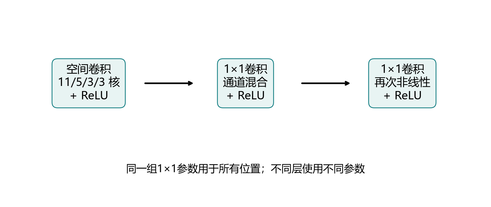
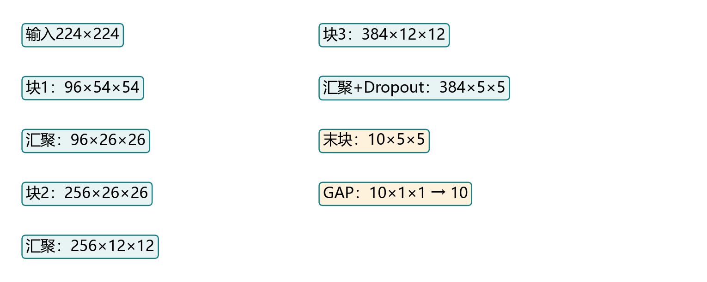
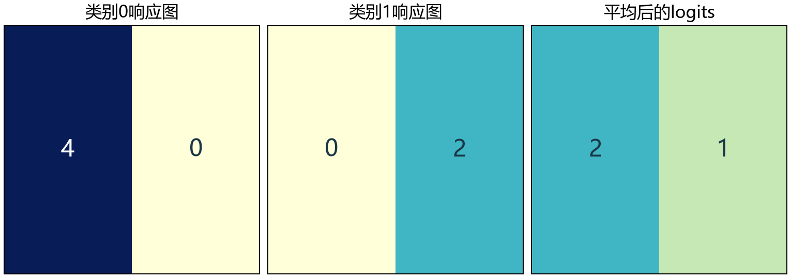
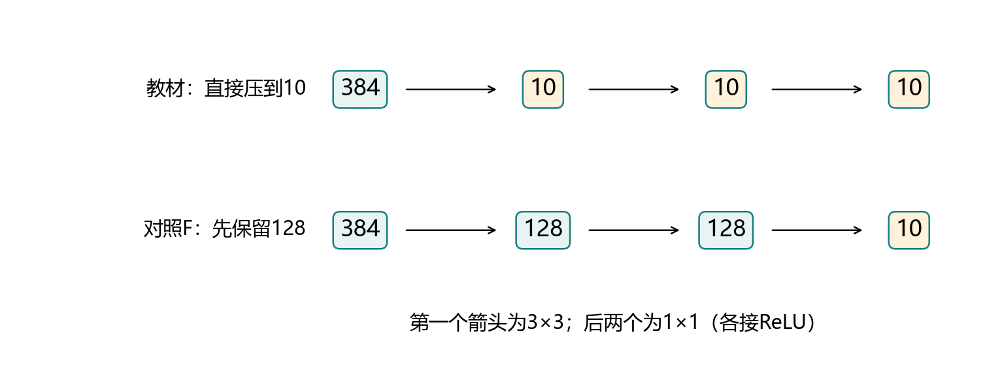
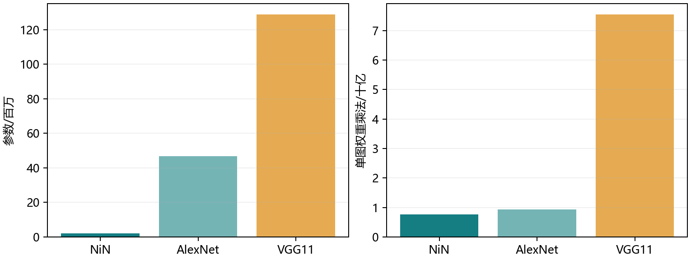
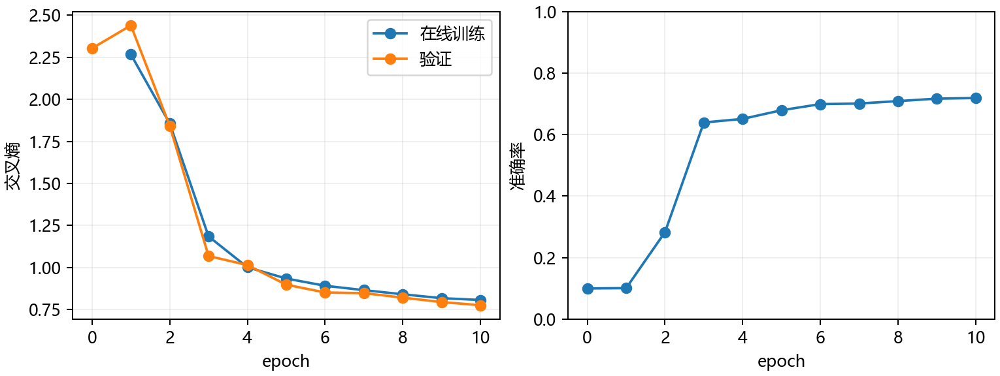
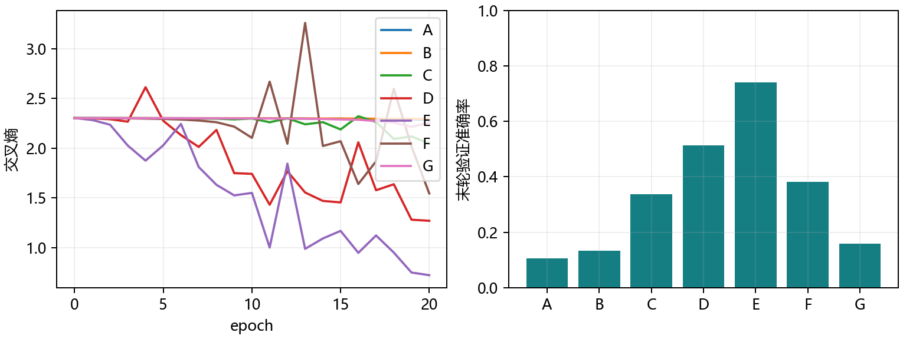
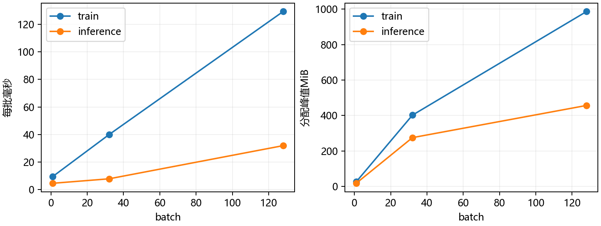

# 7.3 网络中的网络（NiN）· 原理与复现实验

覆盖教材7.3.1-7.3.3及四道练习，PDF277-281/正文259-263；281页仅取本节练习。先从VGG接到逐位置MLP、全局平均、梯度和资源，再指导操作复现。使用已有openmmlab与Fashion-MNIST，无安装升级。教师验证与用户掌握分开记录。

## 01 为什么把小网络放进卷积网络

LeNet、AlexNet和VGG先用卷积、激活和汇聚提取空间特征，再把它们展平，交给全连接分类头。VGG把前半段整理为重复块，但两个4096隐藏层仍占很多参数。

NiN把问题拆成两步：在每个空间位置上，用一个共用的多层感知机处理通道；在网络末端，让每个类别对应一个通道，再对该通道所有位置取平均。前一步增强局部的非线性处理，后一步替代庞大全连接头。



本节把第6.4节的1×1卷积、第4章的MLP、第5章的块，以及分类的logits、交叉熵和反传连成一条线。监督信号仍来自图像标签，训练方法没有换成另一种学习范式。

<!-- side -->

### 阅读与操作路线

前12页连续解释原理、实际结果和资源口径。第13页开始操作，先核对教材完整结构，再亲手写块与全局平均，训练可在CPU运行的小网络，最后复现正式实验。

### 先区分三个尺度

空间核处理邻近位置；1×1核混合同一位置的通道；全局平均把整个响应图汇总为一个数。三者承担不同职责，不能只看到“都是卷积或汇聚”就混为一谈。

本节复现教材的灰度十类模型，保留其最后ReLU，不把Fashion-MNIST成绩当作原论文的ImageNet结果。

<!-- pagebreak -->

## 02 1×1卷积怎样成为共享的全连接层

设输入X形状为(N,C,H,W)。固定样本n与位置(h,w)，取该处C个通道组成列向量x。1×1卷积计算u=W x+b，其中W形状为(D,C)，输出D个通道。它没有读取相邻位置，却能让每个输出通道组合全部输入通道。

把所有位置临时排成(NHW,C)，对每一行使用同一个Linear(C,D)，再排回(N,D,H,W)，结果就是1×1卷积。学习参数D(C+1)与H、W无关，因为各位置共用W和b。

这里的“每个位置独立作用”指前向没有在这一步混合位置，并不是为每个位置各训练一套权重。反向传播时，各位置对共用W的梯度会相加，整批样本的监督共同更新这组参数。

空间卷积已经把邻域信息编码进当前通道向量，因此后接的1×1层仍在处理包含邻域的表示。它不再扩大结构感受野，却能重新组合这些邻域特征。

<!-- side -->

### 对应代码的轴

PyTorch的Conv2d权重为(D,C,1,1)。Linear权重为(D,C)，所以取weight[:,:,0,0]即可对应。输入先permute到NHWC，最后一维才是要映射的通道。

本机float64实测，两种写法最大差8.88e-16。第14页会亲手运行这个对照。

### 与一开始直接展平的差别

Flatten后接Linear会把所有位置分别作为输入坐标，其权重通常随H×W增加。1×1卷积保持空间网格，让后续空间卷积还能利用相邻关系。

共享权重是一种结构约束，不自动保证泛化更好。

<!-- pagebreak -->

## 03 为什么放两个1×1卷积和ReLU

一个默认NiN块可以写为：先做空间卷积并ReLU，再做1×1映射并ReLU，最后再做一次1×1映射并ReLU。固定某位置后，后两步就是有两层映射的共享MLP。

两层之间的非线性很关键。去掉中间ReLU后，W2(W1x+b1)+b2仍是仿射映射。它的合成权重为W2W1，偏置为W2b1+b2。加入ReLU后，激活区域随输入变化，一般不能再用同一个仿射映射替代整条链。

这提供更丰富的逐位置变换，但不意味着两个是唯一正确的数量。额外层增加参数、运算、激活保存和优化难度；删除一层也同时改变表示能力与优化路径。第11页给出固定预算的实际对照。

本实现为每个块新建层，块内不同卷积也有不同参数。只有同一层在不同空间位置共享权重，不会因为都叫1×1就共用一个对象。

<!-- side -->

### 非线性与层数的关系

ReLU(z)=max(0,z)。它保留正半轴、阻断负半轴的局部梯度。增加ReLU能增加可表示的分段仿射结构，也可能产生当前数据上始终为零的通道。

两个1×1层不能提供新的邻域连接。若只堆叠1×1，当前输出仍只依赖同一位置先前已有的信息。

### 教材练习2怎样比较

对照D删除每块第二个1×1；E再删除第一个。共同存在、同名同形状的卷积按角色种子初始化，数据与轮数固定。结果仅说明这些条件下的现象，不作为“更深总更好”的证据。

<!-- pagebreak -->

## 04 一个块的形状与感受野

nin_block(ci,co,k,s,p)的第一层Conv2d决定空间高宽：H_out=floor((H+2p-k)/s)+1。后两个卷积都是kernel1、stride1、padding0，所以保持这个高宽；通道统一为co。

例如输入(N,3,8,8)，第一层为3→4、核3、padding1，则三次卷积都输出(N,4,8,8)。参数为4(3×9+1)+2×4(4+1)=152。ReLU没有学习参数，但参与反向传播。

若进入块前的相邻位置间距为j，结构感受野为r，第一层把它变成r+(k−1)j，并把间距改为sj；两个1×1不会继续扩大r。随后3×3、stride2最大汇聚再增加2j，并把间距加倍。

这解释了“增加深度”与“扩大空间视野”的区别。默认NiN有四块、每块三个卷积，共12个含权重层；顶层遍历还会打印汇聚、Dropout、GAP与Flatten，行数不能直接当卷积数。

<!-- side -->

### 逐位置MLP仍接在空间核后

第一块先用11×11、stride4压缩224输入。后面使用5×5和3×3。邻域范围由这些空间层与汇聚共同累积。

按结构递推，最后响应位置的理论感受野为195×195，相邻响应中心相隔32个输入像素。边缘位置还会碰到padding，实际有效贡献由权重和激活决定。

### Python语法补充

nn.Sequential按顺序连接层，父模型递归注册其内部参数。这里教师程序用有名字的层，方便区分block2.spatial与block2.point1。跟做先用最直观的位置参数写法。

<!-- pagebreak -->

## 05 完整模型怎样把224变成十类

教材模型依次使用96、256、384通道的前三块，块后各接3×3、stride2最大汇聚。第三次汇聚后做p=.5的Dropout，再接384→10的末块，最后GAP和Flatten。



224经首层11×11、stride4变54，三次最大汇聚依次得到26、12、5。末块3×3、padding1保持5×5。因此进入全局平均的张量为(N,10,5,5)，输出为(N,10,1,1)，展平后为(N,10)。

每一行对应一张图，每一列对应一个类别。不要把批量维一起展平，也不要把十个通道再求平均成一个数。

<!-- side -->

### 原文与实际代码一起读

教材描述了“每块后汇聚”的总体模式，具体代码的末块后接全局平均，而非再做一次最大汇聚。本节按实际模型代码复现。

### 为什么没有Linear

模型仍有学习到的分类映射：末块卷积把特征映射到十个类别通道。去掉Linear并不意味着最后只有无参数操作，也不意味着整张图没有非线性分类器。

默认共10个顶层模块、12个Conv2d、0个Linear。不同数量的逐位置层会改变递归卷积数。

<!-- pagebreak -->

## 06 全局平均为什么能得到logits

设末端类别响应为A，形状(N,K,H,W)。全局平均计算z[n,k]=(1/(HW))×Σ_hΣ_w A[n,k,h,w]，把各位置对类别k的响应汇总为一个得分。这里是平均，包含除以HW；不能把教材小结中的“求和”理解成没有除数的sum。



AdaptiveAvgPool2d((1,1))对任意有效的H、W都得到一个空间位置，没有学习参数。本例输出[2,1]，再做softmax得到[.731059,.268941]。交叉熵函数直接接收原始得分，在内部稳定计算对数概率。

先在每个位置做softmax再平均，会得到[.550608,.449392]，与上面不同。softmax是非线性的，不能随意与平均交换。NiN训练的对象是全图类别得分，不是每个位置各有一个真实类别标签。

<!-- side -->

### 得分可以都是非负

教材末块最后也有ReLU，所以平均后的logits非负。交叉熵仍可使用它们，因为分类依赖相对得分，logits不要求同时含正负值。

但最后ReLU可能使某个类别在一些位置的梯度为零；若某通道始终被截成零，优化会受限。对照G只去掉最后一次ReLU，单独观察这一影响。

### 响应图不是像素级真值

只有图像标签，没有像素监督。类别通道可以提供粗略响应，但不能把它直接宣称为精确分割或可靠解释。

<!-- pagebreak -->

## 07 平均、交叉熵和整网反传怎样接通

对批平均交叉熵，令p=softmax(z)，类别标签为y。梯度为∂L/∂z[n,k]=(p[n,k]−1[y_n=k])/N。GAP再把该梯度均分给同一类别通道的HW个位置，因此∂L/∂A[n,k,h,w]=(p[n,k]−1[y_n=k])/(NHW)。

这是对GAP输入A的梯度。继续传到末端ReLU之前时，还要乘该位置的正值门控，再经过卷积与前面所有层。不能因为平均本身无参数，就认为前面的网络收不到训练信号。

本例N=1、HW=2、y=0，每个类别0位置梯度−.134471，类别1为+.134471。反传算出梯度后，SGD执行θ←θ−lr×梯度；平均CE已经除批量，优化器不再手动除一次。

训练时net.train开启Dropout，验证和预测用net.eval关闭随机掩码，并用no_grad或inference_mode关闭梯度记录。模式切换与梯度开关承担不同职责。

<!-- side -->

### 平均带来的归纳偏好

对于输入GAP的响应图，任意重排空间位置都保持平均值不变。因此它放弃了末端精确的空间布局，倾向汇总“哪里出现了多少响应”。

这不证明整网对任意平移严格不变：步幅、汇聚窗口、边缘和裁剪都会改变响应。

### 小目标可能被稀释

在49个位置中只出现一个值1，平均只有1/49。GAP能抑制某些孤立噪声，也可能削弱很小区域的信号，是否合适取决于任务。

最大汇聚只传最大位置的梯度，替换成它会改变决策与优化，不是等价加速。

<!-- pagebreak -->

## 08 384直接压到10会丢掉什么

教材末块首先用3×3卷积把384通道压为10，随后两个1×1都只在这10维上运算。它在空间上仍读取3×3邻域，不是单纯的384→10逐位置线性层；但它很早就限制了后续可用的通道表示。



看一个简化的1×1投影W:(384→10)：秩最多10，所以至少存在374维零空间。两个不同输入若相差一个零空间方向，会产生相同输出；后面的确定性层无法再区分它们。这说明压缩可能丢信息，并不是说真实卷积网络必然恰好丢掉374种语义。

对照F让末块先384→128，再128→128，最后128→10。它保留更宽的中间表示，同时增加参数、计算和优化成本。实验用于观察取舍，不预先保证准确率提高。

<!-- side -->

### 对实际3×3层怎样表述

一个输出位置先把384×3×3=3456个局部输入映射为10个数；完整5×5输出共有250个数，对应9600个输入数的卷积映射。邻域重叠和共享权重使局部投影与全局映射不能混用秩的说法。

### 类别维度放在哪里

GAP前必须有K个输出通道，但不要求更早每层都只有K维。十类决定最终接口宽度，不能据此断言中间十维一定足够。

这也为下一节理解1×1先降维、再接不同空间核提供准备。

<!-- pagebreak -->

## 09 参数、计算、激活与显存分别计数

Conv2d的含偏置参数为C_out(C_in×k_h×k_w+1)。单图权重乘法为H_out×W_out×C_out×C_in×k_h×k_w。把12个卷积相加，完整NiN有1992166参数、762297352次权重乘法；其中八个1×1层有446108参数、184824712次乘法。



NiN的float32权重约7.60MiB，AlexNet约178.39MiB，完整VGG11约491.36MiB。参数下降很大，但仍需计算高分辨率激活；1×1在每个位置都运行，也不是零成本。

本表只计卷积权重乘法，未含加法、bias、ReLU、最大/平均汇聚和反传。常用“乘加约2 FLOPs”是另一种口径，不能直接把本数值叫成整次训练的FLOPs。

<!-- side -->

### 为什么权重小却不等于显存小

训练还保存反传需要的输入、激活和梯度，并使用算子临时工作区。这里是无动量SGD，不需要Adam那两份动量状态，但仍须保存参数梯度。

12个卷积输出的逻辑float32字节之和为6102456/图。这只是逐层张量计数，不是自动微分保存量，也不是实际峰值。

### 预测需要单独测

eval关闭Dropout，inference_mode关闭梯度记录，能省去很多训练保存。仍要考虑批量、模型权重、输入、中间激活和算子工作区。

第12页给出本机分批训练/预测实测，不由参数量直接推断时间或显存。

<!-- pagebreak -->

## 10 教材完整模型的实际十轮训练

完整224输入、SGD .1、batch128、十轮4220次更新，尾批112。54000训练/6000验证/10000测试，沿用划分3601和加载器3603。



| 末轮指标 | 实测 |
| --- | --- |
| 在线训练CE / 准确率 | .807450 / 71.1519% |
| eval训练CE / 准确率 | .763620 / 72.2870% |
| 验证CE / 准确率 | .776353 / 71.8667% |
| 测试CE / 正确数 | .799266 / 7115共10000张 |

<!-- side -->

### 初始化与教材差别

CPU按块和层角色使用7300+10×块序号+角色序号，做Xavier gain1，bias显式清零。教材只重设weight，偏置处理不同。Dropout7303，float32/255后按批bilinear插值224。

### 时间与内存

包括验证、末轮训练重评、测试、哈希和保存共667.42秒。分配峰值986.48MiB。全部进程显存还包括其他开销。

### 检查失败表现，而非美化结果

仅重查验证集，类别1和4从未成为预测最大项。但它们并非全图全零：各自响应为正的空间位置约3.24%和.57%。这说明优化受限，不能简单写成两个完全死亡通道，更不能只靠相关性认定最后ReLU是唯一原因。

训练与验证都仍有明显误差，不能直接断言过拟合。所有成绩来自本机末轮模型，未按测试改选。

<!-- pagebreak -->

## 11 七个固定候选怎样检验设计选择

固定平衡2000训练/1000验证，按类200/100，子集种子7301/7302。七方案各20轮320更新，batch128、尾批80，选末轮验证CE，不读取测试。



A/B/C/G的全部初始参数相同；A/F前三块相同。D/E删除层后，保留层按相同角色种子初始化。样本和更新预算相同，但计算量不相同。

C比A改善了验证CE与准确率，说明调大学习率在本次短预算内有帮助。D/E更快学到分类规律；E在七候选中末轮CE最低，但不能证明逐位置MLP没有用。

F比A好，同时增加参数。G只去掉最后ReLU，改善有限，不能用它把正式模型的问题归结为单一原因。A最终训练eval CE也约2.284，主要表现为学习不足，而非仅验证恶化。

<!-- side -->

### 最后一轮实际结果

| 候选 | 只改这一项 | CE | 准确率 |
| --- | --- | --- | --- |
| A | 教材基线 | 2.2828 | 10.5% |
| B | lr=.05 | 2.2934 | 13.3% |
| C | lr=.2 | 2.0461 | 33.7% |
| D | 1×1减一 | 1.2698 | 51.3% |
| E | 1×1全删 | .7228 | 74.1% |
| F | 末块宽128 | 1.5447 | 38.1% |
| G | 去末ReLU | 2.2568 | 15.9% |

### 比较的限制

A参数1992166，D为1769112，E为1546058，F为2417674。删层改变容量、梯度路径和运算量，不是只减少训练时间。

B准确率比A高，但CE更差；二者评价不同。全部为单种子、有限候选，没有泛化到任意任务的结论，也不拿子集分数与完整训练直接比较。

<!-- pagebreak -->

## 12 训练与预测的时间和显存

单独顺序运行GPU短测。训练为train模式的前向、平均CE、反传和无动量SGD；预测为eval加inference_mode。两者都使用完整224模型，不用参数字节数代替实际峰值。



batch128训练分配峰值约986.48MiB，预测约456.63MiB，均远大于7.60MiB权重。预测仍保留输入和中间计算，关闭梯度记录不会消除所有运行开销。

时间随批量变化，也受算子选择和硬件利用率影响。每批时间不能直接当每张图时间；如需估计吞吐，使用batch除以每批秒数，并说明当前测量范围。

<!-- side -->

### 实际每批时间和分配峰值

| batch | 训ms | 预ms | 训MiB | 预MiB |
| --- | --- | --- | --- | --- |
| 1 | 9.52 | 4.58 | 25.77 | 17.52 |
| 32 | 39.91 | 7.82 | 401.90 | 275.01 |
| 128 | 129.26 | 31.90 | 986.48 | 456.63 |

### 测量条件

随机GPU驻留float32输入，TF32关。每组2步预热、5步CUDA事件计时并同步，不含数据加载与Resize。

统计含权重、驻留输入和计算中间量。预留峰值训练为30/648/1200MiB，预测为24/326/636MiB；与分配值不同，也不等于全进程显存。

### 解释边界

没有多次独立或长程重复，温度、频率与其他负载会影响时间。参数少不保证训练一定快，短测也不保证固定吞吐量。

<!-- pagebreak -->

## 13 操作一：环境、文件与完整结构

在VS Code打开项目根目录，终端也切到该目录。教师文件lessons/ch07/03_nin.py；练习文件exercises/ch07/03_nin.py；沿用已有解释器。

```powershell
$pythonPath = 'D:\Anaconda\envs\openmmlab\python.exe'
$env:PYTHONUTF8 = '1'
& $pythonPath lessons/ch07/03_nin.py --inspect --guided
```

应看到54→26→12→5的空间缩减、末块(1,10,5,5)、GAP(1,10,1,1)和最终(1,10)。参数1992166，单图权重乘法762297352。先用第4、5页公式解释输出。

在项目.cache目录新建7_3_follow.py。把第13-17页Python代码按顺序接在同一个文件。先写导入与数据接口：

```python
import runpy
from pathlib import Path
import torch
from torch import nn
from torch.nn import functional as F
ROOT = Path.cwd()
helper = runpy.run_path(str(
    ROOT / "lessons/ch07/03_nin.py"))
common = helper["COMMON"]
device = common["configure"]("cpu")
```

<!-- side -->

### 跟做与正式训练分开

跟做使用三块小网络和原始28输入，便于CPU检查。它包含空间卷积、两个1×1与GAP。教材完整模型另有四块，输入224。

### inspect做了什么

使用meta张量核对结构与理论计数，不读取数据，不代表模型已在GPU完成实际训练。

### 数据只读

数据已在data/FashionMNIST/raw，主程序download=False。runpy取得教师文件中的函数，不执行其main。Path.cwd依赖当前终端目录，找不到文件时先检查是否在项目根目录。

<!-- pagebreak -->

## 14 操作二：写块并验证逐位置Linear

接在同一个跟做文件末尾。先亲手写默认块：三个Conv，每个后接ReLU。输入、输出通道与空间核由函数参数控制。

```python
def nin_block(ci, co, k, s=1, p=0):
    return nn.Sequential(
        nn.Conv2d(ci, co, k, s, p), nn.ReLU(),
        nn.Conv2d(co, co, 1), nn.ReLU(),
        nn.Conv2d(co, co, 1), nn.ReLU())

torch.manual_seed(7305)
block = nin_block(3, 4, 3, p=1)
print("块输出", tuple(block(
    torch.zeros(2, 3, 8, 8)).shape))
print("块参数", sum(p.numel() for p in block.parameters()))

point = nn.Conv2d(3, 4, 1).double()
X = torch.randn(2, 3, 4, 5, dtype=torch.float64)
Y = point(X)
rows = X.permute(0, 2, 3, 1)
dense = rows @ point.weight[:, :, 0, 0].T + point.bias
dense = dense.permute(0, 3, 1, 2)
print("逐位置差", (Y - dense).abs().max().item())
```

预期块输出(2,4,8,8)、参数152，逐位置差接近float64舍入误差。把输入高宽改为6和7，观察参数量是否改变，再解释共享权重。

<!-- side -->

### 两种“独立”不要混淆

block的两个1×1是两个新对象；它们不共享weight。但每一个1×1对象内部，其weight在全部位置复用。

### permute与矩阵乘法

permute只调整轴顺序。这里把通道移到最后，@才对每个位置的三维向量做相同映射；结果再换回NCHW。

### 参数实验

先不改网络，只改变X高宽，核对D(C+1)不变。再把co由4改为8并重算参数。输入位置数与输出通道数的影响应分开解释。

<!-- pagebreak -->

## 15 操作三：手算全局平均与梯度

继续追加以下代码。这个二类小例子不读取数据，专门把响应图、平均、得分、概率和梯度核对在一起。

```python
A = torch.tensor([[[[4., 0.]], [[0., 2.]]]],
                 dtype=torch.float64, requires_grad=True)
z = nn.AdaptiveAvgPool2d((1, 1))(A).flatten(1)
loss = F.cross_entropy(z, torch.tensor([0]))
loss.backward()
print("logits", z.detach().tolist())
print("概率", z.softmax(1).detach().tolist())
print("CE", loss.item(), "梯度", A.grad.tolist())
delta = z.softmax(1).detach()
delta[0, 0] -= 1
expected = delta[:, :, None, None] / 2
print("梯度差", (A.grad - expected).abs().max().item())
other = A.softmax(1).mean((2, 3))
print("先softmax再平均", other.detach().tolist())
```

应看到logits[2,1]、CE约.313262、每个类别0位置梯度−.134471、类别1为+.134471。梯度差接近0；两种概率汇总分别约[.7311,.2689]与[.5506,.4494]。

<!-- side -->

### 形状检查

A是(1,2,1,2)，含一张图、两个通道和两个空间位置。flatten(1)从通道开始展平，保留第0维批量。

### 改参数核对

把两个响应图同时重复为四个空间位置，均值和CE不变，但每个位置分到的梯度减半。输入叶张量需重新构造；不要在旧A上重复backward后误把累积梯度当新结果。

### 为什么不先softmax

本节CrossEntropyLoss接收logits。先softmax再传给它，会把概率当成新的得分再次归一化，与预期目标不同。

这一步通过后再接入真实图像训练。

<!-- pagebreak -->

## 16 操作四：组装并准备真实图像小训练

继续追加。三块通道为8、16、10，空间卷积都为3×3、padding1；两次2×2汇聚把28变14、7，末块保留7×7，再做全局平均。

```python
net = nn.Sequential(
    nin_block(1, 8, 3, p=1), nn.MaxPool2d(2, 2),
    nin_block(8, 16, 3, p=1), nn.MaxPool2d(2, 2),
    nn.Dropout(.5), nin_block(16, 10, 3, p=1),
    nn.AdaptiveAvgPool2d((1, 1)), nn.Flatten())
for j, layer in enumerate(m for m in net.modules()
                          if isinstance(m, nn.Conv2d)):
    torch.default_generator.manual_seed(7300 + j)
    nn.init.xavier_uniform_(layer.weight)
    nn.init.zeros_(layer.bias)
net = net.to(device).eval()
print("小网参数", sum(p.numel() for p in net.parameters()))
print("小网输出", tuple(net(torch.zeros(8, 1, 28, 28)).shape))
splits, _ = common["load_data"](include_test=False)
train = common["balanced_subset"](splits["train"], 37, 7301)
validation = common["balanced_subset"](
    splits["validation"], 20, 7302)
loader = common["make_loader"](train, shuffle=True, batch_size=8)
optimizer = torch.optim.SGD(net.parameters(), lr=.1)
torch.manual_seed(7303)
```

预期3606参数、输出(8,10)，九个Conv、没有Linear。37图每轮分成8/8/8/8/5，三轮应更新15次；这里使用原始28像素，不进行224插值。

<!-- side -->

### 先选择小规模的目的

本步检查结构、数据职责和训练闭环，三轮小样本不要求高准确率。若程序只跑通但学不到分类规律，应区分样本/轮数限制与实现错误。

### 共享参数怎样更新

net.parameters递归取得全部九个卷积的权重与偏置。GAP无参数，不影响优化器沿整条计算图更新前层。

### 已有数据划分

沿用官方训练集内部的54000/6000划分，再各取小子集，保持训练和验证不重叠。include_test=False确保这段跟做不读取官方测试集。

同名的seed只决定相应随机流程；初始化、数据划分、批次顺序和Dropout需分别记录。

<!-- pagebreak -->

## 17 操作五：更新、验证、保存与恢复

最后追加训练与恢复，再从项目根目录运行整个.cache/7_3_follow.py。每个批次先清梯度，算平均CE，反传，再更新。训练模式的损失按样本数加权统计。

```python
updates = 0
for epoch in range(3):
    net.train()
    total = 0.
    for X, y in loader:
        optimizer.zero_grad(set_to_none=True)
        loss = F.cross_entropy(net(X), y)
        loss.backward()
        optimizer.step()
        total += loss.item() * len(y)
        updates += 1
    print("epoch", epoch + 1, "在线CE", total / len(train))
net.eval()
with torch.no_grad():
    X, y = next(iter(common["make_loader"](
        validation, batch_size=20)))
    before = net(X).clone()
    print("验证", int((before.argmax(1) == y).sum()), "/", len(y))
path = ROOT / ".cache/7_3_follow.pt"
torch.save(net.state_dict(), path)
net.load_state_dict(torch.load(path, weights_only=True))
with torch.no_grad():
    print("更新", updates, "恢复差",
          (net(X) - before).abs().max().item())
```

<!-- side -->

### 运行命令

```powershell
& $pythonPath .cache/7_3_follow.py
```

这里的pythonPath和PYTHONUTF8沿用第13页。预期打印三轮在线CE、15次更新、20张验证计数与恢复差0。小样本分类结果以实际输出为准，不把跑通记作掌握。

### 恢复核对的边界

本步在同一架构对象上重载权重，检查保存内容与eval预测一致。它没有证明恢复了Dropout随机轨迹，也没有保存供严格续训使用的全部随机状态。

### 再改一个参数

把batch8改为10，从相同初始化重跑。37图每轮变成10/10/10/7，三轮12次更新。尾批按真实大小求平均，不为凑整丢弃数据。

<!-- pagebreak -->

## 18 操作六：复现完整训练与三个模式

先完成小网络闭环，再运行教师完整入口。以下命令都在项目根目录执行；--guided显示中文摘要，--record才保存本地模型、报告和曲线。

```powershell
& $pythonPath lessons/ch07/03_nin.py --guided --record
& $pythonPath lessons/ch07/03_nin.py --experiments --guided --record
& $pythonPath lessons/ch07/03_nin.py --benchmark --guided --record
```

默认完整224模型、54000/6000/10000、十轮；实验模式固定七候选，不读测试；benchmark需要CUDA，分别测训练与预测，不读取数据集。GPU任务顺序运行，避免同时占卡影响资源对照。

只想检查CPU流水线，可使用下面的独立custom协议：

```powershell
& $pythonPath lessons/ch07/03_nin.py --device cpu `
  --epochs 1 --batch-size 2 --train-size 11 `
  --validation-size 10 --guided --record
```

它只更新6次、尾批1，不读取测试，写7_3_custom前缀，不覆盖正式结果。省略--guided得到JSON；--inspect在CPU也可运行。

<!-- side -->

### 每个输出到哪里找

正式记录在reports/ch07/7_3_metrics.json及逐轮CSV；子集记录为7_3_experiments.json；GPU测量为7_3_benchmark.json。曲线在同目录figures。

完整权重保存在artifacts/ch07/7_3.pt，不纳入Git；原始数据与教材也不上传。JSON保留协议、种子与实际硬件信息，换机器不能只对照一个准确率数字。

### 重建阅读版

```powershell
python tools/build_study_pdfs.py --section 7.3
```

PDF使用现有文档环境，深度学习程序仍用openmmlab。不要为重建材料升级训练环境。

<!-- pagebreak -->

## 19 综合练习：块、全局平均与训练接通

打开exercises/ch07/03_nin.py。它是三块、原始28输入的3606参数小NiN，九个Conv而非完整四块教材模型。源文件八处TODO由自己填写，按三阶段完成并保存。

| 阶段 | 填写位置 | 运行后的检查 |
| --- | --- | --- |
| 块 | TODO1-3 | 三次卷积的通道、核、padding相容 |
| 输出 | TODO4-5 | (8,10,7,7)经平均和展平变(8,10) |
| 更新 | TODO6-8 | 批平均CE、反传、SGD真正接通 |

先只填1-3并运行，程序应进入4-5提示；填完4-5应打印参数与输出，然后提示6-8。全部完成后，应有三轮损失、15次更新和验证计数。

不需要为了得到某个分数反复换种子。先解释每一步为什么成立，再记录结果；短预算表现不佳时，不把它自动归为代码错误或模型容量不足。

<!-- side -->

### 运行练习

```powershell
& $pythonPath exercises/ch07/03_nin.py
```

首次空模板只提示阶段，等待你填写后再训练。教师参考仅在内存验证，文件中的八处答案仍待填写。

### 集中反馈

反馈三项：预测的张量形状、实际打印的参数/更新/验证结果，以及为什么1×1可以共享Linear、为什么GAP前要十通道。

如果报错，附上完整异常与相关TODO，不只报告“运行失败”。根据反馈先给最小提示。

<!-- pagebreak -->

## 20 怎样定位错误并做可信的参数对照

先查形状，再查损失和梯度，最后讨论优化效果。这样可以把接口错误、随机模式与有限预算的学习不足分开。

| 现象 | 先核对什么 | 如何复现检查 |
| --- | --- | --- |
| 通道不匹配 | 当前输出是否接到下一Conv输入 | 逐块打印NCHW |
| CE形状错误 | logits为(N,10)，y为long/(N,) | 打印shape与dtype |
| 预测重复不一致 | 是否忘记eval关闭Dropout | 同一X前向两次 |
| 损失有值但没更新 | backward与step是否执行 | 更新前后克隆一个权重对照 |
| 显存统计异常 | 批量、梯度和峰值重置时机 | 单独跑benchmark协议 |

改1×1层数时，删除层同时删除它对应的ReLU，再重建网络与优化器；不要在旧模型上沿用不匹配的参数列表。比较学习率时，从相同初值重新训练，数据与轮数固定。

只观察在线损失下降还不够，验证集需关闭Dropout；一次验证更高也不足以证明普遍优势。测试只用于固定方案最后评估，不参与选择学习率。

<!-- side -->

### CE与准确率为何不总同向

准确率只看最大得分类别；CE还关心真类概率。一个方案多对少量图，却对少数错图更自信，CE可能更差，需同时记录。

### 显存不足时

先用batch更小的custom检查，并明确改变了协议。批量改变每轮更新次数和优化噪声，不能沿用正式十轮的4220次更新或本机资源数字。

### 独立验证入口

```powershell
& $pythonPath tools/verify_nin.py
```

它核对小通道模型的NumPy前向/梯度、文档跟做和本地恢复，不重跑完整正式训练，也不填写练习源文件。

<!-- pagebreak -->

## 21 回到教材四道练习，给出完整解释

练习1用A/B/C检验学习率，G检验最后ReLU，F检验末块宽度。按末轮验证CE比较有限候选；即使某项改善，也要限定当前数据、种子、预算与预处理。

练习2先用仿射合并公式解释中间非线性的作用，再结合A/D/E的真实结果。删除一层改变了函数族、参数、计算与优化路径，不把单次差异只归于其中一项。

练习3分四层回答：参数数1992166；单图权重乘法762297352；训练峰值与预测峰值按第12页批量分别给出。权重约7.60MiB只回答存储的一部分，不拿它充当峰值显存。

练习4结合第8页的压缩与零空间例子，说明过早384→10可能丢失有用表示。实际3×3层还混合邻域，不能照搬简化1×1投影的秩数来描述全局卷积。F用更宽中间层观察资源和效果，改善与否都如实保留。

<!-- side -->

### 保留对照的限制

每个候选只有一次固定种子运行，没有多种子均值或置信区间；短GPU测量也没有长程重复。不要把数值排序写成所有任务的结论。

### 本节连接了哪些旧知识

共享1×1接第6.4节；非线性与链式法则接第4章；块注册、保存与设备接第5章；张量形状与汇聚接第6章；训练/验证/测试职责沿用此前正式实验。

能把这些关系说清并复现，才比单独背出模型名称更有用。

<!-- pagebreak -->

## 22 从完整数据流回顾，再接下一节

一张灰度图先经空间卷积提取邻域信息；共享逐位置MLP重新组合通道；最大汇聚降低分辨率；末块产生十类响应图；GAP得到十个logits；交叉熵把图像标签变成整网梯度，SGD完成参数更新。

NiN以卷积分类映射与全局平均替代大全连接头，减少参数；它同时改变表示与优化，不能保证训练时间、准确率或泛化必然改善。看结果时先问协议、数据职责和测量边界。

完成操作后，集中解释五点：1×1与共享Linear的轴对应；两个1×1间ReLU的作用；GAP梯度里的NHW；压到十通道的位置；训练与预测资源的区别。把运行结果与自己的解释一起反馈。

本节材料与教师实验完成不记作用户掌握，八处练习仍需亲手完成。下一节7.4「含并行连结的网络（GoogLeNet）」从教材PDF281/正文263开始，接着研究多个不同空间核怎样并行组合，以及1×1怎样控制各分支的计算量。

<!-- side -->

### 本节文件索引

讲义：docs/ch07/03_nin.md。

教师入口：lessons/ch07/03_nin.py。

综合练习：exercises/ch07/03_nin.py。

实际实验与核对：reports/ch07/7_3_*。

### 学习记录原则

只有实际提交的回答、操作与解释才能更新掌握状态。旧练习未验证不会阻止按请求前进，也不会被教师的成功运行代为补齐。

保留原始数据和模型在本地；教学代码、讲义、PDF与报告随本回合普通提交同步GitHub。
