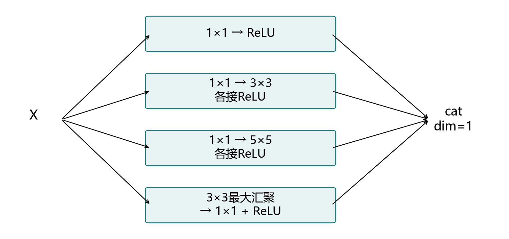
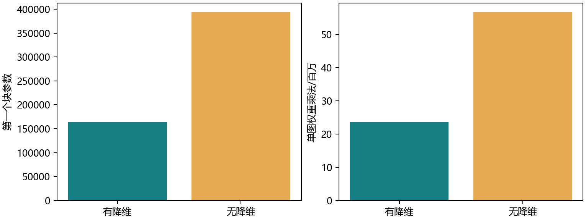
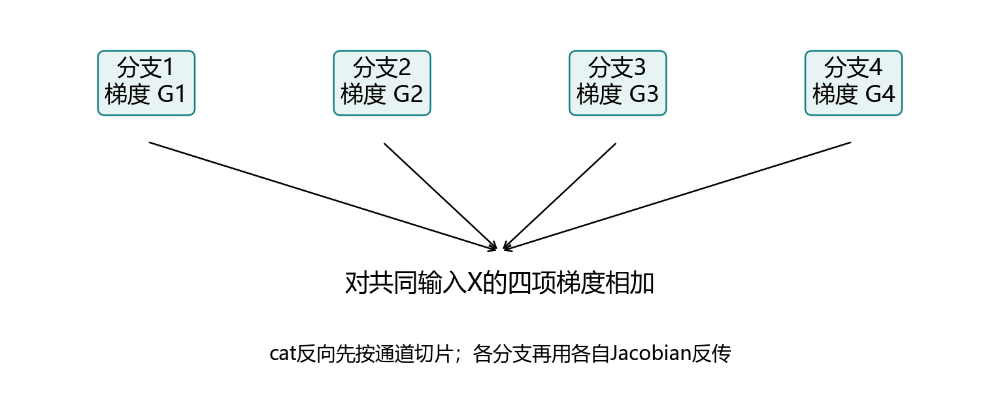
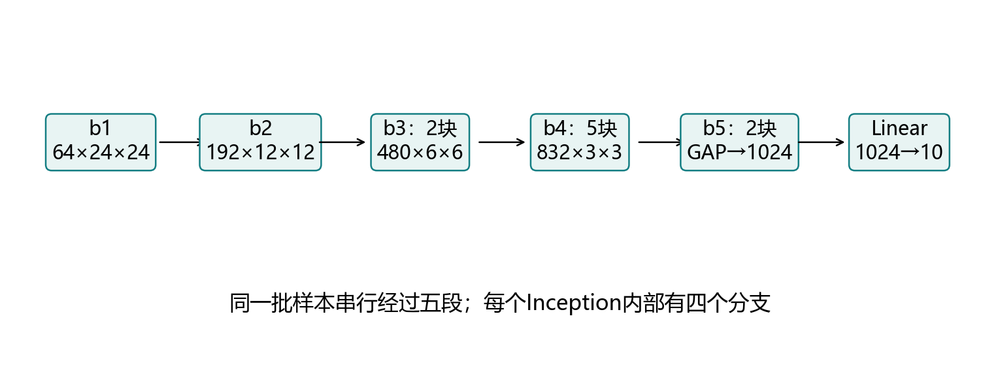
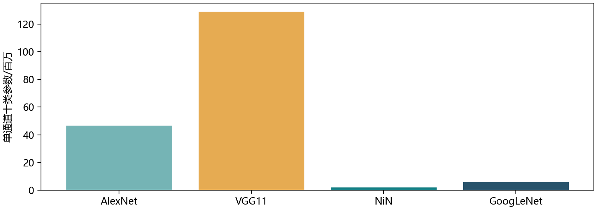
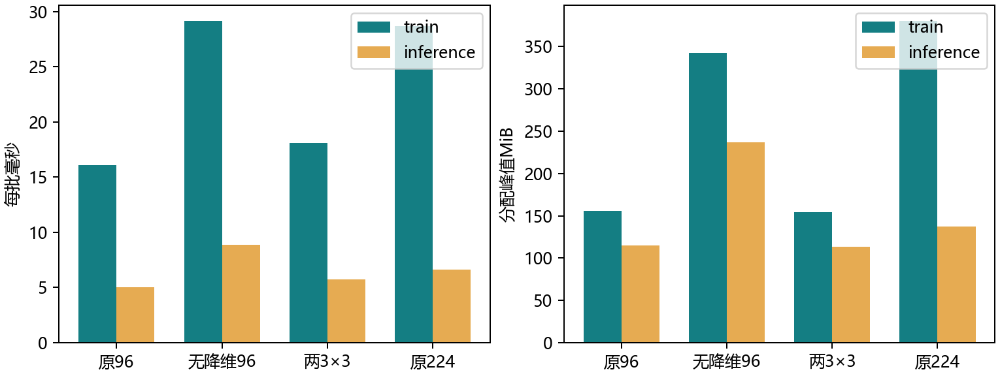
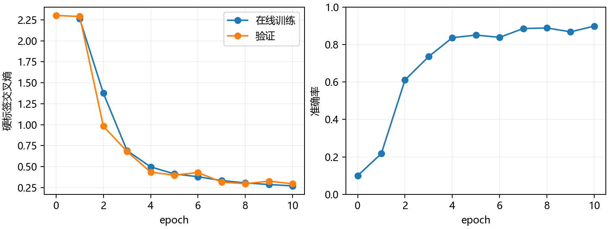
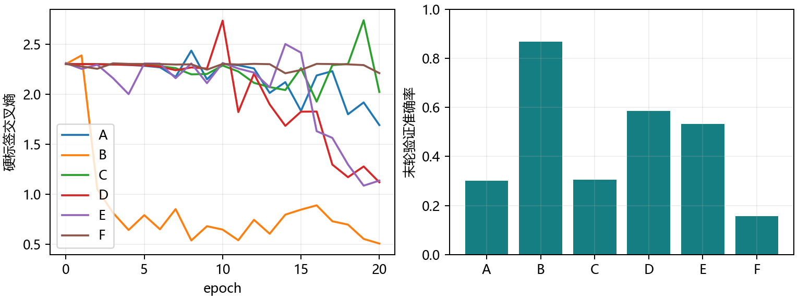

# 7.4 含并行连结的网络（GoogLeNet）· 原理与复现实验

覆盖教材7.4.1-7.4.3及三道练习与子题，PDF281-286/正文263-268；286页只取本节练习。先连接NiN、多尺度分支、1×1降维、梯度和资源，再指导操作复现。使用已有openmmlab与Fashion-MNIST，无安装升级。教师实验不代替用户掌握。

## 01 从NiN的一条链走向多种尺度

NiN把共享逐位置MLP放入卷积网络，让1×1层重新组合通道，再用全局平均汇聚。接下来出现一个设计问题：每个位置应该用多大的空间窗口？小核偏重局部信息，大核能直接覆盖更大邻域，只选一种可能限制表示。

GoogLeNet的Inception块把几种处理并列放在同一个输入上：1×1、先降维再3×3、先降维再5×5，以及最大汇聚后投影。最后保留各条分支的输出，让下一层学习如何组合。



本节延续监督分类：图像进入特征网络，输出十个logits，交叉熵产生梯度，SGD更新全部参数。变化发生在网络组织方式，损失和数据职责继续沿用前几节。

<!-- side -->

### 阅读与操作路线

前15页连续解释原理、完整结构、实际结果和设计取舍。第16页开始逐段跟做，先亲手构造块，再训练小网络，最后复现教材完整模型。

### 结构并行不等于硬件并发

四条分支共享同一输入，但Python代码逐条调用。默认GPU执行不因此自动变成四个设备或四条并行计算流。能否加速仍需实测。

教材是简化版：本节默认不加BN、辅助分类器、原论文特殊训练策略或额外Dropout。后续思想以受控变体预览，结果不冒充官方完整后继模型。

<!-- pagebreak -->

## 02 四分支为什么能按通道拼起来

设输入为(N,C,H,W)。第一分支1×1卷积输出c1通道。第二分支先1×1映射为r3通道，再3×3输出c3。第三分支先1×1映射为r5，再5×5输出c5。第四分支先3×3最大汇聚，再1×1输出cp。

所有卷积后接ReLU。3×3使用padding1，5×5使用padding2；块内最大汇聚使用kernel3、stride1、padding1。这些选择都保持H和W，最终torch.cat(outputs,dim=1)得到(N,c1+c3+c5+cp,H,W)。

cat保留每条分支的通道，不要求它们通道数相同；要求批量与高宽相同。逐元素相加则要求对应维度相容，并把同位置同通道的数合到一起，表达的操作不同。

例如输入(2,8,14,14)，分支输出通道4/6/2/4，拼接后为(2,16,14,14)。若把池化分支步幅误写成2，它会变为7×7，cat立即失败，而不是自动帮你对齐。

<!-- side -->

### “同样大小”的含义

输出网格高宽相同，不代表信息来自同样大的邻域。1×1不再扩大感受野，3×3和5×5读取不同邻域，汇聚分支使用另一种局部统计。

前层通道本来就可能含有大范围信息，因此“1×1分支”不等于它只了解原图一个像素。

### 为什么在dim=1

PyTorch卷积张量是NCHW。dim0是批量，dim1是通道。按批量拼会把同一张图的四种表示错误地当成四张图；按高宽拼会改变空间布局。

多尺度表示可以有帮助，但不能从结构图直接推出准确率一定更高。

<!-- pagebreak -->

## 03 1×1降维怎样减少大核成本

直接用k×k把C个通道映射到D，忽略bias时每个输出位置需k²CD次权重乘法。先1×1降到r通道，再k×k到D，成本变为Cr+k²rD。只有r(C+k²D)<k²CD时，权重乘法才减少。

第一个完整Inception块输入192通道，四分支输出64/128/32/32。3×3前用96通道，5×5前只用16通道。较昂贵的空间核因此在较窄表示上工作；它们的输出仍可较宽，供后续组合。



含bias参数由393472降为163696；在12×12网格上，单图权重乘法由56623104降为23519232。这里只移除第二、第三分支的前置1×1，第一与第四分支的投影保留。

<!-- side -->

### 缩窄也可能丢信息

降维限制了传给空间核的通道组合。ReLU增加非线性，但不能保证压缩前所有有用信息都能保留下来。r越小不意味着分类一定越好。

### 何时反而更贵

如果r几乎等于C，前面多做一次1×1，可能只增加运算。要代入具体输入、输出和中间宽度，而不是把任何1×1都称为“免费降维”。

### 参数与时间分别看

这张图只计算权重乘法，未含汇聚、拼接、激活和反传。额外算子启动、读写与硬件利用率会影响实际时间，第12页再核对GPU测量。

<!-- pagebreak -->

## 04 拼接的反传与共享输入的梯度

把四个分支写为Yb=fb(X)，输出Y=cat(Y1,Y2,Y3,Y4)。损失对Y的梯度先按通道分成G1到G4，每条分支接收属于自己输出的切片，再通过各自卷积、ReLU与汇聚反传。

四条分支都依赖同一个X，所以对X的梯度必须相加：∂L/∂X=Σ_b Jb(X)的转置乘Gb。它们不是四份互不相干的输入，也不应该覆盖前一条分支已有的梯度。



本机float64对照，整块反传与四项分别反传后求和的输入梯度差1.11e-16。正式程序不需要自己写这套求和，autograd根据实际计算图完成；理解规则有助于查错和独立核对。

<!-- side -->

### 参数如何收到信号

各分支的参数通过自己的输出收到监督。最终分类头只给一个全图损失，仍能更新所有被连接且有梯度路径的分支。

ReLU可能截断局部梯度，最大汇聚把梯度传给被选中的位置；这与通道拼接的梯度切片是不同环节。

### 显存为什么不能只数权重

多个分支产生中间结果，cat还需要新的输出存储。训练又保存反传所需信息；实际生命周期由计算图与算子决定，简单累加所有输出不等于峰值显存。

这一节把第4.7节“分支贡献相加”应用到真实卷积子网络。

<!-- pagebreak -->

## 05 用Module表达一个真正的块

Inception继承nn.Module，在__init__中把分支层赋给self.p1等属性，父模型就能递归找到它们的参数。forward接收X，分别计算四个分支，再拼接并返回结果。

第一行super().__init__先初始化Module的内部管理。每次创建一个新的Inception对象，都会构造自己的卷积参数；同一输入流入多个分支，不表示分支之间共用同一套卷积权重。

nn.Sequential适合表示每条分支内部“先后连接”的层。自定义forward则表达“同一X分成多路，再合并”。把它们组合，能避免把复杂网络硬写成一条错误的顺序链。

定义后使用net(X)触发模块调用流程，不在训练循环中手工逐个调分支。一个net.parameters就能把已注册的所有卷积和最后Linear交给优化器；state_dict也包含全部分支权重。

<!-- side -->

### 并列与串联分清

第二分支的1×1和3×3是串联，后者接收前者的输出。四个完整分支之间是并列，分别接收同一个X。

如果把p2接到p1的输出，通道、感受野和整块含义都变了，即使偶然能够运行，也不是教材结构。

### 注册与普通Python列表

临时列表可用于收集已经构造的层；把它们放进Sequential或ModuleList后才进入模块管理。长期仅存在普通列表中的子层，不自动参与父模块的参数、设备和模式管理。

第17、18页会亲手写一个简洁版本，先核对四个分支，再接真实图像。

<!-- pagebreak -->

## 06 九个Inception怎样组成五段网络

前两段是卷积与汇聚的stem。b1用7×7、stride2到64通道，再汇聚；b2先1×1保持64，再3×3到192并汇聚。后面按2/5/2串联九个Inception块。

| 块 | 输入C | 分支1 | 3×3前→后 | 5×5前→后 | 池分支 | 输出C |
| --- | --- | --- | --- | --- | --- | --- |
| 3a | 192 | 64 | 96→128 | 16→32 | 32 | 256 |
| 3b | 256 | 128 | 128→192 | 32→96 | 64 | 480 |
| 4a | 480 | 192 | 96→208 | 16→48 | 64 | 512 |
| 4b | 512 | 160 | 112→224 | 24→64 | 64 | 512 |
| 4c | 512 | 128 | 128→256 | 24→64 | 64 | 512 |
| 4d | 512 | 112 | 144→288 | 32→64 | 64 | 528 |
| 4e | 528 | 256 | 160→320 | 32→128 | 128 | 832 |
| 5a | 832 | 256 | 160→320 | 32→128 | 128 | 832 |
| 5b | 832 | 384 | 192→384 | 48→128 | 128 | 1024 |

<!-- side -->

### 表格怎样读

3a的96与16是内部宽度，不出现在cat后的输出里。64+128+32+32=256，正好接入3b。

b3和b4最后各接一次stride2汇聚。b5在GAP和Flatten后接Linear(1024,10)。

下一块输入C为四个末端通道数之和。

降维中间宽度不计入输出。

这些分配沿用教材示例，来源于特定架构设计经验，并非本机Fashion-MNIST上搜索得到的最优比例。

### 两种汇聚的位置

块内分支汇聚stride1，不改变高宽；阶段末汇聚stride2，降低分辨率。它们都用3×3、padding1，不能只根据kernel_size判断是否下采样。

前层逐渐压缩空间、扩充通道，后层再汇总全图。这条整体思路仍与LeNet、VGG和NiN相连。

<!-- pagebreak -->

## 07 尺寸轨迹与“22层”的计数口径

本节按教材训练96输入。五段输出高宽依次24、12、6、3，再由GAP把最后3×3汇总成1×1。若输入224，阶段高宽改为56、28、14、7，参数数量保持不变。



### 总模块数不是路径深度

九块每块含6个卷积，加stem的3个，共57个Conv；另有1个Linear，总计58个含权重模块。经典“22层”按最长含权重路径计：stem3层+每块最多2层×9+分类1层=22。

分支拓扑中，遍历全部参数模块与沿一条路径数深度，回答的是不同问题。池化、ReLU、cat与GAP虽然无学习权重，仍执行计算。

<!-- side -->

### 两种输入的接口

| 顶层输出 | 96输入 | 224输入 |
| --- | --- | --- |
| b1 | (N,64,24,24) | (N,64,56,56) |
| b2 | (N,192,12,12) | (N,192,28,28) |
| b3 | (N,480,6,6) | (N,480,14,14) |
| b4 | (N,832,3,3) | (N,832,7,7) |
| b5 | (N,1024) | (N,1024) |
| fc | (N,10) | (N,10) |

### 改尺寸为何不改Linear宽度

GAP固定输出1024个通道均值，因此Linear始终接1024维。若直接展平空间特征，输入宽度才会随高宽改变。

<!-- pagebreak -->

## 08 GAP之后为什么还保留一个Linear

NiN让末端通道数直接等于类别数，再对每类响应取平均。这里最后的Inception输出1024个特征通道，GAP只去掉空间维，Linear再把1024维映射到十个类别。

若A为末端特征，先平均再Linear计算z=W×mean(A)+b。由于均值与仿射映射可交换，它也等于mean(W×A+b)：先用1×1卷积把1024通道映射成十个类别响应，再对空间取平均。

本机float64核对两种写法最大差2.78e-17。这个等价依赖中间没有插入ReLU等非线性；不能照搬到NiN最后ReLU之前，把不同顺序说成总是等价。

最后Linear只有1024×10+10=10250参数。全局平均替代的是庞大的空间展平分类头，并不意味着教材代码完全没有全连接层。输出为原始logits，不加softmax就能交给交叉熵。

<!-- side -->

### 与大分类头相比

如果把1024×3×3先展平再接4096，单是这一层权重就有37748736个，还未计偏置和后续层。本节GAP加小Linear显著降低这个部分的参数。

### 保留与丢弃的信息

GAP汇总各通道的空间响应，放弃末端精确位置布局。它可能有利于全图分类，但不能保证适用于定位任务，也不使整网对任意平移严格不变。

卷积和1×1降维仍是学习到的映射。参数变少不等于“没有学习分类”，也不等于优化一定更容易。

<!-- pagebreak -->

## 09 最小合法图像尺寸为什么可以是1

首个7×7、stride2、padding3卷积输出floor((H+6−7)/2)+1=ceil(H/2)。其余四次阶段降采样都用3×3、stride2、padding1，同样输出ceil(H/2)。块内奇数核配合相应padding保持高宽。

所以只要输入H和W分别至少为1，五次向上取整减半后仍至少为1；GAP再固定输出宽度。对本节默认无BN模型，最小合法尺寸为1×1，而不是32或96。1、2、3、31、32、33、96、224的meta结构检查与实际小通道1×1前向均通过。

这只回答张量运算是否合法。把服饰图压成一个像素，会丢失绝大部分形状信息，不能据此推荐1×1训练，也不能推断会保持分类准确率。教材选择96是计算与任务效果的实践取舍。

最大汇聚padding的概念值为负无穷，1×1输入仍有一个真实位置参加最大值；不要把填充值误当成新增图像内容。

<!-- side -->

### 为什么与前几节不同

AlexNet、NiN中有不填充且较大的核与汇聚，因此过小尺寸会变为非正。这里所有降采样都使用足够padding，并在末尾使用GAP，空间接口条件不同。

### BN变体还要检查统计条件

BatchNorm2d训练时每通道要有多于一个参与统计的元素，即N×H×W>1。若某层只剩单样本、单位置，内置层会报错。它属于额外的训练模式约束，不改变默认无BN结构的最小合法尺寸答案。

预测eval使用保存的统计量，约束又与训练不同。完整BN原理留到下一节。

<!-- pagebreak -->

## 10 后续思想预览：BN与标签平滑

教材练习要求尝试后续设计。本节在同一个基础网络上每次只改一个思路，先定义变化，再观察验证结果。它们是可运行的教学变体，不等于完整BN-Inception、Inception-v3或Inception-ResNet的官方架构与训练配方。

B在每个Conv之后、ReLU之前加BatchNorm2d。它用当前批量与空间位置计算每通道统计，归一化后再学习缩放与平移；预测用移动统计。mode切换因此影响计算，no_grad不会自动让BN进入预测状态。

D使用ε=.1的标签平滑，目标分布q=(1−ε)×one_hot(y)+ε/K。十类时真类.91，其他每类.01。目标为−Σ_k qk log(pk)，对logits的梯度为(p−q)/N，减弱把目标概率推到绝对0或1的倾向。

它不保证准确率提高，也不等于把输出随意加噪声。比较D时，在线平滑目标单独记录；验证仍统一用硬标签CE与准确率，避免拿不同损失定义直接排序。

<!-- side -->

### BN预览的实现边界

使用已有PyTorch层，eps=1e-5、momentum=.1、可学习缩放/平移和移动统计。为与A保持相同卷积初值，Conv仍保留bias，明确区别于常见省略bias的Conv+BN写法。

本机小例子已独立核对训练前向、移动统计和eval前向。下一节7.5再完整展开标准化、方差口径、buffer与实现。

### 平滑与数据职责

只改变训练目标，不改变验证和测试标签。ε不是从测试集选出来的；本节固定.1做一次有边界的比较。

K类目标各项必须加起来为1。把真类写成.9而其他九类各.01，会漏掉.01的总质量。

<!-- pagebreak -->

## 11 后续思想预览：核分解与残差

C把第三分支的5×5改成连续两个3×3，均接ReLU。保留1×1降维，随后先r→r，再r→D。两个stride1的3×3具有5×5结构感受野，但非线性与参数分解使它们不是任意原5×5卷积的完全等价替换。

共同的1×1后，原空间核权重为25rD；这里两核为9r²+9rD。当前各块r不大于D，因此这一选择减少权重乘法；若选很宽的中间通道，成本也可能增加。算子变多，实际时间仍需测量。

E在拼接输出后加入捷径：Y=ReLU(cat(branches(X))+P(X))。若输入和输出通道相同，P为恒等；否则用1×1投影匹配通道，空间高宽保持不变。加法要求形状一致，与cat的通道保留规则不同。

捷径提供一条额外梯度路径，但仍会受非线性门控和优化条件影响。本节是基本的投影残差实验；完整Inception-ResNet还涉及其他结构、缩放与训练设计，不据此宣称复现了它。

<!-- side -->

### 一次只改变一个因素

A为教材基线，B加BN，C分解核，D标签平滑，E残差，F去掉降维。没有把BN、残差和大规模增强一起加入后，再把效果归给某一项。

### 参数初值怎样对齐

按稳定层名生成SHA-256角色种子，重建时同名同形状的Conv/Linear使用相同初值。A/B/D的全部卷积与Linear初始哈希相同；BN新增的参数与统计量另行管理。

结构改变后新增或形状不同的层无法共享完全相同权重，这个限制会保留在结果解释中。

<!-- pagebreak -->

## 12 与AlexNet、VGG和NiN比较参数

完整灰度十类GoogLeNet有5977530参数，float32权重23910120字节，约22.80MiB。NiN更小；两者都远少于具有庞大全连接头的AlexNet与完整VGG11。



| 结构 | 参数 | float32权重MiB |
| --- | --- | --- |
| AlexNet | 46764746 | 178.39 |
| 完整VGG11 | 128806154 | 491.36 |
| NiN | 1992166 | 7.60 |
| GoogLeNet | 5977530 | 22.80 |

<!-- side -->

### 为什么参数减少

NiN去掉大分类头，用类别通道加GAP；GoogLeNet用GAP加小Linear，并在大核之前降维。不是因为把输入改小，卷积核参数就自动减少；输入尺寸主要影响激活与运算量。

### 本节结构的计算量

96输入单图权重乘法276066304。224输入为1502982144，参数仍相同。这里只计权重乘法，未计其他运算和反传。

### 删除降维会怎样

F去掉18个前置1×1，卷积总数反而从57变39，但参数增至24284922、96输入乘法798410752。层少了却可能更贵，原因是大空间核直接接收宽输入。

C用两个3×3替代5×5，卷积数增至66，参数5669434、乘法263631616。层数、参数数和时间不能混作一个量。

<!-- pagebreak -->

## 13 独立GPU短测：更少乘法是否更快

单独顺序测量四个配置，均为完整通道、batch8。训练含前向、平均CE、反传和无动量SGD；预测使用eval加inference_mode。时间与PyTorch分配峰值分别记录。



去掉降维后，96输入训练从16.09增至29.12毫秒，分配峰值从156.00增至342.42MiB。更大的空间核输入使参数和理论运算增加，当前实测也更贵。

C的乘法略少，训练却为18.09毫秒，比原96慢。更多算子与读写可能影响结果，但本节没有进一步硬件剖析，不能只用理论次数确定具体瓶颈。

224仅作结构检查和随机输入短测，未做其全量服饰训练。

<!-- side -->

### 实际每批时间与分配峰值

| 结构 | 训ms | 预ms | 训MiB | 预MiB |
| --- | --- | --- | --- | --- |
| 原96 | 16.09 | 5.00 | 156.00 | 114.78 |
| 无降维 | 29.12 | 8.89 | 342.42 | 236.64 |
| 两3×3 | 18.09 | 5.74 | 154.15 | 113.61 |
| 原224 | 28.66 | 6.63 | 380.07 | 137.35 |

### 统一测量条件

float32、TF32关，随机GPU驻留输入。每组2预热5步CUDA事件计时并同步，不含加载、Resize和模型构造。

预留峰值训练210/396/192/472MiB，预测124/380/124/174MiB。预留含缓存，与分配不同；均不等于全部进程显存。

### 解释边界

这是短测，没有长程或多次独立重复。温度、频率与其他负载会影响时间，不保证任意硬件的固定加速比。

<!-- pagebreak -->

## 14 完整教材模型的真实十轮结果

96输入、SGD .1、batch128，54000训练/6000验证/10000测试。沿用划分3601、加载器3603，十轮4220次更新，尾批112。只在固定末轮测试一次。



| 最后一轮指标 | 实测 |
| --- | --- |
| 在线训练CE / 准确率 | .269223 / 89.6981% |
| eval训练CE / 准确率 | .254160 / 90.3704% |
| 验证CE / 准确率 | .294074 / 89.7833% |
| 测试CE / 正确数 | .313835 / 8846共10000张 |

<!-- side -->

### 初始化与教材的差别

CPU按7400和稳定层名派生种子做Xavier gain1、显式零bias，再迁移GPU。教材只重设weight，偏置处理不同。像素float32/255后按批bilinear插值96，align_corners=False、antialias=True。

### 实际代价与曲线

包括验证、末轮训练重评、测试、哈希与保存共410.31秒；PyTorch分配峰值998.97MiB。第8/9/10轮验证88.80%/86.72%/89.78%，并非每轮单调。

### 解释成绩的边界

末轮测试88.46%是本机结果，教材示例约88.6%不是验收目标。没有按测试选轮次。各节输入、结构和优化条件不同，应结合协议解释分数。

<!-- pagebreak -->

## 15 六组受控实验怎样观察后续思想

固定平衡2000训练/1000验证，按类200/100、种子7401/7402。六方案各20轮320更新、尾批80；只按硬标签末轮验证CE比较，不读取测试。



B的末轮验证CE最低，本次BN明显改善短预算优化。它的eval训练CE .002815、准确率99.95%，验证CE仍.506104，说明训练/验证差距依然存在，不能写成BN消除了过拟合。

D与E在本预算内优于A，C的CE更差；不能据此断言某个后续思想普遍有效或无效。F在当前条件下学得较差，同时需要更多参数与计算，去降维不构成改进。

<!-- side -->

### 最后一轮实际结果

| 项 | 唯一变化 | 验证CE | 准确率 |
| --- | --- | --- | --- |
| A | 教材基线 | 1.6911 | 30.1% |
| B | 加BN | .5061 | 86.7% |
| C | 两个3×3 | 2.0220 | 30.6% |
| D | 平滑.1 | 1.1187 | 58.5% |
| E | 投影残差 | 1.1357 | 53.3% |
| F | 无降维 | 2.2108 | 15.6% |

### 同一把尺比较

D末轮在线平滑目标1.470876，在线硬CE1.254346；两者不同，表内只用验证硬CE。A训练eval CE1.699157，主要是学习不足。

全部为单种子、有限预算。B没有额外读取测试；第14页88.46%仍是预定教材基线，不把子集选择分数当成独立测试成绩。

<!-- pagebreak -->

## 16 操作一：文件、环境与完整结构

在VS Code打开项目根目录，终端也切到该目录。教师入口lessons/ch07/04_googlenet.py；练习入口exercises/ch07/04_googlenet.py，沿用已有解释器。

```powershell
$pythonPath = 'D:\Anaconda\envs\openmmlab\python.exe'
$env:PYTHONUTF8 = '1'
& $pythonPath lessons/ch07/04_googlenet.py --inspect --guided
```

预期六段输出：(1,64,24,24)、(1,192,12,12)、(1,480,6,6)、(1,832,3,3)、(1,1024)、(1,10)。再核对5977530参数、57个Conv与276066304次权重乘法。

在.cache目录新建7_4_follow.py，第16-20页Python代码按顺序接到同一文件。先写导入与数据接口：

```python
import runpy
from pathlib import Path
import torch
from torch import nn
from torch.nn import functional as F
ROOT = Path.cwd()
helper = runpy.run_path(str(
    ROOT / "lessons/ch07/04_googlenet.py"))
common = helper["COMMON"]
device = common["configure"]("cpu")
```

<!-- side -->

### 先检验接口

inspect使用meta张量核对形状和理论计数，不读取数据，也不代表已在GPU训练。真正模型由CPU初始化后迁移。

### 跟做是小网络

接下来亲手写简洁Inception，再搭一个两块、原始28输入的小网络。它保留四分支、降维、拼接与GAP，但不是完整九块教材模型。

### 路径与数据

Path.cwd依赖终端目录，找不到文件先确认在项目根目录。数据在data/FashionMNIST/raw，主程序只读且download=False。runpy获取教师定义，不执行其main。

<!-- pagebreak -->

## 17 操作二：先定义四条分支

继续写在同一跟做文件。先定义类和__init__，把分支卷积与汇聚注册为子模块。下一页的forward要缩进在同一个class内部，与__init__对齐。

```python
class Inception(nn.Module):
    def __init__(self, ci, c1, c2, c3, c4):
        super().__init__()
        self.p1 = nn.Conv2d(ci, c1, 1)
        self.p2 = nn.Sequential(
            nn.Conv2d(ci, c2[0], 1), nn.ReLU(),
            nn.Conv2d(c2[0], c2[1], 3, padding=1),
            nn.ReLU())
        self.p3 = nn.Sequential(
            nn.Conv2d(ci, c3[0], 1), nn.ReLU(),
            nn.Conv2d(c3[0], c3[1], 5, padding=2),
            nn.ReLU())
        self.p4 = nn.Sequential(
            nn.MaxPool2d(3, stride=1, padding=1),
            nn.Conv2d(ci, c4, 1), nn.ReLU())
```

ci是共同输入通道；c2、c3是二元组，分别保存该分支降维宽度和最后输出通道。第一分支暂时只定义Conv，它的ReLU会写在forward。

此时类尚缺forward，先不要单独调用它。把下一页方法接好，再运行整个文件。每次Inception(...)都会构造新模块，不把不同块绑定为同一对象。

<!-- side -->

### padding为什么分别为1和2

stride1时，奇数核k配padding=(k−1)/2保持高宽。第一、第四分支的1×1默认不填充；分支汇聚stride1也保持高宽。

### 两种括号

c2[0]、c2[1]是索引元组；nn.Sequential(...)括号中则是按顺序连接的模块对象。位置顺序决定前层输出要交给哪一层。

### self有什么作用

self.p2把路径保存到当前模块对象。父模型能递归找到它，forward也可再次调用。可训练层应在构造时注册，不要每次前向重新创建。

<!-- pagebreak -->

## 18 操作三：拼接并逐分支核对形状

将下面forward保持四格缩进，接在上一页class内部。随后测试代码恢复顶格，结束类定义。四个分支都接X，最后按dim1拼接。

```python
    def forward(self, X):
        p1 = F.relu(self.p1(X))
        p2 = self.p2(X)
        p3 = self.p3(X)
        p4 = self.p4(X)
        return torch.cat((p1, p2, p3, p4), dim=1)

torch.manual_seed(7405)
block = Inception(8, 4, (4, 6), (2, 2), 4)
X = torch.randn(2, 8, 14, 14)
branches = [F.relu(block.p1(X)), block.p2(X),
            block.p3(X), block.p4(X)]
print("分支", [tuple(y.shape) for y in branches])
print("拼接", tuple(block(X).shape))
print("块参数", sum(p.numel() for p in block.parameters()))
```

预期四分支通道4/6/2/4，高宽都14；拼接(2,16,14,14)，块参数450。把X高宽改成9和11，观察输出高宽跟随改变，参数量保持不变。

<!-- side -->

### 主动制造一次尺寸错误

复制一份跟做文件，把分支汇聚stride改为2，观察cat提示高宽不一致。核对后改回1，再继续下一页，避免用错误结构训练。

### 再核对通道和

输出16来自4+6+2+4。降维宽度4与2在分支内部使用，不能再把它们作为额外输出通道相加。

### 参数变化实验

只把c2中间宽度从4改成2，其他不动，重新构造块并数参数。预测3×3权重如何变化，再运行核对。不要在旧优化器上随意替换模块后继续训练。

<!-- pagebreak -->

## 19 操作四：接小网络与真实数据

继续追加。原始28输入先用3×3到8通道，再汇聚为14。第一块输出16通道，再汇聚为7。第二块输出20通道，GAP取20个均值，Linear产生十个logits。

```python
net = nn.Sequential(
    nn.Conv2d(1, 8, 3, padding=1), nn.ReLU(),
    nn.MaxPool2d(2),
    Inception(8, 4, (4, 6), (2, 2), 4),
    nn.MaxPool2d(2),
    Inception(16, 6, (4, 8), (2, 2), 4),
    nn.AdaptiveAvgPool2d(1), nn.Flatten(), nn.Linear(20, 10))
for j, layer in enumerate(m for m in net.modules()
                          if isinstance(m, (nn.Conv2d, nn.Linear))):
    torch.default_generator.manual_seed(7400 + j)
    nn.init.xavier_uniform_(layer.weight)
    nn.init.zeros_(layer.bias)
net = net.to(device).eval()
print("小网参数", sum(p.numel() for p in net.parameters()))
print("小网输出", tuple(net(torch.zeros(8, 1, 28, 28)).shape))
splits, _ = common["load_data"](include_test=False)
train = common["balanced_subset"](splits["train"], 37, 7401)
validation = common["balanced_subset"](
    splits["validation"], 20, 7402)
loader = common["make_loader"](train, shuffle=True, batch_size=8)
optimizer = torch.optim.SGD(net.parameters(), lr=.1)
```

<!-- side -->

### 预期接口

总参数1410，输出(8,10)。两块各6Conv，再加stem的1Conv和最后Linear，共14个含权重模块。

37图每轮8/8/8/8/5，三轮15次更新。小网络不插值到96，目的在于检查完整数据流，不能拿它的分数代替教材正式模型。

### 划分为何可靠

沿用官方训练集内部54000/6000划分，再取37/20；训练和验证不重叠，include_test=False不读取官方测试集。

### 初值与正式模型

跟做按简单遍历序号7400+j初始化，正式模型按层名角色种子。两套规则分别记录；即使某层形状相同，也不把它们宣称为相同起点。

<!-- pagebreak -->

## 20 操作五：训练、验证和保存恢复

最后追加训练与恢复，再运行整个.cache/7_4_follow.py。平均CE已经除实际批量；每个批次清梯度、反传、更新，尾批不额外按8除一次。

```python
updates = 0
for epoch in range(3):
    net.train()
    total = 0.
    for X, y in loader:
        optimizer.zero_grad(set_to_none=True)
        loss = F.cross_entropy(net(X), y)
        loss.backward()
        optimizer.step()
        total += loss.item() * len(y)
        updates += 1
    print("epoch", epoch + 1, "在线CE", total / len(train))
net.eval()
with torch.no_grad():
    X, y = next(iter(common["make_loader"](
        validation, batch_size=20)))
    before = net(X).clone()
    print("验证", int((before.argmax(1) == y).sum()), "/", len(y))
path = ROOT / ".cache/7_4_follow.pt"
torch.save(net.state_dict(), path)
net.load_state_dict(torch.load(path, weights_only=True))
with torch.no_grad():
    print("更新", updates, "恢复差",
          (net(X) - before).abs().max().item())
```

<!-- side -->

### 运行命令与预期

```powershell
& $pythonPath .cache/7_4_follow.py
```

应打印三轮在线损失、15次更新、20张验证计数和恢复差0。小样本三轮不要求高分，先确认接口、梯度与更新真正接通。

### 模式切换继续保留

当前小模型没有Dropout或BN，train/eval的输出通常相同；仍保留规范流程，加入依赖模式的模块后才能正确验证。

### 改一个参数核对

把batch8改为10，从相同初始化重跑。每轮10/10/10/7，三轮12次更新；不能继续期待15。记录预测与实测，再说明批量如何影响优化轨迹。

<!-- pagebreak -->

## 21 操作六：复现完整模型与实验模式

小网络闭环完成后，再运行完整教师文件。所有命令在项目根目录执行；--guided显示中文摘要，--record才写报告、曲线和本地模型。GPU任务顺序运行。

```powershell
& $pythonPath lessons/ch07/04_googlenet.py --guided --record
& $pythonPath lessons/ch07/04_googlenet.py --experiments --guided --record
& $pythonPath lessons/ch07/04_googlenet.py --benchmark --guided --record
```

默认完整96模型、十轮；experiments固定六组子集，不读测试；benchmark需要CUDA，分别测训练与预测，不读取数据集。变体的平滑目标与硬标签CE在JSON里分别记录。

只检查CPU流水线，可以运行独立custom协议：

```powershell
& $pythonPath lessons/ch07/04_googlenet.py --device cpu `
  --epochs 1 --batch-size 2 --train-size 11 `
  --validation-size 10 --guided --record
```

它更新6次、尾批1，不读测试，写7_4_custom前缀，不覆盖正式结果。省略--guided可查看JSON；inspect无需数据。

<!-- side -->

### 输出文件

正式指标：reports/ch07/7_4_metrics.json与逐轮CSV。子集：7_4_experiments.json。GPU资源：7_4_benchmark.json。曲线在figures目录。

本地完整权重：artifacts/ch07/7_4.pt，不提交GitHub。教材、原始数据和环境也只留在本地。

### 重建PDF

```powershell
python tools/build_study_pdfs.py --section 7.4
```

文档使用现有PDF工具环境，训练仍用openmmlab，不为重建讲义升级训练依赖。

完整验证入口为tools/verify_googlenet.py，范围与限制见实验核对报告。

<!-- pagebreak -->

## 22 综合练习：亲手接通四分支与训练

打开exercises/ch07/04_googlenet.py。它与跟做一样使用两个小Inception和原始28输入，1410参数；不是完整九块模型。八处TODO由自己填写，按三阶段运行检查。

| 阶段 | 位置 | 运行后的检查 |
| --- | --- | --- |
| 分支 | TODO1-4 | 四条路径高宽一致，通道正确 |
| 拼接 | TODO5 | 第一块由8输入通道变16输出通道 |
| 更新 | TODO6-8 | 批平均CE、反传与SGD接通 |

先填1-4，程序应进入TODO5提示；填完5，应打印参数1410、输出(8,10)，随后提示6-8。全部完成后，预期三轮15更新、验证计数。不要为了得到某个分数不断换种子。

集中反馈：先预测四分支与拼接形状，再给实际参数/更新/验证结果，最后解释为什么cat的反向先切片，而同一X的梯度要相加。

<!-- side -->

### 运行练习

```powershell
& $pythonPath exercises/ch07/04_googlenet.py
```

空模板先提示阶段，等待填写后再训练。教师参考在内存运行。八处源答案仍待你填写。

### 需要反馈的概念

为什么1×1可以降低后续3×3/5×5成本？为什么块内汇聚不改变高宽？为什么GAP后Linear仍接20维或1024维，而不是乘上空间面积？

若报错，给出完整异常和对应TODO。根据实际反馈先给最小提示，材料已运行不代表练习已由用户掌握。

<!-- pagebreak -->

## 23 常见错误怎样定位与复现

按“形状→注册→损失/梯度→优化效果”检查，避免把接口错误、有限预算和模型设计混为一谈。

| 现象 | 先查什么 | 最小核对 |
| --- | --- | --- |
| cat报尺寸不一致 | 分支stride和padding | 打印四个NCHW |
| 下一块通道不匹配 | 四个末端通道之和 | 不加降维中间宽度 |
| 参数未更新 | 是否注册子层、执行step | 更新前后克隆一个weight |
| CE输入报错 | logits为(N,10)，y为long/(N,) | 不提前softmax |
| BN预测漂移 | train/eval与移动统计 | 固定X比较两种模式 |

改通道时重建模型和优化器，检查后续输入。比较变体从对应固定初值开始，保持数据与预算；换batch会改变更新次数，不能直接沿用4220这个数字。

CPU和GPU浮点计算路径可能给出略不同的logits。先核对恢复权重哈希，再用高精度参照定位差异，确认类别与误差范围；不把“得分不完全相同”直接当作保存失败。

<!-- side -->

### 本次恢复核对的发现

两张验证图默认CPU/CUDA最大差约5.19e-4，超过初定1e-4阈值。CPU对float64参照差2.34e-6；关闭cuDNN后的GPU差1.23e-6，默认cuDNN差5.17e-4。

这定位到当前后端计算路径的数值差异。权重哈希与预测类别一致，正式训练协议未改；记录分别核对的误差界限，不仅放宽阈值就宣告通过。

### 独立数值范围

NumPy保留九块与完整96几何，缩为24437参数，核对全部小模型梯度和尾批更新；另核对分解核、残差和无降维小块。它不等于独立验证完整597万参数的全部梯度。

<!-- pagebreak -->

## 24 回到教材三道练习与全部子题

练习1：先定义BN、两3×3、标签平滑和投影残差的具体改变，再用B-E实际运行观察。统一报告验证硬标签CE；说明这里只复现这些设计思想，没有把简化变体称为完整官方后继网络。BN与残差的系统教学分别接到7.5和7.6。

练习2：按ceil(H/2)推导五次下采样，块内保持高宽，GAP固定接口，得默认无BN网络最小合法1×1。结构可运行与有用的学习任务分开；BN训练还要检查N×H×W>1。

练习3：按第12页同为灰度十类的参数表比较。NiN以类别响应/GAP取代大头；GoogLeNet以降维控制大核，并用GAP加小Linear。不能把“减少全连接头”误写成GoogLeNet没有任何Linear。

F说明去掉降维会让层数更少、参数与计算却更大。C说明分解核能少一些乘法，但不保证更快。把结构公式、实际数值和结果限制一起回答，才是完整的实验解释。

<!-- side -->

### 控制结论的范围

每个候选一个种子，固定20轮和有限数据，没有多种子均值或置信区间。GPU短测只有5步，没有长程独立重复。

### 概念之间的联系

多尺度沿用第6章感受野；1×1来自6.4；分支梯度相加来自4.7；注册与保存来自第5章；GAP来自NiN；所有分类实验继续遵守训练/验证/测试职责。

能够解释这些联系，比单独记住一串通道数更重要。

<!-- pagebreak -->

## 25 沿完整数据流回顾与下一节

一张图先经stem建立特征，再逐个通过九个Inception。每块让同一输入走四条路径，1×1为大核选择较窄表示，各分支保持高宽并按通道拼接。阶段汇聚降低分辨率，GAP汇总1024个特征，小Linear给出十个logits。

交叉熵把标签变成输出梯度，cat按通道切分它，分支反传到共同输入时相加，SGD统一更新已注册参数。资源取决于通道、空间大小、核与运行路径，不由层数或参数量单独决定。

完成跟做后，集中解释五点：四分支怎样对齐；降维何时省计算；cat与add的区别；最长深度与模块总数；GAP为何允许变化输入尺寸。附上预测、实际输出与参数对照的观察。

本节教师实验与材料准备不代替用户作答，八处练习仍需亲手完成。下一节7.5「批量规范化」从教材PDF286/正文268开始，将完整解释BN的统计、训练/预测模式、参数与移动状态，以及从零实现和框架实现。

<!-- side -->

### 文件索引

讲义：docs/ch07/04_googlenet.md。

教师：lessons/ch07/04_googlenet.py。

练习：exercises/ch07/04_googlenet.py。

实际结果与验证：reports/ch07/7_4_*。

### 学习记录原则

只记录真实回答、困难、操作和解释；旧练习未验证不阻止按请求前进，也不会被教师成功运行补记为掌握。

教学代码、讲义、PDF与报告随本回合同步GitHub。数据、教材和完整模型留在本地。
