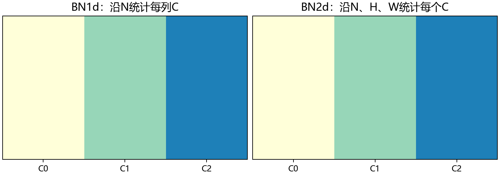
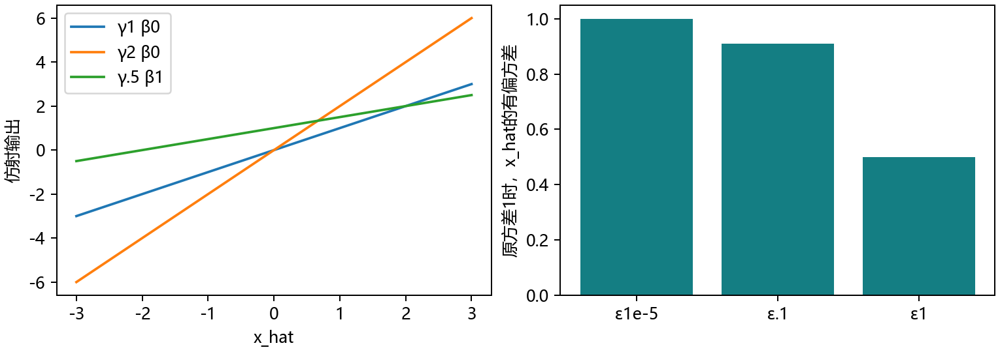
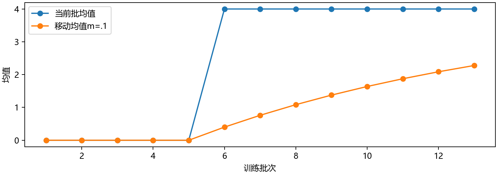
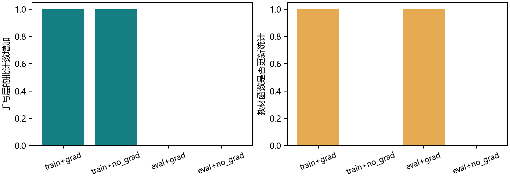
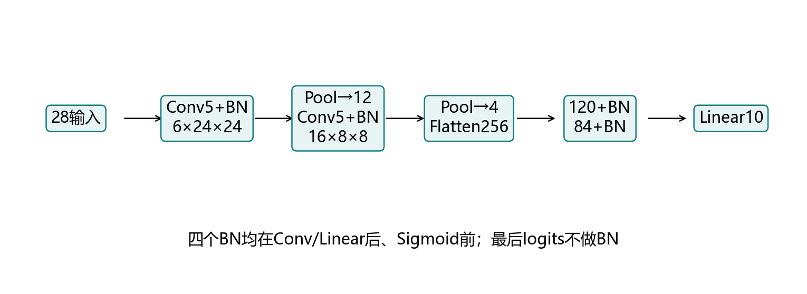
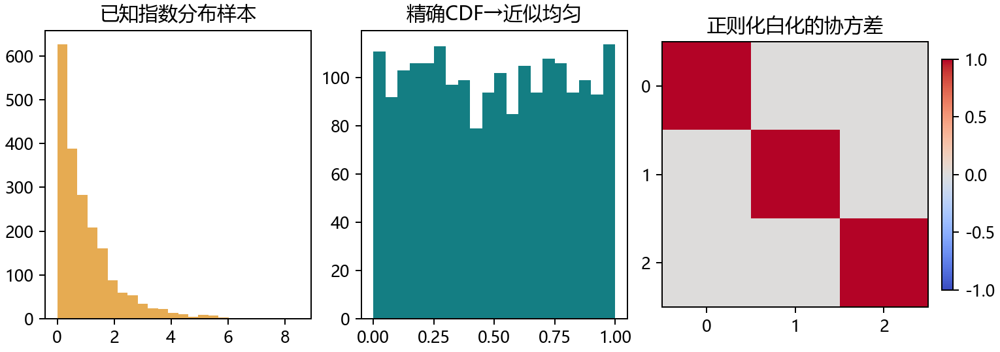
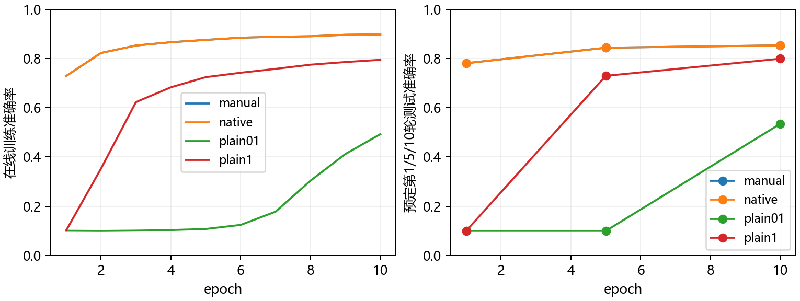
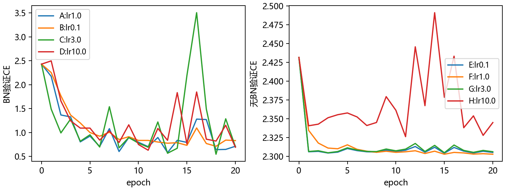
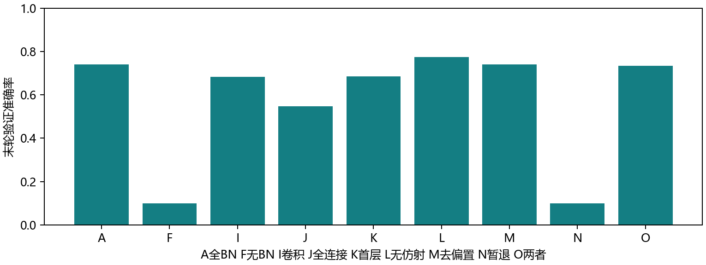
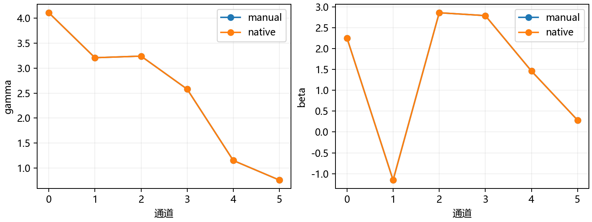

# 7.5 批量规范化 · 原理与复现实验

覆盖教材7.5.1-7.5.6及七道练习，PDF286-293/正文268-275；293页只取本节练习。先串起统计、仿射、梯度、模式、移动状态与研究边界，再指导从零实现和框架复现。沿用既有openmmlab与本地图像数据，不安装升级，不把教师运行记作掌握。

## 01 从上一节的现象追问BN做了什么

上一节的受控子集里，加BN明显改善了短预算优化，但训练与验证仍有差距。现在需要把“加一个层就有效”的观察拆成可计算的规则，弄清它改变了前向、反向和预测时的哪些环节。

输入预处理通常先统一特征尺度；深层网络的中间表示却随权重更新而变化。BN在选定层上，用当前批量估计每个特征的均值与方差，先中心化、缩放，再学习新的拉伸与偏移。

它并不是把所有中间值永久钉在均值0、方差1。批估计有噪声；eps影响规范化方差，gamma与beta还能改变分布。训练用批统计，预测通常使用移动统计，因此模型还多了一组必须保存的状态。

本节完整连接第4章的标准化、梯度与正则化，第5章的参数/buffer和模式，第6章的卷积通道，再回到LeNet实际训练。最后讨论其他规范化与两道研究思路的条件和限制。

<!-- side -->

### 阅读与操作

前19页连续讲原理和实测，第20页起按文件逐段操作。六段Python代码组成一个跟做文件，再完成八处待填练习。

### 两个差别先记住

train/eval决定使用哪组统计；no_grad决定是否记录梯度。两者独立。

gamma/beta是优化器学习的参数；移动均值、移动方差和批计数是buffer，不通过梯度下降学习。

教材原手写函数与框架有模式及移动方差差别，本节会明示。正式手写类按本机PyTorch口径实现，原行为仅作对照。

<!-- pagebreak -->

## 02 先决定统计集合：保留什么轴

全连接输出(N,C)的每个特征列沿N条样本统计；卷积输出(N,C,H,W)则在每个通道内沿N×H×W统计。两者都保留C。不是把所有通道混为一个总体。



代码对应axes=(0,)或(0,2,3)。均值若保持维数，可直接广播；本节参数和buffer保存为(C,)，计算时reshape到(1,C)或(1,C,1,1)。这些形状表达同一统计规则。

记每通道统计元素数为m。二维时m=N，四维时m=NHW。单张卷积图只要H×W>1仍可统计；单样本单位置的BN1d训练则只有一个元素，本实现和框架都会拒绝。

<!-- side -->

### 不把原始元素数当独立样本数

相邻像素可能高度相关。NHW是计算使用的元素数，不保证有NHW个统计独立观察；小批量与小空间尺寸仍可能产生不稳定估计。

### 对应框架接口

BatchNorm1d还支持(N,C,L)，按N和L统计；BatchNorm3d支持(N,C,D,H,W)。本节手写类只覆盖二维和四维，不冒称实现全部高级接口。

保留通道轴是本节统一主线。后面改变统计轴，就得到LayerNorm、InstanceNorm和GroupNorm等不同方法。

<!-- pagebreak -->

## 03 中心化、eps与可学习的仿射变换

对一个通道的m个值，批均值μ=(Σxi)/m，有偏批方差v=Σ(xi−μ)²/m。先计算x_hat=(x−μ)/sqrt(v+eps)，再输出y=gamma×x_hat+beta。eps在平方根内部，避免分母为零并影响小方差时的尺度。

若v>0，x_hat的均值接近0，有偏方差为v/(v+eps)，通常略小于1；v=0时规范化输出全0。随后y的均值与beta相关，方差还会乘gamma²，不能说最终输出始终标准正态。



gamma初始1、beta初始0，但训练后可以不同；gamma也可以为负。它们让模型重新选择有用的尺度与中心，而不是被标准化操作永久限制在固定表示上。

<!-- side -->

### 一个能手算的例子

两条样本为(1,10)、(3,14)。均值(2,12)，有偏方差(1,4)，所以两列规范化后均接近−1与1。

这两列原始单位不同，但每列分别处理。四个值不会混在一起求同一个均值。

### 正尺度不变也有条件

忽略eps时，正比例缩放和平移会被批规范化消去。eps非零时只是近似；负比例会改变方向；有限精度与后续优化也会影响轨迹。

“BN降低尺度敏感性”不等于任意大学习率都稳定。

<!-- pagebreak -->

## 04 批统计为什么必须参与反向传播

均值和方差来自当前输入，也依赖前面的权重。训练时不能把μ、v随手detach后用于规范化，否则会丢掉统计量对应的梯度路径。需要detach的是保存到移动状态里的副本。

令上游梯度为g=∂L/∂y，同一通道各元素共享gamma与beta，则∂L/∂beta=Σg，∂L/∂gamma=Σ(g×x_hat)。输入梯度为：

dx=gamma/sqrt(v+eps)×[g−mean(g)−x_hat×mean(g×x_hat)]。

两个mean都在同一通道的统计集合内计算。这使一个样本的输出与梯度受到同批其他样本影响，BN不再是逐样本独立的函数。输入梯度在统计集合上的和接近0，体现中心化对共同平移方向的约束。

预测使用固定移动统计时，均值与方差不再依赖当前X，输入梯度简化为g×gamma/sqrt(running_var+eps)。eval模式仍可求梯度，前提是没有关闭梯度记录。

<!-- side -->

### 求均值与detach放在哪里

mean、centered、var和x_hat在训练计算图中保留。更新running_mean/var时使用no_grad或detach，防止状态把所有历史批次串成巨大的计算图。

### 本节怎样独立核对

完整44878参数LeNet的NumPy前向、全部参数/输入梯度和三次SGD均已核对；单层二维/四维又用16个坐标中心差分检查公式。

数学公式相同，不保证多次浮点更新逐位相同。小批量2/3的舍入差放大也被保留，未用它替代正常规模的对齐检查。

<!-- pagebreak -->

## 05 移动状态怎样更新，方差为何有两种

预测通常不拿当前测试批重新估计统计，而使用训练积累的移动状态。设新统计更新权重为a：running_mean←(1−a)×running_mean+a×μ。默认a=.1；旧批的影响按几何权重衰减。



PyTorch训练前向使用有偏v，移动方差更新使用v×m/(m−1)的无偏修正。上页两样本例中，更新后running_mean为(.2,1.2)，running_var为(1.1,1.7)。教材原函数把有偏v直接移动，得到(1,1.3)，两者不同。

教材momentum=.9表示旧统计保留比例，对应框架momentum=.1的新统计更新权重。它和SGD动量不是同一个概念，不能直接照抄同名数值。

<!-- side -->

### 移动均值不是精确总体估计

默认初始均值0、方差1；早期受初值影响。每批更新权重相同，即使尾批样本较少，也不是严格按所有样本加权的总体统计。

可另用训练数据做明确的统计校准，但不能随意把测试数据灌进移动状态后再称为独立评估。本节正式测试不更新状态。

### 固定权重与累计平均

框架momentum=None使用累计更新；本节手写类仅支持固定更新权重a。

方差的有偏/无偏是分母m与m−1的区别，不是“是否减均值”，也不是eps本身。

<!-- pagebreak -->

## 06 train、eval和梯度开关怎样组合

本节手写类根据self.training选择批统计或移动状态。train+no_grad仍使用批统计并更新buffer，只是不建梯度图；eval+grad使用移动统计，仍可对输入与参数求导。



教材函数用torch.is_grad_enabled()代替模式，能配合特定训练工具运行，却不等于通用的Module语义。直接调用eval但仍开梯度，原函数仍可能按训练统计计算；train时套no_grad，又可能错误地使用移动统计。

训练时同一目标样本换一组同伴，输出可能改变。eval使用固定状态时，其输出不应随同批其他样本变化。这个差别也是小批量预测为何通常使用eval的原因。

<!-- side -->

### 正常验证流程

先net.eval，再在no_grad或inference_mode里前向。下一轮训练先net.train，不能只切梯度开关。

### 统计更新也是状态修改

即使没有optimizer.step，train模式前向也能改变BN的移动状态与计数。想做不改变模型的结构试运行，应使用eval或独立副本。

### 诊断与正式模型分开

本节模式演示用新建小层或独立副本。没有借验证/测试前向悄悄重校准正式模型，也没有把这种状态修改当成学习已完成。

<!-- pagebreak -->

## 07 参数与buffer一起构成可恢复的模型

gamma与beta属于nn.Parameter，会进入parameters并由优化器更新。running_mean、running_var与num_batches_tracked属于buffer，通常requires_grad=False，但仍是预测所需状态。

用register_buffer注册后，它们随to(device)、double等迁移，并进入state_dict。只把均值方差存成普通Tensor属性，再在forward中临时搬设备，不会自动获得这些管理能力。

本节手写层将gamma命名为weight、beta命名为bias，以便与框架同名状态直接对齐。参数形状都是(C,)，广播由reshape表达；这与教材(1,C)或(1,C,1,1)的存储形状不同，运算含义一致。

保存模型时必须保留参数与buffer。只恢复卷积、Linear、gamma和beta，却漏掉移动统计，eval预测可能明显改变；它不是换成cpu后自然能补回的信息。

<!-- side -->

### state_dict不保存所有配置

eps、momentum、位置与模型拓扑仍需由构造配置恢复。本节检查点同时保存config、epoch、model和optimizer状态。

### 批计数怎么读

每次训练前向增加一次，不等于样本数。当前正式十轮共2110个训练批，因此每层计数2110；验证和固定测试不增加它。

恢复核对不仅比较预测，还核对完整状态哈希与eval前后buffer不变。

保存权重不等于严格恢复所有随机轨迹；精确续训还可能需要加载器与随机状态等额外信息。

<!-- pagebreak -->

## 08 手写与框架：对齐什么，不混淆什么

正式手写类用张量均值、平方偏差、rsqrt和广播实现训练前向，自动微分完成反传；移动更新在no_grad中执行。原教材函数的模式与有偏移动方差只保留为对照，不作为默认训练代码。

相同初始参数和buffer、eps、momentum、统计轴、更新顺序与数据下，手写与框架应在数值容差内一致。本节float64 CPU、批量4/5的六次更新，输出最大差5.50e-14、状态差7.27e-15。

另一个批量2/3探针中，初始差很小，六次更新后最大梯度差约1.19e-6。小批量、低方差与后续更新能放大舍入差，原探针仍保留；不能把长期逐位相同当作数学等价的定义。

本机float32完整十轮中，两实现末轮测试正确数都8530，但损失与个别训练预测有微小差别。判断实现应结合独立梯度、状态和受控路径，而不是只看一张最终准确率。

<!-- side -->

### 查过的官方文档

按本机PyTorch2.4.1查阅2.4版[BatchNorm1d](https://docs.pytorch.org/docs/2.4/generated/torch.nn.BatchNorm1d.html)、[BatchNorm2d](https://docs.pytorch.org/docs/2.4/generated/torch.nn.BatchNorm2d.html)、[BatchNorm3d](https://docs.pytorch.org/docs/2.4/generated/torch.nn.BatchNorm3d.html)。页面已实际获取并保存来源记录。

affine=False固定gamma=1、beta=0；track_running_stats=False会让eval也使用当前批统计。它们改变不同机制。

### 实现速度也要实测

框架可能融合计算或使用优化内核，手写则有多个张量算子。当前完整运行分别约24.34/18.12秒；包括评估与保存，不能直接当作单层内核速度比。

<!-- pagebreak -->

## 09 把四个BN接入本节LeNet

本节教材模型首个5×5卷积不填充：28→24，汇聚到12，再5×5到8，汇聚到4。16×4×4展平为256，再经120、84与十类输出。四个BN都位于Conv/Linear之后、Sigmoid之前。



有BN时44878参数，其中gamma/beta共2×(6+16+120+84)=452；无BN时44426。最后十类logits不再加BN或Sigmoid。优化器仍统一取得全部可学习参数，移动统计另由前向规则更新。

第6.6节首层使用padding2，展平宽度400，与此处不同。所以本节另建相同几何的无BN对照，不能把旧6.6成绩直接当成“只差BN”的对照。

<!-- side -->

### 本节正式协议

原始28像素，float32/255，无Resize。SGD lr=1、batch256、十轮，沿用训练/验证划分与加载器种子。

另外预定无BN lr=.1、无BN lr=1两个方案，与手写/框架BN一起比较。四者Conv/Linear权重初值相同，模型函数与状态并不全部相同。

### 测试曲线预先固定

为回应教材曲线题，预先固定第1/5/10轮测试。四个方案、轮次和学习率均在观察测试前确定，不用这些结果调参或挑轮次。

其余十五组比较只读验证集。

<!-- pagebreak -->

## 10 紧接BN之前的偏置能否删掉

设仿射输出u=Wx+b，随后立即做BN。训练时批均值同样包含b，所以u−mean(u)=Wx−mean(Wx)，偏置被抵消；方差也不受同一通道共同平移影响。因此通常可以省掉这个Conv/Linear的bias，由BN的beta提供平移能力。

条件是仿射后直接接BN。若中间先经过Sigmoid、ReLU等非线性，偏置一般不能这样代数消去。最后分类层后没有BN，它的偏置也不能按这个理由删除。

预测时使用保存的running_mean。若对一个已训练模型直接删去b，必须相应改为running_mean−b，才能保持相同eval输出；只删偏置而不改状态，可能改变预测。重新训练的无bias模型则会自行建立匹配状态。

固定eval状态时还可把BN融合进前一个仿射：W_new=gamma×W/sqrt(running_var+eps)，b_new=beta+gamma×(b−running_mean)/sqrt(running_var+eps)。本机独立数值核对已通过。

<!-- side -->

### 训练等价与部署修改分开

小例子中训练去偏置误差接近舍入；eval直接删偏置会出错，调整移动均值后恢复一致。它解释了“可以不设置bias”和“随意删已训练参数”的差别。

### 参数到底少多少

本节四个BN前偏置共有6+16+120+84=226个。M去掉它们后44652参数；最后输出层bias保留。

### 融合只用于固定统计

训练BN依赖当前批，不能用一组固定W_new、b_new替代整个训练规则。融合结果也需要保留eps与实际状态口径。

<!-- pagebreak -->

## 11 是否每层都要BN，能否替代Dropout

BN放在哪里是结构选择，不是必须在所有层机械添加。本节比较全部四层、只卷积两层、只全连接两层和只第一层；每次保持其他条件相同，再看验证结果与资源。

放在仿射后、激活前，可以在进入Sigmoid前调整尺度，减轻某些饱和情况。若换到激活后，统计对象与梯度路径改变，应作为另一个方案，不能声称位置任意等价。

Dropout按随机掩码丢弃激活，训练时缩放保留值、eval时关闭。BN按统计集合中心化缩放，训练时样本互相耦合、eval时用移动状态。两者的噪声来源和预测规则不同，不能仅因都有正则化效果就称为可互相替换。

本节比较无BN无Dropout、只有BN、只有Dropout、二者兼用。Dropout加在两个隐藏Sigmoid后；它还可能影响后面BN看到的训练分布。效果与位置、概率、学习率和预算有关，不预先保证叠加更好。

<!-- side -->

### 小批量与尾样本

BN1d训练要求每批至少两条。若11图、batch2，原本有一个孤立尾样本，本训练入口把它并入前批：2/2/2/2/3，共5次更新，全部11图保留。

不能为凑整静默丢样本，也不能伪造复制一个样本后称其为两份独立统计。

### 操作后的解释

改位置决定哪些层受到规范化；affine=False固定γ/β；去bias针对紧接BN之前的层。它们各有独立含义，不能因为参数数相近就当成相同模型。

<!-- pagebreak -->

## 12 实践现象、优化直觉与争议分开

BN常能支持较积极的学习率并改善有限预算优化，但这是许多任务中的经验，不能保证对任意模型、数据、批量都有效。本节的学习率扫描只回答预设候选的实际表现，不寻找一个普适的“最高学习率”。

“减少内部协变量偏移”是早期解释。中间表示随训练改变，与第4.9节严格定义的协变量偏移并不相同；后者涉及源/目标联合分布及条件分布假设，不能只因均值变化就混为同一个概念。

优化尺度、损失几何、随机统计产生的噪声等能提供理解方向，但不能把直觉自动当作成功的唯一已证原因。不同机制可能共同作用，实验对照也只能限定在其设计范围内。

BN不是泛化保证，更不意味着训练损失低就不会过拟合。上一节BN变体训练接近全对，而验证仍有明显误差。本节也保留不利或没有改善的结果，而不只展示成功曲线。

<!-- side -->

### 记住确定的规则

统计轴、eps位置、gamma/beta、移动更新、梯度公式与train/eval行为可以精确描述并核对。

### 有限实验怎样说

可以说“当前种子、结构和预算中，方案L的末轮验证CE最低”。不能改写为“不学习gamma/beta总是更好”或“BN永远优于Dropout”。

现代网络也使用其他规范化。任务、批大小与结构不同，应先检查统计假设，再决定采用什么方法。

<!-- pagebreak -->

## 13 改变统计集合：其他规范化方法

输入(N,C,H,W)时，BN对每个C沿N、H、W统计。InstanceNorm对每个样本每个C沿H、W统计；LayerNorm可在每个样本的C、H、W上统计；GroupNorm先分通道组，再在每个样本每组内统计。

| 方法 | 当前输入的统计集合 | 通常保存移动统计吗 |
| --- | --- | --- |
| BN | 同C的N、H、W | 默认保存 |
| InstanceNorm | 同N、C的H、W | 默认不保存 |
| LayerNorm | 同N的指定尾部轴 | 不保存 |
| GroupNorm | 同N、组的C/G、H、W | 不保存 |

这些方法处理批量依赖和结构信息的方式不同。GroupNorm/LayerNorm通常不依赖同批其他样本，但不能由此推出它们在所有任务都更好，也不是对BN名字做替换就完成架构设计。

本机对四种方法的无仿射前向做了独立公式核对。BN使用每通道参数；LayerNorm若normalized_shape=(C,H,W)，默认可学习参数也具有这个形状，与只学习每C两个数的BN/GN不同。

<!-- side -->

### 看清具体API选项

BatchNorm1d的L轴、LayerNorm的normalized_shape、GroupNorm的组数都影响统计集合。不能只凭“1d/2d”判断对哪个轴求均值。

InstanceNorm默认关闭affine和track_running_stats；BN默认打开这两项。比较时先对齐这些选项。

### 模式仍属于整个网络

某个规范化层在train/eval规则相同，不代表包含Dropout的整网输出相同。应分别检查每个模块的行为。

归一化输入后再学习仿射，并不自动把分布变成高斯；下一页才讨论分布变换。

<!-- pagebreak -->

## 14 研究思路一：概率积分变换

若连续随机变量X的真实CDF为F，则U=F(X)服从均匀分布。

再用标准正态的逆CDF映射U，可得标准正态变量。这是有条件的分布变换，不只是减均值除标准差。

本节用已知Exp(rate1)样本演示，F(x)=1−exp(−x)。样本由均匀U反变换生成，再套F可恢复原U到浮点误差。这验证了已知连续分布下的公式，并不是证明未知网络激活也能直接这样处理。

真实激活分布未知且随训练变化。经验CDF常为阶梯函数，会有并列秩与零梯度区域；离散样本0、0、1、2得到经验CDF .5、.5、.75、1，并不严格均匀。若再套正态逆CDF，端点0和1还会发散，必须明确截断与由此产生的误差。

若有已知或可微估计的CDF，情况又不同，不能笼统说所有积分变换都不可微。是否可训练、估计能否泛化、如何处理新分布与计算成本，都是额外研究问题，不能只因能画直方图就称为BN的成功替代。

<!-- side -->

### 本节实验的边界

使用人工2000个样本、精确已知CDF与固定种子，原始数据和变换结果可从报告复查。没有把测试集拟合出的CDF带回分类训练。

### 与BN的差别

BN只调整一阶、二阶尺度，保留更多原分布形状；CDF变换试图调整整个边缘分布，也需要更多分布信息。

边缘分布分别规范化，仍不保证通道间互相独立。这引出完整协方差的问题。

<!-- pagebreak -->

## 15 研究思路二：完整协方差与白化

BN按通道估计方差，未直接消除通道相关性。令中心化样本矩阵为Z，协方差S=Z的转置乘Z/m。若S满秩，可以用S的逆平方根变换，使理想样本协方差成为单位阵。



实际常用(S+eps×I)的逆平方根。其输出协方差的特征值为λ/(λ+eps)，所以正则化后一般不是精确单位阵。只逐通道除标准差，也不会消除全部非对角相关。

中心化样本协方差秩最多min(C,m−1)。本例m=3、C=4，实测秩2，普通逆不存在。加eps使矩阵可逆，但不会增加观察到的数据维度。

<!-- side -->

### 代价与稳定性

完整矩阵要存C²个数，估计约需mC²计算，特征分解约C³。m稍大于C只能满足可能满秩，未必有可靠、良好条件的估计。

批间估计噪声、旋转方向变化与接近重复特征值还会影响训练。可以研究收缩、分组或低秩近似，但需另设实验，不预设优于简单BN。

### 规范化与独立不相等

白化让线性相关在相应条件下消除，不一般保证统计独立；只有额外分布条件下才能进一步推断。

七道教材题的研究部分在这里给出公式、实测与限制，不把开放问题伪装成现成定理结论。

<!-- pagebreak -->

## 16 四个固定完整方案的真实训练

四方案均54000/6000/10000、batch256、十轮2110更新、尾240。预先固定第1/5/10轮测试仅展示曲线，不用于选择学习率或轮次；其余调参只看验证。



| 方案 | 末轮验证 | 末轮测试 | eval训练CE |
| --- | --- | --- | --- |
| 手写BN lr1 | 86.2667% | 85.30% | .354971 |
| 框架BN lr1 | 86.2667% | 85.30% | .354991 |
| 无BN lr.1 | 53.90% | 53.49% | 1.296395 |
| 无BN lr1 | 80.7333% | 79.88% | .500182 |

<!-- side -->

### 曲线到底说明什么

BN两实现本次非常接近；无BN lr.1在十轮内明显学习不足，较小学习率不是自动更可靠。无BN lr1也能学习，但当前预算效果较低。

### 在线与eval不混用

手写BN末轮在线CE .276811、准确率89.7574%；eval训练CE .354971、准确率86.7519%。在线使用当前批统计、参数还在更新，eval使用移动状态，所以两项不必相等。

### 完整代价

手写/框架约24.34/18.12秒，无BN约16.05/15.92秒。这些时间均含评估与保存。BN分配峰值约86.76MiB，不是全进程显存。

<!-- pagebreak -->

## 17 学习率能有多高：有界的扫描

固定平衡2000训练/1000验证、batch128、二十轮320更新、尾80。A-D为BN的lr1/.1/3/10，E-H为相应无BN方案。所有方案不读测试，以最后一轮验证CE比较。



| lr | BN验证CE / 准确率 | 无BN验证CE / 准确率 |
| --- | --- | --- |
| .1 | .8327 / 73.9% | 2.3051 / 10% |
| 1 | .7144 / 74.1% | 2.3027 / 10% |
| 3 | .7048 / 75.1% | 2.3060 / 10% |
| 10 | .6938 / 76.4% | 2.3448 / 10% |

<!-- side -->

### 不误读最高尝试值

本次BN的lr10运行保持有限，在扫描中表现较好；最高尝试值不能推断为普适上限。若出现非有限值，本协议会停止并记录实际完成轮次。

### 为什么无BN都是10%

它们训练eval CE也接近验证CE，当前320更新里主要是未有效学习。完整训练有2110更新与更多图像，不能拿子集失败说成该网络没有分类能力。

所有候选只有一个固定种子，没有多种子置信区间。

<!-- pagebreak -->

## 18 位置、仿射、偏置与暂退的对照

仍用同一验证子集和320更新，Conv/Linear权重初值一致。A全BN、F无BN、I只卷积、J只全连接、K只首层、L固定gamma/beta、M删BN前偏置、N仅Dropout、O两者兼用。



当前各放置位置都能学习，但只放某些层并非与全部相同。L在十五候选中验证CE最低，不表示学习仿射总是有害；它改变了参数化和优化约束。

O比A准确率略低，验证CE却更低；CE与准确率评价不同。N没有有效学习，不把它称为“Dropout避免了过拟合”。BN与Dropout是否互补需结合当前结构、概率和预算。

<!-- side -->

### 最后结果与变化

| 项 | 验证CE | 准确率 |
| --- | --- | --- |
| A 全BN | .7144 | 74.1% |
| I 卷积 | .8373 | 68.3% |
| J 全连接 | 1.1689 | 54.7% |
| K 首层 | .8946 | 68.6% |
| L 无仿射 | .6369 | 77.5% |
| M 去偏置 | .7144 | 74.1% |
| N 暂退 | 2.3029 | 10% |
| O 两者 | .6414 | 73.3% |

M与A很接近，符合紧接BN前偏置抵消的分析。L参数数与无BN相同，但仍有批规范化和移动状态，绝不是同一个模型。

<!-- pagebreak -->

## 19 学到的gamma、beta与状态怎样解读

gamma/beta从1/0出发，经损失反传更新，各通道可以选择不同尺度与中心。移动均值/方差则记录训练前向所见统计，不应由optimizer.step更新。



第一层有六组γ/β，后面各16、120、84组；所有逐通道值、移动统计和计数保存在reports/ch07/7_5_affine.csv。数值偏离初始1/0说明仿射在学习，不单凭正负或大小就给通道贴“有用/无用”标签。

两个完整模型的BN计数均2110，eval前后buffer不变。CPU/CUDA恢复差约0.00054，经float64与关闭cuDNN核对，差异来自后端舍入。16张验证图类别一致，完整状态哈希匹配。

<!-- side -->

### 本节需要保存的内容

检查点保存四层γ/β、移动均值/方差、批计数以及其他层权重。同时保存构造配置，恢复时核对eps、momentum与拓扑。

### 看状态而非只看参数量

四层总共452个仿射参数；另有452个浮点移动统计和4个整数计数。无affine模型仍需这些状态；无BN模型则没有它们。

### 不把检查范围夸大

恢复比较使用验证位置0-15，没有重读测试。类别一致与小误差不等于证明所有输入上跨设备逐位相同。

<!-- pagebreak -->

## 20 开始操作：把六段代码接成一个文件

在项目根目录新建`.cache/7_5_follow.py`，按20-25页顺序追加六段代码。先用CPU完成小网络，原始图像只读，不下载、不安装。

```python
from pathlib import Path
import runpy
import torch
from torch import nn
from torch.nn import functional as F

ROOT = Path.cwd()
assert (ROOT / 'lessons/ch06/06_lenet.py').exists()
H = runpy.run_path(str(ROOT / 'lessons/ch06/06_lenet.py'))
torch.set_num_threads(4)
torch.manual_seed(7500)
splits, split_hashes = H['load_data'](include_test=False)
train = H['balanced_subset'](splits['train'], 37, 7501)
val = H['balanced_subset'](splits['validation'], 20, 7502)
loader = H['make_loader'](train, shuffle=True, batch_size=8)
print('数据', len(train), len(val), '每轮批数', len(loader))
```

<!-- side -->

### 在哪里运行

用VS Code打开项目文件夹，终端选PowerShell。以下两行先设置解释器和编码，之后命令复用它们。

```powershell
$pythonPath = 'D:\Anaconda\envs\openmmlab\python.exe'
$env:PYTHONUTF8 = '1'
```

### 这里复用了什么

runpy.run_path返回脚本中的名字字典；H中取出已验证的数据函数，不触发教材训练入口。Path.cwd()要求终端位于项目根目录。

子集种子7501/7502；加载器种子3603，工作进程数0。37条分为8/8/8/8/5，所以每轮5批，没有孤立尾样本。

### 先核对

预期打印“数据37 20 每轮批数5”。暂时只运行这一段也可以；后面不再重复建立loader。

<!-- pagebreak -->

## 21 写出统计、规范化和移动更新

追加这个纯函数：训练输出保留统计量的梯度，移动更新则detach。此处momentum是新统计的权重。

```python
def follow_bn(X, weight, bias, rm, rv, training):
    axes = (0,) if X.ndim == 2 else (0, 2, 3)
    shape = (1, -1) if X.ndim == 2 else (1, -1, 1, 1)
    if training:
        m = X.numel() // X.shape[1]
        if m < 2:
            raise ValueError('每通道统计元素至少2个')
        mean = X.mean(axes)
        centered = X - mean.reshape(shape)
        var = centered.square().mean(axes)
        with torch.no_grad():
            new_mean = .9 * rm + .1 * mean.detach()
            new_var = .9 * rv + .1 * var.detach() * m / (m - 1)
    else:
        mean, var = rm, rv
        centered = X - mean.reshape(shape)
        new_mean, new_var = rm, rv
    normalized = centered / torch.sqrt(var.reshape(shape) + 1e-5)
    Y = normalized * weight.reshape(shape) + bias.reshape(shape)
    return Y, new_mean, new_var
```

<!-- side -->

### 为什么返回三个值

Y交给下一层；另两个是待存入buffer的移动统计。这里不直接改rm/rv，模块下一页统一复制状态。

### 逐行对应公式

axes保留C；mean和var都是(C,)。reshape把它们恢复为可广播的(1,C)或(1,C,1,1)。训练有偏方差分母m，移动方差乘m/(m-1)。

### detach放在哪里

仅移动更新断开图，不能在计算Y之前把训练mean/var断开，否则会漏掉统计量依赖输入的梯度。no_grad只包移动状态计算。

### 改数值核对

先用两行输入[[1,10],[3,14]]、γ=1、β=0、rm=0、rv=1。应得到移动均值[.2,1.2]、移动方差[1.1,1.7]，输出每列接近[-1,1]。

eps放在平方根内部；它也使规范化结果的有限批方差略小于1。

<!-- pagebreak -->

## 22 用Module把参数、状态和模式接起来

追加FollowBN；这里支持二维/四维输入，始终保存移动统计，eps固定1e-5、momentum固定.1。

```python
class FollowBN(nn.Module):
    def __init__(self, features, dims):
        super().__init__()
        self.dims = dims
        self.weight = nn.Parameter(torch.ones(features))
        self.bias = nn.Parameter(torch.zeros(features))
        self.register_buffer('running_mean', torch.zeros(features))
        self.register_buffer('running_var', torch.ones(features))
        self.register_buffer('num_batches_tracked',
                             torch.tensor(0, dtype=torch.long))

    def forward(self, X):
        assert X.ndim == self.dims
        assert X.shape[1] == self.weight.numel()
        Y, mean, var = follow_bn(
            X, self.weight, self.bias, self.running_mean,
            self.running_var, self.training)
        if self.training:
            with torch.no_grad():
                self.running_mean.copy_(mean)
                self.running_var.copy_(var)
                self.num_batches_tracked.add_(1)
        return Y
```

<!-- side -->

### 三种名字各做什么

Parameter让weight/bias被net.parameters()发现，参与优化。register_buffer注册的移动统计随模型迁移和保存，不进入优化器。self.training由train()/eval()切换。

### 为什么用copy_

带下划线是原地操作，在现有buffer中写入新值。不要给移动统计套Parameter，也不要仅保存在局部变量里。

### 对照正式实现

教师程序ManualBatchNorm还支持可配置eps/momentum、affine=False和输入检查。本页聚焦最少完整路径，未实现track_running_stats=False和累计平均momentum=None。

### 状态兼容的范围

weight、bias和三个buffer的名字/形状与本机默认BatchNorm一致，可加载同一state_dict；仍需另行保证eps、momentum、维数和拓扑一致，因为这些构造选项不都保存在state_dict里。

<!-- pagebreak -->

## 23 组装小CNN：形状先走通，再训练

继续追加；本页小网络方便跟做，与第9页正式LeNet分开。preview时用eval，不让试运行污染移动统计。

```python
def make_follow():
    return nn.Sequential(
        nn.Conv2d(1, 4, 3, padding=1), FollowBN(4, 4),
        nn.Sigmoid(), nn.AvgPool2d(2),
        nn.Conv2d(4, 8, 3, padding=1), FollowBN(8, 4),
        nn.Sigmoid(), nn.AvgPool2d(2), nn.Flatten(),
        nn.Linear(392, 16), FollowBN(16, 2),
        nn.Sigmoid(), nn.Linear(16, 10))

net = make_follow()
weighted = [m for m in net.modules()
            if isinstance(m, (nn.Conv2d, nn.Linear))]
for j, layer in enumerate(weighted):
    torch.manual_seed(7500 + j)
    nn.init.xavier_uniform_(layer.weight)
    nn.init.zeros_(layer.bias)
net.eval()
with torch.no_grad():
    preview = net(torch.zeros(8, 1, 28, 28))
assert tuple(preview.shape) == (8, 10)
print('参数', sum(p.numel() for p in net.parameters()))
optimizer = torch.optim.SGD(net.parameters(), lr=.1)
```

<!-- side -->

### 手算形状

28经padding1的3×3卷积仍为28，平均汇聚到14；第二卷积仍14，再汇聚到7。展平8×7×7=392，之后392→16→10。

### 核对参数

输出应为6850个参数，其中三层BN有2×(4+8+16)=56个仿射参数。另有56个浮点移动统计与3个整数计数，不混入参数数。

### 初始化规则

只对Conv/Linear按7500+j重设Xavier gain1与零bias；BN保留γ=1、β=0。enumerate同时提供序号j和层对象，isinstance筛选类型。

### 可以改什么

先把第二卷积输出8改为12，预先算Flatten=588并同步修改Linear；只改一处会报矩阵形状错误。完成原配置复现后再改参数，保留两次输出便于比较。

<!-- pagebreak -->

## 24 训练、验证、保存与恢复同一状态

```python
updates = 0
for epoch in range(3):
    net.train()
    loss_sum = 0.
    for X, y in loader:
        optimizer.zero_grad(set_to_none=True)
        loss = F.cross_entropy(net(X), y)
        loss.backward()
        optimizer.step()
        loss_sum += loss.item() * len(y)
        updates += 1
    print('epoch', epoch + 1, '在线CE', loss_sum / len(train))
result = H['evaluate'](net, H['make_loader'](val), 'cpu')
print('验证', result, '更新', updates)
assert updates == 15 and net[1].num_batches_tracked.item() == 15
path = ROOT / '.cache/7_5_follow.pt'
torch.save(net.state_dict(), path)
restored = make_follow().eval()
restored.load_state_dict(torch.load(path, weights_only=True))
X, y = next(iter(H['make_loader'](val)))
with torch.no_grad():
    difference = (net(X) - restored(X)).abs().max().item()
assert difference == 0
print('恢复差', difference, 'BN批计数', net[1].num_batches_tracked)
```

<!-- side -->

### 此时运行完整文件

完成下一页追加后，在PowerShell运行：

```powershell
& $pythonPath .cache/7_5_follow.py
```

### 预期结构结果

三轮各5更新，总15；尾批5，三层BN计数15，CPU同路径恢复最大差0。本机在线CE约2.380051/2.164528/1.996535，验证4/20；小样本结果不当作正式效果。

### 为什么乘len(y)

CE已经按批平均，累计时乘实际批量还原损失和，最后除37。若直接平均五个批均值，尾批5会被赋予不合适的权重。

### 模式必须成对切换

H的evaluate内部执行eval+no_grad。下一轮先切train；恢复对象也要切eval。这份文件验证恢复预测，精确续训还要保存优化器、随机数、加载器位置等状态，见5.5。

<!-- pagebreak -->

## 25 同状态框架对照，再拆开两个开关

最后追加；先核对单层float64，再亲眼观察train+no_grad仍更新BN状态。整个文件到这里结束。

```python
a = FollowBN(3, 2).double()
b = nn.BatchNorm1d(3, eps=1e-5, momentum=.1).double()
b.load_state_dict(a.state_dict())
g = torch.Generator().manual_seed(7508)
X = torch.randn(5, 3, generator=g, dtype=torch.float64)
train_error = (a(X) - b(X)).abs().max().item()
a.eval()
b.eval()
with torch.no_grad():
    eval_error = (a(X) - b(X)).abs().max().item()
assert max(train_error, eval_error) < 1e-12
print('单层train/eval差', train_error, eval_error)
a.train()
before = a.num_batches_tracked.item()
with torch.no_grad():
    output = a(X)
assert not output.requires_grad
assert a.num_batches_tracked.item() == before + 1
print('train加no_grad仍更新计数', a.num_batches_tracked.item())
```

<!-- side -->

### 把原理变成观察

a(X)调用forward。第一次a/b都为train，使用批统计并更新buffer；eval比较使用两者各自保存的移动统计。最后a.train()重新切模式，no_grad只影响建图。

### 两项延伸核对

把最后a.train()改为a.eval()，同时把计数断言改为before，检查buffer不变。再退出no_grad、令X.requires_grad_()，应能在eval模式计算输入梯度。

### 对齐不是逐位保证

这里单层双精度误差小于1e-12。完整网批量4/5的六步差小于1e-9。批量2/3重复更新会放大舍入差，报告保留该敏感性。切换CPU/GPU还会改变后端计算顺序。

### 当前跟做的目标

能从统计轴讲到buffer，再从模式切换讲到检查点恢复。小样本三轮验证的是连接正确，正式效果请看四个固定完整方案。

<!-- pagebreak -->

## 26 复现教师完整实验和有界对照

以下命令仍从项目根目录运行。先查结构，再完整训练；每条命令独立执行，--record会覆盖本节相应同名报告和本地模型。

```powershell
& $pythonPath lessons/ch07/05_batch_norm.py --inspect --guided --record
& $pythonPath lessons/ch07/05_batch_norm.py --guided --record
& $pythonPath lessons/ch07/05_batch_norm.py --experiments --guided --record
```

结构输出手写/框架44878、无BN44426，BN仿射参数452。默认命令运行四个预定十轮完整方案，训练与验证逐轮打印；第1/5/10轮固定测试各10000张。自动选择可用GPU，非逐位复现保证。

--experiments运行A-O十五候选，各2000/1000、二十轮，仅按最后验证CE比较，绝不读测试。第17-18页的表与当前reports对应；改协议后应另存报告，避免把两种设置混成一次实验。

<!-- side -->

### 很小的CLI检查

```powershell
& $pythonPath lessons/ch07/05_batch_norm.py `
  --device cpu --epochs 1 --batch-size 2 `
  --train-size 11 --validation-size 10 `
  --guided --record
```

11条合并为2/2/2/2/3，总5更新、尾3，merged=True；自定义分支不读取测试，使用7_5_custom文件名。

### 去哪里找结果

reports/ch07/7_5_metrics.json和epochs.csv汇总正式四方案；每方案另有独立JSON/CSV。experiments文件保存十五候选，affine.csv保存仿射与移动状态。artifacts/ch07/下权重仅保存在本机，不上传GitHub。

### 输入边界

batch至少2、训练子集至少2、验证至少1、epochs至少1。inspect与experiments互斥且使用固定协议，不能叠加自定义训练参数。当前入口没有benchmark或native选项。

<!-- pagebreak -->

## 27 综合练习：八处TODO连成训练闭环

打开exercises/ch07/05_batch_norm.py，先阅读ExerciseBN，再补TODO 1-5；用三行四列探针确认能够返回张量，然后补TODO 6-8完成小CNN训练。

| 阶段 | 自己完成的目标 | 应解释的原因 |
| --- | --- | --- |
| 1 | 选统计轴 | 为什么C不参与平均 |
| 2-3 | mean与有偏var，保留维度 | 分母m对应哪批元素 |
| 4 | 规范化 | eps位置与零方差 |
| 5 | 仿射广播 | γ/β怎样进入优化器 |
| 6 | 批平均CE | 为什么不能先softmax |
| 7-8 | backward与step | 求导与改参数的区别 |

```powershell
& $pythonPath exercises/ch07/05_batch_norm.py
```

未填写时程序提示先完成TODO 1，这是预期的练习入口；不要把提示当作依赖错误。完成后应为6850参数、输出(8,10)、三轮15更新、BN计数15。

<!-- side -->

### 集中反馈一次即可

提交八处修改、三轮在线CE、验证正确数，并用自己的话连贯回答：训练和预测各用什么统计？为什么移动方差与训练方差分母不同？为何no_grad不能代替eval？保存哪些状态才可恢复预测？

### 再做两个参数实验

保留第一次输出后，从相同起点将lr .1改为.03；第二次把batch8改为7。后者37条为7/7/7/7/7/2，每轮6更新、三轮18，要同步修改原15更新断言。

比较时同时记录批次数、BN统计和验证变化。小数据差异受随机顺序与批组成影响，不根据20张验证图得出普适结论。

### 目前学习状态

八处TODO保持待填。教师内存参考和文件跟做通过，只说明材料可运行；没有收到你的作答，不记录为已经掌握。

<!-- pagebreak -->

## 28 排错顺序：形状、状态、模式、数值

先检查第一处异常，再追踪它对应的统计与状态；不要遇到差异就改学习率重跑全部正式实验。

| 现象 | 最先检查 | 原理与处理 |
| --- | --- | --- |
| 通道数不匹配 | 输入C与BN features | γ/β一通道一组 |
| 矩阵乘法失败 | pooling后展平维数 | 小网392，正式网256 |
| 单样本训练报错 | 每通道统计元素m | 全连接BN需N至少2 |
| 验证随批组成变化 | 是否net.eval() | train用当前批统计 |
| no_grad仍改状态 | self.training | 这是train模式的预期行为 |
| 恢复预测差很大 | 完整state与构造选项 | 仅保存parameters会漏统计 |
| CPU/GPU差几位 | dtype、TF32、后端 | 用同输入、同状态定位 |

卷积BN在N=1且H×W大于1时仍可计算，但正式网络还有全连接BN，所以本节训练入口统一要求batch至少2。孤立尾样本并入前批，既不drop也不复制。

<!-- side -->

### 本次实际数值排查

完整检查点16张验证图CPU/cuDNN最大logits差约5.4e-4。CPU对float64约5e-6；关闭cuDNN路径约4e-6，类别均一致。原1e-4跨路径界限失败的原因与后续定位记录在核对报告中。

### 检查命令

```powershell
& $pythonPath tools/verify_batch_norm.py
```

它核对独立NumPy、有限差分、状态对齐、尾批、六段跟做和内存练习参考；正式模型存在时还查恢复。不会填改练习源文件，不重新训练正式方案。

### 不轻易删除偏置

训练时紧接BN的常量偏置被批均值抵消；已训练模型在eval中直接删偏置会改变输出。要同时把running_mean减去该偏置，或使用等价融合公式。

<!-- pagebreak -->

## 29 教材七道练习如何接回知识链

| 教材问题 | 已完成的推理与证据 | 你可继续复现 |
| --- | --- | --- |
| 1 BN前偏置 | 第10页抵消与eval修正 | A/M同起点比较 |
| 2 学习率与曲线 | 第16-17页正式/子集分开 | 固定预算比较.1/1/3/10 |
| 3 每层都需要吗 | 第18页位置A/I/J/K | 看验证CE与准确率 |
| 4 能替代Dropout吗 | 第11/18页机制与A/N/O | 固定概率再比较 |
| 5 γ与β | 第19页图与452行导出 | 按通道查看四层状态 |
| 6 高级API | 第2/8页三种BatchNorm | 先核对2.4版签名 |
| 7 其他变换 | 第14-15页轴/PIT/白化 | 复查分布与秩条件 |

第2题中训练/测试曲线按预定1/5/10轮展示；学习率和其他候选使用独立验证集。看过测试曲线后再追加调参不能把原测试继续当作全新无偏评估。

<!-- side -->

### API的原始来源

PyTorch 2.4官方文档BatchNorm1d、BatchNorm2d、BatchNorm3d，网址与获取记录见reports/ch07/7_5_api_reference.md。文档说明训练方差biased、移动更新unbiased、momentum为新统计权重。

### 研究题有条件

连续已知CDF的概率积分变换可得均匀分布；有限经验CDF、离散重复值与反向可导性另需处理。协方差白化受m-1秩上界、正则化和C²存储/C³分解约束，消除相关不一般等于独立。

### 数据与可复现记录

划分哈希、原始图像哈希、初始权重哈希、逐轮CE、测试轮次、更新数和状态核对均进入reports。完整数据和原书保留本地，报告不含测试逐样本标签导出。

<!-- pagebreak -->

## 30 用一条完整因果链复述，再进入ResNet

从6.6的LeNet到AlexNet/VGG/NiN/GoogLeNet，深度、通道和分支扩大了表达方式，同时让优化更依赖尺度、初始化和训练状态。BN在隐藏表示中按指定统计轴减均值、除标准差，再用可学习γ/β恢复合适尺度。

训练前向使用当前批统计，反向传播必须包含均值和方差对输入的依赖；SGD更新γ/β和其他权重。移动均值/方差由前向更新，属于持久buffer。预测时eval读取移动状态；计算图由no_grad独立控制。

由此才能理解一串具体操作：确定输入形状→选择统计轴→区分两种方差→注册参数和状态→在训练/验证间切模式→按样本数汇总指标→保存完整状态→同输入恢复核对→在固定数据职责下比较学习率和位置。

本次四个完整方案与十五组子集对照支持当前设置下的观察；它们不证明BN永远优于无BN、没有尺度问题，或一定能替代其他正则化。教材的机制讨论保留为讨论，不拿“内部协变量偏移”直接套用4.9的严格分布偏移假设。

<!-- side -->

### 完成这一轮实践的标准

能解释并复现小网6850参数、15更新、尾5、BN计数15和恢复差0；能读懂正式两种BN测试同为85.30%，并区分在线训练与eval训练的统计含义。

练习和概念回答由你完成后再确认掌握；教师程序成功运行不能替代这一步。

### 下一节7.6

残差网络ResNet从教材PDF293/正文275开始。BN帮助优化，但更深网络仍可能出现训练退化；接下来讨论函数类包含、恒等路径、残差F(X)+X、投影匹配和完整网络。

先带着一个问题读下一节：若新加的层能保留原来的映射，为什么仍需考虑实际优化能否找到它？这会把表达能力、优化困难与泛化再次连起来。
