# 7.6 残差网络（ResNet）· 原理与复现实验

覆盖教材 PDF 293-301、正文 275-283 的 7.6.1-7.6.4 和五道练习。PDF 293 从 7.6 标题开始，PDF 301 学到 7.6 练习为止。

## 01 深度增加时，为什么训练也会变差

从 VGG 起，我们学会堆叠卷积块。GoogLeNet 让几条卷积分支并行，BN 让中间激活使用受控尺度。现在考虑一个仍可能出现的现象：同一批训练数据上，更深的模型经过训练后，误差反而比浅模型高。这是训练退化所要描述的问题。

若只是训练误差低、验证误差高，要检查泛化。若连训练集都学不好，就应检查表达能力、优化路径与训练预算。对于能容纳浅模型的深模型，训练退化尤其值得追问，因为已有一个可以复制的解。

2015 年 ResNet 论文报告了普通 34 层比普通 18 层训练误差更高的例子。接下来从函数集合解释为什么这并不矛盾，再看残差如何改变一种解的实现方式。

<!-- side -->

### 学习路线

第 1-18 页连读原理和实验结果。第 19-23 页在同一个 Python 文件里完成五步跟做。第 24-27 页复现完整实验、做综合练习并排错。

### 回忆三个工具

3×3 卷积用 stride=1、padding=1 保住空间尺寸。1×1 卷积可改变通道。两种卷积都可用步幅改变空间采样。BN 的 train/eval 决定统计来源。

这些组件会放在同一个残差块里。形状、激活位置与移动状态一起决定它的行为。

<!-- pagebreak -->

## 02 函数类包含能保证什么

固定训练集 D 与目标 J(f)，浅网络可表示的函数集合为 A，深网络的集合为 B。若 B 包含 A，就有 inf over B J(f) ≤ inf over A J(f)，因为 B 保留了 A 的所有候选。若最小值可达到，可以把 inf 写成 min。

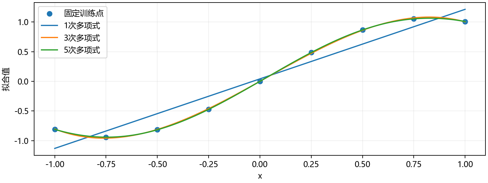

一次多项式可以在三次多项式里把新增系数设为零。用同一批点做最小二乘时，允许的候选更多，最优训练误差不会升高。这里比较的是同一个训练目标。

<!-- side -->

### 参数多还需要集合包含

用只能表示 a+b×x² 的函数去拟合 y=x，训练点关于 0 对称。预测在 x 与 −x 处相同，因而无法拟合相反的标签。允许 x 项的直线可以令 a=0、斜率1，训练误差为0。

### 区分三个值

集合上的最优训练目标由数学关系约束。固定 SGD 预算实际达到的训练目标受初始化和优化影响。测试误差还取决于数据与泛化。

若两个模型使用不同的参数惩罚，先确认比较的是同一个 J。学习率影响求解过程，本身不改变固定网络可表示的映射集合。

<!-- pagebreak -->

## 03 从复制浅模型到学习残差

设原网络为 r(h(x))。如果在 h 和 r 之间插入一个可以实现恒等映射的块 T，则 T(z)=z 时深网 r(T(h(x))) 与浅网相同。这个构造只要在 h 的输出范围内成立即可。

直接堆两层卷积、BN 与 ReLU，需要它们配合实现 T。残差块先保留基准路径 S(X)，再用卷积分支 F(X) 学出修正。加法前目标若为 H(X)，对应的残差就是 H(X)−S(X)。

在形状相同时取 S(X)=X。目标接近输入时，F 只需拟合差值。例如目标 H(x)=1.05x，残差就是 0.05x。并行保留输入后，该分支输出零即可实现加法前的恒等。

<!-- side -->

### 两条路径的职责

主分支计算可学习修正。捷径给出基准，尺寸匹配时直接传递输入。尺寸变化时可用投影 P，此时学习的是 H(X)−P(X)。

### 深度与新解的关系

追加同形块时可以讨论如何把它设为恒等。改变宽度、步幅、池化或输出空间时，要重新验证原模型是否仍可嵌入。

### 残差术语

这里的残差是块的目标映射与捷径映射的差。分类训练仍使用交叉熵从标签学习，代码不会给每个块单独提供残差标签。

<!-- pagebreak -->

## 04 最后一个 ReLU 决定恒等的条件

教材块实际输出 Y=ReLU(F(X)+S(X))。即便同形捷径为 X、主分支 F=0，整块也只输出 ReLU(X)。输入非负时保留原值，负数会变成 0。

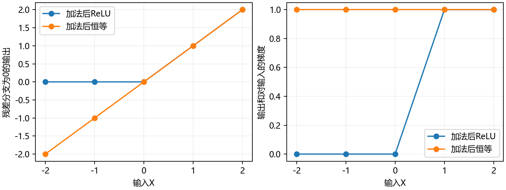

教材后激活结构的同形块通常接在前一个 ReLU 之后，因而该处输入已经非负。预激活块把 BN 和 ReLU 放在卷积前，加法后直接返回，保留带符号的原输入。

<!-- side -->

### 数值例子

输入 [−2,−1,0,1,2]。主分支最后一卷积的权重和偏置都设为零，BN 取初始化的 eval 状态。

教材块输出 [0,0,0,1,2]。预激活块输出 [−2,−1,0,1,2]。输出和对输入的梯度分别为 [0,0,0,1,1] 与全1，0 点采用 PyTorch 的 ReLU 梯度约定。

### 如何让已有模型的主分支归零

如果末 BN 的移动均值已经改变，仅清空前面卷积的权重未必得到零。后激活基本块可把末 BN 的 γ 和 β 都设为0。实验 H 把初始 γ 设为0，β 沿用零初值。

<!-- pagebreak -->

## 05 两条支路怎样共同传回梯度

令 Z=F(X)+S(X)，对上游梯度 G=∂loss/∂Y，后激活块先计算 Gz=G⊙1[Z>0]。加法对两个操作数的局部导数都是恒等，Gz 传入两支。从同一个 X 出发的两份贡献在 X 汇合。

用列向量记梯度，∂loss/∂X=J_F(X).T @ Gz+J_S(X).T @ Gz。这里 .T 表示雅可比矩阵转置，@ 表示矩阵乘法。恒等捷径贡献 Gz，卷积投影的贡献经过该投影的转置雅可比。预激活块无末门时 Gz=G。

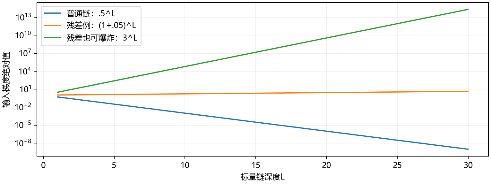

<!-- side -->

### 公式的限制

恒等贡献可被主分支抵消。标量若 F'(x)=−1，则 1+F'=0。若 F'=2，则每层乘3，深链也会放大梯度。加法后有 ReLU 时，还要考虑门是否关闭。

### 多块相加

匹配形状、恒等捷径和无加法后激活同时成立时，可以展开为 X_L=X_l+ΣF_i(X_i)。每个 F_i 的输入仍依赖此前所有块。遇到投影或末门，需要把对应映射写回递推式。

### 实测核对

脚本对恒等和投影分别算整块梯度、主支梯度及捷径梯度，核对两支贡献和。独立 NumPy 进一步核对所有小网参数梯度。

<!-- pagebreak -->

## 06 教材基本块的计算顺序

同形块主路为 Conv3×3→BN→ReLU→Conv3×3→BN。第二个 BN 后就与捷径逐元素相加，最后应用 ReLU。两个卷积用 padding=1，第二个卷积步幅固定1。

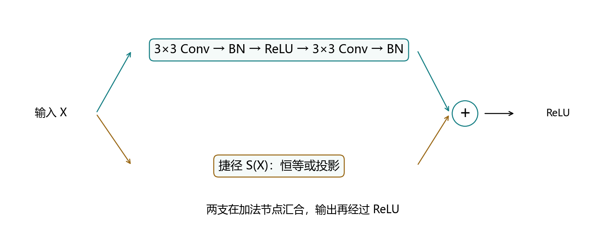

当输入输出通道相同、步幅为1，捷径可直接用 nn.Identity。它注册在模块里，调用时返回原输入，不增加参数。改变 C 或步幅时，捷径使用 1×1 Conv。

<!-- side -->

### 为什么第二处不提前 ReLU

主分支可以给基准加上负修正。提前截断 F 的负值会改变可表示的修正。教材最后的 ReLU 对两支相加的结果做门控。

### 与上节 BN 连起来

训练统计用于使主路的中间激活尺度随批调整。预测时 eval 读取移动统计。教材这一版投影没有 BN，主路卷积保留 bias；我们按这个口径复现。

### Python 操作

forward 里写 Y+S，先显式检查两个 shape 相同。避免在有共享输入和自动微分的图里随意用原地 +=。

<!-- pagebreak -->

## 07 投影让两条路在同一形状汇合

从 (N,C,H,W) 到 (N,2C,H',W')，主分支首个 3×3 用 stride=2 和 padding=1。捷径 1×1 同样 stride=2、padding=0。通道由输出卷积核数量决定。

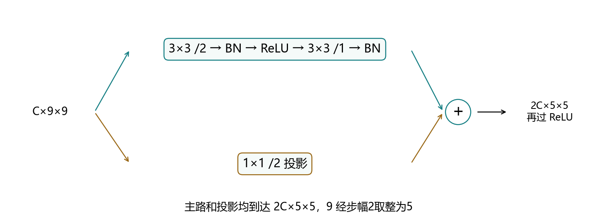

卷积公式 H'=floor((H+2p−k)/s)+1。代入两条路径各自的 k 和 p，均为 floor((H−1)/2)+1，即 ceil(H/2)。H=6 得3，H=9 得5。奇数输入会向上取整。

<!-- side -->

### 教材形状实测

输入 (4,3,6,6)。基本块 3→3、步幅1，输出 (4,3,6,6)。投影块 3→6、步幅2，输出 (4,6,3,3)。

### 相加前检查四维

允许广播的张量仍可能数学上写错。比如一个 (N,1,H,W) 的捷径会被广播到所有通道。本节要求批量、通道、高、宽全部相同。

### 参数成本

1×1 投影权重为 C_in×C_out，再加 C_out 个 bias。它用学习到的通道组合并下采样，通常不具备原始恒等捷径的性质。

<!-- pagebreak -->

## 08 相加与 Inception 拼接有什么关系

Inception 让若干分支在同一个输入上提取不同特征，然后沿通道拼接。如果空间尺寸相同，输出通道为各支路通道数之和。反向沿通道把上游梯度切给各支路。

残差块显式学习对已有特征的修正。相加要求通道也一致，通道数保持为每条分支的输出宽度。反向把同一份加法处梯度传给两支。

例如 X 与 F(X) 都有4通道，则 cat([X,F(X)],dim=1) 产生8通道，X+F(X) 仍为4通道。拼接后若再加固定 1×1 线性核 [I,I]，可以按位实现相加，且要求通道正确对齐和零偏置。

<!-- side -->

### 回答教材第 1 题

把 Inception 精简为两条路，一条保留 X 或投影 X，另一条计算 F(X)。修改合并方式为相加，就得到残差形式。仅删去原分支仍保留 cat 时，张量会保留分开的特征通道。

### 两者也可以组合

F 可以是一组更复杂的多尺度支路。合并后的输出须与捷径对齐才能相加。这与 7.4 的投影残差变体有关。

### 下一节的伏笔

DenseNet 也有跨层连接，但它把来自前面层的多组特征沿通道拼接。7.7 将继续追踪这种设计怎样影响通道和计算。

<!-- pagebreak -->

## 09 从基本块搭出 ResNet-18

Stem 使用 7×7 Conv、stride2、padding3，接 BN、ReLU 和 3×3 MaxPool（stride2、padding1）。96 输入在 stem 结束得到 64×24×24。

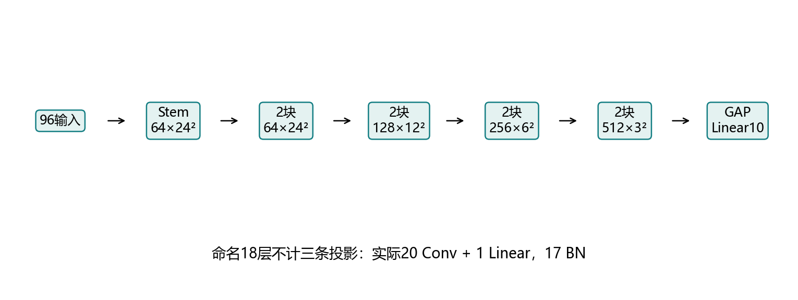

四组各两个块。首组宽度64、保持空间。后面三组的首块负责投影和下采样，宽度升为128、256、512，其余块保持组内形状。96 输入依次得到 24、12、6、3。

<!-- side -->

### 224 输入也能检查

同一模型在224输入下四组输出空间依次56、28、14、7。最终全局平均池将每个通道的空间位置变为一个数，因此两种尺寸最后都是512维。

### 分类头

AdaptiveAvgPool2d(1) 得 (N,512,1,1)。Flatten 得 (N,512)。Linear(512,10) 输出10个 logits，可以直接交给交叉熵。

### 为什么叫18

Stem 卷积1层，加8块×2层，再加 Linear 1层。三条投影卷积不计入命名深度。实际20个Conv、1个Linear、17个BN。

<!-- pagebreak -->

## 10 参数、乘法和输入大小

教材灰度十分类版本为 11,178,378 个参数，float32 参数约42.64 MiB。所有卷积保留 bias，三个投影均无 BN。状态里还存有 BN 的移动均值、方差和批计数。

单个卷积的权重乘法数按 H_out×W_out×C_out×C_in×K_h×K_w 计算。把主路、投影和 Linear 的乘法相加，96 输入每图 318,657,536，224 输入为 1,734,890,496。

参数数与输入尺寸无关，因为卷积权重共享，分类头用全局平均汇聚。激活存储、乘法量和实际速度会随输入尺寸改变。

<!-- side -->

### 计算口径

上面的乘法计数包括 padding 窗口位置的概念乘法，不含 BN、ReLU、汇聚、偏置和反向。GPU 内核可能采用不同算法，耗时还取决于设备及批量。

### 最小合法尺寸

这一结构的 stride2 都可按 ceil(n/2) 保持至少1个空间位置。meta 模式核对1×1也可得到十类输出。训练时 BN 还要求每通道统计元素 N×H×W≥2，且尺寸合法不代表输入含有足够图像信息。

### 度量意义

参数字节回答模型权重占用多少。显存分配峰值还会包含激活、梯度和临时张量。两者在第17页分别列出。

<!-- pagebreak -->

## 11 瓶颈把昂贵的 3×3 放到较窄通道

瓶颈块使用三个卷积。第一个1×1缩窄通道，中间3×3做空间混合，最后1×1恢复或扩张通道。扩张系数4指输出为内部宽度的4倍。两次中间激活之后，末层 BN 输出再与捷径相加并做 ReLU。

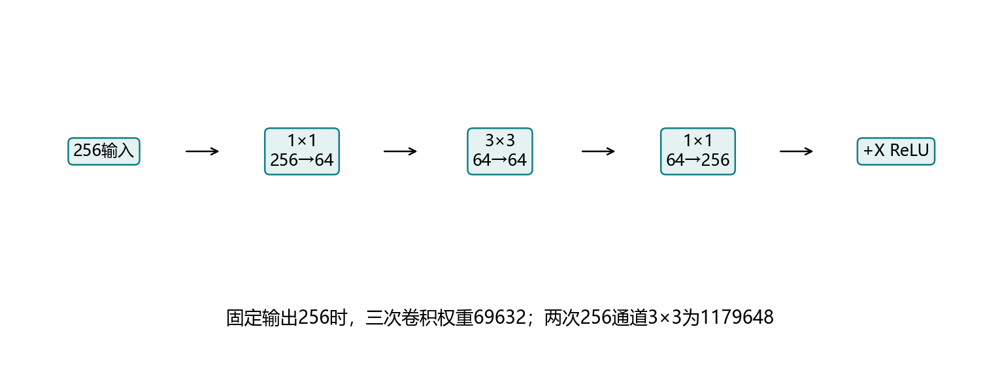

以同形输入输出256为例，内部宽64的瓶颈权重数为 256×64+9×64²+64×256=69,632。两个256→256的3×3权重共 1,179,648。此处对照固定输入输出形状且只数权重。

<!-- side -->

### 投影和降采样

从 stem 的64通道到瓶颈首组输出256，空间尺寸相同，通道仍需要投影。随后三组入口再做步幅2投影，所以完整瓶颈版共4个投影。

### 步幅的版本

原始 ResNet v1 在首个1×1降采样，本节沿用该做法。torchvision ResNet v1.5 在中间3×3降采样。这会改变各层计算量。

### 用同一条件比较

完整 ResNet-50 用了更多块及更宽输出，参数仍多于 ResNet-18。瓶颈省的是指定输入输出宽度下的单块空间卷积成本。

<!-- pagebreak -->

## 12 按论文表1实现 18、34、50、101、152

| 命名 | 块类型 | 四组块数 | 96输入参数 |
| --- | --- | --- | --- |
| 18 | 基本 | 2/2/2/2 | 11,178,378 |
| 34 | 基本 | 3/4/6/3 | 21,290,250 |
| 50 | 瓶颈 | 3/4/6/3 | 23,541,130 |
| 101 | 瓶颈 | 3/4/23/3 | 42,559,370 |
| 152 | 瓶颈 | 3/8/36/3 | 58,226,058 |

命名层数为1+每块卷积数×总块数+1。例如 50=1+3×(3+4+6+3)+1。表里的参数采用本节灰度十分类与 bias 配置。

<!-- side -->

### 结构核对和实训范围

五种拓扑均用 meta 验证96和224输入。正式训练采用完整宽度的18层。起始宽16的对照包括18层、34层、50层与预激活变体。101与152用于结构核对。

### 来源

ResNet 论文 PDF 第5页表1给出各组宽度和块数。第6页图5比较基本块与瓶颈块。

[Deep Residual Learning for Image Recognition](https://arxiv.org/pdf/1512.03385)

### 可追踪文件

reports/ch07/7_6_architectures.json 包含各层输出、参数与单图权重乘法数。7_6_layers.csv 是 96 输入 ResNet-18 的加权层明细。

<!-- pagebreak -->

## 13 预激活把末门移入主分支

教材顺序在两个卷积后用 BN，块末做 ReLU。完整预激活思路在每个卷积前用 BN→ReLU。主分支改变顺序，加法后的输出直接成为下一个块的输入。

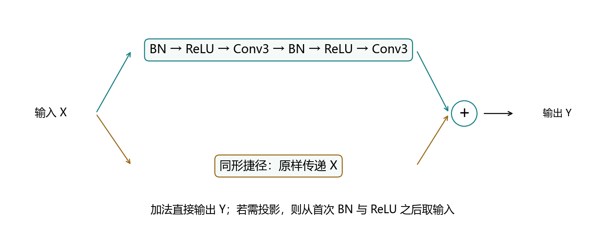

同形捷径用原始 X。若也把捷径接到 BN/ReLU 之后，就改变了原始 X 的直达路径。本节预激活变体在需要投影的转换块中以预激活 X 为投影输入，并在全网 GAP 前加末 BN/ReLU。

<!-- side -->

### 与恒等梯度条件对照

同形块的主路最后一个卷积输出为0时，整块在正负输入上都返回 X。对比第4页后激活块在负输入上的截断。

### 归零初始化的区别

后激活块末 BN 的 γ=0 会使其前面的卷积初始梯度为0，但 γ 自身可能有梯度，移动统计仍更新。预激活块的最后运算是卷积，要得到零残差可以控制最后卷积权重和偏置。

### 来源

[Identity Mappings in Deep Residual Networks，PDF 第2页图1](https://arxiv.org/pdf/1603.05027)

<!-- pagebreak -->

## 14 正式训练协议与第10轮结果

现有 Fashion-MNIST 分成 54,000 训练、6,000 验证，官方测试10,000。灰度图转 float32 并除255，按批双线性插值到96。SGD lr=.05，batch256、十轮，共2110更新。每轮尾240。

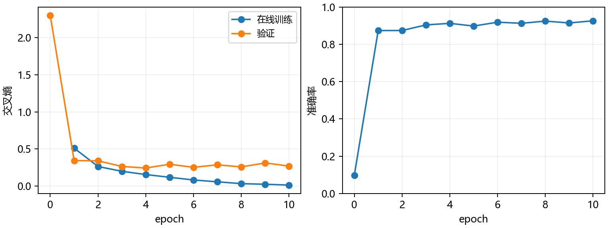

第10轮在线训练 CE .012466、99.7204%。冻结该轮参数与 BN 状态后，eval 训练 CE .005795、99.8907%，验证 CE .268882、92.5667%。预先固定的末轮测试 CE .321594、9190/10000（91.90%）。

<!-- side -->

### 起点和划分

训练/验证划分与批顺序种子延续 3601/3603。Conv 和 Linear 按层名的哈希及基种子7600做 Xavier gain1，bias 为0。BN γ=1、β=0。

### 在线与冻结评估

在线统计来自模型更新过程中的 train 前向。eval 指标来自轮末同一个冻结模型，且用 BN 移动统计。两者样本相同但计算条件不同。

### 读曲线

第5/8/9/10轮验证准确率 89.75/92.40/91.42/92.57%。训练下降并不要求验证逐轮单调。本实验保留波动和末轮结果。

<!-- pagebreak -->

## 15 八组对照如何控制比较

固定平衡子集2000训练/1000验证、起始宽16、96输入、batch128、20轮320更新、尾80。A/B 同为18层，C/D 同为34层，B/D 去掉捷径。E 是50层瓶颈，F 是预激活18，G 修改学习率到.1，H 将后激活块末 BN 的 γ 设0。

A/B/F/G/H 的主路 Conv/Linear 初始哈希相同，C/D 也相同。移除捷径的模型少了三层投影的参数。主路的层数、宽度与卷积初权重保持一致。F 使用预激活，因此 BN 的位置和维度改变。

学习率之外的结构对照使用同一 lr=.05。各候选按末轮验证 CE 比较，整个子集实验使用同一批标签和验证样本。

<!-- side -->

### 读出因果的边界

把同样主路的残差模型和普通模型配对，可以观察捷径及其投影一起产生的变化。深度对照则会改变计算量与参数量。

### 归零实验想验证什么

H 实验固定学习率和训练预算，检查从近似恒等起点出发后实际学习速度。带投影的块仍会改通道和空间。

### 评价指标

CE 依赖真类分数相对其他分数的差距。准确率只计 argmax 是否正确。两个模型在这两项上可有不同排名。

<!-- pagebreak -->

## 16 对照结果怎样解释

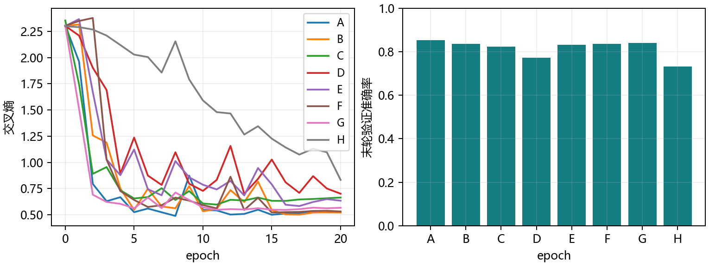

| 候选 | 冻结训练CE | 验证CE | 验证准确率 |
| --- | --- | --- | --- |
| A/B 残差/普通18 | .00449/.00590 | .52191/.52059 | 85.3/83.6% |
| C/D 残差/普通34 | .00171/.41430 | .66415/.70064 | 82.3/77.1% |
| E/F 瓶颈/预激活 | .00422/.01399 | .63406/.53132 | 83.1/83.6% |
| G/H lr.1/末γ零 | .00215/.78660 | .56655/.83253 | 83.9/73.2% |

<!-- side -->

### 训练退化与泛化都能看到

普通34的训练 CE 高于普通18，符合此预算中的优化困难现象。残差34训练 CE 低于残差18，但验证 CE 更高，反映小训练子集上的泛化差距。

### 按预定指标选择

B 的末轮验证 CE 最低，A 的准确率最高。没有用子集挑选结果重跑测试。正式91.90%仍来自预先固定的完整模型。

### H为何值得保留

H 的训练和验证结果都落后于 A。小探针中，置零末 γ 让第一卷积初始梯度为0，γ 仍能更新。当前范围内它启动较慢。

<!-- pagebreak -->

## 17 深度的实际代价如何测

同一 RTX 4060 Laptop GPU、驻留随机输入 batch8，顺序短测四种配置。预热2次，CUDA 事件计时5次。训练包含前向、交叉熵、反传和 SGD，预测使用 eval 和 inference_mode。

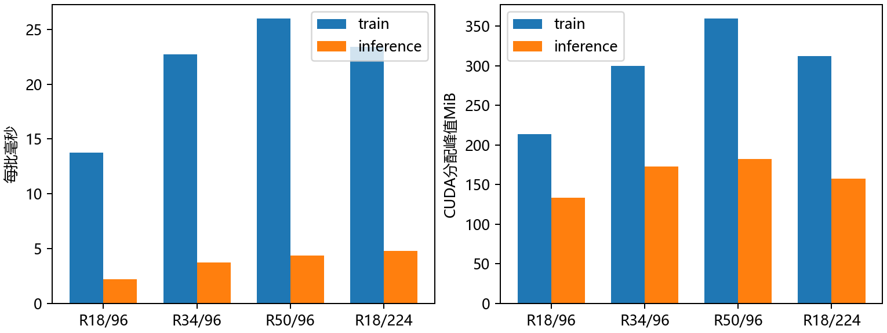

| 网络/输入 | 训练/预测毫秒 | 训练/预测峰值MiB |
| --- | --- | --- |
| 18/96 | 13.76/2.24 | 214.10/133.67 |
| 34/96 | 22.71/3.72 | 299.63/173.16 |
| 50/96 | 25.98/4.38 | 359.63/182.26 |
| 18/224 | 23.41/4.80 | 311.97/157.69 |

<!-- side -->

### 正式训练是另一口径

全量96输入、batch256，含验证、末轮测试及保存约336.24秒。CUDA分配峰值约1343.39 MiB。小批短测不含 DataLoader 和 Resize。

### 回答教材第5题

嵌套函数类在同训练目标下扩展候选。实际训练仍受优化难度、数据量、样本外误差、显存和时延约束。比较规模前应说明当前约束和选择指标。

### 为什么还要对照其他深度

增深会改变每批开销，即便更新步数相同，所用时间也可能不同。比较固定时间预算时，能完成的步数也会改变。

<!-- pagebreak -->

## 18 验证实现后再开始跟做

独立 NumPy 图对完整八块96几何缩通道网（11,558 参数）核对 Conv、BN、ReLU、带填充汇聚、GAP、Linear 和两支梯度相加。全参数梯度最大差 2.00e-14，两步 SGD 后参数差 6.04e-16，BN 状态差 8.88e-16。

恒等、投影、瓶颈、预激活各拿一个小网做有限差分，共50个坐标，步长1e-6，最大差1.78e-10。正式检查点的完整状态与报告哈希一致，在16张验证图上的 CPU/CUDA 得分最大差2.88e-5，预测类别一致。

接下来把同形块和转换块接入一个小图像分类网络。先验证输入与输出，再走一轮完整的训练、评估和保存过程。

<!-- side -->

### 独立核对的层次

完整宽度模型跑真实图像训练。独立梯度核对保留八块和空间布局但缩窄通道。有限差分再单独检查每类块。

### BN状态恢复

检查点保存完整 state_dict，含移动统计与计数。16个输入在恢复路径中都使用 eval，缓冲区保持不变。正式模型每个 BN 的批计数为2110。

### 跟做何时算通过

两种形状探针正确，小网络三轮更新次数正确，恢复时同一输入输出一致。练习需要自己接通八个 TODO 并解释这种结构的选择。

<!-- pagebreak -->

## 19 跟做一：准备同一个 Python 文件

打开整个项目，在项目根目录的 .cache 下新建 7_6_follow.py，把第19-23页的五个主栏代码块按顺序粘在同一个文件里。

```python
from pathlib import Path
import runpy
import torch
from torch import nn
from torch.nn import functional as F

root = Path.cwd()
assert (root / 'lessons/ch06/06_lenet.py').exists()
torch.set_num_threads(4)
h = runpy.run_path(str(root / 'lessons/ch06/06_lenet.py'))
splits, _ = h['load_data'](include_test=False)
train = h['balanced_subset'](splits['train'], 37, 7601)
val = h['balanced_subset'](splits['validation'], 20, 7602)
loader = h['make_loader'](train, shuffle=True, batch_size=8)
print('数据', len(train), len(val), '每轮批数', len(loader))
```

<!-- side -->

### 设置 PowerShell 终端

在项目根目录运行两行。后续复用这个解释器和编码。

```powershell
$pythonPath = 'D:\Anaconda\envs\openmmlab\python.exe'
$env:PYTHONUTF8 = '1'
```

### 复用已有数据

runpy.run_path 把现有脚本里的函数作为字典返回。用 h 中的加载器读取本地 Fashion-MNIST，图像保持原始28尺寸，训练37张、验证20张。

### 先检查这一步

执行此段应打印数据37/20、每轮批数5。训练批量分布8/8/8/8/5。若 Path 断言失败，切回项目根目录再执行。

<!-- pagebreak -->

## 20 跟做二：写基本残差块

追加这个类。同形时无需投影，发生通道变化或 stride 变化时选 1×1 Conv。

```python
class FollowResidual(nn.Module):
    def __init__(self, ci, co, stride=1):
        super().__init__()
        self.conv1 = nn.Conv2d(ci, co, 3, stride, padding=1)
        self.bn1 = nn.BatchNorm2d(co)
        self.conv2 = nn.Conv2d(co, co, 3, padding=1)
        self.bn2 = nn.BatchNorm2d(co)
        if ci != co or stride != 1:
            self.shortcut = nn.Conv2d(ci, co, 1, stride)
        else:
            self.shortcut = nn.Identity()

    def forward(self, X):
        Y = F.relu(self.bn1(self.conv1(X)))
        Y = self.bn2(self.conv2(Y))
        skip = self.shortcut(X)
        assert Y.shape == skip.shape
        return F.relu(Y + skip)
```

<!-- side -->

### 沿着数据读代码

ci、co 分别是输入和输出通道。模块赋值给 self 属性后会被注册。forward 只负责应用已创建的层，SGD 能找到这些层的参数。

### 对照第6页公式

第一层 BN 后立刻 ReLU，第二个 BN 后先和捷径相加。最后一行只在相加后使用一次 ReLU。

### 预先预测形状

同形块4→4、步幅1时，9×9 仍为9×9。转换块4→8、步幅2时，9×9 变5×5。下一页用同一个张量实际验证。

<!-- pagebreak -->

## 21 跟做三：从两种形状探针组装小网络

```python
with torch.no_grad():
    X = torch.zeros(2, 4, 9, 9)
    print('同形', tuple(FollowResidual(4, 4).eval()(X).shape))
    print('投影', tuple(FollowResidual(4, 8, 2).eval()(X).shape))

def make_small():
    return nn.Sequential(
        nn.Conv2d(1, 4, 3, padding=1), nn.BatchNorm2d(4),
        nn.ReLU(), FollowResidual(4, 4), FollowResidual(4, 8, 2),
        nn.AdaptiveAvgPool2d(1), nn.Flatten(), nn.Linear(8, 10))

net = make_small()
layers = [m for m in net.modules()
          if isinstance(m, (nn.Conv2d, nn.Linear))]
for j, layer in enumerate(layers):
    torch.manual_seed(7600 + j)
    nn.init.xavier_uniform_(layer.weight)
    nn.init.zeros_(layer.bias)
net.eval()
with torch.no_grad():
    shape = tuple(net(torch.zeros(8, 1, 28, 28)).shape)
print('参数', sum(p.numel() for p in net.parameters()), '输出', shape)
optimizer = torch.optim.SGD(net.parameters(), lr=.05)
```

<!-- side -->

### 预期输出

同形 (2,4,9,9)，投影 (2,8,5,5)，小网 logits (8,10)。输入宽28经转换块得到14，GAP把8×14×14变成8×1×1，Flatten得到8维。

### 参数口算

Stem Conv与BN共48。第一个残差块312，第二个转换块952，最后 Linear90，总1402。BN的移动统计不计入参数。

### 试改宽度

将转换块输出8改为12，同时调整 Linear 输入为12。GAP后 12×1×1，所以 Flatten 的结果为12维。先改后预测输出仍应是10类。

<!-- pagebreak -->

## 22 跟做四：更新参数并评估

```python
updates = 0
for epoch in range(3):
    net.train()
    loss_sum = 0.
    for X, y in loader:
        optimizer.zero_grad(set_to_none=True)
        logits = net(X)
        loss = F.cross_entropy(logits, y)
        loss.backward()
        optimizer.step()
        loss_sum += loss.item() * len(y)
        updates += 1
    print('epoch', epoch + 1, '在线CE', loss_sum / len(train))
val_loader = h['make_loader'](val)
result = h['evaluate'](net, val_loader, 'cpu')
print('验证', result, '更新', updates)
assert updates == 15 and net[1].num_batches_tracked.item() == 15
```

<!-- side -->

### 一次更新的四步

清旧梯度。用 logits 与类别索引计算批平均交叉熵。backward 让梯度穿过相加并汇总到共享输入。step 依据梯度改变参数。

### 尾批如何计数

每个批的 CE 已平均。记录整轮时乘 len(y) 还原批损失和，再除37，尾批5条自然获得较少权重。

### 验证怎样复用

h 的 evaluate 会执行 eval 和 no_grad。三个 epoch 共15次更新，首 BN 计数15。本机三轮在线 CE 为2.490730、2.362553、2.240054，验证正确数2/20。这个小样本实验用于检查训练链路。

<!-- pagebreak -->

## 23 跟做五：保存、恢复并比较同一输入

```python
path = root / '.cache/7_6_follow.pt'
torch.save(net.state_dict(), path)
restored = make_small().eval()
restored.load_state_dict(torch.load(path, weights_only=True))
X, y = next(iter(val_loader))
with torch.no_grad():
    before = net(X)
    after = restored(X)
    error = (before - after).abs().max().item()
assert error == 0
print('恢复差', error, 'BN计数', restored[1].num_batches_tracked.item())
```

五段写好后，在项目根目录执行，并对照同形、投影、输出、更新数和状态恢复结果。

```powershell
& $pythonPath .cache/7_6_follow.py
```

<!-- side -->

### 哪些值被保存

参数与注册 buffer 一起进入 state_dict。预测依赖四种东西：构造形状、权重与偏置、BN 参数与移动统计、eval 模式。

### 预期恢复值

CPU同环境对同一验证批，恢复差0，首 BN 批计数15。下文正式模型另对照跨设备的浮点差。

### 此处保存用于恢复预测

精确续训还要恢复优化器、随机数、数据顺序或加载器进度。回顾 5.5 的检查点设计。

<!-- pagebreak -->

## 24 复现教师正式实验与对照

从项目根目录运行，先查结构。随后可以复现正式版、八组子集及 GPU 计时。加 --record 会覆盖本节对应报告与本地检查点。

```powershell
& $pythonPath lessons/ch07/06_resnet.py --inspect --guided --record
& $pythonPath lessons/ch07/06_resnet.py --guided --record
& $pythonPath lessons/ch07/06_resnet.py --experiments --guided --record
& $pythonPath lessons/ch07/06_resnet.py --benchmark --guided --record
```

inspect 应打印11178378参数、命名18、实际20 Conv。默认十轮，GPU自动选择，末轮测试10000张。experiments 末尾列 A-H 验证结果。benchmark 需要 CUDA，输出四配置各训练/预测两项。

<!-- side -->

### 也可先跑小规模命令

```powershell
& $pythonPath lessons/ch07/06_resnet.py `
  --device cpu --epochs 1 --batch-size 2 `
  --train-size 11 --validation-size 10 `
  --guided --record
```

孤立尾样本并入前一批，得到2/2/2/2/3。预期5更新，尾批3，合并=True。报告使用 7_6_custom 前缀。本机10张验证图判对1张。

### 在哪里读结果

reports/ch07/ 的 7_6_metrics、epochs、experiments、benchmark、verification 保存各类结果。模型权重保存在本地 artifacts/ch07/。

<!-- pagebreak -->

## 25 综合练习：八处 TODO 学会一条完整路径

打开 exercises/ch07/06_resnet.py。先补 TODO 1-5，确保最开始的投影形状探针返回张量，再补 TODO 6-8。

| 位置 | 要接通的行为 | 核对问题 |
| --- | --- | --- |
| 1-2 | 主支两层卷积与BN | 哪一处在加法前做ReLU |
| 3 | 调用捷径模块 | 何时需要改变空间和通道 |
| 4-5 | 对齐后相加再激活 | 为什么禁广播 |
| 6 | 批平均交叉熵 | logits与标签各是什么形状 |
| 7-8 | 反传和SGD更新 | 哪一步实际改变参数 |

```powershell
& $pythonPath exercises/ch07/06_resnet.py
```

空白程序会提示先完成 TODO 1-5。全部接通后应打印参数1402、输出(8,10)、三轮15更新、首 BN 计数15。

<!-- side -->

### 改一处参数复查

记下原配置的结果。用相同种子把转换块步幅从2改为1。通道4→8仍需要1×1投影，空间变为28×28。GAP输出仍是8维。

可再从固定起点改 lr=.02，比较三轮在线 CE 和验证正确数。不要同时改步幅和学习率，否则无法追踪结果来自哪个修改。

### 一次反馈

贴八处修改、三轮结果与验证正确数。解释两支形状怎样对齐、什么时候能实现恒等、加法与cat的梯度差异，以及预测需要哪些 BN 状态。

<!-- pagebreak -->

## 26 按形状、模式、优化、恢复的次序排错

| 现象 | 先检查 | 下一步 |
| --- | --- | --- |
| 加法报尺寸不同 | 两支步幅和C | 奇数边长按ceil核对 |
| Linear不匹配 | GAP与Flatten | 核对最后输出通道 |
| 验证改变BN计数 | eval是否调用 | no_grad独立控制建图 |
| 训练第1轮近随机 | 输入与首层梯度 | H情形再查末γ |
| 训练好验证差 | 冻结训练和验证CE | 同预算对照深度 |
| 加载后预测差大 | state与构造一致性 | 检查stride与BN状态 |

小模型若改 batch=7，批次为7/7/7/7/7/2，每轮6次，三轮18次。修改对应断言。正式自定义入口对 batch 或训练子集小于2会报参数错误。

<!-- side -->

### 重做数值核对

```powershell
& $pythonPath tools/verify_resnet.py
```

它执行独立 NumPy、有限差分、五段跟做、内存练习参考，以及已有正式模型的恢复检查。

### 理解误差阈值

同环境恢复应逐位一致。CPU、CUDA 和不同内核的运算顺序会改变浮点舍入，可先看得分差和类别一致性，再检查所用输入和状态。

<!-- pagebreak -->

## 27 连回教材练习和下一节

| 教材题 | 回看 | 动手核对 |
| --- | --- | --- |
| 1 Inception与残差 | 第8页相加和cat | 对照通道与梯度 |
| 2 实现变体 | 第12页五个配置 | 查看结构JSON |
| 3 瓶颈 | 第11页降维与扩张 | 固定256外宽计算权重 |
| 4 预激活 | 第13页运算顺序 | 比较负输入的恒等性 |
| 5 限制复杂度 | 第16-17页 | 结合训练CE、验证CE与耗时 |

把整节连起来复述：复制旧映射给出更深模型的一组候选参数，同形捷径提供直接基准，残差分支学习修正。尺寸变化时用投影对齐。训练要看梯度和批统计，评价还要看验证表现与资源。

<!-- side -->

### 下一节 7.7 DenseNet

教材 PDF 301、正文283 起始。下一节使用通道拼接把早期特征保留下来，然后通过过渡层缩减通道与分辨率。

读之前可以先画三个块。设输入4通道，每块新增3通道。对照残差块的维度条件，算出 DenseNet 三次拼接后的通道数。
