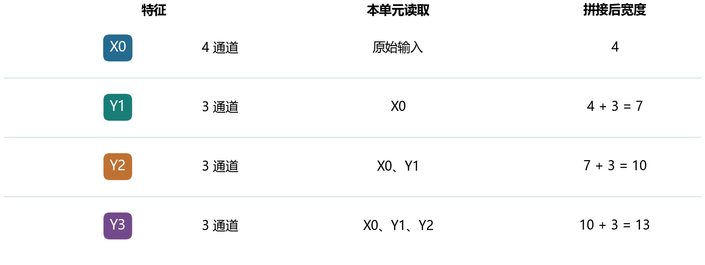
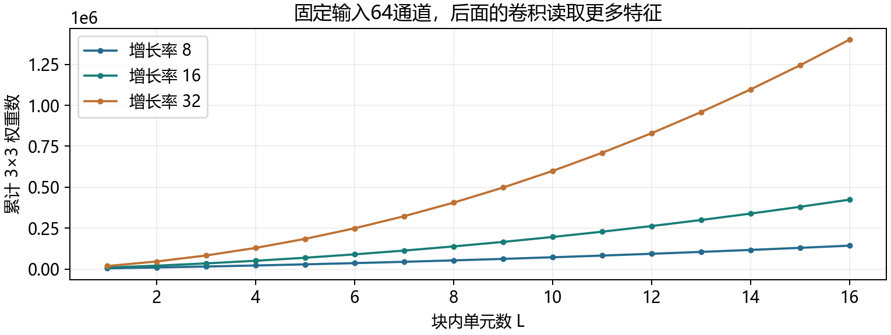
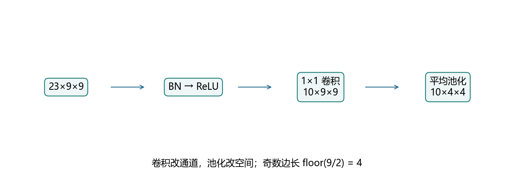
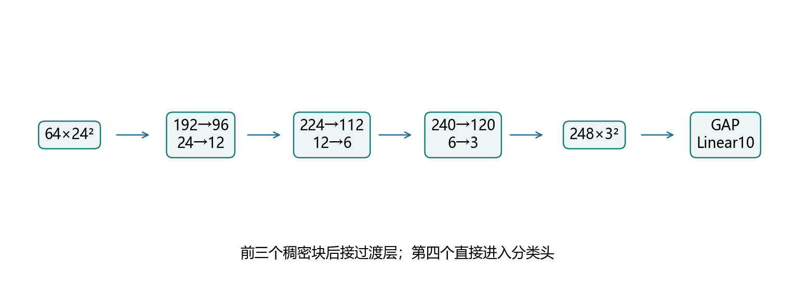
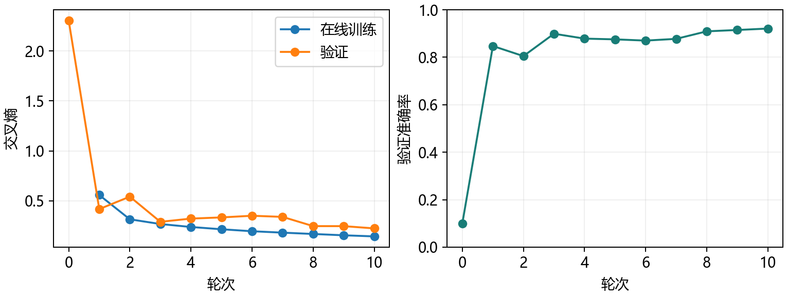
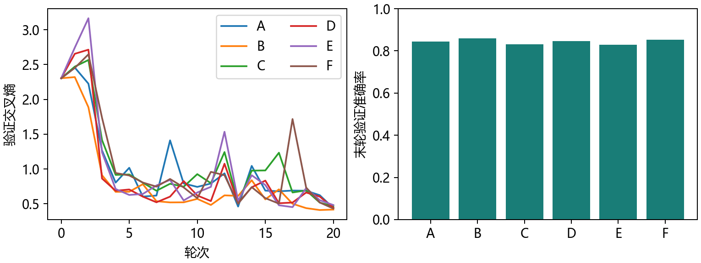
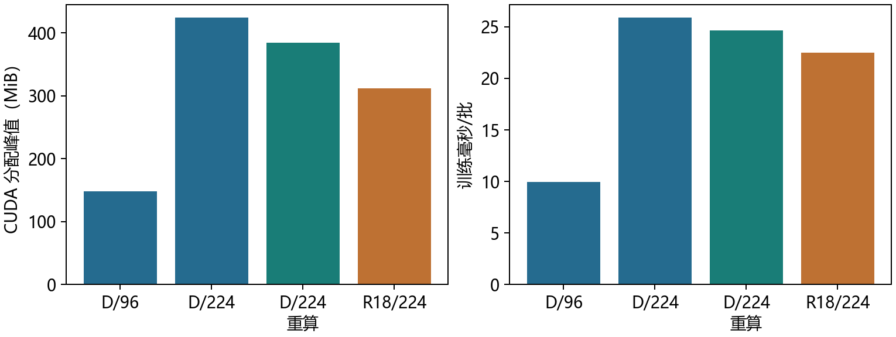
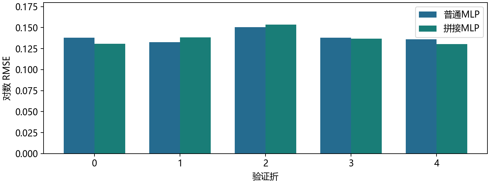

# 7.7 稠密连接网络（DenseNet）

按教材 PDF 301-306、正文 283-288，覆盖 7.7.1-7.7.5 和五道练习。PDF 301 从 7.7 开始，PDF 306 为本节讨论链接。

## 01 从加法捷径到保留多个特征

7.6 的同形残差块保留输入，并在相加节点把它和新分支合成同一组通道。计算 Y=X+F(X) 时，第 j 个输出通道已经包含两支的信息。若后续层希望分别读取旧特征与新特征，可以直接把两组通道并排交给它。

DenseNet 把一个块内的输入及各单元新增的特征图保留下来。每个新单元读取到目前为止积累的所有通道，加工后只贡献少量新图。块之间再压缩通道和空间尺寸，使下一块从一个可控的宽度开始。

教材用泰勒展开启发这一思路。逐步附加基于已有表示的新项，可以组织一个更丰富的表示。这里的新项由卷积和非线性学得，既无预设的多项式阶数，也无泰勒截断误差结论。

<!-- side -->

### 阅读和操作顺序

第1-16页依次讲特征复用、梯度、结构及实测结果。第17-21页在同一个文件写五段代码。第22-24页用于复现完整实验和完成综合练习。

### 重新定位三个组件

Inception 先并行算出多组特征再拼接。DenseNet 在一个块里逐层拼接，新层读取前层的特征组。ResNet 通常把新旧表示加在同一组输出通道上。

这三种连法对张量尺寸和梯度的要求不同。接下来从一个具体形状算起。

<!-- pagebreak -->

## 02 增长率就是每个单元贡献的通道数

设块输入 X0 有 C0 个通道。第1个单元产生 Y1=H1(X0)，第2个单元读 cat(X0,Y1) 后得到 Y2。第 i 个单元读 X0 与此前 i−1 组输出，每组新输出都是 k 通道。块最终把输入与所有新输出沿通道拼起来。



从1计数时，输入宽度是 C0+(i−1)k。Python 的 i 从0开始，所以用 C0+i×k。L 个单元后输出 C0+Lk 通道。

<!-- side -->

### 用形状读 dim

图像张量顺序是 N、C、H、W。torch.cat((X,Y),dim=1) 在 C 轴接起来，要求 N、H、W 对齐。把 dim 设成0会把样本轴拉长，含义变成增加样本。

### 教材探针

输入 (4,3,8,8)，两个单元各新增10通道。第一个卷积 3→10，第二个 13→10，输出 (4,23,8,8)。10 是每次贡献，23 是整个块的输出宽度。

### 自查一个例子

C0=4、L=3、k=3。卷积输入依次4、7、10，最终13。所有卷积输出都固定3通道。

<!-- pagebreak -->

## 03 拼接的反向把梯度按通道切开

设 Z=cat(X,Y)，损失传回 G。若 X 有 c 个通道，cat 的局部反向给 X 的直接梯度是 G[:, :c]，给 Y 的是 G[:, c:]。Y 又由 X 算得，因此 X 还要加上经 H 反传的贡献。

对于只有一个单元的块，若把梯度记成列向量，上式就是 gradX = G_old + J_H(X).T @ G_new。.T 表示转置，@ 表示矩阵乘法。多个单元读取同一个旧特征时，该特征汇总所有使用处反传的梯度。

用标量检查。设 Y1=2X，Y2=X+3Y1，损失是对拼接出的三项求和。把式子代回得到 loss=10X，所以 gradX=10。自动微分在多个使用点汇总出的梯度应与这个值相同。

<!-- side -->

### 和 ResNet 的反向对应

在相加节点，同一个上游梯度传给两个同形输入。拼接节点先按输入的宽度分段。两种结构都要在共享输入处把来自各条使用路径的贡献相加。

### 直达路径的条件

在一个块的输出里，原输入 X0 占据前 C0 个通道，因此有直接梯度槽位。过渡层会混合通道并池化，端到端梯度仍取决于后段算子和损失。

### 与前一章对齐

用 4.7 的计算图看，每个重复使用的 Tensor 都产生多条出边。反向要等这些出边回来的贡献都合并。

<!-- pagebreak -->

## 04 预激活单元怎样接到稠密块

教材单元依次做 BN、ReLU 和 3×3 Conv。BN 在卷积之前，所以 num_features 必须等于本单元读取的宽度，而 Conv 的输出数始终是增长率 k。padding=1、stride=1 保持空间尺寸。

循环中的 X 表示目前积累的特征。先算 Y=unit(X)，再令 X=cat((X,Y),dim=1)。用 ModuleList 保存单元，使优化器与 state_dict 能找到它们。

也能用 Sequential 注册一串单元，但前向仍须逐个取出。直接调用这些单元组成的 Sequential 会把前单元输出的 k 通道送入后一个单元，少了旧通道。

<!-- side -->

### 对照 7.5 与 7.6

7.5 的 BN 区分训练批统计和推理移动统计。7.6 的预激活把 BN 与 ReLU 放进权重层之前。DenseNet 沿用这个顺序，每个单元的 BN 宽度跟随当前拼接宽度增长。

### 为什么新旧能拼起来

3×3 卷积用 padding=1 保持 H、W，且不改变样本序号。输出 Y 和原 X 可直接在 C 轴拼接。

### 一个易查的断言

预先记录每层的预期宽度。若 BN 报 running_mean 应有的元素数不符，打印每轮 X.shape[1] 检查拼接和公式。

<!-- pagebreak -->

## 05 少生成特征可以省参数

一个 3×3 卷积把 c 个输入通道映射到 k 个新通道，要 9ck 个权重。块内第 i 个单元的 c=C0+(i−1)k。对 L 个单元求和，卷积权重总数为 9k×(LC0+kL(L−1)/2)，还要另计偏置、BN 仿射等参数。



旧通道继续保留，每层只生成少量新特征。较小的 k 让新增特征较少。越靠后的层读取的输入越宽。固定 k 时，块内卷积权重数随块深度出现二次项。

<!-- side -->

### 与上一节的数量对照

教材 DenseNet 为758,226参数，教材 ResNet-18 为11,178,378。二者都用灰度十类头。这个差距来自单元只产出32通道、组间压缩和 ResNet 的宽卷积配置。

### 同时看乘法

卷积的权重乘法数是权重数乘输出空间大小。96输入时教材 DenseNet 约1.291亿，ResNet-18 约3.187亿。表里的乘法不计 BN、激活、汇聚和训练反向。

### 配置决定结果

加大 k、加深块、降低压缩程度会改变比较。有参数少的 DenseNet，也有大于本项目 ResNet-18 的论文深度变体。

<!-- pagebreak -->

## 06 过渡层同时约束通道与分辨率

一个稠密块输出 C 个通道。教材过渡层先执行 BN→ReLU，再做 1×1 Conv，把通道映射为 floor(C/2)。最后用窗口2、步幅2的平均池化缩小 H、W。卷积默认步幅1，所以先只改变 C。



图中23→10是显式指定的演示规模。教材探针用 (4,23,8,8) 得 (4,10,4,4)。正式网络则按压缩系数 theta=.5 得到新通道数，不需要在最后一个块后再设过渡层。

<!-- side -->

### 两个取整独立计算

通道数用 floor(theta×C)。空间大小用窗口公式 floor((H−2)/2)+1，等于 floor(H/2)。H=9 输出4，末尾一行没有完整窗口。

### 与残差投影比较

7.6 的 1×1 投影让两个分支在相加前匹配形状。DenseNet 的 1×1 位于块与块之间，训练一个更窄的通道表示，再做空间降采样。

### 最小空间大小

三个过渡层需要 stem 后每边至少8。stem 的两次 stride2 给 ceil(S/4)，正方形最小 S=29。最小输入的末端是1×1，训练 BN 还需每通道至少两个元素。

<!-- pagebreak -->

## 07 过渡层为什么采用平均汇聚

在一个 2×2 窗口里，平均汇聚保留四个位置的平均响应。假设区域 A 有一个位置为4、其余为0，区域 B 四个位置都为1。两块的均值为1，最大值却分别为4和1。

平均适合保留区域整体强度，孤立峰值在输出中只占四分之一。最大汇聚强调最强响应，局部峰值可能更显著。反向中，均值的梯度分给四个位置，最大汇聚通常只向选中位置传梯度。

DenseNet 的过渡层已经用1×1混合多组特征，再用平均汇聚做区域下采样。教材之外也可以保留其它算子并实测，本节用同起点的候选 A/B 比较 avg 和 max。

<!-- side -->

### 避免由例子替代实测

同一窗口内两种统计保留的信息不同。对某个任务最终哪种表现更好还受学习率、结构和样本影响。

### 可自己验证的小改动

先记录基线。把跟做中的 nn.AvgPool2d(2,2) 换成 nn.MaxPool2d(2,2) 再跑。中间形状相同，观察梯度路径和得分。

### 区分边界条件

这里池化无 padding。想比较不同边界设置时，要同时检查输出空间和平均分母。

<!-- pagebreak -->

## 08 完整教材网络的四组宽度

用和 7.6 相同的 stem。7×7 Conv 的步幅为2，接 BN、ReLU 和步幅2的3×3 MaxPool。96×96 输入到 stem 结束得到64×24×24。



四个块各4个单元。k=32，所以每块新增128通道。三次压缩分别为192→96、224→112和240→120，空间24→12→6→3。第四块输出248×3×3，BN、ReLU、GAP、Flatten、Linear(248,10) 产生10类 logits。

<!-- side -->

### 224 尺寸怎样传

空间尺寸依次56、28、14、7，通道公式保持一致。GAP 把每个通道变成一个数，分类头无需为输入尺寸重写。

### 命名与层计数

教材模型有16个稠密单元，每个一个卷积，加 stem 和3个过渡卷积为20个 Conv，最后还有 Linear。这个练习配置可独立记为四组各4单元、k=32。

### 结构检查便于复现

inspect 用 meta 张量沿网络只推导形状，直接打印出参数与实际加权层计数。结构检查与完整训练各自有独立的入口。

<!-- pagebreak -->

## 09 论文表1的 DenseNet-BC

B 表示瓶颈。单元用 BN→ReLU→1×1 先把宽输入转换成4k通道，再经 BN→ReLU→3×3 得到 k 通道。C 表示过渡层进行压缩，论文使用 theta=.5。

| 论文名称 | 四组单元数 | 参数数 |
| --- | --- | --- |
| DenseNet-121 | 6/12/24/16 | 6,957,834 |
| DenseNet-169 | 6/12/32/32 | 12,494,858 |
| DenseNet-201 | 6/12/48/32 | 18,105,866 |
| DenseNet-264 | 6/12/64/48 | 30,669,322 |

表中参数来自本项目灰度输入、无卷积 bias 和十类头的实现。四种结构都进行了224输入的形状检查。

<!-- side -->

### 瓶颈什么时候少权重

输入 c、输出 k 时，直接3×3有9ck权重。瓶颈的权重数为4ck+36k²。只比较这两项，c>7.2k 时瓶颈更少。早期宽度小的单元仍可能增加权重。

### 名称对照

保留论文表1的名称。按代码逐算，论文标为264的配置有130个双卷积单元，加 stem 与三个过渡卷积得到264个 Conv，另有一个 Linear。

[原论文表1与 DenseNet-BC](https://arxiv.org/pdf/1608.06993)

<!-- pagebreak -->

## 10 特征复用与训练显存是两回事

参数和缓冲区占用设备内存。训练还会记录每个单元的输入及 BN、ReLU、Conv 反向所需的中间值，并给梯度和工作区分配内存。

朴素循环每次 cat 都新建一块连续结果。虽然旧通道代表相同的特征，它们可能被多次写进不同结果，若这些结果供反向使用就要保留或重算。

仅累计各单元读取的拼接宽度，有 LC0+kL(L−1)/2。乘上 N×H×W 与每元素字节可估算这一类张量的规模。实际峰值还包括卷积工作区、反向中间量和分配器行为，需用实测核对。

<!-- side -->

### 从96放大到224

stem 后空间24×24变56×56。前几层的激活和拼接在更大作业区域上展开，权重尺寸同期保持。输入上采样带来计算和内存变化。

### 训练与预测分别看

预测使用 eval 和 inference_mode，无需保留反传图。同一个网络在两种模式下峰值可以不同。

### 两个CUDA记账量

allocated 是张量等活跃分配的字节。reserved 包含分配器保留的缓存块。两项都以短测范围内的峰值记录，单位 MiB。

<!-- pagebreak -->

## 11 用激活重算减少同时保存的拼接

重算版用列表保留原输入和各个新产生的窄特征。调用单元时才 cat，使用 checkpoint 让反传在需要处重新执行单元。这样可减少一批持续保留的拼接和中间激活，代价是额外的前向计算。

本节代码采用 use_reentrant=False，前向与重算各有上下文。BN 在正常前向照常更新。重算阶段把 running_mean、running_var、num_batches_tracked 临时换成副本，让计算继续走训练 BN 路径。结束后放回原 buffer。

直接重跑含 BN 的前向可能让持久状态每批多更新一次。即使当步梯度相同，之后的推理也可能改变。

<!-- side -->

### 同起点验证三次更新

在小型 BC 网络以 float64 执行相同三批，普通与重算的 logits、输入/参数梯度及全状态最大差均为0。各 BN 计数为3，原 buffer 对象也已恢复。

### 什么时候启用

示例只在 train 且开启自动微分时重算。eval 继续用已积累的移动统计。若修改 checkpoint 内的有状态操作，需再次核对状态、随机性和优化轨迹。

### 其它内存方法

降低批量、缩小输入或用混合精度也能改变内存。它们分别会影响 BN 统计、空间信息与数值精度。可在本机 PyTorch 内进行这些对照。

<!-- pagebreak -->

## 12 在 Fashion-MNIST 上训练十轮

沿用54,000训练、6,000验证、10,000官方测试。原图 float32/255，按批双线性插值到96。SGD lr=.1，batch256，十轮2110次更新，每轮尾批240。完整评估只在预先固定的第10轮使用测试集。



末轮在线训练 CE .144266，准确率94.7852%。冻结后评估，训练 CE .161255，准确率94.1056%。验证 CE .224294，准确率92.0833%。测试CE .257751，正确9088张（90.88%）。

<!-- side -->

### 可复现的起点

划分与加载器用3601/3603。Conv 和 Linear 用种子7700加层名哈希做 Xavier，bias=0。BN 从 γ=1、β=0 与默认移动统计开始。

### 读完整曲线

验证准确率第3轮89.90%，第6轮87.02%，第10轮92.08%。在线损失随训练下降，验证随参数和 BN 状态波动。

### 资源口径

含评估和保存约284.43秒，CUDA分配峰值1676.60 MiB。正式用 batch256，后面显存短测用 batch8。

<!-- pagebreak -->

## 13 六组对照看增长率、汇聚与压缩

用按类平衡的2000张训练和1000张验证，固定分法7701/7702。所有候选96输入，起始宽32，batch128、20轮320次更新、尾80。A 基线 k=16、theta=.5、avg、lr=.1。



### 实际结果怎么读

B 使用最大池化，末轮验证CE最低，准确率比 A 高1.5个百分点。这是固定数据、单种子和训练预算下的结果。正式模型沿用教材的平均池化。

### 验证协议

各候选按末轮验证CE比较。完整训练的配置和测试轮次事先固定。

<!-- side -->

### 末轮结果

| 候选 | 唯一改动 | 末轮验证CE | 准确率 |
| --- | --- | --- | --- |
| A | 基线 | 0.438190 | 84.5% |
| B | 改为 max | 0.416740 | 86.0% |
| C | k=8 | 0.463476 | 83.2% |
| D | k=24 | 0.443528 | 84.7% |
| E | theta=.75 | 0.481571 | 82.8% |
| F | lr=.05 | 0.431570 | 85.3% |

### 控制比较

A、B、F 的完整初始化哈希一致。改 k 或 theta 会改变张量形状与参数数，所以比较的是改变超参数后的综合效果。

<!-- pagebreak -->

## 14 224 输入和重算的实测

同一 RTX 4060 Laptop GPU，batch8、合成输入驻留 CUDA，热身2次后对5次训练更新取均值。训练包含前向、CE、反向与SGD。资源报告另保存 eval 短测和 reserved 峰值。



| 配置 | CUDA 分配峰值 MiB | 毫秒/批 |
| --- | --- | --- |
| DenseNet 96 | 148.06 | 9.95 |
| DenseNet 224 | 424.25 | 25.88 |
| DenseNet 224 重算 | 384.53 | 24.68 |
| ResNet-18 224 | 311.97 | 22.49 |

<!-- side -->

### 显存测量说明了什么

同卡 batch8 训练时，224 DenseNet 参数更少但分配峰值更高。重算减少约39.72 MiB，降幅9.36%。在224的 eval 短测中，DenseNet 和 ResNet-18 的分配峰值分别为123.70和157.69 MiB。

### 时间怎样解释

五次短测中重算项约24.68毫秒。重算会增加某些前向操作，同时可能改变工作区和内核选择。若要评价速度差异，应延长测量、交换运行顺序并重复。

### 实际操作

第22页的 benchmark 可以重复本项。仅作部署推理时查看 eval 行，并保留输入与批量的口径。

<!-- pagebreak -->

## 15 把拼接用于 4.10 的房价 MLP

表格张量形状是 (N,F)，所以仍在 dim=1 拼接特征。两种 MLP 先共享结构相同的32维 stem。普通版随后用32→29→13→1。拼接版把16维新特征依次接到旧特征后，宽度32→48→64，最后64→1。



沿用4.10的1,460条和五折编号。填补、缩放与类别词表仅在每折训练部分拟合，验证转换使用已确定的规则。两种模型共用每折 stem 初值、训练顺序和标签中心。参数只差16个。

<!-- side -->

### 回归指标和实际结果

预测对数房价。折外 RMSE 是所有1,460条折外预测的对数误差平方求均值后开方。普通版 .139191，拼接版 .138182。拼接版在第0、3、4折较低，第1、2折较高。

### 对照有哪些条件

每折1168训练、292验证，Adam lr=.003、batch64、固定100轮、1900步。weight 衰减 .01，bias 不做衰减。一个种子下的微小差值适合用来练习配对比较。

复现复用本地训练CSV，输出五折汇总。这里的标签、损失与第12页图像分类不同。

<!-- pagebreak -->

## 16 先用可核对的结果连接原理和代码

缩小宽度的独立 NumPy 图包含四个稠密块、三个过渡层和分类头。共923参数。沿 cat 分片并汇总旧特征梯度，整网参数梯度最大差8.17e-15。两次 SGD 后参数最大差1.11e-16，BN 状态最大差2.22e-16。

基本单元与 BC 单元另有28处中心差分核对，最大误差1.75e-10。重算与普通实现的三步对照同时检查了 buffer 内容和对象。每一步算术误差可从机器记录核对。

接下来用28×28原图搭两个块。首块验证通道公式，过渡层核对空间，再接到训练、验证和恢复。

<!-- side -->

### 精简任务

37张训练、20张验证、batch8，每轮8/8/8/8/5，三轮15更新。两个稠密块各2单元，每次新增3通道。预测10类，先核对形状和计数。

### 复现代码

五个主栏 Python 块依次写入项目 .cache 目录的 7_7_follow.py。配套练习文件使用同一个小网络，保留八个待填写处。

### 读验证结果

20张的验证集用于核对流程。每正确一张改变5个百分点，正式比较请回到第12-13页的固定协议。

<!-- pagebreak -->

## 17 跟做一 准备数据和终端

打开项目文件夹，在项目根目录的 .cache 下建立 7_7_follow.py。把本页主栏作为文件开头。

```python
from pathlib import Path
import runpy
import torch
from torch import nn
from torch.nn import functional as F

root = Path.cwd()
assert (root / 'lessons/ch06/06_lenet.py').is_file()
h = runpy.run_path(str(root / 'lessons/ch06/06_lenet.py'))
torch.set_num_threads(4)
splits, _ = h['load_data'](include_test=False)
train = h['balanced_subset'](splits['train'], 37, 7701)
val = h['balanced_subset'](splits['validation'], 20, 7702)
loader = h['make_loader'](train, shuffle=True, batch_size=8)
print('数据', len(train), len(val), '训练批', len(loader))
```

<!-- side -->

### PowerShell 设置

从项目根目录执行。

```powershell
$pythonPath = 'D:\Anaconda\envs\openmmlab\python.exe'
$env:PYTHONUTF8 = '1'
```

### 为什么复用 6.6

runpy.run_path 读取既有文件中的函数并返回字典。这些函数读取本地 Fashion-MNIST 并复用已核对的划分。

### 预期输出

数据37、20，训练批5。这个小模型保留原始28×28，正式96输入由另一入口处理。

<!-- pagebreak -->

## 18 跟做二 实现稠密块

继续在同一文件追加。用 Python 从0计数的 i 计算每个单元的 BN 与卷积输入宽度。

```python
class FollowDense(nn.Module):
    def __init__(self, ci, k, layers):
        super().__init__()
        self.units = nn.ModuleList()
        for i in range(layers):
            width = ci + i * k
            unit = nn.Sequential(
                nn.BatchNorm2d(width), nn.ReLU(),
                nn.Conv2d(width, k, 3, padding=1))
            self.units.append(unit)

    def forward(self, X):
        for unit in self.units:
            Y = unit(X)
            X = torch.cat((X, Y), dim=1)
        return X

first = FollowDense(4, 3, 2).eval()
with torch.no_grad():
    probe = first(torch.zeros(2, 4, 9, 9))
print('稠密块探针', tuple(probe.shape))
assert tuple(probe.shape) == (2, 10, 9, 9)
```

<!-- side -->

### 跟踪每轮 X

第一轮4→7，第二轮7→10。Y 始终3通道。ci 指输入通道、k 指每层的增长率，整个块返回不断增长的 X。

### 先理解注册

ModuleList 像列表一样可循环，还能让父模块找到里面的层。这样 net.parameters() 能传给SGD，train/eval 和 device 也能递归设置给内部层。

### 跟做探针处用 eval

用零输入查看结构，避免将这次形状探针计入训练 BN 状态。随后真正训练前调用 net.train()。

<!-- pagebreak -->

## 19 跟做三 连上过渡层和分类头

```python
def make_small():
    shrink = nn.Sequential(
        nn.BatchNorm2d(10), nn.ReLU(), nn.Conv2d(10, 5, 1),
        nn.AvgPool2d(2, 2))
    return nn.Sequential(
        nn.Conv2d(1, 4, 3, padding=1),
        FollowDense(4, 3, 2), shrink, FollowDense(5, 3, 2),
        nn.BatchNorm2d(11), nn.ReLU(),
        nn.AdaptiveAvgPool2d(1), nn.Flatten(), nn.Linear(11, 10))

net = make_small()
layers = [m for m in net.modules()
          if isinstance(m, (nn.Conv2d, nn.Linear))]
for i, m in enumerate(layers):
    torch.manual_seed(7700 + i)
    nn.init.xavier_uniform_(m.weight)
    nn.init.zeros_(m.bias)
net.eval()
with torch.no_grad():
    print('过渡探针', tuple(net[2](probe).shape))
    shape = tuple(net(torch.zeros(8, 1, 28, 28)).shape)
print('参数', sum(p.numel() for p in net.parameters()), '输出', shape)
opt = torch.optim.SGD(net.parameters(), lr=.05)
```

<!-- side -->

### 先算宽度

输入1→stem4。第一块4+2×3=10。过渡层变5通道并降到14×14。第二块5+2×3=11，GAP 展平11维，Linear 输出10。

### 预期探针

上一页的 9×9 输入先有10通道的块输出，过渡后探针 (2,5,4,4)。主模型输入8张28×28，输出 (8,10)，共965个可训练参数。

### 改增长率时同步计算

若只把第二块 k=3 改为4，末宽由11变13，末 BN 和 Linear 的输入要一起改为13。第一块与过渡层尺寸保持。

<!-- pagebreak -->

## 20 跟做四 训练再检查冻结模型

```python
updates = 0
for epoch in range(3):
    net.train()
    total = 0.
    for X, y in loader:
        opt.zero_grad(set_to_none=True)
        logits = net(X)
        loss = F.cross_entropy(logits, y)
        loss.backward()
        opt.step()
        total += loss.item() * len(y)
        updates += 1
    print('epoch', epoch + 1, '在线CE', total / len(train))
val_loader = h['make_loader'](val)
result = h['evaluate'](net, val_loader, 'cpu')
print('更新', updates, '验证', result)
count = net[1].units[0][0].num_batches_tracked.item()
assert updates == count == 15
```

<!-- side -->

### 把梯度路径连回原理

交叉熵直接接 logits 和类别索引。backward 对每个 cat 切分梯度，在共享特征处加总。step 按已经算出的梯度更新卷积和其它参数。

### 尾批按实际样本数统计

批平均 CE 乘 len(y) 得到本批总和。整轮除37，尾批只占5份。若改 batch 为7，每轮是7/7/7/7/7/2，共18次更新，修改断言。

### 验证输出

evaluate 切到 eval 并关闭梯度计算，首个 BN 计数维持15。本机在线 CE 依次为2.387346、2.344831、2.325221，验证2/20。

<!-- pagebreak -->

## 21 跟做五 保存再恢复同一批得分

```python
path = root / '.cache/7_7_follow.pt'
torch.save(net.state_dict(), path)
restored = make_small().eval()
restored.load_state_dict(torch.load(path, weights_only=True))
X, y = next(iter(val_loader))
with torch.no_grad():
    error = (net(X) - restored(X)).abs().max().item()
assert error == 0
print('恢复得分最大差', error)
```

五段写好后在项目根目录执行。

```powershell
& $pythonPath .cache/7_7_follow.py
```

<!-- side -->

### 预期恢复

同一 CPU、同一输入、相同构造，输出最大差0。state_dict 包含训练参数和 BN 移动统计。两个模型都要处于 eval。

### 若加载时报张量形状不同

确认 make_small 中增长率、过渡层和分类头与保存时一致。若改过配置，先训练并保存对应版本再恢复。

### 预测与续训

本节跟做检查恢复预测。要续训还需根据 5.5 保存优化器、随机数和加载进度，明确从哪一轮恢复。

<!-- pagebreak -->

## 22 复现完整实验和教材拓展

在项目根目录执行。加 --record 会覆盖本节对应报告和本地检查点。可先查96配置和论文变体，再选择正式、对照或GPU短测。

```powershell
& $pythonPath lessons/ch07/07_densenet.py --inspect --guided --record
& $pythonPath lessons/ch07/07_densenet.py --guided --record
& $pythonPath lessons/ch07/07_densenet.py --experiments --guided --record
& $pythonPath lessons/ch07/07_densenet.py --benchmark --guided --record
& $pythonPath tools/run_densenet_house.py --record
& $pythonPath tools/verify_densenet.py
```

inspect 应输出758226参数和20个Conv。正式报告记录十轮和末轮测试。对照记录六候选。GPU模式输出7行训练或预测测量。房价脚本复现五折对比。最后一行核对教学示例和模型状态。

<!-- side -->

### 自定义 CPU 烟测

```powershell
& $pythonPath lessons/ch07/07_densenet.py `
  --device cpu --epochs 1 --batch-size 2 `
  --train-size 11 --validation-size 10 `
  --guided --record
```

11张训练输入以2/2/2/2/3处理。预期5更新、尾批3、合并=True。本机验证0/10，该命令用于检查流程。该模式输出 custom 报告。

### 报告目录

reports/ch07/ 下以 7_7 开头的 JSON 与 CSV。模型存于本地 artifacts/ch07/。若重跑各报告后需重绘图，可运行 tools/build_densenet_figures.py。

<!-- pagebreak -->

## 23 综合练习 把八处 TODO 接成闭环

打开 exercises/ch07/07_densenet.py。先完成稠密块与形状探针，再写过渡层，最后补损失、反传和SGD。

| 位置 | 要补齐的行为 | 想清楚的问题 |
| --- | --- | --- |
| 1 | 单元输入宽度 | 为什么每次加 k |
| 2-3 | 计算新特征并拼接 | 在 NCHW 的哪一轴接 |
| 4-5 | 1×1 与池化 | 哪一步改通道和空间 |
| 6 | 批平均交叉熵 | logits 和长整型类别 |
| 7-8 | 反传与SGD更新 | 哪一步计算梯度 |

```powershell
& $pythonPath exercises/ch07/07_densenet.py
```

空白文件会提示先完成 TODO 1。完整运行应输出965参数和15次更新。

<!-- side -->

### 两次修改各只动一个条件

先记录基线三轮和验证结果。第一轮试把过渡平均池改最大池。再恢复平均池，单独改变第二块的 k 并同步末 BN 与 Linear。

### 如何反馈

贴八处修改、形状预测、三轮 CE、验证正确数。回答为什么参数较少时训练显存仍可能更大，以及重算为何要处理 BN buffer。

### 常见问题

BN 通道报错先查 i 的计数起点。cat 尺寸报错查 padding 和 dim。过渡层输出空间为0就回查输入尺寸或过渡次数。

<!-- pagebreak -->

## 24 教材练习和后续的序列模型

| 教材题 | 对应页 | 实操核对 |
| --- | --- | --- |
| 1 平均池化 | 7、13 | 同初值比较 avg 与 max |
| 2 参数 | 5、9 | 查卷积权重公式及计数 |
| 3 显存和削减方法 | 10、11、14 | 看224的训练、预测和重算 |
| 4 论文变体 | 9、22 | 运行 inspect 看四种块数 |
| 5 房价 MLP | 15、22 | 重做五折，检查折内预处理 |

把一个块的宽度 C0+Lk、过渡通道 floor(theta×C)、过渡空间 floor(H/2) 连起来，再用实际 shape 自查。每次改配置时还可以比较参数、乘法、训练时间、验证指标与显存的变化。

<!-- side -->

### 第八章 循环神经网络

章首在教材 PDF 307（正文289），8.1 序列模型从 PDF 308（正文290）开始。接下来研究样本有先后顺序时如何使用历史信息预测未来。

在 DenseNet 中，拼接发生在同一张图的网络层之间。序列模型还会涉及时间步、依赖范围和按时间顺序划分数据。

### 本节记录

本机实验与跟做验证已经完成。综合练习八处待填，学习反馈以你的实际运行与解释为准。
