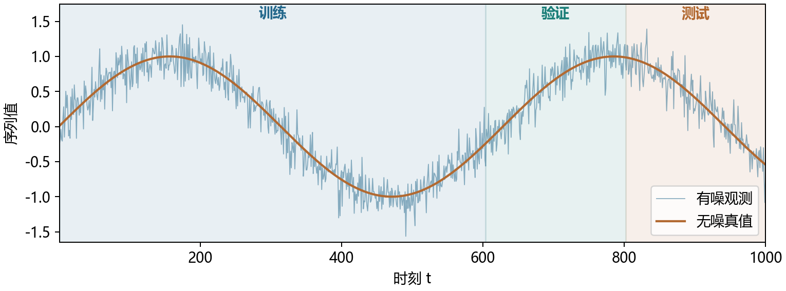
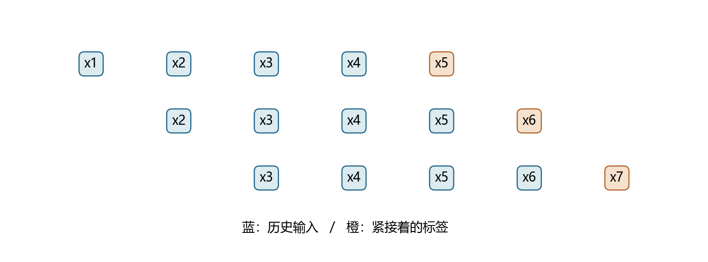
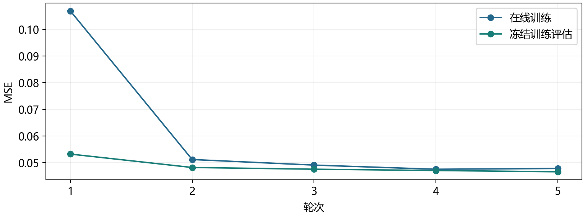
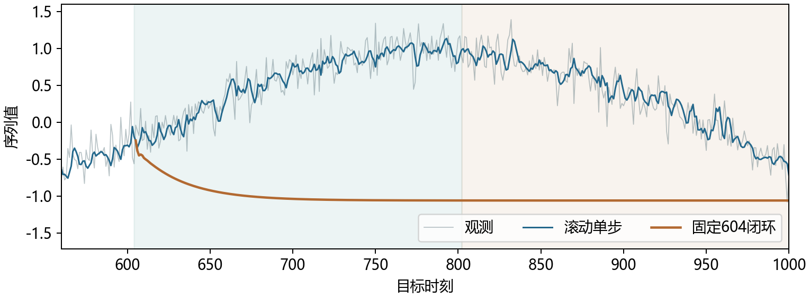
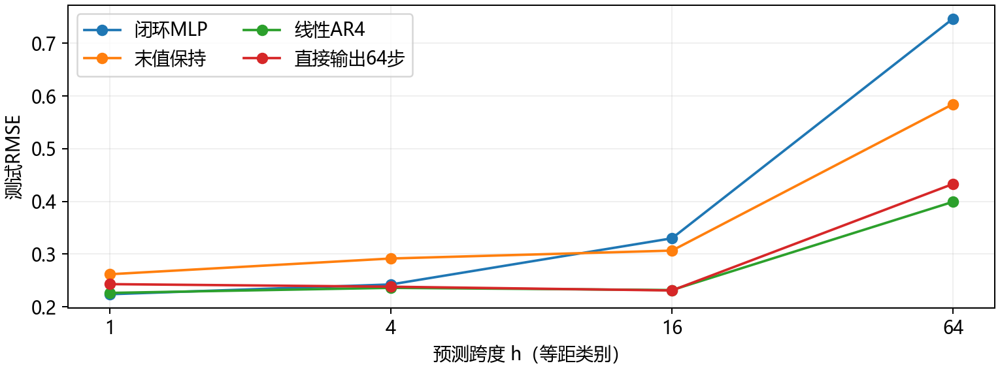
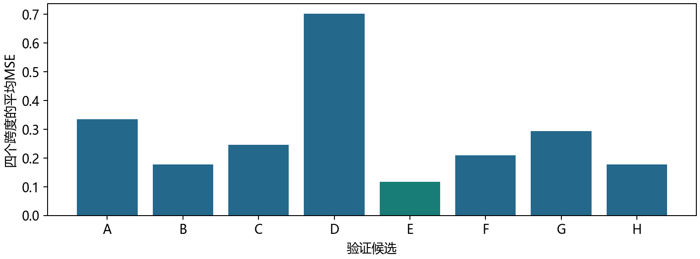
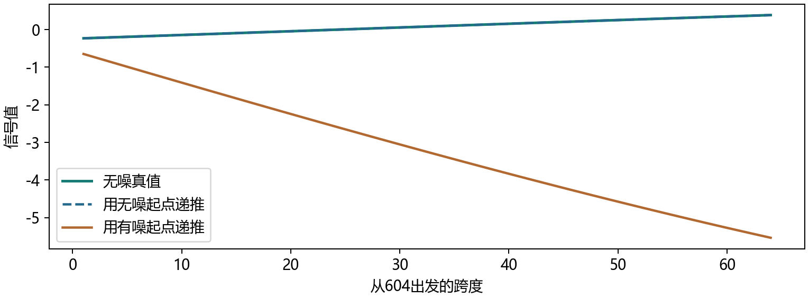

# 8.1 序列模型

覆盖教材 PDF 308-316、正文 290-298 的 8.1.1 至 8.1.3 和四道练习。PDF 307 为第8章导入，PDF 316 在 8.2 标题前结束本节。

## 01 预测下一时刻需要先定义已知信息

第7章处理图像，同一张图内像素的位置有含义。现在样本有时间顺序。读完一句话的前半段，可以根据已经出现的词预测下一个词。重排这些词会改变含义，也会改变预测时哪些信息已经可用。

设 x_t 是时刻 t 的观测。给定 x_1 到 x_t，我们要在时刻 t 产生 x_(t+1) 的预测。先明确此时见过的历史，再讨论如何构造训练样本和评价。

内插是在已有观测之间估计缺点，可能用缺点两边的信息。外推是估计已知范围之后的值。在真实上线时间回放外推时，未来观测还不可用。随机切分整条时间序列容易把外推变成更容易的任务。

<!-- side -->

### 阅读与操作

第1-15页从条件概率、滞后窗口讲到误差传播和实测。第16-20页的五段代码写入同一文件。第21-23页用于完整复现、综合练习和排错。

### 本节的输出

教材示例生成带噪正弦序列，再用 MLP 从历史窗口回归下一步。第8章后面会用可学习状态维护历史。

### 先分清时间与行号

正文从时刻1计数。Python 的 observed[0] 保存 x_1。下文给出的切片都对照这个约定。

<!-- pagebreak -->

## 02 条件概率链式分解与学习目标

整条序列的联合分布可以按次序展开为 P(x_1)×P(x_2|x_1)×…×P(x_T|x_1,…,x_(T−1))。先描述第一个点，再逐项乘上给定此前历史的条件分布。这是概率链式法则，对相关序列同样成立。

条件分布的形状可以随历史变化。连续值回归若使用平方损失，最优点预测是条件均值。给定同一历史 h，令 μ=E[X|h]，则 E[(X−a)²|h]=Var(X|h)+(μ−a)²，取 a=μ 可使平方误差最小。分布中的波动仍然存在。

对于离散词元，模型输出整个候选词表上的 logits，经 softmax 得到条件概率，用 3.4 的交叉熵训练。样本是连续数值时，本节用 MSE 学一个点预测。

<!-- side -->

### 长度为什么是问题

时刻越晚，完整历史越长。如果把每个过去值都放进同一个固定输入宽度的 Linear，就需要规定怎样压缩历史。

### 动力学稳定的假设

训练后把同一模型用到更晚时刻，依赖历史与未来关系具有一定稳定性。马尔可夫阶数描述“需要记多久”，转移是否随时刻改变则是另一件事。

本示例的正弦均值随时间变化。因此可以讨论生成规律固定，同时不能把有噪观测直接称作严格平稳序列。

<!-- pagebreak -->

## 03 马尔可夫条件让历史缩短

一阶马尔可夫条件要求给定当前状态后，更早的历史不再改变下一步的条件分布。若真实规律需要最近 τ 步，可把这 τ 个值看成一个扩展状态。训练时选定输入长度，再用数据检查近似质量。

例子有安静和活跃两状态。转移矩阵 T 的每行表示当前状态，每列是下一状态。安静行 [.8,.2]，活跃行 [.3,.7]。若要算从安静出发两步到活跃，枚举中间状态。

路径一经过安静，权重 .8×.2。路径二经过活跃，权重 .2×.7。两条路径相加得到 .30。整个两步矩阵等于 T@T，两行分别 [.70,.30]、[.45,.55]。

<!-- side -->

### 矩阵乘法对应边缘化

P(x_(t+2)|x_t) 对所有可能的 x_(t+1) 求和。在马尔可夫条件下，第二次转移只需要中间状态。矩阵乘法把这一步写成一行。

### 同一阶数也可随时间变化

若两个时段的转移矩阵不同，就依顺序乘 T1@T2。一阶条件仍可能成立。使用同一个 T 是额外的时间齐次条件。

### 对连续序列的联系

前面的条件分布思想也适用于连续值。这里后续的 MLP 直接输出均值近似，无法从一个预测数字读出完整的转移概率。

<!-- pagebreak -->

## 04 固定窗口与隐状态怎样记历史

固定窗口直接使用最近 τ 个观测，例如 x_(t−3)、x_(t−2)、x_(t−1)、x_t。把历史装成固定宽度之后，线性回归或 MLP 都能给出下一步。对同一序列做这种回归，就是自回归。

另一种做法是维护摘要状态 h_t=g(h_(t−1),x_t)，再用 h_t 预测 x_(t+1)。每见一个新值就更新状态，输入虽然只有一个新点，状态可以携带较早的信息。

在本节正弦例子里，可以把无噪状态写成 sin(0.01t) 与 cos(0.01t) 两个分量。每一步把它们按固定角度旋转，传感器只读到加噪的第一个分量。记住相位和趋势有助于预测。

<!-- side -->

### 教材第4题

室温传感器只读带噪温度，房间蓄热、空调状态和室外条件却会影响接下来怎么变。若短窗口难以表达这些长期因素，可以用隐状态摘要历史。

### 状态与观测

观测是记录下来的 x。隐状态是我们希望从记录中推断或学习的摘要。长度固定只是结构设计的一部分，仍需使状态包含任务相关信息。

### 本节与后续

本节把固定 τ 写成显式窗口。第8章后续将训练更新摘要的循环神经网络。本页的正弦旋转状态用于解释动力学。

<!-- pagebreak -->

## 05 正向、反向和因果要分开

同一个联合分布也可以从后往前相乘。给定未来观测能更新我们对过去的判断。用第3页的两状态例子，若原来安静/活跃为 [.7,.3]，观察下一时刻安静后，前一时刻安静的概率是 .56/(.56+.09)≈.862。

分母是到达安静的两种路径之和。由贝叶斯公式得到的这个后验，可以和正向 .8 不同。它用于推断已经发生的状态；改变未来观测显示什么，只会改变推断材料。

时间先后也不能单独证明因果关系。共同原因可能影响前后的变量。若真实过程是 x_(t+1)=f(x_t)+ε，且 ε 与 x_t 独立，倒过来往往不能保持同样的独立噪声结构。

<!-- side -->

### 教材第3题

续写时，下一个词只能用已生成的左侧文本，因此适合正向条件分解。填空和校对可以用两边文本。可用信息取决于任务是生成未来，还是补全已知文本中的空位。

### 词序与干预

后面的词可以帮助消歧前面的词。这是条件推断。训练语言模型时靠语料学习条件关系，因果解释需要额外假设。

### 落到数据代码

每个样本都记录标签时刻。检查它用到的最大输入时刻小于标签时刻。在多步模式检查起点后未再次读取观测。

<!-- pagebreak -->

## 06 合成数据和按时间切分

生成 t=1 到1000。无噪信号 s_t=sin(0.01t)，观测 x_t=s_t+ε_t，ε 为独立高斯噪声、标准差0.2。模型只用 x_t 训练。保留 s_t 可单独测信号的拟合误差。



前600个合法 τ=4 窗口的标签在5-604。验证标签605-802，测试803-1000，各198。训练标签范围先固定，然后在每个训练轮中打乱这些合法窗口。

<!-- side -->

### 边界处可以用历史

预测605可用601-604，预测803可用799-802。训练与评估不会因边界而失去最新的已知观测。划分依据是目标时刻。

### 训练前处理也受边界约束

若要估计均值、方差或缺失填补统计，只在训练期拟合。重叠窗口的随机训练/测试切分会把非常相近的窗口放入两侧。

### 噪声与 RMSE

预测观测的 RMSE 衡量现实标签误差。对 s_t 的 RMSE 衡量去噪后信号误差。即便准确知道 s_t，独立新噪声仍不可提前预测。

<!-- pagebreak -->

## 07 把一条序列变成输入矩阵和标签列

τ=4 时，第0行输入 [x_1,x_2,x_3,x_4]，标签 x_5。第1行向右滑一个点，输入 [x_2,x_3,x_4,x_5]，标签 x_6。相邻行共享三个输入。



T=1000 时有996行。用 observed.unfold(0,τ+1,1) 得到一个有5列的窗口视图。前4列作特征，最后1列作标签。损失计算要求 net(X) 和 y 都是 (N,1)。

<!-- side -->

### 切片也能得到同一结果

Python 第 i 行的特征来自 observed[i:i+τ]，标签来自 observed[i+τ]。用 i+τ+1 得到从1计的目标时刻。

### 为什么保留标签列

labels[:,−1:] 仍为二维，labels[:,−1] 会少一维。把 (N,1) 减 (N,) 会广播成 (N,N)，每条预测被拿去和所有标签相减。

### 最早的四个时刻

时刻1到4缺少完整的四点历史。本节从第5点开始做监督学习。若改成填充，要说明填充值以及怎样让模型区分填充和真实观测。

<!-- pagebreak -->

## 08 用 MLP 和平方损失训练自回归

正式模型为 Linear(4,10)→ReLU→Linear(10,1)，共61参数。数据和权重用 float64。权重 Xavier、偏置0，数据/模型/批顺序种子为8101/8102/8103。



沿教材用批内平方误差之和反传，Adam lr=.01，batch16，五轮。每轮600行分成37个完整批和尾批8，共190步。冻结后的训练 MSE 从第一轮 .053270 降到第五轮 .046637。

<!-- side -->

### 更新和评估的分母

反传用 sum 对齐教材，显示 MSE 用所有误差的和除总元素数。在线训练 MSE 汇总当时不同参数下的损失。冻结评估用同一个轮末模型。

### 为什么这里用 CPU

模型和数据都小，CPU足以复现。本实现沿用教材结构和训练口径。实验固定种子并使用 float64 与零偏置。

### 不混合比较 sum 和 mean

完整批的梯度整体尺度相差批量大小，尾批不同。Adam 还会累积梯度矩，改归约时应声明新配置并重跑。

<!-- pagebreak -->

## 09 滚动单步与固定起点闭环

滚动单步的每一行都用该时刻之前的真实观测。预测605用601到604，预测606用602到605。第二次预测要求真实 x_605 已到达。

固定在604做多步预测时，只初始化601到604。先算预测值 p_605，下一步的输入为 x_602、x_603、x_604、p_605。预测时刻609时，窗口里的四个值都是预测值。



<!-- side -->

### 怎么复现这个区别

把真实 x_605 改成一个很大的数。对固定604的预测，起始窗口没有变化，整条闭环也一样。对滚动到605后再预测606，输入会改变。校验脚本实际做了这个检查。

### 实测数据如何读

完整198个测试时刻滚动单步 RMSE .217437，信号 RMSE .110900。固定604闭环诊断跨605到1000共396点，观测 RMSE 1.561005。

这两项的时间范围和可见信息不同。正式跨跨度对比使用第11页给出的共同起点。

<!-- pagebreak -->

## 10 为什么回填会把误差带到下一步

训练时输入窗口来自观测。固定起点闭环时，窗口里逐渐加入模型自己的输出，输入分布会随跨度变化。第二步的误差既受该步自身预测偏差影响，也受第一步误差影响。

用标量局部近似 e_(h+1)=b+a×e_h。b 表示每一步的新误差，a 表示误差经映射的传递倍率。若 e_0=0，迭代得到 e_h=b×(1+a+…+a^(h−1))。取 b=.1，十步在 a=.5、1、1.2 时误差约 .200、1.000、2.596。

τ>1 时，误差在整个窗口状态里传播。抛掉旧元素、加入新预测相当于状态映射。重复迭代可能放大，也可能收缩到某个范围，实际取决于沿轨迹遇到的模型斜率和偏差。

<!-- side -->

### 为什么会得到平坦曲线

若逐步回填后窗口接近常量输入，且模型对这个常量输出接近同一值，轨迹会在附近停滞。模型没有接收到后续的真实相位进展。

### 区分两种评价目标

单步好说明在真实历史输入下预测下一点有效。闭环好还要求自身预测作为未来输入时仍能给出合用结果。

### 一种替代方案

模型可以从同一起始窗口直接产生多个未来点。这样无需把第1步误差喂回去。输出维度、训练目标与监督范围也会相应改变。

<!-- pagebreak -->

## 11 同一起点表如何对齐 h 步

设 o 是起点，即最后一个已经观察到的时刻。先取 [x_(o−τ+1),…,x_o]，每次预测一个新值，滚动 h 次。第 h 个输出与 x_(o+h) 对齐。h=1 对应预测矩阵的第0列。

教材一次给每个合法起点准备一行。T=1000、τ=4、最大64时，全序列所有合法起点为4..936，共933行，完整工作表为933×68。前4列是真值，后64列是依次预测的结果。每一列的目标时刻随行起点平移。

本节评估只用留出区间的合法起点。验证604..738，测试802..936，各135个，保证同一组起点的1、4、16、64步目标全部在对应区间。

<!-- side -->

### 末行做反推

测试最后一个起点为936。窗口最后一个真实元素就是 x_936，64步的真值是 x_1000。若起点937，则64步目标超出序列。

### h1 样本数为什么不同

完整滚动单步测试覆盖803到1000，共198点。共同起点表的 h1 覆盖803到937，共135点。由于样本范围不同，两处 RMSE 可以不同。

### 起点逐步向前怎么理解

每行内部闭环。切到下一行是另一次预测任务，时间推进后可以有新的已见真实观测。评价时按这个操作环境解释。

<!-- pagebreak -->

## 12 固定协议下的四种预测方法



| 模型 | h=1 | h=4 | h=16 | h=64 |
| --- | --- | --- | --- | --- |
| 闭环 MLP | .223696 | .242308 | .329857 | .746654 |
| 末值保持 | .261643 | .291525 | .306509 | .584459 |
| 线性 AR4 | .226194 | .235837 | .231601 | .399030 |
| 直接64列 | .242866 | .237990 | .230835 | .432926 |

单步 MLP 在 h1 表现好，线性 AR4 在 h64 的 RMSE 更低。对这种任务，保留简单基线能揭示结构和跨度的影响。

<!-- side -->

### 二种无需闭环 MLP 的参照

末值保持把最新观测复制到未来。线性 AR4 用训练600行最小二乘拟合四个滞后系数和截距，再闭环迭代。

### 直接多步的监督边界

直接版从四个历史值预测64列，训练起点4..540，共537行。每行最远标签也不晚于604。模型有754参数，用元素平均 MSE，五轮170更新。

### 实验能说明多少

直接版在 h16 与 h64 好于闭环 MLP。它使用不同目标、参数量和训练行数。该对照展示可选的预测方式，效果由本协议与数据决定。

<!-- pagebreak -->

## 13 在验证集比较窗口和架构

各候选统一用目标17..604，共588行，五轮。用135个验证起点计算 h=1、4、16、64 的 MSE，等权平均为候选分数。



E 的16步原始窗口分数最低。F 把最早13点平均，再保留最近3点，仍只有4个输入。它在本协议中好于只读最近4点的 A。

<!-- side -->

### 末轮验证分数

| 候选 | 历史或架构 | 平均 MSE |
| --- | --- | --- |
| A | 4，隐藏10 | .335009 |
| B | 1，隐藏10 | .178424 |
| C | 2，隐藏10 | .246294 |
| D | 8，隐藏10 | .702843 |
| E | 16，隐藏10 | .116796 |
| F | 16压为4列 | .210262 |
| G | 4，隐藏16/8 | .293641 |
| H | 4，训练线性 | .177883 |

### 教材第1题的结论范围

E 虽然领先，D 仍比 A 的误差大，窗口收益并不单调。聚合降低噪声的同时会丢失旧值顺序。E 只参加验证对照。

<!-- pagebreak -->

## 14 无噪正弦为什么两步历史就够

写 x_t=A sin(ωt)+B cos(ωt)。连续形式满足 x''=−ω²x，位置和速度构成二维状态。考虑固定步长 δ 的相位采样。对正弦和余弦用和差公式，可得 x_(t+1)+x_(t−1)=2cos(δ)x_t。



已知 δ=.01 时，给两个连续无噪值即可递推。用干净的603、604作为起点，64步最大绝对误差约1.20e-14。换成有噪观测作为起点，预测对干净曲线的64步合并 RMSE 约3.65875。

<!-- side -->

### 一点通常缺一份相位信息

同一个正弦高度可能处于上升段或下降段。时间、相位与振幅均未知时，两次连续观察提供两条方程。已知频率且 sin δ 不为0，能解出二维状态。

### 为什么小步长对噪声敏感

相邻两次观测很接近。用差分推断斜率时，噪声差被除以小步长。后续曲线会把错误的斜率或相位带到所有预测点。

若已知绝对时刻、幅度与相位，可直接算真值。这里两步的结论以未知状态和已知频率为条件。

<!-- pagebreak -->

## 15 真实序列的验证与本机数值核对

教材第2题中的投资者只挑过去回报最好的一组，容易把偶然波动当规律。筛选的候选越多，历史冠军越可能含有噪声。市场状态会变化，还需考虑样本构成、退市、交易成本和风险。在时间顺序上做验证，先固定选择规则，最后再用后续未见区间检查。

本机用独立 NumPy 重放61个参数的全部190次更新。输入直接按 NumPy 切片构造，梯度、Adam 的一阶/二阶矩与偏差修正分别计算。相对 PyTorch 的参数最大绝对差为3.89e-16，10个中心差分坐标最大误差8.64e-12。

接下来缩到120点，完成从造数、滑窗、训练到两种预测的完整流程。用真实标签切分保证与正式实验同一逻辑。

<!-- side -->

### 能自己解释的三件事

试着解释三件事。训练最后一行的输入和标签怎样对齐。两种模式预测606时各自怎样取得605。两点递推为什么对起始噪声敏感。

### 代码入口

第16-20页的主栏 Python 代码按顺序追加。跟做文件只保存在项目 .cache 目录；练习文件保留八个待补表达式。

### 指标口径

正文报告每个点的平方误差均值和它的平方根。比模型时同时核对目标范围、起点与可获取的历史。

<!-- pagebreak -->

## 16 跟做一 生成序列和训练边界

在项目根目录创建 .cache/8_1_follow.py。先写下面的准备代码。

```python
from pathlib import Path
import torch
from torch import nn
from torch.utils.data import DataLoader, TensorDataset

root = Path.cwd()
assert (root / 'lessons/ch08/01_sequence_models.py').is_file()
torch.set_num_threads(1)
time = torch.arange(1, 121, dtype=torch.float64)
clean = (0.01 * time).sin()
rng = torch.Generator().manual_seed(8101)
noise = torch.randn(120, generator=rng, dtype=time.dtype)
observed = clean + 0.2 * noise
tau, cutoff = 4, 84
print('序列长度', len(observed), '最后训练时刻', cutoff)
```

<!-- side -->

### PowerShell 设置

在 VS Code 打开项目根目录，使用已经存在的 openmmlab 解释器。

```powershell
$pythonPath = 'D:\Anaconda\envs\openmmlab\python.exe'
$env:PYTHONUTF8 = '1'
```

### 预期输出

序列长度120，最后训练时刻84。前4点用来给第5点提供历史。若报路径断言，检查终端所在目录。

### 改噪声怎么比较

先跑基线，再只把0.2改为0.0。保留相同时间和种子，比较两种模式的 RMSE。

<!-- pagebreak -->

## 17 跟做二 生成二维窗口并检查边界

```python
rows = observed.unfold(0, tau + 1, 1)
features = rows[:, :tau]
labels = rows[:, tau:]
target_t = torch.arange(tau + 1, len(observed) + 1)
train_count = int((target_t <= cutoff).sum())
assert features.shape == (116, 4)
assert labels.shape == (116, 1)
assert torch.equal(features[0], observed[:4])
assert labels[0, 0] == observed[4]
assert target_t[train_count - 1].item() == 84
assert target_t[train_count].item() == 85
print('特征', tuple(features.shape), '标签', tuple(labels.shape))
print('训练行', train_count)
order = torch.Generator().manual_seed(8103)
loader = DataLoader(
    TensorDataset(features[:train_count], labels[:train_count]),
    batch_size=8, shuffle=True, generator=order)
```

<!-- side -->

### 预期形状

116×4 的特征，116×1 的标签，训练80行。最后训练标签84，第一条未来标签85。

### 三种切片

冒号表示这一轴取全部。[:, :tau] 取左边 τ 列，[:, tau:] 取最后一列并保留二维。[:train_count] 直接按第0轴取前80行。

### 顺序何时重要

先按标签时刻确定训练前缀。只有 DataLoader 对训练区的窗口行打乱；每行内部仍按从远到近的顺序。

<!-- pagebreak -->

## 18 跟做三 创建 37 参数网络并训练

```python
def make_net():
    torch.manual_seed(8102)
    first = nn.Linear(tau, 6, dtype=torch.float64)
    nn.init.xavier_uniform_(first.weight)
    nn.init.zeros_(first.bias)
    last = nn.Linear(6, 1, dtype=torch.float64)
    nn.init.xavier_uniform_(last.weight)
    nn.init.zeros_(last.bias)
    return nn.Sequential(first, nn.ReLU(), last)

net = make_net()
opt = torch.optim.Adam(net.parameters(), lr=.01, foreach=False)
updates = 0
for epoch in range(3):
    net.train()
    for X, y in loader:
        opt.zero_grad(set_to_none=True)
        loss = (net(X) - y).square().sum()
        loss.backward()
        opt.step()
        updates += 1
assert updates == 30
print('参数', sum(p.numel() for p in net.parameters()), '更新', updates)
```

<!-- side -->

### 先手算

第一层4×6权重加6个偏置，最后一层6×1权重加1个偏置，共37。80个训练窗口每批8，每轮10次，三轮30次更新。

### 每个批的三步

先清上一批梯度。平方误差求和后反传。最后由 Adam 根据累计的矩更新参数。

### 预期输出

参数37，更新30。训练损失使用 (8,1) 与 (8,1)。需要换历史长度时，先让窗口、Linear 输入和训练行数一致。

<!-- pagebreak -->

## 19 跟做四 让两种模式只差窗口来源

```python
net.eval()
with torch.no_grad():
    rolling = net(features[train_count:]).flatten()
    context = observed[cutoff - tau:cutoff].reshape(1, -1)
    forecasts = []
    for _ in range(len(observed) - cutoff):
        prediction = net(context)
        forecasts.append(prediction)
        context = torch.cat((context[:, 1:], prediction), dim=1)
    closed = torch.cat(forecasts, dim=1).flatten()
truth = observed[cutoff:]
assert rolling.shape == closed.shape == truth.shape == (36,)
torch.testing.assert_close(rolling[0], closed[0])

def rmse(p, y):
    return (p - y).square().mean().sqrt().item()

print('单步 RMSE', rmse(rolling, truth))
print('闭环 RMSE', rmse(closed, truth))
```

<!-- side -->

### 开头必然一致

预测85时两种模式都使用81..84作为历史。预测86时单步使用真值85，闭环使用预测85。检查它们都给出36个预测。

### 怎样检查闭环

更新 context 的右侧只接 prediction。上面的 truth 直到所有预测都完成才用于算误差。

### 为什么取 flatten

单步模型输出 (36,1)，把列展平为 (36,) 才能逐点与 truth 比较。闭环列表先在同一行接成 (1,36)，再展平。

<!-- pagebreak -->

## 20 跟做五 核对保存和加载

```python
path = root / '.cache/8_1_follow.pt'
path.parent.mkdir(parents=True, exist_ok=True)
torch.save(net.state_dict(), path)
restored = make_net().eval()
restored.load_state_dict(torch.load(path, weights_only=True))
with torch.no_grad():
    before = net(features[-4:])
    after = restored(features[-4:])
    error = (before - after).abs().max().item()
assert error == 0
print('恢复最大差', error)
```

五段都写入同一文件后，在项目根目录运行。

```powershell
& $pythonPath .cache/8_1_follow.py
```

<!-- side -->

### 预期结果

本机单步和闭环 RMSE 分别为 .252419、.268675。用相同结构加载后，同一批输入的输出最大差为0，沿用第5章的模型保存方式。

### 改一个变量再跑

把噪声0.2改成0后重跑，先看单步和闭环 RMSE。再恢复噪声，单独更改模型隐藏宽度，每次只改一个因素。

### 若想下一次继续训练

这段仅恢复预测。精确续训还需保留优化器、随机数状态和数据加载进度。

<!-- pagebreak -->

## 21 复现教材规模与八组对照

从项目根目录运行。教师入口先跑验证候选，再跑固定基线、线性 AR4、末值保持与直接64列对照。

```powershell
& $pythonPath lessons/ch08/01_sequence_models.py --guided --record
& $pythonPath tools/build_sequence_figures.py
& $pythonPath tools/verify_sequence_models.py
```

第一行应打印190更新、单步测试RMSE .217437、共同起点四跨度 .223696/.242308/.329857/.746654、验证候选 E。第二行重画7幅图。第三行核对 NumPy 重放、时间对齐和五段跟做。

用 --record 时，人工输入 CSV 写到 datasets/ch08/sequence_sine.csv，实验 JSON、轨迹与指标写到 reports/ch08/。

<!-- side -->

### 怎样读实验文件

8_1_train.csv 是五轮更新。8_1_test_horizons.csv 是每个模型的4个跨度。trajectory 表在时间轴上并列观测、单步、固定604预测，空白表示当时没有该类预测。

### 不带导读也可读 JSON

省略 --guided 打印完整 JSON。--record 才写出数据和报告。旧章节的数据不参与本节训练。

### 关心未来时用哪项

若场景会不断得到新观测，就用滚动单步。观测结束以后一次计划多步时，查看固定起点预测和指定跨度。

<!-- pagebreak -->

## 22 综合练习 从时间切分跑到闭环

打开 exercises/ch08/01_sequence_models.py。按顺序补八处 TODO。先核对窗口与标签，再训练，最后把每一步预测接回历史。

| 位置 | 操作 | 通过时的自查 |
| --- | --- | --- |
| 1-2 | 特征、标签 | (116,4) 和 (116,1) |
| 3 | 按目标时刻确定前缀 | 80行到84为止 |
| 4-6 | 平方误差、反传、Adam | 3轮30次更新 |
| 7-8 | 起始窗口与回填 | 两种输出各36点 |

```powershell
& $pythonPath exercises/ch08/01_sequence_models.py
```

未填写时给出窗口提示。完成后会打印训练行、更新、预测长度及两个 RMSE。

<!-- side -->

### 集中反馈

提交八处修改、两个矩阵形状和两种 RMSE。说清预测86的两种输入中，哪个元素来源不同。

### 自己做一次边界检查

把截止时刻改到82。先算训练行数、更新数和未来点数，再调整闭环循环次数与断言。确认新起始窗口的最后一个值是 x_82。

### 不把代码运行当成掌握

本机已验证手册代码和练习接口。课程记录保留待填写的 TODO。你的预测、输出和解释作为学习反馈。

<!-- pagebreak -->

## 23 教材习题回顾与常见问题

| 教材题 | 对应页 | 动手核对 |
| --- | --- | --- |
| 1 窗口、噪声、聚合和网络 | 13、14 | 读验证表和两点递推 |
| 2 依据历史收益筛选 | 15 | 核对时间与选择规则 |
| 3 文本中的时间方向 | 5 | 比较续写与填空 |
| 4 隐变量自回归 | 4 | 举例缺失可见状态 |

遇到 loss 看起来正常但误差大，先检查目标和输出是否发生广播。若共同起点最后一个目标超界，检查最大跨度和起点上限。若闭环比预期好，验证是否错误读取了起点以后的真值。

<!-- side -->

### 两种泛化检查

训练期的低 MSE 不足以评价后续时刻。冻结模型，再按时间评估。标注每个跨度读取真值的范围。

### 8.2 文本预处理

下一节从教材 PDF 316（正文298）开始。序列元素将从浮点数换成词元，需要先完成清洗、切分、建词表和索引编码。

### 本节接到下一节

用字符或词元建成整数序列后，我们也可问给定历史，下一个元素是什么。预测输出则是对离散候选的概率。
