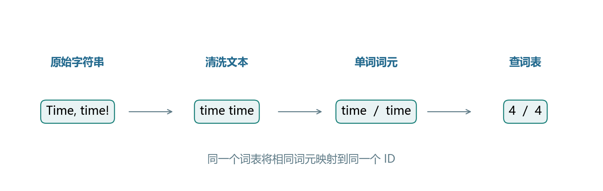
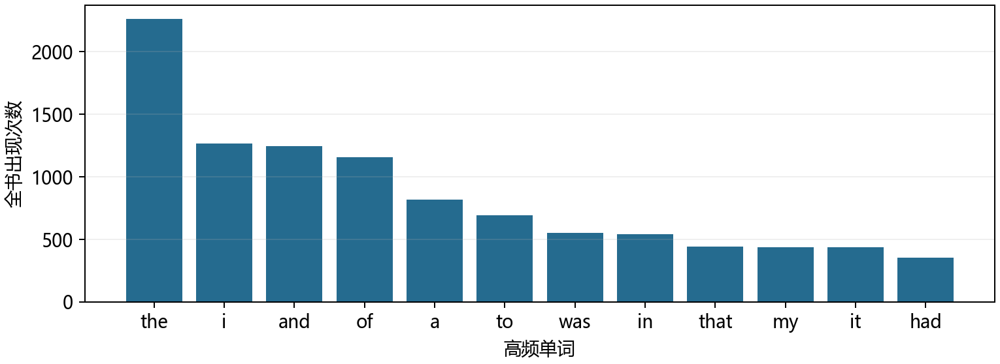
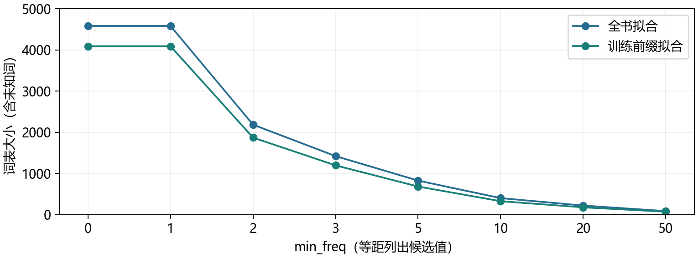
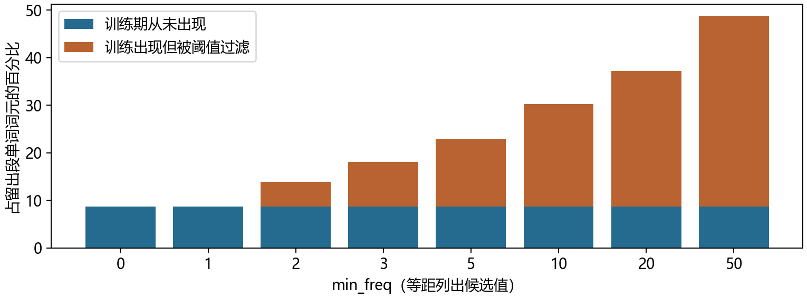
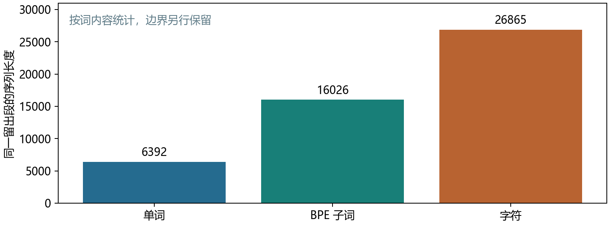

# 8.2 文本预处理

覆盖教材 PDF 316–321、正文 298–303 的 8.2.1 至 8.2.4 和两道练习。第 321 页在 8.3 标题前结束本节。

## 01 从序列预测接到文本输入

8.1 用最近几个数值预测下一时刻。换成连续文字后，顺序仍然有意义。读到 “the time” 时，下一项可能是 “machine”，也可能是别的词。我们需要先定义这里的“一项”，才知道模型该预测哪个事件。

以字符为单位，模型预测下一个字符。以单词为单位，模型预测下一个单词。切分粒度同时决定时间步的数量和每一步的类别数。选好粒度后，把每个词元映射成唯一整数，后续再把整数变成模型可用的向量。



<!-- side -->

### 阅读路线

第1–12页贯通清洗、切分、词表、索引和两道教材题。第13–17页在同一个文件顺序跟做。第18页跑原书语料并改参数，第19页完成综合练习和结果核对。

### 本节的交付对象

到本节末尾，我们会有一个一维字符索引列表和与它配套的字符词表。8.3 再来定义下一词元预测的概率与取批方式。

<!-- pagebreak -->

## 02 从文件字节读出文本行

文件在磁盘中存储的是字节。用 UTF-8 解码后才得到 Python 的字符串。本节先验证原文件哈希，再解码。以 a中 为例，UTF-8 有四个字节 [97, 228, 184, 173]，Python 字符串长度为2。

用 splitlines() 去掉每条记录的换行符，保留中间的空记录。教材按文件行清洗。一本书的排版行可能只有一个词，也可能跨越句子的内部，因而每行只作为读取与清洗的单位。

本机教材语料的原始文件为178,979字节，解码后得到3,221行。程序既显示原始文件的哈希，也记录清洗后为空的373行，便于定位预处理是否用了同一份数据和规则。

<!-- side -->

### 看看三种长度

len(raw) 给字节数。len(raw.decode('utf-8')) 给 Unicode 码点数。len(text.splitlines()) 给行数。一个视觉上的字符还可能由多个码点组合，例如字母后加组合重音。

### 读小样本和读原书

跟做用项目中的 datasets/ch08/text_demo.txt。完整示例用 data/timemachine.txt。第18页给出首次取得教材语料的命令。

<!-- pagebreak -->

## 03 清洗规则决定保留哪些信息

教材用正则表达式 [^A-Za-z]+ 找到连续的一段非 ASCII 字母，并合为一个空格。再用 strip() 去首尾空格，lower() 把剩余字母转成小写。执行顺序让整行非字母归为空字符串。

以 “Time-travel isn't 8.2!” 为例，连字符、撇号、数字和标点都落在替换范围内。最后得到 “time travel isn t”。替换成空格保留了前后两段的分界。如果直接删去所有非字母，time 与 travel 会粘成 timetravel。

这套规则适合在英文教材示例中缩小字符集合。预测年份或标点的任务需要清洗时保留数字或标点。恢复大小写的任务还需区分字母大小写。按同一规则处理中文，“研究生命”会变为空串。

<!-- side -->

### 读正则

方括号描述一个字符的取值范围。开头的 ^ 在方括号内表示取反。+ 表示前面的模式连续出现一次或多次。先找整段，再统一替换成一个空格。

### 先核对一个样例

教材首行清洗后是 “the time machine by h g wells”。作者姓名缩写间的句点已经被空格替换。

<!-- pagebreak -->

## 04 同一行可以切成单词或字符

对清洗结果 “time travel”，line.split() 得到 ['time', 'travel']。line.split() 按空白切开并舍去分隔空白，所以只有两个时间步。list(line) 则保留中间的空格，一共有11个字符词元。

两种写法都先产生“行列表里的词元列表”。空行对应 []。保留行这层结构，可检查每行切分、按原行序切分训练与留出数据。词元化过程没有计算每个词出现几次，也尚未产生数字。

词元总数是所有出现位置的数量，词种数是不同字符串的数量。例如 ['time','time','machine'] 有3个词元、2个词种。设 n(w) 为词 w 的出现次数，单词词元总数就是把所有 n(w) 相加。

<!-- side -->

### 词与字符各自的代价

单词粒度通常序列较短，罕见拼写会占据词表条目。字符粒度容易用少量符号拼出新词，预测整词时模型要跨更多步。第12页再用同一段文字量化这个差别。

### 保留原顺序

计数用顺序无关的总和。组成训练序列时，必须回到原词元顺序。按词频排序只影响词表编号。

<!-- pagebreak -->

## 05 用词频计数和保留项建立词表

把训练词元逐项交给 Counter。它以词元为键、出现次数为值。先按出现次数降序排列，再依次给满足 min_freq 的不同词元分配索引。教材风格的默认词表从 <unk> 开始，索引为0。并列词频保留首次出现次序，便于同一语料复现。

设 R 是先占位置的保留项集合，含 <unk>。对训练集合中出现的词 w，只要 n(w)≥min_freq 且 w 不在 R，就加一个词表条目。因此词表大小是 |R| 加上通过筛选的不同词种数。这里统计中出现的每种词已有至少1次，故阈值0和1给出相同的词表。



<!-- side -->

### 两个方向

idx_to_token 是列表，位置即编号。token_to_idx 是字典，给出字符串的编号。用 enumerate() 同时拿到位置和值，确保这两个映射互逆。

### 原书基线

全书32,775个单词词元，4,579个不同单词。默认单词词表含 <unk> 共4,580项。排名第一的 the 出现2,261次，编号1。

<!-- pagebreak -->

## 06 正反查表和特殊词元

固定词表后，逐项编码得到 ID 序列。例如全书默认单词词表把首行编码为 [1, 19, 50, 40, 2183, 2184, 400]。反向取列表的这些位置，可以恢复清洗并切分后的首行词元。

如果单词未在建表阶段出现，或其训练频次低于阈值，字典查询用 <unk> 的编号0。两个原词可能落到同一个ID。反查能恢复 <unk>，清洗前的标点、大小写以及未知词的原拼写已经无法从编码推回。

练习会额外保留 <pad>、<bos>、<eos>。<pad> 补齐同批序列的形状，可用掩码把这些位置移出损失。<bos> 和 <eos> 分别表示开始与结束。如果需要模型预测终点，就把 <eos> 作为有效标签。教材默认字符任务只保留 <unk>。

<!-- side -->

### 手算一次查表

小词表按顺序存 [<unk>, <pad>, <bos>, <eos>, time]。编码 [<bos>, time, new, <eos>, <pad>] 得 [2,4,0,3,1]。解码的第三项为 <unk>。

### ID 为什么要固定

如果训练时编号4表示 time，推理时改为 machine，输入仍是合法整数，模型却会读取错误的参数行。保存与加载模型时须恢复同一词表顺序及预处理规则。

<!-- pagebreak -->

## 07 字符展平明确了相邻关系

教材为后续实验选用字符粒度。先把所有清洗后的行拆成字符，建字符词表，再按行序与行内序展平成一串 ID。行内空格可见，原换行符已被 splitlines() 去除，展平不额外插入分隔符。

字符数等于所有清洗行的长度之和，本机为170,580。如果在非空行之间添加空格，总字符数会增加2,847，得到173,427。后一规则会改变跨行的相邻字符，从而改变下一字符训练样本。

原书字符词表有26个字母、一个空格和一个 <unk>，共28项。用 --max-tokens 截取前若干字符索引时，先按全语料构建教材词表，再切索引序列，所以字符词表大小仍为28。

<!-- side -->

### 用两行看清楚

清洗行 ["time", "machine"] 在教材流程里拼成 “timemachine”。插入行间空格的流程得到 “time machine”。两种结果都保留行内原有的空格。

### 有边界的任务怎么做

若每行来自不同文档，可为文档添加边界词元，或逐文档取样时避开跨文档事件。判断依据是数据来源和预测任务。

<!-- pagebreak -->

## 08 从索引到一位错开的预测任务

在字符序列 “time” 中取前三个字符做输入，后三个字符做标签。于是 t 预测 i，历史 ti 后预测 m，历史 tim 后预测 e。把索引记为 c，长度 k 的输入 c[s:s+k] 和标签 c[s+1:s+k+1] 对齐在同一批训练步上。

给定词表大小 V，输入 ID 要落在 [0,V) 内。为每个词元准备一个 d 维向量，组成 V×d 的参数矩阵 E。ID=i 时取 E 的第 i 行。若将 i 写成 one-hot 行向量，乘 E 的结果也是 E[i]，直接查表可以省去大部分零值乘法。

组成一批以后，输入 ID 张量形状是 (B,T)，查表输出 (B,T,d)。语言模型随后给每个时间步 V 个 logits。标签仍是整数 ID，和第3章交叉熵的类别索引相同。

<!-- side -->

### ID 当作位置

ID 的差值只说明表中的编号差。向量如何相似由模型训练决定。跟做使用逐行填的简单矩阵，让你能直接看到取了哪一行。

### 本节和下节的接口

8.2 产生 ID 序列与词表，8.3 解释条件概率、困惑度和怎样从同一序列取批。这里的玩具切片只用来检查输入与标签的时间对齐。

<!-- pagebreak -->

## 09 教材第2题 提高词频阈值

在同一本书上扫描 min_freq。阈值由1升到2，所有只出现一次的词种都被移除，全书词表由4,580降为2,183。被移除的2,397个单词出现位置统一编码为0。



当阈值升到10，词表为400项，全书有8,659个位置映射到 <unk>。词表更小，可以减少嵌入和输出分类层的参数，同时合并了更多拼写和意义。此处对同一本书建表并编码，衡量的是筛选造成的信息损失。

<!-- side -->

### 从公式读出单调性

频次至少10的词必定也满足至少2次。因此随着 min_freq 变大，保留词种集合只会缩小或持平。全书和训练前缀的词表各自都满足这一点。

### 怎样复现实验

第18页的 --min-freq 2 改变教材版单词词表。完整扫描的每一行都按自己的阈值重新建表，可在 8_2_frequency_sweep.csv 核对。

<!-- pagebreak -->

## 10 留出段把未见与低频分开

沿原始行顺序，用前2,576行建表，后645行只编码。留出段有6,392个单词词元。阈值为1时，留出段有555个位置用到了训练中从未见过的词，因此未知率为555÷6,392 ≈ 8.68%。

阈值提高到2，未见词导致的位置仍是555个。另有332个位置的词在训练中出现过一次，但被移出词表。于是 <unk> 达887个，未知率13.88%。未知率按词元的出现次数计算。一个未知词若重复出现三次，分子就增加三。



<!-- side -->

### 先切分再拟合

正式评估时先切分原文，训练前缀决定词表、频次排序和 BPE 合并。留出只用这些既定规则编码。若用留出数据补齐词表，诊断就会减弱对新词的检测。

### 读另一个阈值

阈值10时训练词表325项，留出有1,933个 <unk>，占30.24%。其中训练见过却被过滤的有1,378个。原始的555个未见位置始终保留在统计里。

<!-- pagebreak -->

## 11 教材第1题 用规则或词典决定边界

第一种扩展是用 Unicode 正则直接从原字符串匹配词、数字和标点。对 “Time-travel isn't 8.2!” 保留 ['Time', '-', 'travel', "isn't", '8.2', '!']。缩约词仍在同一个词元里，数字和标点可用于预测。不同语言的正则规则需要根据文本调整。

第二种扩展是用词典做中文切分。前向最大匹配每次从当前位置试最长的词典项，成功就前进相应长度。小词典中若同时有“研究生”“研究”“生命”“起源”，从“研究生命起源”开头会先选“研究生”，随后退回单字“命”，最后得到“起源”。

这句话还能切成“研究 / 生命 / 起源”。最长匹配只按局部长度选边界。词典覆盖和语境都会影响切分质量。实际中文分词可结合上下文调整边界概率。

<!-- side -->

### 和第3页对照

教材清洗之后，数字、撇号与连字符已经丢失。Unicode 正则示例直接对原始字符串应用，因此仍然可以利用这些信号。

### 检查两个变化

在项目根目录运行 PowerShell 命令，进入 Python 交互窗口。$py 沿用第13页的解释器路径。

```powershell
& $py -i lessons/ch08/02_text_preprocessing.py --guided
```

看到 >>> 后逐行输入，运行后用 exit() 返回。第一次匹配从“研究”开始，第二次保留小数和感叹号。

```python
dictionary_tokens('研究生命起源',
                  {'研究', '生命', '起源'})
regex_tokens('I paid 8.2!')
```

<!-- pagebreak -->

## 12 用训练语料学习子词合并

第三种扩展是字符级 BPE。先把每个训练单词拆成字符，统计词内所有相邻片段对。词出现 n 次，它的每个相邻位置就给计数增加 n。选择计数最大的对，把匹配位置从左到右合并，然后重新统计。编码新词时，从字符起步，按学习到的先后顺序应用各条规则。

本机只用前2,576行学习80次合并。最先合并 t+h，第二次合并 th+e。travelling 被切成 t / ra / v / el / l / ing。规定词内合并后，词间边界仍由外层分词记录。



<!-- side -->

### 读数据时统一计数范围

逐词比较同一留出段，单词6,392、BPE片段16,026、字符26,865。这里不计空格与换行。训练BPE词表含 <unk> 共107项，本次留出片段0个未知。新书若有训练未见的字符，字符起步的实现仍可能遇到未知。

### 字节也可以做基本单位

UTF-8 的字节值只有256种，可覆盖可编码的 Unicode 文本。ASCII 字符占1字节，汉字通常占3字节。将字节完整拼接后再解码，可以恢复原字符串。

<!-- pagebreak -->

## 13 跟做一 读入并清洗文本

在项目根目录用 VS Code 新建 .cache/8_2_follow.py。第13–17页的五段 Python 顺序追加到这一个文件。每追加一段，就从项目根目录重新运行一次。

```python
from collections import Counter
from pathlib import Path
import re

root = Path(__file__).resolve().parents[1]
path = root / 'datasets/ch08/text_demo.txt'
raw = path.read_text(encoding='utf-8').splitlines()
clean = [re.sub(r'[^A-Za-z]+', ' ', line).strip().lower()
         for line in raw]
print('lines:', len(clean), repr(clean[0]), repr(clean[3]))
print('third:', repr(clean[2]))
assert len(clean) == 5 and clean[3] == ''
```

<!-- side -->

### PowerShell 运行命令

```powershell
$env:PYTHONUTF8 = '1'
$py = 'D:/Anaconda/envs/openmmlab/python.exe'
New-Item -ItemType Directory -Force .cache | Out-Null
& $py .cache/8_2_follow.py
```

### 检查第一步

输出共有5行，Python 下标3是空串。首行变为 'time time'，下标2变为 'time travel isn t'。用 repr() 打印空串会显示引号，便于区分缺失输出与空内容。

### 两层路径运算

__file__ 是当前脚本路径。resolve().parents[1] 从 .cache 下的脚本回到项目根目录。Path 的 / 拼接文件路径。

<!-- pagebreak -->

## 14 跟做二 切两种词元并统计训练词

继续追加代码。前四行是训练样本，第五行留出。空行保留原位置，对总计数的贡献为0。

```python
words = [line.split() for line in clean]
chars = [list(line) for line in clean]
counts = Counter(token for row in words[:4] for token in row)
print('word row:', words[0])
print('char row:', chars[0])
print('train time:', counts['time'])
print('totals:', sum(map(len, words)), sum(map(len, chars)))
assert words[3] == chars[3] == []
assert counts['time'] == 3 and 'wells' not in counts
```

<!-- side -->

### 检查空行与空格

单词首行 ['time', 'time']，字符首行 ['t', 'i', 'm', 'e', ' ', 't', 'i', 'm', 'e']。单词一共12个，字符一共60个，训练词 time 出现3次。

### 读循环顺序

先遍历 words[:4] 取一行，再遍历这一行取单词。Counter 逐个记数。临时在文件末尾打印 Counter(token for row in words for token in row)['wells']。会得到1，因为这次也数了留出段。

<!-- pagebreak -->

## 15 跟做三 拟合词表与处理并列

继续追加代码。用列表承载逆向表，再按照同一顺序生成正向表。min_freq 先设为2。

```python
min_freq = 2
reserved = ['<unk>', '<pad>', '<bos>', '<eos>']
ranked = sorted(counts.items(), key=lambda pair: pair[1],
                reverse=True)
idx_to_token = reserved + [word for word, count in ranked
                          if count >= min_freq]
token_to_idx = {word: i for i, word in enumerate(idx_to_token)}
print('vocab:', idx_to_token)
assert token_to_idx['<unk>'] == 0
assert token_to_idx['time'] == 4
```

<!-- side -->

### 检查索引表

预期词表 [<unk>, <pad>, <bos>, <eos>, time]。time 的索引是4。前四项的编号由 reserved 的顺序决定。

### 改一个阈值

第16页完成后一起试。把2改为1时，7个训练词种都入表。加上4个保留项共11项。计数并列时，先出现的 the 排在 machine 前。练习默认要用2，验证后改回去。

### 读排序参数

pair[1] 是 (词元, 频次) 中的频次。reverse=True 让频次降序排列。并列时保留原顺序。字典推导式借助 enumerate() 生成键值。

<!-- pagebreak -->

## 16 跟做四 编码、逆查与补齐

继续追加代码。用首行和留出行组成一条核对样例。pad_mask 只把补齐项的位置标为 False。

```python
sample = ['<bos>'] + words[0] + words[4] + ['<eos>', '<pad>']
ids = [token_to_idx.get(word, 0) for word in sample]
decoded = [idx_to_token[i] for i in ids]
pad_mask = [i != token_to_idx['<pad>'] for i in ids]
print('ids:', ids)
print('decoded:', decoded)
print('valid:', sum(pad_mask))
assert ids == [2, 4, 4, 0, 0, 0, 3, 1]
```

<!-- side -->

### 预期输出

编码 [2, 4, 4, 0, 0, 0, 3, 1]，三个0分别来自 wells、wrote、words。末尾 ID 1 是 <pad>，只有这一格被掩码去掉，有效位置数为7。

### 未知词也留在序列位置

三个未知项没有被删掉。它们仍各占一个时间步，且 mask 为 True。是否再排除未知标签是下游损失函数的任务选择。

### 用阈值验证

把上一页阈值改为1时，toy 词表变大，wells、wrote、words 仍来自留出行，仍然映射为0。随后恢复2，再继续下一页。

<!-- pagebreak -->

## 17 跟做五 字符序列、错位和向量

追加最后一段。建立 toy 字符表和字符流，先对齐五个字符位置，再用 Embedding 读取二维向量。

```python
import torch

flat = [char for row in chars for char in row]
char_names = ['<unk>'] + list(Counter(flat))
char_ids = {char: i for i, char in enumerate(char_names)}
corpus = [char_ids[char] for char in flat]
x = torch.tensor([corpus[:5]], dtype=torch.long)
y = torch.tensor([corpus[1:6]], dtype=torch.long)
weight = torch.arange(2 * len(char_names), dtype=torch.float32)
weight = weight.reshape(-1, 2)
embed = torch.nn.Embedding.from_pretrained(weight)
print('X:', x.tolist(), 'Y:', y.tolist())
print('X text:', repr(''.join(char_names[i] for i in x[0])))
print('Y text:', repr(''.join(char_names[i] for i in y[0])))
print('vectors:', list(embed(x).shape), embed(x)[0, 0].tolist())
assert torch.equal(embed(x), weight[x])
```

<!-- side -->

### 检查首批位置

输入拼为 “time ”，标签拼为 “ime t”。输入 ID 张量形状 (1,5)，向量形状 (1,5,2)。把打印出来的 X 和字符表对照，检查 time 中的每个字符找到了哪一行。

### 读出第一行查表结果

玩具字符表按首次出现顺序编号，首个字符 t 的 ID 是1。权重矩阵下标1处设为 [2.,3.]，第一步输出这两个数。代码用 weight[i] 独立核对每个输出向量。

### 改一个长度

把 Y 的切片改成 corpus[2:7]，观察标签字符串和 X 的关系。现在第一个 t 会预测 m；恢复从1开始的切片即可回到下一字符任务。

<!-- pagebreak -->

## 18 复现教材规模与两项参数实验

用项目根目录的 PowerShell 运行。首次缺少语料时，给下方第一条 & 命令附加 --download，按教材存储地址下载并核对 SHA-1。

```powershell
$env:PYTHONUTF8 = '1'
$py = 'D:/Anaconda/envs/openmmlab/python.exe'
$lesson = 'lessons/ch08/02_text_preprocessing.py'
& $py $lesson --guided --record
& $py $lesson --guided --min-freq 2
& $py $lesson --guided --max-tokens 100
& $py tools/verify_text_preprocessing.py
```

第一条输出3,221行、32,775个单词词元、4,580项单词词表、170,580个字符索引和28项字符词表。其后打印各阈值的全书词表大小和训练前缀协议下的留出未知率。

<!-- side -->

### 参数结果怎么读

第二条仅改教材版单词词表，预期4,580→2,183。字符词表仍为28。第三条把字符流截成100项，词表仍为28。两条对比都省略 --record，并保留完整默认实验的报告。

### 核对文件

默认 --record 写 reports/ch08/8_2_metrics.json 和 8_2_frequency_sweep.csv。去掉 --guided 可以打印完整 JSON。独立核对工具逐字符重算，并运行讲义跟做和内存练习参考。

### 检查教材示例

首行单词索引为 [1,19,50,40,2183,2184,400]。Python 下标10的索引为 [2186,3,25,1044,362,113,7,1421,3,1045,1]。

<!-- pagebreak -->

## 19 综合练习与排错

打开 exercises/ch08/02_text_preprocessing.py。从 TODO 1 开始，按清洗、切分、建表和往返查询填写八处。每完成一组就在项目根目录运行一次。

```powershell
& $py exercises/ch08/02_text_preprocessing.py
```

先核对5行和中间空行，再核对训练 time=3。最后检查5项词表、8个索引及60个字符。请解释为什么未知词各保留一个位置。把 min_freq 改成1核对11项词表，再指出如何在展平时保留行边界。练习末尾断言针对默认阈值，比较参数时用第13–17页的跟做文件。

<!-- side -->

### 常见排错

空行消失时，检查是否在分训练行前过滤了空串。遇到意外的未知 ID，可打印两张映射表，确认训练切片、最低频次和四个保留项的顺序。

完整脚本提示缺少语料时，加 --download。哈希不匹配时，检查当前文件是否是教材指定版本。想保留原文的标点，回到原字符串使用第11页的规则。

### 继续到 8.3

用字符词表和一维索引序列做输入，下一节从教材 PDF 第321页、正文第303页开始学习语言模型、词频与序列小批量。
