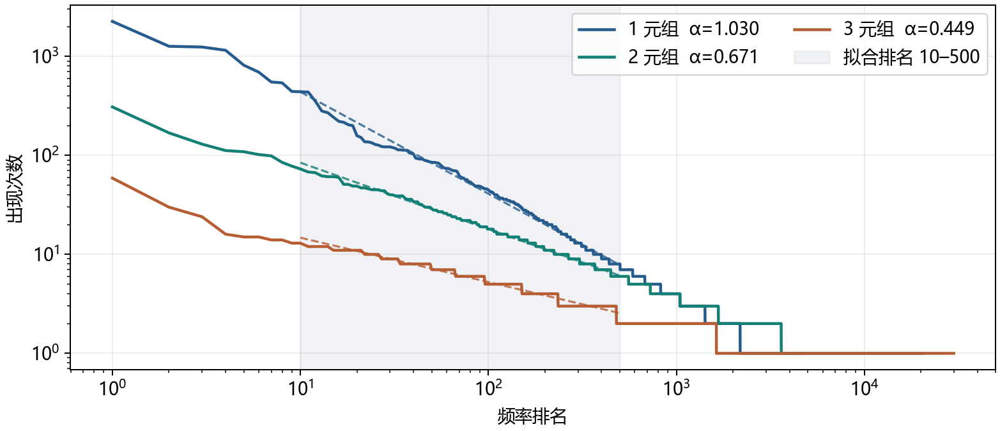
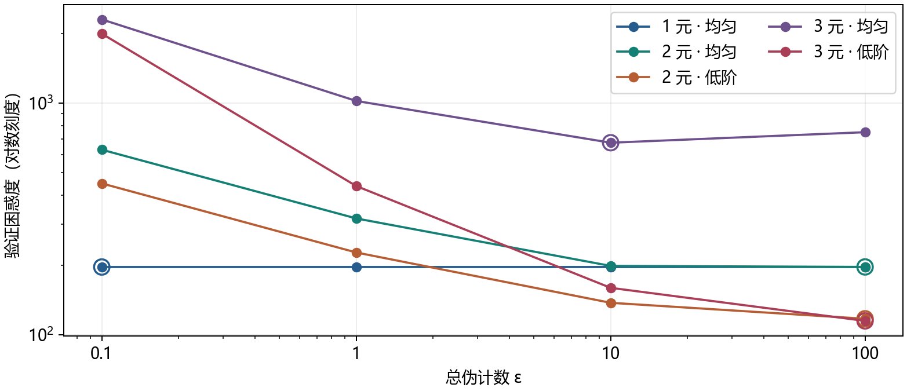
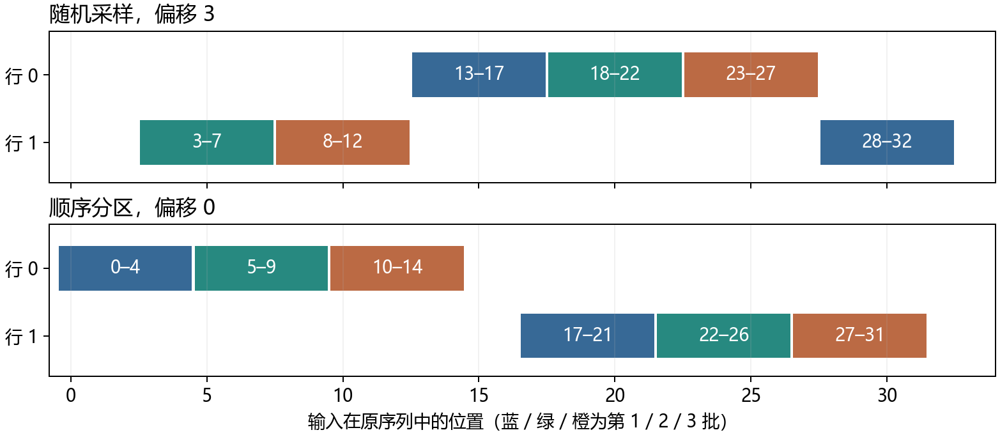
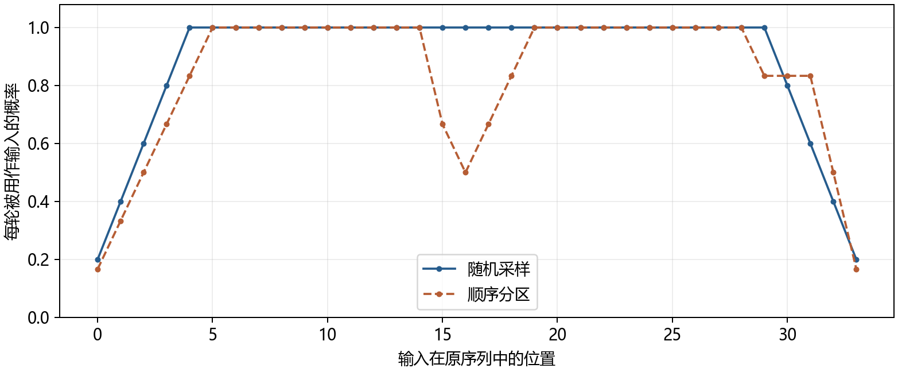
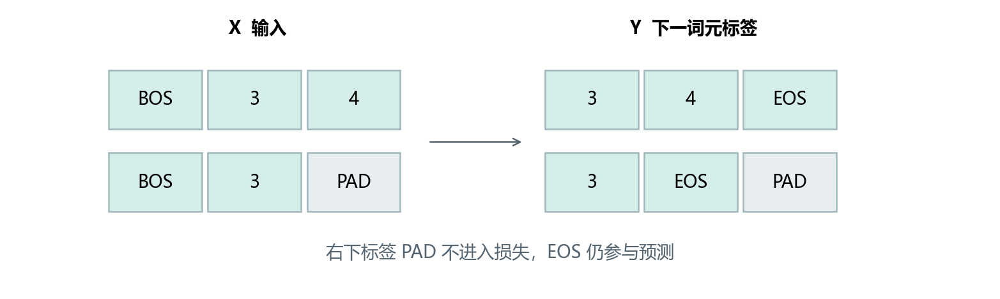

# 8.3 语言模型和数据集

覆盖教材 PDF 321–330、正文 303–312 的 8.3.1 至 8.3.4 和全部六道练习。教材 PDF 第 330 页在 8.4 标题前结束本节。

## 01 上一节的词元怎样成为概率事件

8.2 已把文本变成词元序列和固定的 ID。8.3 在这条序列上提出一个任务。读到「the time」以后，下一词可能是 machine，也可能是 traveller。语言模型给所有候选词元分配概率，再用真正出现的下一个词检验这些概率。

结合 8.1 的链式法则，把整条序列的概率写成 P(x_1)×P(x_2|x_1)×…×P(x_T|x_1,…,x_(T−1))。每个因子都是读到某处时对下一个词元的判断。句长变化时可让模型预测 EOS，序列以这个结束事件收尾。

评分时可以逐项读取真实前缀，衡量模型给真实后继分配的概率。生成时从预测分布取样。将生成的词元追加到前缀，再预测下一项。文本排序、语音转写等应用也可以利用模型为候选文本提供的分数。

<!-- side -->

### 阅读与操作

第1–14页从语言概率、频次和损失讲到分批。第15–19页的五段代码追加到同一文件。第20页复现原书数据，第21页完成八处综合练习，第22页回看教材题。

### 两个实验分别做什么

单词用于全书词频描述与留出段模型评分。字符用于后续循环网络的数据读取器。两种粒度的预测事件不同，各自使用匹配的词表。

<!-- pagebreak -->

## 02 把长历史截成 n 元语法

完整的前缀在增长，直接查表时相同长前缀很少反复出现。n 元模型借用 8.1 的马尔可夫近似，只让最近 n−1 项进入条件概率。n 指整个事件的长度，包括当前要预测的词元。

对四个词 a b c d，一元模型把序列概率近似为 P(a)P(b)P(c)P(d)。二元模型使用 P(a)P(b|a)P(c|b)P(d|c)，每次只看前一项。三元模型可写成 P(a)P(b|a)P(c|a,b)P(d|b,c)，开头历史不足时用低阶分布。

二元模型能区分 machine 在 time 后还是在 the 后。三元还能区分 the time 和 a time 两种前缀。要让很早出现的名字影响句末，仅保留两步历史可能不够。8.4 开始用随时间更新的隐状态表达较长的历史。

<!-- side -->

### 两种边界约定

学习每段的开头时，可以像上面一样用短历史，也可以加 BOS 形成规定长度的历史。多段文本各自计数时，避免把上一段结尾与下一段开头误作相邻事件。

### 和窗口时间步的关系

取批参数 T 控制每批每行有多少输入位置。n 控制一个预测看多少项。这里的三元计数模型与后面 (B,T) 的批形状是两件事，改 T 不会改三元模型。

<!-- pagebreak -->

## 03 从共同出现次数推到条件概率

以训练序列 [0,1,2,0,1,3,0,1,2,3] 为例，从每个还有后继的位置取一对相邻值。上下文 1 的后继有 2、3、2。样本预测分布为 P(2|1)=2/3 和 P(3|1)=1/3，另外两类为0。

一般情况下，把上下文 h 后接 y 的次数记为 C(h,y)，把同一历史后所有候选的次数相加得到 C(h,·)。给定 h 时最大化观测序列的似然，等价于最大化 Σ_y C(h,y) log p(y|h)，在概率和为1的条件下，频率解是 C(h,y)÷C(h,·)。

计算分母时，只能统计有后继的历史。如果一段正好在 h 处结束，这次 h 没有提供一个预测目标。例如对 [1,2,1]，可以构造 (1,2) 和 (2,1)，上下文 1 只有一次有效后继。直接用全部 1 的出现次数做分母会让概率和变成1/2。

<!-- side -->

### 代码怎么取相邻项

二元组可写成 zip(seq[:-1], seq[1:])。第一个切片去掉最后一项，第二个切片跳过第一项。如果序列长 L，二元组共 L−1 个，三元组共 L−2 个。

### 区分零与未定义

历史见过、某个后继未见时，未经平滑的估计给这个后继0。历史自身没有有效后继时，分母为0，这个条件分布没有从数据中估出来。两类情况在报告中分开计数。

<!-- pagebreak -->

## 04 用伪计数补全稀疏事件

对一个条件分布给总量 ε 的伪计数。先选一个已归一化的基分布 q(y)，再令 p(y|h)=(C(h,y)+εq(y))÷(C(h,·)+ε)。对 y 求和，分子恰好是 C(h,·)+ε，所以概率和为1。

可将这个式子看成两个分布的加权平均。观察频率的权重是 C(h,·)÷(C(h,·)+ε)，基分布的权重是 ε÷(C(h,·)+ε)。历史完全未见时退回 q。历史出现越多，直接计数所占权重就越大。

加 k 平滑令 q 均匀，每类加 k，故 ε=kV，V 是词表大小。加一平滑对应 ε=V。教材给出了另一种低阶基分布，一元以均匀作基，二元可用全局一元分布，三元再依赖更低阶统计。

<!-- side -->

### 本实验的低阶设定

本实验用当前历史去掉最早一项后所得的低阶条件分布做 q。三元以对应的二元为基，二元以一元为基。各层共用同一 ε。教材三元式示例用全局概率作基，可以代进同一总伪计数公式。

### 在玩具分布中算一次

V=4，ε=2，每类加0.5。上下文 1 的计数 [0,0,2,1] 变成 [0.5,0.5,2.5,1.5]，分母5，依次得到 [0.1,0.1,0.5,0.3]。

<!-- pagebreak -->

## 05 从联合似然到平均损失和困惑度

连续乘很多小概率会下溢。把概率取自然对数后，由链式法则可把 log P(序列) 写成各步 log p(y|h) 的和。对有效标签取负对数再平均，得到平均负对数似然 L。真正标签的概率越小，对这一项损失的贡献越大。

困惑度 PPL=exp(L)，等于真实标签概率的几何平均数的倒数。模型若总在 V 类中给每类 1/V，困惑度就是 V。理想模型给所有已观察目标概率1，困惑度为1。有任何真实事件概率0时，负对数为无穷，无法得到有限的困惑度。

在第4页的玩具分布上，若真实后继依次为2、3，L=−(ln0.5+ln0.3)/2，PPL=1/√0.15≈2.582。它衡量分布给正确词的信心。例如仍然猜错第一名时，把正确词的概率从0.01提升到0.2，也会降低损失。

<!-- side -->

### 和第3章交叉熵接上

神经网络给每一步输出 V 个 logits。使用交叉熵时，真实类别使用下一词元 ID。F.cross_entropy 内部用稳定方式计算负对数概率。计数模型则已给出概率，可直接算 −log p。

### 比较需要同一评分条件

评分位置、词元化、词表及未知词处理都要对齐。字符 PPL 和单词 PPL 的一步含义不同。跨批平均使用总损失除以有效标签总数。末批与补齐会改变分母。

<!-- pagebreak -->

## 06 在同一语料数一元、二元和三元组

把全书的清洗单词按原序拼接。全书有32,775个单词，产生32,774个二元组和32,773个三元组。单词 the 出现2,261次，排名第10的 my 有440次。最高频二元组 of the 有309次，最高频三元组 the time traveller 有59次。

不同元组的种类数依次为4,579、20,234、29,882。只出现一次的种类数依次为2,397、16,625、28,251，三元组约94.5%的已观测种类只出现一次。越长的组合越难在同一本书里获得稳定的计数。

高频功能词连接分句、表达关系，对语言建模也有用。删除 of、the 等词会改变相邻词关系。教材在本实验保留它们，读者可以对照全书频次。书的排版换行不当作句界，因此此处跨过清洗后的行。

<!-- side -->

### 第1题 估计存储量

若 100,000 指词表含 100,000 种词，四阶稠密计数需要 V+V²+V³+V⁴，约 10^20 个计数槽。条件分母可从对应行求和。若题中的 100,000 是词元总数 L，实际观测种类受窗口数限制。四阶最多 L−3 个，四阶及以下合计最多 4L−6 个。

### 稀疏存储与数据限制

哈希表只保存出现过的组合，可省下空槽。稀疏存储省了空间，未知历史的估计仍需要平滑或共享参数。

<!-- pagebreak -->

## 07 第3题 从双对数图估计齐普夫指数

按频次降序排列词或元组，排名 r 从1开始。齐普夫近似为 f(r)∝r^(−α)，取自然对数后得到 ln f(r)=c−α ln r。在双对数图上拟合直线，可以把斜率取负作为指数估计。



拟合排名10–500时，一元、二元、三元的 α 为1.0297、0.6714、0.4486。改用排名20–1000时，变为1.0503、0.6961、0.4720。后两条曲线的尾部很早到达频次1，拟合结果会受语料规模、排名区间和并列频次影响。

<!-- side -->

### 斜率怎么求

令 u=ln r，v=ln f(r)。用 du、dv 表示它们各自减去均值后的差。斜率为 Σ(du×dv)÷Σ(du²)，指数取相反数。按固定总数归一化频次时，只会改变截距。

### 怎样复核范围

完成版的 book_statistics 调用 rank_fit 两次，指标 JSON 中每个阶数都列出两个区间及 R²。检查 8_3_metrics.json 中 book 下的 fits，比较范围改变后是否仍有同样的指数大小顺序。

<!-- pagebreak -->

## 08 用留出文本对照平滑方式

按原始行顺序切成训练2,576行、验证322行、测试323行。沿用 8.2 的 min_freq=2，仅用训练行建1,869项单词词表，罕见训练词和未登录留出词都落到同一个 <unk>。各段独立展平。验证与测试都从第三个词起评分，分别有3,249和3,139个标签。

每个模型在验证段比较 ε=0.1、1、10、100，按平均负对数似然选值，再用该值计算测试困惑度。每组都在同一批标签上评分。均匀参照若每词概率都为1/1,869，PPL 为1,869。



<!-- side -->

### 看固定协议的结果

选定 ε 后，一元测试188.995，二元均匀185.206、二元低阶109.754，三元均匀651.268、三元低阶108.504。三元均匀给稀疏历史的分配较粗，三元低阶用更有信息的分布补足。

### 为什么保留零频统计

在同一验证段，未经平滑的二元有1,031个真实后继概率0。三元有1,032个历史无支持，加上1,331个在见过的历史下概率0的事件。报告用空值标识整体没有可报告的有限 PPL。

### 结论的适用范围

这是固定书、词表、切分和候选的比较。低阶三元选到了搜索上界100，当前结果只回答这四个候选中哪一个验证损失最低。

<!-- pagebreak -->

## 09 从整条序列得到输入和标签

到这一页把单位换回字符，复用 8.2 的字符 ID。设语料 c 的长度是 L。一个长度 T 的窗口从 s 开始，X=c[s:s+T]，对应 Y=c[s+1:s+T+1]。标签是在同一段原序列上整体右移一位。

有效起点需要 s+T<L，最大 s 为 L−T−1。总共有 L−T 个滑窗起点，若 L≤T 就没有长 T 的完整输入标签对。长语料可切成多个短窗口，一批取 B 个窗口，得到两个 torch.long 张量，形状都是 (B,T)。

ID 值本身可以重复。判断窗口是否相邻应看绝对位置。玩具用了 list(range(35))，此时编号恰好等于位置，容易读出形状和对齐。原书里相同词元可能出现在不同位置。

<!-- side -->

### 动手前先预测

对 0 到34，T=5，从 s=13 开始的 X 是 [13,14,15,16,17]。Y 是 [14,15,16,17,18]。最后一个监督位置需要窗口之外的下一项18，因此只用 X 后移无法构造完整的 Y。

### 读切片边界

Python 的右边界不包含。在第一个长度恰为 T 的切片中，最后一个下标是 s+T−1。末尾的标签下标是 s+T，必须仍小于 L。

<!-- pagebreak -->

## 10 随机采样打乱子序列的次序

按教材在0到 T−1之间均匀抽偏移 o。从 o 出发，每隔 T 个位置切一个完整窗口。候选起点数 q=floor((L−o−1)/T)，其中 floor 表示向下取整。打乱候选列表后每批取 B 个。完整批数为 floor(q/B)。

玩具序列 L=35，T=5，B=2。固定 o=3，候选起点 [3,8,13,18,23,28]。固定洗牌种子8301，首批起点 [13,28]，第二批 [18,3]，第三批 [23,8]。每个窗口内部的字符顺序仍和原序列一致。



<!-- side -->

### 随机的范围

随机来自每轮偏移与候选列表的顺序。固定偏移后，只从这一格点网格上取窗，一批内取到的起点互异。重排批次不会重新排列窗口内的时间。

### 状态怎么处理

个别同行窗口会碰巧在原序列上续接。例如上图随机第1批行0到第2批行0。一般训练时随机模式每批重新初始化隐状态，不能依赖偶然续接。

<!-- pagebreak -->

## 11 顺序分区让相邻批的同一行续接

教材顺序模式的偏移 o 在0到 T之间抽取，包含 T。先预留最后标签，再把可配对长度按 B 条等长流分开。每条流的长度 M=floor((L−o−1)/B)。行 r 从 o+rM 开始。第 j 批在各行的起点加 jT，再取各行的窗口。

L=35、B=2、T=5、o=0 时，M=17。三批的起点分别是 [0,17]、[5,22]、[10,27]。每行相邻两批正好前进5。同一批的两行相隔17，代表不同位置上的序列流。每行末尾2个可配对位置因装不满窗口而丢弃。

这种结构允许循环网络在同一轮相邻批之间沿同一行传递隐状态。切换到下一轮时重置状态。后续训练还要把传递的状态从上一批计算图分离，以限制梯度追踪范围。

<!-- side -->

### 和教材 reshape 对上

教材先按整个连续切片构造 X 与右移一位的 Y，然后各自 reshape 成 (B,M)。逐行取 T 列与这里按起点索引等价。若最后一列被用到，标签仍来自原字符流的下一位置。

### 最后一批的计算

完整批数为 floor(M/T)。原书读取器默认 B=32、T=35、截取10,000字符。固定种子下，顺序和随机都得到8批，每批有1,120个标签。

<!-- pagebreak -->

## 12 第4、5题 轮换偏移之后谁被覆盖

只用同一个偏移时，一些起始位置永远无法作为窗口开头。重新抽偏移能让不同余数类被看到。全局每个位置被用作输入的概率仍受首尾截断、丢弃不满批，以及顺序分区每条流的尾部影响。



随机模式中，给定偏移若有 q 个候选且留下 m=B×floor(q/B) 个，每个候选在均匀洗牌后的保留概率是 m/q。把这个概率按偏移平均，玩具位置0与33都只有0.2，中间许多位置为1。顺序模式还在流的边界附近形成凹陷。

<!-- side -->

### 怎样增加覆盖

可轮换全部余数类，并保留最后一个不足 B 的批。若要枚举每个完整窗口起点，可用步长1产生 L−T 个高度重叠的窗口，再打乱它们。代价是重复计算更多上下文和标签。

### 怎样得到均匀评估

均匀采起点不自动给均匀的标签覆盖。固定评估协议可逐个评分每个目标一次，用该目标之前可用的历史。另一种做法是短尾窗口用补齐与掩码保住边界事件，明确规定跨文档如何处理。

<!-- pagebreak -->

## 13 第2、6题 对话和完整句子怎样取批

用对话训练时，可以给每轮加入说话人标记，并用 EOS 或专门分隔词元标出轮次与对话边界。回复任务可把历史轮次当条件，然后对回复部分计分。训练、验证和测试按对话划分，可以避免同一场对话出现在不同集合里。

完整句子长度往往不一。先在每句内部右移一位形成输入与标签，再补 PAD 到批内最长。下面两句长度分别是3和2个有效预测位置。标签共5个有效元素，求平均损失时排除 PAD 位置。EOS 仍是有效目标。



<!-- side -->

### 句长不同时怎么办

按长度分桶可减少无效补齐。支持变长批的模型可使用打包序列或相应的注意力掩码。多句拼在一批还需确认每句的记忆与下一句隔开。

### 对照实测

玩具句子批忽略 PAD 的平均损失为1.405108，困惑度约4.075966。把补齐也计入时损失为1.439163。即使这个例子只多算一格，评分问题也已改变。

<!-- pagebreak -->

## 14 复用字符读取器及准备模型面向的形状

教材把两种读取方式封装成可迭代加载器。项目入口 load_data_time_machine(B,T,...) 返回加载器和 8.2 的字符词表。调用 iter(loader) 开启一轮，next 得到两个 (B,T) 张量。读取器每轮新选偏移，显式 seed 可重现实验序列。

当前默认使用语料前10,000个字符，保留全书的28项字符词表。B=32，T=35。种子8301为两种模式分别选出偏移14，各有8批，一轮处理8,960个输入位置。对相邻批的224次同行比较，顺序模式全部续接，随机模式碰巧有2次续接。

三元计数实验只对同一份固定单词词表打分。这个字符加载器用在后续神经语言模型中，输出字符输入、字符标签和配套词表。它们一起定义了 8.4 要预测什么以及每批应如何读取。

<!-- side -->

### 编号和行顺序

Y 中的值是字符类别，落在 [0,28) 内。为了算下一词元损失，模型每步应输出28维 logits，且展平后的时间位置顺序要和标签一致。

### 误差常在哪里

改 B、T 或截取长度后，完整批数会变化。读到空迭代器时先核对长度和偏移，至少需要有一个满足规则的完整批。若误把 Y 写成 X，模型学到的是复述输入。

<!-- pagebreak -->

## 15 跟做一 用玩具序列统计转移

在项目根目录打开 PowerShell。先创建 .cache，再在 VS Code 新建 .cache/8_3_follow.py。将下面代码写入，之后第16–19页依次追加。每加一段，从项目根目录重新运行。

```python
from collections import Counter
import math
import random

words = [0, 1, 2, 0, 1, 3, 0, 1, 2, 3]
pairs = list(zip(words[:-1], words[1:]))
counts = Counter(pairs)
totals = Counter(h for h, _ in pairs)
print('pairs:', len(pairs), '1 -> 2:', counts[1, 2])
print('total after 1:', totals[1])
assert sum(totals.values()) == len(pairs)
```

<!-- side -->

### 建目录和运行

```powershell
$env:PYTHONUTF8 = '1'
$py = 'D:/Anaconda/envs/openmmlab/python.exe'
New-Item -ItemType Directory -Force .cache | Out-Null
# 文件保存后运行
& $py .cache/8_3_follow.py
```

### 核对分母

共有9个相邻对。给定1的下一项是2、3、2，所以分母3，(1,2) 的次数是2。若误用所有 3 的出现次数做上下文3的分母，会把最后一个没有后继的3也算进去。

### Python 语法

zip 对齐两个切片，list 把结果保存下来供两个 Counter 重复使用。counts[1, 2] 读取键 (1,2) 的次数。Counter 对缺失键返回0。

<!-- pagebreak -->

## 16 跟做二 平滑后评分

继续在同一个文件追加。先用四类的均匀分布平滑，计算给定1的所有候选概率。再把真实后继2、3的负对数概率取平均。

```python
vocab_size, epsilon = 4, 2.0
history = 1
probs = [(counts[history, y] + epsilon / vocab_size)
         / (totals[history] + epsilon)
         for y in range(vocab_size)]
labels = [2, 3]
loss = sum(-math.log(probs[y]) for y in labels) / len(labels)
print('probs:', probs, 'sum:', sum(probs))
print('loss / PPL:', f'{loss:.6f}', f'{math.exp(loss):.6f}')
assert math.isclose(sum(probs), 1.0)
```

<!-- side -->

### 对照输出

概率 [0.1,0.1,0.5,0.3]，和为1。平均损失约0.948560，困惑度约2.581989。对照第4、5页手算结果，确认 ε 是四个候选加起来的总量。

### 改一个参数

临时改 ε 为4，再运行。每类增加1，给定1的分母为7，分布变成 [1/7,1/7,3/7,2/7]。这两次评分的困惑度变为 7/√6≈2.857738。观察完恢复2。

<!-- pagebreak -->

## 17 跟做三 切窗并随机取批

追加代码。使用 0 到34 的序列，固定偏移3，按 T=5 切窗口。先打印洗牌前起点，再取首批并验证时间位移。

```python
import torch


def take(starts, sequence, steps):
    x = [sequence[s:s+steps] for s in starts]
    y = [sequence[s+1:s+steps+1] for s in starts]
    return torch.tensor(x), torch.tensor(y)


seq = list(range(35))
batch_size, steps, offset = 2, 5, 3
q = (len(seq) - offset - 1) // steps
starts = list(range(offset, offset + q * steps, steps))
print('candidates:', starts)
random.Random(8301).shuffle(starts)
rx, ry = take(starts[:batch_size], seq, steps)
print('random:', starts[:batch_size], tuple(rx.shape))
print('first row X / Y:', rx[0].tolist(), ry[0].tolist())
assert torch.equal(rx[:, 1:], ry[:, :-1])
```

<!-- side -->

### 预期首批

洗牌前 [3,8,13,18,23,28]，洗牌后首批 [13,28]。第0行 X=[13,14,15,16,17]，Y=[14,15,16,17,18]。两个张量形状都是 (2,5)。

### 改一个参数

把这段里的 batch_size 改为3，一共有2个完整批，首批形状 (3,5)。起点集合、洗牌顺序和窗内时间顺序都保持一致。做完对照把批量大小恢复为2。

<!-- pagebreak -->

## 18 跟做四 核对顺序分区的跨批连续性

继续追加代码。用固定偏移0构造两条流，复用上一页函数取 X、Y。打印每一批的两行起点，并检查第2批输入开头等于第1批每行标签的最后一项。

```python
seq_offset = 0
lane = (len(seq) - seq_offset - 1) // batch_size
lane_starts = [seq_offset + r * lane for r in range(batch_size)]
groups = [[s + t for s in lane_starts]
          for t in range(0, lane // steps * steps, steps)]
x0, y0 = take(groups[0], seq, steps)
x1, y1 = take(groups[1], seq, steps)
print('sequential:', groups, 'lane:', lane)
assert torch.equal(y0[:, -1], x1[:, 0])
```

<!-- side -->

### 预期顺序

起点依次为 [0,17]、[5,22]、[10,27]。行1在首批从17开始，在第二批从22开始。每行步长5，轮内可用这种对齐传递状态。

### 改一个参数

把这段的 seq_offset 改成1，lane 从17降到16。前两批起点分别变为 [1,17] 和 [6,22]。边界变了，同行跨批接续仍成立。恢复0保留默认对照。

<!-- pagebreak -->

## 19 跟做五 对完整句子批掩码评分

追加最后一段。0 作 PAD、1 作 BOS、2 作 EOS。为便于独立核对，给正确类3的两个时间位置加 ln2，其余 logits 都是0。用 ignore_index 将句尾补齐从损失移出。

```python
import torch.nn.functional as F

sx = torch.tensor([[1, 3, 4], [1, 3, 0]])
sy = torch.tensor([[3, 4, 2], [3, 2, 0]])
logits = torch.zeros(2, 3, 5, dtype=torch.float64)
logits[:, 0, 3] = math.log(2)
loss = F.cross_entropy(logits.reshape(-1, 5),
                       sy.reshape(-1), ignore_index=0)
print('sentence shape:', tuple(sx.shape), 'valid:', int(sy.ne(0).sum()))
print('masked loss / PPL:', f'{loss:.6f}', f'{math.exp(loss):.6f}')
```

<!-- side -->

### 核对形状和输出

logits 原形状 (2,3,5)，reshape 后为 (6,5)，标签为 (6,)。有效标签5个，平均损失约1.405108、困惑度4.075966。两格对词3的概率为2/6，其余三个有效标签各为1/5。

### 改一个参数

临时移除交叉熵调用中的 ignore_index=0。补齐将作为第六个类别0标签参加评分，得到约1.439163的平均损失。恢复掩码参数后再比较实验结果。

<!-- pagebreak -->

## 20 在《时光机器》复现实验

在项目根目录运行。若缺 data/timemachine.txt，给第一条演示命令加 --download。脚本复用 8.2 的下载校验和字符词表。

```powershell
$env:PYTHONUTF8 = '1'
$py = 'D:/Anaconda/envs/openmmlab/python.exe'
$demo = 'lessons/ch08/03_language_models.py'
& $py $demo --guided --record
& $py $demo --guided --batch-size 8 --num-steps 12 --max-tokens 1000
& $py tools/build_language_model_figures.py
& $py tools/verify_language_models.py
```

默认输出三阶的总数、种类数和指数，随后打印五组验证与测试 PPL。字符部分显示 (32,35)、两个偏移14、各8批。指标文件 reports/ch08/8_3_metrics.json 带有全量排名频次、候选分数和批首例。

<!-- side -->

### 检查字符参数

对照命令将语料截到1000字符并使用 (8,12)。预期两种模式各10批、各960个输入位置。偏移分别为3和12，顺序仍达到72/72的同行续接。单词模型的数据切分与评分保持同一实验配置。

### 检查生成和验证

图由 tools/build_language_model_figures.py 读取默认指标并生成。核对工具独立重算计数、分布和取批位置。参数对照省略 --record，保留完整默认报告。

<!-- pagebreak -->

## 21 综合练习 用计数和采样接成程序

打开 exercises/ch08/03_language_models.py。先补 TODO 1–2 统计相邻事件和有后继的历史，再补 TODO 3–4 平滑并计算损失。随后补 TODO 5–7。求随机起点和对应的 X 与 Y。最后一处 TODO 求顺序分区的第二批。

```powershell
& $py exercises/ch08/03_language_models.py
```

每完成一组就运行。最后的预期输出为概率 [0.1,0.1,0.5,0.3]、困惑度2.581989、随机首批起点 [13,28]、顺序第二批 [5,22]。若断言未过，先打印形成该断言的中间量。

<!-- side -->

### 建议反馈三处

解释为什么 (1,2) 是2次而分母是3。说明为什么算候选窗口前要给最后一个标签留位置。最后比较两种取批在何时能将上一批的行状态直接传下去。

### 常见排错

概率和不为1，检查 ε 是否只在分母加一次。窗口少一位时，查看切片右端是否包含最后一个标签。改种子时，随机首批起点变化属于预期结果，先恢复8301再运行固定断言。

<!-- pagebreak -->

## 22 回看教材六题与下一节

1. 第6页区分词表大小与词元总数，并给出四阶计数的稠密和稀疏上界。
2. 第13页按说话人、轮次标记和目标掩码组织对话，数据切分以会话为单位。
3. 第7页估计三个齐普夫指数，并更换拟合区间核对。
4. 第12页用重叠滑窗、轮换偏移和补齐短尾讨论其他读取办法。
5. 第12页解释为什么随机偏移扩大覆盖，同时计算端点和流边界的实际概率。
6. 第13、19页展示句子长度不同怎样补齐，并用五个有效标签计算损失。

<!-- side -->

### 接到 8.4

本节用计数组合给出条件概率，也产出了形状清楚的字符批。下一节把每个时间步的历史压入可学习的隐状态，用当前词元更新它，再输出下一个字符的分数。

### 教材定位

8.4「循环神经网络」始于教材 PDF 第330页、正文第312页。
